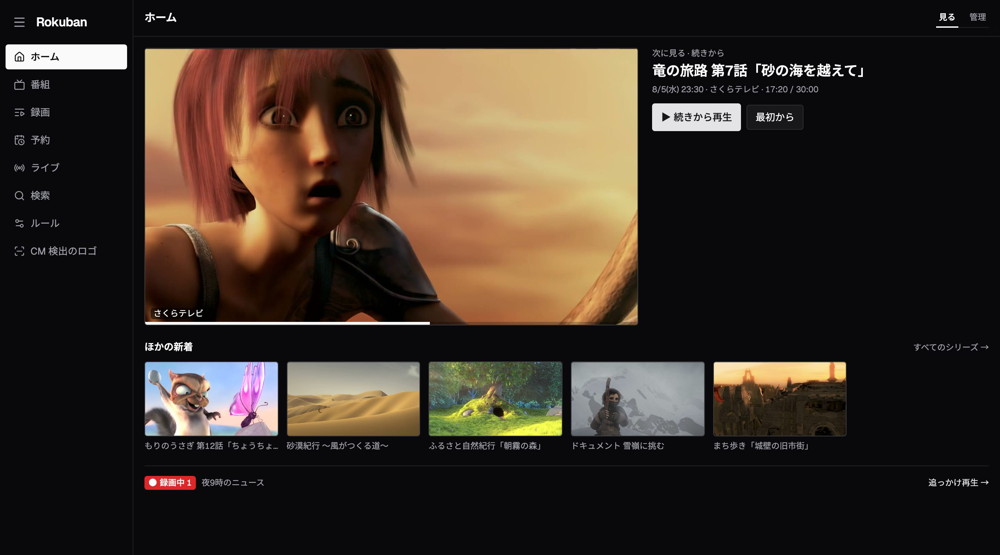
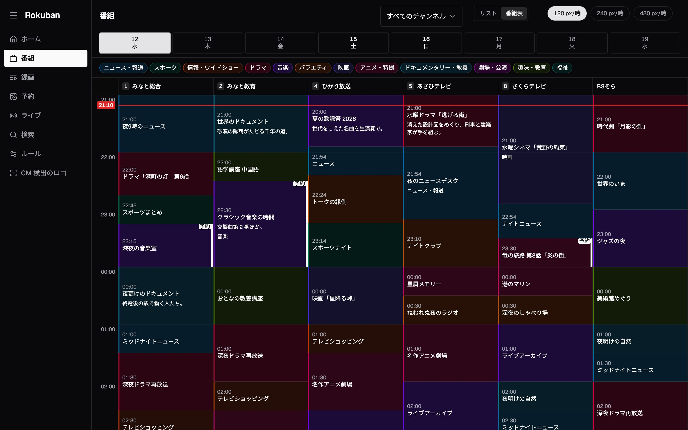
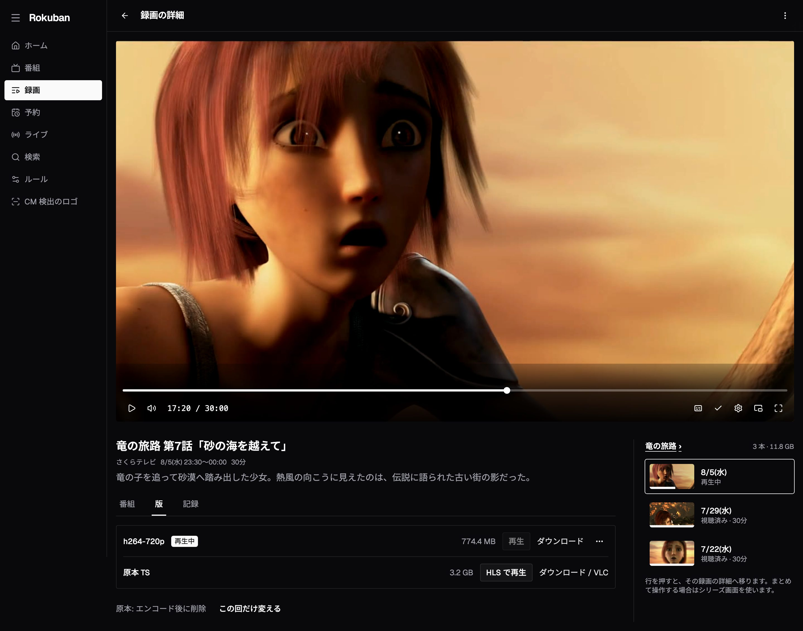
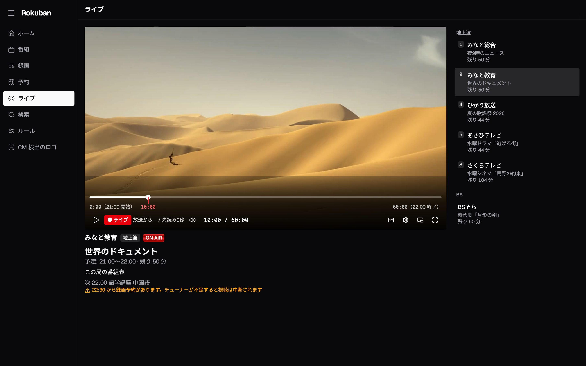
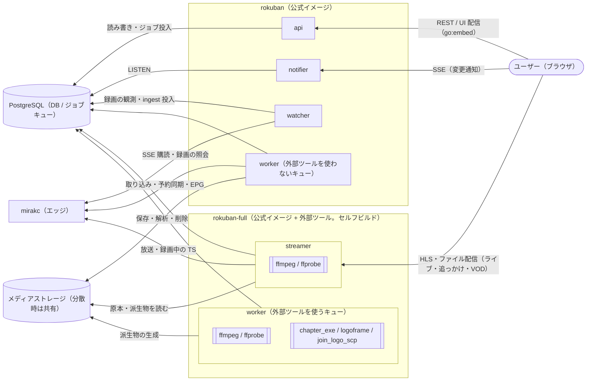

# Rokuban

クラウドネイティブに設計された録画サーバー。

EPGStation の漸進的改善ではなく、ゼロベースで再設計する。EPGStation は単一ホスト構成で動作する一方、Node.js IPC によるプロセス結合、プロセス内のエンコード待ち行列・実行管理、共有ファイルシステム前提、シングルライター前提を持つ。これらはホストをまたぐプロセス分割や複数レプリカへの水平スケールに制約を与える。状態の永続化を含む比較の範囲は [全体アーキテクチャ](docs/overview.md) の「背景」を参照。

## 画面



| 番組表 | 録画の再生 |
|---|---|
|  |  |

| ライブ視聴 | スマホ |
|---|---|
|  |  |

画面の局と番組は架空のもので、映像の作品とは関係がない。
映像は次の 2 作品の予告編から静止画を切り出し、16:9 に切り抜いて縮小したものである。
どちらも [CC BY 3.0](https://creativecommons.org/licenses/by/3.0/) で公開されている。

- [Sintel](https://durian.blender.org/): © copyright Blender Foundation | durian.blender.org
- [Big Buck Bunny](https://peach.blender.org/): (c) copyright 2008, Blender Foundation / www.bigbuckbunny.org

撮り直す手順は [web/e2e/README.md](web/e2e/README.md) の「README のスクリーンショット」にある。

## 基本方針

- 録画の実行は mirakc に全面委譲。Rokuban は TS パケットを触らず、オーケストレーションと I/O に徹する
- Go 単一バイナリ。monolithic mode（自宅 1 プロセス）と distributed mode（k8s ロール分割）を最初から設計に組み込む
- アプリケーションの DB / ジョブキュー基盤は PostgreSQL 一本。Redis やメッセージブローカーを置かない
- レベルトリガー・crash-only・冪等を設計原則とする

## 構成図



ここでいう PostgreSQL 一本は、Rokuban のアプリケーション DB とジョブキューに限る。システム全体では、mirakc が予約と録画バッファを保持し、Rokuban は原本・派生物を置くメディアストレージにも依存する。

## 使ってみる

既存の mirakc（EPGStation と共有可）に繋いで動かせる。

```sh
cp .env.example .env
$EDITOR .env          # MIRAKC_URL と POSTGRES_PASSWORD は必須
docker compose up -d  # 初回は公式イメージに ffmpeg を積んだ rokuban:full をローカルビルドする
```

`http://localhost:40773` で UI が開く。手順と確認項目は
[docs/runbook.md](docs/runbook.md) を参照。

## ドキュメント

### 使う人向け

| ドキュメント | 内容 |
|---|---|
| [docs/configuration.md](docs/configuration.md) | 設定 |
| [docs/operations.md](docs/operations.md) | 運用 |
| [docs/runbook.md](docs/runbook.md) | 手動での動作確認手順 |

### 開発する人向け

| ドキュメント | 内容 |
|---|---|
| [docs/overview.md](docs/overview.md) | 全体アーキテクチャ |
| [docs/recording.md](docs/recording.md) | 録画エンジン |
| [docs/schema.md](docs/schema.md) | DB スキーマ |
| [docs/data.md](docs/data.md) | データ層 |
| [docs/storage.md](docs/storage.md) | メディアストレージ |
| [docs/api.md](docs/api.md) | API 設計 |
| [docs/frontend.md](docs/frontend.md) | フロントエンド |

大きい文書は索引と分割本文で構成する。節番号・節名は分割前のままなので、
コードコメントの「recording.md §3.2」などは索引から該当ファイルを引ける。

## ステータス

番組表の閲覧、ルールによる自動予約、録画、録画の再生といった中核機能に加え、
エンコード・サムネイル生成・自動削除・EPGStation からの移行・ライブ視聴・
k8s でのロール分割デプロイまで動作する。
開発中なのはハイブリッド / サーバーレス構成、クラウドストレージ、
ホームとライブラリ（見返す）面など。開発の詳細な進捗は [CLAUDE.md](CLAUDE.md) と GitHub issue を参照。

## ライセンス

Rokuban の独自コードは [MIT License](LICENSE) で提供する。公式バイナリと
`web/dist` に含まれる依存ライブラリ・フォントの著作権表示とライセンス全文は
[`THIRD_PARTY_NOTICES`](THIRD_PARTY_NOTICES) にまとめている。依存元の変更後は
`npm run third-party-notices` で更新し、`npm run third-party-notices -- --check` で
生成漏れを検査できる。
