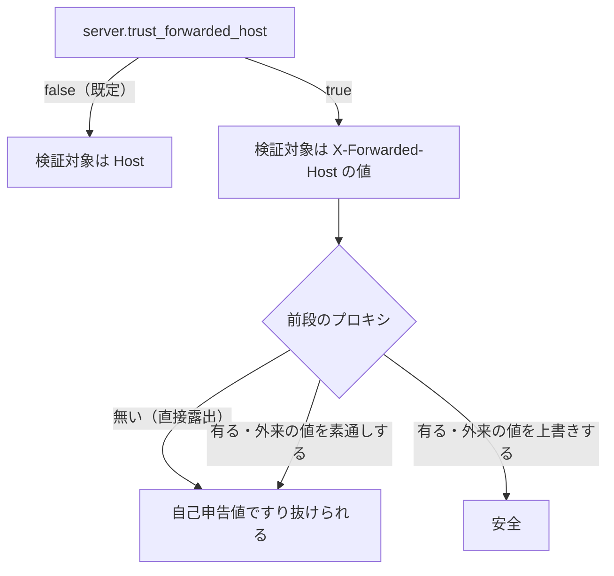

> [docs/api.md](../api.md)（索引）の分割本文。認証・リバースプロキシ・nginx・プロトコル選定。

## 認証: アプリ内に持たない

**Rokuban はアプリ内に認証・認可機構を一切持たない。認証が必要な構成ではリバースプロキシに委譲する。**

### 根拠: 法的制約がスコープを決める

認証を作り込む理由は法的に存在しないので作らない。録画が適法なのは私的使用の範囲に限られ、Rokuban は構造的に単一世帯用アプリである。

これは技術的な簡略化とは見なさず、スコープの問題として考える。日本の著作権法では、放送の録画が適法なのは私的使用（30 条）の範囲内である。世帯外に視聴させる形態は複製権・公衆送信権（送信可能化権）に抵触しうる（まねきTV / ロクラクII 最判 2011 が示した通り、機器・サービスを介した「公衆」向け提供は事業者側の侵害とされた）。

つまり **Rokuban は構造的に単一世帯用アプリ**であり、次は将来も含めてスコープ外である。

- ユーザーアカウント / マルチテナント
- 共有リンク・外部公開機能
- ユーザー単位の権限・認可

### 帰結

アプリはユーザーという概念を持たず、状態は世帯全体で共有する。認証が要る構成はリバースプロキシに委ね、アプリに残るセキュリティ要件は Host ヘッダー検証だけである。

1. ユーザーという概念を持たない。user テーブルなし、API に authn/authz 層なし。視聴履歴・再生位置などの状態は世帯グローバル
2. リモートアクセスは私的使用の範囲で構成側が保証する。推奨は VPN / Tailscale。公開インターネット経由ならリバースプロキシで TLS + Basic 認証（や Authelia 等）。リバースプロキシ・フレンドリー要件がそのまま当てはまる
3. **アプリ内に残る唯一のセキュリティ要件は Host ヘッダー検証。** 認証なしの LAN アプリでは DNS rebinding が定番の穴である。DNS rebinding とは、悪意あるサイトが攻撃者ドメインを LAN アドレスに解決させ、ブラウザ経由で API を叩き放題にする攻撃である。許可 Host の allowlist 検証だけはアプリ側で持つ。Cookie 認証を持たないので CSRF は構造的にほぼ無関係
4. ドキュメントで明示する。「インターネットに直接露出させない」「認証が要る構成の nginx 例」を同梱構成例に含める

## リバースプロキシ・フレンドリー要件

Rokuban は TLS や認証を抱え込まず、リバースプロキシの背後で支障なく動くことを要件にする。このジャンルのアプリ（EPGStation 含む）は認証・TLS をリバースプロキシに委ねるのが慣習で、真面目な公開構成では nginx / Caddy / k8s Ingress がどのみち前段に居る。

### 要件一覧

単一ホスト名で api・notifier・streamer を分けるときは、標準 Ingress の機能だけで全経路の振り分け先が決まることを判定基準にする。そのほか、プロキシ越しでも動くようルート相対パスや WebSocket 不使用などを要件にし、X-Forwarded-Host は明示した構成に限って信頼する。

#### 経路の振り分け

標準 Ingress の完全一致またはパス要素単位の接頭辞だけで、全経路の backend が一意に決まるようにする。メソッド・クエリ・ヘッダー・正規表現には依存しない。

使う一致方式は、完全一致の `Exact` とパス要素単位の `Prefix` だけである。

| 経路 | Ingress での振り分け |
|---|---|
| SSE | `/api/events` を Exact で notifier へ送る |
| ライブ配信 | site を含む `/api/sites/<site>/networks` の Prefix で site streamer へ送る |
| 録画の派生物（encoded・サムネイル・シークタイル） | 固定接頭辞 `/api/media/recordings` で streamer へ送る |
| 原本のファイルとコマ | 置き場ごとの `/api/media/stores/<store>` Prefix で、その置き場をマウントした streamer へ送る |
| 世代付き録画 HLS | 同じ `/api/media/stores/<store>` Prefix で、その置き場の `rokuban-recording-hls` へ送る |

録画 VOD は、`{id}` の後ろで api と streamer が分かれる `/api/recordings/{id}/...` を使わず、応答の性質を示す固定接頭辞で送る。

#### そのほかの要件

プロキシ越しでも動くよう、パスはルート相対にして WebSocket は使わず、SPA のフォールバックはアプリが返す。X-Forwarded-Host は opt-in にし、keep-alive 付きのプロキシはアイドルタイムアウトをサーバー以下にする。

| 要件 | 内容 |
|---|---|
| `X-Forwarded-Host` の解釈 | opt-in（既定は信頼しない） |
| ルート相対パスの徹底 | API・アセット参照は `/api/...` |
| WebSocket 不使用 | SSE は `proxy_buffering off` だけで通る |
| SPA フォールバック | Go 側の catch-all で `index.html` を返す |
| keep-alive アイドル接続の上限 | サーバー側は 120 秒 |

API・アセット参照はすべてドメインを含まないルート相対パスにする。SSE は `proxy_buffering off` だけで通るので、WebSocket のアップグレード要件を持ち込まない。

#### X-Forwarded-Host の扱い

転送されたホスト名の解釈は opt-in にし、信頼できるプロキシが必ず前段に居り、外来の X-Forwarded-Host を上書きする構成でだけ有効にする。直接露出する構成で無条件に信頼すると、Host の検証を自己申告値ですり抜けられてしまう。

`server.trust_forwarded_host: true` を明示した構成に限り、Host allowlist の検証対象をヘッダーの値に切り替える。既定（false）では常に `Host` を使う。

この opt-in は `server.trust_forwarded_host` で切り替え、既定は false である。DNS rebinding の攻撃ページは Rokuban と同一オリジンとして扱われるため、任意のリクエストヘッダーを付けられる。前段にプロキシが存在しない直接露出構成（`--all` の既定構成）でこのヘッダーを無条件に信頼すると、Host allowlist（§認証 帰結3）を自己申告値ですり抜けられてしまう。信頼できるプロキシが必ず前段に居り、かつそのプロキシが外来の `X-Forwarded-Host` を上書きする構成でだけ有効にする。判断の詳細と設定キーは [configuration.md](../configuration.md) §server.allowed_hosts を参照。

#### keep-alive のアイドル接続

upstream keep-alive を有効にしているプロキシでは、プロキシ側のアイドルタイムアウトをサーバーの 120 秒以下に揃える。長く取ると、プロキシがまだ生きていると思っている接続をサーバー側が先に切る。

サーバー自身が 120 秒でリクエスト間のアイドル接続を切る。**upstream keep-alive を有効にしているプロキシ構成では**、プロキシ側のアイドルタイムアウトを 120 秒以下に揃える。nginx なら `upstream` ブロックに `keepalive N` を書いた場合が該当する。書かなければ upstream には都度 `Connection: close` で繋ぐので無関係である。

根拠

- サーバー自身のアイドル接続の切断: `IdleTimeout`（120 秒。要件の表の行も同じ）

### 検討したが実装しないもの

X-Forwarded-For は解釈せず、X-Forwarded-Proto・X-Forwarded-Prefix・絶対 URL ビルダー（public_url）も実装しない。出力先も使い手も無いコードを先回りで作らないためである。アクセスログを新設するときやサブパス配信が必要になったときに、再検討する。

`X-Forwarded-For` は解釈しない。認証・レート制限・認可は持たない（本ファイル §認証）ので、なりすまされても実害はアクセスログの精度が落ちるだけである。しかしそのアクセスログ機構自体が存在しない（リクエスト単位のログが無い）。出力先の無いヘッダー解釈は意味を持たないコードになるため、アクセスログを新設する機会があれば再検討する。

`X-Forwarded-Proto` / `X-Forwarded-Prefix` / `public_url`（絶対 URL ビルダー）は実装しない。API はルート相対パス `/api/*` を使う。webhook の payload に URL は載らない（[rest.md](rest.md) §エンドポイント設計の規約、[configuration.md](../configuration.md) §webhook）。Go と TS の棚卸しでは絶対 URL の生成箇所が見つからなかった。使い手の無いビルダーは先回りで作らない。サブパス配信が必要になったら棚卸しからやり直す。

### 単一バイナリの自己完結は維持

nginx を置かなくても全機能が動く、単一バイナリの自己完結を維持する。nginx は推奨デプロイパターンの一部で、アーキテクチャ図に現れる箱とは扱わない。

`--all` で nginx なしでも全機能動作する。ミニ PC にコンポーネントを増やさないという基本方針を変えない（参照: [overview.md](../overview.md) の monolithic mode）。構成図は変更なしで、nginx は HTTP 層の設計要件として現れる。

根拠

- Host allowlist の検証先: `internal/api.AllowedHosts`
- リクエスト単位のアクセスログ: `internal/api`
- 絶対 URL の棚卸し対象: `internal/api` / `internal/streamer` / `internal/notifier` / `internal/webhook` / `web/src`
- 出力先の無い解釈を作らない: 不変条件 10
- 使うコードが無い段階では形を作らない: 不変条件 11

## nginx リファレンス構成

同梱の nginx 構成は、TLS 終端・認証・録画ファイル配信の委譲・SSE の設定を含む推奨構成である。Caddy / k8s Ingress / Cloudflare Access 等でも同等の構成が可能である。

実ファイルの構成例を [`deploy/nginx/nginx.conf`](../../deploy/nginx/nginx.conf) に同梱する。ホスト名・upstream・証明書・認証ファイルのパスだけを環境に合わせて変更し、Rokuban の埋め込み SPA と録画ディレクトリを nginx へ read-only で渡す。カバーする構成は次の通り。

- TLS 終端 + Let's Encrypt
- Basic 認証（または Authelia 等の外部認証連携）
- X-Accel-Redirect で録画ファイル配信のバイト転送を nginx に委譲
- SSE 設定: `proxy_buffering off` + タイムアウト調整
- SPA は proxy するだけ。SPA はバイナリに go:embed 済みなので、nginx は配らずアプリへ委ねる

実機での確認は [nginx runbook](../runbook/nginx.md) にまとめる。

## プロトコル選定の根拠

API は REST + OpenAPI、通知は SSE を選ぶ。GraphQL・tRPC・Connect-RPC と、WebSocket・Socket.IO は選ばない。

### REST + OpenAPI を選び、GraphQL / tRPC / Connect-RPC を選ばない理由

tRPC は Go なので使えず、GraphQL の自由度は自前の SPA 一つには要らず、Connect-RPC は HTTP キャッシュ・curl でのデバッグ・HLS との統一感で REST に劣る。型安全性は OpenAPI とコード生成で実用上同水準に確保できる。

| 選択肢 | 判断 |
|---|---|
| tRPC | 選外 |
| GraphQL | 不採用 |
| Connect-RPC / gRPC-web | 不採用 |
| REST + コード生成 | 採用 |

tRPC はバックエンドが TypeScript であることが前提で、Go なので使えない。

GraphQL は、クライアントが多様でクエリの形が予測できない場合に効く道具である。このアプリのクライアントは自前の SPA 一つで、必要なクエリの形はすべて既知なので、導入コスト（スキーマ・リゾルバ・キャッシュ層）に見合う自由度の需要がない。

Connect-RPC / gRPC-web は型安全性が魅力だが、HTTP セマンティクスによるキャッシュ、curl で叩けるデバッグ容易性、HLS 配信との統一感で素の REST のほうが優れる。

REST + コード生成は、型安全性を OpenAPI + orval / oapi-codegen で実用上同水準に確保できるので採用する。

### SSE を選び、WebSocket / Socket.IO を選ばない理由

SSE を選ぶのは、再接続処理が対称になり、notifier の水平スケールに Redis アダプタが要らず、プロキシ設定も単純で済むためである。クライアントからサーバーへの継続的プッシュが要る場面は無い。

mirakc と同じ「接続時に現在状態を再送し、以降差分」という設計に揃えることで、クライアントの再接続処理が対称的になる。notifier ロールの水平スケールで Redis アダプタが不要になる。

リバースプロキシの設定が `proxy_buffering off` だけで済む（WebSocket のアップグレードハンドシェイクが不要）。このアプリにクライアントからサーバーへの継続的プッシュが必要な場面は存在しない。
