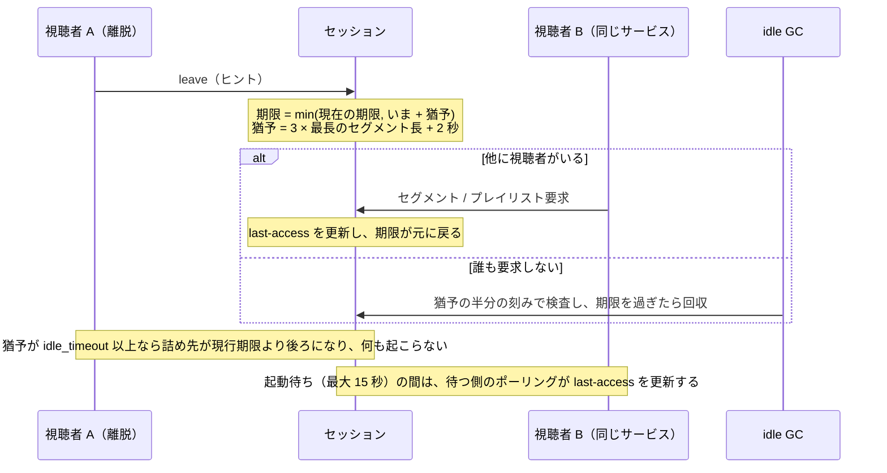
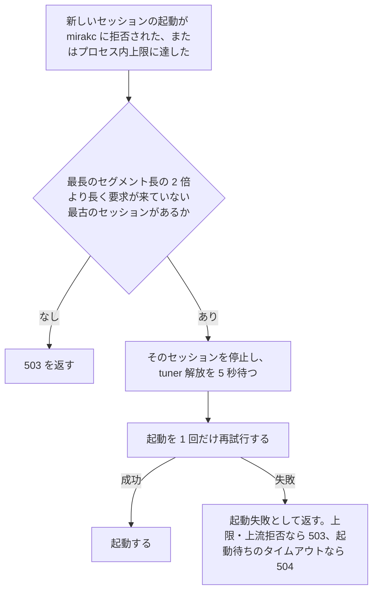
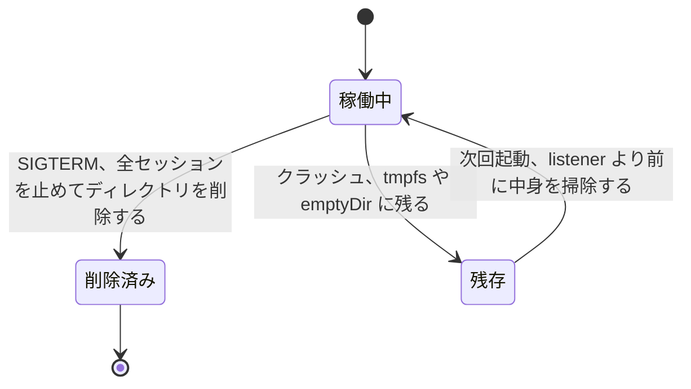

> [media.md](../media.md) のライブ HLS。索引から辿る

### ライブ視聴の HLS --- 既定はアプリ配信

ライブの HLS は、streamer ロールのアプリが配信する。セグメント要求がアプリを通ると、クライアントの生存が無料で分かり、使われなくなった ffmpeg を止める idle GC が成り立つからである。遅延を目標にする構成では、パッケージングと生存判定をまとめて外の packager に移す。

#### 配信するもの

プレイリストの入口は常に master playlist で、音声 rendition を 3 本含む。字幕を無効にすると、master は要求したプロファイルだけを載せる。有効にすると、全プロファイルと字幕を 1 つの master にまとめる。

`playlist.m3u8` は、音声 rendition 3 本（下記 §音声）を含む。`live.captions: false`（既定）では `?profile=` のプロファイルだけの master を返す。`true` のときは全プロファイルを 1 つの master にまとめ、ffmpeg の `libaribcaption` で変換した WebVTT 字幕 rendition も含む。variant / 字幕 playlist と `.ts` / `.vtt` セグメントは、同じサービス URL の下で配信する。hls.js は字幕 rendition を字幕トグルとして表示する。VOD とライブのどちらも、TS/PES を Rokuban が読むことはない。

#### アプリ配信を既定にする理由

インメモリの使い捨てのセッションには、クライアントがいなくなったら ffmpeg を止める idle GC が要る。アプリ経由でセグメントを配れば last-access が無料で取れるが、nginx が直接配るとアプリは生存を見失う。

ライブセッションがインメモリの使い捨てなのは、全体アーキテクチャの crash-only の例外である。nginx が scratch から直接配る形でも、`auth_request` やログ監視で回収はできる。しかしセグメントは数 MB で転送負荷が軽く、複雑さに見合わない。そのため**既定は streamer ロールのアプリ配信のまま**とする。遅延を目標にする構成では、パッケージングと生存判定をまとめて外の packager に移す（下記「パッケージャは MediaMTX の LL-HLS を選べる形にする」）。

#### 無効時の応答

ライブを無効にすると、ライブのルートは登録されず、JSON の 404 を返す。SPA のフォールバックには落とさない。

対象は `live.enabled: false` のときの、これらのライブのルートである（[rest.md](../rest.md)「機能の有効/無効は能力 API で観測する」）。落とすと「無い」が HTML の 200 になり、probe するクライアントが成功と誤認する。入口そのものを出さない判断は `GET /api/capabilities` 側にある。

#### 遅延の目標は置かない --- `segment_seconds` を短くしても縮まない

アプリ配信の経路では、ライブの glass-to-glass 遅延を目標値にしない。セグメントを短くしても遅延の改善は小さく、4 秒に届かない。代わりに再生の途切れ（stall）とフレーム落ちが大きく増えるからである。

実クラスタ・実チューナー・実ブラウザで 2 秒と 1 秒のセグメント長を比べても、遅延の改善は 6.2 秒 → 5.0 秒どまりである。4 秒には届かない。代わりに 30 分あたりの stall は 3 回 → 454 回、dropped frames は 0.006% → 2.1% になった。

セグメントの公開間隔そのものが揺らぐので、`segment_seconds` は遅延の目標値にならない。実測では p95 が 2.3 秒 → 3.6 秒、最大が 4.7 秒 → 10.2 秒へ広がった。プレイヤーはライブ端より数本後ろから開始するので、公開の揺らぎはそのままバッファ不足による再生停止になる。**短くするほど遅延が縮むという関係は、ここには無い。**

1 秒級を狙うとき、セグメントをさらに短くする案は採らない。1 秒台に届かず、再生が途切れるためである。代わりにパッケージャを替える（下記「パッケージャは MediaMTX の LL-HLS を選べる形にする」）。

この値はセグメントの公開端とプレイヤーの latency からの導出値である。放送時刻を映像に焼き込んだ比較ではない（ffmpeg の再 mux で TDT/TOT が落ちるため）。したがって「放送から 6.2 秒」と断言はしない。測定の条件と経路ごとの内訳は [frontend/live/metrics.md](../../frontend/live/metrics.md) §「遅延・バッファの計器」に置く。

#### パッケージャは MediaMTX の LL-HLS を選べる形にする

遅延を目標にする構成では、パッケージングと生存判定をまとめて MediaMTX の LL-HLS に移す。必須にはせず、無くても現行のアプリ配信で動く形にする。

##### 遅延と途切れの実測

遅延は約 1 秒まで縮み、stall と dropped frames は増えた。増えた分のどこまでが MediaMTX に由来するかは未検証である。

実測（同一局・720p・視聴者 1・30 分・実 Chrome + hls.js）では、アプリ配信（`segment_seconds: 2`）の `hls.latency` 中央値は 5.68 秒だった（上記の 6.2 秒とは別の測定）。MediaMTX v1.21.1 の LL-HLS（part 200ms / segment 1s）は 0.92 秒（p95 2.15 秒）である。セグメント長を詰めても 1 秒台には入らない（上記）ので、パッケージャを替える以外に手段が無い。試作は `-tune zerolatency` を含むが、その寄与は高々 0.1〜0.3 秒で、差の大半は part による部分公開に由来する。

同じ 30 分で stall は 1 回 → 15 回、dropped frames は 0 → 0.14% だった。試作側は WAN 越しの port-forward・ソフトウェアエンコード・part 単位の取得（24 req/s）という条件の差を含む。差のどこまでが MediaMTX に由来するかは未検証である。

##### 起動の形

MediaMTX の設定テンプレートには、mirakc の知識を置かない。rokuban のコマンドを起動させる形にすれば、無くても動く位置づけにできる。

ここでいう知識は、合成 service id と URL の組み立てである。`runOnDemand` が rokuban のコマンドを起動する形にすれば、`live.enabled` と同じ位置づけ（無くても現行のアプリ配信で動く）にできる。

##### 生存判定の移り先

アプリ配信の根拠は、セグメント要求がアプリを通れば生存判定が無料で手に入ることだった（上記）。MediaMTX に移すと生存判定も MediaMTX の HLS セッションの inactive 判定に移るので、その根拠とは衝突しない。代わりに離脱ヒントが機能しなくなる。

idle GC は packager 側に移り、下限は約 30 秒になる。最後の要求から publisher が止まるまで、既定では約 60 秒かかる。`hlsMuxerCloseAfter` と `runOnDemandCloseAfter` を 1 秒に詰めても約 32 秒である（HLS セッションの inactive 判定が支配的）。現行の `idle_timeout`（既定 30 秒）と同等である。

**未解決: 離脱ヒントの猶予（`3 × segment_seconds + 2s` = 8 秒）に相当するものが MediaMTX に無い。** ヒントを受けた rokuban が publisher を止める経路を作れるかは未検証である。作れなければ、チューナーが 1 本のサイトでは切り替えのたびの解放が 8 秒から約 30 秒へ伸びる。

##### 前段の URL 書き換え

外から見える契約はプレイリスト URL だけで、セグメントの実パスは契約にならない。前段は、プレイリストだけでなく全要求の接頭辞を MediaMTX のパスへ書き換える。

hls.js も VLC もプレイリスト URL からの相対解決しかしないので、`/live/segments/` の実パスは契約にならない。現行の `segments/<name>` は ffmpeg の `-hls_base_url` が書く値で、クライアントは組み立てない。MediaMTX の LL-HLS も `init.mp4` / `*_partN.mp4` / `*_segN.mp4` を、プレイリストと同じディレクトリの相対 URI で書く。

相対 URI は、クライアントが要求した `.../live/` の下で解決される。書き換える接頭辞は `/api/sites/{site}/networks/{networkId}/services/{serviceId}/live/` である。書き換え先は `live/{site}/{networkId}/{serviceId}/` である。加えて `playlist.m3u8` を `index.m3u8` へ写す。試作では計器自身が立てた同一オリジンのリバースプロキシがこの写しを担い、実 Chrome + hls.js が 30 分再生できた。

##### プロファイルとパス

1 パスに映像 2 本を publish しても、ABR の master は書かれない（実測）。プロファイルごとにパスを分け、それらを束ねる master の書き手を別に置く。

MediaMTX は 2 本目を `skipping track 3 (H264)` として捨てる。`?profile=` の選択を保つには、プロファイルごとのパスと、それを束ねる master の書き手が要る。

##### 音声レンディションと字幕

未解決: 音声レンディションと字幕の契約を MediaMTX の経路でどう満たすかは、未測定である。

試作では音声 2 本が rendition として master に載った。契約は、標準 / 主 / 副の 3 本と、`captions: true` のときの WebVTT 字幕である。

##### セッション ID のクエリ

未解決: MediaMTX の LL-HLS はセッション ID を variant の URI のクエリにも載せる。未知のセッションへの要求に 404 を返すなら、この形は採れない。その挙動は未検証である。

MediaMTX の LL-HLS はセッション ID を URI のクエリに載せる（`?session=<uuid>`）。master が書く variant の URI（`video1_stream.m3u8?session=…`）にも載る。つまり hls.js が取り直し続ける variant の URL が session を握る。MediaMTX の再起動・ハッシュの担当移動・idle GC の後に、未知の session を持つ variant 要求へ MediaMTX が何を返すかは未検証である。404 なら下記「資源同定」が塞いでいる「セッション ID を握ったクライアントが 404 で回復できなくなる」経路そのものになり、この形は採れない。

#### 資源同定: セッション ID を持たない

ライブの URL はサイト・ネットワーク・サービスで名指しし、セッション ID は URL にもクッキーにも置かない。セッションはサービスに 1 つで、同じサービスを見る視聴者がそれを共有する。

URL は `/api/sites/{site}/networks/{networkId}/services/{serviceId}/live...` の形にする。

##### セッション ID を置かない理由

セッション ID を持たないと、同じチャンネルを見る視聴者がチューナー 1 本を共有できる。スケールアウトしても URL は変わらず、セッションが消えても同じ URL が新しいセッションを起こす。

チューナーが共有される。別の部屋で同じチャンネルを見ても ffmpeg 1 本・チューナー 1 本で済む。チューナーは録画と取り合う唯一の共有資源なので、これがいちばん役に立つ。

スケールアウトの鍵が既に資源同定の中にある。`(site, networkId, serviceId)` は前段の consistent hash の鍵にそのまま使える。そのため streamer のレプリカを増やしても URL・クライアント・API は変わらない（[operations.md](../../operations.md) §5「streamer のスケール」。URL を固定深さにする制約もそこに書いてある）。

セッションが消えても URL が死なない。Pod 死・ハッシュの担当移動・idle GC の後でも、同じ URL への再要求が新しいセッションを起こす。「セッション ID を握ったクライアントが 404 で回復できなくなる」経路が存在しない。セッションを起こすのは master だけではない。hls.js が取り直し続けるのは variant playlist の方なので、variant の要求もセッションを作り直す。master だけにすると、セッションが消えた後の variant 要求が 404 になり、hls.js は 4xx を再試行せずに止まる。

セッション ID を持つ設計（`POST` でセッションを作って ID 付きの URL を配る）は採らない。導出物の identity を宛先にしてしまうためである。ライブセッションは使い捨てなので、宛先は「このサービスが見たい」という要求で名指しする。その結果、idle GC の粒度もサービス単位になる。そのサービスへのセグメント要求が一定時間来なければ ffmpeg を止める。クライアント 1 人ごとの生存は追わない。

<details><summary>根拠</summary>

- セッション URL に導出 ID を置かない: 不変条件 9
- 要求を宛先にする設計: 不変条件 5
- 資源同定を先に決める: 不変条件 11

</details>

##### プロファイルとハッシュ鍵

プロファイルはクエリで受け、前段のハッシュ鍵には入れない。別のプロファイルで見ると、同じサービスが 2 つの Pod に割れるからである。

プロファイルは `?profile=` で受ける。鍵に入れると同じサービスを別プロファイルで見たときに 2 つの Pod に割れ、チューナーを 2 本取る。1 つの Pod の中で 1 チューナーから複数プロファイルを出す。

##### パスの id 空間

ライブの URL の network と service の id は、サービス一覧 API と同じ SI の値にする。同じ階層に 2 つの id 空間を置かず、mirakc の合成 id への変換は streamer が担う。

`{networkId}` / `{serviceId}` は `GET /api/sites/{site}/services` と同じ SI の値である。mirakc が要求する Mirakurun 合成 service id（`networkId * 100_000 + serviceId`）は streamer 側で変換する。

同じ URL 階層に 2 つの id 空間を同居させない。`services/{serviceId}` が一覧では SI の値、ライブでは合成 id を指すとする。すると将来 `GET /api/sites/{site}/.../services/{serviceId}` を足したとき、どちらの空間か決められない。API の資源同定は差し替えコストが最も高い先払いなので、読者が 1 つ（同梱 SPA）しかいない今のうちに払う。

mirakc の id 規則を、Rokuban の一番外側に置かない。合成 id は mirakc / Mirakurun の内部規則であり、変換を web に置くと同じ規則の実装が Go と TypeScript に二重化する。URL は永続テーブルより差し替えが高いので、mirakc 固有の概念を置く場所として最悪である。

`serviceId` 単独では鍵にならない。SI の service_id は network をまたぐと一意でない（Mirakurun が合成 id を発明した理由そのもの）。宛先を SI の値で名指しするなら `networkId` も URL に要る。放送イベントを site・network・service・event の 4 つで引く場合と同じ形である。

<details><summary>根拠</summary>

- Mirakurun の合成 service id と実装箇所: `internal/programid.ServiceID`
- mirakc 固有概念を外側の設計に持ち込まない: 不変条件 7
- 放送イベントは site / network / service を含む id で引く: 不変条件 9、`(site, network_id, service_id, event_id)`

</details>

#### 離脱は「ヒント」であって停止命令ではない

視聴者の離脱は、セッションを止める命令にしない。idle の期限を短い猶予まで詰めるヒントとして扱う。他に視聴者がいれば、その人の次の要求で期限が戻るので、再生は切れない。

##### 離脱の受け口が要る理由

視聴者がチャンネルを切り替えると、元のセッションが idle の期限まで残り、1 人の視聴者がチューナーを 2 本取る。この窓を縮めるために、離脱の受け口を置く。

チャンネルを切り替えた視聴者のセッションが `live.idle_timeout` のあいだ残ると、**1 人の視聴者が 2 本のチューナーを取る**。チューナーが 2 本しか無い環境では切り替え 1 回で録画が開始できなくなりうる（mirakc の優先度では録画が勝つので、視聴者からは「切り替えたら見られなくなった」と見える）。ただし受け口を「セッションを閉じる API」にはできない。

##### 受け口の形

離脱の受け口は、サービスを宛先にした POST で、常に 204 を返す。セッションは作らず、該当セッションが無ければ何もしない。

```
POST /api/sites/{site}/networks/{networkId}/services/{serviceId}/live/leave
  → 204 No Content（常に）
```

宛先は `(site, networkId, serviceId)` で、セッション ID は導入しない（「資源同定」の決定）。固定深さも保つので、前段の consistent hash 鍵の取り出しはそのまま効く。

ヒントはセッションを作らない。該当セッションが無ければ何もせず 204 を返す。存在を漏らさず、`sendBeacon` に再送の材料も与えないためである。POST なのは `navigator.sendBeacon` が POST しか出せないからで、モバイル Safari では `unload` が発火しないので、ページ離脱時に届く送信手段はこれしかない。

##### 期限を詰める規則

ヒントはセッションを止めず、idle の期限を「いま + 短い猶予」に詰めるだけで、期限は縮む方向にしか動かさない。誰かが見ているかは、既存のセグメント要求が持つ。

ライブセッションはサービス単位で共有される（上記）ので、「離れた側の要求で止める」形にすると、別の部屋で同じチャンネルを見ている視聴者の再生を一方的に切れてしまう。他に視聴者がいれば、その人の次のセグメント / プレイリスト要求が last-access を更新して期限が元に戻る。**ヒントは収束を速めるだけで、「誰かが見ているか」という事実は既存の観測（セグメント要求）が持つ。** レベルトリガーと同じ形であり、クライアントの identity も参照カウントも要らない。

期限は縮む方向にしか動かさない。last-access の巻き戻しだけを許し、ヒントでセッションを延命させない。猶予が `live.idle_timeout` 以上なら詰め先が現行期限より後ろになるため、ヒントは何も起こさない。

idle GC ループの刻みも猶予の半分にする。`idle_timeout / 2` のままだと、期限を詰めても回収が次のパスまで来ず、ヒントが刻みに飲まれる。

ヒントが届かなくてもおかしくならない（従来どおり `live.idle_timeout` で回収される）。余計に届いてもおかしくならない（自分の次の要求が期限を戻す）。



<details><summary>根拠</summary>

- イベントはヒント、正しい状態は既存観測が持つ: 不変条件 5

</details>

##### 猶予の導出

猶予は独立した設定キーにせず、最長のセグメント長から導出する。値は生きている視聴者の次の要求までの間隔を上回る（既定 8 秒）。

最長の `live.profiles[].segment_seconds` から、`3 × 最長の segment_seconds + 2s` を求める。`idle_timeout` ではクリップしない。

猶予が `idle_timeout` 以上になる構成では、ヒントを no-op にする。たとえば `segment_seconds: 6` / `idle_timeout: 2s` をそのままクリップすると、猶予がセグメント長を下回る。

生きている視聴者の次の要求までの間隔を決めるのはセグメント長であり、独立した短い猶予を許すと leave が別の視聴者の再生を切る道具になる。

<details><summary>根拠</summary>

- 猶予の導出式: `leaveGrace`

</details>

##### 起動待ちの視聴者

起動待ちの間は誰も要求を出さない無音区間に見えるが、セッションを待つ視聴者がいる。待つ側がポーリングのたびに last-access を更新し、ヒント 1 発で回収されないようにする。

セッションの起動待ち（mirakc 接続 + ffmpeg 起動 + playlist の 1 本目が出るまで。最大 15 秒）は、誰も要求を出さない無音区間に見える。**そこにはそのセッションを待っている視聴者がいる。** ここで last-access が止まったままだと、この区間に届いたヒント 1 発で、起動待ちの視聴者ごとセッションが回収される（実測: 504）。待っている側がポーリングのたびに last-access を更新することで、無音区間そのものを無くす。猶予を「起動待ちより長く」する形では、ヒントの効果がその分鈍る。この経路は、猶予を 8 秒に詰められるようにしたことで生まれた。

<details><summary>根拠</summary>

- 起動待ちの上限: `playlistStartupTimeout`

</details>

#### 一覧の契約（`GET /api/live-profiles`）

画質セレクタが出すプロファイルの一覧は、専用の一覧 API で公開し、名前と表示用の高さだけを返す。能力 API には載せない。

画質セレクタが出すのは `config.live.profiles` の名前である。その公開面は `GET /api/live-profiles` に置く（`LiveProfileSummary { name, height? }`）。

##### 能力 API に載せない理由

能力 API の live の値は、object にしない。能力 API は入口を出してよいかを真偽値で答え、一覧は何が選べるかを答える別の問いだからである。

`GET /api/capabilities` の `live` を object にしない。あちらの規律は、返すのは真偽値だけで、config のキー名・値は載せないことである。エンコードプロファイルとサイトの一覧も、config のキー名・値を載せない点で同じ規律に従う。畳むと、フロントの能力の 4 値判定の派生が曖昧になる。

##### 載せる項目と順序

載せるのは名前と表示用の高さだけで、エンコード設定の中身は出さない。先頭が省略時の既定になり、フロントは並びを変えない。

`name` と表示用の `height` だけを載せる。`video_codec` / `crf` / `qp` / `preset` / `extra_args` / ffmpeg パスは出さない。出すとフロントがそれを再現する形に育つ。エンコードプロファイルの一覧の要約型と同じ規律である。`height` は実際の出力高で、0 または省略は「スケールしない」を表す。

順序が既定の根拠である。先頭が `?profile=` を省略したときの既定になる（streamer が名前の省略時に先頭のプロファイルを選ぶのと同じ決め方）。フロントは並びを変えない。

##### 無効なデプロイと未知の名前

一覧は、ライブの有効・無効を見ない。設定にプロファイルが書かれていれば、無効なデプロイでも返る。一覧に無い名前は、セッションを起こす前に 400 で拒否する。

一覧は `live.enabled` を見ない。返るのは `config.live.profiles` の写しで、無効なデプロイでも profiles が書かれていれば返る（`config.compose.yml` は `enabled: false` と `profiles` を並べて出荷している）。有効かどうかは `GET /api/capabilities` の `live` の問いである。ここで無効を空配列として返すと、同じ config の状態を 2 箇所で判定することになる。未定義なら空配列を返し、`null` は返さない。

未知の名前は 400 にする。`?profile=` が空なら既定（先頭）に落ちるが、一覧に無い名前は `unknown live profile` を返す（セッションを起こす前に拒否する）。フロントは一覧に照らして先に落とすので、この 400 は直リンク・手書き URL の受け皿になる。

##### ロール分割時のずれ

ロール分割で api と streamer に別の config を配る構成では、この一覧と実際に配られるプロファイルがずれる。

ずれを検出する手段は無い。一覧は api が読む config から作り、実際に配るのは streamer である。したがって「一覧にあるから見られる」とは言えない（下界主義。[data.md](../../data.md) §6.5 と同じ規律）。

<details><summary>根拠</summary>

- 能力 API の規律が同じ一覧: `ListEncodeProfiles` / `ListSites`
- フロントの能力の 4 値判定: `lib/capabilities.ts` の `pending` / `unknown` / `enabled` / `disabled`
- 要約型の規律が同じ一覧: `EncodeProfileSummary`
- 既定プロファイルの決め方: `LiveConfig.profile`

</details>

#### 実装（`internal/streamer`）

ライブは 1 サービスにつき ffmpeg 1 プロセスとチューナー 1 本を使い、全プロファイルを 1 回の起動で出す。DB は引かず、パスの値から mirakc 向けの id を合成する。

```
GET  /api/sites/{site}/networks/{networkId}/services/{serviceId}/live/playlist.m3u8[?profile=<name>]
       → application/vnd.apple.mpegurl
GET  /api/sites/{site}/networks/{networkId}/services/{serviceId}/live/segments/{name}
       → video/mp2t
POST /api/sites/{site}/networks/{networkId}/services/{serviceId}/live/leave
       → 204（離脱のヒント。上記「離脱は『ヒント』であって停止命令ではない」）
```

master から参照される variant playlist（映像・音声）と字幕 playlist は `.../live/{name}.m3u8` で配信する。受け付けるのは ffmpeg が書く variant の名前だけで（master の名前や未知のプロファイルは 404）、セッションが無ければ作る（上記「セッションが消えても URL が死なない」）。`.vtt` は字幕有効時だけ受け付ける。

##### id の合成と検証

パスの id は 16 ビット符号なし整数の十進正準形だけを受け付け、読めなければ 400 にして mirakc には触れない。mirakc へは合成した整数を渡し、URL 文字列は渡さない。

SI の network_id / service_id の幅に合わせ、先頭ゼロも拒否する。パスの `(networkId, serviceId)` から、mirakc の `GET /api/services/{id}/stream?decode=1` の `{id}` を合成する。ライブセッションはインメモリの使い捨てで、認可はリバースプロキシに委譲し、同時上限もプロセスローカルなので、DB を引く理由が無い。

mirakc へ渡すのは合成した整数で、URL 文字列は渡さない。そのため `%2F` や `%3F` を含む要求が mirakc の別 endpoint に化ける経路は無い。

URL の正準形は前段の hash 鍵に必要である。streamer 内では `1024` と `01024` が同じ session key になる。[operations.md](../../operations.md) §5 の `map $uri $live_key` は生 URL を使う。別名を許すと同じチャンネルが 2 Pod に分かれ、チューナーを 2 本使う。「同じチャンネルの視聴者は同じ Pod」という前提を守るため、URL の正準性を保つ。

不明な id を mirakc がどう扱うかは未測定であり、その挙動には依存しない。上流が要求を拒否した場合は、他の起動失敗と同じ 503 にする。

<details><summary>根拠</summary>

- mirakc の service id 合成: `internal/programid.ServiceID`
- id の正準形: `strconv.ParseUint(s, 10, 16)`
- `%2F` / `%3F` / 非数値 / 空 / 符号付き / 16 bit 超 / 桁あふれ / 全角数字 / 先頭ゼロは 400。偽 mirakc は要求を 1 件も受け取らない: `TestLiveStreamer_RejectsHostileIDSegments`
- mirakc の Request-URI は `/api/services/3192053248/stream?decode=1` ちょうどになる。固定するテスト: `TestLiveStreamer_MirakcPathIsComposedFromPathSegments`
- 上流拒否時の 503: `TestLiveStreamer_UpstreamRejectionBecomes503`

</details>

##### トランスコードと ffmpeg の起動

ライブのトランスコードは必須で、地上波の MPEG-2 をブラウザが再生できるよう H.264/AAC に変換する。ffmpeg の検査は、ライブが有効なときだけ行う。

トランスコードは必須である。ISDB-T 地上波の映像は MPEG-2 で、ブラウザの HLS 経路（hls.js/MSE）は事実上再生できない。mirakc フィルタ + `-c copy` では受信端末を満たせないため、ffmpeg で H.264/AAC に変換する（`live.profiles`、[configuration.md](../../configuration.md) 参照）。

`profile` クエリが空なら、`live.profiles` の先頭を既定として使う。セグメント URL 自体は `?profile=` を持たない。ffmpeg が書き出すファイル名にプロファイル名を接頭辞として焼くため、プレイリストが指す相対パスだけで一意に解決できる。

1 サービス = 1 ffmpeg プロセス = mirakc の 1 チューナーである。設定済みの全プロファイルを 1 回の ffmpeg 起動で同時に出す。見られていないプロファイルの CPU も使うトレードオフはあるが、プロファイルを跨いだ ffmpeg の使い分けを実装しない分シンプルになる。

ffmpeg の LookPath 検査は `live.enabled: true` のときだけ行う。公式イメージ（ffmpeg 無し）で streamer ロールを起動する構成（録画配信 / サムネイルのみ）を使えなくしないためである。

##### チューナーの調停

チューナーの調停は mirakc のリクエスト優先度に一元化し、枯渇時は録画が優先される。Rokuban は、ライブの優先度がルールの優先度より低いことを強制しない。

ライブ GET は `live.tuner_priority`（既定 1）を `X-Mirakurun-Priority` に載せる。既定の ruler schedule priority（10）より低いため、枯渇時は録画が優先される（[recording.md](../../recording.md) §2「チューナー調停」）。

予約表を見てライブ要求を拒否しない。streamer を予約エンジンに依存させず、mirakc 固有の優先度を永続テーブルに持ち込まないためである。

Rokuban は `live.tuner_priority < rules.priority` を強制しない。前者は config、後者は運用中に DB で変える値である。両者を跨いで検証する権威は無い（[configuration.md](../../configuration.md) §config と DB の境界）。ルールの priority を 10 未満に下げれば、既定値のままではライブが録画に勝つ。運用者が両方の値を選ぶ。

##### セッション数の上限と idle GC

同時セッション数にはプロセスローカルの上限があり、超えた要求は既存のセッションを中断させずに 503 を返す。idle GC はサービス単位で働き、クライアント 1 人ごとの生存は追わない。

同時セッション上限（`live.max_sessions`）はプロセスローカルである。超えた要求と、mirakc 側のチューナー枯渇は、いずれも既存セッションを中断させずに 503 を返す（エラーの本文はプレーンテキスト。OpenAPI 対象外のため生成クライアントの契約は無い）。

idle GC はサービス単位である。セグメント要求（プレイリスト取得も含む）ごとに last-access を更新し、`live.idle_timeout` の間要求が来なければ ffmpeg と mirakc への接続を止める。クライアント 1 人ごとの生存は追わない。**離脱ヒント（`POST .../live/leave`）はこの last-access を巻き戻すだけ**で、止めるのはあくまで idle GC である（上記「離脱は『ヒント』であって停止命令ではない」）。

##### 最古の idle セッションの退避

新しいセッションの起動が拒否されたとき、またはプロセス内上限に達したときだけ、最古の idle セッションを退避し、1 回だけ再試行する。該当する idle セッションが無ければ、従来どおり 503 を返す。

退避するのは、新しいセッションの起動が mirakc に拒否されたとき、またはプロセス内上限に達したときだけである。最長の `segment_seconds` の 2 倍より長く要求が来ていないセッションを候補にする。候補の選択に mirakc の現在状態は使わない。状態を取得しても読み取りと再試行の間に古くなるためで、自分側の last-access と起動失敗だけで判断すれば、外れた場合の結果は従来の 503 と同じになる。退避したセッションの停止が完了しても mirakc の tuner 解放は非同期なので、再試行の前に、実測値（2.35〜4.18 秒）に余裕を持たせた 5 秒の解放待ちを 1 回だけ入れる。

退避は、上流拒否の理由を区別しない。mirakc はチューナー枯渇も存在しない service への要求も同じ 404/503 で返すため、streamer 側では区別できない。結果として、存在しないチャンネルへの要求でも idle セッションの退避が走る（近似分析が受け入れている性質）。



<details><summary>根拠</summary>

- 退避したセッションの停止: `stop()`

</details>

##### セグメントの置き場と後始末

セグメントは tmpfs に書き、録画バッファとは別に置く。クラッシュ後も残るので、次回起動時に HTTP listener の前で中身を掃除する。後始末は、停止の仕方で次の図のとおり変わる。

セグメントは `live.segment_dir` の tmpfs に書き、録画バッファとは別に置く（[operations.md](../../operations.md) §5「ライブのセグメントを録画バッファと同じディスクに置かない」）。



`--all` / `--roles streamer` の SIGTERM では、idle GC と同じ経路で全セッションを止め、ディレクトリを削除する。SIGKILL などのクラッシュでは、tmpfs はノード再起動まで残る。k8s の `emptyDir: {medium: Memory}` もコンテナ / Pod の再起動をまたいで残る。次回起動では、HTTP listener の前に `live.segment_dir` の中身を掃除する。directory 自体は削除しない。

`emptyDir` を `segment_dir` に直接 mount した構成では、Linux が mount point への rmdir を EBUSY で拒む（[configuration.md](../../configuration.md) §live）。

<details><summary>根拠</summary>

- 起動時の tmpfs 内容削除: `NewLive`

</details>

#### 音声（二重音声の主 / 副）

音声は、プロファイルごとに標準・主・副の 3 本の代替音声 rendition で出し、選ぶのはプレイヤーである。サーバーは選択を知らず、セッションも作り直さない。

選択は視聴者ごとの状態で、共有セッションの寿命に載せると、作り直しのたびに気づかないうちに既定へ戻る（idle GC の後に既定の要求が作り直す等）。WebKit では取得する rendition が替わることまで確認している。

##### 主 / 副の作り方

音声 ES が 1 本なら、主 / 副は出力側の pan で作り、片側を両耳へ写す。複数なら 2 本目を副に使う。標準はフィルタを掛けない。

音声 ES が 1 本なら、主 / 副は出力側の `pan` で作る。二重音声の既定デコード（`-dual_mono_mode` 無し）は L = 主 / R = 副のステレオである。片側を両耳へ写す（`pan=stereo|c0=c0|c1=c0` / `pan=stereo|c0=c1|c1=c1`）。`-dual_mono_mode` はデコーダ側で 1 回の起動に 1 つしか選べないため使わない。実測（ffmpeg 9.0.2）では、SCE 2 つを持つモノラル AAC で、この `pan` と `-dual_mono_mode main|sub` の出力がバイト一致した。

音声 ES が複数なら、2 本目を副に使う。セッション開始時の ffprobe が数を調べる。標準 / 主は `0:a:0`、副は `0:a:1` を map する。3 本目以降は選ばない。ffprobe が失敗した場合は 1 ES として扱い、従来の pan に戻す。

未検証: 音声 ES 数が変わる番組境界を跨いだライブセッションの追従。ffmpeg の map は起動時に固定される。

標準はフィルタ無しで `DEFAULT=YES` にする。今までと同じエンコードなので、音声を選ばない視聴者の音は変わらない。

##### 二重音声の分類

一 ES 内の二重音声かどうかは、記述子を読んで分類しない。音声 ES が 1 本の番組では、主 / 副に L / R の pan を使う。

音声 ES が 1 本の番組では主 / 副に L / R の pan を使うので、通常のステレオで選ぶと片側だけになる。実放送の [二] は、2026-10-06 の地上波 NHK の録画でステレオ ES が 2 本と測定した。先頭 ES の L−R RMS は −81.1 dB、2 本の L RMS 差は −24.4 dB だった。単一 ES の実放送 dual mono は未観測である。

<details><summary>根拠</summary>

- 実放送の音声 ES の並び。先頭が主・`jpn`、2 本目が副・`etc`: `program.audios` の `isMain=true` / `jpn` と `isMain=false` / `etc`

</details>

##### 並び順の契約

master の音声は、グループ内の並び順が UI との契約である。0 = 標準 / 1 = 主 / 2 = 副で選ぶ。

master の `NAME` は ffmpeg が `audio_<n>` で固定し、n はプロファイル数でずれる。そのため名前には頼れず、並び順を契約にする。

##### 再生位置の時刻情報

ライブの playlist には `EXT-X-PROGRAM-DATE-TIME` を付ける。これが無いと、hls.js はライブの窓（`playlist_size` × `segment_seconds`）より後で前に聴いた音声へ戻ったときに止まる。

<details><summary>根拠</summary>

- PDT によるライブ音声の切替・復帰（PDT を外すと落ちる。変異で確認済み）: `web/e2e/live-audio.mjs`
</details>

##### 拒否する引数

ライブの追加引数で、ストリームの選択や並びを変えるものは拒否する。並びを変えると、ffmpeg が起動時に落ちるためである。

ライブの `extra_args` / `input_extra_args` では、`-an` `-vn` `-sn` `-map` を拒否する。ストリームの並びは `-var_stream_map` が持つ。
