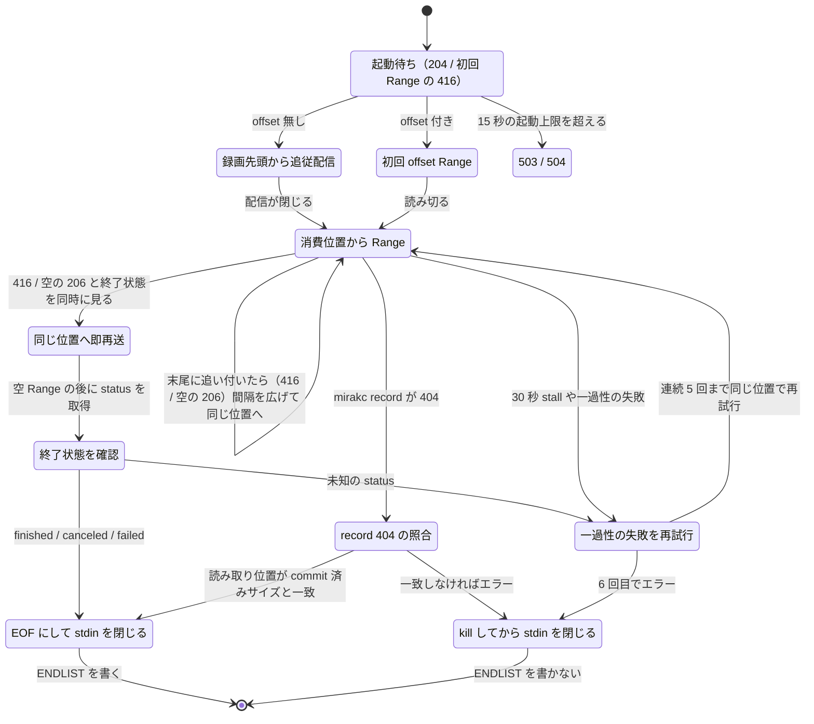
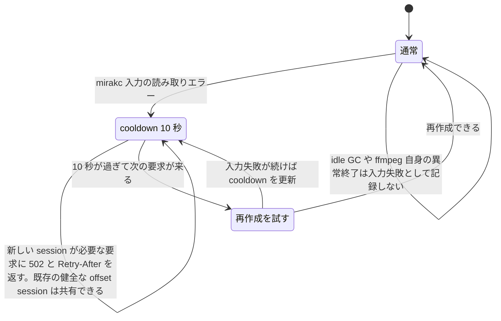
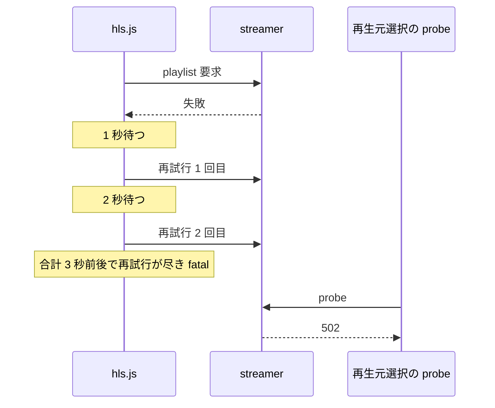

> [media.md](../media.md) の録画・追っかけ再生。索引から辿る

### 録画中の追っかけ再生

録画中の番組を、録画開始位置から現在の録画末尾まで HLS で追従再生する。ライブ視聴とセッション管理・最大セッション数・idle GC・離脱ヒントを共有し、資源の同定子は録画の durable id である。

```
GET  /api/sites/{site}/recordings/{id}/chase/playlist.m3u8[?profile=<name>]
	       → application/vnd.apple.mpegurl
GET  /api/sites/{site}/recordings/{id}/chase/offset/{offset}/playlist.m3u8[?profile=<name>]
	       → application/vnd.apple.mpegurl
GET  /api/sites/{site}/recordings/{id}/chase/segments/{name}
GET  /api/sites/{site}/recordings/{id}/chase/{name}       （master の映像 / 音声 variant / subtitle playlist）
	       → video/mp2t / text/vtt / application/vnd.apple.mpegurl
GET  /api/sites/{site}/recordings/{id}/chase/offset/{offset}/segments/{name}
GET  /api/sites/{site}/recordings/{id}/chase/offset/{offset}/{name}
	       → video/mp2t / text/vtt / application/vnd.apple.mpegurl
POST /api/sites/{site}/recordings/{id}/chase/leave
POST /api/sites/{site}/recordings/{id}/chase/offset/{offset}/leave
	       → 204（離脱のヒント）
```
<details><summary>根拠</summary>

- ライブ視聴と共有するセッション管理: `LiveStreamer`、`live.max_sessions`

</details>

#### 開始できる条件と URL

追っかけの URL は、録画ファイル配信と同じ理由で OpenAPI に載せない（[recording.md](recording.md)「OpenAPI には載せない」）。新しいセッションを開始できるかは、同期行の状態と原本の行の有無から逆引きして決め、原本の行がある録画は新しく開始しない。

`{id}` は `recordings` の行の id の十進正準形である。同期行の `(site, record_id, status)` と、原本のアセット行の有無を逆引きして、セッション可否を決める。

| 状態 | 挙動 |
|---|---|
| 同期行と録画行が `recording` / `finished` で、原本行が無い | 新しいセッションを開始できる |
| 原本行がある（`state` を問わず、`deleted` を含む） | 新しいセッションを開始しない |
| 録画が正常終了し、既にセッションがある | EVENT playlist とセグメントを idle GC まで取得できる |
| ごみ箱、commit 済みで保持セッション無し、失敗、未束縛、存在しない id、または URL の `site` と DB の録画 site が不一致 | 404 |

`deleted` の原本行も ingest が commit した事実なので、新しいセッションを開始しない理由になる。URL の `site` は site 束縛へルーティングするための値であり、DB の録画 site と一致させる。

<details><summary>根拠</summary>

- 録画 id の正準形: `recordings.id`
- 同期行: `record_sync`
- 原本のアセット行: `kind='original'` の `media_assets`
- site 束縛へのルーティング: `cmd/rokuban`

</details>

#### mirakc からの読み取り

mirakc へは、録画先頭から追従する経路で要求する。offset 付きでは概算した位置から Range で読み、読み切るたびに、消費済み位置から次の Range を要求する。

mirakc へは `GET /api/recording/records/{record_id}/stream` を Range なし・優先度ヘッダーなしで要求する。これは offset を省略したときに録画先頭から追従する経路である。

`{offset}` は録画開始からの 0 以上の整数秒で、省略時は `0` と同じである。offset 付きでは `GET /api/recording/records/{record_id}` の `recording.startTime` と `content.length` から概算位置を求める。TS パケット境界に合わせて `Range: bytes=<position>-` を送る。

mirakc の Range 応答は要求時点までの有限 snapshot である。先頭からの追従配信が閉じた後、または初回 offset Range を読み切った後に、消費済み位置から次の Range を要求する。録画先頭からの読み捨てはしない。入力ループ全体の状態遷移は「EOF と ENDLIST の決め方」の図に示す。

録画終了と競合して 416 / 空の 206 と終了状態を同時に見た場合は、同じ位置へすぐ Range を再送する。最後の Range が空になるまで続け、終了直前の追記を読み残さない。status は空 Range の後だけ取得し、未知の status は終了とみなさず同じ位置で再試行する。

<details><summary>根拠</summary>

- 未知 status は終端とみなさず、同じ offset で再試行する: `TestRecordFollowReaderUnknownStatusRetriesInsteadOfEnding`
- follow stream の終了後に Range を続ける: `TestFollowChaseRecordContinuesWithRangeAfterFollowCloses`

</details>

#### offset 付き再生の前提と範囲

offset 付き再生は、mirakc の録画配信 API が Range の seek と有限の応答に対応していることを前提にする。Range を無視してオフセット付き要求に 200（先頭からの本文）を返す mirakc は、安全のため受け付けず、オフセット再生を 503 にする。

現在の運用対象はこの契約を含む `mirakc 4.0.0-dev.0` 系（実際に配備するイメージは同じ API 契約を満たすバージョンに固定する）で、古いバージョンでは `{offset}` を使わず従来の URL を使う。

録画ファイルがまだ 0 バイトなら 204、追従中に現在位置が末尾へ到達したら 416/空の 206 を返し得るため、いずれも録画終了まで一定時間待って再試行する。起動待ちの上限（既存の playlist 起動上限 15 秒）を超えたときだけ 503/504 とする。204/416 の待機は上流接続失敗として数えない。

オフセットが現在の録画可能範囲以上なら、新しいセッションを作らず 416 を返す。録画開始時刻・コンテンツ長からの初期位置は可変ビットレート等の影響を受ける概算であり、開始後は通常の HLS シークで補正できる。許容誤差は放送・エンコーダーごとに異なるため、固定値を API 契約として保証しない。待機と 503/504 の遷移は「EOF と ENDLIST の決め方」の図に示す。

#### EOF と ENDLIST の決め方

追っかけの終端は入力を閉じる時点で決まり、EOF にするのは録画末尾まで読み切ったときだけである。追従配信が閉じただけでは EOF にせず、Range で追い続ける。



追っかけは `EVENT` playlist とし、`hls_list_size=0` / `temp_file` を使って `delete_segments` は使わない。ffmpeg は stdin の EOF で `ENDLIST` を書くので、入力を閉じる時点で終端の意味が決まる。stdin が開いたままなら書かず、kill 時も書かない。

EOF にするのは録画末尾まで読んだ後だけである。mirakc が `finished` / `canceled` / `failed` を返し、同じ offset の最後の Range も空になったときに限る。canceled / failed でも録れた所まで配信して `ENDLIST` を付ける。

mirakc record が 404 なら、読み取り位置と commit 済み原本のサイズが一致するときだけ EOF にする。ingest は mirakc が録画の終了を返し、最後の Range が空になるまで読んでから commit する。だから commit されたバイト数は終了時点のファイル長である。一致しなければ終端とせずエラーにする。ffmpeg の遅れ、別経路の原本、mirakc の record 消失では一致しない場合がある。

追従配信が閉じても EOF にしない。mirakc 側の無入力 timeout で録画中にも閉じることがある（頻度は未検証）。正常終了でも途中切断でも消費位置から Range で追い、Content-Length が無い本文も読む。

<details><summary>根拠</summary>

- `ENDLIST` は stdin EOF のときだけ出す: `TestBuildChaseFFmpegArgs_RealFFmpegEndlistOnlyAtStdinEOF`
- この実 ffmpeg 検証は CI で skip を禁じる: `ROKUBAN_REQUIRE_FFMPEG`
- record 404 後の commit 済み原本との照合: `TestChaseRecordNotFoundUsesCommittedOriginal`、`TestChasePurgeEndUsesCommittedOriginal`

</details>

#### 入力エラー時の ffmpeg の止め方

入力エラーでは終端の印を書かせない。再試行上限超過、再試行しても変わらない失敗、終端と確かめられない 404 では、ffmpeg を kill してから stdin を閉じる。

stdin の pipe は streamer が持ち、標準のプロセス実行の close では入力エラーと正常 EOF を区別できない。ffmpeg 自身が異常終了したときの `ENDLIST` は未検証である。

<details><summary>根拠</summary>

- 入力エラーで正常 EOF を書かない: `TestChaseInputErrorDoesNotWriteEndlist`
- stdin の pipe を閉じる標準のプロセス実行: `os/exec`

</details>

#### 再接続と再試行

Range 本文が 30 秒止まったら再接続し、一過性の失敗は連続 5 回まで再試行する。通常の Range 要求は 0.5 秒以上あけ、録画中に末尾へ追い付いたら間隔を広げる。

Range 本文が 30 秒 stall したら再接続する。timer は本文の読み取りを待っている間だけ動かし、ffmpeg stdin の backpressure で reader が呼ばれない間は止める。

5xx、通信断、本文 stall、未知 status は連続 5 回まで再試行し、6 回目でエラーにする。待ちは 200ms から倍々で、5 回目の前が最大 3.2 秒である。

通常 Range 要求は 0.5 秒以上あける。録画中に末尾へ追い付いたら間隔を 1 秒まで広げ、データを読んだ後は最短間隔に戻す。終了 status 後の最後の Range はすぐ送る。状態遷移は「EOF と ENDLIST の決め方」の図に示す。

<details><summary>根拠</summary>

- stall timer と consumer backpressure: `TestRecordFollowReaderStallAndConsumerBackpressure`
- stall timer が待つ本文の読み取り: `Read`
- 再試行回数と delay: `MaxConsecutiveRetries`、`RetryDelay`、`TestRetryDelay`

</details>

#### 入力エラー時のセッションと cooldown

mirakc 入力の読み取りエラーでは、録画 ID ごとに 10 秒の cooldown を置き、新しいセッションの作成を止める。cooldown 中に新しいセッションが要るときは、502 に Retry-After を付けて返す。



cooldown 中に新しい session が要る要求には `502 Bad Gateway` を返し、残り秒数の `Retry-After` を付ける。502 の本文は `追っかけ入力のエラーが続いているため、再作成を一時停止しています。しばらく待ってから再読み込みしてください。` である。cooldown の記録と session map からの削除は同じ lock 区間で行うため、同時要求も新しい session を作らない。

`502` と `Retry-After` の組み合わせで streamer の cooldown と proxy の 502 を区別する。proxy の 502 にはこの header が無く、入力失敗として扱わず再生元を選び直せる。上流入力の失敗を示す 502 は、チューナーや session 数不足を示す `503 Service Unavailable` と分類を分ける。

再生中の失敗では、hls.js の playlist 再試行が尽きて fatal になった後、再生元選択の probe が 502 を受ける。cooldown が 3 秒より短いと、再生元を選び直す前に hls.js の再試行が新しい session を作ることがある。



hls.js 1.7.3 の既定は再試行 2 回・初回待ち 1 秒・指数 backoff なので、待ちは 1 秒と 2 秒の計 3 秒前後になる。10 秒はこの約 3 秒より長く、3 倍強の余裕を取る値である。実測値ではない（未検証）。

<details><summary>根拠</summary>

- idle GC や ffmpeg crash は入力失敗にしない: `TestChaseIdleGCIsNotRecordedAsInputFailure`
- hls.js 1.7.3 の設定箇所: `playlistLoadPolicy.default.errorRetry`
- 再試行の設定: `maxNumRetry: 2`、`retryDelayMs: 1000`

</details>

#### 終了後のセッション

ffmpeg が入力 EOF の後に正常終了したら、idle GC まで playlist と全 segment を保持する。異常終了したとき（kill を含む）は、使えなくなった session とファイルを直ちに解放する。

正常終了の後は、既存の playlist から `?profile=` を切り替えられる。録画が finished でも ingest 前なら、原本行が無い間は新しい session を開始できる。ingest 後で保持 session が無ければ 404 である。

<details><summary>根拠</summary>

- 正常終了後の profile 切替: `TestFinishedChaseProfileSwitchServesRetainedPlaylists`
- finished / ingest 前の新規 session: `TestFinishedUncommittedChaseUsesOriginalRowExistence`

</details>

#### セッション数と容量

ライブ・追っかけ・原本 VOD のセッション数は合算する。セグメントは録画バッファとは別の tmpfs / scratch に置く。ライブは playlist の窓だけを残し、追っかけと原本 VOD は録画全体の EVENT セグメントを idle GC まで保持する。

最大セッション数 `live.max_sessions` は全経路で共有する。内訳は Prometheus の `rokuban_live_active_sessions{kind="live"|"chase"|"original_vod"}` で見る。どの経路も `live.segment_dir` を使う。容量の見積もり式と `sizeLimit` の判断は [operations.md](../../operations.md) §5「ライブのセグメントを録画バッファと同じディスクに置かない」（[k8s-streamer.md](../../operations/k8s-streamer.md)）にある。

#### 伸びる temp の終わらせ方

録画中の temp は、読み待ちを 90 秒にして追従して読む。途中で変換が終わったら 503 で再試行させ、録画の終端は DB で判定する。測定の詳細は [playback-temp-measurement.md](playback-temp-measurement.md) にある。

FFmpeg の引数は `-follow 1 -rw_timeout 90000000` である。90 秒は定数にし、設定のキーにはしない。

- 変換が途中で終わったら、待っている要求には 503 + Retry-After を返し、次の要求でそのセグメントから起動し直す。要求されたセグメントを出す前に正常終了した変換とエラー終了した変換の両方を再試行させる
- 録画の完了は、FFmpeg の終了ではなく、DB の record の状態と原本の行で判定する。`rw_timeout` による exit 0 は、録画の途中でも起きた
- 入力の種類（temp / 原本）を変換の組に含める。`-skip_estimate_duration_from_pts 1` を付ける

入力の種類を組に含めないと、原本が commit された後の要求が、temp を follow している古い変換に吸い込まれる。その変換は長さが未確定なので、最後の短いセグメントを公開しない。プレイヤーが再試行する間は waiter が付き続け、idle kill も働かない。録画の終わりを端で見ている人は、最後のセグメントが「追記が見えるまでの遅れ（最大 55 秒）+ 90 秒」の間 503 になる。組を分ければ、commit の後の要求は原本の新しい変換へ向かう。古い変換は waiter が無くなり、idle kill で消える。

90 秒は正しさの境界ではなく、書き手が止まり続けたときに 503 と起動し直しを繰り返す周期である。300 秒にしても、同じことがその周期で起きるだけである。waiter が無い変換は idle の 30 秒で先に kill されるので、90 秒が効くのはクライアントが再試行し続けている間だけである。

根拠は PVC での測定で、条件は NFS 4.1 の既定の mount、1 組のノード、書き手 500 kbit/s である。`-skip_estimate_duration_from_pts 1` と組み合わせて末尾まで完走した。読めるバイトが増えなかった最長区間は 51 秒、追記が見えるまでの遅れは最大 55 秒だった。10 秒はこの遅れの中央値（23 秒）より短く、書き込み中に 40 秒で空の出力のまま終了した。River 配送、再試行、ノード障害を含む停止時間の上限は測っていない。

未検証の点が 2 つある。NFS の hard mount で read 自体が止まる場合は、`rw_timeout` が効かない可能性がある。SIGSTOP の間の時間が `rw_timeout` に数えられ、SIGCONT の直後に exit 0 になる可能性もある。

<details><summary>根拠</summary>

- 正常終了・エラー終了の両方で 503 を返し、playlist に ENDLIST を付けない: `TestRecordingHLSTempTransformErrorsAreRetryableAndDoNotEndPlaylist`
- `/dev/fd/3` から追記を FFmpeg 9.0.2 が読む: `TestGrowingTempFollowReadsAppendedBytesThroughFD3WithRealFFmpeg`

</details>

### 録画原本のブラウザ再生

完了済みで active な原本 MPEG-2 TS を、site streamer が FFmpeg で HLS の一時セッションに変換して再生する。変換結果は派生物として保存しない。同じ録画・同じ offset の視聴者と profile 切替は 1 本のセッションを共有する。

プレイリスト起動時は、原本が無ければ 404、範囲外 offset は 416 を返す。同時セッション上限と streamer のシャットダウン中は 503、起動待ちのタイムアウトは 504、それ以外の起動失敗は 500 を返す。503 は待てば直る状態、500 は起動の失敗、504 は時間切れで、クライアントが案内を言い分けられるようにしている。シャットダウン中を 503 に残すのは、ローリング更新中の一時的な状態で、待てば直るからである。500 の詳細はログに残す。

```
GET  /api/sites/{site}/recordings/{id}/original-vod/playlist.m3u8[?profile=<name>]
         → application/vnd.apple.mpegurl
GET  /api/sites/{site}/recordings/{id}/original-vod/offset/{offset}/playlist.m3u8[?profile=<name>]
         → application/vnd.apple.mpegurl
GET  /api/sites/{site}/recordings/{id}/original-vod/segments/{name}
GET  /api/sites/{site}/recordings/{id}/original-vod/{name}
         → video/mp2t / text/vtt / application/vnd.apple.mpegurl
GET  /api/sites/{site}/recordings/{id}/original-vod/offset/{offset}/segments/{name}
GET  /api/sites/{site}/recordings/{id}/original-vod/offset/{offset}/{name}
         → video/mp2t / text/vtt / application/vnd.apple.mpegurl
POST /api/sites/{site}/recordings/{id}/original-vod/leave
         → 204（離脱のヒント）
POST /api/sites/{site}/recordings/{id}/original-vod/offset/{offset}/leave
         → 204（離脱のヒント）
```
#### 資源の同定とセッションの共有

セッションは録画と offset で同定し、profile は出力 playlist の選択にだけ使う。同じ録画・同じ offset の視聴者は 1 本のセッションを共有する。省略した offset と 0 は同じ先頭セッションで、ライブ・追っかけと同じ最大セッション数・idle GC・離脱ヒントに従う。最大セッション数を超えた場合は 503 になる。

これらのバイナリ配信ルートは `openapi.yaml` に載せない。Prometheus は `rokuban_live_active_sessions{kind="original_vod"}` に内訳を出す。

`{offset}` は録画先頭からの秒を表す正準な 10 進整数である。`007`、`+5`、`5.0` などの非正準形は 400、原本の長さ以上は 416 にする。offset ごとに session key と HLS scratch を分ける。offset 付き playlist / segment / leave はすべて同じ offset の session を参照する。各 offset は通常の原本 HLS セッションとして `live.max_sessions` に数え、leave ヒント・idle GC・容量圧力時の idle session 退避も共有する。`offset/0` と offset 無しの URL は同じ session と scratch を使う。

<details><summary>根拠</summary>

- セッションの同定子: `(recordings.id, offset)`

</details>

#### 原本の確認と open-then-verify

開始時に DB で同じ site の完了録画と active な原本を引き、原本を読み取り専用で開く。その後、同じアセットがまだ active で相対パスも一致することを DB で再確認し、一致しなければ 404 にする。

相対パスの lock は取らず、streamer は media に何も書かない。

lock を取らなくても open した inode と active な原本行を照合できる。

| 順序・制約 | 結果 |
|---|---|
| canonical file は DB 行の commit より前に rename する | active 行の公開時には canonical file が既にある |
| unlink は deleting 状態の commit より後に行う | active 行を確認した inode が並行削除で別 file にならない |
| live 行がある `rel_path` は他の書き手が公開できない | 同じパスの別アセットにすり替わらない |

したがって再確認時に active なら、open 済み inode はその行の原本である。trash・purge・supersede・失敗・原本不在・別 site / 未束縛 site は 404 にし、その場合は session や DB 行を作らない。

<details><summary>根拠</summary>

- 引く録画と原本の条件: `finished`、`storage.stores` の FS 置き場（FS 置き場は今 1 つだけ。[置き場の規則](../../configuration/keys.md#置き場の規則)）のコピーが `active`
- open-then-verify で inode と DB 対象を照合: `TestOriginalVODVerifiesDBTargetAfterOpen`
- live な行がある `rel_path` へ別の書き手が公開できない: `media_assets_rel_path_idx`
- unlink は deleting 状態の commit より後にしか起きない: `MarkMediaAssetDeleting`

</details>

#### 開始後の要求と DB エラー時の継続

開始後の segment 要求は、利用者の操作である録画の trash・purge・supersede だけを見る。encode 完了後に原本が消えても、視聴中の再生は止まらない。録画の行が見つからない場合を除き、再確認で DB エラーが出ても警告を記録して配信を続ける。

asset の状態は見ない。該当すれば 404 にして session と scratch を回収する。

FFmpeg は開いた inode を読み続ける。encode 完了直後に `until_encoded` で canonical path が unlink されても、視聴中の再生は止まらない。

再確認で、行が見つからないとき以外の DB エラーが出たら警告を記録して配信を続け、再生を DB の可用性に依存させない。

<details><summary>根拠</summary>

- 行が見つからないことを表すエラー: `ErrNoRows`
- original unlink 後も開いた inode から再生を継続: `TestOriginalVODRetainedSessionSurvivesOriginalDeletion`

</details>

#### playlist の種類と終了後の扱い

playlist は変換開始から書かれる event 形式にする。vod 形式は FFmpeg の終了時にしか playlist を書かず、変換が長いと playlist 待ちで 504 になる。正常終了後は終端と全 segment を idle GC まで保持する。

FFmpeg は既存の live profile、音声 rendition、任意の WebVTT 字幕設定を使う。playlist は `-hls_playlist_type event` にする。`vod` は FFmpeg の終了時にしか playlist を書かない。ffmpeg 9.0.2 で 20 秒の MPEG-2 TS を実時間変換したとき、変換中の `.m3u8` は 0 個で、終了後に初めて出た。

変換が 15 秒を超えると `vod` は playlist 待ちで 504 になる。`event` は変換開始から playlist を書き、終了時に `#EXT-X-ENDLIST` を付ける。

`-hls_list_size 0` と `temp_file` を使い、`delete_segments` は付けない。変換中の seek 範囲は変換先端まで伸び、末尾に届くのは変換完了後である。

正常終了後は `#EXT-X-ENDLIST` と全 segment を idle GC まで保持し、seek と遅れて届く segment 要求に応える。異常終了時は scratch と session を回収する。原本が active のままなら次の要求で作り直せる。

<details><summary>根拠</summary>

- 変換中に playlist を配信: `TestOriginalVODServesPlaylistWhileFFmpegIsStillConverting`

</details>

#### offset 付きの入力と範囲判定

offset 付きでは、開いたままの原本の fd から映像の長さを調べ、FFmpeg に渡す前に範囲を確認する。範囲の判定は映像ストリームの終端で行う。format の duration は、音声など最長の stream で決まって映像より長くなるので使わない。

原本は子プロセスの fd 3 に渡すため、canonical path が unlink されても同じ seek 可能な inode を読める。通常の `pipe:0` では seek できないため、この方式にする。ffprobe の後に descriptor を先頭へ戻し、FFmpeg も先頭から読めるようにする。offset が 0 より大きいときは `-ss {offset}` を `-i /dev/fd/3` より前に置き、入力側 seek で必要な範囲まで decode して捨てる。

`-copyts` は使わず、HLS 時間軸は offset ごとに 0 から始める。再生位置は `offset + currentTime` として扱う。

映像より長くなる format の duration を使うと、映像の終端より後ろの offset が通ってしまう。

合成した 660 秒の TS で測った。format duration 660.010 秒と比較すると、`[映像の終端, format の duration)` に入る offset 660 が通った。FFmpeg は出力せず、playlist 待ちの 15 秒後に 504 になった。映像の duration 660.000 秒から終端を求め（`start_time + duration - format の start_time`）、その 0.5 秒手前より後ろの offset は 416 にする。offset 659 は 200 で 0.14 秒、offset 660 / 661 / 99999 は 416 で 0.03 秒だった。

終端ちょうどでも最後のフレームより後ろを指して空出力になる可能性があるため、0.5 秒の余白を取る。範囲外 offset は利用者入力なので INFO で記録する。ERROR にはしない。

<details><summary>根拠</summary>

- seek 範囲の判定: `TestOriginalVODOffsetRealFFmpegSeekAccuracyAndRange`
- seekable descriptor を子プロセスへ渡す: `cmd.ExtraFiles`、`/dev/fd/3`

</details>

#### 退避の待ち時間

原本 VOD の退避は、mirakc のチューナー解放待ち（5 秒）を挟まない。原本 VOD はチューナーを持たないからである。

`max_sessions: 2` で容量が埋まった状態からの seek は、待ちありで約 5.4 秒、待ちなしで 0.13 秒だった（実バイナリ、合成 660 秒 TS）。

<details><summary>根拠</summary>

- チューナー解放待ちの定数: `liveMirakcReleaseWait`

</details>

#### 既定の再生経路と容量

原本だけの完了録画は、この原本 VOD の経路をブラウザ再生の既定にする。active な録画は追っかけ、active な encoded がある完了録画は MP4 progressive + Range を使う。

原本 MPEG-2 decoder を持たない FFmpeg build は `live.enabled` の streamer 起動前に拒否し、再生要求後に空の HLS player だけが出る状態を避ける。

原本 VOD の HLS scratch も `live.segment_dir` に置き、録画バッファ / archive から分離する。正常終了後も idle GC まで録画全体の変換済み segment が残る。tmpfs 容量の見積もりは [k8s-streamer.md](../../operations/k8s-streamer.md) にある。

#### offset seek の精度と開始時間の測定

原本 VOD の offset seek は、合成した TS で精度と開始時間を測った。放送 TS の実録画での値は未検証である。

##### CI の seek 精度

CI の seek 精度確認は、実 ffmpeg / ffprobe と合成した 40 秒の TS で行う。offset 0・7・20・38 秒の誤差はすべて 0.00 秒で、試した範囲外の offset（40〜42 秒）は 416 が 3 秒以内に返る。

CI の seek 精度確認は実 ffmpeg / ffprobe と lavfi 生成の 40 秒 MPEG-2 + MP2 TS を使う。映像の輝度は録画先頭からの秒に比例し、音声は 41.5 秒まで続く。HLS 先頭 segment の先頭 frame の輝度から時刻を読む。

| 要求 offset | 結果（FFmpeg 9.0.2、macOS arm64） |
|---|---|
| 0 / 7 / 20 / 38 | 誤差はすべて 0.00 秒 |
| 40 / 41 / 42 | 416 が 3 秒以内に返る |
| format duration 比較に戻す変異で 40 / 41 | 15 秒待って 504 |

この条件は 40 秒の合成映像だけで、PTS の不連続・wraparound を含む放送 TS の実録画では未検証である。

##### 先頭フレームの PTS

HLS の先頭セグメントの映像 PTS は、どの offset でも 1.48 秒だった。ブラウザの再生位置は 0 から始まる。

上のテストのログで測った。1.48 秒は mpegts muxer の既定の遅延で、offset によらない。ブラウザの `currentTime` は 0 から始まる。HLS の PTS 自体を 0 にそろえているわけではない。

##### 10 分以上の入力での精度

660 秒の合成 TS で、5 つの offset の精度を 1 回測った。先頭フレームの表示は、offset 0 を除いて offset より 0.20〜0.36 秒後ろだった。測定に使った runner は、リポジトリに置いておらず、再実行できる形では残っていない。

10 分以上の入力での精度は 660 秒の合成 TS で 1 回測った。25 fps の 320×80 映像に録画先頭からの `秒:フレーム番号` を焼き込んだ。映像は MPEG-2（GOP 15、B-frame 2、closed GOP）、音声は MP2 で、1 Mbit/s MPEG-TS muxrate でまとめた。format duration は 660.010022 秒、video stream duration は 660.000000 秒である。測定に使った runner は、不変条件 4（ffmpeg の exec は worker / streamer のみ）を破るためリポジトリに置いていない。再実行できる形では残っていない。

| 要求した offset | HLS の先頭フレーム表示 | offset との差 |
| ---: | ---: | ---: |
| 0 秒 | 0.00 秒 | 0.00 秒 |
| 61 秒 | 61.36 秒 | +0.36 秒 |
| 307 秒 | 307.32 秒 | +0.32 秒 |
| 603 秒 | 603.20 秒 | +0.20 秒 |
| 659 秒 | 659.36 秒 | +0.36 秒 |

##### master playlist までの開始時間

同じ 5 offset を各 3 回変換し、原本を開いてから master playlist が読めるまでを測った。中央値は 59〜94 ms で、非ゼロ offset の duration probe は 17〜20 ms だった。

同じ 5 offset を各 3 回 FFmpeg で変換し、原本 open 後から master playlist が読めるまでを測った。非ゼロ offset は duration probe と FFmpeg 起動を含む。DB lookup、HTTP/router、原本 open は計時外である。

| offset | master ready 中央値（最小–最大） |
| ---: | ---: |
| 0 秒 | 80 ms（78–93 ms） |
| 61 秒 | 94 ms（92–96 ms） |
| 307 秒 | 93 ms（93–93 ms） |
| 603 秒 | 93 ms（93–95 ms） |
| 659 秒 | 59 ms（59–60 ms） |

非ゼロ offset の duration probe は 17–20 ms だった。659 秒では残り 1 秒の短い出力になる。

<details><summary>根拠</summary>

- offset seek の精度と範囲: `TestOriginalVODOffsetRealFFmpegSeekAccuracyAndRange`、`runSession`、`ROKUBAN_REQUIRE_FFMPEG`
- 測定 runner をリポジトリに置かない: 不変条件 4

</details>

### 世代付き録画 HLS

録画中と完了後の録画を、置き場と録画と世代で決まる同じ URL から HLS 配信する。

URL は置き場名・録画 id・ingest 世代で同定する。API は `hlsPlayback` に profile ごとの master URL を返す。この URL は `openapi.yaml` に載せない。

```text
GET /api/media/stores/{store}/recordings/{id}/hls/v{gen}/{profile}/master.m3u8
GET /api/media/stores/{store}/recordings/{id}/hls/v{gen}/{profile}/{rendition}/index.m3u8
GET /api/media/stores/{store}/recordings/{id}/hls/v{gen}/{profile}/{rendition}/{n}.ts
```

`{store}` は `storage.stores` に定義した FS 置き場の名前と一致する必要がある。振り分けの鍵を site ではなく置き場にするのは、規則によって 1 つの site の原本が複数の置き場に分かれうるからである。

#### 入力と世代

録画中は ingest の temp を、commit の後は原本を、同じ URL で読む。どちらを読むかは、ファイルの有無ではなく DB の行で決める。

原本の行があれば commit 済みの原本を読む。原本の行が無く `recording_ingest_progress` の行があれば、その `temp_rel_path` の temp を読む。temp の置き場も URL の `{store}` と一致させる。

`{gen}` は、temp では `recording_ingest_progress.temp_generation`、原本では `media_assets.ingest_generation`（NULL は 0）である。commit が同じ世代を原本の行へ写すので、temp から原本へ切り替わっても URL は変わらない。キャッシュ済みのセグメントも同じバイト列から作るため、commit の後も使える。temp が作り直されて世代が変わったら、古い世代の URL は 410 にする。

#### playlist

playlist は、ffmpeg の出力を待たずにアプリが EVENT 型で組み立てる。

各セグメントには `recordings.started_at + n × D` の `#EXT-X-PROGRAM-DATE-TIME` を付ける。`D` は profile の `live.profiles[].segment_seconds` である。

映像の長さは、temp でも原本でも同じ関数で測る。定義は「末尾の映像パケットの最大の pts + duration − 原点」で、2^33 を法として取る。PTS は約 26.5 時間で巻き戻る。原点は先頭の映像パケットの PTS である。format 全体の duration は音声など最長のストリームに引かれるので使わない。ffprobe の stream duration は、FFmpeg の文書に無い推定が入るので使わない。

末尾の測り方は次のとおりである。

- ファイル末尾の数 MiB（4 MiB から始め、32 MiB、256 MiB へ広げる）を、ffprobe に標準入力で渡す。`/dev/fd/N` で fd を渡すと、Linux では通常ファイルを先頭から開き直すので、末尾だけを渡したことにならない。Go は TS を解釈しない
- 窓に映像パケットが 1 つも無ければ窓を広げる。最大の窓にも無ければ、temp は前回の値を使い、原本は失敗にする
- 窓だけを渡した ffprobe は `duration` を `N/A` で返すことがある（実 ffprobe の 64 KiB の窓で測定）。そのときは、重複を除いた pts の隣り合う差の最小の正の値（フレーム間隔）を `duration` とする
- 最大の 2 つの pts の差は使わない。B フレームがあると、I/P フレームの直後で切れた窓で 3 フレームぶんになり、長さが縮む（29.97 fps、`-bf 2`、64 KiB の窓で測定）

録画中は、観測した映像の長さに全体が収まるセグメントだけを載せる。セグメント n は `(n+1) × D ≤ 観測した長さ` のときに載り、載せる行はすべて D 秒の EXTINF である。壁時計からは決めない。壁時計で決めると、録画が終わった後に ingest が長引いたとき、原本に無いセグメントを載せ続ける。実録画では 240 行の playlist が commit の後に 182 行へ縮み、載せ済みの番号が 416 になった。EVENT は載せた行を変更・削除できない（RFC 8216 §6.2.1）。

観測は、録画・世代・入力の種類ごとに 1 本にまとめる。temp のサイズが前回と同じなら前の値を使い、メモリ上では最大値を保つ。観測が前回より小さくても、載せた行は減らない。

録画が終わって ingest が commit したら、原本の長さで最後の短いセグメントと `#EXT-X-ENDLIST` を足す。temp は追記だけで原本と同じバイト列であり、長さも同じ関数で測るので、録画中に載せた行と EXTINF は commit の後も変わらない。載せた行が commit の前後で変わらないためには、`duration` が `N/A` のときの補完も単調である必要がある。

ENDLIST を付けるのは、原本の行が DB にあるときだけである。ffmpeg の終了、入力のエラー、record の状態が未知であることは、終端の根拠にしない。

DB に問い合わせられない間も、付けた ENDLIST は外さない。そのときはキャッシュした原本の metadata を、temp の metadata より優先する。

映像 PTS が同じ世代の中で後退する録画は、保証の範囲外である。固定長の格子が PTS の単調性を前提にしており、完了した録画の配信も同じ前提に立つ。

#### 取り消し・失敗した録画

取り消し・失敗した録画は、配信を保証しない。ingest は temp と進捗行を消す（[ingest-retry.md](../../recording/ingest-retry.md)）。行が引けなくなると、playlist もセグメントも 404 になり、走っていた変換は止まる。視聴は止まり、途中までのバイトは終わった後にも見られない。

途中までを見せ続けるには、temp を残すことになる。残すと、進捗行の寿命、孤児の回収、後継の録画のバイトの混入を扱う費用がかかる。視聴中だけ録れた所まで見せる価値は、その費用に見合わない。

#### rendition とセグメント

映像と 3 本の音声を MPEG-TS の rendition にし、字幕があれば WebVTT の rendition を足す。

3 本の音声は標準・主・副である。`live.captions` が有効で原本に字幕ストリームがある場合は、字幕の rendition も master に載せる。映像・音声は `.ts`、字幕は `.vtt` のセグメントを返す。

temp を読む変換の引数と、入力の種類を変換の組に含める理由は、[伸びる temp の終わらせ方](#伸びる-temp-の終わらせ方)で決めてある。

長さが確定した入力（原本）では、全 rendition を映像と同じ番号で終わらせる。実録画では音声が映像より約 0.36 秒短く、FFmpeg が音声だけ 1 つ前の番号で ENDLIST を出し、終端の音声が 503 になった。そこで音声のフィルタに `apad,atrim=end=<映像の終端 − 起動位置>` を足し、PTS で切る。`apad=whole_dur` は、サンプル数で数えるので使わない。途中から起動した変換や途中で欠けた音声で、番号がずれるからである。

完成判定も、長さが確定した入力では rendition ごとの ENDLIST と最後のファイルで行う。途中で止まる副音声や字幕は、埋めても番号が揃う保証が無い。

ただし、どの rendition も、同じ変換の映像が ENDLIST を書き、映像の最後のファイルが確定した最後の番号に届いたときだけ完成とみなす。入力が途中で切れると、映像はそれより手前で終わるが、音声は apad の無音で確定した映像の終端まで進む。そのため、映像が届いていない番号の音声と字幕は公開しない。

伸びる入力では、ENDLIST を終端とみなさない（`rw_timeout` で終わることがある）。

#### 配信の可否と DB

要求ごとに DB を引き、ごみ箱・完全削除・置換でないことと、原本または進捗行のある temp があることを確かめる。配信できなければ、原因ごとに次のとおり 404 か 410 を返す。

- 行が見つからない（ごみ箱・完全削除・置換・入力なし・取り消し・失敗）、temp の置き場が違う、原本ファイルが無い、開き直した入力が別のアセットだった場合は 404 にする。その世代の変換を止め、キャッシュを捨てる
- URL の世代が今の世代と違う場合は 410 にする。URL が指す世代について、同じく変換を止めてキャッシュを捨てる
- `{store}` が違う場合は 404 にするだけで、変換にもキャッシュにも触らない

原本は、有効なコピーを持つ行があれば、`recordings.status` にかかわらず配信する。原本 VOD と違って完了の述語を持たないのは、commit が mirakc の record の状態で決まり、status は watcher が後から書くからである。述語を持つと、commit の直後に status が追い付くまで 404 になり、変換も止まる。

新しく変換を始めるときは、原本または temp の fd を開いてから DB を引き直し、同じ種類・相対パス・世代であることを確かめる。DB に問い合わせられないときは、すでに開いている変換とキャッシュを使い続ける。行が無いと分かったときは止める。DB が使えない間に新しい変換を始める要求は 503 にする。

キャッシュにあるセグメントはそのまま返す。無いセグメントや、playlist に載せたがまだ変換できないセグメントは、`SegmentManager` が必要な範囲を変換するのを待って返す。待たずに 404 を返さないのは、RFC 8216 §6.2.1 に従い、playlist に載せたセグメントを取得できないものとして扱わないためである。前段の CDN が 404 をキャッシュすると、変換が終わった後も 404 が返り続けうる。待つ時間は `recording_hls.wait_timeout` までで、超えた要求は 503 と `Retry-After` を返す。セグメントは `private, max-age=31536000, immutable`、playlist は `no-cache` にする。世代が URL に含まれるので、セグメントは長期にキャッシュできる。

<details><summary>根拠</summary>

- 載せる行が `(n+1) × D ≤ 観測した長さ` で、全て D 秒、縮まない: `TestRecordingHLSTempPlaylistListsOnlyObservedVideo`
- 録画終了後に ingest が長引いても、行と EXTINF が commit の後も変わらない: `TestRecordingHLSCommitKeepsPublishedRowsWhenIngestOutlastsRecording`
- ENDLIST は原本からだけ付く: `TestRecordingHLSEndlistOnlyFromTheOriginal`
- DB に問い合わせられない間も ENDLIST と載せた行を保つ: `TestRecordingHLSDatabaseOutageKeepsEndlistAndPublishedRows`
- 入力エラーで ENDLIST を付けない: `TestRecordingHLSTempFollowsAndOriginalHasKnownEnd`
- 変換が終了しても再試行させ、ENDLIST を付けない: `TestRecordingHLSTempTransformErrorsAreRetryableAndDoNotEndPlaylist`
- 観測を 1 本にまとめ、サイズが同じなら測り直さない: `TestRecordingHLSTempObservationIsSharedAndSkippedForUnchangedSize`
- 窓に映像パケットが無いとき窓を広げる: `TestMeasureRecordingHLSVideoDurationWidensTheWindow`
- 広げても無ければ前回の値を使う: `TestRecordingHLSTempWithoutVideoPacketInTheWindowKeepsPreviousValue`
- 末尾の窓だけを標準入力に渡す: `TestMeasureRecordingHLSVideoDurationPipesOnlyTheTail`
- 窓だけの測定と全体の測定が一致する（実 ffprobe）: `TestMeasureRecordingHLSVideoDurationWithRealFFprobe`
- PTS の巻き戻りをまたいでも長さが負や飛び値にならない（playlist）: `TestRecordingHLSTempPlaylistAcrossPTSWrap`
- 同上（長さの計算）: `TestRecordingHLSVideoDurationFromPackets`
- 入力が途中で切れても、映像が届いていない番号の無音を公開しない: `TestSegmentTransformTruncatedInputDoesNotPublishSilentAudioWithRealFFmpeg`
- 原本の行があれば status が recording でも原本を返す: `TestRecordingHLSTargetPreservesCommittedGeneration`
- B フレームがあっても、切り出しを長くして長さが縮まない: `TestMeasureRecordingHLSVideoDurationDoesNotShrinkWithBFrames`
- 取り消し・失敗で行が消えたら 404 になり変換が止まる: `TestRecordingHLSCanceledIngestReturns404AndStopsTransform`
- 古い世代の URL は 410: `TestRecordingHLSTempGenerationChangeReturnsGone`
- 音声が映像より短くても、全音声の最後とその前の番号を取得できる（実 FFmpeg）: `TestSegmentTransformAudioRenditionsEndAtTheVideoNumberWithRealFFmpeg`
- 完成判定が rendition ごとで、伸びる入力では ENDLIST を終端にしない: `TestSegmentTransformFinalIsDecidedPerRenditionOnlyForKnownLength`
- 届く前に終わった映像は完成とみなさない: `TestSegmentTransformEndlistMakesOnlyTheRecordingsLastSegmentFinal`

</details>

#### PTS と変換キャッシュ

セグメント番号は、録画時刻の格子に固定する。

変換は、セグメント `n` の映像・音声 PTS を、原本の先頭映像 PTS を原点とする `origin + n × D` の格子に揃える。ffmpeg を別の位置から起動し直すたびに起点が変わると、同じ番号でも境界がずれる。要求が今の変換から離れると、変換は要求の位置から起動し直される。そのため入力には `-copyts -seek_timestamp 1 -noaccurate_seek` と原点からの `-ss` を使い、2 秒の pre-roll の後で trim と PTS filter を適用する。

2 秒の pre-roll は、合成 GOP での測定をもとにした既定値である。実録画の全 GOP 長での trim 精度は未検証である。

同時に動かせる変換の数は `recording_hls.max_concurrent` までである。上限に達した状態で新しい変換が要るセグメントを要求すると、その要求が空きを待つ。待機中の要求を持たない変換のうち、最後に要求された時刻が最も古いものを止め、それが終わるまで待つ。待機中の要求を持つ変換しか残らなければ、どれかが終わるまで待つ。`recording_hls.wait_timeout` を超えた要求は 503 と `Retry-After` を返す。

キャッシュの容量と tmpfs の大きさは、[k8s-streamer.md](../../operations/k8s-streamer.md) の「世代付き録画 HLS の scratch」で決める。変換とキャッシュは専用 Pod の tmpfs に置く。原本と temp は読み取り専用で開く。

キャッシュの使用バイト数、ヒットとミス、動いている変換の数、503 の件数は次のメトリクスで見る。

- `rokuban_recording_hls_cache_bytes`
- `rokuban_recording_hls_cache_requests_total`
- `rokuban_recording_hls_active_transforms`
- `rokuban_recording_hls_unavailable_total`

上の旧 `/original-vod/` 経路にある「`-copyts` を使わず、offset ごとに HLS 時間軸を 0 から始める」という説明は、そのセッション方式だけに当てはまる。世代付き録画 HLS は `-copyts` を使い、録画全体で共通の PTS 格子にセグメントを置く。

<details><summary>根拠</summary>

- PTS 格子と pre-roll: `TestSegmentTransformRealFFmpegKeepsRequestedPTSGrid`

</details>
