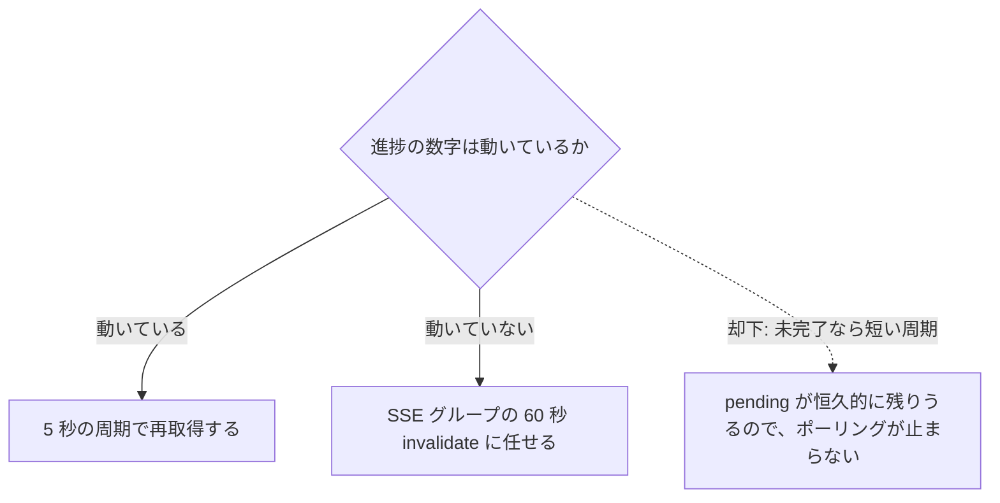
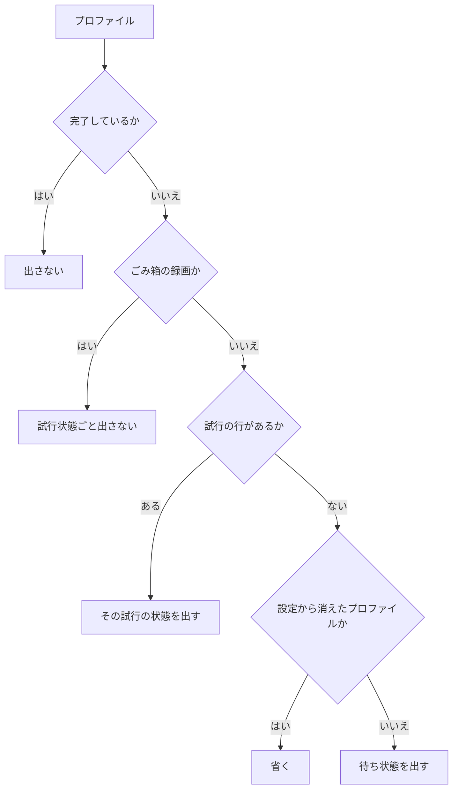
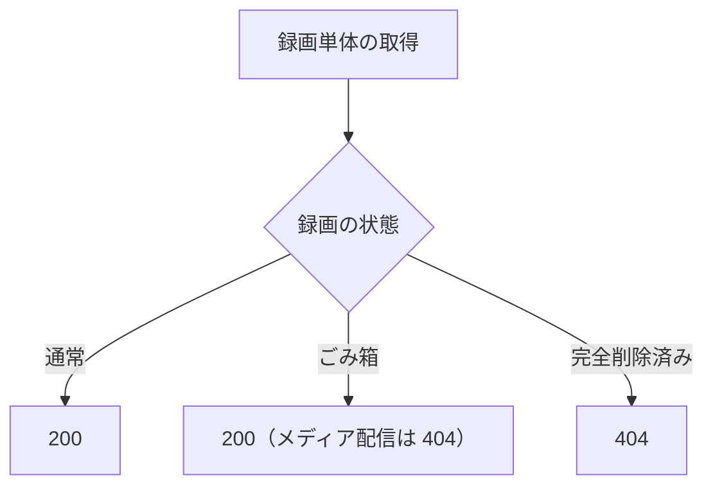

> [docs/api.md](../api.md)（索引）の分割本文。REST API の設計判断だけを置く。**パス・パラメータ一覧・enum・既定値の権威は openapi.yaml** であり、ここには書き写さない。

## REST API（OpenAPI ファースト・コード生成・後方互換）

予約・ルール・録画一覧などの CRUD と検索はすべて REST API で提供する。**OpenAPI 定義を唯一の権威**とし、クライアント・サーバー双方のコードを生成する。

### コード生成パイプライン

REST API の型は、OpenAPI 定義から TypeScript 側と Go 側の両方へ生成する。

TypeScript 側は orval で、型付きクライアント（TanStack Query フック）を生成する。Go 側は oapi-codegen で、ハンドラの型を OpenAPI 定義から導出する。

### 契約の保護

破壊的変更は生成物の差分として CI で検知する。運用開始後は API の後方互換を保ち、**運用開始前は保たない**。

運用開始後に保つのは、UI と API のデプロイタイミングがずれうるためである（参照: [frontend.md](../frontend.md) のアセット配信）。運用開始前に保たないのは、互換のための分岐が「おかしくなったときに気付けない」形（旧パラメータが気づかないうちに無視され全件が返る等）で残り続けるからである。外から見える資源同定（パス・識別子・クエリパラメータ）を直す機会は運用開始前しかない。

根拠

- 将来への先払いは高い方（外から見える資源同定）から: 不変条件 11

### エンドポイント設計の規約

API のパスはルート相対にし、資源のパスに site を含めるかは、その資源の存在と状態が特定の 1 つの site の観測に閉じるかで決める。件数や種類名では決めない。複数 site を 1 つの応答にまとめるのは、構造的に site をまたぐ資源に限り、運用上便利という理由では例外にしない。

#### パスの形

API のパスはドメインを含まないルート相対にする。絶対 URL のビルダーは先回りで作らず、必要になった時点で単一ビルダーへ一元化する。

ルート相対にするのは、CDN / リバースプロキシ構成で CORS 不要・実行時コンフィグ注入不要とするためである。現状 Rokuban には絶対 URL を生成している箇所が無く（API・webhook ペイロードともルート相対のみ）、無い箇所にビルダーを作る理由が無い。絶対 URL 生成を散らばせると、後からホストや接頭辞の書き換えを効かせられない。

根拠

- ルート相対のパス: `/api/*`
- ビルダーを先回りで作らない: 不変条件 11

#### site をパスに含める判定基準

site をパスに含めるかは、資源の存在と状態が特定の 1 つの site の観測に閉じるかで決める（[スキーマ](../schema.md) §1-5）。件数や種類名では決めない。同じ種類でも、site 非依存 worker が書く行は site を含めない。

判定の入力は資源のあるべき形であり、現行レスポンスからパスを正当化しない。現状の形を根拠にすると、判定基準が何も条件しなくなる。

集合を返す操作も同じ基準に従う。mirakc の record や、その site の EPG に存在するかで決まる programId は、単体・一覧とも site をパスに含める。site に束縛されない資源は、パスに固定せず、絞り込み条件か応答本体で指定する。

根拠

- 番組・意図・上書きの形は site をパスに含める: `/api/sites/{site}/programs/{programId}...`
- site に束縛されない資源の例（rokuban 採番の id）: `recordings.id`
- 資源の site 境界は観測の範囲で決める: 不変条件 1、11

#### 複数 site を 1 応答に集約する場合

複数 site を 1 応答に集約するのは、資源が構造的に site をまたぐ場合に限る。例えば予約と容量超過は、各要素が site に属しながら全 site を集約する。

例のパスは `GET /api/reservations` と `GET /api/capacity/overages` である（下記「録画一覧」の「既定は全サイトを返す」）。

#### 検索の複数 site 集約

検索は構造的な複数 site 集約に当たり、site を横断して、結果の各行が実際にマッチした site を運ぶ。絞り込みは 1 つの条件に一本化する。

ルールはマッチした全 site で評価され、site ごとに 1 予約を作る（[ruler](../recording/ruler.md)「サイトの扱い」の N 予約）ので、結果は site で畳まない。パスには site を置かず、パスによる既知 site の検証もしない。

根拠

- 絞り込み条件（空 = 全 site）: `sites`
- 検索のパスは site を置かない: `/api/programs/search`、`{site}`

#### site レジストリと存在しない site

api プロセスは特定の site に束縛されず、1 プロセスが全 site を処理する。存在しない site への読み取りは 404、書き込みは 400 を返す。

site の権威は設定の site レジストリである。site の一覧（`GET /api/sites`）は存在する site だけを返し、mirakc の URL は含まない。

根拠

- site レジストリ: `config.mirakcs`
- 存在しない site への書き込み: POST / PUT / PATCH / DELETE が 400

#### 書き込みの宛先とする id

導出行が作る id は、書き込みの宛先にしない（[invariants.md](../invariants.md) §9「identity」）。

根拠

- 導出行の id を宛先にしない: 不変条件 9

#### サーキットブレーカーの再開

サーキットブレーカーの再開も、site をパスに含めるかの判定基準に従う。資源ごとの分類で決まり、種類名による分類は採らない。

site を持つ名前は `POST /api/sites/{site}/breakers/{name}/resume` に分ける。site 非依存 worker が書く名前は `POST /api/breakers/{name}/resume` に分ける。

根拠

- site を持つ名前: `ruler_deletes` / `reconcile_total_loss`
- site 非依存の名前: `delete_reconcile`
- site 分類の判定: `internal/breaker.IsSiteless`

### 機能の有効/無効は能力 API で観測する

**フロントは、機能の有効・無効を能力 API が返す真偽値の集合で観測する。** 応答に基づいて入口を出し、設定値や実行時に使えるかどうかは取得しない。

#### 能力 API を置く理由

無効な機能への入口を出さない判断は、サーバーの応答に頼る。

フロントは config を読めない（api ロールは設定ファイルを配らない）。`live.enabled` のように「無効ならその機能への入口ごと出したくない」設定がある。`live.enabled: false` のときも主ナビに「ライブ」が出続け、プレイリストの URL が SPA フォールバックの HTML 200 を返していたため、利用者には無効な機能に見えず、正しく動かない再生に見えていた。

根拠

- フロントが config を読めない: 不変条件 1

#### 能力 API の契約

能力 API が返すのは、入口を出してよいかだけである。設定値そのものは返さない。フィールドはすべて必須にする。欠けた項目を「未対応の古いサーバー」と読むか「無効」と読むかをフロントに判断させると、判断が入口ごとにばらけるためである。

config のキー名・値・ffmpeg のパス・プロファイル定義は載せない（`GET /api/encode-profiles` / `GET /api/sites` と同じ規律）。将来 `live.profiles` の一覧が要るなら、それは能力に当たらない選択肢なので、別のエンドポイントになる。ビルド時フラグにもしない。実行時 config で on/off する設計と食い違い、同じ SPA アセットがどの構成にも配れるという前提を成り立たなくする。

根拠

- 能力 API: `GET /api/capabilities`

#### 「有効」の意味

能力 API の「有効」は、今すぐ使えることを意味しない。設定で有効という事実だけを表し、実行時の状態は従来どおり当該 API のエラーとして出る。

`live: true` でも、streamer が動いていない / チューナーが埋まっているといった状態は、当該 API の 404 / 503 になる（[frontend/live.md](../frontend/live.md)）。

#### 能力の値とロール

能力の値は、プロセスのロールに依存させない。

生成ルートはロールで絞られず、api ロールを持たないプロセスでも能力 API は生える。そのため注入を api ロールの分岐に置くと、同じ config の別プロセスだけが違う答えを返す。site のレジストリとメトリクスのレジストリを無条件に渡しているのと同じ理由である。

根拠

- 能力 API のルート: `/api/capabilities`
- 無条件に渡すもの: `cmd/rokuban/server.go` は `Sites` / `MetricsRegistry` を無条件に渡す

#### API パス配下の未マッチの扱い

API パス配下で一致するルートが無いリクエストは、SPA に落とさず JSON の 404 にする。SPA に落とすと「無い」が 200 の HTML になり、プレイリストを probe するような、取れたかで判断するクライアントが成功と誤認するためである。

ライブに限らず、登録されないルート全般（api ロール単独の `/api/events` など）に効く。末尾スラッシュ無しの `/api` も同じ扱いにする。末尾 1 文字で 404 と HTML 200 に分かれると、この規則を覚えていられない。ナビを消すだけではディープリンクの再生は動かないように見え、404 化だけではナビは残る。能力 API とこの 404 は、片方だけでは足りない。

根拠

- 未マッチを SPA に落とさない: `internal/api/spa.go`（対象は `/api/` 配下）

### EPG の読み取り

番組は開始と終了の時間窓で引き、ページネーショントークンを持たない。番組は軽い一覧用の形と詳細用の形に分け、フィールド選択は入れない。予約状態はサーバーで結合せず、クライアントが予約を別に取って結合する。

番組リスト UI とグリッドの両方が、この API を使う。

#### 時間窓がカーソル。ページネーショントークンを持たない

番組一覧は、開始と終了の時間窓で引き、ページネーショントークンを持たない。トークンが解く問題が無いためである。

窓は `start` / `end` で指定する。一覧でも site をパスに残すのは、EPG 射影の存在がその site の観測に閉じているためである（§エンドポイント設計の規約の判定基準）。`GET /api/sites/{site}/programs` が、この窓で引く API である。

トークン方式を採らない理由は 3 つある。第一に、データ量に上限がある。EPG はローリングウィンドウで、実測 8 日分 2680 件（GR のみ 7 チャンネル）なので、「ページ 500」が原理的に発生せず、ページネーションが解決する問題が存在しない。第二に、トークンの中身が時間窓の言い換えになる。安定ソート鍵を opaque token に包むと、日付ディープリンクができず、キャッシュも効かなくなるだけである。第三に、プロジェクションが 10 分ごとに全量書き換わる。カーソルが指していた番組が消えているケースを常に扱う必要が出るが、時間窓なら「同じ窓 → 常に同じ完全な結果」で、クエリキーが自然に決まり EPG の churn にも強い。

窓の最大幅を超えたら 400 を返し、無言の切り詰めはしない（切り詰めると「全部取れた」と誤解される）。窓の重なり判定・幅の上限・`service=<Service.id>` の複数指定は openapi.yaml の description が権威である。

根拠

- 安定ソート鍵: `(start_at, network_id, service_id)`

#### サービス一覧は `hasPrograms` を足すが、それでは絞らない

サービス一覧は、番組を持つかどうかのフラグを各サービスに足すが、そのフラグでは行を絞らず、番組の無いサービスも全件返す。ルール作成や検索の画面が、いま番組の無い局も選べる必要があるためである。

`Service.hasPrograms` は、EPG プロジェクション全体（表示中の時間窓ではない）にそのサービスの番組が 1 件でもあるかを表す。時間窓に依存させないのは、フロントのチャンネル絞り込み候補をこのフラグから作るためである（[frontend.md](../frontend.md)）。候補が時間窓や絞り込み選択に依存すると、「1 局に絞ると他局へ切り替えられなくなる」「ページを読み込むほど候補が増える」という不具合が出る。

絞らないもう 1 つの理由は、このエンドポイントが「EPG プロジェクションのサービス一覧」であることである。射影に居るが番組ゼロのサービスも定義上の正当な構成員なので、絞ると一覧の名前が実体と食い違う。サービスを選ぶのは、ルールの新規作成フォームと検索画面（`/search`）である。

#### 一覧と詳細で形を分ける（段階的開示）

番組は、軽い一覧用の形と、詳細用の形に分ける。UI は行を展開したときに詳細を取る。

一覧は `ProgramListItem`（軽い形）、詳細は `Program`（extended / video / audios 込み）である。EPG 射影の列は UI 完全形で、出演者等の長い項目が数 KB あり、全列返すと 1 日分 335 行で 1.5 MB になる。一覧用の軽い列だけなら約 85 KB/日で済む。

根拠

- 全列は重い: `epg_programs` の `extended`（出演者等）が数 KB

##### フィールド選択

番組の応答には、必要な項目だけを選ぶフィールド選択を入れず、形を名前付きで少数だけ用意する。

フィールド選択を入れると、生成される型が実質 `Partial<T>` に劣化して、OpenAPI + コード生成の利点が消える。TanStack Query のドキュメントキャッシュも分裂する（フィールドセットが違うと別エントリになる）。GraphQL を却下した論拠「クライアントは 1 つで、必要なクエリの形はすべて既知」に従う。形が 4 つ 5 つと増えて組み合わせ爆発の兆候が出たら、それが GraphQL を再検討するシグナルであり、`?fields=` を再検討なしに足して済ませる話ではない。

#### 予約状態は番組と結合しない

番組リストの各行に予約済みを出すために、サーバーで番組と予約を結合することはしない。予約を別に取り、クライアント側で結合する。予約と番組でキャッシュの寿命が違うためである。

`ProgramListItem` へ `reservationId` を持たせる（サーバーで JOIN する）形を採らない理由は、ほかに 2 つある。サーバーで JOIN すると、1 件予約するたびに SSE で番組リスト全体を invalidate することになるが、分けておけば予約クエリだけ捨てれば済む。予約は数十件なので、`/api/reservations` を別に取るクライアント結合は Map 1 つで済む。

### 録画一覧: 絞り込み + キーセットページング

録画一覧は、既定で全サイトの録画を返す。site の指定は読み出しの絞り込みであって、プロセスの束縛ではない。

`GET /api/recordings` の絞り込みパラメータ・キーセットカーソルの使い方・既定値と上限は openapi.yaml の `listRecordings` の description が権威である。ここには openapi.yaml に載らない判断だけを残す。

#### 既定の対象 site と絞り込み

既定は全サイトを返す。site を service の識別子に混ぜず、全軸を「軸内は OR、軸間は AND」に揃える。

api は不変条件 1 により site に束縛されず、1 プロセスがレジストリの全 site を扱うので、既定を全サイトにできる。予約一覧と容量超過も同じ形（全サイトを返し、各要素が `site` を持つ）である。これは §エンドポイント設計の規約の判定基準が名指す唯一の例外（複数 site の要素を意図して 1 応答に集約する）であり、要素自体は site に閉じている。

`?site=` が絞り込みであって束縛でないのは、束縛がプロセスがどの mirakc に触れるかの話で、絞り込みは読み出しの述語にすぎないからである。不変条件 1 とは別の軸になる。site を `service` に混ぜると、「あるサイトの録画を全部」がチャンネルの列挙でしか表せず、`service` だけが他の軸と違う意味論（組の選言）を持つことになる。

#### ストレージ残量の取得

ストレージ残量の API は、site ごとの項目を持たず、全サイトを返す形にも当てはまらない。

`GET /api/storage` が対象とするアーカイブ（`storage.media_dir`）とスクラッチ（`storage.scratch_dir`）は、複数存在しうる mirakc サイトと違い、単一である。詳細は [docs/storage.md](../storage.md) §5「残量の観測」にある。

#### ごみ箱でのカーソル軸

ごみ箱を指定しても、カーソルの軸は番組開始時刻の降順のままにし、削除時刻の降順にはしない。カーソルの意味がごみ箱のフラグで変わると、同じパラメータが違う軸を指して契約が破綻するためである。

一覧・ごみ箱を 1 つのキーセット契約に統一するため、`trash` によってカーソル軸が変わる形は採らなかった。`before` / `beforeId` の意味が `trash=true` かどうかに依存すると、同じパラメータ名で違う軸を指すことになる。1 エンドポイントの前提が別のフラグの値で変わるのは、形をモード分岐させる代償の方が大きい（不変条件 11）。

ごみ箱 UI で「最近捨てたものが上」が要る場合は、フロント側で `deletedAt` により再ソートする（1 ページ内なら安価。ページを跨いだ再ソートが要るなら別途検討）。従来のごみ箱一覧の削除時刻降順からの意図的な変更であり、戻さない。

根拠

- カーソル軸: `program_start_at` 降順
- 採らなかった軸: `deleted_at` 降順
- 旧ごみ箱一覧のクエリ（worker の DB テスト用で HTTP 一覧には使わない）: `ListTrashRecordings`

#### 動的 WHERE ビルダ（sqlc の静的クエリにしない）

録画一覧の WHERE は、指定された条件だけを追加する動的な形で組み立て、sqlc の静的なクエリにはしない。静的に全軸分を並べると、選択条件でも汎用述語が残り、索引が使われないことがあるためである。

ルール評価のクエリ組み立てと同じクロージャ方式で WHERE を組む。条件を指定されたときだけ SQL に含めるので、最初の plan は入力された条件に応じた形になる。

通常一覧とごみ箱は同じ組み立てを使う。棚の絞り込みも条件部分を共有するが、ページング・並び順・番組ハブは一覧だけの軸なので共有しない。静的な形との速度差は無かったが、条件の修正を両方へ反映するために共有する。

根拠

- WHERE の組み立てと通常 / ごみ箱一覧の実行経路: `internal/api/recordings_query.go`、`buildRecordingsQuery`、`queryRecordings`
- 全軸分の汎用述語が `q` のような選択条件でも残る: `($n IS NULL OR ...)`、`$n IS NULL OR ...`
- q 検索の式 GIN index: `recordings_title_trgm`、`recordings_description_trgm`
- 棚と一覧で共有する条件部分: `recordingsFilterWhere`
- 静的な形との速度差を測った数値を doc コメントに持つ: `buildRecordingShelvesQuery`
- 同じ `arg` クロージャ方式の WHERE builder: `internal/rulequery.Compile`、`arg`

##### プリペアド文キャッシュと再計画

録画一覧のクエリは、ドライバの既定のプリペアド文キャッシュを使わず、毎回再計画する実行方式を指定する。既定のままだと、6 回目以降に一般計画へ切り替わって極端に遅くなることがあり、動的 WHERE だけではこの劣化経路が残るためである。

ドライバは SQL テキストごとに名前付きのプリペアド文をキャッシュし、PostgreSQL PREPARE の規則により、6 回目以降に custom plan から generic plan へ切り替わることがある。generic plan は bind 値を見ず、trgm 式の索引が選ばれない可能性がある。実測では 6 回目の実行が 0.7ms から 290ms になった。

再計画を選ぶのは、絞り込みの組み合わせごとに SQL テキストが変わり、キャッシュを維持する利点が薄いためである。これは汎用述語による劣化とは別に塞ぐ。

根拠

- この経路だけ unnamed 再計画を指定する箇所: `queryRecordings`、`pgx.QueryExecModeExec`
- named statement の既定: `QueryExecModeCacheStatement`
- 汎用述語による劣化: `($n IS NULL OR ...)`

##### キーワード正規化と検索エンジン

録画検索のキーワード正規化は EPG 検索と共有し、検索エンジンは共有しない。

検索エンジンを共有しない理由は、[data.md](../data.md) §5「録画検索は rulequery を共有しない」にある。

根拠

- EPG 検索と共有するキーワード正規化: `normalize_search_text`
- 共有しない検索エンジン: `internal/rulequery`

### 取り込み状態は一覧の要素に載せる（別エンドポイントにしない）

取り込みの状態は、録画の一覧の要素と単体取得に載せ、専用のエンドポイントは足さない。取り込み中かどうかは再生できるかと同じ質問で、一覧を引いた時点で答えが要るためである。

状態は `Recording.ingest` として載せる。別エンドポイントにすると、一覧の行数ぶん N+1 のリクエストになる。

#### 状態の導出

取り込みの進捗の権威は worker が DB に残した観測だけで、状態はその観測と資産・同期行の有無からリクエストのたびに導出する。列には焼かない。

api ロールは mirakc に問い合わせない（不変条件 1）ので、進捗の観測以外に頼れるものが無い。状態の値の意味と、なぜ「リトライ中」を持たないかは `openapi.yaml` の `IngestProgress` と [recording/ingest.md](../recording/ingest-followup.md) §5.6 にある。

根拠

- worker が残す進捗の観測: `recording_ingest_progress`
- 状態の導出に使う資産と同期行: `media_assets`、`record_sync`
- 列に焼かず毎回導出する: 不変条件 9

#### 進捗の更新

取り込みの進捗は SSE で押さず、REST の再取得で収束させる。短い周期で取り直すのは、進捗の数字が動いている間だけにする。

SSE はヒントで、状態の権威ではない。短い周期（5 秒）を張るのは進捗の数字が動いている間だけで、それ以外は SSE グループの 60 秒 invalidate に落とす（[frontend/recordings.md](../frontend/recordings.md)）。「未完了なら短い周期」にすると、`pending` が恒久的に残りうるためポーリングが止まらない。

根拠

- SSE はヒントで、状態の権威ではない: 不変条件 5
- pending が残りうる理由（行が消えない）: `record_sync`

### エンコードの試行状態も一覧の要素に載せる

未完了のエンコードの状態も、録画の一覧の要素と単体取得に載せる。専用のエンドポイントは足さず、リクエストのたびに導出する。

状態は `Recording.encodeStatus` として載せる。専用エンドポイントを増やすと、一覧の行ごとに N+1 の要求が必要になる。

#### 取り込み状態と共通の 3 点

エンコードの状態は、取り込み状態（上記）と同じく、別エンドポイントにせず、リクエストのたびに導出し、SSE では押さずに定期的な invalidate で収束させる。

「この録画のエンコードは進んでいるのか」は一覧を引いた時点で答えが要る質問で、分けると行数ぶんの N+1 になる。権威は worker が書いた試行の行で、api はそれと有効な encoded 資産から毎回組み立てる。専用トピックも NOTIFY も持たず、既存の `recordings` グループの 60 秒 invalidate で収束させる。

根拠

- worker が書く試行の行: `recording_encode_attempts`
- 組み立てに使う資産: `media_assets` の active な `encoded`
- エンコード状態を列に焼かず毎回導出する: 不変条件 9
- durable 状態は SSE で押さず、定期 invalidate で収束させる: 不変条件 5

#### 取り込み状態と違う点

取り込み状態と違う点は 2 つある。完了したプロファイルは出さず、待ち状態は、ジョブが来る根拠のある録画にしか付けない。ごみ箱の録画と、設定から消えたプロファイルには付けない。

完了したプロファイルは、`encodedAssets` の存在が「完了」を表すので、同じ情報を 2 つの配列で主張しないために出さない（`encodeStatus` は desired − observed の差だけ）。

`queued` は「来る根拠」があるものにしか付けない。api ロールは worker にも mirakc にも問い合わせない（不変条件 1）ので、「来る」と言えるかどうかは DB と自分の設定だけで決める必要がある。ごみ箱の録画は、reconciler が削除されていない行に絞るので、ジョブが二度と投入されない。`config.encode.profiles` から消えたプロファイルは、reconciler の対象プロファイル絞り込みが投入対象から外す。これは進捗の無いプログレスバーを出さないのと同じ判断である（[frontend/recordings.md](../frontend/recordings.md)）。**「設定を読む」判定を api に置いたのはここだけで、mirakc への問い合わせは足していない。**

状態の値の一覧と、`running` / `failed` の各値の意味と、失敗が固定される条件は `openapi.yaml` の `EncodeJobStatus` にある。表そのものの判断は [schema/recordings/satellites.md](../schema/recordings/satellites.md) の `recording_encode_attempts` 節である。

根拠

- ごみ箱の録画にジョブが投入されない: reconciler の絞り込み `deleted_at IS NULL`
- 設定から消えたプロファイルを外す: reconciler の `known_profiles` 絞り込み

#### 契約に載せない情報

失敗理由と最後の試行時刻は、契約に載せない。読み手は運用者の SELECT である。

運用者の読み方は [runbook/troubleshooting.md](../runbook/troubleshooting.md) にある。

根拠

- 契約に載せない項目: `error`、`attempted_at`

### 録画単体: `GET /api/recordings/{id}`

録画単体の取得は、一覧要素と同形の 1 件を返す。ごみ箱の録画も 200 で返し、完全削除済みの録画だけは 404 にする。

この 1 件は、skip 理由や予約からのリンクの遷移先になる。ごみ箱の録画を 200 で返すのは、一覧の `trash=true` が既にメタデータを 200 で返しているためである。単体取得だけ厳しくする理由が無い（メディア配信がごみ箱を 404 にする契約 [api/media.md](media.md) とは別の判断）。完全削除済みの行は、ファイルが既に無く通常一覧・ごみ箱一覧のどちらにも現れないので、単体取得だけ見える形にしない。

根拠

- ごみ箱の行: `deleted_at IS NOT NULL`
- 完全削除済みの tombstone: `purged_at` が立った行

#### 再開位置と視聴済み印

再開位置と視聴済み印は、同じ録画の行を宛先にして書く。視聴済み印は選択した行へ書き、読むときは同じ放送イベントの行を束ねるので、未視聴へ戻すと同じイベントの印がすべて消える。

再開位置は `/api/recordings/{id}/playback-position` の `PUT` / `DELETE` で扱い、再生中の資産によらず原本時間軸の ms で保存する。`GET /api/recordings/continue-watching` は位置の更新時刻が新しい順に返す。世帯共有の視聴済み印は `/api/recordings/{id}/watched` の `PUT` / `DELETE` で扱う。

根拠

- 視聴済み印を束ねる放送イベントの組: `(network_id, service_id, program_start_at)`

### シリーズの棚と分類ルール: `GET /api/recording-shelves` / `/api/label-rules`

シリーズの棚は、録画を実効シリーズごとに集計した射影である。録画の行の同一性もキーセットの軸も変えず、録画一覧にシリーズの絞り込み軸も足していない。

`Recording.series` は実効シリーズ（分類ルールが当たればその値、当たらなければ自動キー）で、棚の `value` と同じ空間の値である。`/api/recordings` に `series` の絞り込み軸は足していない。

#### 棚の集計

棚は、削除されておらず置き換えられてもいない録画全体を母集団にして集計する。録画中・取り込み待ち・失敗も含む。

`count` はこの母集団の件数で、`playableCount` は原本または有効な encoded 資産がある録画の件数になる。`latestStartAt` は棚内で最も新しい番組開始時刻で、`representativeId` はその録画の id を指す。`title` は代表録画の生タイトルで、`value` を正規化前の表示名として置き換えるものではない。

根拠

- 母集団の条件: `deleted_at IS NULL AND superseded_at IS NULL`

#### 棚の画面

シリーズ画面は、番組ハブを開ける棚だけを出す。API は状態を失わないよう、開けない棚も返す。

`/series` は `value` をシリーズ名、`title` を補助表示に使い、`playableCount` と `latestStartAt` を付ける。`value` が `NULL` の棚が、番組ハブを開けない棚である。棚全体を選ぶリンクは `/recordings/{representativeId}/series` に向く。

#### 棚のパス

棚のパスを、録画単体のパスの id の位置と重なる形にしない。id と区別できなくなるためである。

`/api/recordings/shelves` にすると、`/api/recordings/{id}` の id が `shelves` の場合と曖昧になる。

#### 分類ルール

分類ルールの作成・更新・削除は、同じトランザクションで全件再評価のジョブを投入する。既にコミット済みの録画は、そのジョブでしか追従しない。

CRUD は `/api/rules`（録画ルール）に倣う形である。トリガーは自分の行しか見ないので、再評価のジョブが無いと既存の録画は追従しない。値が正規化で空になるルールは 400 で拒否する。何も主張しないルールを作らせない。

`LabelRule.valueKey` は実効の棚キー（`value` に自動キーと同じ正規化を通した結果）で、`value` と食い違いうる（最初の空白で切れる）。一覧はこれを見せ、フォームは入力中の値を `GET /api/label-rule-value-key` に問い合わせて見せる。正規化は SQL 関数の 1 箇所に置き、クライアントへ複製しない。

分類ルールの画面は `/rules` に置く。シリーズ画面からルールを作る入口も同じ画面のフォームを開き、作成・更新・削除後は再評価ジョブの完了に合わせて棚を更新する。API は件数によらず全部の棚を返す。判断の根拠は [data/series.md](../data/series.md) §8。

根拠

- 分類ルールの表: `label_rules`

