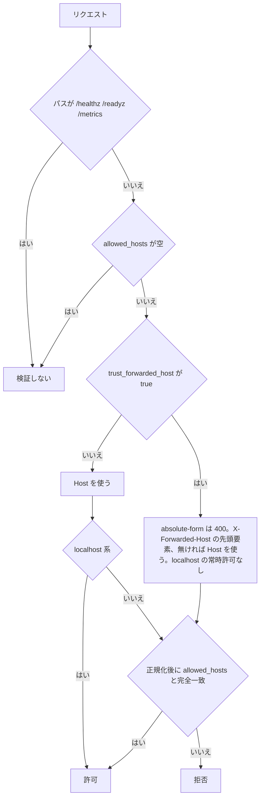

# 設定

設定は YAML 1 ファイルを入口とし、パースの前に環境変数を展開する。この 1 本だけを設定の入口にする。

## 方針

設定の入口は YAML 1 ファイルと環境変数の展開だけにする。CLI フラグは起動形態を表すものに限り、設定値そのものはフラグで渡さない。

入口は「YAML 1 ファイル + `${VAR}` 展開」のみ。フラグは `--config` のパスと `--all` / ロール選択などに限る。

## 展開方式

展開は YAML をパースする前の生テキストに対して常に行う。未定義の変数があれば、起動時に失敗させる。

Grafana Loki / Tempo の `-config.expand-env` と同じ生テキスト展開で、実装は [drone/envsubst](https://github.com/drone/envsubst) である。`${VAR}` と `${VAR:-default}` のシェル風記法を使える。

展開は常時オンにする。Loki がオプトインなのは後方互換のためで、グリーンフィールドには不要だからである。リテラルの `${` は `$$` でエスケープする（エンコードコマンド内など）。

標準ライブラリの `os.ExpandEnv` は使わない。未定義変数を気づかないうちに空文字にするため、パスワード未設定のまま起動して原因の分からない認証エラーになる。代わりに `LookupEnv` で未定義を検出し、**起動時に「未定義: POSTGRES_PASSWORD」と fail-fast する**（crash-only 方針と整合。[overview.md](overview.md) 参照）。

YAML ライブラリは goccy/go-yaml を使う。yaml.v3 は事実上メンテナンスが止まっている（2026 時点）。

### 機微情報の供給

アプリから見える機微情報は常に環境変数だけなので、機構 1 つで全環境をカバーできる。環境ごとの供給元は次の通り。

- 自宅 (Docker Compose): `.env` / `env_file:`
- 自宅 (systemd): `EnvironmentFile=/etc/rokuban/secrets.env`
- k8s: `Secret` → `envFrom` / `secretKeyRef`（config 本体は ConfigMap）

## スキーマ構造

設定のトップレベルは関心事ごとに切る。個々のキーの判断は、この下の節に書く。

### 関心事別にセクションを切る

トップレベルはロール別に切らず、関心事別に構成する。ロール別 Deployment でも config は同一ファイルを共有し、ロールで切ると streamer と worker が同じ ffmpeg 設定を二重に持つためである。各ロールは自分に関係するセクションだけを読む。

### リファレンス

キーの網羅の基準は、リポジトリ直下のコメント付きサンプル設定ファイルである。この文書の表はキー・既定値・一言に留め、値を選んだ理由だけを各節に書く。

[`config.example.yml`](../config.example.yml) の YAML を写さないのは、片方だけ直って気づかないうちにずれるためである。既定値の実装は `internal/config/config.go`（`defaults()` と各 `applyDefaults`）にある。

#### サーバーから CM 検出までのキー

キーと既定値の表である。判断は下記の該当する節にある。

| キー | 既定値 | 説明 |
|---|---|---|
| `server.listen` | `":40773"` | HTTP 待ち受け（mirakc の 40772 の隣） |
| `server.allowed_hosts` | `[]` | Host の許可リスト |
| `server.trust_forwarded_host` | `false` | `X-Forwarded-Host` を検証するか |
| `db.host` / `db.user` / `db.password` / `db.database` | —（必須） | PostgreSQL 接続情報 |
| `db.port` | `5432` | |
| `db.sslmode` | `disable` | |
| `db.max_conns` | `0`（roles から自動算出） | プロセスが持つ唯一のプールの上限 |
| `db.api_statement_timeout` | `0`（= 30s） | api を含むプロセスの statement timeout |
| `mirakcs` | —（必須。既定なし） | mirakc の `{site, url}` 配列 |
| `storage.media_dir` | —（必須） | 原本の ingest 先 |
| `storage.scratch_dir` | `/var/tmp/rokuban` | ローカルスクラッチ |
| `storage.accel_location` | `""`（Go が直接配る） | X-Accel-Redirect の location |
| `ingest.concurrency` | `3` | mirakc サイトあたりの同時転送数 |
| `ingest.stall_timeout` | `30s` | 転送の無進捗検知 |
| `epg.sync_interval` | `10m` | EPG の全量取得間隔 |
| `epg.retention_grace` | `24h` | 放送終了から番組を刈り取るまでの猶予 |
| `ruler.max_deletes_per_pass` | `0`（= 50） | 大量削除ブレーカーの閾値 |
| `reconciler.start_delay_grace` | `0`（= 3m） | 開始遅延検出器の猶予 |
| `worker.periodic_jobs` | `true` | 定期ジョブをプロセス内で投入するか |
| `worker.queues` | `[]`（全キュー） | worker ロールが引くキューの絞り込み |
| `encode.ffmpeg` / `encode.ffprobe` | `ffmpeg` / `ffprobe` | PATH 検索。フルパス指定可 |
| `encode.concurrency` | `1` | encode キューの MaxWorkers |
| `encode.thumbnail_concurrency` | `1` | thumbnail キューの MaxWorkers |
| `encode.profiles` | `[]` | 構造化エンコードプロファイル |
| `cm_detect.enabled` | `false` | CM 検出を有効にするか |
| `cm_detect.binary_dir` | `/usr/local/bin` | JLSE のコマンドの配置先 |

`mirakcs` は `site` も既定なしで各要素に必須である。`storage.media_dir` は、fsync・close・同一 FS rename・親ディレクトリ fsync を保証するローカル FS / JuiceFS / NFS を指す。FUSE S3 は原本 ingest 先にしない。`storage.scratch_dir` は worker ロールでは空にできず、起動時に拒否する。

`ingest.concurrency` は `チューナー数 + 全速 pull の許容本数（1〜2）` で決める。既定 3 は 2 チューナー機の下端で（[録画](recording.md) §5.4）、4 チューナー機では 5〜6 になる。接続プールの予算はこの値に追随する（[DB 運用](operations/database.md)）。

`epg.retention_grace` は ruler の GC（予約と番組単位の意図）も同じ猶予に使う。**エッジの滞留を N 日許すなら N 以上が要る**（[ストレージ](storage.md) §6「凍結が依存する寿命と、エッジの滞留の交点」）。

`encode.profiles` の形はサンプル設定ファイルにある。`rate` は rescue 締切の倍率で、既定は 4.0 である。`cm_detect.enabled` を有効にすると、ingest 時に CM 検出を録画へ凍結し、worker の定期投入が有効になる。`cm_detect.binary_dir` には JLSE の `logoframe` / `chapter_exe` / `join_logo_scp` を置く。

#### ライブ視聴・webhook・cleanup・log のキー

キーと既定値の表の続きである。

| キー | 既定値 | 説明 |
|---|---|---|
| `live.enabled` | `false` | ライブ視聴のルートを登録するか |
| `live.ffmpeg` | `ffmpeg` | PATH 検索 |
| `live.ffprobe` | `ffprobe` | 字幕ストリーム判定。PATH 検索 |
| `live.captions` | `false` | ARIB 字幕を WebVTT で出力するか |
| `live.segment_dir` | —（`enabled: true` なら必須） | HLS セグメントの書き出し先 |
| `live.max_sessions` | `4` | プロセスローカルの同時セッション上限 |
| `live.idle_timeout` | `30s` | サービス単位の idle GC 猶予 |
| `live.tuner_priority` | `1` | mirakc への X-Mirakurun-Priority |
| `live.hwaccel` / `live.input_extra_args` | なし | HW アクセラレーション / 入力側追加引数 |
| `live.profiles` | —（`enabled: true` なら 1 つ以上必須） | HLS 用プロファイル |
| `webhook.url` | `""`（no-op） | POST 先 |
| `webhook.secret` | `""` | 非空なら `X-Rokuban-Webhook-Secret` ヘッダに載せる |
| `webhook.timeout` | `5s` | 1 回の要求のタイムアウト。失敗時は同期で 1 回だけ再試行 |
| `webhook.events` | `[]`（全イベント有効） | 配送イベントの許可リスト |
| `cleanup.trash_retention` | `0`（= 30 日） | ごみ箱（`recordings.deleted_at`）の猶予 |
| `cleanup.orphan_mtime_grace` | `0`（= 7 日） | 孤児候補にするまでの mtime 猶予 |
| `cleanup.orphan_age` | `0`（= 14 日） | 孤児候補を自動回収または報告するまでの期間 |
| `cleanup.max_deletes_per_pass` | `0`（= 100） | 一括削除ブレーカーの閾値 |
| `cleanup.missing_asset_age` | `0`（= 24 時間） | 実体ファイルが無い候補を報告するまでの期間 |
| `log.level` | `info` | debug / info / warn / error |
| `log.format` | `json` | json / text |

`live.captions` には `libaribcaption` 入りの FFmpeg が必要である。`live.profiles` の形（`scaler` / `crf` / `qp` を含む）はサンプル設定ファイルにあり、`segment_seconds` の既定は 2、`playlist_size` の既定は 6 である。判断は下記「live」と「encode/live の HW エンコード」にある。

`cleanup.trash_retention` はごみ箱の猶予である（[storage.md](storage.md) §7）。`cleanup.max_deletes_per_pass` はソースを問わず 1 パス全体の合計に対して働く（ruler と同じラッチ式）。`cleanup.missing_asset_age` は、「active なのに実体ファイルが無い」候補の報告までの期間である。自動削除はしない（[storage.md](storage.md) §7「孤児回収の逆」）。

`log.*` は config を読む全サブコマンドに共通の入口で、`slog` の既定ロガーへ適用される。対象は server / migrate / rescue / enqueue / catalog / config validate である。config の読み込みより前に出るログだけは既定（text 形式・Info 以上）のままになる（`--config` のパース失敗など）。


### 必須キー

最小構成で書くのは 3 つだけで、残りは全部既定値を持つ。最小構成は 10 行程度に収まる。

3 つは `db`（資格情報）、`mirakcs`（下記「mirakc レジストリ」参照）、`storage.media_dir` である。

### db の運用ノブ（max_conns / api_statement_timeout）

接続プールの上限と api ロール向けの statement timeout の 2 つで、詳細は [operations.md](operations.md) §3「DB 運用」に決まっている。

`db.max_conns` は、プロセスが常に 1 個のプールしか持たず全ロールが共有するため、未指定（0）なら起動時の roles からロール別 budget を合計して自動算出する。`db.api_statement_timeout` は api ロールを含むプロセスのプール全体に適用される（monolith では worker 側にもかかる）。既定は 30s である。

### ingest.stall_timeout

Work slice 内の転送で無進捗を検知する時間で、既定は 30 秒である。この時間バイトが進まなければ接続を切り、temp の offset から Range 再開する。

4 分の slice は有限な Work Timeout で snooze し、同じジョブを再開するため、この値は録画全体の時間を制限しない（[recording.md](recording.md) §5.3）。遅い回線や大きな録画で接続断と判定される場合は延ばす。

### サーキットブレーカーと検出器の閾値

削除数の上限は、一度に消える予約の数を抑え、超えると削除を止めて手動で再開するまで止まり続ける。開始遅延の猶予は、録画が始まらない異常を検出してアラートするまでの待ち時間で、短すぎると正常でも誤検知する。

`ruler.max_deletes_per_pass` は、1 サイト・1 パスで実行してよい導出削除数の上限である。超えたら削除を一切実行せず、大量削除サーキットブレーカーとして発動する。数えるのは「ルールが base を供給しているのに desired から外れた」削除だけである。

**ユーザーが投資を手放す書き込み（intent skip / intent クリア / 最後の investment だった overrides の削除）をしない限り起きない削除は、数にも入らず、発動中でも実行される**。境界も同節にある（[recording.md](recording.md) §3.2）。

発動すると、手動で `POST /api/sites/{site}/breakers/ruler_deletes/resume` するまで止まり続けるラッチになる。件数が閾値以下に戻っても自動では解けない（[recording.md](recording.md) §3.2「大量削除サーキットブレーカー」）。下げると EPG の一時的な欠損やルールの一括編集で発動しやすくなる代わりに、誤判定で一気に失う予約の上限が下がる。既定値 50 は、通常運用で 1 サイトが同時に抱えるアクティブ予約数を明確に超える値として選んである。

`reconciler.start_delay_grace` は、開始遅延検出器（[recording.md](recording.md) §3.3）の猶予である。開始時刻にこの時間を足した時刻を過ぎても録画の開始（`recordings.started_at`）が観測されない予約を検出して、アラートする。mirakc 側の未知の不具合への保険で、EPGStation#724 のチューナー再接続ハングで開始が 10 分遅延した実例がある。開始直後は mirakc の SSE 到達と watcher の処理に遅れがあるため、短すぎると正常な録画開始でも誤検知してアラートが常時鳴る。

### worker.periodic_jobs と worker.queues

定期ジョブの設定は、プロセス内で定期ジョブを投入するかを決め、k8s では無効にして外部の CronJob から投入する。キューの設定は、worker が引くキューを絞る。空なら全部で、引数でも指定できるが両方指定は起動エラーになる。

`worker.periodic_jobs` の対象は `rokuban enqueue` で投入できるジョブと同じ集合である（`rokuban enqueue --help`）。`cm_detect_reconcile` だけは `cm_detect.enabled` が条件になる。k8s では false にし、CronJob から `rokuban enqueue` で投入する。true だと ScaledJob の 1 件消化モード（`--once`）が起動を拒み、投入元も CronJob に一本化できないためである（[data.md](data.md) §2）。

`worker.queues` は、空なら全キューを引く。ロールを増やさずに「ruler / reconciler だけ別 Pod」を実現するための knob である。同じ指定を `--queues` で argv からもできるが、**両方指定は起動エラー**になる。k8s では ConfigMap 1 個を全 Pod で共有し、Pod ごとの差分を argv に寄せるためである（[operations.md](operations.md) §5）。

書くのは論理名で、物理名は書かない。使えるのは `ingest` / `epg` / `ruler` / `reconciler` / `watcher` / `encode` である。`thumbnail` / `cleanup` / `storage` / `cm_detect` / `default` も使える。site 単位のキューの物理名への展開と、ロールとの関係は [operations.md](operations.md) §5 を参照する。worker ロールが無いプロセスは、この設定に関わらずキューを引かない。

### ffmpeg の存在検査

ffmpeg の存在検査は、その ffmpeg を使うロールが起動するときだけ行う。api ロールは検査しない（不変条件 4）。

`encode.ffmpeg` / `encode.ffprobe` は、worker ロールが encode/thumbnail キューを購読するときだけ LookPath で存在検査する。購読するのは、絞り込みが無い（`worker.queues` が空で `--queues` も無い）か、encode/thumbnail を含むときである。`live.ffmpeg` は `live.enabled: true` の streamer 起動時だけ検査する。

### CM 区間の検出

CM 区間の検出は既定で無効で、有効にすると取り込み時にこの設定が録画ごとに凍結される。無効のデプロイでは、API が録画ごとの有効化と再検出の要求を 409 で断る。

`cm_detect.enabled` の既定は `false` である。有効にすると、ingest がこの値を録画単位の `recording_encode_policy.cm_detect` に凍結し、worker が 15 分ごとに必要な検出を投入する。録画詳細の PATCH で個別に有効化できるが、`enabled: false` のデプロイでは API が `cmDetect: true` と再検出を 409 で断る。誰もジョブを積まず、`until_encoded` の原本が結果を待って残り続けるためである。

worker 起動時に、`cm_detect.binary_dir` の 3 コマンドと ffprobe（原本の実尺を読む）と固定ルール `/usr/local/share/rokuban/cm_detect/JL_標準.txt` を検査する。これらは `Dockerfile.full` にだけ含まれ、公式イメージには含まれないため、JLSE 対応には full イメージを使う。

`cm_detect` キューは同時実行数 1 で動く。検出が完了するか 3 回失敗するまで、`until_encoded` の原本は削除対象にしない。

### live

ライブのルートを登録するのは streamer ロールだけである。セグメントの書き出し先は既定値が無く、有効なら必須で、複数プロセスで共有しない。同時セッション数の上限はプロセスごとの値で、全体の天井ではない。

無効（既定）なら、ffmpeg の無い公式イメージで streamer を起動する構成（録画配信とサムネイルのみ）を壊さない（不変条件 4）。

`live.enabled` だけは `GET /api/capabilities` の `live` にも出る。フロントは config を読めず、これが無いと無効な機能への導線を出し続けるためである。ロール分割構成でも config ファイルは共有する（上記「関心事別にセクションを切る」）ので、値はそのまま公開面に写し、streamer には問い合わせない（不変条件 1）。

この値を返すのは api ロールのプロセスに限らない。REST の生成ルートはロールで絞られないので、HTTP を持つどのプロセスに聞いても同じ答えになる。そうしないとロールごとに答えが割れる（[api/rest.md](api/rest.md)「機能の有効/無効は能力 API で観測する」）。答えが表すのは常に「この config が有効か」であり、**「api の config では有効だが streamer を動かしていない」構成では導線が出る**（押した先はプレイリストの 404）。

#### セグメントの書き出し先

書き出し先は、録画バッファとは別ディスクにする。

`live.segment_dir` が空だと起動時エラーにする。適当なローカルパスへ気づかないうちにフォールバックすることはしない。録画バッファ（mirakc `recording.basedir`）とは別ディスクにする（tmpfs 前提。k8s なら `emptyDir: {medium: Memory}`）。

起動時（HTTP リスナーが立つ前）にこのディレクトリの中身を掃く。tmpfs はノード再起動でしか消えないため、前回プロセスの残骸（SIGKILL 等で SIGTERM の後始末が効かなかった場合）が毎起動で必ず消える。`segment_dir` 自体は消さない。k8s の `emptyDir` を直接マウントする構成では、Linux はマウントポイント自体への rmdir を EBUSY で拒む（Linux コンテナで実測済み）。中身だけを掃けば毎起動 Warn ログは出ない。推奨値 `/dev/shm/rokuban-live` のように tmpfs のサブディレクトリを使う構成では、そもそもマウントポイントではないのでこの問題は起きない。

**複数プロセス / 複数レプリカで共有しない。** 起動時の掃除は「自分がこのパスの唯一の書き手である」という前提に立つ。共有すると後発の起動が先発の生きているセッションディレクトリを消す（視聴は一度途切れるが、次のプレイリスト要求で新しいセッションが起きて自己修復する）。

追っかけ再生は録画時間ぶんの EVENT セグメントを idle GC まで保持する。同時視聴する録画の時間・本数・profile の bitrate を掛け合わせて tmpfs 容量を見積もる。

#### セッション・猶予・優先度・プロファイル

離脱ヒントの猶予は導出し、優先度は録画より低く保つ。

`live.max_sessions` は、このプロセスが同時に持てるライブ / 追っかけセッション（≒ ffmpeg プロセス）数である。プロセスローカルな上限であり、グローバルな天井（チューナー数、mirakc が裁定）ではない（[operations.md](operations.md) §5「既定を 1 にする根拠」）。

`live.idle_timeout` はサービス単位の idle GC 猶予で、この時間セグメント要求が来なければ ffmpeg を止める（クライアント 1 人ごとの生存は追わない）。離脱ヒント（`POST .../live/leave`）を受けたときに詰める短い猶予は、設定キーにしない。`3 × 最長の live.profiles[].segment_seconds + 2s`（既定 8 秒）として導出する。

この猶予は `idle_timeout` ではクリップしない。クリップすると `segment_seconds: 6` + `idle_timeout: 2s` のような設定で猶予がセグメント長を下回り、leave が「他人の視聴を切る道具」になってしまう。猶予が `idle_timeout` 以上になる設定では、ヒントは詰める先が「いま」より後ろにならないので no-op になる（起動を止めるより運用者の意思を尊重する）。

猶予は「生きている視聴者の次の要求が来るまでの間隔」より長くなければならない。その間隔を決めているのはセグメント長そのものなので、独立したキーにすると 2 つの値が矛盾する組み合わせを運用者が書けてしまう（[api.md](api.md) §ライブ視聴の HLS「離脱は『ヒント』であって停止命令ではない」）。config と DB の境界と同じく、別の値から必ず導けるものはキーにしない。

`live.tuner_priority` は mirakc への X-Mirakurun-Priority で、ruler が生成する schedule の既定 priority（10）より低くする（[recording.md](recording.md) §2「チューナー調停」）。**Rokuban はこの不等式を強制しない。** ルールの priority は DB 側（`rules.priority`、既定 10）でユーザーが自由に変えられ、ライブ側は config 側なので、両者を跨いで比較検証する権威がどちらにも無い。ユーザーがルールの priority を 0 や 1 まで下げると、この既定値のままではライブが録画に勝ってしまう。運用者が両方の値を意識して選ぶ前提とする。

`live.profiles` は `encode.profiles` とは別の構造体である。HLS はセグメント長・プレイリスト長という VOD には無い制約を持つ。`name` は `?profile=` から参照する一意な名前で、英数字・ハイフン・アンダースコアのみ（セグメントファイル名の接頭辞に使うため）。ISDB-T の映像は MPEG-2 でブラウザの HLS 経路では事実上再生できないため、H.264 への変換が前提となる。この並びが `/live` の画質セレクタの並びで、先頭が `?profile=` 省略時の既定になる。一覧は `GET /api/live-profiles` が返し、名前と `height` だけで、コーデック・品質・extra_args は出さない。

### encode/live の HW エンコード

構造化するのは、追加引数では届かない位置、つまり入力より前のオプションとアプリが握るスケール filter だけである。コーデック指定より後ろのオプションは既存の追加引数で足りるので構造化しない。

届かない位置とは、`-i` より前のオプションと、アプリが `-vf` を握っているスケール filter である。コーデック指定より後ろのオプション（`extra_args` が既に出ている位置）は既存のキーで足りる。`-global_quality` / `-cq` / `-q:v` のような品質オプションもこれに当たり、キー化しない。

| キー | 説明 |
|---|---|
| `encode.profiles[].scaler` / `live.profiles[].scaler` | スケール filter の系統名 |
| `encode.profiles[].deinterlace` / `live.profiles[].deinterlace` | インターレース解除の系統スイッチ |
| `encode.profiles[].qp` / `live.profiles[].qp` | `-qp`（品質指定） |
| `encode.profiles[].hwaccel` | プロファイル毎の `-i` 前置ブロック |
| `live.hwaccel` | `live:` 直下の `-i` 前置ブロック |
| `encode.profiles[].input_extra_args` / `live.input_extra_args` | `-i` 直前の追加引数 |
| `encode.profiles[].extra_args` / `live.profiles[].extra_args` | 既存キー（改名なし） |
| `encode.profiles[].subtitles` | `webvtt` のみ |
| `encode.profiles[].cut` | カット版を出力するか（下記「カット版」） |
| `live.captions` | WebVTT 字幕 rendition 付きの master にするか |

字幕は、VOD では `encode.profiles[].subtitles` が原本の ARIB 字幕を encoded ファイル隣の `.vtt` サイドカーに出力する。ライブでは `live.captions` を `true` にすると、全プロファイルを 1 つの master playlist にまとめ、WebVTT 字幕 rendition を出力する。字幕なし番組では映像・音声のみの master を出力する。どちらも libaribcaption 入りの ffmpeg が必要で、ライブは無ければ起動エラーになる。複数プロファイルの `segment_seconds` / `playlist_size` は同一値が必要である。

起動エラーになる組み合わせは次の通り。矛盾していて実行時に決められない設定である。

- `crf` と `qp` の同時指定（優先順位を実行時に決めさせない）
- 未知の `scaler`
- `height` が 0 なのに `scaler` を書く
- `hwaccel` ブロックがあるのに `kind` が空
- `crf`・`qp` の負値

#### scaler・deinterlace・hwaccel

filter の文字列は直接書かせず、系統名と真偽値で指定する。hwaccel は VOD ではプロファイルごと、ライブでは live セクション直下に置く。

`scaler` は系統名を取り、`-vf` の filter 文字列そのものは受け付けない。既定は `""`（= `software`）で、許す値は `software` と `vaapi` のみである。qsv / cuda はこの環境の ffmpeg で `scale_qsv` / `scale_cuda` の綴りを確認できておらず未検証のため、除外してある。`height` が 0 のときに書くと起動エラーになる。

`deinterlace` の既定は `false`（現行互換）である。`true` なら `scaler` から software=`yadif` / vaapi=`deinterlace_vaapi` を導出し、scale があれば解除の後ろに連結する。bool にして filter の実体を `scaler` から導出するのは、矛盾した設定を表現できないようにするためである。`scaler: software` なのに `deinterlace_vaapi` を書く設定や、`-vf` を別名で自由に書く設定がその例である。`deinterlace: false`（省略）のときは、生成する argv を従来から変えない。

`encode.profiles[].hwaccel` は、プロファイル毎の `-i` 前置ブロックで、`kind` は必須、`device` と `output_format` は任意である。VOD はプロファイルごとに入力を開き直すため、プロファイル単位で持たせられる。`live.hwaccel` は `live.profiles[]` の中には置けず、`live:` 直下に置く。ライブは 1 回の ffmpeg で入力 1 本・出力 N 本なので、プロファイル毎に持たせると「プロファイル 2 つが別の hwaccel を要求する」という表現できない設定が書けてしまう。セクション直下に置けば、それが表現不可能になる。

`encode.profiles[].input_extra_args` と `live.input_extra_args` は、`-i`（VOD）/ `-f mpegts -i pipe:0`（live）の直前に追加する引数である。

device ノードのマウントはデプロイ側の仕事である（k8s `resources.limits` / Docker `--device`）。`hwaccel.device` の存在は起動時に検査しない。公式イメージや device の無い CI を壊すためである。無い device を書いたプロファイルは、ジョブ / セッションの失敗として現れる。

#### argv の順序

ffmpeg の argv は、アプリ所有の先頭、入力側の引数、入力、変換、出力側の引数、アプリ所有の末尾の順に並ぶ。

VOD の順序は次の通り。

```
-hide_banner -nostats -y                                      # アプリ
[-hwaccel K] [-hwaccel_device D] [-hwaccel_output_format F]   # hwaccel ブロック
[input_extra_args…]                                            # ユーザー（入力側）
-i INPUT                                                       # アプリ
-c:v VC -c:a AC
[-vf <deinterlace[, scaler が決めた scale]>]                   # deinterlace=true または height>0 のときだけ、常に 1 個
[-crf N | -qp N] [-preset P]
[extra_args…]                                                  # ユーザー（出力側）
-f CONTAINER -progress pipe:1 -loglevel error OUTPUT           # アプリ所有の末尾
```

ライブの順序は、同じ規則を入力 1 本・出力 N 本の形に展開したものである。入力側は `live.hwaccel` → `-probesize`/`-analyzeduration` → `live.input_extra_args` → `-f mpegts -i pipe:0` と並ぶ。そのあと、プロファイルごとに `-map`（映像 1 本と音声 3 本）→ `-c:v`/`-c:a` → 主 / 副の `-filter:a:N` と並ぶ。

その後ろに `[-vf]`（captions 有効時は `-filter:v:N`）→ `[-crf|-qp]` → `[-preset]` が続く。さらに `-force_key_frames` → `profile.extra_args` → `-var_stream_map` / `-master_pl_name` → `-f hls ...` と並ぶ。filter は `deinterlace` が true なら解除を先頭に置き、height があれば scale をその後ろに 1 個だけ連結する。音声 3 本の意味は [api/media.md](api/media.md) §音声にある。

**`extra_args` の位置が 1 点だけ動いた。** VOD 側は以前 `-f`（コンテナ）の後ろだったが、今は前に移った。「ユーザーのオプションはコーデック/品質/スケール指定の後・アプリ所有の末尾の前」という規則を VOD と live で 1 つにするためである。`-f` は下記「追加引数の許可リスト」に含まれないので、この移動でユーザーが相対順序に依存していた挙動が変わることはない。

### カット版（`encode.profiles[].cut`）

カット版を出すプロファイルを選ぶなら、カットしないプロファイルを 1 つ以上含める。原本は再生できず、確認に再生が要るので循環になるためである。自動検出のままではカット版を作らず、ユーザーが確認したチャプターだけが対象である。

**切る対象は録画側の事実としてチャプターが持ち、その出力に切り取りを適用するかは出力の性質としてプロファイルが持つ。** チャプターは自動検出（`cm_detect`）の結果をユーザーが確認したもので、その `cut=true` 区間が落ちる。自動検出のままでは作らない。誤検出のまま本編が削られ、原本がごみ箱を経由せずに消えると取り返せないためである。

カット版の相対パスには世代番号が入る（1 世代目から付ける）。チャプターを直しても自動では作り直さず、UI の「編集前の内容です」から `POST /api/recordings/{id}/encoded/{profile}/reencode` で作り直す（[storage/contract.md](storage/contract.md) §3）。

<details><summary>根拠</summary>

- 確認済みを示す行: `recording_chapter_ownership`
- 相対パスの列: `rel_path`
- 世代番号を含むファイル名の形: `…_{profile}.g{n}.{container}`

</details>

`cut: true` を選ぶ構成では、`cut` でないプロファイルを 1 つ以上含めること。原本 TS はブラウザで再生できないので、この循環になる。ルール保存・予約 overrides・事後追加 API・ingest の凍結の 4 経路が同じ判定を共有し、マージ結果が `cut` だけになった場合は凍結時に `cut` を落とす。意図は overrides に残るので、`cut` でないプロファイルを足せば戻る。

#### カット版の argv と切る時刻

カット版の argv は filtergraph で組み、時刻の原点は入力の最早の開始時刻である。

```
-hide_banner -nostats -y
[-hwaccel K [-hwaccel_device D] [-hwaccel_output_format F] | -vaapi_device D] [input_extra_args…]
-i INPUT
-filter_complex <trim/atrim → concat → deinterlace → scale>    # アプリが組む
-map [vout] -map [aout]
-c:v VC -c:a AC …
```

`hwaccel.output_format` があれば、通常の encode と同じ hwaccel 引数を `-i` の前に出す。省略時は従来の救済経路を使う。`hwaccel.kind: vaapi` なら `-vaapi_device D` を出す。各区間を映像は `trim=start=…:end=…`、音声は `atrim=start=…:end=…` で切り、`concat` したあとに、`scaler` から導出した deinterlace / scale を連結する。VAAPI の GPU 経路は `deinterlace_vaapi` → `scale_vaapi` を使い、`format=nv12,hwupload` は付けない。救済経路では CPU filter の後ろに `format=nv12,hwupload` を付ける。

映像を「最初の映像フレームから数えたフレーム番号」で切ると、放送 TS では映像だけがずれる。境界は同じフレーム番号から秒へ換算する（`frame / fps`）ので、区間ごとに A/V のずれが蓄積しない。trim の後に PTS から区間の開始時刻を引くのは、`concat` が各区間の先頭を 0 とみなすためである。`PTS-STARTPTS` は使わず開始時刻を引くことで、映像の先頭が区間の頭より遅れる場合も遅れを残す。

**出力側に `-map` を書けないので、アプリがストリームを選ぶ。** ffmpeg の既定の選択（映像は画面サイズが最大のもの、音声はチャンネル数が最大のもの、同点は若い番号）を ffprobe で再現する。再現しないとカット版だけ別のストリームが選ばれ、カットしない版と音声が食い違う。

字幕サイドカーは同じ ffmpeg 起動の別出力なので `trim` が効かない。書き出した後に同じ keep 区間の写像で時刻を付け替える。CM 区間の中に収まるキューは捨て、境界をまたぐキューは keep 側でクリップする。

カット版にだけ掛かる起動エラーは次の通り。HW フレームに CPU filter を掛ける組み合わせと、VAAPI の前提が揃わない組み合わせである。

- `hwaccel.output_format` があり、`height > 0` または `deinterlace: true` なのに `scaler: vaapi` でない。HW フレームの後ろに CPU filter は置けないため
- `hwaccel.output_format` を指定する場合は `vaapi` のみ。指定すると hwupload を付けないので、ソフトウェア形式を HW へ上げる手段が無いため
- `scaler: vaapi` で filter があるのに `hwaccel.output_format: vaapi` が無い。upload は filter 後なので VAAPI filter に CPU フレームを渡せないため
- `hwaccel.kind` が `vaapi` 以外。VAAPI scaler と救済経路を使えないため
- `hwaccel.kind: vaapi` なのに `device` が無い。`-hwaccel_device` または `-vaapi_device` に渡すものが無いため
- `extra_args` の `-map`。ストリームの並びはアプリが握るため（live と同じ理由）

HW フレームは trim と concat を通せる。VAAPI の GPU 経路は FFmpeg 7.1 以降を推奨し、5.1〜7.0 では救済経路を使う。

FFmpeg n5.1.6 / n9.0 の trim.c と avf_concat.c はフレーム内容を参照せず、HW pixel format を除外しない。avfilter.c はこれらの filter の入力 `hw_frames_ctx` を出力へ引き継ぐ。ffmpeg 9.0.2 の VideoToolbox で trim → setpts → concat → `scale_vt` → `h264_videotoolbox` を実測した。

5.1〜7.0 は MPEG-2 のデコード surface が固定 6 枚で、カット版では枯れて `get_buffer() failed` からつなぎ目にブロックノイズが出る。ジョブは成功扱いで終わるので、壊れたカット版がそのまま公開される。7.1 以降は動的プールになり、7.1.5-0+deb13u1 / libva 2.22.0-3 / iHD 25.2.3 でつなぎ目 3 の 30 分原本全体を処理しても `get_buffer() failed` は出なかった。未検証: 7.1 以降でつなぎ目の多い録画。

5.1〜7.0 は `-extra_hw_frames` で直さず、救済経路を使う。足りない枚数はつなぎ目の数で増えるので、固定値では足りない。5.1.9-0+deb12u1 / libva 2.17.0 / iHD 23.1.1 では、つなぎ目 1 は 1 枚、つなぎ目 3 は 4 枚の追加で解消した。つなぎ目 15 は 16 枚の追加でも `Cannot allocate memory` で止まった。救済経路は `-hwaccel` を付けずに CPU でデコードするので、このプールを使わない。

#### 追加引数の許可リスト

値の個数まで既知の許可リストにあるものだけを受け付ける。

`extra_args` / `input_extra_args` で値を取らないのは `-an` `-vn` `-sn` `-dn` `-shortest` `-nostdin` `-re` である。直後の 1 トークンを値として取るのは `-movflags` `-map` `-global_quality` `-cq` `-q:v` `-b:v` `-b:a` である。`-probesize` `-analyzeduration` `-extra_hw_frames` も 1 トークンを取る。値を取らないフラグも明示しているため、`["-an", "/tmp/evil.mp4"]` のように 2 本目の出力パスをフラグの値に見せかけることはできない。`-filter:v:0` / `-lavfi` のような filtergraph の別名・ストリーム指定子付き表記も許可リストの外であり、完全一致の denylist が別名を取りこぼす形は採らない。

**ライブではさらに `-an` `-vn` `-sn` `-map` を拒否する。** ライブはストリームの並び（映像・音声 rendition 3 本・字幕）を `-var_stream_map` で持つ。並びを変えると ffmpeg が起動時に落ち、利用者には 504 しか見えない（[api/media.md](api/media.md) §音声）。

### mirakc レジストリ: `mirakcs:`

mirakc は site と url だけを持つ要素の配列で登録し、単一でも 1 要素の配列で書く。site は省略できず、文字種と長さに制約があり、重複もできない。プロセスが束縛する site は、設定キーにせず起動時のフラグで表す。

`mirakcs:`（`{site, url}` の配列）に mirakc エンドポイントを登録する。単一オブジェクトの糖衣は無い。複数 mirakc を許すと programId のスコープが mirakc 単位になり、予約・EPG 射影・ingest の全スキーマに「どの mirakc か」が波及するため、要素ごとに `site` でスコープする。チューナー集約は mirakc 自身のリモートチューナー機能で賄えるため、単一サイトなら Rokuban 側は 1 エンドポイントで足りる。ハブ mirakc への集約は採らない。WAN リアルタイム依存になり、録画中の回線瞬断が録画欠損に直結するためである。

`site` は DB の全テーブルの `site` 列の値になる。API の資源同定（`/api/sites/{site}/...`）の権威は `config.mirakcs` レジストリに site が存在するかであり、api 自身は不変条件 1 によりどの site にも束縛されない。

旧 `mirakc:`（単数）キーを書いたまま起動すると `unknown field "mirakc"` で fail-fast する。`mirakcs:` の 1 要素（`site` と `url` を書いた形）に書き換える。

#### site の規則

site は省略も重複もできず、文字種と長さを制約する。削除 reconcile のブレーカーだけは site を持たない。

- `mirakcs:` は非空が必須である。空（未指定含む）は起動エラーになる
- 各要素の `site` は省略できない。`mirakc:`（単一形式）の時代のような "default" への既定値フォールバックは無い。`site` を書かない要素は空文字列のまま下記の構文制約に落ちて起動エラーになる
- 要素は `site` と `url` の 2 つだけである。`storage` / `worker` / `ingest` 等のチューニング値は要素に入れない。アーカイブは単一（`media_assets` に site 列が無い）であり、`worker.queues` 等はデプロイ時のパラメータで、site の属性ではない。site ごとのチューニング値は、それを読むコードができたときに足す（不変条件 11）
- レジストリ内の site 名の重複も不可である。違反はすべて起動エラーとして全件列挙される（規約 4）
- 削除 reconcile のサーキットブレーカー（`breaker.DeleteReconcile`）は site 列を持たず、値は空文字列である。他の 2 種のブレーカー名のように実際の束縛 site をキーにしない。再開は site を含まない `POST /api/breakers/delete_reconcile/resume` を使う。

<details><summary>根拠</summary>

- site 列を持たないブレーカー: `breaker.DeleteReconcile`、`internal/worker/delete_reconcile.go`
- 理由と経緯の置き場所: `DeleteReconcileWorker` の doc コメント

</details>

構文は `^[a-z0-9]([_-]?[a-z0-9])*$` で、53 文字以内である。キュー名を site で修飾するため、緩めると site 名がキュー名として弾かれる。上限の 53 は、River のキュー名上限 64 から、site 修飾される論理キューのうち最長の prefix（`reconciler_`、11 文字）を引いた値である（64 − 11 = 53）。この検査は設定のロード時に行うので、`--sites` で束縛していないレジストリ上の site 名も対象になる。束縛するときに初めて起動エラーになる、ということは無い。

`catalog` と `thumbnails` は site 名にできない。この禁止は今は必須ではない。`rel_path` の前置が `sites/{site}/` になったので、site 名がトップレベルの `catalog/` / `thumbnails/` と直接衝突することはない。緩めても得られる自由度（この 2 語を site 名にしたい運用要求は無い）が緩めるコスト（`internal/config` のバリデーション・テストの変更）に見合わないため、禁止だけ残してある。トップレベルディレクトリ名の予約（`catalog/` / `thumbnails/` / `sites/` の 3 つ。今も必要）とは別の話で、[docs/storage.md](storage.md) §5 で分けて説明している。

#### プロセスの site 束縛

束縛は起動時のフラグで表す。watcher と worker は複数の site を束縛でき、中央プロセスの worker は site 非依存のキューに絞る。

`server` サブコマンドの `--sites` フラグで表す。多サイトでどのロールがどのプロセスに乗るかは [docs/overview.md](overview.md) の役割分類に決定済みである。site に縛られるのは「mirakc に到達する必要がある仕事」（watcher / ingest / reconciler / epg / record_sweep / ライブ streamer）だけである。DB もアーカイブも単一なので、api / notifier / 録画配信 streamer / ruler / encode / thumbnail / 削除 reconcile は site 非依存の中央プロセスになる。

`--sites` を設定キーにしないのは、下記「やらないこと」の CLI フラグ方針に沿うためである。`--all` / ロール選択と同じ「起動形態」の軸に当たる。

未指定でレジストリが 1 要素ならその 1 つに束縛し、2 要素以上なら起動エラーにする（暗黙に全部にしない）。`--sites=`（明示的な空）は束縛なしの中央プロセス、`--sites tokyo` は tokyo への束縛である。`--sites tokyo,tokyo` のような重複は 1 つに畳む。束縛数の判定が紛らわしいエラーにならないようにするためである。

- `watcher` ロールは 1 プロセスが N サイトを束縛できる。束縛サイトごとに独立した goroutine と advisory lock（`watcher:<site>`）を持つため、複数サイトを同じプロセスで watch しても互いに干渉しない。0 サイト束縛では watch 対象が無いだけで、起動エラーにはしない
- `worker` ロールも 1 プロセスが N サイトを束縛できる。mirakc クライアントは site → 値の map になり、site 単位のキュー・定期ジョブが対象にする束縛サイトは集合になった。site 単位のキュー（ingest/epg/reconciler/watcher）は束縛サイトの数だけ物理キュー（`<queue>_<site>`）を購読する。site 単位の定期ジョブ（epg_sync/tuner_sync/ruler_pass/reconcile_pass/record_sweep）も束縛サイトごとに 1 本ずつ登録する
- 0 サイト（中央プロセス）の worker は、`worker.queues` / `--queues` を site 非依存キューに絞ったときだけ許す。`worker.queues` が空（既定=全キュー）のまま、または site 単位のキューを含んだまま 0 サイトで起動すると、届く site 単位のジョブは束縛サイトの集合のどれとも一致せず全滅して再試行し続けるだけになる。そのため起動エラーにする
- どのキューが site 単位か、物理キュー名への展開は [operations.md](operations.md) §5 を参照する
- `enqueue` サブコマンドは site 束縛ジョブだけ `--site` で投入先を選ぶ（未指定かつレジストリ 1 要素ならその 1 つ、2 要素以上なら必須）
- site 非依存ジョブには `--site` を付けない。どれが site 非依存かは `rokuban enqueue --help` が列挙する（詳細は [operations.md](operations.md) §1「ジョブ化されたループの監視」）
- `rescue` は site 非依存で、`--site` を持たない。catalog の各行は自分の site を持ち、catalog が無い場合のストレージ走査も `sites/{site}/` 前置から site を決める。前置の無いファイルは登録せず Warn にする

### server.allowed_hosts と server.trust_forwarded_host（X-Forwarded-Host は opt-in）

許可リストは DNS rebinding を防ぐ唯一の機構で、Host を正規化して完全一致で比べる。転送ホストはクライアントが自己申告できる値なので、明示的に有効にした構成でだけ検証対象にし、有効にすると localhost 系の常時許可は効かなくなる。

許可リストは DNS rebinding 対策で、アプリ内に認証を持たないため、この防壁の唯一の要になる（[api.md](api.md) §認証 帰結3）。localhost 系（`localhost` / `127.0.0.1` / `::1`）は、`X-Forwarded-Host` を検証対象にしておらず `Host` を直接使っているときに限り、許可リストの設定に関わらず常に許可する。`X-Forwarded-Host` はクライアント側が自己申告できる値なので、転送値にも同じ緩和を適用すると `X-Forwarded-Host: localhost` で許可リストを素通りできてしまう。

判定の流れは次の図の通り。



`allowed_hosts` が空でなく、かつ `/healthz` / `/readyz` / `/metrics` 以外のパスでは、判定の入力は `Host` ヘッダーである。ポート部が 1 文字以上の数字だけで構成されるときに限り、それを落とす。ポート部が数字だけでない場合（数値でない場合や空の場合を含む）は落とさず入力全体を比較対象にするため、`allowed_hosts` のどの値とも一致せず拒否される（fail-closed）。

比較は正規化後の完全一致で、正規化は「ASCII 範囲だけの小文字化」と「末尾ドット 1 個の除去」の 2 つだけを行う。`Host`（または `X-Forwarded-Host`）側と `allowed_hosts` の両側に同じ正規化が掛かる（`allowed_hosts` に大文字を書いてもよい）。接尾辞・ワイルドカードの一致は無い。

`allowed_hosts` が空（開発用にチェック無効）のときは、この検証自体が丸ごとスキップされ、absolute-form も拒否されない。`/healthz` / `/readyz` / `/metrics` の Host 許可リストの免除は [operations/monitoring.md](operations/monitoring.md) を参照する。

docker-compose の既定構成（`.env` に `ROKUBAN_ALLOWED_HOSTS` を設定しない）でも空になり、同じ緩和が掛かる。空のまま利用者が気付かず公開ポートに晒す事故を防ぐため、起動時に `allowed_hosts` が空なら WARN ログを出す。この WARN はロールに関わらず出る。OpenAPI 由来のルートはどのロール構成でも生えるため、ロール分割デプロイでは全 Pod が同じ判定になる。

#### 転送ホストの信頼

前段のプロキシが外来の値を必ず上書きする構成に限って有効にする。

**`X-Forwarded-Host` は `server.trust_forwarded_host: true` を明示した構成でのみ検証対象にする（既定 `false`）**。DNS rebinding の攻撃ページはブラウザから見て Rokuban と同一オリジンなので、CORS のプリフライトなしに任意のリクエストヘッダーを付けられる。前段にリバースプロキシが無い直接露出構成（`--all` の既定構成）を考える。ここで `X-Forwarded-Host` を無条件に信頼すると、攻撃ページが `X-Forwarded-Host: <allowlist に載っている値>` を自己申告するだけで許可リストを素通りできてしまう。

この値は `config.example.yml` に載る類の推測可能な名前である。前段に正しいリバースプロキシが居て、かつそのプロキシが外来の `X-Forwarded-Host` を必ず上書きする構成に限り、この設定を有効にしてよい。

`trust_forwarded_host: true` の構成では、`Host` がプロキシ自身の値（例: コンテナ内部の DNS 名）に書き換わり、元のクライアント向け Host は `X-Forwarded-Host` に移る。これを前提に、`X-Forwarded-Host` があればそちらを検証対象にし、無ければ `Host` を使う。nginx リファレンス構成では `proxy_set_header X-Forwarded-Host $host;` を設定する。`allowed_hosts` にはブラウザからアクセスする外部ホスト名（例: `rokuban.example.com`）を書く。この構成では localhost 系の常時許可は効かなくなるので、nginx 経由で `http://localhost/` を見る運用なら `allowed_hosts` に明示的に列挙する。

この構成では、リクエストラインに absolute-form（`GET http://host/path HTTP/1.1`）でホストを書いた要求は 400 で拒否する。Go 標準の HTTP サーバーは absolute-form の request-target が来ると `Host` ヘッダーを常に削除してしまう。そのためサーバー側からは「リクエストラインと `Host` ヘッダーが食い違うか」を判定できず、リクエストラインからこの許可リストを満たすことはできない。

`trust_forwarded_host` が既定の `false` のままの構成（直接露出）では、`X-Forwarded-Host` を一切見ず、常に `Host` で検証する。リバースプロキシ構成でこれを有効にし忘れると、`Host` がプロキシ自身の値のまま許可リストに弾かれるだけで、安全な側の結果になる（実害は 400 で気付ける）。

`X-Forwarded-For` / `X-Forwarded-Proto` / `X-Forwarded-Prefix` / `public_url` は、解釈も設定項目も持たない。理由は [api.md](api.md) §リバースプロキシ・フレンドリー要件「検討したが実装しないもの」を参照する。

<details><summary>根拠</summary>

- 標準の HTTP サーバーが absolute-form で Host を削除する挙動: `net/http`

</details>

### db は構造化フィールド

DB 接続情報は構造化フィールドで書く。1 本の DSN は採らず、パスワードの URL エスケープ事故を避ける。

`url:` 1 本の DSN は採らない。

### webhook のイベントとペイロード

webhook が送るのは、録画の完了・失敗、エンコードの完了・失敗、録画の削除の 5 種類である。受け側は、配送ごとに変わる識別子を使わず、種別・録画・プロファイル・試行番号の組で重複を判別する。

`webhook.events` の許可リストに書ける type と、共通 envelope は次の通り。

| type | 発火点 | 追加フィールド |
|---|---|---|
| `recording.finished` | watcher（`status` が finished へ遷移したとき 1 回） | — |
| `recording.failed` | watcher（mirakc の失敗イベントを受けるごと） | — |
| `encode.finished` | EncodeWorker（コミット成功時。冪等スキップでは発火しない） | `profile` |
| `encode.failed` | EncodeWorker（River の試行ごと） | `profile` / `attempt` / `maxAttempts` |
| `recording.deleted` | 削除 reconcile（ごみ箱の録画の最後のアセットを物理削除したとき 1 回） | — |

```json
{
  "id": "<配送単位の UUID>",
  "type": "encode.failed",
  "at": "<RFC3339 UTC>",
  "recordingId": 1,
  "site": "default",
  "title": "番組名",
  "status": "failed",
  "profile": "h264",
  "attempt": 3,
  "maxAttempts": 25
}
```

**`id` は配送ごとに変わる。** 同じ論理イベントが再送されうるので、受け側の冪等キーには `(type, recordingId, profile, attempt)` を使う。エンコード失敗は River が再試行するため、恒久的な失敗では試行ごとに配送される（最終試行だけ通知したいなら `attempt == maxAttempts` で絞る）。

`recording.deleted` は録画の寿命で決まり、アセットの kind では決めない。`keep_original: until_encoded` の原本削除は「録画が消えた」ことではないので発火せず（encoded で再生できる）、逆に原本を先に消してある録画のごみ箱削除では最後のアセットの削除で発火する。

絶対パス・credentials は載せない。1 パスの通知に時間上限があり、超過分は捨ててログに件数を残す（削除の進捗が webhook 先に引きずられないようにするため）。

## 規約

キーは snake_case で、期間は duration 文字列で書く。未知のキーは起動失敗にし、エラーは検出できるものを全件列挙する。

1. snake_case: キーは snake_case にする（Prometheus/Loki/mirakc に揃える）。JSON API 側の camelCase とは世界が違うので混在してよい
2. Go duration 文字列: 期間は `30s` / `5m` の `time.Duration` 文字列で書く（goccy/go-yaml のカスタム型 1 つで済む）
3. strict パース: 未知キーは起動失敗にする（goccy の strict モード）。`encode_profles` のような typo が気づかないうちにデフォルト動作になるのは、未定義環境変数の全件列挙 fail-fast と同じ思想で塞ぐべき穴である
4. エラーは全件列挙: 未定義環境変数・必須キー欠落ともに、検出できるものは全件列挙して起動失敗する（1 個ずつ直させない）

## config と DB の境界

**設定はデプロイ環境の性質、DB は運用中に UI から変えたい意思を持つ。** エンコードプロファイルは設定側に置き、ルールからは名前で参照する。自由形式のコマンド文字列とフィルタグラフの直接指定は許さない。

設定はそのホストやクラスタを再構築すると変わるもので、DB はルール・予約・視聴履歴のように UI から変える意思である。

エンコードプロファイルは config 側に落ちる。プロファイルの実体は「その環境の ffmpeg ビルドと HW (VAAPI/QSV/NVENC) で何ができるか」であり、`ffmpeg` パスと同じデプロイ属性である。DB のルールからは名前参照とし、ルール保存時に存在検証する（なければ 400）。自由形式の cmd 文字列は採らない（構造化フィールドから worker が引数を組み立てる）。HW エンコードも同じ構造化フィールドで表す（上記「encode/live の HW エンコード」）。`-vf`（filtergraph）を直接書けるキーも作らない。filtergraph は第 2 のコマンド言語であり、`scale_vaapi=...,drawtext=...` のような式が書けた時点で cmd を別名で解禁したのと同じになるためである。

`encode.profiles[].rate` は録画実尺に対する締切の倍率で、既定は 4.0 である。encode ジョブ投入時に録画の終了時刻と開始時刻の差と rate から締切を解決して args に保存する。これにより、JobRescuer を動かす leader と投入元の設定が異なっても、実行ジョブに対して同じ締切を使える。

締切は `max(1 時間, 実尺 × rate)` である。実尺は終了時刻と開始時刻の差を使い、取れなければ番組長で代用する。それも取れない場合と締切のない旧 args は 12 時間となる。River はこの値をそのまま ffmpeg の締切に使うので、短く見積もると長尺が毎回締切超過で失敗する。誤った締切超過より、死亡検知が遅れる方を選ぶ。

<details><summary>根拠</summary>

- 実尺の取得元: `recordings.ended_at - started_at`、`ended_at - started_at`
- 実尺が取れないときの代用: `program_duration_ms`

</details>

## 運用補助

運用者が使う補助は、設定を検証するコマンドと、キーの網羅の基準になるサンプル設定ファイルの 2 つである。

- `rokuban config validate`: env 展開 + strict パース + 必須検証だけやって終了する。ConfigMap 更新前チェックや CI に置ける
- `config.example.yml`: コメント付きでリポジトリに置き、キーの網羅の基準とする（ドキュメント生成までは YAGNI）

## やらないこと

設定まわりで採らない仕組みは、env による自動上書き、設定ファイルの分割、ホットリロードである。CLI フラグでの設定値渡しも採らず、フラグは起動形態を表すものに限る。

- env による config キーの自動オーバーライド（viper/koanf の多層マージ）は採らない。どの値がどこから来たか追いにくくなる割に、この規模では利得がない
- 設定ファイルの分割・include 機構は採らない。分離の必要があるのは機微情報だけで、それは env で足りる
- CLI フラグで設定値を渡すことは採らない。CLI フラグは `--config` のパスと `--all` / ロール選択などプロセスの起動形態に限定する。
  - 例外は「このプロセスが何を担当し、どう畳むか」を表すフラグに限る（`--sites` / `--queues` / `--once` / `--once-idle-timeout` / `--soft-stop-timeout`）。
  - `--queues` は config キー `worker.queues` と同じ値を取るが、その値自体がデプロイ時のパラメータであって環境の設定ではない。**両方指定は起動エラー**にして、値の出所が 2 つに分かれないようにしている。
  - `--once` とその `--once-idle-timeout` も argv 側に置く。前者は起動形態そのもので、後者はその形態にしか意味を持たない値なので、config キーにすると常駐プロセスにも見える場所に置くことになる。
  - `--soft-stop-timeout`（SIGTERM 後に実行中のジョブを打ち切るまでの猶予）も同じ扱いである。対になるのは k8s の `terminationGracePeriodSeconds` で、プラットフォーム側の SIGKILL が真の上限になる。その値はワークロードごとに桁で違う（数時間の encode と数秒の ruler）。共有 ConfigMap 1 個ではその違いを表現できず、同じ Pod spec に 2 つの数値を並べて書けることが対応関係を保つ唯一の手段になる。
  - k8s のロール分割では ConfigMap 1 個を全 Pod で共有し、Pod ごとの差分を argv に寄せるため、これらは argv 側に無いと ConfigMap が Pod セットの数だけ増える（[operations.md](operations.md) §5）
- SIGHUP 等のホットリロードは採らない。設定変更は再起動で反映する。crash-only + level-triggered 設計なら再起動は無害で、リロードは「どの値がいつから有効か」という追跡困難性を別の形で持ち込むだけである
