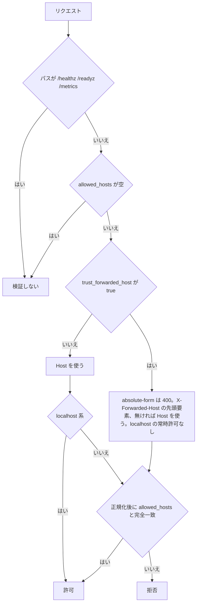

> [configuration.md](../configuration.md) §スキーマ構造のうち、allowed_hosts・db・webhook の節。索引から辿る。

### server.allowed_hosts と server.trust_forwarded_host（X-Forwarded-Host は opt-in）

許可リストはアプリ内に残る唯一のセキュリティ機構で、DNS rebinding を防ぐ。Host を正規化して完全一致で比べる。転送ホストはクライアントが自己申告できる値なので、明示的に有効にした構成でだけ検証対象にし、有効にすると localhost 系の常時許可は無効になる。

許可リストは DNS rebinding 対策で、アプリ内に認証を持たないため、この防壁の唯一の要になる（[api.md](../api.md) §認証 帰結3）。localhost 系（`localhost` / `127.0.0.1` / `::1`）は、`X-Forwarded-Host` を検証対象にしておらず `Host` を直接使っているときに限り、許可リストの設定に関わらず常に許可する。`X-Forwarded-Host` はクライアント側が自己申告できる値なので、転送値にも同じ緩和を適用すると `X-Forwarded-Host: localhost` で許可リストを回避できてしまう。

判定の流れは次の図の通り。



`allowed_hosts` が空でなく、かつ `/healthz` / `/readyz` / `/metrics` 以外のパスでは、判定の入力は `Host` ヘッダーである。ポート部が 1 文字以上の数字だけで構成されるときに限り、それを落とす。ポート部が数字だけでない場合（数値でない場合や空の場合を含む）は落とさず入力全体を比較対象にするため、`allowed_hosts` のどの値とも一致せず拒否される（fail-closed）。

比較は正規化後の完全一致で、正規化は「ASCII 範囲だけの小文字化」と「末尾ドット 1 個の除去」の 2 つだけを行う。`Host`（または `X-Forwarded-Host`）側と `allowed_hosts` の両側に同じ正規化が掛かる（`allowed_hosts` に大文字を書いてもよい）。接尾辞・ワイルドカードの一致は無い。

`allowed_hosts` が空（開発用にチェック無効）のときは、この検証自体が丸ごとスキップされ、absolute-form も拒否されない。`/healthz` / `/readyz` / `/metrics` の Host 許可リストの免除は [operations/monitoring.md](../operations/monitoring.md) を参照する。

docker-compose の既定構成（`.env` に `ROKUBAN_ALLOWED_HOSTS` を設定しない）でも空になり、同じ緩和が掛かる。空のまま利用者が気付かず公開ポートに晒すミスを防ぐため、起動時に `allowed_hosts` が空なら WARN ログを出す。この WARN はロールに関わらず出る。OpenAPI 由来のルートはどのロール構成でも生えるため、ロール分割デプロイでは全 Pod が同じ判定になる。

#### 転送ホストの信頼

前段のプロキシが外来の値を必ず上書きする構成に限って有効にする。

**`X-Forwarded-Host` は `server.trust_forwarded_host: true` を明示した構成でのみ検証対象にする（既定 `false`）**。DNS rebinding の攻撃ページはブラウザから見て Rokuban と同一オリジンなので、CORS のプリフライトなしに任意のリクエストヘッダーを付けられる。前段にリバースプロキシが無い直接露出構成（`--all` の既定構成）を考える。ここで `X-Forwarded-Host` を無条件に信頼すると、攻撃ページが `X-Forwarded-Host: <allowlist に載っている値>` を自己申告するだけで許可リストを回避できてしまう。

この値は `config.example.yml` に載る類の推測可能な名前である。前段に正しいリバースプロキシが居て、かつそのプロキシが外来の `X-Forwarded-Host` を必ず上書きする構成に限り、この設定を有効にしてよい。

`trust_forwarded_host: true` の構成では、`Host` がプロキシ自身の値（例: コンテナ内部の DNS 名）に書き換わり、元のクライアント向け Host は `X-Forwarded-Host` に移る。これを前提に、`X-Forwarded-Host` があればそちらを検証対象にし、無ければ `Host` を使う。nginx リファレンス構成では `proxy_set_header X-Forwarded-Host $host;` を設定する。`allowed_hosts` にはブラウザからアクセスする外部ホスト名（例: `rokuban.example.com`）を書く。この構成では localhost 系の常時許可は適用されなくなるので、nginx 経由で `http://localhost/` を見る運用なら `allowed_hosts` に明示的に列挙する。

この構成では、リクエストラインに absolute-form（`GET http://host/path HTTP/1.1`）でホストを書いた要求は 400 で拒否する。Go 標準の HTTP サーバーは absolute-form の request-target が来ると `Host` ヘッダーを常に削除してしまう。そのためサーバー側からは「リクエストラインと `Host` ヘッダーが食い違うか」を判定できず、リクエストラインからこの許可リストを満たすことはできない。

`trust_forwarded_host` が既定の `false` のままの構成（直接露出）では、`X-Forwarded-Host` を一切見ず、常に `Host` で検証する。リバースプロキシ構成でこれを有効にし忘れると、`Host` がプロキシ自身の値のまま許可リストに弾かれるだけで、安全な側の結果になる（実害は 400 で気付ける）。

`X-Forwarded-For` / `X-Forwarded-Proto` / `X-Forwarded-Prefix` / `public_url` は、解釈も設定項目も持たない。理由は [api.md](../api.md) §リバースプロキシ・フレンドリー要件「検討したが実装しないもの」を参照する。

<details><summary>根拠</summary>

- 標準の HTTP サーバーが absolute-form で Host を削除する挙動: `net/http`

</details>

### db は構造化フィールド

DB 接続情報は構造化フィールドで書く。1 本の DSN は採らず、パスワードの URL エスケープ漏れを避ける。

`url:` 1 本の DSN は採らない。

### webhook のイベントとペイロード

webhook が送るのは、録画の完了・失敗、エンコードの完了・失敗、録画の削除の 5 種類である。受け側は、配送ごとに変わる識別子を使わず、種別・録画・プロファイル・試行番号の組で重複を判別する。

`webhook.events` の許可リストに書ける type と、共通 envelope は次の通り。

| type | 発火点 | 追加フィールド |
|---|---|---|
| `recording.finished` | watcher（`status` が finished へ遷移したとき 1 回） | — |
| `recording.failed` | watcher（mirakc の失敗イベントを受けるごと） | — |
| `encode.finished` | EncodeWorker（コミット成功時。冪等スキップでは発火しない） | `profile` |
| `encode.failed` | EncodeWorker（River の試行ごと） | `profile` / `attempt` / `maxAttempts` |
| `recording.deleted` | 削除 reconcile（ごみ箱の録画の最後のアセットを物理削除したとき 1 回） | — |

```json
{
  "id": "<配送単位の UUID>",
  "type": "encode.failed",
  "at": "<RFC3339 UTC>",
  "recordingId": 1,
  "site": "default",
  "title": "番組名",
  "status": "failed",
  "profile": "h264",
  "attempt": 3,
  "maxAttempts": 25
}
```

**`id` は配送ごとに変わる。** 同じ論理イベントが再送されうるので、受け側の冪等キーには `(type, recordingId, profile, attempt)` を使う。エンコード失敗は River が再試行するため、恒久的な失敗では試行ごとに配送される（最終試行だけ通知したいなら `attempt == maxAttempts` で絞る）。

`recording.deleted` は録画の寿命で決まり、アセットの kind では決めない。`keep_original: until_encoded` の原本削除は「録画が消えた」ことではないので発火せず（encoded で再生できる）、逆に原本を先に消してある録画のごみ箱削除では最後のアセットの削除で発火する。

絶対パス・credentials は載せない。1 パスの通知に時間上限があり、超過分は捨ててログに件数を残す（削除の進捗が webhook 先に引きずられないようにするため）。

