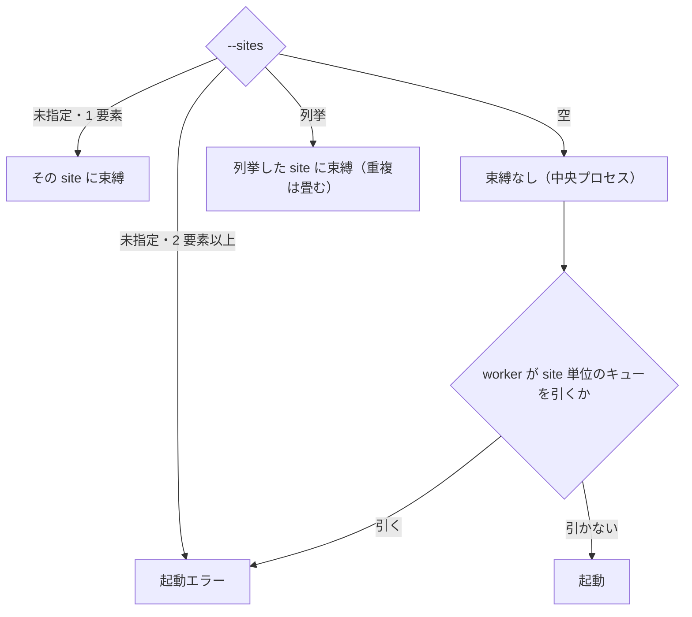

> [configuration.md](../configuration.md) §スキーマ構造のうち、mirakc レジストリの節。索引から辿る。

### mirakc レジストリ: `mirakcs:`

mirakc は site と url だけを持つ要素の配列で登録し、単一でも 1 要素の配列で書く。site は省略できず、文字種と長さに制約があり、重複もできない。プロセスが束縛する site は、設定キーにせず起動時のフラグで表す。

`mirakcs:`（`{site, url}` の配列）に mirakc エンドポイントを登録する。単一オブジェクトの糖衣は無い。複数 mirakc を許すと programId のスコープが mirakc 単位になり、予約・EPG 射影・ingest の全スキーマに「どの mirakc か」が波及するため、要素ごとに `site` でスコープする。チューナー集約は mirakc 自身のリモートチューナー機能で賄えるため、単一サイトなら Rokuban 側は 1 エンドポイントで足りる。ハブ mirakc への集約は採らない。WAN リアルタイム依存になり、録画中の回線瞬断が録画欠損に直結するためである。

`site` は DB の全テーブルの `site` 列の値になる。API の資源同定（`/api/sites/{site}/...`）の権威は `config.mirakcs` レジストリに site が存在するかであり、api 自身は不変条件 1 によりどの site にも束縛されない。

旧 `mirakc:`（単数）キーを書いたまま起動すると `unknown field "mirakc"` で fail-fast する。`mirakcs:` の 1 要素（`site` と `url` を書いた形）に書き換える。

#### site の規則

site は省略も重複もできず、文字種と長さを制約する。

- `mirakcs:` は非空が必須である。空（未指定含む）は起動エラーになる
- 各要素の `site` は省略できない。`mirakc:`（単一形式）の時代のような "default" への既定値フォールバックは無い。`site` を書かない要素は空文字列のまま下記の構文制約に落ちて起動エラーになる
- 要素は `site` と `url` の 2 つだけである。`storage` / `worker` / `ingest` 等のチューニング値は要素に入れない。アーカイブは単一（`media_assets` に site 列が無い）であり、`worker.queues` 等はデプロイ時のパラメータで、site の属性ではない。site ごとのチューニング値は、それを読むコードができたときに足す（不変条件 11）
- レジストリ内の site 名の重複も不可である。違反はすべて起動エラーとして全件列挙される（[basics.md](basics.md) §規約 4）
- 削除 reconcile のサーキットブレーカー（`breaker.DeleteReconcile`）は site ではなく置き場名を範囲（`scope` 列）にする。API は `store` に置き場名を返し、`POST /api/stores/{store}/breakers/delete_reconcile/resume` でその行を再開する。store 名は `storage.stores` の設定だけで検証する。

構文は `^[a-z0-9]([_-]?[a-z0-9])*$` で、53 文字以内である。文字種は River のキュー名の制約と同じにし、緩めない。キュー名を site で修飾するため、緩めると site 名がキュー名として弾かれる。上限の 53 は、River のキュー名上限 64 から、site 修飾される論理キューのうち最長の prefix（`reconciler_`、11 文字）を引いた値である（64 − 11 = 53）。この検査は設定のロード時に行うので、`--sites` で束縛していないレジストリ上の site 名も対象になる。

`catalog` と `thumbnails` は site 名にできない。この禁止は今は必須ではない。`rel_path` の前置が `sites/{site}/` になったので、site 名がトップレベルの `catalog/` / `thumbnails/` と直接衝突することはない。緩めても得られる自由度（この 2 語を site 名にしたい運用要求は無い）が緩めるコスト（`internal/config` のバリデーション・テストの変更）に見合わないため、禁止だけ残してある。トップレベルディレクトリ名の予約（`catalog/` / `thumbnails/` / `sites/` の 3 つ。今も必要）とは別の話で、[docs/storage.md](../storage.md) §5 で分けて説明している。

根拠

- 置き場の範囲のブレーカー: `breaker.DeleteReconcile`、`internal/worker/delete_reconcile.go`
- 理由と経緯の置き場所: `DeleteReconcileWorker` の doc コメント

#### プロセスの site 束縛

束縛は起動時のフラグで表す。watcher と worker は複数の site を束縛でき、中央プロセスの worker は site 非依存のキューに絞る。

`server` サブコマンドの `--sites` フラグで表す。多サイトでどのロールがどのプロセスに乗るかは [docs/overview.md](../overview.md) の役割分類に決定済みである。site に縛られるのは「mirakc に到達する必要がある仕事」（watcher / ingest / reconciler / epg / record_sweep / ライブ streamer）だけである。DB もアーカイブも単一なので、api / notifier / 録画配信 streamer / ruler / encode / thumbnail / 削除 reconcile は site 非依存の中央プロセスになる。

`--sites` は `--all` / ロール選択と同じ「起動形態」の軸で、[basics.md](basics.md)「やらないこと」の CLI フラグ方針に沿う。

`--sites=` は明示的な空、`--sites tokyo` は tokyo への束縛である。未指定でも暗黙に全部にはしない。`--sites tokyo,tokyo` のような重複は、束縛数の判定が紛らわしいエラーにならないよう 1 つに畳む。

- `watcher` ロールは 1 プロセスが N サイトを束縛できる。束縛サイトごとに独立した goroutine と advisory lock（`watcher:<site>`）を持つため、複数サイトを同じプロセスで watch しても互いに干渉しない。0 サイト束縛では watch 対象が無いだけで、起動エラーにはしない
- `worker` ロールも 1 プロセスが N サイトを束縛できる。mirakc クライアントは site → 値の map になり、site 単位のキュー・定期ジョブが対象にする束縛サイトは集合になった。site 単位のキュー（ingest/epg/reconciler/watcher）は束縛サイトの数だけ物理キュー（`<queue>_<site>`）を購読する。site 単位の定期ジョブ（epg_sync/tuner_sync/ruler_pass/reconcile_pass/record_sweep）も束縛サイトごとに 1 本ずつ登録する
- 0 サイト（中央プロセス）の worker は、`worker.queues` / `--queues` を site 非依存キューに絞ったときだけ許す。`worker.queues` が空（既定=全キュー）のまま、または site 単位のキューを含んだまま 0 サイトで起動すると、届く site 単位のジョブは束縛サイトの集合のどれとも一致せず全滅して再試行し続けるだけになる。そのため起動エラーにする
- `enqueue` サブコマンドは site 束縛ジョブだけ `--site` で投入先を選ぶ（未指定かつレジストリ 1 要素ならその 1 つ、2 要素以上なら必須）
- site 非依存ジョブには `--site` を付けない。どれが site 非依存かは `rokuban enqueue --help` が列挙する（詳細は [operations.md](../operations.md) §1「ジョブ化されたループの監視」）
- `rescue` は site 非依存で、`--site` を持たない。catalog の各行は自分の site を持ち、catalog が無い場合のストレージ走査も `sites/{site}/` 前置から site を決める。前置の無いファイルは登録せず Warn にする

