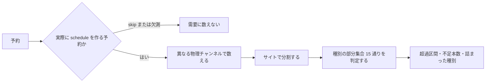
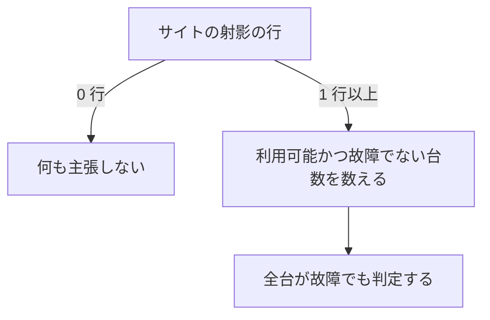

> [data.md](../data.md) §6.5 の一部。索引から辿る

## 6.5 チューナー射影と容量超過の判定

チューナーの本数と対応種別は、mirakc から使い捨ての射影に写して読む。不変条件（api は mirakc に問い合わせない）より、EPGStation のように起動時に取得してメモリに持つ形は取れない。

EPG プロジェクションと同じ使い捨てのプロジェクションとして扱えば、権威は mirakc のまま保てる。対応種別が必須なのが決め手である。GR 専用チューナーに BS は載らないので、本数だけを設定に手書きする案は成立しない。

<details><summary>根拠</summary>

- チューナーの射影先: `tuner_sync`
- 起動時に叩く形を取らない対象の API: `/api/tuners`

</details>

### 主張するのは「超過」だけ。勝敗は予測しない

着色と警告の対象は時間帯の区間であり、個別の番組には付けない。主張は下界に限る。**「超過している」は確実だが、「収まる」は保証できない。**

個別番組への「競合」表示は、「この番組が負ける」という勝敗の主張になる。勝敗を決めるのは mirakc であり、しかも Rokuban から見えない消費者（EPGStation の並走・ライブ視聴・EPG 収集ジョブ）がいるので、我々には決められない。超過は区間の性質であって、番組の性質ではない。UI の文言も「この予約は競合しています」とは書かず、「この時間帯はチューナーが不足しています」と書く。

この主張にすると、予約単位で勝敗を決める実装が持つものの多くが要らなくなる。要らなくなるのは、予約ごとの競合フラグ列、優先度による貪欲詰め、負ける側を決定論的に決める順序、マージンの織り込み（mirakc は予約ごとのマージンを持たない）である。

### 判定: 種別部分集合に縮約した Hall 条件

需要は異なる物理チャンネルの数で数える。同一チャンネルの予約は 1 本のチューナーに相乗りできるので、予約件数は需要にならない。判定は、チューナー種別の部分集合ごとに、需要が対応チューナーの本数以下かを確かめる。



副産物として、マルチ編成が自然に畳まれる。サブサービスは同一チャンネルなので、需要は 1 になる。

数えるのは reconciler が実際に schedule を作る予約だけである。実効の skip が true の行と、never-scheduled（番組が終了したのに schedule が一度も観測されなかった事実）の欠測行がある予約は、需要にならない。欠測は放送イベントのキーで欠測の表を引いて判る。mirakc 由来の failed 試行は録画の表にだけ現れるので、需要除外にはならず、再試行の経路を妨げない。

**欠測を予約の状態や録画の failed 行から導出し直さない。** 試行と欠測は別の事実である。混ぜると、failed の試行が需要を消し、警告を見逃す。

<details><summary>根拠</summary>

- 除外される予約の条件: 実効の `skip` が true
- 欠測を引く表: `never_scheduled_events`
- 試行だけが現れる表: `recordings`
- 欠測の導出元にしない予約の表: `reservations`

</details>

#### 種別の部分集合への縮約

二部グラフの頂点は個別のチューナーだが、同じ種別の需要は、チューナーから見て隣接集合が完全に一致する（twin vertices）。そのため Hall の条件は、種別の部分集合について確認すれば足りる。需要の部分集合を総当たりする必要はない。

需要 `d` の隣接集合は `N(d) = { t : type(d) ∈ t.types }` で `type(d)` にしか依存しない。任意の `S ⊆ D` について `A = types(S)` とおくと `N(S) = N(A)` になる。`A` を固定すると `|N(S)|` は一定だが `|S|` は最大 `Σ_{t∈A} d[t]` まで動く。したがって、その最大ケースだけ調べれば、同じ `A` を持つ他の全部分集合も自動的に満たされる。

```
∀S ⊆ D: |N(S)| ≥ |S|   ⟺   ∀A ⊆ Types: Σ_{t∈A} d[t] ≤ |N(A)|
```

指数が `2^|D|` から `2^|Types|` に落ちる。種別は 4 つなので、非空部分集合は 15 通りである。

```
d[t]   = その区間で必要な種別 t の異なるチャンネル数
cap(A) = 種別集合 A のいずれかに対応するチューナー本数

すべての A ⊆ {GR,BS,CS,SKY} について   Σ_{t∈A} d[t] ≤ cap(A)
```

破れた `A` の `Σd − cap(A)` が不足本数になり、その `A` が詰まった種別の証拠になる。出力は真偽値でなく、「BS が 1 本不足」の形になる。

GR/BS 両対応チューナーが混ざると、単純な「重なり数と総本数の比較」では検出できないケースが出る。T1={GR}, T2={GR,BS} に対し「GR 1 + BS 2」は、総本数（2）が足りているのに `{BS}`: 2≤1 が破れる。

<details><summary>根拠</summary>

- 縮約の対象にした種別の識別子: `channel_type`

</details>

#### 縮約の条件は「隣接集合が同じ」であること

縮約が成り立つ条件は、需要の隣接集合が一致することである（twin vertices）。ruler がマッチした全サイトで予約を作るので、予約は 1 つのサイトに束縛され、同値類はサイトと種別の組になる。

上では便宜的に「種別」と書いたが、同値類を何で切るかは予約モデルに依存する。N 予約の決定（[録画エンジン](../recording.md) §3.1）により、同値類は `(site, channel_type)` になる。BS 番組 P に対して、サイト A の予約とサイト B の予約が独立に生まれ、reconciler はそれぞれのサイトの mirakc に schedule を作る。**サイトの選択は ruler が既に行使し終えた選択であり、容量判定の自由度に入らない。** 判定が答えるのは「サイト A のチューナーでサイト A の予約群を賄えるか」だけになる。

これは電波の性質に由来しない。BS はどのサイトでも受信できるので、物理的には「BS 番組を録る」需要は全サイトの BS 対応チューナーに隣接している。分解が成り立つのは、予約が site に束縛されているという設計の結果である。

「1 予約 + サイト選好」は採らない（[録画エンジン](../recording.md) §3.1 で却下）。その設計では BS / CS の需要がサイトに束縛されない。すると同値類は `{ (東京, GR) }, { (高松, GR) }, …, { BS 全サイト横断 }, { CS 全サイト横断 }` となり、`2^(サイト数 + 2)` 通りの判定になるので、サイト別計算ができない。縮約自体は生き残るが、分解という都合の良い性質は N 予約の決定に依存している。

<details><summary>根拠</summary>

- 同値類の切り口: `(site, channel_type)`
- 同じ番組に独立に生まれる 2 つの予約: `予約(site=A, P)` と `予約(site=B, P)`

</details>

#### 判定はサイトごとに独立して行う

二部グラフはサイトごとに非連結なので、予約とチューナーを site で分割し、各サイトについて独立に 15 通りを判定する。異なるサイトの需要はチューナーの集合が交わらないので、混ぜた部分集合の条件は各サイトの条件から自動的に成り立つ。

```
G = ⨆_site G_site        （サイト間に辺が存在しない）
```

Hall の条件は、非連結グラフでは各成分について確認すれば十分である。種別を `(site, channel_type)` に拡張して `2^(サイト数 x 4)` 通り調べる必要はない。異なるサイト `A`, `B` は隣接集合が交わらないので、`|N(A ∪ B)| = |N(A)| + |N(B)|` かつ `Σd(A∪B) = Σd(A) + Σd(B)` となる。混合した部分集合の制約は、満たされた 2 つの制約の和として自動的に成立する。

**site は分割キーであって、需要のキーには入らない。** 分割の内側では `(channel_type, channel)` が物理チャンネルを一意に定める。GR 27ch が東京と高松で別のチャンネルであることは、分割が処理する。

#### 多サイト時は「サイトの不足 ≠ 番組の喪失」

サイト A の不足は、その番組が録れないことを意味しない。A で負けても、B の予約が生きていれば番組は残る。出力もサイト単位になり、多サイト時のグリッド表示は未解決である。

同一の番組の予約が他サイトにあり、そこが不足区間でなければ実質カバーされている、という判定は容易に書ける。警告が過剰に不安を与えないよう、多サイト時はここを区別する価値がある（サイトが 1 つの現状では意味を持たない）。

超過区間のリストはサイト単位になる。予約一覧のバッジは、予約行の site（API が返す `Reservation`。[api.md](../api.md)）を見るだけで決まる。メトリクスは `site` ラベル付きのゲージになる。

**未解決: 多サイト時のグリッド表示。** BS / CS は全国共通なので 1 行に畳めるが、地上波はサイトごとに異なるので畳めず、帯もサイトごとに要る。多サイト化の論点として残す。

<details><summary>根拠</summary>

- カバーの判定に使う番組の識別子: `program_id`
- バッジが見る予約行の列: `site`
- API が返す予約の型: `Reservation`
- メトリクスのラベル: `site`

</details>

#### 容量に数えるチューナー

容量に数えるのは、存在して恒久的に壊れていないチューナーだけである。設定で無効化したものと故障報告のあるものは除く。現在の利用者は引かない。

現在の利用者は一時的な占有であり、将来の区間の容量とは無関係である。「見えない消費者は数えない = 下界」の性質とも一貫する。

**この除外条件は Mirakurun のセマンティクスであり、mirakc に対しては恒真である。** `/api/tuners` は Mirakurun 互換 API である。

Mirakurun 本体では、故障フラグはチューナープロセスのエラーを 3 回数えたら立つラッチで、以後クリアされない。利用可能フラグは、故障フラグが立っていると二度と true に戻らない。

mirakc はこの 2 つを実装していない。利用可能フラグは常に真、故障フラグは常に偽を返す。2019 年の初回実装から条件分岐が入った形跡は無い。設定で無効化したチューナーはそもそも一覧に現れない（mirakc が起動時に落とす）。したがって mirakc 相手では、容量に数える条件は射影の全行に一致する。

式は残す。互換 API の契約としては正当で、mirakc が将来実装したときに有効になる。ただし、この条件が容量を減らすことに依存した設計をしてはいけない（減らない）。

<details><summary>根拠</summary>

- 容量に数えるチューナー本数: `cap`
- 取得元の API: `/api/tuners`
- Mirakurun 本体の故障ラッチ: `isFault` が `error` を 3 回数えたら立つ（`TunerDevice.ts`）
- Mirakurun 本体で復帰しない利用可能フラグ: `isAvailable`
- mirakc の実装がリテラルを返すこと: `true` / `false`（`mirakc-core/src/models.rs` の doc comment `Always true.` / `Always false.`）
- 容量に数える条件の式: `is_available AND NOT is_fault`

</details>

### これは原理的に近似であり、誤りの向きが偏っている

容量判定は、見えない消費者があるので近似であり、選定基準は有用性と説明可能性である。既知の盲点はすべて警告を見逃す向きに偏っている。**「不足している」という主張は信頼できるが、警告が出ないことは保証ではない。**

予約が競合するかを確実に知る術は無い。見えない消費者（EPGStation の並走・ライブ視聴・EPG 収集ジョブ）がいる以上、この判定はもともと近似値であり、正解を計算しているわけではない。厳密性は求めない。計算量のために近似で妥協するのは、正当な選択肢になる。

twin vertices の縮約も、前提が完全には成り立たない。mirakc のチューナー設定には、特定チャンネルを除外する `excluded_channels` がある。これを使うと、同一種別内で需要の隣接集合が異なるので、縮約の前提が成り立たなくなる。ただし、チューナー一覧の API のレスポンスに `excluded_channels` は含まれない。API 経由で知る術が無いので、種別だけが API の許す精度になる。

既知の盲点は次の通りである。いずれも実際の容量を減らし、警告を見逃す向きに誤る。

| 盲点 | 実際の容量への影響 | 誤りの向き |
|---|---|---|
| 見えない消費者（並走 EPGStation / ライブ視聴 / EPG 収集） | 減る | 警告を見逃す |
| `excluded_channels` による除外 | 減る | 警告を見逃す |
| 乗り換え不可と mirakc の first-fit | 減る | 警告を見逃す |

表の EPG 収集のうち、mirakc の番組表更新ジョブは周期が分かっているので、cron 設定を取得できれば、需要に織り込んで精度を上げられる。API で取得可能かは未確認である。

mirakc main の実装を読んだ限り、録画中はチューナーを替えず、空きチューナーは設定順で選ぶ。区間ごとの Hall 条件は、番組の途中でチューナーを替えられるとした必要条件にすぎない。条件を満たしても録画できない場合がある。

mirakc の多段集約によるサイト間の容量共有は、盲点にならない。その構成自体を非サポートとする（[録画エンジン](../recording.md) §9）。

したがって UI は、警告が出ないことを「大丈夫」と読ませてはいけない。文言は「この時間帯はチューナーが不足しています」の側だけを出し、「収まります」とは言わない。

縮約は必須でない。将来 `excluded_channels` が API に載るか設定から読めるようになったら、素の二部マッチングに戻せばよい（需要 ≤ 10、チューナー ≤ 10 の規模なので、素朴な増加路法で足りる）。縮約を選ぶ理由は計算量でなく、不足本数と詰まった種別が副産物として出るという UI 上の利点にある。

<details><summary>根拠</summary>

- チューナー設定の型: `TunerConfig`
- チューナー一覧の API が返す型で、除外設定を含まないこと: `MirakurunTuner`
- mirakc main のバージョン: `4f2493f98374`
- 録画中に乗り換えず、空きチューナーを設定順で選ぶ実装: `mirakc-core/src/tuner.rs` の `activate_tuner`
- 番組表更新ジョブ: `update-schedules`

</details>

### 計算: 累積和はチャンネル単位に張り、0↔1 遷移だけを拾う

累積和はチャンネル単位に張り、0 と 1 の間の遷移のときだけ需要を増減する。予約期間全体を 1 回解いて超過区間の一覧を作り、各問い合わせはその一覧への範囲検索にする。

15 通りの判定は軽く、重いのは各区間での異なりチャンネル数の数え直しである。**純粋な imos 法（予約に ±1 して累積和）は誤りになる。** 需要は異なり数であり、同一チャンネルの 2 予約を 1 と数える必要があるからである。累積和はチャンネル単位に張り、`0→1` / `1→0` の遷移でのみ `d[t]` を増減させる。既に埋まっているチャンネルへのイベントは `d` を変えないので、判定をスキップできる。チャンネル共有が多いほど計算量が落ちる。

部分集合の判定も差分化できる。`d[t]` が ±1 したとき影響を受けるのは `t` を含む 8 通りだけなので、16 個の `Σd − cap(A)` を保持して 8 個更新し、最大値を見れば `O(1)` で判定できる。

#### 予約期間全体を 1 回解く

窓ごとに解かず、予約期間全体を 1 回解く。予約集合はローリングウィンドウで件数に上限があるので、8 日分を 1 回走って結合済みの超過区間リストを作り、全クエリをその上の範囲検索に落とす。

| クエリ | 計算 |
|---|---|
| グリッドの帯（窓 [a,b]） | 二分探索 + 交差 |
| 予約一覧のバッジ | 自分の区間との交差判定 |
| メトリクスのゲージ | 区間数を数える |
| 「この条件を保存したら不足区間が増えるか」 | DB の事実で候補を絞り、既存需要へ加えて再走査 |

保存前の判定は、`O(E)` なので素直に再走査する。

<details><summary>根拠</summary>

- 再走査の計算量: `O(E)`

</details>

#### 区間リストのキャッシュ

区間リストは予約とチューナー射影の純関数なので、api プロセス内にメモリキャッシュできる。ただし api は NOTIFY を LISTEN しないので、無効化は TTL に依存させる。

LISTEN セッションは notifier ロールの持ち物である。api はサーバーレスで scale-to-zero する前提のため、常駐 LISTEN を持てない（[api.md](../api.md) 参照）。導出状態なので、複数レプリカが各自で持ってよい。キャッシュミスや期限切れは毎回 8 日分を再走査するだけで、数十マイクロ秒のオーダーに収まる。そのため TTL だけで十分回復する。キャッシュは念のための位置づけであり、鮮度を NOTIFY に頼る設計にはしない。

<details><summary>根拠</summary>

- 純関数の入力: `(予約, チューナー射影)`

</details>

### 実装で決めたこと

チューナーの射影が 1 行も無いサイトは、何も主張しない。超過区間を返さない。行が 1 つでもあれば、全台が故障でも判定する。



「0 行」の扱いは、docs に無かった case で、実装時に決めた。射影からは「チューナーが 0 本」と「まだ同期していない」を区別できず、後者を容量ゼロとして扱うと、全区間が超過になって警告が洪水になる。上に書いた「既知の盲点はすべて警告を見逃す方向に偏っている」という性質を、我々自身の無知で損なわないための規律である。全台故障は射影された事実であり、無知には当たらない。

実装は、純関数の判定部と DB 読みの部分に分け、射影ジョブは worker に置く。

<details><summary>根拠</summary>

- 判定と DB 読み: `internal/capacity`（判定が `Compute`、DB 読みが `Load`）
- 射影ジョブ: `internal/worker/tuner.go`
- 射影の表: `tuner_sync`

</details>

#### 射影の読み方

容量に数えるのは、利用可能かつ故障していないチューナーである。この判定は容量の判定側に置き、SQL では絞らない。SQL で絞ると、「0 行」と「全台故障」が区別できなくなる。

未知の種別を含むチューナーは、そのチューナーごと捨てる。未知の種別だけ落として残りを投影すると、「その種別に対応していないチューナー」として容量に数えられ、警告を見逃す方向に誤る。未知の種別のサービスを捨てる EPG 同期の規律と同じだが、捨てる単位が違う。

<details><summary>根拠</summary>

- 容量に数える本数: `cap`（式 `is_available AND NOT is_fault`。判定は `internal/capacity` 側）
- 未知の種別のチューナーごと捨てる対象: `channel_type`
- 種別集合ごとの容量: `cap(A)`
- 未知の種別のサービスを捨てる規律の実装: `EpgSyncWorker`

</details>

#### 区間の結合と報告

隣接区間は、不足本数と詰まった種別が一致するときだけ結合する。無条件に結合して最大値を報告すると、不足が小さい部分区間について知らないことを主張してしまう。下界に限る原則に反する。

詰まった種別は、破れた種別集合のうち不足本数が最大のものを選び、同数なら要素数が最少のものを選ぶ。「BS が 1 本不足」と狭く言い当てるためである。

半開区間性を保証するのは、同時刻のイベントをまとめて反映してから判定することである。開始と終了の処理順は関係しない。当初は「終了を先に」ソートしていたが、その並べ替えを反転しても結果が変わらないことが確認できたので、削除した。観測できない規則は残さない。

<details><summary>根拠</summary>

- 結合の条件: `(不足本数, 詰まった種別)` が一致
- 詰まった種別の選び方: `jammedTypes`（破れた `A` のうち不足本数最大、要素数最少）

</details>

#### 保存前プレビュー

ルールを保存する前の不足区間のプレビューは、保存前と同じ需要を基準にして、保存後に増える区間だけを返す。

条件は番組検索と同じ条件コンパイラで評価する。候補は EPG サービスのチャンネル情報で需要へ変換し、既存予約・skip の意図・fulfilled・編集中ルールの重複排除で skip になる番組は除く。編集中のルールを指定したときは、そのルールが勝者になっている現予約を既存需要から外してから、候補を加える。

基準は保存前の全サイト読み込みと同じ需要である。保存後の区間から、保存前に同じ site で不足本数が同じか大きい区間だけを除く。したがって、既存の不足の悪化も追加として返る。

<details><summary>根拠</summary>

- 番組検索と共有する条件コンパイラ: `rulequery.MatchPrograms`
- 候補をチャンネル情報から需要へ変換する元: `epg_services`
- 重複排除で除く意図: `skip`
- 編集中ルールの指定: `ruleId`
- 基準にする全サイト読み込み: `LoadAllSites`

</details>

#### 未実装

未実装なのは、メモリキャッシュ、多サイト時に他サイトでカバーされている番組の区別、15 通りの差分更新の 3 つである。

メモリキャッシュは、TTL に依存させる設計のまま未実装である。多サイト時の「同一の番組が他サイトでカバーされている」区別は、サイトが 1 つの現状では意味を持たない。

15 通りの判定は、毎遷移で全再計算する。差分化（`t` を含む 8 通りだけ更新）は、64 演算に対して割に合わない。

<details><summary>根拠</summary>

- カバーの判定に使う番組の識別子: `program_id`
- 差分化で更新する対象の種別: `t`

</details>

### 前提: 予約にチャンネルのスナップショットが要る

予約には、チャンネルのスナップショットを予約時に焼き付ける。使い捨ての EPG 射影への結合に頼ると、射影が刈られたり欠損したりしたときに、容量判定が正しく動かなくなる。

需要の単位が `(channel_type, channel)` なので、予約側にネットワーク ID・サービス ID・種別・チャンネルのスナップショット列が必要になる。録画行への非正規化スナップショット（§6、[projections.md](projections.md)）と同じ規律である。この列は番組スナップショットの表（[スキーマ](../schema.md) §3.7）にある。予約の表には無く、予約の表から `(site, program_id)` の外部キーで結合して読む。

<details><summary>根拠</summary>

- スナップショットの列: `network_id` / `service_id` / `channel_type` / `channel`
- 列を持たない予約の表: `reservations`
- 列を持つ番組スナップショットの表: `program_snapshots`
- 予約から結合する外部キー: `(site, program_id)`

</details>
