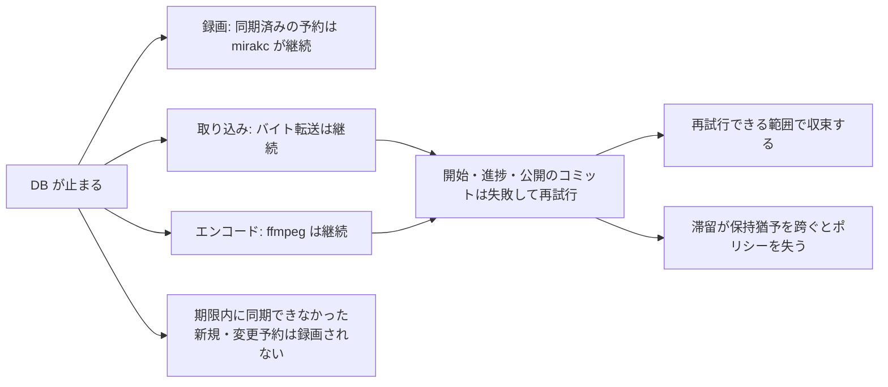

> [data.md](../data.md) §1 §2 §3 §7 の一部。索引から辿る

## 1. 方針: PostgreSQL 一本

データベースは PostgreSQL 一本にする。決め手は、コミットに連動する通知の仕組みが MySQL には無いことと、その上に載る既製のジョブキューライブラリが MySQL には育っていないことである。

### MySQL との比較

決め手は、コミットに連動する通知の仕組みが MySQL には無いことと、その上に載る既製のジョブキューライブラリの層が MySQL には育っていないことである。調停の仕組みだけなら MySQL でも成立する。

| 機能 | PostgreSQL | MySQL 8.0 |
|---|---|---|
| SKIP LOCKED | あり | あり（同等） |
| アドバイザリロック | `pg_advisory_lock` | `GET_LOCK()`（代用可能） |
| コミット連動の pub/sub | LISTEN/NOTIFY | なし（ポーリングか外部ブローカー） |
| ジョブキューライブラリ | River / pg-boss / Oban / Solid Queue 等が成熟 | この層がほぼ空白 |
| 日本語検索 | pg_trgm / PGroonga | InnoDB FTS + ngram（見劣り） |
| JSON | JSONB + GIN | JSON 型 + 生成列（やや不便） |

調停プリミティブ（SKIP LOCKED / アドバイザリロック相当）だけなら、MySQL でも成立する。**決定打は LISTEN/NOTIFY の不在である。** ブローカーレス設計の根幹であり、MySQL では変更伝搬がポーリングしかなく、反応性を上げるほど DB を無駄に叩く。もう 1 つの決定打は、その上に載る既製ライブラリの層が MySQL には育っていないことである。

<details><summary>根拠</summary>

- 比較表のアドバイザリロック: `pg_advisory_lock` と `GET_LOCK()`

</details>

## 2. ジョブキュー: River（Postgres バックエンド）

エンコード・取り込み・サムネイル・掃除は、すべて [River](https://github.com/riverqueue/river) のジョブとして動かす。ジョブは at-least-once で再実行されるので、冪等に書く。常駐シングルトンのロールは watcher だけで、ruler と reconciler はジョブとして動かす。

### 契約と adapter の境界

ジョブ引数の型は共有の置き場に置き、River への依存は adapter に閉じ込める。責務は変わる理由で 4 つに分け、理由の違うものを同じ場所に置かない。

| 責務 | 変わる理由 | 持ち主 |
|---|---|---|
| 何を何分で、何本並列で | 製品仕様の変更 | 製品側（`cmd/rokuban` の仕様の組み立て） |
| どの site・どのキューを受け持つか、誰が定期投入の契機を持つか | デプロイ | 起動形態（`--sites` / `--queues` / `worker.periodic_jobs` / `--once`） |
| 仕様の型の意味と不変条件 | エンジンに依らない約束の変更 | 契約（`internal/jobq`） |
| エンジンでどう実現するか | エンジンの差し替え | adapter（`internal/jobq/riveradapter`） |

API は、store の commit 後にヒントとして投入する。投入の失敗はログに残し、定期 reconcile に委ねる。watcher も、観測の commit の後にヒントとして投入する。CLI は単発で投入し、合流の有無を結果から表示する。

River クライアントと投入オプションへの変換は、adapter に閉じ込める。worker の登録だけは River の公開 API が具体型を要求するので、River adapter を通す。他の adapter は中立なレジストリを使う。

import 境界の linter は、本番コードによる River adapter の直接 import を禁止する。例外は worker の登録とテスト DB 作成だけである。構成の根である起動コードは adapter を組み立てるので、対象外にする。テストも River の import を adapter に閉じる。唯一の例外は KEDA の SQL テストで、ScaledJob の状態名を River のスキーマと照合する。

逆向きの境界も持つ。adapter の本番コードは、契約とエンジンだけに依存する。禁止リストで製品パッケージを塞ぐと、リストに無い別の製品パッケージへの依存が通る。そのため許可リストで判定し、テストは対象外にする。

契約は River と asynq の共通部分に絞る。扱うのは queue・timeout・retry・enqueue・work・runner lifecycle と、worker の仕様の型である。仕様の型は、キューごとの並列数と購読する物理キュー名、定期ジョブの一覧と周期を表す。定期投入の runner は、起動直後に 1 回、その後は周期ごとに投入する。この点は型の doc に書いた契約である。排他、一覧、job ID / 試行番号、`--once`、購読の仕組みは adapter 固有のまま外に置く。adapter の内部状態へ依存しない境界を先に作るためである。

定期投入の責務は 3 つに分かれ、変わる理由が違う。一覧と周期は製品の方針で、jobq の仕様が持つ。誰が投入の契機を持つかはデプロイ形態が決める（[定期実行の契機](#定期実行の契機はデプロイ形態に委ねる)）。投入の仕組みは adapter 固有である。`worker.periodic_jobs` を false にしても、仕様の定期ジョブの一覧は空にならない。契機の有無と一覧は別の軸だからである。

設定キーを持たない周期と並列数は、上書きできない製品の仕様として組み立て関数のリテラルで書く。config に既定値を置くのは、設定キーのある値だけである。adapter は既定値を持たず、0 の並列数や周期を起動時に拒む。adapter が「0 なら既定値」を持つと、config の既定値との二重既定になり、片方だけが直る。

物理キュー名の命名規則は製品の規則で、起動形態ではない。投入側の規則は adapter のコンストラクタが解決関数として受け取る。購読側の物理名は、組み立て関数が同じ規則の部品で展開して仕様に入れる。この 2 つは別の経路なので、型は一致を保証しない。食い違うと、api が `ingest` へ入れ、worker が `ingest_tokyo` を引く「黙って動かない」になる。そのため adapter は構築時に、定期ジョブの投入先が購読する物理名に入ることを検査する。解決関数が nil のときも、論理名に倒さず構築を拒む。登録した worker の投入先が決まることと、定期ジョブの kind が登録済みであることも、構築時に検査する。site が実行時に決まる Args の投入先は、起動時には検査できない。

<details><summary>根拠</summary>

- ジョブ引数の型の置き場: `internal/jobs`
- 投入側と実行側が共有する契約: `internal/jobq` の `Kind` / `Spec`
- commit 後のヒントの投入と CLI の単発投入: `Enqueue`、合流の表示は `Result.Coalesced`
- River への変換の閉じ込め先: `internal/jobq/riveradapter`、投入オプションは `InsertOpts`
- 中立なレジストリ: `jobq.Registry`
- 仕様の型と検査: `jobq.WorkerSpec` の `Validate` / `Select` / `CheckKinds` / `CheckQueueFor`
- 仕様の組み立て: `cmd/rokuban` の `newWorkerSpec`（`tsscan` が `internal/jobs` を import するので jobs には置けない）
- import 境界の判定: `.golangci.yml` の depguard。adapter の本番コードは `riveradapter-allowlist`（許可リスト）
- import の例外: `internal/` の本番コードでは `internal/worker/worker.go` と `internal/testutil`
- 対象外にする起動コード: `cmd/`

</details>

### ジョブの確保と再実行

ワーカーは行ロックでジョブを 1 件ずつ確保し、複数ワーカーが同時に来ても同一ジョブの二重実行はトランザクション分離の性質として起きない。再実行は at-least-once なので、ジョブは冪等に書く。

タイムアウトは必須の有限値で、締切に達すると Work の context は締切超過になる。実行中にプロセスが死んだ場合も、締切と adapter の復旧猶予以内に再配送対象となる。古い Work が止まったことや同じ job ID であることは保証しない。

最大試行回数は、通常エラー・締切超過・プロセス死の失敗回数で止める保険である。0 は adapter の既定を使い、Snooze は回数を消費しない。

at-least-once なので、ジョブは冪等に書く。出力は一時パスに書いて完了時に公開し、DB 登録は競合時に吸収する。

<details><summary>根拠</summary>

- 1 件の確保: `FOR UPDATE SKIP LOCKED`
- 必須の有限タイムアウト: `Spec.Timeout`、締切超過は `DeadlineExceeded`
- 失敗回数の保険: `Spec.MaxAttempts`
- DB 登録の吸収: `ON CONFLICT`

</details>

### 常駐シングルトンとジョブ化

常駐シングルトンのロールは watcher だけで、リーダー選出はアドバイザリロックで行う。ただしそのシングルトン性は接続数の配慮であり、正しさの要件には入らない。ruler と reconciler はシングルトンにせず、ジョブにする。

リーダー選出はセッション断で自動解放されるので、フェイルオーバーも自然に付く。k8s の Lease API に依存しないため、monolithic mode でも同じコードが動く。

**watcher のシングルトン性は正しさの要件ではない。** record 処理は行ロックで冪等化されており、複数の watcher が同一 record を並行処理しても録画行は重複しない。シングルトンなのは「mirakc に N 本の SSE を張らない」という接続数の配慮に過ぎない。詳細は [録画エンジン](../recording.md) §3.3 を参照。

ruler と reconciler をジョブにするのは、定期・冪等・パスを跨ぐ状態を持たないという性質が epg_sync と同じだからである。現行 River runtime は、一意性の指定で同じ site の未完了ジョブを抑止する。これは River adapter の機能で、共通契約の排他保証ではない。両方の timeout は有限で、プロセス死後の再配送は adapter が担う。セッションロックへ移す利益は、現在の River runtime にはない。未解決: River 以外の adapter には、ruler の並走（古い評価結果による上書き）を止める機構が無い。

<details><summary>根拠</summary>

- リーダー選出: `pg_advisory_lock`
- 一意性の指定: `UniqueOpts`

</details>

#### 重複抑止と並走の限界

現行 River runtime では、一意性の指定が通常運用の重複抑止にも使われる。ただし抑えるのは行の重複だけで、rescue 後に旧 Work が止まらなければ 2 実行が並走する。並走すると古い評価結果による上書きなどが起きうるが、これはコード読解による推定で、並走を起こしての確認はしていない。

worker の最大並列数はプロセスごとの値で、k8s の ScaledJob では Pod が並列に立つ。定期実行とヒントの重なりを River 内で抑止しているが、この挙動を共通契約へ持ち込まない。

並走するとおかしくなるものは次の通りである。これはコード読解による推定で、並走を起こしての確認はしていない。

1. ruler: パスの前半の読みと後半の書きが別トランザクションなので、古いルール集合で評価したパスが後からコミットすると、新しいパスの結果を上書きする。ラベルルールの reconcile がアドバイザリのトランザクションロックで止めている形と同じである。これで投資の無い予約が消えて直前の番組を録り逃すかは未検証である。
2. reconciler: パス冒頭の一覧に基づく mirakc への DELETE / POST が、別のパスの適用と食い違う。

<details><summary>根拠</summary>

- 重複抑止に使う指定: `UniqueOpts`
- プロセスごとの並列数: `MaxWorkers: 1`
- ruler のパスの読みと書き: `runPassForSite`
- 同じ形で止めているラベルルールの reconcile: `label_rule_reconcile`

</details>

### 合流と優先度の指定

合流と優先度の指定は、ヒントとして扱う。合流してよいという意思表示に限り、1 行にすることも並走を止めることも保証しない。優先度も順序を保証しない。

正しさはこれらに依存させない。現行 River 投影では、合流の指定を River の一意性の指定に写し、重複 enqueue を減らす。

<details><summary>根拠</summary>

- 共通契約のヒント: `Coalesce` と `Priority`
- 合流の写し先: `UniqueOpts`

</details>

### エンコード待機列

エンコード待機列は、ドメイン表から導出する。River のジョブ一覧は使わない。

不足プロファイルを、実行中の試行行の有無で実行中と待機中に分ける。待機列と encode の投入は、「エンコードしてよいか」の述語をスキーマ側の同じ名前から引く。片方にだけ条件を書き足すと、待機列に出るのに投入されない録画ができる。試行回数が上限に達した失敗行は worker が開始時に cancel して作られないので、どちらにも数えない。

投入と待機列が食い違うのは 2 つだけである。試行回数が上限に達したものは、reconcile は投入するが待機列は数えない。全区間をカットして keep が空になった cut プロファイルは、reconcile は Go で keep を導出して投入しないが、待機列は SQL だけで数えるので数え続ける。keep の導出を SQL に写すと導出が 2 か所になるので、揃えない。

満たされていない作り直し（凍結区間が `requested_keep` と等しい active な版がまだ無い要求）は、active な版があっても待機列に入る。active な版の存在は、ユーザーが押した keep で作られたことを意味しないためである。満たされた要求は入らない。ただし、ごみ箱の録画、原本が active でない録画、設定に無いプロファイルの要求は数えない。ごみ箱の録画は作ってはならず、残りの 2 つは投入しても worker が作れないからである。試行回数が上限に達した要求も数えない。worker が開始時に cancel するので、数えると何も起きないのに「待機中」と出続ける。作り直しを押し直すと失敗行が消えて試行の予算が戻るので、その時点から再び数える。

録画一覧 API の絞り込み（`GET /api/recordings` の encodeState）も、待機列と同じ行から録画 ID を取る。

worker が encode 中に死ぬと、次の試行が始まるまで試行行は実行中のまま残る。River の rescue は締切後（実尺が不明なら最大 12 時間）なので、その間は実行中に数える。

desired から外れた後も River に残るジョブは、待機列に数えない。ジョブエンジンの状態より、現在の desired と observed の差を「これから作るもの」の根拠にするためである。

<details><summary>根拠</summary>

- 待機列の導出: `internal/api/encode_queue.go`
- 不足プロファイルと作り直し要求を合わせた導出: `ListEncodeQueue`
- 不足プロファイルの列挙（reconcile 側）: `ListMissingEncodeProfiles`
- desired の不足（設定では絞らない）: view `unencoded_desired_profiles`
- 録画単位の述語（ごみ箱でない・原本が active）: view `encodable_recordings`
- プロファイル単位の述語（設定にある・cut なら確認済み）: 関数 `encodable_profile`
- 待機列と投入の集合の一致: `TestEncodeReconcileAndQueueAgreeOnPendingSet`
- 作り直し要求の列挙（reconcile 側）: `ListEncodedAssetRebuildRequests`
- 実行中と待機中の区分: `running` と `queued`
- 使わない River の API: `JobList`
- 待機列の分割・上限・observed の除外・cut の所有条件: `TestGetEncodeQueueSummaryFromDomainState`
- 待機列と `encodeState` 絞り込みの一致: `TestListRecordingsEncodeStateMatchesQueueCounts`

</details>

### 定期実行の契機はデプロイ形態に委ねる

定期ジョブの投入は、Docker ではプロセス内の定期投入が担う。k8s の worker は伸縮する短命なクライアントなので、CronJob が投入用のコマンドを叩く。

River の `PeriodicJobs` は、リーダーに選出されたクライアントだけが投入する。k8s の worker は KEDA で 0〜N に伸縮する短命な client なので、定期投入の担い手に向かない。スケールアップのたびに `RunOnStart` が走るのも望ましくない。1 件消化モード（`--once`）は、`periodic_jobs: true` だと起動を拒む。

| デプロイ形態 | 定期投入の担い手 |
|---|---|
| Docker（monolith） | プロセス内の River `PeriodicJobs`（既定で有効） |
| k8s | CronJob が `rokuban enqueue <job>` を叩く |

k8s の CronJob は、insert-only クライアントで 1 件投入して即終了する。`PeriodicJobs` の登録は設定で切れるようにし、k8s では無効にする。両方有効だと二重投入になる。`UniqueOpts` で合流するので害は小さいが、意図が曖昧になる。副次的な利点として、k8s では何がいつ走るかが CronJob の spec に一元化される。Go のコードと YAML に散らない。

**k8s の JobRescuer / JobScheduler は notifier Deployment の常駐 River client が担う。** client は全 kind を登録する。購読するのは site 非依存の `ruler` queue だけである。Ruler は DB 完結なので中央で実行できる。`worker.periodic_jobs: false` は維持するため、定期ジョブの投入元は引き続き CronJob である。載せ先と queue の判断は [k8s 運用](../operations/k8s.md) §5 にある。

### River のジョブ一意性の注意

一意性を判定する状態は必ず明示する。既定は完了済みと破棄済みを含み、一度終わった引数のジョブを二度と投入できなくする。設定は行ごとに保存されるので、変更したときは古い行の削除が要る。

現行の River 投影では `UniqueOpts.ByState` を必ず明示する。既定（`UniqueOptsByStateDefault`）は `completed` と `discarded` を含む。そのため既定のままだと、定期ジョブ（`epg_sync`）は実質ワンショットになり、破棄された ingest も再投入できない。Rokuban は `available / pending / retryable / running / scheduled` に限定している。同時実行を防ぐのが目的で、処理済みかどうかは DB の状態が権威だからである。

#### 状態設定の変更と残骸

状態の設定は行ごとに保存されるので、古い設定で投入された行は、設定を直しても鍵を占有し続ける。変更したときは、既存の該当ジョブ行を一度削除する。

`unique_states` は行ごとに保存される。一意索引は `river_job_state_in_bitmask(unique_states, state)` を条件に持つ。そのため、**古い設定で投入された行は設定を直しても鍵を占有し続ける。** この設定を変更したときは、既存の該当ジョブ行を一度削除する必要がある。例は次の通りである。

```sql
DELETE FROM river_job WHERE kind = 'epg_sync' AND state = 'completed';
```

<details><summary>根拠</summary>

- 行ごとに保存される設定: `unique_states`
- 一意索引の条件: `river_job_state_in_bitmask(unique_states, state)`
- 削除する対象の表: `river_job`

</details>

#### キュー名の変更

キュー名を変えるときは、キューを一意キーに含めておく。含めていないと、旧キューの残骸が新キューへの投入を気づかないうちに塞ぐ。エラーを返さないので、ログにも出ない。

River projection は `UniqueOpts.ByQueue` を使い、現在は `Coalesce: true` の全ジョブでキューを一意キーへ含める。`ByArgs` と `ByQueue` は別軸なので、片方だけでは意図した identity にならない。キュー名を変える（リネーム・site 修飾の追加）ときに Queue を一意キーに含めていないと、旧キューの残骸が新キューへの Insert を塞ぐ。この結果は `UniqueSkippedAsDuplicate` で、エラーを返さないのでログにも出ない。トラブルシュート手順は [runbook/troubleshooting.md](../runbook/troubleshooting.md) 「デプロイ直後、旧キューの残骸が `river_job` に残っている」を参照。

#### 合流の identity

合流の identity は、種別・論理キュー・引数全体の JSON とする。導出値が引数に入ると、導出値だけが違う投入も別の identity になり、重複して実行されうるが、正しさは損なわれない。

部分フィールドを選ぶ `river:"unique"` タグは使わない。引数全体の JSON なら、どの adapter でも同じ identity を再現できる。代償として、encode の保存済み締切のように導出値が引数に入ると、締切だけが違う投入も別の identity になる。それは同じ仕事なので、重複として次の形で現れる。

1. deploy 直後は、待ち行列と実行中の encode の全件が 1 回ずつ重複しうる。
2. 運用者が profile の rate を変えるたびに、同じ重複が起きる。
3. 同時実行数が 2 以上か複数 Pod なら、重複側の `beginEncodeAttempt` が試行番号を進める。すると実行中だった側の公開は古い試行として拒否され、ffmpeg の結果が捨てられる。既定の同時実行数 1 では、重複は後から実行され、公開判定で飛ばされる。

いずれも正しさは損なわれない。

<details><summary>根拠</summary>

- 試行番号を進める処理: `beginEncodeAttempt`

</details>

### Redis バックエンド（Sidekiq 系）を採用しない理由

DB と Redis に書き込み先が分かれると、コミット前投入では競合、コミット後投入ではジョブ消失が起きる。ステートフル基盤が増え、スループットも要らないので、Redis バックエンド（Sidekiq 系）は採用しない。

1. dual-write 問題: 「録画完了を DB に登録」と「エンコードジョブを積む」は常にセットである。だが書き込み先が DB と Redis に分かれると、コミット前 enqueue（ワーカーが未コミットデータを読む race）か、コミット後 enqueue（隙間のクラッシュでジョブ消失）かの二択になる。真面目に解決すると outbox パターン、つまり結局 DB 上のキューを作ることになる。
2. ステートフル基盤が増える: ミニ PC にはコンテナ 1 つ、クラウドにはマネージド Redis が 1 つ増え、バックアップ・監視・障害モードが 2 系統になる。
3. スループットが要らない: このシステムの負荷は「1 日数十件、1 件数十分」のジョブである。キューに必要なのは耐久性と可視性（再起動で消えない・SQL で覗ける・ドメイン更新と同一トランザクション）で、これは RDB の得意領域である。

傍証として、Rails 8 が Solid Queue（DB バックエンド）をデフォルトに変えた。中規模までは Redis を挟む価値が薄いという業界側の再評価である。DB キューの一般的な弱点（数千 jobs/sec で vacuum・ロック競合が苦しい、コネクション数がワーカー数に比例）は、このワークロードでは遠く及ばない。

## 3. イベント通知: LISTEN/NOTIFY

NOTIFY は「何か変わった」のヒントとして受け、実データは必ずテーブルから読み直す（レベルトリガー）。通知の取りこぼしは定期 reconcile で収束するので、配送保証には依存しない。例外は、テーブルに載せない揮発のエンコード進捗だけで、完了判定には使わない。

NOTIFY はコミット時にのみ配送される組み込み pub/sub である。各コンポーネントは、これを「何か変わった」のヒントとして受ける。

### 揮発テレメトリの例外

エンコード進捗は、テーブルに保存せず、通知で直接ブラウザへ渡す。完了判定には使わない。欠落しても、正しい状態はテーブルの再読で復元できなければならない。

ffmpeg の `out_time` を実入力 duration に対する割合にして、最大 1 回/秒で NOTIFY する。notifier の EventHub が接続中のブラウザへ SSE として渡す。テーブルへ保存しないのは、秒単位で変わる復元不要の値を永続化すると、再起動後に WAL・dead tuple・vacuum 対象を増やすためである。

**完了判定には使わない。** NOTIFY に配送保証が無く、切断・遅参・notifier 停止で欠落しうるからである。欠落しても、正しい状態は `recording_encode_attempts` / `media_assets` の再読で復元できなければならない（不変条件 5）。

フロントエンド（[フロントエンドアーキテクチャ](../frontend.md) 参照）の SSE も同じ構造である。durable な状態のイベントは、TanStack Query の `invalidateQueries` に徹し、正しい状態は常に REST から再取得する。エンコード進捗だけは上記の揮発テレメトリとして payload を直接表示し、durable 状態が `running` でなくなれば破棄する。

<details><summary>根拠</summary>

- 進捗の元の値: `out_time`
- 再読で復元する対象の表: `recording_encode_attempts` / `media_assets`
- フロントエンドの再取得: `invalidateQueries`
- 進捗を破棄する条件の状態: `running`

</details>

### 配送の担い手

ブラウザへの SSE 配送の担い手は notifier ロールで、api ロールは担わない。api ロールは mirakc にもファイルシステムにも依存せず（不変条件 1）、長寿命接続の LISTEN セッションも持たない。

配送のエンドポイントは `/api/events` である。サーバーレス（scale-to-zero）に載せるためには、常駐前提の LISTEN を api に置けない。notifier は「Postgres を LISTEN してブラウザへ配り直すだけ」の小さな常駐プロセスとして分離してある。

### notifier の多重化

notifier はシングルトンにしない。各レプリカが独立に LISTEN し、自分に繋がっている SSE クライアントにだけ配る。レプリカ間の調停は構造的に要らないので、追加の配送基盤も要らない。

レプリカ間で配送内容を調停する必要は、構造的にない。各クライアントは 1 つのレプリカにしか繋がっておらず、そのレプリカの LISTEN だけが届けば十分だからである。したがって、レプリカを増やしても Redis アダプタのような追加の配送基盤は要らない。

この理由づけは、reconciler と ruler のジョブ化によりシングルトンが watcher だけになったのとは別である。あちらは「冪等だから複数動いてもおかしくならない」、notifier は「配送先が自分にぶら下がる接続だけなので調停自体が要らない」。

<details><summary>根拠</summary>

- シングルトンに含まれないこと: `cmd/rokuban/server.go` の `singletonRoles`

</details>

### mirakc の SSE 購読との分離

watcher が mirakc から受ける SSE 購読とは、意図的に分離したままにする。「長寿命接続を持ち続ける」という機構は同じでも、相手も向きも障害時の影響範囲も無関係なので、1 つの抽象やプロセスにまとめない。詳細は [api.md](../api.md) の「2 つの SSE を 1 つに集約しない」を参照。

## 7. DB 輻輳時の隔離

録画は、mirakc に番組終了前まで同期済みの予約に限って DB 停止から分離される。取り込みとエンコードは、バイト処理だけが DB の外にあり、ジョブ全体は DB に依存する。DB 障害で失敗しても、再試行できる範囲では収束する。

「ユーザー操作で DB が詰まったら録画やエンコードに影響しないか」という懸念への整理である。DB 輻輳から分離できる処理はあるが、故障モードを常に「収束の遅れ」とは一般化しない。保証は、次の各節の条件付きである。



### 録画の分離

録画は、mirakc に番組終了前まで同期済みの予約に限って、DB 停止から分離される。新規・変更の予約は、reconciler が期限内に同期できなければ録画されない。

スケジュールは mirakc 側の `schedules.json` に永続化済みで、録画実行は mirakc が自律的に行う。ただし mirakc 自身、録画バッファ、チューナーが動作していることが条件である。

<details><summary>根拠</summary>

- mirakc 側に永続化済みのスケジュール: `schedules.json`

</details>

### 取り込みの継続

実行中の ingest は、転送中のバイト I/O だけを見れば DB の外側にあるが、ジョブ全体は DB に依存する。DB 障害で失敗しても、録画バッファに record が残り、再試行できる範囲では収束する。

DB が必要なのは、開始時の同期行の参照、進捗の書き込み、公開点である原本アセットのコミットである。

有限 slice の区切りでは checkpoint を保存し、同じ River job を snooze する。プロセス死では JobRescuer が retry を予約し、temp の flock と checkpoint を使って再開する。DB 障害で接続やコミットを失った場合の詳細は [ingest](../recording/ingest-retry.md) §5.3 を参照。

<details><summary>根拠</summary>

- 開始時に参照する同期行: `record_sync`
- 公開点のコミット: `media_assets`

</details>

### エンコードの継続

実行中の encode は、ffmpeg のバイト処理だけを見れば DB の外側にあり、公開は DB のコミットで決まる。投入時に録画実尺とプロファイル rate から締切を計算し、args に保存する。

#### 締切と死亡検知

プロセス死は、締切後に JobRescuer が再試行する。実尺が不明な場合の締切は 12 時間である。

締切は `max(1 時間, 実尺 × rate)` で、実尺は録画時刻、取れなければ番組長で代用する。`Timeout()` は保存した締切を返し、実尺が不明な場合と締切のない旧 args は 12 時間を使う。River が ffmpeg の締切にそのまま使うので、誤った締切超過で失敗を積むより死亡検知が遅れる方を選ぶ。

<details><summary>根拠</summary>

- 締切の式: `max(1 時間, 実尺 × rate)`
- 保存した締切を返す関数: `Timeout()`

</details>

#### 試行回数と scratch

試行回数は、ドメインの試行回数と公開時の fencing token を兼ね、遅れて戻った旧試行の公開を拒否する。scratch は試行ごとに分け、掃除は同じ録画とプロファイルの範囲に限る。並走中の試行は残る。

Worker は queue の job ID / attempt を使わず、scratch は `(recording_id, profile, attempt_count)` で分ける。掃除は `(recording_id, profile)` に限る。各試行は自分の scratch directory の flock を持ち続け、掃除は lock が取れた（死んだ）directory だけを消す。他の scope の encode の有無には影響されない。並走中の試行は残る。

<details><summary>根拠</summary>

- 試行回数と fencing token を兼ねる列: `recording_encode_attempts.attempt_count`
- scratch の分け方: `(recording_id, profile, attempt_count)`、掃除の範囲は `(recording_id, profile)`
- encode の scratch 掃除の範囲が `(recording_id, profile)` に限ること: `TestRemoveStaleEncodeScratchScopesByRecordingAndProfile`
- 他の scope の encode の有無に掃除が影響されないこと: `TestRemoveStaleEncodeScratchIgnoresLiveEncodeOfOtherScope`
- 並走中の試行の scratch が残ること: `TestEncodeWorker_ConcurrentScratchCleanupSkipsActiveAttempts`

</details>

#### 上限と解除

停止による取り消しと snooze は試行に数えず、締切超過は失敗として数える。ドメイン上限（25）に達したら、River 上も cancelled にする。解除は failed 行を消して予算を戻す操作である。

詳細は [k8s 運用](../operations/k8s.md) を参照。ドメイン上限（25）に達したら `river.JobCancel` を返す。解除は `POST /api/recordings/{id}/encode-profiles` が failed 行を消して予算を戻す。

停止による `Canceled` は River の attempt を消費するが、ドメインでは数えない。そのため `MaxAttempts` 26 は、River が先に discard しない保証ではない。その場合は reconcile が新しいジョブで回復する。

<details><summary>根拠</summary>

- 停止による取り消し: `Canceled`
- 上限到達で返す値: `river.JobCancel`
- 解除の API: `POST /api/recordings/{id}/encode-profiles`
- River の最大試行回数: `MaxAttempts`

</details>

### CM 検出とロゴ候補解析の締切

CM 検出とロゴ候補解析は、録画の実尺から締切を決める。締切は実尺の 2 倍と 30 分の下限のうち、大きい方である。実尺が取れなければ番組長で代用する。

実尺は `recordings.ended_at - started_at` である。どちらかが NULL（EPGStation 取り込み等）なら `program_duration_ms` を使う。scratch の識別に job ID / attempt は使わない。CM 検出は `(recording_id, attempt_count)`、ロゴ候補解析は `(recording_id, attempted_at)` を使う。rescue までの待ち時間は通常の規則に従い、`max(1h, Timeout())` になる。

<details><summary>根拠</summary>

- 実尺の元の列: `recordings.ended_at - started_at`（実体は `recordings` の `started_at` / `ended_at`）
- 実尺が取れないときの代用: `program_duration_ms`
- scratch の識別: CM 検出は `(recording_id, attempt_count)`、ロゴ候補解析は `(recording_id, attempted_at)`
- rescue までの待ち時間: `max(1h, Timeout())`
- CM の実尺が `started_at` / `ended_at` から引かれること: `TestCMRecordingDurationQueriesUseStartedAndEndedAt`
- 2 倍の実尺と 30 分の下限（CM 検出の締切式）: `TestCMDetectionTimeoutUsesTwiceDurationWithThirtyMinuteMinimum`

</details>

### CM 検出の試行回数

CM 検出の試行回数は、試行表の回数で数える。失敗と締切超過は試行になり、停止時のキャンセルは回数に入れない。

プロセス死は、次の開始時に running 行を進めて数える。停止時のキャンセルは、過去の失敗が無い最初の試行なら行を消し、失敗後の試行なら回数を戻して `retrying` にする。`failed` の後に新しいロゴや枠で再び desired になったら、予算は 1 からやり直す。結果の保存は開始時の回数を照合するため、古い試行は後から結果を確定できない。

**試行行の新旧は、方針の世代番号（`recording_encode_policy.cm_detect_generation`）で決める。** 世代は `cm_detect` が実際に切り替わるときだけ 1 進み、同じ値の再送では進まない。試行行は作られた時点の世代を持ち、方針が有効で世代が一致する行だけが現在の試行になる。時刻で比べると、トランザクションの時刻の意味や時計の精度といった DB 方言の挙動に契約が依存する。読み手（画面・章・ロゴ状態・原本の削除判定・desired）は現在の試行だけを 1 つの view 越しに読み、判定を複製しない。無効化から再有効化までに残った古い行は、reconcile が削除する。試行の開始は世代の違う行を新しい試行として作り直すので、予算は 1 から数え直す。

worker の書き込み（失敗の記録・キャンセル・結果の保存）は、試行回数に加えてこの世代で試行行自身を絞る。回数だけでは、再有効化の前の worker が同じ回数 1 の新しい行を書き換える ABA を防げない。方針表（メディア側の表）はロックしない。無効化の後に届いた検出結果の保存は受け入れる。無効化は検出結果を消さないので、「無効だが検出済み」は元から取りうる状態である。API は試行表を書かない。

<details><summary>根拠</summary>

- 試行回数の列: `recording_cm_attempts.attempt_count`
- 世代の列と現在の試行の view: `recording_cm_attempts.policy_generation`、`current_cm_attempts`
- 世代の進み方: `TestCMDetectionGenerationAdvancesOnlyOnRealTransitions`
- 古い世代の worker が新しい行に触れないこと: `TestCMDetectionOldGenerationWorkerCannotMarkOrCancelNewAttempt`
- 戻した後の状態: `retrying`、上限到達後の状態は `failed`
- 停止時のキャンセルが回数に入らず、締切超過が数えられること: `TestCMDetectDeadlineCountsAndCancellationDoesNotCount`
- 失敗後に新しいロゴや枠で desired になると予算が 1 からやり直されること: `TestCMDetectionNewDesireAfterFailedStartsNewBudget`

</details>

### ロゴ候補の回収

録画実尺に応じた締切と rescue 猶予を過ぎた候補は、failed にして回収する。基準は候補の解析開始時刻である。

締切は実行側と共通の `cmDetectionTimeout` で求める。実尺は投入側と同じ `GetCMRecordingDuration` で引く（録画行が無ければ最小締切で回収する）。`MaxAttempts: 1` なので、失敗後の再解析は利用者がロゴ領域を保存し直す。停止時のキャンセルは候補行を消し、再 reconcile に任せる。設定値 0 は River の既定 1 時間として扱う。

<details><summary>根拠</summary>

- 基準になる解析開始時刻: `attempted_at`
- 実行側と共通の締切: `cmDetectionTimeout`
- 投入側と同じ実尺の取得: `GetCMRecordingDuration`
- 再解析を利用者に任せる最大試行: `MaxAttempts: 1`
- 孤児ロゴ候補の回収が締切と猶予を待つ境界: `TestFailOrphanCMLogoCandidatesWaitsForDeadlineAndGrace`
- 停止時のキャンセルが候補行を消すこと: `TestCMLogoCandidateWorkerCancellationClearsRunningRow`

</details>

### 長時間の滞留とポリシー

長時間の滞留は、ポリシーを失うことがある。ingest が滞留して EPG の保持猶予を跨ぐと、予約から encode policy を解決できず、既定値で凍結される。

保持猶予は `epg.retention_grace` である。作成時点で予約も意図も無ければ、`source` は `unattributed` になる。原本の保持・エンコードの扱い、回線断を含む滞留の測り方は [ストレージ運用](../operations.md) §4 と [ストレージ](../storage.md) §6 を参照する。

<details><summary>根拠</summary>

- 滞留の許容期間: `epg.retention_grace`
- 予約も意図も無いときの由来: `source` が `unattributed`

</details>

### ルール評価と UI

ルール評価は UI と同期しない。ルール編集 API は、編集を書いて再評価ジョブを投入するだけで即応答する。

評価は ruler がバックグラウンドで実行する。ユーザーが連打してもキューで直列化され、DB を占有する形にならない。

### 飢餓防止の実装規律

コネクションプールの上限をロールごとに分け、API 系クエリには実行時間の上限を置く。実装済みで、詳細と数値の根拠は [operations.md](../operations.md) §3「輻輳時の隔離」を参照する。

ロール別に分けるのは、api が全コネクションを食い潰して worker や reconciler が待つ事態を防ぐためである。プロセスが持つプールは常に 1 個なので、実体は「そのプロセスが担う roles からその 1 個の `MaxConns` を決める」ことになる。実行時間の上限 `statement_timeout` は、api ロールを含むプロセスのプールにだけ適用する。

<details><summary>根拠</summary>

- プール上限: `MaxConns`
- API 系クエリの実行時間の上限: `statement_timeout`

</details>

### monolith モードの注意

monolith モードでは、Postgres のデータディレクトリとエンコードの scratch を、同じディスクに置かない構成を推奨する（インストールドキュメント事項）。実際に競合しやすいのは、ロックよりディスク I/O だからである。
