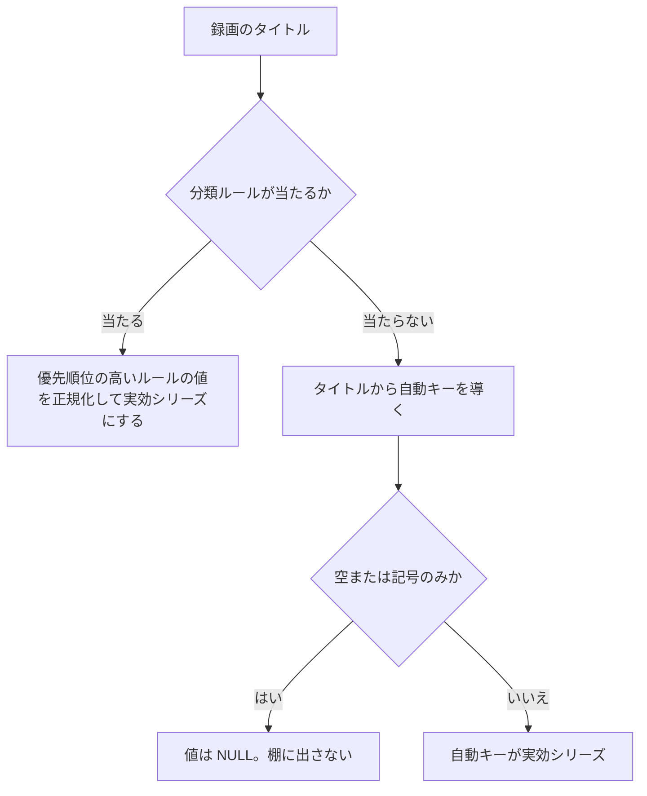

> [data.md](../data.md) §8 の一部。索引から辿る

## 8. シリーズ同一性

シリーズ棚・番組ハブ・「次のエピソード」は、どの録画とどの番組が同じシリーズかを前提にする。ここでは、その比較の基準と、それを API の資源へ写す判断を置く。

### 正本はタイトルからの導出。放送のシリーズ記述子は使わない

シリーズ同一性は、タイトルからの導出で決める。放送のシリーズ記述子は使わない。地上波 7 局・6960 番組の実測で、記述子の付与率は 0 件だった。

mirakc の番組 API はシリーズ情報を契約に持つ。しかし付与率は 0 件で、パイプラインは生きているのに、放送にシリーズ記述子が載っていない。BS は未測定だが、地上波で常に空になる以上、記述子を比較の基準にはできない。独立した 2 実装（KonomiTV と stuayu 版 EPGStation）も、記述子を使わず、タイトル側の導出を採っている。

重複排除の類似度は流用しない。あれは「同じ放送の再放送か」を問うもので、ほぼ同一の文字列だけを拾う。同一枠の別回の組では、類似度 0.5 に届くのが半分しかない。

根拠

- mirakc の番組 API の契約: `series`
- 載っていない記述子: series_descriptor
- 流用しない類似度: `internal/ruler/dedupe.go`

### 2 層: 分類ルール → 自動キー

実効シリーズは、分類ルールが当たればその値、当たらなければタイトルから導く自動キーとする。ルールは優先順位の高いものが先に勝つ。比較の基準はタイトルとルールで、評価の結果は作り直せるキャッシュである（次節）。

#### 自動キーと分類ルール

自動キーは、タイトルを正規化し、区切り記号・話数・枠名で切って導く。分類ルールは、キーワード 1 つと値の組で、優先順位の高いものが勝ち、同順位なら id の若いものが勝つ。

自動キーは、immutable な SQL 関数で導く。記号除去と NFKC の後、区切り記号と話数で切る。枠名を 1 語飛ばしてから、最初の空白で切る。空や記号のみのタイトルでは NULL を返す。

同順位で勝者が不定だと、評価のたびに棚が入れ替わる。

分類ルールの値も、自動キーと同じ正規化を通して比較する。画面のシリーズ名は実効キーを表示し、代表録画の生タイトルを補助表示する。キーを `ドラマ` のような短い値にしても、過剰併合が隠れず、ルールを直す場所が見える。

値が正規化で NULL になるルールは作らせない（CHECK）。何も主張しないルールになるからである（不変条件 10）。

根拠

- 自動キーの関数: `series_key(title)`
- 分類ルールの表: `label_rules`
- 勝者の順序: `priority DESC, id ASC`
- 短い値の例: `ドラマ`

#### 分類ルールの値の正規化

分類ルールの値にも自動キーの正規化がかかるので、最初の空白などで切れる。**割るつもりのルールが、同じ棚に落ちる。**

たとえば `NHK高校講座 数学I` と `NHK高校講座 化学` は、どちらも `NHK高校講座` の棚になる。`ドラマ「半沢直樹」` は、`ドラマ` になる。

値を棚のキーとして切り直す案は採らない。代わりに、API が実効の棚キーを返し、一覧とフォームで食い違いを見せる。

根拠

- 例: `NHK高校講座 数学I` / `NHK高校講座 化学` → `NHK高校講座`。`ドラマ「半沢直樹」` → `ドラマ`
- API が返す実効の棚キー: `valueKey`

#### 枠名を飛ばす理由

最初の空白で切ると、枠名の棚に作品が大量に併合され、分類ルールでも割れない。そこで枠名を関数内の定数として飛ばす。設定にしないのは、自動キーを immutable に保つためである。

単一の正規化では決まらない。最初の空白で切る段は、同一枠の別回の再現率を 60% から 83% に上げるが、枠名で過剰併合する。

関東の GR・BS の録画 4 年分では、`アニメ　<作品名>` の形が 1 つの棚に 2,268 件落ち、その下の作品名は 239 種類あった。分類ルールはキーワード 1 本で 1 作品しか切り出せないので、これは割れない。ハブの「次回」も同じ棚で誤爆し、候補が 136,053 件になった。

そこで、枠名（`アニメ` / `TVアニメ` / `日5`）を関数内の定数として飛ばす。最大の棚は 120 件、ハブの候補は 429 件に落ちた。

枠名を設定にしない理由は、自動キーを immutable に保つためである。設定にすると生成列にできず、プロセスごとに値が割れうる。残った過剰併合（`NHK高校講座` など）は、分類ルールで割る。巨大な棚として目に見えるので、直す場所が分かる。

未検証: 枠名の 3 語は、香川・岡山の site では測っていない。

#### 分類ルールの条件

分類ルールの条件は、キーワード 1 つに限る。録画タイトルと EPG の番組名の両方に、同じ式を当てるためである。共有するのは、キーワードの方言だけである（[search.md](search.md)「録画検索は rulequery を共有しない」）。条件をジャンルや局へ広げるなら、その決定と同時に見直す。

LIKE のエスケープは、SQL 関数に一本化する。分類ルールは DB 側のトリガーとジョブで評価するので、Go 側でエスケープする経路を通らない。

根拠

- 共有する方言: `KeywordClause`

#### 録画と EPG の入力

式は録画と EPG で対称でも、入力（録画時のタイトルのスナップショットと、現在の番組名）は対称とは限らない。同じ放送イベントで比べた 63 件（GR 35・BS 28）は、生のタイトルが全件一致した。ただし、EPG の保持窓に入る数日分だけの値で、月単位の改名率は未測定である。

### 評価結果の持ち方

読むたびに全録画を評価すると予算に収まらないので、評価結果を作り直せるキャッシュとして DB に持つ。自動キーは生成列、分類ルールの当たりは録画ごとの衛星表に置く。

#### 予算

読むたびに全録画を評価すると、73,000 行・分類ルール 50 本で 1.59 s かかった（うち自動キーの導出が約 600 ms）。利用者が開く棚とハブでは払えないので、評価結果を持つ。予算は、母集団の条件込みで 73,000 行・200 ms とする。

予算を決めた環境では、旧母集団で実効シリーズを書き下した形の棚が 141 ms だった。別の環境では、同じ回に測ったその形との比（200/141 ≈ 1.42 倍）で読む。当時は 73,000 行がすべて再生可能で、今の合成データ（65,000 行）と違う。この違いが比をどちらへ動かすかは未検証である。

根拠

- 自動キーの関数: `series_key`

#### 何をどこに持つか

自動キーは、録画と EPG 番組の表に生成列として持つ。分類ルールの当たりは、勝ったルールの id を録画ごとに衛星表へ持ち、当たらない録画には行を作らない。

自動キーの生成列は、STORED で持つ（ジャンルの配列と同じ形）。書くループが無いので、導出が事実を上書きする経路が無い。

衛星表の行の存在は、そのルールが勝ったことを表す。

id を持つので、ルールの値を変えた変更は JOIN で即座に反映される。キーワードと優先順位の変更、追加、削除は、全件の再評価になる。削除も全件の再評価が要る。当たりの表は勝者しか持たないので、勝者が消えた録画の次点は、表から分からない。CASCADE は安全網でしかない。

分類ルールの表にも、値の正規化結果を生成列で持つ。集計のたびに録画ごとに正規化すると、生成列で消したコストが値の側から戻る。

根拠

- 生成列を持つ表: `recordings` / `epg_programs`
- 同じ形の生成列: `genre_lv1`
- 値の正規化結果を持つ表: `label_rules`

#### 当たりの表の書き手

当たりの表には書き手が 2 人いる。1 行の評価はトリガーが、全件の再評価は River のジョブが行う。両者は評価の関数を 1 つ共有する。

1 行の評価は、録画の INSERT とタイトルの UPDATE に付けたトリガーが行う。録画を作る経路は複数あるので、Go 側で呼ぶと 1 つ漏れる。トリガーは「既存の当たりを消す → 勝者がいれば入れる」の 2 段にする。upsert だけだと、当たらなくなった録画に古い当たりが残る。

UPDATE のトリガーは、タイトルが変わったときだけ当てる。列指定の UPDATE トリガーは、SET 句にタイトルがあれば値が同じでも発火する。in-place 登録と rescue は、タイトルを無条件に書く。そのため、変更前後のタイトルが違うときだけ発火する WHEN 句で止める。

全件の再評価は、River のジョブが 1 トランザクションで差分だけ適用する。全件を消して入れ直すと、変化が無くてもデッドタプルと通知が毎回出る。

根拠

- 1 行の評価: `recordings` の INSERT と `title` の UPDATE に付けたトリガー
- 発火の条件: `UPDATE OF title` は SET 句に `title` があれば発火する
- 止める WHEN 句: `WHEN (OLD.title IS DISTINCT FROM NEW.title)`。テストは `TestRecordingsLabelRuleTrigger_SkipsUpdatesThatKeepTheTitle`

#### 再評価ジョブの動かし方

全件再評価のジョブは、advisory lock で直列化し、一意化はしない。実行中に来た 2 本目の編集を捨てないためである。

ロックで直列化するのは、並行した 2 本のうち古い方が、後から上書きしうるからである。rescue の再評価も同じロックを取る。

一意化すると 2 本目の編集を捨てる。捨てると、1 本目が古いルール集合で評価し終えた時点で打ち止めになる。2 本目の編集は、次の定期再評価（15 分）まで反映されない。「実行中を除いた状態集合」では、一意化の代用にならない。River が一意性の状態集合から実行中を外した集合を、挿入時にエラーにするからである。

再評価ジョブは、cleanup キュー（site 非依存の DB ジョブ用）で走らせる。ruler キューは同時実行 1 で、サイトごとの ruler パスが並ぶので、全件評価（0.86 s）で塞がない。

代償は、素早く N 回編集すると、全件評価が N 回直列に走ることである（1 回 0.86 s / 73,000 行）。編集はまれな操作なので許容する。

根拠

- ロックのキー: `LockLabelRuleReevaluation` の 1 箇所。テストは `TestRescue_WaitsForLabelRuleReevaluationLock`
- 外した集合をエラーにする River の設定: `UniqueOpts.ByState` から `running` を外した集合（`requiredV3states`）
- cleanup キューを使う他のジョブ: `delete_reconcile` / `catalog_export`
- ruler キューの設定: `MaxWorkers: 1`

#### 定期の再評価と母集団

定期的な全件の再評価を必須にする。ルール編集をまたいでコミットした録画は、旧ルールで評価されうる。この窓は、定期の再評価だけが閉じる。

全件の再評価には、母集団の条件を入れない。ごみ箱や tombstone の録画も、ハブの起点になる。母集団で絞るのは、棚と一覧の側である。

#### catalog と rescue

当たりの表は、catalog に入れない。作り直せる値なので、録画の表が戻れば再評価で戻る。分類ルールの表は、catalog に入れる。ユーザーが書いた、再取得できない設定だからである。

rescue は、分類ルールを録画より前に書く。INSERT トリガーが、復元済みのルール集合で評価するためである。末尾では、同じトランザクションの中で全件の再評価を回し、当たりの表を閉じる。トリガーは新規行とタイトルの変更しか見ないので、DB に残っていた録画の当たりは、この再評価でしか追従しない。

根拠

- catalog に入れる表: `label_rules`
- 末尾の再評価の確認: `TestExportRescue_RoundTripsLabelRules`

#### 通知

通知は、全件の再評価で変化があったときに、録画のトピックへ 1 回だけ送る。当たりの表に行トリガーを付けると、全件の再評価で行数ぶん通知が出る。

分類ルールの変更も通知するので、キーワードを変えた直後は古い棚が一度返り、再評価の完了後に割れる。

根拠

- 通知のトピック: `recordings`
- 通知する変更の表: `label_rules`

#### 自動キーの関数を変えるマイグレーション

自動キーの関数を変えると、録画の既存行の生成列は自動では再計算されないので、ビューと列を落として作り直す。EPG 側は、次の同期で値が入れ替わるので、この手順は要らない。

タイトルを SET 句に含まない UPDATE では、生成列は再計算されない。`REINDEX` でも直らない。

列を作り直す順序は次の通り。

1. `DROP VIEW recording_series`
2. `DROP COLUMN`
3. `ADD COLUMN`
4. `CREATE VIEW`

録画の自動キーの列に、索引は張らない（読み手がいないので落とした）。ビューが列を参照しているので、列だけは落とせない。関数を変えたら列も変わることを、マイグレーションのテストで確かめる。

EPG 側は、この手順が要らない。同期の `ON CONFLICT DO UPDATE` が番組名を毎回 SET するので、次の同期で値が入れ替わる。

根拠

- 自動キーの関数と列: `series_key` / `recordings.series_key`
- 手順の対象のビュー: `recording_series`
- 再計算されない UPDATE の条件: `title` を SET 句に含まない
- EPG 側の列: `epg_programs.series_key`。同期が毎回 SET する列は `name`

### 実装で決めたこと

値とキーワードの正規化結果は、生成列に持つ。これは前提であり、任意の最適化として扱わない。実効シリーズの定義はビューの 1 箇所に置き、棚の母集団は生きている録画全体とする。

#### 生成列

値の正規化もキーワードの正規化も、生成列で持つ。勝者を決める関数は、録画 1 行ごとに呼ばれる。キーワード側を毎回正規化すると、(録画行 × ルール本) 回になる。73,000 行 × 50 本で 16.0 s から 0.95 s になった。

根拠

- 録画 1 行ごとに呼ばれる関数: `label_rule_winner`

#### プランの形とビュー

棚のクエリは、プランの形に依存する。旧母集団では、録画を走査する CTE のマテリアライズが効いたが、本番の形では付けない。代表と件数は 1 回の集計で出し、実効シリーズの定義はビュー 1 箇所に置く。

旧母集団では、録画を走査する CTE を MATERIALIZED にしていた。過去の実測では、外すと下流が全部 1 行の計画になり、73,000 行で 141 ms が 617 ms になった。

旧母集団は、再生できる録画だけだった。過去の実測では、CTE を外すと主テーブルの走査が部分一意索引に乗った。一意索引の行数を 1 と見積もるので、下流が全部 1 行の計画になり、代表を求めるソートが外側の行数ぶん繰り返された。代表と件数を別の CTE に割ると、231 ms だった。

本番の CTE は旧 CTE に当たるが、MATERIALIZED にしない。現行 SQL の合成 seed では、617 ms は再現しなかった。MATERIALIZED にすると、本番形の 1.06〜1.09 倍遅い（ハーネス 3 回）。617 ms の再現条件は未検証なので、再発したら `EXPLAIN` で計画を調べる。

再生可能な資産の CTE は、現行クエリでは参照が 1 回なので、MATERIALIZED にしない。MATERIALIZED にした形は、本番形の 1.03〜1.05 倍遅く（ハーネス 3 回）、結果は一致した。

代表と件数は、1 回の集計で出す。DISTINCT ON と件数の集計を別の CTE に割ると、同じ行をもう 1 度走査する（141 ms から 231 ms）。

実効シリーズの定義は、ビューの 1 箇所に置く。棚のクエリも、このビューを JOIN する。ビュー経由は、書き下しより 7〜8% 遅い（旧母集団の形で、合成 73,000 行・141 棚・ルール 50 本、約 240 ms 対 約 223 ms、開発機）。

根拠

- 再発時に計画を調べる文: `EXPLAIN`
- 旧母集団で MATERIALIZED にしていた CTE: `playable`。`MATERIALIZED`
- 外すと乗った索引: `recordings_unique_active_event`
- 本番の CTE: `live`。旧 `playable` に当たる
- 再生可能な資産の CTE: `playable_assets`
- 1 回の集計の形: `array_agg` + `GROUP BY`。別の CTE に割る形は `DISTINCT ON`
- 定義を置くビュー: `recording_series`。書き下さない式は `COALESCE(lr.value_key, r.series_key)`

#### 測定ハーネス

棚と予約一覧の測定は、テストのハーネスに残してある。速さはアサートせず、件数と形どうしの結果一致を判定する。未視聴の集計を壊し、合計の照合で落ちることを確かめた。

測定用の DB の環境変数が無ければ、スキップする。

ハーネスは `internal/api/shelves_bench_test.go` にある。環境変数があるときは、73,000 行・141 棚の合成データを作る。録画中・失敗・ごみ箱などを混ぜる。6 つの棚クエリ形を、prepared statement 経由で交互に 10 ラウンド測る。棚形は、本番（sqlc 経由）、旧母集団の形、旧母集団の形から MATERIALIZED を外した形、本番の CTE だけを MATERIALIZED にした形である。さらに、再生可能な資産の CTE だけを MATERIALIZED にした比較形と、旧母集団の形で実効シリーズを書き下した形（予算の比の分母）を測る。

予約一覧は、実効シリーズを LEFT JOIN で足す形と相関サブクエリで足す形を、予約数と予約に載らない EPG の行数を別々に動かして測る。

速さはアサートせず、棚ごとの再生可能件数・最新開始時刻・形どうしの結果一致を判定する。未視聴数は、別のイベント集計と照合する。母集団は生きている録画で、LEFT JOIN + FILTER を採る。

psql の単発実行は、基準にしない。アプリと同じ pgx の prepared statement 経路で測る。単発の psql と計画が変わるかは、この合成 seed では未検証である。

ハーネスの検証は、「外すと数倍遅い」の再現では行わない。この seed では、一度も再現していない。代わりに、未視聴の集計を壊し、合計の照合で落ちることを確かめた。壊し方は 6 通りある。録画行で数える、印を生きている行・再生可能な行・purge されていない行からだけ読む、キーを event_id にする、キーからサービスを落とす、である。

根拠

- ハーネス: `internal/api/shelves_bench_test.go`
- スキップの条件: `ROKUBAN_BENCH_DATABASE_URL` が無い
- 集計の形: `LEFT JOIN` + `FILTER`
- 壊し方のキー: `event_id`

#### 棚の母集団と未視聴件数

棚の母集団は、生きている録画全体とし、再生可能件数を別に返す。未視聴件数は、放送イベントを単位に数える。録画行の数は、同じ放送を二重計上するので採らない。

画面は、値をシリーズ名、代表録画の生タイトルを補助表示に使う。値が NULL の棚は、実効シリーズを起点に番組ハブを開けないので、画面に出さない。最新開始時刻は、同じ集計から返す。API は、件数によらず全部の棚を返す。

未視聴件数は、放送イベント数で定義する。生きている録画のうち再生可能な録画を、放送イベントで束ねる。同じキーを持つ全録画行（削除済み・supersede 済み・purge 済みの tombstone を含む）に視聴済みの印が無いイベントを、1 件と数える。複数拠点の録画や録り直しがあっても 1 件とし、古い行の視聴済み印も読む。

数えるのは、棚ごとである。同じ放送の行が拠点ごとに別の棚へ入ると、各棚で 1 件ずつ数える。棚をまたいだ合計は、放送数にならない。

未視聴件数は、棚クエリの同じ集計で返す。予約一覧も録画の本数を出すために棚クエリを読む。未視聴だけを別クエリにすると、実効シリーズの評価がもう 1 回走る。

根拠

- 生きている録画の条件: `deleted_at IS NULL AND superseded_at IS NULL`
- シリーズ名に使う値: `value`。値が NULL の棚: `NULL`
- 最新開始時刻: `latestStartAt`
- 放送イベントのキー: `(network_id, service_id, program_start_at)`
- 視聴済みの印: `recording_watched`
- 評価が走るビュー: `recording_series`

#### 予約一覧の実効シリーズ

予約一覧の実効シリーズは、相関サブクエリで引く。EPG 側のビューを LEFT JOIN すると、予約の識別が、ビューの中へ押し下がらない。EPG の全行を Seq Scan して勝者を評価してから突き合わせるので、費用が EPG の行数に比例する。

測定値は、Apple M3 Max・PostgreSQL 16.2・ハーネス 3 回の中央値である。予約 2,000 件・EPG 約 2,000 行では、LEFT JOIN が 70〜72 ms、相関サブクエリが 75〜76 ms だった。予約に載らない EPG を 134,000 行足すと、LEFT JOIN は 4.58〜4.78 s、相関サブクエリは 76〜81 ms になる。予約 500 件では、LEFT JOIN が 18〜19 ms、相関サブクエリが 20 ms だった。EPG から消えた予約も行として残り、実効シリーズは NULL になる。

根拠

- LEFT JOIN すると押し下がらない列: 予約の `(site, program_id)`
- LEFT JOIN するビュー: `epg_program_series`
- 全行で評価される関数: `label_rule_winner`

#### 測定値

現行の本番形の測定値は、生きている 71,000・再生できる 65,000 行、sqlc と pgx 経由の中央値、ハーネス 3 回、Apple M3 Max・PostgreSQL 16.2 である。棚は 302.6〜307.3 ms だった。同じ回の書き下し形（223.1〜229.8 ms）の 1.33〜1.36 倍で、予算の 1.42 倍に収まる。実データでの絶対値は未測定である。

当時の値（73,000 行がすべて再生できて母集団が旧形、別の環境）は、棚 141 ms・一覧 50 件の series 列 10 ms・全件再評価 0.86 s だった。同じ形（書き下し）は開発機で約 223 ms で、値は環境が違うので直接は比べられない。

ハブの測定値は、録画 73,000 行・棚 141・分類ルール 51 本・EPG 136,053 行、HTTP 経由の中央値である。一覧は 58 ms、次回は 15 ms だった。次回の費用は、返す行数 × 分類ルール本に比例する。EPG 側の候補が 45,351 件になる棚（分類ルールが EPG の 1/3 を 1 つの棚に併合した病理的な場合）では 740 ms で、返す応答が 8.8 MB になる。実データの EPG は 6 日分 1,779 行（GR 19 サービス）なので、候補は数十件である。

根拠

- 一覧 50 件の列: `series`

#### EPG 側の引き当て

EPG 側はルールの当たりを持たず、ハブの「次回」を引くビューを、ルールの枝と自動キーの枝の 2 本の UNION ALL に割って書く。1 式にすると、値の絞り込みが枝に押し下がらず、EPG の全行を評価してしまう。

ルールの当たりを持たないのは、10 分ごとに全行を書き直す同期に、再評価の契機をもう 1 つ足すことになるからである。ハブの「次回」は、起点の実効シリーズ v から引く。E(番組) = v は、次のどちらかである。

- 値が v のルールが当たり、それより前の順序のルールがどれも当たらない
- 自動キーの生成列が v で、どのルールも当たらない。値が v のルールだけを否定すると、別の値のルールに取られた番組が混ざる

この 2 つは、`epg_program_series` ビューの 2 本の UNION ALL として書く。`COALESCE(勝者の値, 自動キー)` の 1 式にすると、プランナは `value = $1` をどちらの枝にも押し下げられない。EPG の全行で勝者を評価してから値を比べることになる（136,053 行・ルール 51 本・sqlc と pgx 経由で 1.30 s。Seq Scan の Filter で 135,089 行が落ちる）。

2 本に割ると、`value = $1` が両方の枝に入る。自動キーの枝は btree の索引で、ルールの枝は番組名の正規化式の GIN 索引で引く。同じコーパスで 15 ms になる。

ルールの枝の LIKE は、勝者を決める照合より狭くなってはならない。狭い側にずれると、勝者が居るのに枝から漏れる番組が出る（結果が減るだけで、例外は出ない）。

根拠

- 勝者の順序: `priority DESC, id ASC`
- 2 本の UNION ALL にするビュー: `epg_program_series`
- 押し下げられない述語: `value = $1`
- 自動キーの枝の索引: `epg_programs_series_key_idx`（btree）
- ルールの枝の索引: `epg_programs_name_trgm`（`normalize_search_text(name)` の GIN）
- 勝者を決める照合: `label_rule_winner`

### 評価結果を宛先にしない

評価結果は作り直せるキャッシュであり、API の宛先にしない。当たりの行を指す API も、上書きする操作も、自動棚の統合も、手動のシリーズ上書きも作らない。

KonomiTV はシリーズを FK と非正規化列に焼いて宛先にし、stuayu 版は焼いた引き当てキーの掃除機構を作り続けている。

「自動棚 A を B に統合する」操作は作らない。導出値を宛先にした上書きは、正規化を変えた時点で宛先を失う。

録画ルールからラベルを継承させない。勝者ルールだけを継承すると、広いルールに気づかないうちに負ける。作成時にコピーすると、予約と録画で値が食い違う。「このルールで録れたもの」は、`rule_id` の軸が既に持っている。

手動でシリーズを上書きする層は置かない。録画にしか付けられないので、EPG 側の「次回」と非対称になる。

根拠

- 既に「このルールで録れたもの」を持つ軸: `rule_id`

### 資源同定: 起点は録画 id

番組ハブは、起点にした録画 1 件の id で同定する。シリーズは、起点の実効シリーズと等しい録画の集合として毎回導出し、まだ録画の無い番組を起点にしたハブは作らない。

予約が持つシリーズの値は、EPG 側のビューから読む照合値で、宛先にはしない。予約評価と録画棚は更新契機が違うため、別々に取得し、予約のシリーズと棚の値を照合する。番組ハブは、棚が返す代表録画の id から開く。

根拠

- 予約が持つシリーズ: `series`。読み元のビュー: `epg_program_series`
- 棚の値: `value`。代表録画の id: `representativeId`

#### 録画 id を使う理由

録画 id を起点にする理由は 4 つある。

- 正規化キーを URL に置くと、規則を変えた時点で、404 にならずエラーも出さずに 0 件になる
- 録画 id は、watcher が作る不可逆な事実の id で、導出器が作るキーではない（不変条件 9）
- 録画行は purge 後も、tombstone とタイトルのスナップショットが残るので、起点の URL は使えなくならない
- 棚の中のどの録画を起点にしても、同じ集合になる

#### 録画の無い番組と行の同一性

まだ録画の無い番組を起点にしたハブは作らない。番組を指す組は EPG のローリングウィンドウから外れると、宛先を失う。

一覧 API の行の同一性（1 行 = 1 録画）は、シリーズで絞っても変えない。N 予約で同じ放送が 2 拠点から録れていれば、ハブに 2 行並ぶ。ドロップ統計で選び分ける運用では、それが正しい。

同じ放送をまとめるのは、「次のエピソード」の UI だけである。再生できる行に限り、起点と同じ site を優先する。開始時刻がずれて supersede されない failed 行（[schema/recordings.md](../schema/recordings.md)「`superseded_at`: failed 行が後続 record に枠を譲る」）を「次」に入れないためである。

根拠

- 宛先を失う組: `(site, programId)`
- 開始時刻がずれて supersede されない行: `failed` 行

#### 並びと経路

シリーズ内の並びは、放送日時順とする。話数は持たないので、重複排除を切ったルールでは再放送が「次」になりうる（頻度は未測定）。

経路はすべて、単一ホスト名の Ingress で catch-all に落ち、api ロールが DB だけで答える（不変条件 1）。streamer 行きの Prefix の下には置かない（[api/deployment.md](../api/deployment.md)）。

根拠

- catch-all のパス: `/`
- 置かない経路: `/api/sites/{site}/recordings` と `/api/media/` の下

### 不変条件 7 との整合

放送のシリーズ id を永続テーブルに入れる案は、記述子を使わない時点で消えた。分類ルールの表が持つのは、ユーザーが書いたキーワードと値だけで、mirakc 固有の概念を含まない。名前は「ラベル」とし、mirakc の schedule tags と区別する。

根拠

- 分類ルールの表: `label_rules`
- 区別する mirakc の tags: `schedule_sync.tags` / `record_sync.tags`

