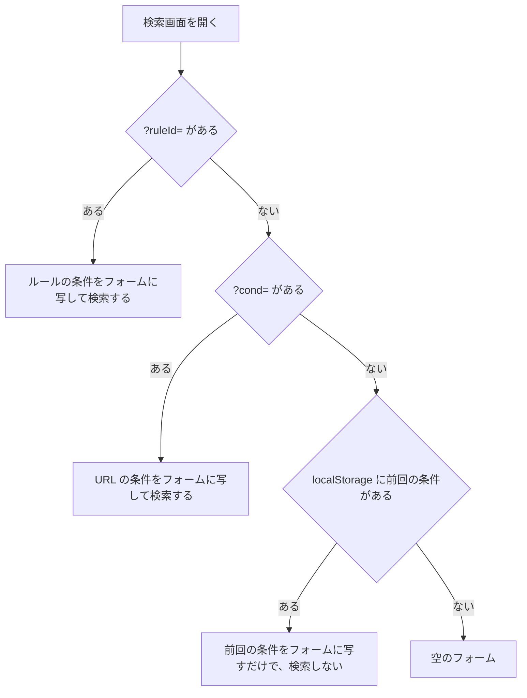

> [frontend.md](../frontend.md) の一部。索引から辿る

# デザイン言語（副調整室の計器盤）

この文書は以後の UI PR のレビュー判定基準である。新しい画面やコンポーネントを足すときは、ここを満たしているかで見る。

形（トークン名と実際の値）の権威は `web/src/index.css`。ここには判断（なぜ）だけを書く。**合否は実ブラウザで測る**（`pnpm e2e:design`。下記「合否は画素で測る」）。

## テーゼは「副調整室の計器盤」

UI の仕事は、**いま何が電波に乗っていて、何が録れていて、何が足りないか**を一目で言うことである。基準は副調整室（サブ）の計器盤で、地は徹底して無彩にし、色が点いていること自体を情報にする。

Rokuban が扱うのは放送波と有限のチューナーである。装飾で個性を出す画面にはしない。原点は 16px のファビコン（[branding.md](branding.md)）で成立している階調構成で、それをそのままアプリの地に持ち上げている。

## 地は「イ」の 3 値

地の階調は、ファビコンの 3 値（輝線の白・間隙の灰・字の黒）と同じ値を使う。ライトは白地に黒、ダークは消灯した画面に輝線で、役割を入れ替える。

| ファビコン | 呼び名 |
|---|---|
| 輝線 = 白 | 紙白 |
| 間隙 = 灰 | 走査線グレー |
| 字 = 黒 | 墨 |

値そのものはここには書かない。スタイルシートとファビコン生成スクリプトに既に 2 度書いてあり、3 つ目を作ると必ずどれかが古くなるためである。ライトは白地に黒でファビコンそのものであり、ダークは役割を入れ替えたもので、反転ではない。

3 値の間を埋める段は、3 値がちょうど 50 / 500 / 900 に一致する Tailwind zinc の ramp から採る。別の ramp を持ち込むと、3 値だけが浮いて中間段と噛み合わなくなる。zinc はわずかに寒色で、これが「地は無彩、色は信号」を成立させている。地が寒色側に寄っているぶん、暖色の信号（タリーレッド・琥珀）だけが色として立ち上がる。

**3 値の一致は、両方のファイルを読むテストが検査する。** 同じ決定が 2 箇所に書いてあるので、片方だけ動かすと気づかないうちに食い違うためである。

<details><summary>根拠</summary>

- 3 値のトークン: `--paper`（紙白）、`--scanline`（走査線グレー）、`--sumi`（墨）
- 値が既に書いてある 2 箇所: `index.css`、`scripts/gen-favicon.mjs`
- 3 値の間を埋める段: `--tone-*`
- 3 値の一致を検査するテスト: `web/tests/design-tokens.test.ts`

</details>

### 浮いた面の例外

浮いた面は、ライトでは純白を使う。これが 3 値の唯一の例外である。

ポップオーバー（録画の絞り込み・チャンネル選択）はオーバーレイを持たないので、地と同色だと輪郭が罫線と影しか無くなる。

<details><summary>根拠</summary>

- 浮いた面のトークン: `--card`、`--popover`

</details>

## 色は信号のみ

**恒常的な装飾色は持たない。** 色が点いている箇所は、そのとき何かを主張している箇所に限る。チャンネル色・アバター色・ブランドアクセントは入れない。

### 信号の一覧

信号色ごとに、示す意味と色の載せ方（塗りと線、文字と淡い地など）が決まっている。信号色と意味は次の表の通り。

| 信号 | 意味 | 形 |
|---|---|---|
| タリーレッド | いま電波に乗っている | 塗りと線のみ |
| 琥珀 | 警告 | 文字と淡い地 |
| destructive | 取り返しがつかない・失敗した | 文字と淡い地 |
| チャプター編集 | カット区間と選択中の境界 | 区間の面・選択位置 |
| ジャンル淡色 | 番組の種別 | セルの淡い地 |

タリーレッドは録画中と現在時刻を示し、点灯した札と現在時刻の線に使う。琥珀はチューナー不足・条件なしのルール・期間指定の副作用を示す。destructive は失敗・ドロップ・EPG から消失・削除操作を示す。チャプター編集の色は両テーマで固定する。ジャンル淡色は、読まずに帯の並びを把握するための補助である。

<details><summary>根拠</summary>

- タリーレッド: `--tally`、`--tally-foreground`
- 琥珀: `--warning`
- destructive: `--destructive`
- チャプター編集: `--chapter-cut`、`--chapter-cut-muted`、`--chapter-selection`
- ジャンル淡色: Tailwind の淡い段

</details>

### 現在地とフォーカス

サイドバーの現在地は、無彩色の前景色を地に塗り、文字とアイコンに背景色を使う反転で示す。キーボードフォーカスは意味色を使わず、走査線グレーの実線リングで示す。

アクセント色を持たない Rokuban では、この中立な塗りが HIG の「サイドバーのアイコンはアプリのアクセント色を使う」に相当する。色相を足さず、選択中の画面だけを明るさの反転で示す。現在地の反転面にフォーカスが重なる場合は、オフセットを置いてリングをページの地に出す。

<details><summary>根拠</summary>

- 現在地の反転: `foreground`、`background`
- フォーカスリングの色: `--scanline`

</details>

### 補助リンクと凡例

補助リンクは、ミュート色の文字とアイコンで押せることを伝える。枠・背景・アクセント色は常設しないので、有効スイッチの状態表示と競わせない。

画面遷移には末尾にシェブロンを置き、同じ画面でダイアログを開く操作には先頭にプラスを置く。番組表のジャンル凡例は色と語の対応表であり、色だけに意味を持たせず再認を助ける。放送終了セルの減光は状態色を増やさず、ジャンル淡色に muted の面を重ねる濃淡の変更とする。

<details><summary>根拠</summary>

- 補助リンクの文字色: `text-muted-foreground`
- 画面遷移の末尾アイコン: `ChevronRight`
- ダイアログを開く操作の先頭アイコン: `Plus`

</details>

### タリーの使い方

**タリーは塗りと線にしか使わず、文字色にはしない。** リストの「放送中」には色を使わず、太さだけで示す。

11px〜14px の赤い文字はダークの地に対して AA（4.5）に届かない。塗りにすれば「紙白の文字 / タリーの塗り」の比で測れて、両テーマとも 4.5 を超える。この規律のおかげで「点灯している」という比喩と読みやすさが同じ方向を向く。

チャンネル数ぶんの行が同時に放送中になるので、リストの放送中を赤くすると地になり、信号として働かなくなる。「いま」を主張するのは番組表グリッドの線と札で、画面に 1 本 / 1 枚しか出ない。

タリーにだけ、塗りの上に載る文字の前景色を持たせる。琥珀には対の前景色を作っていない。琥珀は塗りに使わないので書き手がいない。使う人がいないトークンは足さない（CLAUDE.md 不変条件 11）。琥珀を塗りに使いたくなったら、そのコードと同じ PR で琥珀の前景色を足す。

<details><summary>根拠</summary>

- 塗りの上に載る文字の前景色: `--tally-foreground`
- 琥珀に持たせない前景色と、足すときの名前: `--warning`、`--warning-foreground`

</details>

### タリーと destructive の区別

タリーレッドと destructive は色相が近いので、色では区別せず、形に担わせる。タリーは塗り、destructive は文字と淡い地で示す。

タリーは「点灯」なので塗り（紙白の文字を載せる）、destructive は「失敗した」なので文字と淡い地にする。同じ赤でも、塗られているかどうかで「いま動いている」と「失敗した」が見分けられる。

この排他性のために外した色が 1 つある。**日付ストリップの「日 = 赤 / 土 = 青」は使わない。** カレンダーの慣習ではあるが、赤が画面の中で 2 つの意味を持つと、タリーが「いま電波に乗っている」を主張できなくなる。週末は濃さで立てる（墨 = 週末 / 走査線グレー = 平日）。土と日のどちらかは文字自身が言うので、色で区別する必要はない。

<details><summary>根拠</summary>

- タリーの塗り: `bg-tally`
- destructive の文字と淡い地: `text-destructive`、`bg-destructive/10`

</details>

### 緑の信号色は持たない

**警告が出ないことは保証ではない。** 警告を出さないことは「大丈夫」を意味しない（[data.md](../data.md) §6.5）ので、「競合なし」「収まります」を緑で出さない。

判定の盲点はすべて「警告を見逃す」方向に偏っている。緑の信号色を持たないのはこのためである。

### コントラストは毎回測る

コントラストの数値はここに転記せず、実ブラウザで毎回測る。文字の下限は 4.5、面と線は 3 とし、下限を割る組み合わせは除外せず失敗として扱う。

#### 半透明の地は合成して測る

半透明の地は、文字が実際に重なる背景へ合成してからコントラスト比を出す。警告色の文字が乗るのは淡い警告色の面の上なので、地に対する比だけを見ると 0.5〜0.7 ほど甘い数字が出る。

判定を足したことと、それが機能していることは別である。合成の実装を入れても、淡い地を持つのが外側の要素で文字を持つのが内側の要素だと、locator が内側だけを取得して背景が透明になる。その結果、合成が恒等関数になる。この状態では、色を暗くした修正を revert しても判定は緑のまま通った。いまは祖先を遡って最初に不透明な面に当たるまで重ねる。取得した要素の背景が透明なら、そのこと自体で判定を失敗させる。

<details><summary>根拠</summary>

- コントラストの実ブラウザ判定: `pnpm e2e:design`、`e2e:design`、`web/e2e/design.mjs`
- 半透明の地を合成して測る（地だけだと 0.5〜0.7 甘い）: `text-warning`、`bg-warning/10`
- 合成が恒等関数になる失敗: 祖先を遡って最初に不透明な面まで重ねる、背景が透明なら落とす

</details>

#### 実画素の採取

実画素は、1px 塗って画素を採取して判定する。Chromium は計算値も oklch のまま返すので、計算済みスタイルから実画素は読めない。

canvas の塗り色も同じ挙動である。背景画像に直接書いた色も読めないので、縞の色はカスタムプロパティに出す（下記「走査線は読み込み中・ON AIR の 2 箇所限定」）。

<details><summary>根拠</summary>

- 実画素の採取: `getComputedStyle`、`canvas` の `fillStyle`、`getImageData`、`oklch(...)`、`background-image`、カスタムプロパティ

</details>

#### 下限を割った組み合わせの直し方

除外リストは持たない。下限を割る組み合わせは、通常の失敗判定に入れる。

失敗バッジは、ライトの destructive の明度を下げて直した。色相は動かしていない。タリーと近いままで、彩度だけがその明度で sRGB 色域に収まる上限まで下がる（上記「タリーと destructive の区別」）。録画中との識別は、従来どおり「塗り + 紙白の文字」と「文字 + 淡い地」の形の差で保つ。

ライトでは muted の地に muted の文字を載せたバッジが下限 4.5 を割る。地・文字とも走査線グレー側の段を経由するためである。走査線グレーの値そのものは動かさず、該当する小バッジの文字を前景色にして直した。前景色は地の無彩 3 値の一部で信号色ではないので「色は信号のみ」と矛盾しない。新しく muted の地の小バッジを足すときは、この手を最初から使う。

chip と day-strip は、hover のときだけ muted の地が乗る形である。Lighthouse は hover を測らないので合否の対象外だが、同じ組み合わせである以上、揃えて hover の文字色を前景色にしてある。

<details><summary>根拠</summary>

- 除外リストを置かない判定: `knownGaps`
- 失敗バッジの色相と彩度: `--destructive`、`--tally`、`web/src/index.css`
- muted の地への文字色修正: `text-foreground`、`bg-muted`、`text-muted-foreground`
- 前景色にした録画ラベル: 「完了」、取り込みバッジ、site タグ（録画一覧）
- 前景色にした番組ラベル: sticky 日付見出し（番組リスト）、番組表グリッドとチャンネルピッカーのリモコン番号タグ
- 前景色にした他のラベル: `ReservationVerdictBadge`、ルール一覧の「無効」、ライブのチャンネル種別タグ・チャンネル一覧のリモコン番号タグ
- chip / day-strip の hover: `components/ui/chip.tsx`、`components/day-strip.tsx`、`hover:bg-muted`、`hover:text-foreground`

</details>

#### 行の hover と選択行

一覧行の hover 中の副情報は、ミュート色を維持する。hover の実測は代表として録画一覧の行だけで行い、4 画面すべては測っていない。

4 画面（録画一覧・予約一覧・ホーム・番組リスト）の hover の面は、最も近い薄さへ揃え、通常時の「本文 = 前景色 / 副情報 = ミュート色」の階層を崩さない。実測は、録画一覧の行を e2e:design が実際に hover して行い、ライト・ダークの両テーマで測る。録画一覧の選択モードで選んだ行も、同じ薄さの面に揃えてある。こちらは常時見える面で Lighthouse の監査対象なので、hover と同じ理屈で e2e:design が実測する。

<details><summary>根拠</summary>

- 行 hover と選択行: `hover:bg-muted/40`
- 行 hover の対象 4 画面: `components/program-row.tsx`、`components/recording-row.tsx`、`pages/reservations.tsx`、`pages/home.tsx`

</details>

#### 測っていない組み合わせ

上の列挙は、muted の面にミュート色の文字が乗る箇所の網羅ではない。網羅の権威は e2e:design の出力の側に置く。そこに出ていない組み合わせは「測っていない」であって「通っている」ではない。いま分かっている残りは次の通り。

- 測ってあり、下限を満たす: 録画詳細の説明文・見出し語の一群・品質イベントのミュート文字。詳細本体はページ地へ直接置き、e2e:design は見出し語「チャンネル」の文字色をページ地に対して測る。同じ色トークンを使う説明文・品質イベントも同じコントラストになる。常時見えるため Lighthouse の監査対象に入る。
- 未検証: 検索のルール由来バナーの読み込み中の枝（薄い muted の地）。ここではルールが解決した本体がミュート文字を持たず、エラーの枝は destructive の文字である。
- 未検証: エンコード対象プロファイルの行の hover（薄い muted の地）。コンテナ名がミュート文字である。
- 未検証: destructive 側のボタンの hover（基底より濃い面）。
- 未検証: ブレーカーバナーの理由文（淡い destructive の地の上で、文字自身が半透明）。

検索のルール由来バナーとプロファイル行の hover は、一瞬 / hover 中しか出ないため判定に載せていない。他の不透明度の実測値から外挿もしない。判定を足すまでは「同じ手で直した」扱いにも「通っている」扱いにもしない。

モバイル番組のチャンネルピッカーのトリガーは、上記のバッジ群とは別の組み合わせである。専用には測っていない。他所で測っている地の無彩 3 値そのものの対に当たるためである。「トリガーが読めない」という古い観測がどの要素を指していたかは同定できていない（未検証）。リモコン番号タグは、開いたポップオーバーの選択肢側にあり、トリガーの中には無い。ポップオーバーは閉じている間も DOM に残す指定を付けていないので、閉じている間は DOM に存在しない。

<details><summary>根拠</summary>

- 録画詳細の実測: `/recordings/$id`、`RecordingDetail`、`<dt>`「チャンネル」
- ルール読み込み中の面: `RuleSourceBanner`、`components/rule-form.tsx`、`bg-muted/40`、`text-destructive`
- エンコード設定の hover: `components/encode-settings-fields.tsx`、`hover:bg-muted/60`、`text-muted-foreground`
- destructive の面（基底の `/10` より濃い面）: `Button variant="destructive"`、`hover:bg-destructive/20`
- ブレーカーバナーの文字: `circuit-breaker-banner.tsx`、`text-destructive/80`、`bg-destructive/10`
- チャンネルピッカーのトリガーの色: `bg-background`、`text-foreground`
- 閉じている間も DOM に残す指定を付けていない: `ChannelOption`、`keepMounted`

</details>

### 操作標的の寸法は基準を先に決めて実測する

形を変える前に、実ブラウザで測る標的と下限を固定する。全標的は 24px、coarse の頻度の高い主操作は 44px 以上、モバイル主ナビは高さ 56px を、CSS px の下限とする。

寸法は DOM 属性やクラス名から推測せず、測定値で決める。基準はブラウザの CSS px で、物理端末の pt / dp は使わない。

| ポインタ / 用途 | 最低寸法 | 適用 |
|---|---:|---|
| fine / coarse の全操作標的 | 24 × 24px | 全標的 |
| coarse で頻度の高い主操作 | 高さ 44px 以上 | 行の主操作ほか |
| coarse のモバイル主ナビ | 高さ 56px | 主ナビ |

24px の下限は [WCAG 2.5.8 Minimum (AA)](https://www.w3.org/WAI/WCAG22/Understanding/target-size-minimum) による。実効 hit 寸法で判定し、24px 未満は spacing 例外で見逃さない。44px を置くのは、行の予約・取消・ライブ、日付セル、チャンネル候補、ライブのチャンネル一覧である。日付セルの幅は均等配分を保つため 24px 以上にする。モバイル主ナビは safe-area と合わせて 44px 以上を確保し、4 項目の広さを維持する。

全ボタンを 44px にはしない。管理画面の fine 操作は 24〜36px 程度に保ち、行の主操作や親指で頻繁に触る面だけ 44px にする。予約行の右端列と操作の重なりは、予約 UI の規則に従う。

#### 測定の方法

測定では、実際に見える標的だけを列挙し、visual 寸法と hit 寸法を分ける。隠れた要素は除外し、擬似要素が当たり判定を広げる場合は実効寸法へ加える。標的間隔も記録するが、全面リンクと行内操作など意図した重なりがあるため、全画面に一律の gap は課さない。

- fine のデスクトップと coarse の 360px モバイルで測る。
- 合否は、列挙漏れがないこと、実効寸法が 24px の下限を満たすこと、44px を役割として決めた標的の個別の基準を満たすことで決まる。
- 行の操作列のように折りたたまれた要素は「見えない標的」として数えない。

#### 参考指針の位置づけ

44 × 44px は強い参考線だが、WCAG AAA、Apple、Material の指針は対象と単位が異なる。CSS px にそのまま置き換えず、用途とポインタを分けて測る。

<details><summary>根拠</summary>

- 寸法の基準を先に決める: [不変条件 11](../invariants.md)
- 要素の列挙と `getBoundingClientRect()` の測定: `web/e2e/design.mjs` の ④-A、Playwright
- 測定画面: 番組、検索、予約、録画、ルール、ライブ
- visual / hit 寸法、最小エッジ間隔、意図的な重なり件数を出力する
- 対象 selector: `button, a[href], [role="button"], [role="switch"], input, select, summary`
- 非表示要素と skip link の扱い: `display:none`、`visibility:hidden`、`overflow`、`sr-only`、Tab 後の既存判定
- coarse の日付セルは高さ 44px、幅 24px 以上を保つ
- モバイル主ナビは `min-h-14` と safe-area で高さ 56px にする
- 擬似要素: `::before`
- 予約行の操作列: [reservations.md](reservations.md)
- 参考基準: [WCAG 2.5.5 Enhanced (AAA)](https://www.w3.org/WAI/WCAG22/Understanding/target-size-enhanced)、[Apple のアクセシビリティ指針](https://developer.apple.com/design/human-interface-guidelines/accessibility)、[Material のアクセシビリティ指針](https://m1.material.io/usability/accessibility.html)
- 参考値: Apple は 44pt、Material は 48dp。CSS px へそのまま置き換えない

</details>

## トークン外の生の色値を書かない

コンポーネントが書いてよい色は、意味を持つトークン名だけである。Tailwind 標準パレットの直指定と生の色値は書かず、色の定義はスタイルシートの 1 箇所に集める。

検査は次のコマンドで回す。CI の lint job でも回る。

```sh
cd web && pnpm check:colors
```

書いてはいけないのは、標準パレットの直指定（琥珀の 700 番など）と、16 進表記・`rgb()`・`oklch()` の生値である。**色の定義は 1 箇所に集める。**

<details><summary>根拠</summary>

- 書いてよいトークン名の例: `bg-background`、`text-muted-foreground`、`text-warning`、`bg-tally`
- 書かない直指定と生値の例: `bg-amber-700`、`#rrggbb`、`rgb()`、`oklch()`
- 色の定義を集める場所: `web/src/index.css`

</details>

### 除外と検査の限界

除外は、テーマの色ではないものだけに限り、理由込みで検査スクリプトに並べてある。検査が見ていない書き方もあるので、検査が通ったことを、色がトークン外に無い保証とは読み替えない。

除外の対象は、トークンの定義・ジャンル淡色・映像のレターボックス・映像上の操作バーと再生プレビュー・ダイアログの幕である。ライト・ダークで変わってはいけない黒（映像が来ていない領域・背後を沈める幕）と、映像上で読みやすさを保つ操作バーがこれに当たる。スマホの設定シートは映像の外（画面の下）に出るので、地の色はカードのトークンを使う。

検査が見ていない書き方は、動的なクラス名の合成・CSS の名前付き色・3 桁の 16 進・`public/` の資産である。「`check:colors` が通った」を「色をトークン外に書いていない」と読み替えない。

<details><summary>根拠</summary>

- 除外を並べた場所: `web/scripts/check-colors.mjs`
- 設定シートの地の色: `bg-card`

</details>

### 濃さを変えるとき

濃さを変えたいときは、別の色を作らず、同じトークンの不透明度を下げる。帯のためだけの琥珀を作ると、琥珀が 2 つになった時点で「琥珀 = 警告」が言えなくなる。

容量超過の帯は、琥珀の塗りを薄くし、罫線を濃く残す。不透明度の実際の値はコンポーネント側が持つ。ここに書くと、下限を割って直したときに追随し損ねる。

## 文字サイズは 4 段に揃える

文字サイズは最小・小・基準・大の 4 段に揃える。バッジは最小、チャンネル・日時・尺などの副情報は小、本文と一覧の題名は基準、見出しは大を使う。

実際の寸法はスタイルシートと Tailwind のスケールを権威とし、この文書には転記しない。

<details><summary>根拠</summary>

- 4 段の名前: `xs`（バッジ）、`sm`（副情報）、`base`（本文と一覧の題名）、`lg`（見出し）
- 寸法の権威: `index.css`

</details>

### 最小段は 12px のままにする

最小段は 12px のままにする。13px に上げると、小段（14px）との差が 1px しかなく、サイズ段階を見分けにくくなる。

macOS HIG はキャプションとフットノートの最小サイズを 10pt としているが、この役割には、Rokuban では 12px の最小段を選ぶ。小さい文字を別の直値で増やさず、通常の画面では 4 段のうち最小段に揃えるためである。

<details><summary>根拠</summary>

- 最小段と小段: `xs`、`sm`

</details>

### 直値の例外

直値の例外は、横幅が時刻を表す番組表グリッドとホームの運用時間軸に限る。該当するラベルは下限を設け、その他の表示は直値を書かず 4 段のトークンを使う。

テストが、例外の要素の外の直値と、例外内の下限割れを落とす。幅が md 未満の入力欄は 16px にし、iPhone Safari のフォーカス時の拡大を避ける。実機で拡大しないことは未検証なので、確認は実機確認の受け入れに残す。

<details><summary>根拠</summary>

- 直値の検査: `web/tests/font-tokens.test.ts`、`data-testid`、`text-[Npx]`

</details>

### ページ本文の幅

ページ本文は main の幅いっぱいにする。中央寄せや共通の幅上限は置かない。全幅の sticky ヘッダと本文の左端を揃え、棚やカード一覧でも横幅を情報量として使う。

番組・予約・録画など行全体がボタンまたはリンクの一覧では、右端のシェブロンは行の目印である。押す対象は行全体なので、題名から離れても操作のしやすさは変わらない。番組リストと検索結果は広い画面で番組説明の先頭 1 行を別列に置き、題名の列幅を固定して説明の左端を行ごとに揃える。説明は折り返さず、仮想化行の高さを保つ。放送局を横に並べる番組表グリッドも、横幅が情報量なので同じく全幅である。

## 数字は tabular-nums

時刻・尺・サイズ・ドロップ数・PID は縦に並ぶので、等幅数字にして桁を揃える。指定はルート要素に 1 度だけ当て、コンポーネント側では個別に指定しない。

揃えないと、並べて比べるという計器盤の唯一の仕事ができない。**ルート要素への 1 度の指定で全域に適用する**のは、触るたびに指定を思い出す必要をなくすためである。

テストが、コンポーネント側に個別指定が残っていないことを検査する。残っていれば全域適用に統合した決定と矛盾するので、そこで落ちる。フォントと等幅数字の実効性（どの書体が実際に等幅を作るか）は [stack.md](stack.md)「フォントは英数字と和文で 2 書体を使い分ける」にある。

<details><summary>根拠</summary>

- ルート要素への指定: `html`、`tabular-nums`
- 個別指定が残っていないことの検査: `web/tests/font-tokens.test.ts`

</details>

## 走査線は読み込み中・ON AIR の 2 箇所限定

走査線は、読み込み中の骨組み表示と ON AIR バッジだけに使い、空状態には縞を敷かない。ファビコンの 3 値の構造を流用し、本文で縞の上に文字を置くのは ON AIR だけにする。

形はスタイルシートの 2 つのユーティリティ（読み込み中用と ON AIR 用）である。空状態に縞を敷くと、データが無い状態と読み込み中を見分けにくくなる。周期は [branding.md](branding.md)「走査線は 3 値で描く」のファビコンと同じ設計を流用する。

<details><summary>根拠</summary>

- 2 つのユーティリティ: `web/src/index.css` の `.scanlines`（読み込み中）と `.tally-scanlines`（ON AIR）、`scripts/gen-favicon.mjs`
- 骨組み表示: `Skeleton`、`ListSkeleton`
- 用途を骨組み表示と ON AIR に制限する検査: `web/tests/scanline-usage.test.ts`
- 閉じている範囲（別の使用元を足すと落ちる）: `scanlines` は `index.css` 定義 + `components/page.tsx`、`tally-scanlines` は `index.css` 定義 + `pages/live.tsx`
- 使用箇所の手動点検: `tally-scanlines` は文字列として `scanlines` を含むので、ヒットしたファイルを目で見て 2 用途に収まっているかを判断する。`grep -rln --include='*.ts' --include='*.tsx' --include='*.css' 'scanlines' web/src | grep -v '\.test\.'`
- 走査線の使用元: `components/page.tsx`、`pages/live.tsx`、`scanlines`、`tally-scanlines`
- 使用クラスの境界: `.scanlines`、`.tally-scanlines`、`scanlines`、`tally-scanlines`

</details>

### 読み込み中の表示

読み込み中の表示は、共通の骨組み表示に限る。すべての一覧の初回読み込みでこの形を使う。

一覧の骨組み表示は、1 リージョンに 1 つだけ読み上げの対象を持ち、内側の骨組みは装飾のみにする。固定高の行が縦に並ぶ一覧に使い、ポップオーバーの幅制約、チップの折り返し、単一行の詳細、列のある表にはこの形を使わない。

各画面固有の「読み込み中…」は一覧の初回読み込みではないため、個々の status にする。対象はサイト取得、チャンネル選択、ルール条件、番組詳細、由来バナー、ドロップ統計、ライブプレイヤーである。一覧の続き取得には status を付けない。スクロールのたびに mount / unmount すると、連続スクロール中に読み上げが繰り返されるためである。

<details><summary>根拠</summary>

- 共通の骨組み表示: `Skeleton`、`ListSkeleton`（`components/page.tsx`）
- 画面固有の status: `<p>読み込み中…</p>`（サイト、チャンネル、ルール、番組詳細、由来バナー、ドロップ統計、ライブ）
- 一覧の骨組みの読み上げ: `role="status"`、sr-only、内側の `Skeleton` は `aria-hidden`
- 画面固有の status のうち `?ruleId=` の由来バナー: `?ruleId=`
- 続き読み込みの例外: `IntersectionObserver`、mount / unmount、`role="status"`

</details>

### ON AIR の縞

ON AIR の縞は、「色は信号のみ」の例外としてタリーレッドの塗りを使う（上記「色は信号のみ」）。縞の片方にはタリーそのもの（録画中バッジと同じ、AA を満たす組み合わせ）を使い、もう片方は色相と彩度を保って明度だけ下げる。

ON AIR の文字は塗りの上の前景色とし、縞の両方とのコントラストを測る。片方を最悪ケースと決め打つと、もう一方を文字と同色にする変異が判定をすり抜ける。骨組み表示は装飾で、文字を持たない。色の具体値はここに書かない。スタイルシートが権威である。

色相を変える手段（oklch で墨と混ぜる補間など）は使わない。oklch の補間が色相を極座標の最短弧で結ぶため、タリーの色相から外れた第 5 の信号色（マゼンタ寄り）を生みかねない。色相・彩度を変えずに明度だけ動かすため、相対カラー構文を使う。

縞の 2 色は、背景色用と背景画像のグラデーション用に分けたカスタムプロパティにする。背景画像の中に直接置いた色は測れないが、分けると e2e:design が両方を測れる。

<details><summary>根拠</summary>

- ON AIR の文字色と縞の両方を測る判定: `web/e2e/design.mjs`、`text-tally-foreground`
- 骨組み表示の装飾指定: `Skeleton`、`aria-hidden`
- 色相を変える手段の禁止: `color-mix(in oklch, ...)`
- 明度だけ動かす構文: `oklch(from var(--tally) calc(l * ...) c h)`
- 縞の 2 色のカスタムプロパティ: `--scan-gap`（`background-color`）、`--scan-lit`（`background-image` のグラデーション）
- 色の値と縞の定義: `web/src/index.css`

</details>

### 走査線に動きは付けない

走査線そのものの動きは無い。CRT の走査を模した動きは検討したが、このアプリの他の状態色がどれも静止していることを理由に見送った。

読み込み中の骨組み表示は、走査線とは無関係に不透明度の明滅を持つ。

<details><summary>根拠</summary>

- 読み込み中の明滅: `Skeleton`、`animate-pulse`

</details>

## アニメーションは `prefers-reduced-motion` で縮退する

動きの縮退は、OS の動きを減らす設定に追従する 1 つの規則に集約する。個別のクラスごとには書かない。

動きは骨組み表示の明滅、ポップオーバーとダイアログの出入り、ボタンの押下フィードバックにある。洗い出しは網羅ではない。縮退は、時間をほぼ 0 に短縮し、アニメーション自体は消さない。アニメーションを消す指定にはしない。理由はスタイルシートのコメントにある。縮退時と通常時の両方向を実ブラウザで確認する。

<details><summary>根拠</summary>

- 動きのクラスとコンポーネント: `animate-pulse`、`Skeleton`、`slide-in-from-*`、`zoom-in-95`、`fade-in-0`、`Button`、`translate`
- 集約先と animation を消さない理由: `web/src/index.css`、`@media (prefers-reduced-motion: reduce)`、`animation-duration`、`transition-duration`
- 通常時と縮退時の実ブラウザ判定: `web/e2e/design.mjs`
- 動きの全般方針: `html`、`tabular-nums`、`animation: none` は使わない

</details>

## トーストのキーボード到達性

短命トーストの action には Alt+T でキーボードからアクセスできる。Alt+T でフォーカスを移すことで、フォーカス中にタイマーを止める既存の一時停止もキーボードから利用できる。

## 確認ダイアログの初期フォーカス

確認ダイアログを開いた直後は、ダイアログ本体にフォーカスを置く。キャンセルも確定も既定ボタンにせず、本文を読んでから操作できる状態にする。

HIG は Return だけで alert を閉じないよう、既定ボタンを避けるよう勧める。Tab の最初の移動先はキャンセルとし、Escape で閉じたら開く前のボタンへフォーカスを戻す。Return / Tab / Escape の実ブラウザ判定は検査スクリプトが担う。

<details><summary>根拠</summary>

- フォーカスを置く本体の属性: `role="alertdialog"`
- 実ブラウザ判定: `web/e2e/issue-1233-dialog-focus.mjs`

</details>

## 入力エラーの文言は欄を持つコンポーネントだけが出す

入力欄のコンポーネントがエラー文言を表示するなら、親が受け取るのは保存可否の boolean だけにする。判定関数が表示用の文字列も返す形では、親が同じ文字列を描画したとき画面に同じ文が 2 行出る。

読み上げも重複しうる（未検証）。名前欄のように欄が自前で文言を表示しない場合は、親が文言を表示する。Vitest の後処理は、テストが到達した状態の終了時点の DOM にある alert 要素の文言重複を検出するが、途中の状態は見ない。検査が通っても重複がない保証にはならず、欄を持つコンポーネントだけが文言を出す規則が本体である。

<details><summary>根拠</summary>

- 文言重複の検出: `afterEach`、`role="alert"`

</details>

## 角は立てる

角丸は小さく取る。shadcn 既定の 10px は SaaS のカードの丸みで、密な一覧に対して過剰に柔らかい。計器のパネルとスイッチは角が立っている。

角丸の派生段は、この基準値に追従する。

<details><summary>根拠</summary>

- 基準値と既定値: `--radius`、`0.625rem`
- 派生段: `--radius-*`

</details>

## 頻度 3 段

配置は実装順では決めない。**触る頻度で決め**、最上位に番組と録画、中間に予約とライブ、端に検索・ルール・破壊的操作を置く。

| 段 | 対象 | 置き場 |
|---|---|---|
| 最上位 | 番組・録画（シリーズを含む） | 最短の入口。モバイルは親指の届く位置 |
| 中間 | 予約・ライブ | 最上位の次 |
| 端 | 検索・ルール・破壊的操作 | 意図して探しに行く位置 |

単一世帯の運用なので、頻度の仮説は自分の行動で検証してよい。

### 切替の形

切替の形は URL の都合では決めず、ユーザーが選ぶ意味で決める。同じデータの見せ方を変えるなら segmented control、データを絞る条件なら filter chips、別の画面内容へ移るなら tabs にする。

- segmented control: 録画 / シリーズ、番組のリスト / 番組表、予約のシリーズ / 時間順
- filter chips: 予約一覧の「すべて / 要確認」。日付 strip は既存の塗りつぶしセルを維持する
- tabs: 録画の「ライブラリ / ごみ箱」、ホームの「見る / 管理」。選択中は無彩の下線で示す

### 操作標的の大きさ

操作標的の大きさは、頻度とは独立して決める。coarse pointer で表示中の操作要素は 44×44 CSS px 以上の hit 領域を確保し、fine pointer では既定の Button の高さを抑える。

### 端に寄せる実装手段

「端」に寄せる実装手段は overflow メニューである。破壊的・稀な操作はこれに乗せ、開く / 編集のような主操作とは同格に並べない。新しい overflow の作法は都度作らず、標準部品を再利用する。

メニュー部品は、`@base-ui/react` の Menu を shadcn の作法でラップした標準部品である。新しい破壊的・稀な操作を行に足すときは、この部品を再利用する。適用先は増減しうるので、ここには数え上げない。実際の適用箇所は、メニュー部品の import 元を grep すれば分かる。

<details><summary>根拠</summary>

- メニュー部品: `components/ui/dropdown-menu.tsx`、`dropdown-menu`、`@base-ui/react` の `Menu`

</details>

## 合否は画素で測る

**色は jsdom では測れない。** ユニットテストが全部通っても、色については何の保証にもならないので、合否は実ブラウザの実画素で測る。

Tailwind のクラスは解決されないし、oklch も計算されない。判定手段は次の通り。

| 手段 | 見るもの | CI |
|---|---|---|
| `pnpm e2e:design` | 実ブラウザの実画素 | 載せない |
| `pnpm check:colors` | トークン外の生の色値 | lint job |
| `pnpm test` | 文字列として言えること | web-test job |

e2e:design は、主要画面 × ライト / ダーク × デスクトップ / モバイルのスクリーンショットと、状態色・地の無彩性・コントラストの機械判定で見る。check:colors は実ブラウザ不要である。`pnpm test` は、実ブラウザ無しで文字列として言えることだけを見る。「3 値がファビコンと一致」「地と字が 3 値を参照している」「信号色がライト・ダーク両方にある」「どのトークンのクラスが当たっているか」がこれに当たる。

<details><summary>根拠</summary>

- `pnpm test` の対象テスト: `tests/design-tokens.test.ts` ほか

</details>

### 状態色は判定に載せる

変えた状態色は、必ず実ブラウザの判定に載せる。判定の外に 1 箇所でも置くと、そこだけ既定値へ気づかないうちに戻っても全部緑のまま通る。

トーストが多行に折り返したときのメッセージと action / close の縦中央一致も、実ブラウザ判定で測る。サイドバーの現在地、現在地に重なるリング、共通ボタンのフォーカスリングは、ライト / ダークそれぞれで PNG の実画素を採り、ページ地とのコントラストを 3:1 以上とする。ボタンは半透明リングへ戻ると border-color の判定だけでは検出できないため、描画済みリングの画素そのものを測る。非現在地リンクと畳んだサイドバーのリングも同じく実画素で測る。リングの不透明度修飾は check:colors が禁止する。

<details><summary>根拠</summary>

- トーストの縦中央判定: `web/e2e/design.mjs`
- リングの不透明度修飾の禁止: `ring-ring/NN`、`outline-ring/NN`

</details>

### 判定の足し方と手元での実行

判定を足すときは、直す前の実装で実際に落ちることを確認する。e2e:design は CI に無いので、手元で走らせて exit code を見るところまでやる。手順は [web/e2e/README.md](../../web/e2e/README.md) §デザイン。

判定側が DOM の変化（バッジが `<span>` から `<a>` に変わる等）に追随できていないと、locator が空の要素を取得して赤くなる。しかし誰も走らせなければ数マイルストーン気付かれない（実際に起きた）。

検査スクリプトは、API を `page.route` で丸ごと差し替えるので、mirakc も実チューナーも DB も要らない。時刻も固定してあり、ショットの差分は実装の差分だけになる。

<details><summary>根拠</summary>

- 検査スクリプト: `e2e/design.mjs`

</details>

## ダークは OS 設定に追従する

ダークへの到達手段は、OS 設定への自動追従とする。明示的な切り替え UI は持たない（下記「端末ごとの個人設定は localStorage に置く」）。

初回フレームだけライトになることを避けるため、HTML に埋め込んだスクリプトが React の起動前にダーククラスを付ける。起動後は、アプリの起動ファイルが OS 設定の変更を購読して同じクラスを同期する。ダーククラスの経路は、実ブラウザ判定（e2e:design）で使うために残す。

<details><summary>根拠</summary>

- OS 設定への追従: `prefers-color-scheme`
- 起動前にクラスを付けるスクリプト: `index.html`、`html.dark`
- 起動後の同期: `main.tsx`、`change`
- 実ブラウザ判定のために残す経路: `.dark`

</details>

## 端末ごとの個人設定は localStorage に置く

**端末ごとの見た目や操作の好みは、ブラウザのローカル保存に置く。** サーバーには置かない。

Rokuban は利用者という概念を持たない（[api/deployment.md](../api/deployment.md) §認証）。サーバーに置いても「世帯でひとつ」の値にしかならず、端末ごとの値にはならない。スマホと PC でテーマや密度が違うのはむしろ正しい挙動なので、好みは端末ごとで足りる。

### サーバーへ移す条件

サーバーへ移す条件は 1 つだけで、端末間で食い違うと事実と合わなくなる項目が出たときである。それは世帯グローバルな事実で、再生位置と視聴済みの印がこの条件に当たる。

食い違うと事実と合わなくなる項目とは、視聴済みの印のように、「どちらの端末が正しいか」を利用者が判定できない値である。そのとき初めて表を作る。それは個人設定とは別の、世帯グローバルな事実なので、利用者ごとの表にはならない。再生位置と視聴済みの印は、サーバーの表に移した（[recordings.md](recordings.md) §視聴状態）。

<details><summary>根拠</summary>

- サーバーへ移した表: `recording_playback_positions`、`recording_watched`

</details>

### 端末ごとに持つ項目

端末ごとに持つ項目は、表示形式・縮尺・再生速度などの好みで、テーマは持たず OS に追従する。番組表の表示形式・最後の検索条件・ホームのモードは URL が優先する。保存キーの名前の権威はコードにある。

| 対象 | 備考 |
|---|---|
| テーマ | 持たない（OS 追従のみ）。上記「ダークは OS 設定に追従する」 |
| サイドバーの畳み | [shell.md](shell.md) |
| 再生速度 | 端末ごとに 1 つ（VOD と追っかけで共有） |
| チャプター編集中の再生速度 | 通常再生とは分けて端末ごとに 1 つ |
| 録画一覧の表示形式（リスト / カード） | 出す情報は同じで並べ方だけが変わる |
| 番組表の表示形式（リスト / 番組表） | URL の `view` が優先。モバイルは常にリスト |
| 番組表の時間軸の縮尺 | URL には持たない |
| 予約一覧のまとめ方（シリーズ / 時間順） | 同じ情報の並べ替えだけを変える。既定はシリーズ |
| 最後の検索条件 | URL が優先（下記） |
| ホームのモード | URL の `?mode=` が優先。初回既定は見る側 |

<details><summary>根拠</summary>

- 保存キーの権威: `web/src/` の `rokuban:` 接頭辞の定数

</details>

### 再生速度の保存

再生速度は端末ごとに 1 つだけ持ち、録画ごとには持たない。速度は自分がどう見るかの好みであり、この録画をどう見るかの設定とは性質が違うからである。

録画を変えるたびに 1 倍へ戻ると、毎回選び直しになる。チャプター編集中の速度も端末ごとの好みだが、CM 確認のために上げた値が通常視聴へ残らないよう、通常の再生速度とは別に保存する。

### メディア操作は標準 controls と重ねない

自前の操作 UI は、資源の切り替え・アプリ状態の操作・標準 controls に無い操作のどれかを担う場合にだけ置く。標準 controls が提供する操作は、そちらを使う。

自前の UI を置く条件は次の通り。

- 再生中の `<video>` の状態だけでなく資源を切り替える（プロファイル、字幕、追っかけの offset、原本 TS の取得）
- アプリやサーバーの状態を動かす（ライブ視聴の開始など）
- 標準 controls にその操作が無いことを対象ブラウザで実測した

再生・一時停止、シーク、音量、再生速度、PiP は、標準 controls が提供するブラウザではそちらを使う。同じ値を自前 UI と標準 UI の両方から変更できると、別々の表示や状態になって利用者を迷わせる。設定の保存が Rokuban 側にあることは、自前の操作 UI を置く理由にしない。たとえば再生速度は、標準 controls の `ratechange` を端末の `localStorage` に保存し、新しい VOD / 追っかけの `<video>` に `defaultPlaybackRate` として適用する。通常のライブ視聴には速度を適用しない（理由は [live/overview](live/overview.md)）。

2026-09-23 の Chromium 151 実測では、標準 controls の `⋮` メニューに Playback speed と Picture in Picture があった。そのため、録画プレーヤーから再生速度セレクトと PiP ボタンを外した。ブラウザごとに標準バーの機能は異なる。Rokuban 独自の操作を追加する前に、対象ブラウザで標準 controls に機能が無いことを実測する。画面に置かないキー操作は、標準 controls に無い追加ショートカットだけを残し、入力欄や `<video>` にフォーカスがある間は処理しない（[recordings.md](recordings.md)、[live.md](live.md)）。

### 検索条件は URL が正、localStorage は URL が空のときだけ

押した検索の条件は URL にも載り、共有・ブックマーク・リロードで同じ結果に戻るのは URL の仕事である。localStorage の前回の条件は、URL が条件を持たないときの初期値にしか使わない。

押した検索の条件は `/search?cond=<JSON>` にも載る。これは個人化には当たらず、資源の同定だからである（`/recordings` の絞り込みと同じ判断）。

初期値を決める順序は、`?ruleId=`（ルール編集。条件の元はルール）、`?cond=`、localStorage、空の順である。



**localStorage から復元するのはフォームだけで、開いただけでは検索しない。** 検索すると、押していない操作が起きたのと同じになるためである。

URL に載せる値は openapi 由来のスキーマでまるごと検証し、不正な条件は条件なしとして開く。localStorage 側も、保存したあとに openapi が変わるので、読むたびに同じスキーマで検証する。

<details><summary>根拠</summary>

- 条件を載せる URL: `/search?cond=<JSON>`、`/recordings`
- 優先順序: `?ruleId=`、`?cond=`
- 検証するスキーマ: `api/zod.ts`

</details>

### 設定ページは作らない

設定ページは作らず、項目はその画面の操作点に置く。作るのは、どの画面にも属さない項目が出たときだけである。

設定は「端」（上記「頻度 3 段」）だが、専用ページも作らない。**どの項目も、その画面を見ているあいだにしか意味を持たない**ので、操作点そのものに置くほうが近い。再生速度は VOD / 追っかけの操作バーの再生設定、表示形式は一覧のヘッダ、検索条件は検索フォーム自身が持つ。

それまでは、1 画面 1 項目の設定を集めたページは、探しに行く手間を増やすだけになる。

### 持たないと決めたもの

番組表の局幅とフォントサイズの数値設定、ボトムタブのカスタマイズ、一覧の 1 ページ件数、行の高さ（密度）は持たない。

- 番組表の局幅・フォントサイズの数値設定。列幅は画面幅への clamp で自動的に決まる（[programs.md](programs.md)）。時間軸の縮尺だけは、短い番組を正確に選ぶ判定基準として 3 段階を持つ（[programs.md](programs.md)）。
- ボトムタブの項目カスタマイズ・並べ替え。頻度 3 段は設計の主張そのもので、並べ替えを渡すと主張が消える。単一世帯なので、頻度の仮説は自分の行動で検証できる
- 一覧の 1 ページ件数。一覧はページ番号を持たず、続きを継ぎ足す形（録画はスクロールでの追加取得、検索は「さらに表示」）なので、設定する対象が無い
- 行の高さ（密度）を表示形式とは別に持つこと。リストとカードの 2 択で足りる。つまみを 2 つ渡すと、組み合わせの数だけ「誰も見ていない見た目」が増える

### localStorage の作法

保存値の読み書きは例外処理で囲み、保存が無い状態を既定値にする。初回フレームに映る値だけは、起動前のスクリプトで当てる。

キーは `rokuban:` 接頭辞のあと関心事を先頭に置き、区別に要るぶんだけ `:` でスコープを足す。読み書きは必ず try/catch で囲む。private mode や設定でのストレージ無効化では、参照そのものが例外を投げる。

保存が無い状態が既定値である。`localStorage` を丸ごと消しても正しく動かなくなる画面があってはならない。ストレージを触るテストは自分で後片付けする（後処理で消す。アプリシェルのテストだけは前処理で消す。どちらでもよい）。そのうえで、既定値だけで成立するテストを書く。片付けを忘れた隣のテストに汚されても落ちない状態にしておけば、順序に依存する失敗を持ち込まずに済む。

初回フレームで見えてしまう値だけは、HTML に埋め込んだスクリプトで React 起動前に当てる。いまそこにあるのは OS のダーク設定の判定だけである。地の色やレイアウトの密度を保存するようになったらここに足すが、起動前に走るコードなので、初回フレームに映らない項目は足さない。

<details><summary>根拠</summary>

- 後片付けの方式: `afterEach`、`app-shell.test.tsx` は `beforeEach`
- 起動前に当てるスクリプト: `index.html`、`prefers-color-scheme`

</details>
