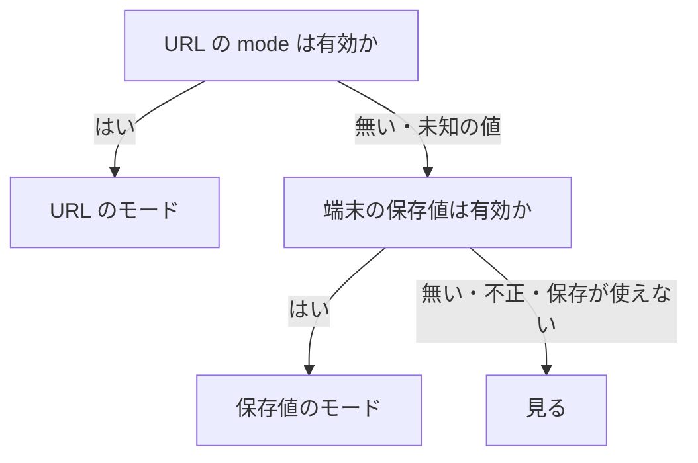
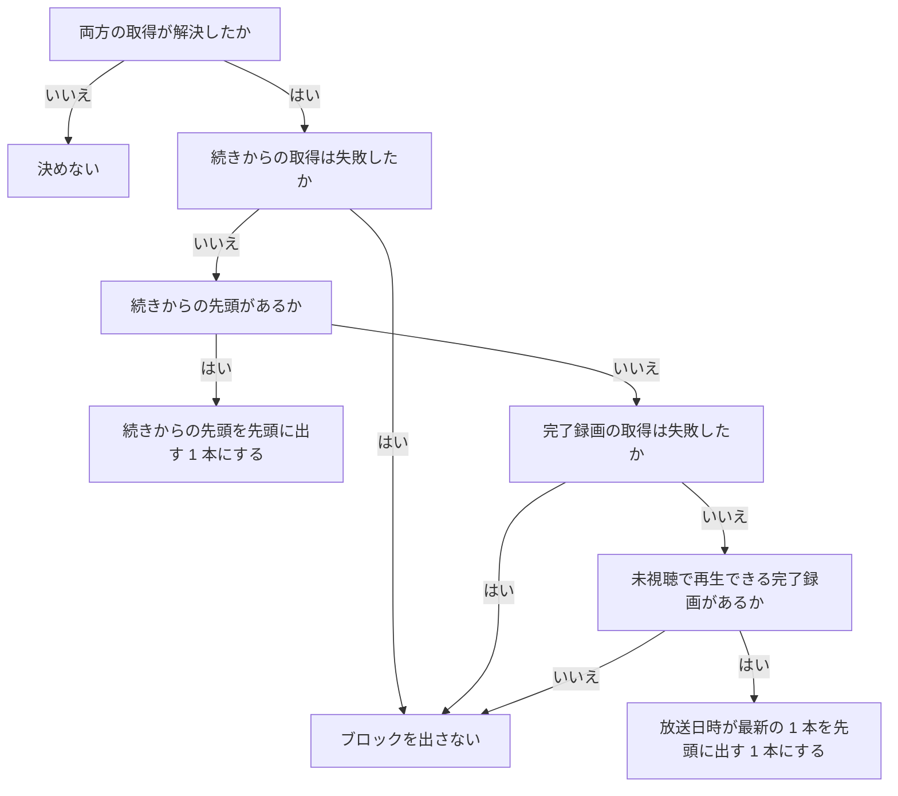
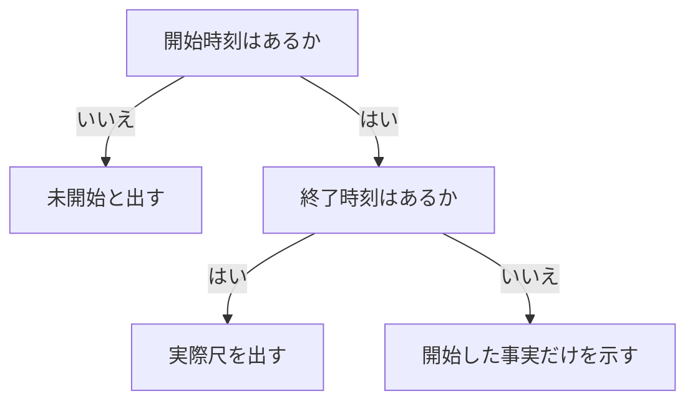

> [frontend.md](../frontend.md) の一部。索引から辿る

# ホーム

ホームは、録画サーバーへ再訪したときに、何を見るかと録れているかを 1 画面で確かめる起点である。

## 何を解く画面か

ホームは「見る」と「管理」の 2 モードに分け、既存のエンドポイントの組み合わせだけで作る。**新しい API は作らない。** 初回は「見る」を既定にする。

運用が安定した録画サーバーへの再訪では、「何を見るか」と「録れているか」のどちらも確認したい。旧ホームは 5 つの管理セクションと再生候補を同じ重みで積んでいたので、どちらも面積を得られなかった。モードは URL の `?mode=watch|ops`、端末の保存値、既定値の順で決め、管理側の警告件数は両モードの切替に載せる。見る側にもブレーカーだけは帯で出し、失敗・容量超過・ドロップは警告バッジに留める。

## ルート: `/` はホーム、番組表は `/programs`

ホームをルートに置き、番組表は別の経路へ移してナビの 2 番目に置く。サーバーは API 以外を index.html にフォールバックするので、サーバー側の変更は要らない。

ルートは最初に開く画面なので、新しい起点に割り当てる。番組表の `/programs` も、このフォールバックで既に配れる。

根拠

- `/api/` 以外を index.html にフォールバックする: `internal/api/spa.go`

## ナビ: ホームが最上位の先頭、予約は「その他」へ

ナビの先頭に「ホーム」を足し、予約は常時のボトムタブから「その他」へ戻す。常時項目は 3 個のままで、ホーム・番組・録画の 3 個に置き換わる。

並び・畳み方の全体の権威は、[shell.md](shell.md) §項目の並びは頻度順にある。予約を戻せるのは、今夜これで録れているかの確認をホーム自身が担うためである。

根拠

- ナビの先頭項目: `navItems`
- ボトムタブの常時項目の数: `MOBILE_PRIMARY_COUNT`

## 表示は「見る / 管理」の 2 モード

ホームの右上に「見る / 管理」の 2 択を置く。モードは URL、端末の保存値、既定の「見る」の順で決める。「管理」には要対応の件数をバッジで載せ、「見る」にはブレーカーの停止だけを帯で出す。

### モードの決め方

URL の指定を最優先し、無ければ端末の保存値、どちらも無ければ「見る」にする。URL を先にするのは、「管理で見る」のようなリンクが明示したモードを、端末の前回値で覆さないためである。

URL の有効な `mode` を読み、無い / 未知の値なら `localStorage` の保存値を読む。保存値は読むたびに検証し、保存の読み書きが使えない環境では保存なしとして扱う。

根拠

- モードの決定順と保存値の検証: `lib/home-mode.ts`、`resolveHomeMode`、`readHomeModePreference`
- 保存先: `localStorage`

### 切替のバッジと帯

「管理」のバッジは要対応の件数で、問い合わせが解決するまでは出さず、0 件なら出さない。「見る」ではブレーカー発動中だけヘッダー直下に帯を出し、失敗・容量超過・ドロップは出さない。

バッジは、要対応の一覧を作る 6 種の結果（ブレーカー・容量超過・完了録画のドロップ・失敗録画・録画されず・CM 検出失敗）を、同じ配列から数える。問い合わせは 5 本である。CM 検出失敗はドロップと同じクエリを共有するので、数は増えない。

帯には「{停止中の操作}が停止中」と「管理で見る」を出す。失敗・容量超過・ドロップをこの帯に出さない。

根拠

- バッジの件数の元になる配列: `warnings`

### 見る

「見る」は、本文の最初に「次に見る 1 本」を置き、その下に「ほかの新着」を並べる。先頭に出す 1 本は続きからの先頭を優先し、無ければ未視聴の完了録画から最新のものを選ぶ。

#### 次に見る 1 本の配置

desktop では、16:9 のサムネイルに本文幅の過半を使い、題名・放送日時・局・再生位置・主ボタンを横に並べる。phone ではサムネイルを全幅にし、その下へ縦に並べる。

#### 先頭に出す 1 本の選び方

先頭に出す 1 本は続きからの先頭を優先し、無ければ未視聴で再生できる完了録画のうち放送日時が最も新しいものにする。両方の取得が解決するまで決めず、候補が無ければこのブロックは出さない。

未視聴とは、視聴済みの印が無いことをいう。再生できるとは、原本のサイズか、エンコード済みの資産のどちらかがあることをいう。

根拠

- 先頭に出す 1 本の優先順と完了録画の候補: `GET /api/recordings/continue-watching`、`watchedAt`、`sizeBytes`、`encodedAssets`
- 先頭に出す 1 本の選定の実装: `lib/home-selection.ts`、`chooseHomeHero`

#### ボタンと移動先

続きから選んだ 1 本は、主ボタンを「続きから再生」、副ボタンを「最初から」にする。完了録画から選んだときは、主ボタンを「再生」にする。どちらのボタンも録画詳細へ移動し、「最初から」は保存位置を復元しない。

再生元チップは出さない。先頭に出す 1 本のサムネイルも、主ボタンと同じ録画詳細へ移動する。録画中のものは、追っかけ再生へ入る印を付けた移動先にする。

根拠

- 追っかけ再生への入口: `#chase`

#### Tab 順と読み上げ

サムネイルのリンクは、同じ行き先を主ボタンが重ねて持つので、Tab 順と読み上げから外す。

#### サムネイルの重ね表示と再生位置

再生位置は、サムネイル下端の線と、メタ行の「経過時間 / 再生時間」の文字で示す。文字の列には線を置かない。映像の外の線はシークバーに見え、時間軸が二本あるように読めるためである。

先頭に出す 1 本のサムネイルには、左下に局名、下端に進み具合の線を重ねる。「ほかの新着」には付けない。

#### サムネイルに映す内容

続きから選んだ 1 本は、再生可能なエンコード済み資産と保存位置が揃うときだけ該当コマを表示し、描画できなければ固定画像へ戻す。「ほかの新着」は動画を取得せず、番組を探しやすくする固定画像を使う。

カット版は資産の範囲に写す。

根拠

- カット版のコマ位置を資産の範囲に写す: `keepRanges`

#### ほかの新着と録画中の行

「ほかの新着」は、続きからの 2 件目以降に続けて条件に合う完了録画を並べ、録画中は細い 1 行に畳む。予約・容量超過・ドロップ・失敗の一覧は、見る側に置かない。

録画の重複は除く。desktop はカードが 1 行に入る件数にし、phone は固定件数にする。見出しの右から、系列の一覧（`/series`）へ移動できる。録画中の行は「録画中 N」・題名・追っかけ再生を並べ、0 件の行は出さない。

### 管理

管理モードは、**時間軸と要対応の一覧とストレージの 1 行**を並べ、「録れたか」「いま録っているか」「この時間帯に不足区間があるか」を 1 画面で見せる。容量超過は API が返した区間と種別だけを示し、どの予約が録れないかは主張しない。

返らない時間帯が収まるかも主張しない。時間軸の段は、重なった番組を読み分けるために詰めた位置であり、チューナー割り当てではない。

#### 時間軸の窓と行

窓は今日の 0 時から明日の終わりまでの 48 時間に固定し、行は site と放送種別の組ごとに分ける。単一 site では種別だけで分ける。

窓の終わりは既存の予約窓と同じ `dayOrigin(2, now)`（明日の暦日の終わり）にする。始点を現在時刻に依存させない。午後始まり（正午）の窓だと、午前に開いたとき始点が未来になる。すると「いま」の線が窓の左端に張り付き、午前の録画・録画中も窓から落ちる。

窓の長さは、すべての幅で同じ窓を比較できるように選んだ値であり、測定はしていない。見出しは窓を明示する（「今日 0 時 → 明日の終わり」と、行になった種別「地デジ / BS ごと」）。窓は 2 日にまたがり、同じ時刻が 2 回出るので、目盛りは日の境界を語で読めるようにする（「18時」「翌0時」）。

根拠

- 48 時間の窓: `dayOrigin(2, now)`
- 行の単位: `site × channelType`

#### 録画と予約の取得

録画は状態（録画中・完了・失敗）ごとに取得を分け、1 本あたり API の上限件数にする。録画中の取得だけは日付範囲を付けず、日またぎの録画が窓の始点で消えないようにする。

録画と予約は、窓に重なるものを置いて窓の端で切る。録画中は `from` / `to` を付けない。API の `from` / `to` は開始時刻の範囲なので、`from` に窓の始点を渡すと、0 時より前に始まった日またぎの録画が、録画中でも 0:00 から終わるまで消える。件数はチューナー数で抑えられる。

完了・失敗録画は、窓の始点より 24 時間前から取得し、窓に重なるものに絞る。24 時間を超えて窓へ食い込む録画は漏れる。番組の最長尺は未計測である。

失敗の取得では、置き換え済みの擬似失敗行を除く。ドロップと失敗の警告用取得は、時間軸とは独立させる。予約は既存の予約一覧を共有する。管理モードでは、見るモード用の無条件録画一覧と「続きから」は取得しない。

根拠

- 録画の取得を分ける状態: `status=recording|finished|failed`
- 失敗の取得条件: `status=failed`
- 録画と予約の取得: `GET /api/recordings`、`GET /api/reservations`、`pages/home.test.tsx`「0 時をまたぐ録画は…」

#### 時間軸の縮尺と目盛り

縮尺は window 幅だけで決める。時間軸の枠幅で決めると、縮尺とラベル幅が互いを変える帰還ループになる。時間軸は全体を縮小せず、枠の中だけを横スクロールし、行見出しは枠の外に固定する。

スクロールバーは常に見える高さを保ち、凡例の末尾に「枠の中を横にスクロールできます」と書く。縮尺は、window 幅で phone と desktop を分けるモックに合わせる。phone は 30px/h、desktop はそれより大きくする。**切替は window 幅だけで決める。** 時間軸の枠幅で決めると、縮尺がラベル幅を変え、ラベル幅が枠幅を変える帰還ループになり、ある窓幅で 2 つの縮尺を往復した。

目盛りは、枠に全体が収まらないものと、「いま」の pill に隠れるものを隠す。ラベルと pill の箱は実幅で測る。中心 ± 20px の固定箱だと、端から 20px 以内の「18時」まで隠し、過去側に目盛りが 1 本も無くなった。この判定は、午前から深夜の時刻とスクロール位置を実ブラウザで測る。jsdom は使わない。

根拠

- 縮尺の帰還ループを観測した幅: 単一 site 592–598px、複数 site 660–676px
- ラベルと pill の実幅測定、実ブラウザでの判定: `e2e/design.mjs`

#### 段の割り当て

各行の番組は、開始時刻順に並べ、終了した最初の段へ置く。前の終了時刻と次の開始時刻が等しければ同じ段を使う。段は重なりの表示であり、チューナーの番号ではない。

時間区間は半開区間として扱うので、終了と開始が等しいものは重ならない。凡例には「段は重なりの表示で、チューナーの番号ではありません」と明記する。

根拠

- 表示順と段数を固定する純関数: `lib/home-timeline.ts`

#### 容量超過の重ね方

容量超過は、API が列挙したすべての種別の行へ、site が一致する場合だけ、斜線・破線枠・「N 本不足」で重ねる。個々の予約には印を付けず、予約の勝敗やチューナー本数は表示しない。

予約 API から重なる題名を取得できるときは、「この時間帯の予約: …」を要対応行の副行に置く。並べるのは、列挙された種別の予約だけである。詰まっていない種別の予約は、不足と無関係なので並べない。

容量クエリの開始時刻は、これまでどおり現在時刻を時頭に量子化し、終端は明日の終わりにする。時頭の量子化で返りうる終了済み区間は、終了時刻が現在より後のものだけを残して除く。

根拠

- 容量超過の取得と列挙された種別: `GET /api/capacity/overages`、`jammedTypes`
- 量子化と終了済み区間の除去: `dayOrigin(0, now)`、`dayOrigin(2, now)`、`endAt > now`
- 行への重ね合わせの判定: `e2e/design.mjs`

#### 状態の色

状態は色と塗りの形で見分け、緑は使わない。録れた = 無彩の塗り、録画中 = タリーの塗り、予約 = 枠線、失敗 = destructive の文字・淡い地・枠、ドロップあり = 録れた塗りと下端の destructive の線、容量超過 = 琥珀の斜線で表す。

根拠

- 失敗とドロップの色: `destructive`

#### ブロックの扱い

ブロックは操作標的にせず、時間軸直下の折りたたみ「録画・予約の詳細」に、24px 以上の詳細リンクを開始時刻順に並べる。ブロック自体をリンクにすると、30 分枠でも 15px 幅、行も 20px 高さで、最小標的寸法を満たせないためである。

この一覧は詳細へ行く唯一の入口なので、状態ごとの連結にしない。各行に、日（今日 / 明日）・種別（複数 site では site も）・状態（録れた / 録画中 / 失敗 / 予約）を出す。窓は 2 日にまたがるため、日が無いと同じ時刻が区別できない。

#### 完了録画への到達

管理モードのホームから完了録画へは、「録画・予約の詳細」を開いて行を選ぶ 2 操作で着く。ヘッダーの「直近の完了へ」アンカーは置かない。

完了録画は、時間軸の過去側（今日 0 時以降）とこの詳細一覧に出る。それより前は録画一覧で辿る。合否は、実ブラウザの実クリックで測る。

根拠

- 完了録画への実クリック判定: `e2e/design.mjs`「ホーム管理モード: 完了録画への到達」

#### 時間軸の読み込み・失敗・空

読み込み中は時間軸のスケルトン、取得失敗時はエラーを出す。行が無いときは、時間軸本体を出さない。管理モードの全材料が確定して表示対象も無ければ、単一の空状態を出す。

#### 要対応とストレージ

「要対応」は種別チップ・太字の題名・副行で構成し、ブレーカー、失敗録画、録画されず、チューナー不足、ドロップの順に並べる。0 件なら一覧を出さない。色はチップだけが持ち、チューナー不足は琥珀、他は destructive にする。

#### 要対応の各行

失敗録画は番組名・日時と状態または理由、ドロップは件数・番組名・放送日時と局、チューナー不足は時間区間と重なる予約を示す。個別の予約が録れないとは断定しない。

失敗録画は「録画失敗」を種別とし、例は「今日 17:00 · Eテレ · 未開始 / 理由: …」である。チューナー不足の例は、「今夜 23:30–23:56 地デジが 1 本不足しています」／「この時間帯の予約: …」である。個別の予約が録れないとは断定しない。

#### 「録画されず」の行

「録画されず」は、スケジュールも録画試行も観測されていない予約を 1 件ずつ出し、予約詳細へリンクする。EPG から消えたことは意味せず、一覧から消えたことも録画成功の保証にしない。

放送終了後の検出期間は既定 24 時間である。予約の行は番組スナップショットの回収とともに削除される。そのため「録画漏れはありません」とは表示しない。

根拠

- 「録画されず」の状態と保持期間: `reservations.state = orphaned`、`reservations`、`orphaned`、`epg.retention_grace`、`program_snapshots`、CASCADE
- 成功保証を一覧の不在から導かない判断: `docs/schema/recordings.md`

#### ストレージの 1 行

「ストレージ」は一覧の下に 1 行だけ置き、残り容量・見込み消費・必要な場合だけ満杯までの日数・エンコード待ち件数を出す。取得できない材料は値を作らず省き、観測時刻が古い場合だけ警告する。

材料は、録画一覧の保存先残高と同じ保存先、平均 bitrate、完了録画サンプル、今後 7 日の予約スケジュールと表示を省く規則である。媒体 root や各材料が取得できない場合は、対応する行・見積もりを省く。

根拠

- 録画一覧の保存先残高: `StorageBalance`

#### 見るモードとの分担

見るモードでは、録画中の細い行・続きから・ほかの新着を表示し、管理側の一覧は出さない。ブレーカーだけは既存の停止中バナーで知らせ、管理モードの警告件数はモード切替のバッジに使う。

### ドロップ警告の検出範囲は時間軸の窓から独立させる（クエリは 1 本）

ドロップ検出の範囲は、直近の完了録画の上限件数で決め、時間軸の窓から独立した定数にする。完了録画のクエリは 1 本だけにして、表示用とドロップ検出用で兼ねる。

#### 範囲を窓から独立させる

要対応のドロップ検出の範囲（直近の完了録画）は、時間軸の窓（今日 0 時以降）とは**独立した定数**にする。表示の都合で窓を狭めたとき、検出の遡り幅まで気づかないうちに縮まないようにするためである。この上限は実測ではない恣意的な値だが、窓の変更が検出範囲に連動しない。窓の外の録画のドロップも、要対応には出る。

根拠

- 検出範囲の定数: `DROP_WARNING_SCAN_LIMIT`
- 窓の外のドロップも拾う判定: `pages/home.test.tsx`「今日 0 時より前の finished drop も 20 件の警告 scan から拾う」

#### 完了録画のクエリは 1 本

完了録画の一覧は 1 本だけ取る。見るモードの先頭に出す 1 本・ほかの新着の材料とドロップ検出の材料を兼ねる。同じ絞り込み・同じ既定順なので、2 本目は新しい情報を持たない。2 本に分けると、2 つの応答の間に録画が 1 本完了したとき、同じ画面で表示とドロップ検出の集合が食い違いうる。

ドロップ警告は、ドロップの要約があり、いずれかの件数が 0 より大きい録画にだけ出す。要約が無い（未計測）録画と全件 0 の録画はどちらも警告しないので、ホームは両者を区別しない。区別は API が持つ。

根拠

- ドロップの要約: `dropSummary`

### 失敗録画は時間軸と要対応へ出す（専用セクションは持たない）

**失敗録画は専用のセクションを作らず、時間軸内の失敗ブロックと「要対応」の行に出す。** 「続きから」は見るモードにだけ置く。

#### 失敗録画の取得と警告の窓

警告に出すのは、取った失敗録画のうち直近の窓の中だけにする。窓が無いと、稼働の長いサーバーでは要対応一覧が古い失敗で埋まるためである。

窓は開始時刻を基準にした期間である。他の警告材料は、どれも自然に消える。ブレーカーは発動中のみ、容量超過は今日〜明日の窓、ドロップは「直近の完了」で実質直近になる。しかし失敗だけは、上限件数に収まる限り、いつの失敗でも出続ける。この窓の値は、他の上限と同じ性質の恣意的な値で、測定していない。

時間軸の失敗クエリは、状態が失敗であることを必須にし、窓と重なるものだけを置く。警告用のクエリは時間軸と独立しており、ドロップ検出と違って、表示と検出の範囲を分ける必要はない。そのため、この上限は他の上限と共有せず、独立した定数にする。

根拠

- 時間軸の失敗クエリの条件: `status=failed`
- 失敗の警告用クエリの上限: `FAILED_RECORDING_SCAN_LIMIT`
- 失敗の recency 窓: `FAILED_RECORDING_WARNING_WINDOW_MS`、`startAt`
- 「直近の」失敗録画を求める受け入れ基準: issue の受け入れ基準

#### 予定尺と実際尺

**失敗録画の要対応行では、予定尺と実際に録れた尺を分ける。** 予定尺だけだと開始直後に終わった失敗も予定どおりに読めるためである。「未開始」は、rokuban が開始を観測していないという意味で、mirakc 側の事実は主張しない。

予定尺だけを出すと、「ほぼ予定どおり録れた」ように読める。実際は 0 分に近いのに、予定尺は番組の予定尺のままである。実機観測では、開始・終了が同じ秒なのに、表示尺は番組の予定尺だった。

開始時刻と終了時刻は、独立に書かれる。録画の状態を更新する処理は、開始時刻を無条件に書き、終了時刻は値があるときだけ書く。そのため、次の 3 通りがある。

終了時刻が無いのは、mirakc の失敗した録画の情報に終了時刻が無かった場合である。この場合は、開始した事実だけを示し、実際尺は主張しない。

「未開始」は、rokuban が開始を観測していないという意味である。mirakc が録画を開始しなかったという mirakc 側の事実は主張しない。開始時刻を書くのは、録画の情報を観測した経路だけで、失敗行を直接作る経路は書かない。そのため、録画の観測より先に失敗の SSE が届いた窓でも、同じ「未開始」の形になる。

3 通りの中の区切りは中黒に揃える。メッセージ全体が `（尺 / 理由: …）` の形で、スラッシュを「尺と理由の境目」に使っているので、尺の中でも使うと、1 行に 2 種類の意味のスラッシュが並ぶためである。

根拠

- 予定尺と実尺の書き込み経路: `durationMs`、`startedAt`、`endedAt`、`started_at`、`ended_at`、`UpdateRecordingStatus`、`CreateFailedRecording`
- record の観測より先に SSE が届く窓でも「未開始」になる: `recording.failed` SSE
- 開始のみの形（終端が無い mirakc failed record）: `endTime`
- 尺と理由の区切り: `（尺 / 理由: …）`、` / `、`・`

#### CM 検出失敗の材料

CM 検出失敗の材料は、ドロップと同じ、直近の完了録画のクエリを共有する。要対応に出ないことは、CM 検出失敗が無い保証ではない。

表示と検出でクエリを分けると、応答の間に完了録画が増えたとき、対象がずれる。

同じ画面でドロップと CM 検出の対象が食い違わないよう、CM 検出だけの新しい取得は足さず、ドロップと同じ録画集合から状態を読む。

根拠

- 共有する完了録画クエリの上限: `DROP_WARNING_SCAN_LIMIT`

#### CM 検出失敗の行の単位

CM 検出失敗の行は、直す操作の単位に合わせる。局のロゴ画面で直せる段階は、局（ネットワークとサービスの組）ごとにまとめ、他の段階は録画ごとに出す。並びは局単位の行を先、録画単位の行を後にする。

| 段階 | 修正操作 |
|---|---|
| ロゴ | 枠を教えて候補を採用する |
| 枠 | 枠を教え直す |
| 採用 | 候補を採用する |
| 照合 | ロゴを忘れるか、枠を教え直して候補を採用する |
| 解像度 | 同じ解像度の録画から枠を教えて候補を採用する |

検出中・再試行待ちと無効は、失敗として出さない。警告には失敗の事実・件数・録画名・局名だけを示し、技術的な原因は推測しない。見るモードのバッジもこの行数を数えるため、局単位にまとめた失敗は 1 件として数える。未知の段階も録画単位で出し、録画詳細へ移動する。局単位の行は、局のロゴ画面（`/cm-logos/{networkId}/{serviceId}`）へ移動する。

並びは局単位の行を先、録画単位の行を後にする。それぞれ完了録画の放送開始時刻の新しい順にし、1 操作で複数の録画を直せる局単位の行を先に置く。

未解決: `/cm-logos` の `failedCount` は、録画でしか直せない段階を局の要対応に数え、逆に採用の段階は数えていない。ホームの局まとめとは件数が一致しない。

未解決: 局のロゴは 1 局に 1 解像度だけである。解像度が混ざる局（マルチ編成時に主サービスが 480i になる局が実在する）では、解像度の段階を局で直すと、もう一方の解像度の録画が、解像度の段階で失敗する。

根拠

- CM 検出の失敗状態と修復画面: `cmDetection.state='failed'`、`cmDetection.state`、`cmDetection.stage`、`/cm-logos/{networkId}/{serviceId}`
- 局画面で扱う 5 段階: `stage='logo'`、`'area'`、`'match'`、`'resolution'`、`'adopt'`
- 段階名の対応: ロゴ = `logo`、枠 = `area`、採用 = `adopt`、照合 = `match`、解像度 = `resolution`
- 失敗として出さない状態: `detecting`、`disabled`
- 局の組のキー: `networkId`、`serviceId`
- 局単位・録画単位の行順は完了録画の応答順を使う
- 局の件数の食い違い: `/cm-logos`、`failedCount`

#### 警告の並び

警告の並びは、止まっているもの、既に失われたもの、これから足りなくなるもの、品質が落ちたもの、CM 検出失敗の順にする。ブレーカー、失敗録画と録画されず、チューナー不足、ドロップ、CM 検出失敗に当たる。**CM 検出に失敗しても録画自体は見られる**ので、失敗録画やチューナー不足より後ろに置く。

失敗録画は上限件数まで並びうるので、失敗が多いと、行動可能な「チューナー不足」が下へ押し下げられる。件数上限は入れていない。押し下げが実運用で問題になるかは未検証である。問題になるなら、上限より並びの入れ替えが先になる。

根拠

- 失敗録画の件数上限: `FAILED_RECORDING_SCAN_LIMIT`

#### 失敗一覧から置き換え済みの行を除く

通常の失敗一覧は、置き換え済み（supersede 済み）の失敗行を API が返さない。そのため、録れているのに失敗と出る偽陽性や、同じ番組が 2 行並ぶ形は起きない。無条件の一覧とごみ箱の一覧は履歴として両方の行を残すので、フロントは追加の絞り込みをしない。

この一覧は `?status=failed` で取る。本物の録画が観測されて置き換わった擬似失敗行を、警告が拾わない。同じ番組が並ぶのは、擬似行と置換で作られた行が両方出る形である。履歴として両行を残すのは、無条件一覧と `trash=true` である。

根拠

- API 側の絞り込み: `superseded_at IS NULL`、`internal/api/recordings_query.go`
- 判定: `TestListRecordings_FailedFilterExcludesSuperseded`
- 無条件一覧とごみ箱には履歴を残す: `docs/schema/recordings.md`

#### 失敗理由の取り出し

失敗理由は、追記専用の品質イベントの履歴のうち、失敗系のイベントから取り出す。最後の要素の理由があればそれを出し、無ければ「理由不明」と何も表示しないことを区別する。理由は mirakc の生の理由をそのまま保持したものである。空の文字列も理由不明に寄せ、材料が無い状態を JSON として見せない。

読み取りは失敗系イベントに限る。スクランブル件数は別の統計から導けるため、理由へ重ねて記録しない。品質イベントにいま書くのは 2 種類の失敗系イベントだけだが、読むときは失敗系に絞る。書き手はどちらもオブジェクトを書く。

録画の失敗は、mirakc の失敗理由（種別を持つ判別付きの和）をシリアライズして書く。録画の破損は、理由の文字列を 1 つ持つ形で書く。それぞれ種別と理由を読み、期待した形でない場合だけ、録画単体ページの「品質イベント」欄と同じ流儀で読める形にフォールバックする。

読めたが空文字だった場合は、JSON へ落とさず「理由不明」に寄せる。失敗理由の種別に省略指定は無いので、空の種別はあり得る形である。そのまま出すと「理由: {"type":""}」になり、何も表示しない場合と区別できる文言にならない。

根拠

- 失敗理由の入力と表示: `quality_events`、`drop_stats.scrambled`、`mirakc.FailedReason`、`json.Marshal`、`JSON.stringify`、`FailedReason.Type`
- 空の種別があり得る形: `omitempty`、`{"type":""}`
- 現在の失敗イベント: `recording.failed`、`recording.record-broken`。両書き手は object を記録する
- 書かれる形: `{ type, message?, osError?, exitCode? }`、`{ reason: string }`、`type` / `reason`
- `reason` は mirakc の生の理由をそのまま保持する: 不変条件 7

### 容量超過クエリの `start` はレンダー時刻を量子化してから渡す

容量超過クエリの開始時刻は、レンダー時刻を時頭へ量子化してから渡す。生のミリ秒を渡すと、レンダーのたびにキャッシュキーが変わり、再取得が終わらなくなる。

#### 生の時刻をキーに載せない

開始時刻に生のミリ秒を渡さない。レンダーのたびにキャッシュキーが変わり、「未解決 → 即解決 → 再描画 → また未解決」が閉じない無限再取得になるためである。

レンダーごとに変わる値を、クエリのパラメータ（延いてはキャッシュキー）に直接載せると、レンダーのたびに新しいキーになる。

根拠

- 生の値を渡さない開始時刻: `start`、`Date.now()`、TanStack Query

#### 原因と採らない対症療法

原因は、終端側だけ量子化して開始側に適用し忘れた、量子化の欠落である。now を固定する対症療法は採らない。症状を消すだけで、欠落は残るためである。

終端は日境界で、元から量子化済みで問題が無かった。開始時刻も同じ関数で時境界へ量子化する。これは、番組表が「今日」の起点を作るのに使っているのと同じ関数・同じ考え方である。**キャッシュキーに入る値は、答えが変わる粒度まで量子化する**という規律を、終端側だけに適用して開始側に適用し忘れていた。

根拠

- 時間値の量子化とキャッシュキー: `dayOrigin(0, now)`、`dayOrigin(2, now)`、`pages/programs.tsx`、`openapi.yaml` の `start`
- 採らない対症療法: `useRef`、`useState`

#### 時計を止めた構成では見えない

この欠陥は、jsdom も実ブラウザも時計を止めている構成では見えなかった。時計に起因する挙動は、時計を止めない経路を別に用意して判定する。

根拠

- 時計を止めない経路の規律: `web/e2e/README.md` §判定を足すときの規律

#### 広がった窓の回収

量子化で広がる分（最大 59 分）は、実際の今より後に終わる区間だけを残して回収する。進行中の区間は量子化の前後で残し、終わった区間は警告に出さない。

これはクライアント側の絞り込みで、キャッシュキーを安定させる量子化が表示の正しさを緩めない。開始時刻を時頭まで戻すと新たに入るのは、時頭から今までに終わった区間だけである。この回収には両方向の判定がある。「既に終わった超過区間は警告に出さない」と「時境界より前に始まり進行中の超過区間は警告に出す」である。前者は、フィルタを常に真にすると落ちる。回収が無いと、もう終わったチューナー不足が最大 59 分警告に出続ける。

根拠

- 回収の実装: `pages/home.tsx`、`activeOverages`、`endAt > now`
- 終了済みと進行中を分ける両方向の判定: `pages/home.test.tsx`「既に終わった超過区間は警告に出さない」／「時境界より前に始まり進行中の超過区間は警告に出す」
- 前者の判定が落ちる変異（フィルタを常に true にする）: `() => true`

### 時境界を越えた瞬間に警告を消さない（`keepPreviousData`）

時境界でクエリのキーが進んでも、新しい応答が来るまで前のキーのデータを見せ続け、警告を消さない。素のままだと要対応一覧が 1 往復だけ消え、警告だけが見えていたときはページ全体がスケルトンに戻るためである。

量子化の代償として、容量超過クエリのキーは毎時 0 分に 1 回変わる。新しいキーにはまだデータが無いので、素のままだと要対応一覧が消える。**警告だけが可視だった場合は、ページ全体が読み込みスケルトンに戻る。** アイドルなサーバーでブレーカーだけ発動している状態がそれに当たる。この画面の主題は、セクションが理由なく消えないことなので、キーが進んでいる間は前のキーのデータを見せ続ける。

根拠

- 前のデータを見せ続ける設定: `placeholderData: keepPreviousData`（TanStack Query）、`isPending`

#### 毎時の境界

古いデータを見せている間も、終わった区間が警告に出ることはない。毎時の境界で進むのは開始時刻だけなので、前のキーのデータは、窓が最大 1 時間だけ広い同じ問い合わせの結果（新しい窓の上位集合）である。そのうえで、毎レンダー「今」で絞り直す。

根拠

- 毎レンダーの絞り直し: `activeOverages`、`start`

#### 日境界

取りこぼす側の境界は日境界にある。終端が進む深夜 0 時には、前のキーのデータが新しい窓の部分集合になるので、新しく窓に入った超過が 1 往復だけ見えない。1 往復で自己回復するため許容する。この側は未検証である。毎時の側は下記のテストで測っているが、日境界の側は測っていない。

根拠

- 終端の日境界: `end`（`dayOrigin(2)`）

#### 判定

判定は、容量超過クエリのキーが進み、新キーが未解決のままでも、警告セクションが残ることを確かめる。設定を外すと落ちる。このテストは、キーが実際に進んだことと、**2 回目の応答が確認の時点でまだ未解決であること**も確認している。後者が無いと、遅延の仕掛けが機能しなくなったときに空虚な成功へ転ぶ。

根拠

- 判定: `pages/home.test.tsx`「容量超過クエリのキーが進み、新キーが未解決のままでも警告セクションは残る」、`placeholderData`

### 管理モードの読み込み・失敗・空状態

管理モードでは、時間軸、要対応、ストレージを別々に描く。材料が確定するまでは確定していない値を作らず、材料の取得失敗は従来どおり警告無しへ縮退する。

#### 時間軸

時間軸は、録画 3 種の窓内クエリ・予約・容量超過がすべて解決するまでスケルトンを出す。いずれかの取得が失敗した場合は、時間軸の取得失敗を表示する。解決後に行が無ければ、チャートは出さない。別の要対応やストレージ材料があれば、その表示は続ける。

#### 要対応

要対応は、ブレーカー・容量超過・完了録画のドロップ検出・失敗録画・予約一覧の 5 クエリが解決した後にだけ出し、0 件なら一覧を出さない。予約一覧が解決する前は、「録画されず」の件数が分からない。そのため、要対応と管理モードの警告件数のどちらも確定しない。

#### ストレージ

ストレージ行は、ストレージの取得が成功した場合だけ作る。

取得先は `GET /api/storage` である。媒体 root が無ければ行を出さない。root があっても、bitrate sample・予約・エンコード待ちの取得が失敗した場合は、その材料を必要とする見積もりまたは値だけを省く。エラーを 0 や「余裕あり」と解釈しない。

#### ページ全体の空状態

ページ全体の単一空状態（「表示できる項目がありません」）は、次の条件がすべて揃う場合に限る。時間軸・警告・ストレージの表示材料がすべて確定している。時間軸にイベントも不足区間もない。警告も媒体 root も無い。時間軸・ストレージの取得自体にエラーが無い。ロード中の一瞬を「何も無い」と誤読させない（CLAUDE.md「非同期の空虚な成功」）。

## スコープ外

ホームには、視聴モードのストレージ残高と、取り込み進捗を出さない。ホームの「いま録画中」の行は、録画中かどうかだけを見せる。

視聴モードにはストレージ残高を置かない。管理モードは [recordings.md](recordings.md) の保存先残高と同じ材料・表示を省く規則を使い、残り容量と 7 日の予約消費見込みなどを 1 行で示す。

取り込み進捗は、録画一覧・録画単体ページにある（[recordings.md](recordings.md) §取り込み中であることを画面に出す）。**「いま録画中」の行にも取り込みの状態は付く。** 追従して取り込む処理が録画開始から走るためである（[recording/ingest.md](../recording/ingest.md) §5.1）。ただしホームは録画中かどうかだけを見せる面であり、取り込み進捗の数字まで出すのは一覧側の関心事として分けたままにする。取り込み中の録画を載せたくなったらセクションの絞り込み自体を変える話になるので、そのときに決める。

根拠

- 録画一覧の保存先残高: `StorageBalance`
- 録画の取り込み状態: `Recording.ingest`

