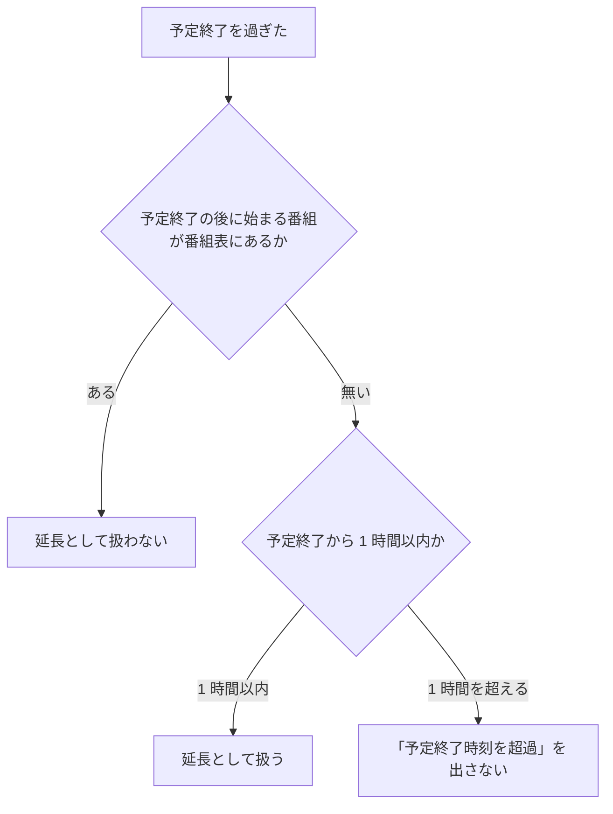

> [live.md](../live.md) の「フロントエンド実装」。索引から辿る

## フロントエンド実装

ライブ視聴は独立したルートの 1 画面で構成し、チャンネル一覧・プレイヤー・いま放送中の番組を並べる。番組は既存の EPG API の時間窓クエリで取り、専用 API は足さない。

ルートは `/live` である。番組表グリッドの「いま」から入る形を採らないのは、グリッド自体が `lg` 以上でしか出ない（[表](../programs.md)「リストを基本のビューにする。グリッドはその上に足す」）ため、モバイルからの入口を別に用意する必要が生じ結局 2 箇所になるからである。チャンネル一覧はレジストリの全 site から作る（各 site の `GET /api/sites/{site}/services`）。

根拠

- ライブ画面の実装の場所: `pages/live.tsx`

### ライブの操作バー・番組軸・チャンネル行

ライブも録画再生と同じ自前の操作バーを使い、画質・音声・字幕は設定メニューに置く。通常のシークバーは出さず現在番組の軸を 1 本置き、録画 HLS が利用できるときは録画済み位置へ切り替えられる。

#### 操作バーと設定メニュー

画質や音声は再生方法の設定なので、字幕とともに操作バーの設定メニューへ集め、映像の下には局や番組など視聴判断に使う情報だけを残す。

ライブも `<video controls>` を使わず、録画再生と同じ自前の操作バーを使う。バーの自動非表示・タッチ・フォーカスの扱いも録画再生と同じ共有の実装に乗せる。設定と視聴情報の置き場所を分け、映像の直下に設定欄が縦に積み上がらないようにする。

**設定メニューには画質・音声・字幕を置き、PiP と全画面は録画再生と同じ操作にする。** 字幕（CC）はバーにも置く。画質は既存の `?profile=`、音声は `?audio=main|sub`（標準は省略）の表現を保つ。音声は従来の `標準` / `主音声` / `副音声` の 3 択にし、自動降格後の画質には「自動で下げた」と付ける。画質・音声を操作バーへ移すことは URL やトラック切替の意味を変えないため、共有 URL と既存の切替挙動を保てる。

自動降格の条件と停滞通知の経路は変えない。自動で画質が下がった知らせだけを映像左上に数秒表示し、既存の `aria-live` を保つ。表示場所の変更と停滞判定を切り離し、ライブの失敗分類や猶予時間に新しい意味を持ち込まない。

映像の下には局名・種別・ON AIR、番組名・放送時刻・残り、次の番組、中断予測、当該局の番組表へのリンクを置く。画質・音声のセレクタはこの情報欄から外す。

根拠

- 自前の操作バーに置き換えるネイティブ操作: `<video controls>`
- 停滞通知の経路: `onStalled`

#### 番組軸

現在番組の軸を 1 本置き、通常のシークバーは出さない。軸の位置と残り時間は端末の時計から計算し、番組情報は EPG の予定として扱う。

左端は番組開始、右端は予定終了、赤い印はライブ位置であり、表示は番組開始からの経過にする。目盛りは録画 HLS 中の軸と同じ経過時間の置き方で、左端は `0:00（23:41 開始）`、右端は `45:00（00:26 終了）`、赤い印の真下は経過時刻（`20:12`）だけを置く。壁時計は両端の括弧の中に限り、赤い印には付けない。ブラウザの seekable 範囲は番組時刻を表さないので、番組の予定時間を軸にする。映像の外には進み具合の線を置かず、映像と操作を一体に見せる。チャンネル一覧と番組名の下は「残り 25 分」のような文字で出す。モバイルでは番組軸を操作列より上に置き、デスクトップでは操作バー内にまとめる。

時刻がずれた端末では赤い印と残り時間もずれるが、既存の「いま放送中」時間窓と同じ性質として受け入れる。放送波を読む専用の観測は作らず、予定終了を過ぎても実際の番組が続く繰り下げに耐えるよう、軸の予定範囲を超えた位置も扱えるようにする。

延長として扱うのは、予定終了の後に始まる番組が番組表に無く、予定終了から 1 時間以内のときだけである。放送の空き時間や、とうに終わった番組を「予定終了時刻を超過」で出さない。

通常時は「ライブ」の印の横に、既存の遅延・バッファの値を出す（デスクトップのみ）。これはライブを見ている間の計器なので、ライブ位置と同じ操作バー内に置き、視聴中の状態をひとまとまりにする。スマホはバーを増やさないために出さない。

根拠

- 軸の左端と右端: `startAt`、`endAt`

#### 「最初から」と過去位置

番組の録画を録画 HLS で再生できるときに「最初から」ボタンを出し、番組軸の過去で録画済みの範囲を押せるようにする。録画 HLS が無ければボタンを出さず、軸は表示だけにする。「最初から」や軸上の過去位置を押すと、同じプレイヤーの再生元を録画 HLS へ替え、ライブ側には離脱ヒントを送る。

番組一覧 API が返す当該放送イベントの `recordingId` で録画詳細を取り、`hlsPlayback` の master URL を再生元にする。`hlsPlayback` が空、または録画情報が無いときはボタンを出さない。mirakc の録画 ID をブラウザに持ち込まないので、既存の番組画面と同じ録画同定を保てる。開始位置は録画ファイル先頭からの秒で、hls.js の開始位置に渡す。切り替えのためのオフセット付きセッションは作らない。

ページ遷移なしで再生元を替え、離脱ヒントでチューナーを早く解放する。

録画 HLS 中も軸は番組基準のまま保つ。左端は番組開始、右端は現在の番組表の予定終了である。録画済みの範囲は、録画ファイル先頭の位置から、録画済みの長さを足した位置までになる。ライブ位置はその 1 秒手前に置く。録画済みの範囲の外にホバーすると「まだ録画されていません」を添える。軸上の位置は、録画ファイル先頭の位置に映像の `currentTime` を足した値である。シークの目標は、軸上の秒から先頭の位置を引いた値を 0 からライブ位置までに収め、再生リストの seekable の終端も超えない。

**未録画位置は選択できない。** 録画 HLS の 0 秒は録画ファイルの先頭で、その時刻は番組開始と録画開始の遅い方とする。録画開始はチューナーを開いた時刻で、ファイル先頭ではない。録画が番組開始より前に始まった場合、予定時刻より前のデータはファイルに流れず、番組開始が 0 秒になる。録画が遅れて始まった場合は録画開始がファイル先頭になり、番組開始から録画開始までの軸を無効にする。後者でも録画中なら「最初から」ボタンは残し、その操作だけは 0 秒（録画にある最も早い位置）へ丸める。負の位置は要求しない。

根拠

- 録画ファイル先頭の時刻: `max(recording.startedAt, program.startAt)`、`started_at`
- 録画 HLS の入口と master URL: `pages/live.tsx`、`recordings.hlsPlayback`
- 録画軸の導出とシークの変換: `liveRecordingPlaybackTimeline`、`playbackStrategy`
- ホバーの文言・軸上の位置・シークの変換: `live-player.test.tsx`「ライブ画面の録画軸」
- 録画 HLS のルートと世代: [録画再生](../recordings/playback.md)

#### 録画 HLS 中の表示とライブへの復帰

録画 HLS 中の軸の先端の印は「ライブへ戻る」操作で、押すと新しいライブセッションへ戻る。録画 HLS 中は「ライブ」の印を「● 録画から再生中」に替え、別のボタンは置かない。

印の title は `ライブ {時刻}（押すとライブへ戻る）` とする。空きチューナーが無ければ、ライブへ戻る操作は既存の容量エラーを表示する。録画詳細は元から録画を見ているので、「● 録画から再生中」の印もライブへ戻る操作も出さない。

ライブを再生中に録画 HLS へ切り替えた場合は、`canplay` で再生を再開する。止めたライブから替えたなら止めたままにする。録画 HLS の世代切替やシークは、同じ録画の位置を保つ。

根拠

- 実ブラウザでライブから録画 HLS へ切り替え、master URL・未録画のホバー・軸の印でのライブ復帰を確認: `web/e2e/live.mjs`
- 印と表示の出し分け（ライブ画面だけ）: `live-player.test.tsx`「「録画から再生中」はライブ画面（onReturnLive あり）だけに出す」
- 録画 HLS の再生位置・世代切替・復旧: `web/e2e/recording-playback-timeline.mjs`

#### チャンネル行と全チャンネルの予定番組

全チャンネルの予定番組は、既存の EPG API の窓クエリで site ごとに 1 回だけ問い合わせる。チャンネル一覧には局ごとの予定番組名、残り時間、録画中の印を出し、選択中の局の詳細は既存のクエリを維持する。

残り時間は `残り 25 分` のような文字で、録画中の印は `● 録画中` である。録画中の印は対応する番組の `recordingId` がある場合に付ける。進捗バーは付けない。行に線を増やすと映像外に別の進捗表現ができ、ライブ位置を表す操作バーの番組軸と役割が重なるためである。

`/api/sites/{site}/programs` に短い時間窓で要求し、`service` は付けない。窓に重なる番組（窓より前に始まった放送中予定も含む）を各行へ対応付ける。専用 API を追加すると同じ「いま放送中」の判定が二重化し、固定の API 面を増やすため、既存 EPG API の窓クエリを使う。

全局用の問い合わせは一覧の各行を埋めるためのもので、選択中の局に必要な詳細情報（次の番組を含む）の取得を置き換えない。現在の選択状態に必要な query key と更新動作を残すことで、全局一覧の追加が既存の番組表示を変えない。

#### 時刻表示と番組窓の更新

表示時計は端末でローカルに毎秒更新し、ネットワーク要求にはしない。全局一覧の再問い合わせは、番組の予定境界で行う。

秒ごとの更新が変えるのは、赤い印や残り時間の描画だけである。各局の番組終了予定で全局一覧を取り直せば切替後の行を更新でき、秒ごとに全 site の番組一覧を取得するコストを避けられる。

表示時計と番組窓は共有時計で更新する。次の予定境界の窓を先に取得し、境界まで cache に保持した同じ窓へ切り替える。秒ごとの表示更新と境界での再取得は、同じ時計に予約する。

| 状態 | 表示と更新 |
|---|---|
| 窓の期限内 | キャッシュした窓を使う。 |
| 期限切れ・各局の放送中番組が揃っている | 同じ窓を保つ。 |
| 期限切れ・放送中番組が欠ける局がある | 現在時刻を含む窓へ追いつく。欠けている間は期限ごとに再取得する。 |
| 先行取得が未完了 | site ごとにデータを持つ最新の旧窓を使い、現在時刻で判定する。続いている番組を残し、境界で始まる番組は応答まで空にする。 |

全局取得の窓は 60 秒分なので、長時間番組が続いても別局の現行番組まで入る保証はない。全行を空にすると、遅い回線で行が縮む症状が戻る。旧窓の時刻で判定すると終了済み番組を放送中として出してしまう。選択中チャンネルの詳細は、同じ site・同じ service の旧窓だけを使う。

番組を持つ局のどれかが放送休止などで放送中番組を欠く間は、全 site の全局窓を毎分取り直す。

根拠

- 共有時計で表示時計と番組窓を更新する: `useNow`
- 番組を持つ局の判定: `hasPrograms`

