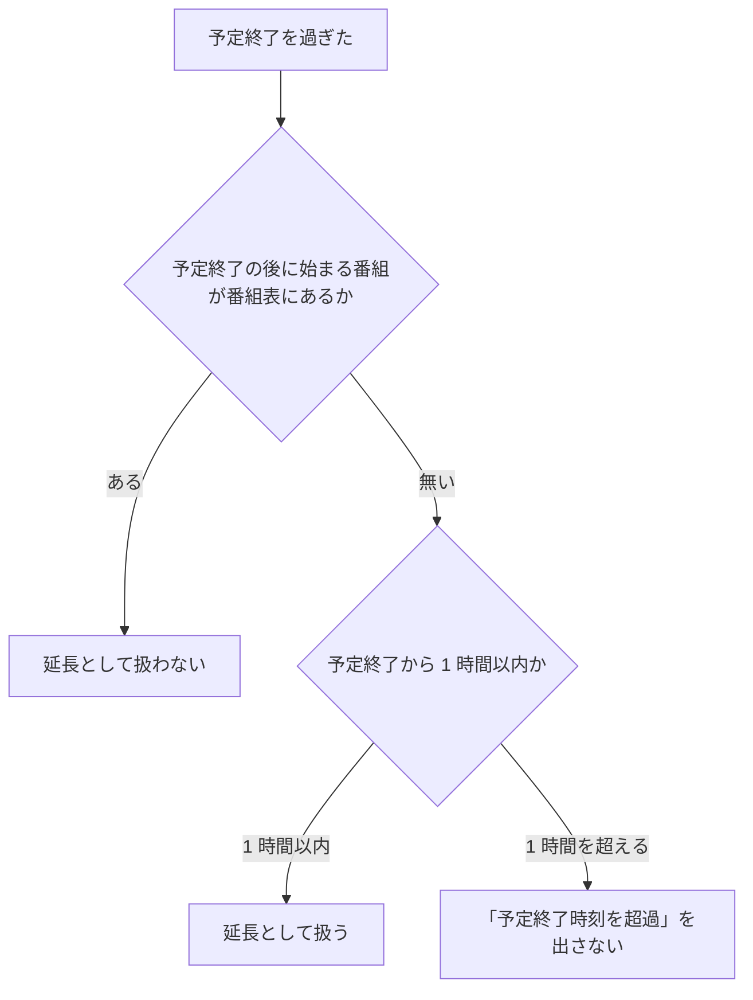

> [live.md](../live.md) の「フロントエンド実装」。索引から辿る

## フロントエンド実装

ライブ視聴は独立したルートの 1 画面で構成し、チャンネル一覧・プレイヤー・いま放送中の番組を並べる。番組は既存の EPG API の時間窓クエリで取り、専用 API は足さない。

ルートは `/live` である。番組表グリッドの「いま」から入る形を採らないのは、グリッド自体が `lg` 以上でしか出ない（[表](../programs.md)「リストを基本のビューにする。グリッドはその上に足す」）ため、モバイルからの入口を別に用意する必要が生じ結局 2 箇所になるからである。チャンネル一覧はレジストリの全 site から作る（各 site の `GET /api/sites/{site}/services`）。

根拠

- ライブ画面の実装の場所: `pages/live.tsx`

### ライブの操作バー・番組軸・チャンネル行

ライブも録画再生と同じ自前の操作バーを使い、画質・音声・字幕は設定メニューに置く。通常のシークバーは出さず現在番組の軸を 1 本置き、録画 HLS が利用できるときは録画済み位置へ切り替えられる。

#### 操作バーと設定メニュー

画質や音声は再生方法の設定なので、字幕とともに操作バーの設定メニューへ集め、映像の下には局や番組など視聴判断に使う情報だけを残す。

ライブも `<video controls>` を使わず、録画再生と同じ自前の操作バーを使う。バーの自動非表示・タッチ・フォーカスの扱いも録画再生と同じ共有の実装に乗せる。設定と視聴情報の置き場所を分け、映像の直下に設定欄が縦に積み上がらないようにする。

**設定メニューには画質・音声・字幕を置き、PiP と全画面は録画再生と同じ操作にする。** 字幕（CC）はバーにも置く。画質は既存の `?profile=`、音声は `?audio=main|sub`（標準は省略）の表現を保つ。音声は従来の `標準` / `主音声` / `副音声` の 3 択にし、自動降格後の画質には「自動で下げた」と付ける。画質・音声を操作バーへ移すことは URL やトラック切替の意味を変えないため、共有 URL と既存の切替挙動を保てる。

自動降格の条件と停滞通知の経路は変えない。自動で画質が下がった知らせだけを映像左上に数秒表示し、既存の `aria-live` を保つ。表示場所の変更と停滞判定を切り離し、ライブの失敗分類や猶予時間に新しい意味を持ち込まない。

映像の下には局名・種別・ON AIR、番組名・放送時刻・残り、次の番組、中断予測、当該局の番組表へのリンクを置く。画質・音声のセレクタはこの情報欄から外す。

根拠

- 自前の操作バーに置き換えるネイティブ操作: `<video controls>`
- 停滞通知の経路: `onStalled`

#### 番組軸

現在番組の軸を 1 本置き、通常のシークバーは出さない。軸の位置と残り時間は端末の時計から計算し、番組情報は EPG の予定として扱う。

左端は番組開始、右端は予定終了、赤い印はライブ位置であり、表示は番組開始からの経過にする。目盛りは録画時間軸と同じ経過時間の置き方で、左端は `0:00（23:41 開始）`、右端は `45:00（00:26 終了）`、赤い印の真下は経過時刻（`20:12`）だけを置く。壁時計は両端の括弧の中に限り、赤い印には付けない。ブラウザの seekable 範囲は番組時刻を表さないので、番組の予定時間を軸にする。映像の外には進み具合の線を置かず、映像と操作を一体に見せる。チャンネル一覧と番組名の下は「残り 25 分」のような文字で出す。モバイルでは番組軸を操作列より上に置き、デスクトップでは操作バー内にまとめる。

時刻がずれた端末では赤い印と残り時間もずれるが、既存の「いま放送中」時間窓と同じ性質として受け入れる。放送波を読む専用の観測は作らず、予定終了を過ぎても実際の番組が続く繰り下げに耐えるよう、軸の予定範囲を超えた位置も扱えるようにする。

延長として扱うのは、予定終了の後に始まる番組が番組表に無く、予定終了から 1 時間以内のときだけである。放送の空き時間や、とうに終わった番組を「予定終了時刻を超過」で出さない。

通常時は「ライブ」の印の横に、既存の遅延・バッファの値を出す（デスクトップのみ）。これはライブを見ている間の計器なので、ライブ位置と同じ操作バー内に置き、視聴中の状態をひとまとまりにする。スマホはバーを増やさないために出さない。

根拠

- 軸の左端と右端: `startAt`、`endAt`

#### 「最初から」と録画済み位置

現在番組に対応する録画があり、録画 API の `hlsPlayback` が master URL を返すときに「最初から」ボタンを出す。利用できる録画範囲だけを番組軸から選べる。`hlsPlayback` が空、または録画情報が無いときはボタンを出さず、軸を表示だけにする。

番組一覧 API の `recordingId` で録画詳細を取得する。切り替え先は録画 API が返した `/api/media/stores/{store}/recordings/{id}/hls/v{gen}/{profile}/master.m3u8` であり、ライブ画面のまま `recording-hls` 再生元を選ぶ。「最初から」は録画時間軸の 0 秒、番組軸の過去位置は `recordingTimeline` で録画時間軸へ対応付けて初回シークに渡す。ライブを離れるときは既存の離脱ヒントを送る。

**未録画位置は選択できない。** 軸の録画可能範囲は録画 API の `startedAt` と `hlsPlayback` から作る。録画が番組より遅れて始まった場合は、それより前の番組時間を無効にする。「最初から」は録画 HLS の先頭から始めるため、番組開始前に録画が始まった場合も録画ファイルの先頭を使う。

根拠

- 録画 HLS の入口と master URL: `pages/live.tsx`、`recordings.hlsPlayback`
- 番組時刻から録画時刻への変換: `recordingTimeline`
- 録画 HLS のルートと世代: [録画再生](../recordings/playback.md)

#### 録画 HLS 中の表示とライブへの復帰

録画 HLS へ切り替えると、表示を「● 録画 HLS」に替え、「ライブへ戻る」操作を出す。押すと通常のライブ HLS に切り替える。録画 HLS とライブは別の配信元なので、ライブへ戻ると新しいライブ再生を始める。

ライブを再生中に録画 HLS へ切り替えた場合は再生意図を引き継ぐ。停止中に切り替えた場合は停止状態を保つ。録画 HLS の世代切替や seek は同じ録画時間軸で位置を保つ。

根拠

- 実ブラウザでライブから録画 HLS へ切り替え、API master URL と復帰操作を確認: `web/e2e/live.mjs`
- 録画 HLS の再生位置・世代切替・復旧: `web/e2e/recording-playback-timeline.mjs`

#### チャンネル行と全チャンネルの予定番組

全チャンネルの予定番組は、既存の EPG API の窓クエリで site ごとに 1 回だけ問い合わせる。チャンネル一覧には局ごとの予定番組名、残り時間、録画中の印を出し、選択中の局の詳細は既存のクエリを維持する。

残り時間は `残り 25 分` のような文字で、録画中の印は `● 録画中` である。録画中の印は対応する番組の `recordingId` がある場合に付ける。進捗バーは付けない。行に線を増やすと映像外に別の進捗表現ができ、ライブ位置を表す操作バーの番組軸と役割が重なるためである。

`/api/sites/{site}/programs` に短い時間窓で要求し、`service` は付けない。窓に重なる番組（窓より前に始まった放送中予定も含む）を各行へ対応付ける。専用 API を追加すると同じ「いま放送中」の判定が二重化し、固定の API 面を増やすため、既存 EPG API の窓クエリを使う。

全局用の問い合わせは一覧の各行を埋めるためのもので、選択中の局に必要な詳細情報（次の番組を含む）の取得を置き換えない。現在の選択状態に必要な query key と更新動作を残すことで、全局一覧の追加が既存の番組表示を変えない。

#### 時刻表示と番組窓の更新

表示時計は端末でローカルに毎秒更新し、ネットワーク要求にはしない。全局一覧の再問い合わせは、番組の予定境界で行う。

秒ごとの更新が変えるのは、赤い印や残り時間の描画だけである。各局の番組終了予定で全局一覧を取り直せば切替後の行を更新でき、秒ごとに全 site の番組一覧を取得するコストを避けられる。

表示時計と番組窓は共有時計で更新する。次の予定境界の窓を先に取得し、境界まで cache に保持した同じ窓へ切り替える。秒ごとの表示更新と境界での再取得は、同じ時計に予約する。

| 状態 | 表示と更新 |
|---|---|
| 窓の期限内 | キャッシュした窓を使う。 |
| 期限切れ・各局の放送中番組が揃っている | 同じ窓を保つ。 |
| 期限切れ・放送中番組が欠ける局がある | 現在時刻を含む窓へ追いつく。欠けている間は期限ごとに再取得する。 |
| 先行取得が未完了 | site ごとにデータを持つ最新の旧窓を使い、現在時刻で判定する。続いている番組を残し、境界で始まる番組は応答まで空にする。 |

全局取得の窓は 60 秒分なので、長時間番組が続いても別局の現行番組まで入る保証はない。全行を空にすると、遅い回線で行が縮む症状が戻る。旧窓の時刻で判定すると終了済み番組を放送中として出してしまう。選択中チャンネルの詳細は、同じ site・同じ service の旧窓だけを使う。

番組を持つ局のどれかが放送休止などで放送中番組を欠く間は、全 site の全局窓を毎分取り直す。

根拠

- 共有時計で表示時計と番組窓を更新する: `useNow`
- 番組を持つ局の判定: `hasPrograms`

