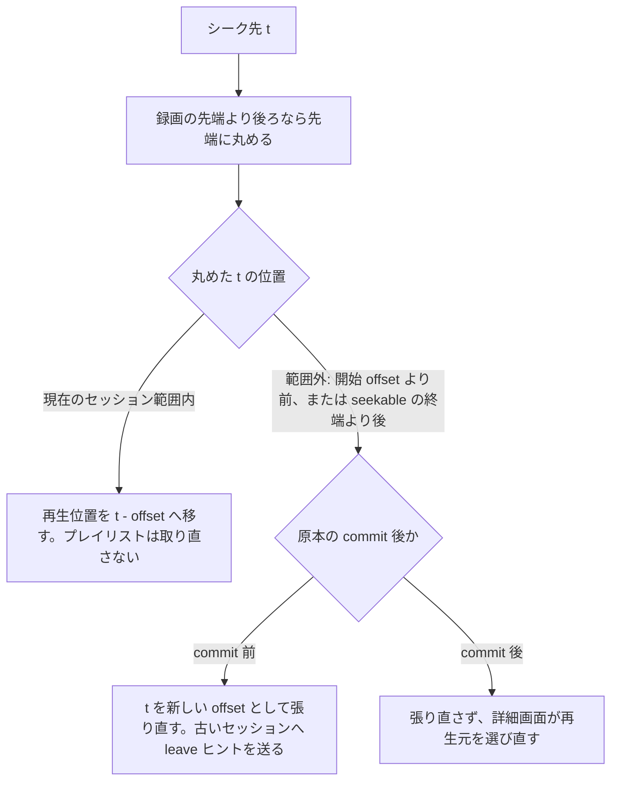

> [live.md](../live.md) の一部。索引から辿る

# ライブ視聴 --- EPGStation 水準のシンプルな UI

リッチな視聴体験（ハードウェアトランスコード、低遅延、コメント連携）は KonomiTV が既に高水準で解決しており、そこに張り合わない。同じ mirakc を共有すれば KonomiTV との共存も可能（チューナーは優先度調停で録画が勝つ）。

Rokuban 自体のライブ視聴は「チャンネル一覧から選んでブラウザ再生、画質切り替え程度」で良い。

## 実装方式

ライブ視聴は mirakc のサービスストリームを ffmpeg で HLS に変えて配る薄いパイプで、streamer ロールが担当する。

入力は mirakc の `/api/services/{id}/stream` である。セグメントはローカルスクラッチに書き、streamer が配信する（配信経路の詳細は [api.md](../../api.md) のライブ HLS 配信）。streamer はリアルタイムに mirakc からの帯域を張り続けるため、分散モードではエッジ寄りに配置する。エンコードジョブと違い、レイテンシと帯域の制約があるからである。

<details><summary>根拠</summary>

- ライブ視聴を担当するロール: `streamer`

</details>

## セッション管理

ライブ視聴セッションは意図的に in-memory で持ち、クライアントがいなくなったら ffmpeg を止める idle GC を置く。

落ちたらクライアントが再接続すれば済む使い捨て状態であり、「すべての状態を Postgres に」の原則の明示的な例外である（参照: [overview.md](../../overview.md) の crash-only 設計原則）。セグメント要求がアプリを通るので、idle GC に要る last-access の更新が追加の仕組みなしで手に入る（参照: [api.md](../../api.md) のライブ HLS 配信）。

## 録画中の追っかけ再生

録画詳細の再生枠は 1 つで、録画中かつライブ能力が有効なら追っかけを再生元に選ぶ。明示的な再生操作の後にだけ変換セッションを作り、表示するだけの閲覧では streamer の資源を保持しない。

通常の詳細表示ではポスターと再生ボタンを出し、押すまでは `/chase/playlist.m3u8` を要求しない。ホームの「録画中」帯、番組リスト、番組表グリッドのダイアログからは `/recordings/{recordings.id}#chase` へリンクし、詳細を開くと再生を始める。

### 再生元の選び方

再生元は詳細を開いたときに選び、再生中に選び直すのは、範囲外へのシーク・再生元のエラー・詳細の開き直しのときだけである。追っかけの終端は録画ファイルの終端なので、選び直さない。

放送が終わって録画の状態が `finished` になっても、取り込みが `pending` / `transferring` なら、詳細から新しい追っかけを始められる。commit 前の追っかけは、状態更新だけでは再生元を替えず、同じ video と既存の EVENT プレイリストで続ける。

commit 後に mirakc の record が消えて再生元エラーになったときは、詳細が REST で録画状態を取り直してから、原本 HLS か encoded を選ぶ。SSE はヒントなので、切替を SSE の到着に依存させない（[recordings/playback.md](../recordings/playback.md) §録画のブラウザ再生）。

<details><summary>根拠</summary>

- 録画の状態と取り込みの状態: `recordings.status`、`finished`、`ingest.state`、`pending`、`transferring`
- 追っかけの再生元の保持と切替: EVENT playlist、原本 HLS、`<video>`

</details>

### 番組画面からの入口

番組リストと番組表グリッドのダイアログにも、同じリンク先への入口を置く。リンク先には、番組一覧 API が返す録画中録画の識別子を使う。対応する録画が無ければ、既存の再生ボタンを従来どおりライブへ向ける。

番組一覧 API は、番組と同じ放送イベントに対応する録画中録画の識別子を `recordingId` として任意で返す。サーバーは放送イベントを特定するキー（site・ネットワーク ID・サービス ID・イベント ID・開始時刻）で録画を照合する。番組の識別子と録画の識別子は別の値なので、リンク先には API が返した `recordingId` を使う。

録画が終了・失敗・キャンセル・ごみ箱の場合も、追っかけへは切り替えない。録画状態の SSE 通知を受けた番組表は、一覧 API を取り直す。

<details><summary>根拠</summary>

- 録画の照合先の表: `recordings`
- 録画の照合に使う放送イベントのキー: `site`、`networkId`、`serviceId`、`eventId`、`startAt`
- 番組の識別子と録画の識別子は別: `programId`、`recordings.id`

</details>

### 追っかけの URL

追っかけの URL は固定の深さで、mirakc の record id をブラウザ側に持たない。site は前段が site ごとの streamer を選ぶために含め、DB 上の録画の site と一致しない要求は streamer が 404 にする。

```
/api/sites/{site}/recordings/{recordings.id}/chase/playlist.m3u8[?profile=<name>]
/api/sites/{site}/recordings/{recordings.id}/chase/offset/{offset}/playlist.m3u8[?profile=<name>]
/api/sites/{site}/recordings/{recordings.id}/chase/segments/{name}
/api/sites/{site}/recordings/{recordings.id}/chase/offset/{offset}/segments/{name}
/api/sites/{site}/recordings/{recordings.id}/chase/leave
/api/sites/{site}/recordings/{recordings.id}/chase/offset/{offset}/leave
```

ブラウザの再生経路はライブと同じく hls.js に一本化する。hls.js には `startPosition: 0` を渡す。

### 追っかけの時間軸

追っかけの時間軸は操作バー内のカスタムシークバー 1 本で、左端が番組開始、右端が番組終了予定である。録画済みの範囲を塗り、予定を超えて録画が続けば、軸を録画済みまで広げて予定終端の印を残す。

録画済みの塗りは、ファイル先頭（番組開始と録画開始の遅い方）から現在までで導出し、1 秒ごとに伸ばす。録画開始はチューナーを開いた時刻で、ファイル先頭ではない。録画済みの上限は、サーバーが追いつくため 1 秒手前にする。追っかけ中は seek tile が無いので、ドラッグ中は時刻だけをプレビューし、映像サムネイルは出さない。

現在位置とプレビュー時刻は、番組開始からの経過で表示する。分は 60 を超えても合計分で書く（70 分 12 秒は `70:12`）。チューナーが番組開始より前に開いていても、ファイル先頭と軸の 0 秒は番組開始に揃う。録画が遅れて始まれば、録画済み範囲は軸の途中から始まり、録画済みと再生済みの塗りは録画開始位置から始める。放送の実時刻はタイトル行にだけ出す。

予定尺は録画作成時の番組スナップショットで、watcher は追っかけ中の延長に合わせて更新しない。軸を録画済みまで広げるのは、録画済みの秒数が予定尺を超えたときである。未録画側の時刻は予定として表示する。

<details><summary>根拠</summary>

- 軸の左端と右端: `startAt`、`startAt + durationMs`
- ファイル先頭の時刻: `max(startedAt, startAt)`、`started_at`
- 予定尺はスナップショットで更新しない: `durationMs`

</details>

### 軸の目盛りと延長表示

デスクトップはシークバーの下に左端・先端・予定終端の目盛りを出し、スマホは目盛りを出さず時刻を短くする。延長中は予定終端の印に合わせた「予定」ラベルと、右端の「延長中」ラベルを並べる。

デスクトップでは先端の印の下に時刻だけを置く。押すと先端へ移ることは、文言で書かず印のアクセシブル名と title に置く。

ラベルは「予定 60:00 ¦」と「延長中 · 先端 70:12」の形で、¦ を予定終端の印に合わせる。印に合わせると行からはみ出すなら行の中へ寄せ、端のラベルと重なる場合は端のほうを隠す。先端ラベルは隠さず、予定ラベルを手前へ寄せる。スマホの短い時刻は `12:00 / 25:01` の形である。

### シークの動作

シーク先は録画先頭からの秒で表す。現在のセッション範囲内なら再生位置の移動だけで済ませ、範囲外ならその秒を新しい offset としてプレイリストを張り直す。先端より後ろは先端に丸める。原本の commit 後は張り直さず、詳細画面が再生元を選び直す。

セッション範囲は offset から offset + seekable の終端までである。シーク先の秒を t とすると、範囲内では `currentTime = t - offset` で移動し、プレイリストを取り直さない。



張り直す前に再生中だったなら、張り直した後も再生を続ける（原本 HLS と同じ）。commit 後に張り直さないのは、新しい追っかけセッションを作れないからである。commit 後の範囲外のシークでは、詳細画面が最新の録画状態で再生元を選び直す。finished でも ingest が `pending` / `transferring` の間は、追っかけを続けられる（[recordings/playback.md](../recordings/playback.md) §録画のブラウザ再生）。

<details><summary>根拠</summary>

- セッション範囲と移動の式: `offset`、`offset + seekable.end`、`seekable`、`currentTime = t - offset`、シーク先の秒 `t`
- 張り直しの URL: `/chase/offset/{offset}/...`

</details>

### ドラッグとホバーの扱い

ドラッグ中は位置のプレビューだけを出し、pointer up（キーボードでは操作キーを離したとき）に確定する。マウスを載せただけでは、つまみも時刻も動かさない。

録画先端へは、赤い印か End キーで移動する。専用の「最新」ボタン、秒数入力、「この位置から再生」ボタンは置かない。

ホバーでは `aria-valuenow` も動かさず、載せた位置の時刻を吹き出しで出す。未録画の位置（ファイル先頭より前・先端より後ろ）なら「まだ録画されていません」を付ける。

### 開始位置と画質

つまみを動かさなければ、従来の URL で録画先頭から始めて保存済みの再生位置を復元する。画質セレクタは操作バーの再生設定メニューに入れ、切替でセッションを作り直さない。

つまみを動かして 0 秒を明示した場合は、保存済みの位置を復元せず先頭から始める。画質の切替では同じセッションのプレイリストだけを取り直し、再生位置を保つ。

### 音声

音声もライブと同じ標準 / 主 / 副の 3 択にする。同じ操作バーを持つ再生元は、同じように使えるべきだからである。切替は HLS master の URL も追っかけセッションも変えず、プレイヤーが選ぶ音声の rendition だけを替える。

`?audio=main|sub` を録画詳細の search に置き、標準は省略する。

追っかけの HLS は EVENT プレイリストで過去のセグメントを保持する。ライブのように窓がスライドしないため、PDT を付けず、音声を切り替えても再生が止まらないことを、長時間再生の e2e 判定で確認する。

<details><summary>根拠</summary>

- 長時間再生の判定: `web/e2e/chase-audio.mjs`

</details>

### 再生速度

追っかけの再生速度は、VOD と共通の端末設定に保存し、通常のライブ視聴には適用しない。

VOD と共通にするのは、追っかけが録画再生だからである。通常のライブ視聴には速度を適用しない。ライブは放送の実時間で見るため、録画再生用の速度設定を使わない。

### 再生位置の保存と離脱ヒント

再生位置は録画の原本時間軸の ms で保存し、画質やプロファイルでは分けない。画面を離れるときは leave ヒントを送る。ヒントは idle GC を早めるだけで、共有セッションを即座に止めはしない。

再生位置は `/api/recordings/{id}/playback-position` に原本時間軸の ms で保存する。live の配信プロファイルや VOD のエンコードプロファイルでは分けず、原本 VOD と共通の値を使う。追っかけではプレイヤー内部の相対秒に開始 offset を加えて保存する。成長中の EVENT プレイリストでは duration を終端とみなさず、視聴済み判定もしない。再生中は定期的に、pause / seeked / pagehide で保存する。

画面遷移・`pagehide`・visibility hidden では `POST .../chase/leave` を送る。オフセット付きなら同じ `/offset/{offset}` を含め、sendBeacon を優先する。
