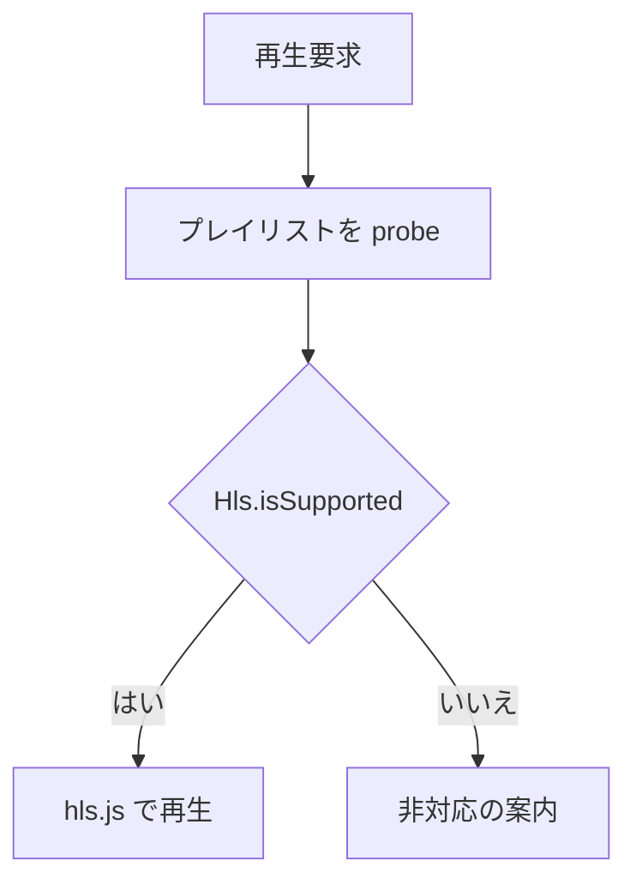

> [live.md](../live.md) のブラウザ再生能力とエラー処理。索引から辿る

### ブラウザ再生能力、probe、エラー分類

ライブ視聴は hls.js で再生する。再生前にプレイリストを 1 回取得して HTTP 層の失敗を分類し、再生中は hls.js の致命的エラーと再生位置の停止を扱う。

#### hls.js の読み込み

hls.js はライブ視聴画面だけが動的に import する。他の画面の初期バンドルには含めない。ビルドで独立チャンクになることを確認する。

根拠

- 動的 import する場所: `components/live-player.tsx`
- チャンクの分離を確認するコマンド: `pnpm build`
- チャンク名: `assets/hls-*.js`

#### 再生経路と非対応の表示

HLS の再生方式と非対応時の表示は、同じブラウザ判定に揃える。

再生可能かどうかは `Hls.isSupported()` だけで決める。真なら hls.js を作り、偽なら再生方式ごとの非対応メッセージを表示する。`canPlayType()` の戻り値で経路を変えない。ブラウザが HLS の MIME に `maybe` を返すことは、アプリが配る TS を再生できる根拠にならない。

`Hls.isSupported()` が偽のときは `<video>` に m3u8 URL を渡さない。対応能力が無い環境では、何も表示されないプレイヤーではなく、利用者が理由を読めるエラーを出す。

根拠

- 再生方式の判定: `Hls.isSupported()`、`components/live-player.tsx`
- `canPlayType()` が `maybe` でも hls.js を使う: `components/live-player.test.tsx`
- 非対応時に m3u8 URL を直接設定せず案内を出す: `components/live-player.test.tsx`

#### 再生前の probe

プレイリストの GET を 1 回行い、到達可能性と HTTP ステータスを確かめてから hls.js に URL を渡す。hls.js のエラーイベントは HTTP ステータスや応答本文を持たないため、probe の応答で同じ分類と案内を作る。

probe はセグメント要求と同じアプリ配信を通るので、idle GC の last-access 更新にも乗る。成功時は同じ応答本文から、全プロファイルを束ねた master かどうかを調べる。

根拠

- 取得する関数: `probeLivePlaylist`（`lib/live.ts`）
- probe を通した後に URL を渡す: `LivePlayer`
- master 判定: `bundlesProfiles`

#### 再生中の失敗と停滞

hls.js の致命的エラーは再生を止め、再生方式ごとのエラー表示を出す。表示後も裏でセグメント要求が続かないよう、インスタンスを破棄する。

映像の停滞は `currentTime` を 1 秒ごとに観測し、12 秒進まないときに画質の自動降格を試す。`stalled` / `waiting` は MSE で正常時にも発生するため、失敗の判定には使わない。停滞判定と降格先は [quality.md](quality.md) にある。

根拠

- hls.js の致命的エラー: `Hls.Events.ERROR`、`data.fatal`
- 破棄とエラー表示: `LivePlayer` のエラーハンドラ
- 停滞の観測: `watchLiveDiagnostics`、`observeStall`
- 12 秒の境界、pause と hidden の抑止: `live-player.test.tsx`

#### プレイリスト取得失敗の分類

プレイリストの取得失敗は、到達不能・容量（503）・追っかけの入力失敗・その他に分類する。到達不能は中立の文言、それ以外は本文をそのまま見せる。いずれも再読み込みボタンで probe からやり直せる。

到達不能は、streamer に到達できない場合である。ハイブリッド構成では、自宅側が落ちているだけの正常状態でありうる（[overview.md](../../overview.md) §サーバーレスデプロイ）。そのため、destructive な赤は使わず、中立の文言にする。

503 はどの原因でも「今は無理なので後で試す」という同じ対応を求めるので、すべて容量に分類する。原因の違いは分岐ではなく、方式ごとの見出しと案内文で伝える。ライブはセッション上限・チューナー枯渇・シャットダウン中を同じ案内で扱う。追っかけはチューナーを使わないので、チューナー不足の文言を出さない。原本 TS の 503 は、同時セッション上限か streamer のシャットダウン中だけを示す。応答本文もそのまま見せる（[shell.md](../shell.md)「エラーの本文も UI まで運ぶ」と同じ規律）。

追っかけの 502 は、`Retry-After` がある場合だけ入力失敗後の cooldown に分類する。ヘッダーがない 502 はプロキシ由来の可能性があるため、その他として扱う。原本 TS の起動待ちタイムアウトは 504、起動時のその他の失敗は 500 なので、容量に分類しない。

分類関数と文言（見出し・案内文・hls.js の致命的エラー・HLS 非対応）は、方式ごとに `playbackStrategy` が 1 つだけ持つ。呼び出し側で方式を分岐すると、一部の場面だけ分岐が漏れる。

根拠

- 分類の関数: 方式ごとの `PlaybackStrategy.classifyLoadError`（共通部分は `classifyLiveLoadError`）
- 到達不能: `unreachable`（`fetch` 自体が reject）
- 容量: `capacity`（503）
- 追っかけの入力失敗: `chase-input`（502 + `Retry-After`）
- その他: `other`
- 方式ごとの文言: `PlaybackStrategy.errorMessages`
- 再読み込みでやり直す先: `probeLivePlaylist`

