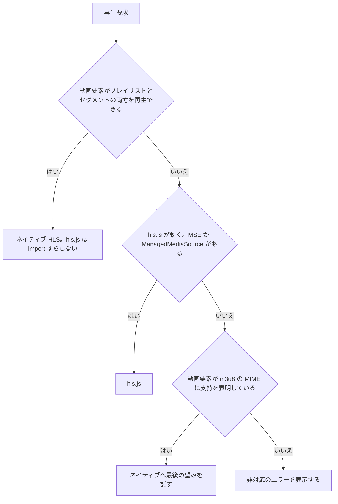
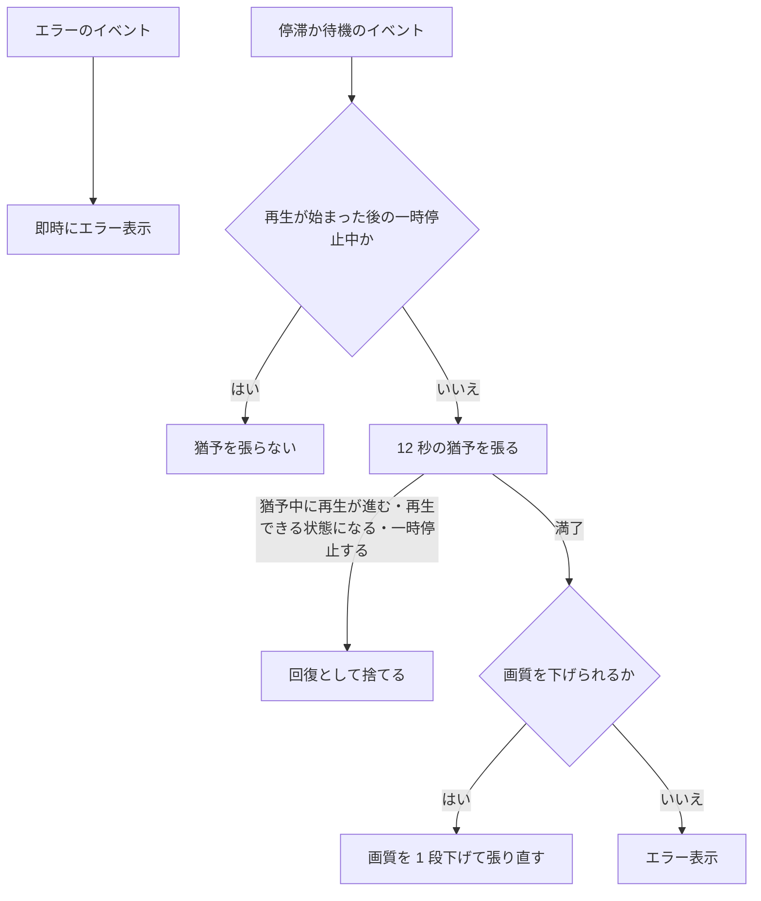

> [live.md](../live.md) のブラウザ再生能力とエラー処理。索引から辿る

### ブラウザ再生能力、probe、エラー分類

ライブの再生経路は、ネイティブ HLS・hls.js・最後の望みとしてのネイティブの 3 段で選ぶ。各段は実際に確かめた能力で選ぶ。再生前にプレイリストを 1 回取得して HTTP 層の失敗を分類し、メディア層の失敗は動画要素のイベントで拾う。

#### hls.js の読み込み

hls.js はライブ視聴画面だけが動的に import する。他の画面のバンドルには乗らない。ビルドの出力で、hls.js が約 520 KB の独立チャンクに分かれることを確認済みである。

根拠

- 動的 import する場所: `components/live-player.tsx`
- 独立チャンクを確認したビルド: `pnpm build`
- 独立チャンクの出力名と、乗らない側のバンドル: `assets/hls-*.js`、`assets/index-*.js`

#### 再生経路の梯子

再生経路は 3 段の梯子で選ぶ。各段は「実際に確かめた能力」で選ぶ。上の段から順に試し、動く段で止まる。

3 段目に来るのは、MSE も ManagedMediaSource も無いブラウザ（iOS 17.1 未満の iPhone Safari）だけである。ここで「非対応です」と断じると、ネイティブなら完璧に再生できる端末を締め出す。

根拠

- 1 段目の判定対象: `<video>`
- 2 段目の判定: `Hls.isSupported()`
- 3 段目の判定: `claimsHlsPlaylistSupport`

#### 1 段目でセグメントの MIME まで問う理由

プレイリストの MIME への戻り値では Safari と Chrome を区別できないので、1 段目ではセグメントの MIME まで問う。セグメントを demux できるのは WebKit だけだからである。

Playwright の 3 エンジンで実測した値は次の通り。

| `canPlayType` の引数 | WebKit 605.1.15 | Chromium 151 | Chrome 151 | Firefox 153 |
|---|---|---|---|---|
| `application/vnd.apple.mpegurl` | `maybe` | `maybe` | `maybe` | `''` |
| `application/x-mpegURL` | `maybe` | `maybe` | `maybe` | `''` |
| 上記 + `; codecs="avc1.42E01E,mp4a.40.2"` | `probably` | `probably` | `probably` | `''` |
| `video/mp2t` | `maybe` | `''` | `''` | `''` |

戻り値は、エンジンの違いとは無関係に、codecs パラメータの有無で決まる。HTML 仕様では、codecs を許す type に codecs が無い場合、`probably` を返すべきではない。hls.js 公式 README も、真偽値で判定し、`=== 'probably'` の比較は使わない。

`video/mp2t` は、streamer が実際にセグメントへ付ける Content-Type である。これを demux できるのは WebKit だけで、Chromium / Firefox はできない。hls.js が TS を fMP4 へ remux して MSE に載せる理由もここにある。

つまり判定するのは、ブラウザが配信物をそのまま再生できるかである。エンジンや拡張子で推測しない。判定は、実ブラウザが固定する。

根拠

- 判定を実ブラウザで固定する: `web/e2e/live.mjs` の ⑥

#### 実在する戻り値を入力にする

判定のテストの入力は、この実測値の表にする。実在しない戻り値で主張しても何も守らない。判定を変えるときは、同じ実測をやり直す。

実ブラウザが返さない戻り値を渡す判定のテストは、通る。しかし、その戻り値を返す実ブラウザは存在しない。

根拠

- 実在しない入力で通るテスト: `expect(supportsNativeHls(() => 'probably')).toBe(true)`。`'probably'` を返す実ブラウザは存在しない
- 実測値の表を入力にしているテスト: `lib/live.test.ts`

#### 再生前の probe

再生の前に、プレイリストを 1 回だけ取得して成否を確かめる。動画要素のエラーイベントも hls.js のエラーイベントも、HTTP ステータスや本文を運ばないためである。

これは、両方の再生経路で同じエラー表示を出すためで、実際に動画要素や hls.js へ URL を渡す前に行う。この GET 自体もセグメント要求と同じ経路（streamer のアプリ配信）を通る。そのため、idle GC の last-access 更新にも自然に乗る。

根拠

- 取得する関数: `probeLivePlaylist`（`lib/live.ts`）、`fetch`
- ステータスや本文を運ばないイベント: `<video>` の `error`

#### メディア層の失敗の拾い方

probe は HTTP 層しか見ないので、メディア層の失敗は動画要素のイベントで拾う。対象はネイティブ経路だけである。聴かないと、文言も再読み込みボタンも出ない、永久に止まった黒いプレイヤーになる。

プレイリストが 200 で返っても、セグメントが壊れていれば再生は始まらない。黒いプレイヤーには読み込み表示も出ない。WebKit で実測された症状である。聴く種類は、同じ実測から決めた。プレイリストは 200 のまま、セグメントだけを 3 通りに壊して WebKit で観測した結果は次の通り。

| 壊し方 | `<video>` が出すもの | `video.error` |
|---|---|---|
| セグメントが 404 | `error`（再生中なら `waiting` も） | code 3 `Media failed to decode` |
| セグメントが応答しない | `progress` → `stalled`（3.6 秒後） | null |
| プレイリストの中身が壊れている | `progress` → `stalled`（3.6 秒後） | null |

したがって `error` だけでは足りない。セグメントの無応答や壊れたプレイリストでは、`error` が出ない。一方で、`stalled` / `waiting` を即失敗とするのも誤りである。正常なライブでも、バッファ枯れで出る。

根拠

- 聴く関数: `watchNativeMedia`（ネイティブ経路のみ）

#### 猶予つきの失敗判定

エラーのイベントは即時に失敗とし、停滞と待機のイベントは 12 秒の猶予をつけて失敗とする。猶予が満了したら、エラー表示の前に画質の自動降格を試す（[quality.md](quality.md)「停滞したら画質を 1 段下げる」）。

猶予の根拠は、停滞のイベントが途絶から 3 秒後に出ることと、セグメント長が 2 秒であることである。正常なら 3 セグメント以上落ちないと、猶予に到達しない。猶予中に、再生が進む・再生できる状態になる・一時停止するのいずれかが起きたら、回復として捨てる。

「再生が進む」は、再生位置が基準から 50 ms 以上動いたかで判定する。基準は、直近の停滞か待機のイベントが出た時点の再生位置である。`timeupdate` が出ただけでは回復としない。WebKit はバッファの終端で、再生位置の動かない `timeupdate` を出す。

停滞のイベントで猶予を張った後も、残りのバッファは再生され、尽きた位置で待機のイベントが出る。このとき基準を停滞の時点に置いたままにすると、終端の `timeupdate` を「進んだ」と読んで猶予を捨てる。猶予を張り直すイベントはその後来ないので、黒いまま何も出なくなる。そのため、猶予が張られている間の待機のイベントでも基準を取り直す。

hls.js 経路には、この watcher を張らない。hls.js のエラーイベントが同じ役割を持ち、MSE では待機のイベントが正常時にも出るため、誤検知になる。停滞のイベントを拾わないことは、テストで確かめている。

根拠

- 猶予の長さ: `liveStallTimeoutMs`（12 秒）
- 回復として捨てるイベント: `playing` / `canplay` / `pause`、および 50 ms 以上進んだ `timeupdate`
- WebKit が終端で出す、動かない `timeupdate` の実測: stalled@5.202 → 残りを再生 → waiting@7.790 → timeupdate@7.790
- 50 ms の根拠: 正常再生中の `timeupdate` 間の進み幅は 0.148 〜 0.252 秒（WebKit の ⑮ で隣り合う 23 組）で、終端の `timeupdate` は 0 しか動かない。50 ms はこの 2 つの間に置いた値である。ほかの環境でも両者がこの間に収まるかは未検証
- 判定の所在: `live-player.test.tsx` の「currentTime が止まった timeupdate は停滞の猶予を解除しない（WebKit の buffer 枯渇）」、`chase.mjs` ⑮（WebKit）
- hls.js 経路の代わりに使うイベント: `Hls.Events.ERROR`
- 即時に失敗とするイベントと猶予つきのイベント: `error`、`stalled` / `waiting`
- hls.js 経路では `stalled` を拾わない: `live-player.test.tsx`

#### 一時停止中の扱い

一時停止中は、再生が一度始まった後に限り、猶予を張らない。WebKit は一時停止の直後にも停滞のイベントを出すが、配信は正常だからである。再生前は、一時停止の状態でも監視を止めない。

解除のイベントは一時停止中には来ない。放置すると、正常な配信に必ずエラー画面が出て、動画要素が invisible になる。実測は playing@0.0 → pause@2.3 → stalled@2.3 → 12 秒後にエラー表示だった。

一時停止だけで抑止すると、再生前の監視まで止まる。動画要素に自動再生の指定は無く、読み込み直後は一時停止の状態である。無応答時は停滞のイベントだけが届き、20 秒待ってもエラーも待機も来ないため、永久に黒いままになる。

そのため、再生を一度でも観測したかを持ち、観測済みで一時停止中のときだけ抑止する。再開後も配信が止まっていれば、待機のイベントが再送される。実測は pause@6.05s → play@12.05s → waiting@12.05s である。

根拠

- 一時停止直後に出るイベント: `pause()`、`stalled`
- 一時停止だけで抑止すると黒いままになる理由: `autoPlay`（`<video>` に無い）、`paused === true`、`error` / `waiting` は来ない
- 抑止の条件: `playing` を一度でも観測したか、`hasStarted && paused`、`paused`
- 再開後に再送されるイベント: `waiting`

#### メディア失敗の判定手段

判定は、ネイティブ経路のメディア失敗のテストと、実 WebKit の e2e で行う。一時停止の抑止そのものは、実ブラウザで機械判定できていない。

一時停止の抑止を実ブラウザで判定できないのは、e2e が一時停止を作らないためである。根拠は jsdom のテストと手動測定である。

テストが見るのは、次の通りである。

- エラーのイベントでは出す
- 猶予が経過すると出す
- 猶予中に再生が始まれば出さない
- 一時停止中の停滞では出さない
- 猶予中の一時停止では出さない

さらに、再生前の停滞では出すこと、再開後に復帰していなければ再び出すことも見る。

実 WebKit では、404 と無応答の両方でエラー表示と再読み込みが出る。e2e は再生を呼ばないため、再生前の窓を塞がないことも同時に見ている。判定の対象は probe を通過した後のメディア層で、HTTP 層（streamer 不在 / 503 / playlist 404）は probe 側が確認する。

根拠

- ネイティブ経路のメディア失敗の各判定: `live-player.test.tsx`「ネイティブ経路のメディア失敗」
- 内訳のイベント: `error`、`playing`、`stalled`、`pause`
- 実 WebKit で 404 と無応答の両方にエラー表示と再読み込みが出る。再生を呼ばないので再生前の窓を塞がないことも見る: `web/e2e/live.mjs` ⑦、`play()`

#### エラーの 3 分類

プレイリストの取得失敗は、到達不能・容量（503）・その他に分類する。到達不能は中立の文言、容量とその他は本文をそのまま見せる。いずれも再読み込みボタンで probe からやり直せる。

方式ごとの分類関数と見出し・案内文は、`playbackStrategy` が持つ。

到達不能は、streamer に到達できない場合である。ハイブリッド構成では、自宅側が落ちているだけの正常状態でありうる（[overview.md](../../overview.md) §サーバーレスデプロイ）。そのため、destructive な赤は使わず、中立の文言にする。

503 はすべて容量に分類する。ライブは同時セッション上限・チューナー枯渇・シャットダウン中を同じ案内で扱う。追っかけはチューナーを使わないため、チューナー不足の文言を出さない。原本 TS の 503 は同時セッション上限か streamer のシャットダウン中を示す。方式ごとの見出しと案内文は strategy から表示し、応答本文もそのまま見せる（[shell.md](../shell.md)「エラーの本文も UI まで運ぶ」と同じ規律）。

追っかけの 502 は、`Retry-After` がある場合だけ入力失敗後の cooldown に分類する。ヘッダーがない 502 はプロキシ由来の可能性があるため、その他として扱う。原本 TS の起動待ちタイムアウトは 504、起動時のその他の失敗は 500 なので、容量の案内には入らない。

その他のエラーと hls.js の致命的エラー、ネイティブ HLS の `<video>` error は方式ごとの見出しを使う。いずれも再生方式の strategy に文言を置き、`LivePlayer` 側で方式判定を重ねない。

根拠

- 分類の関数: `classifyLiveLoadError`
- 到達不能: `unreachable`（`fetch` 自体が reject）
- 容量: `capacity`（503）
- その他: `other`
- 再読み込みでやり直す先: `probeLivePlaylist`

