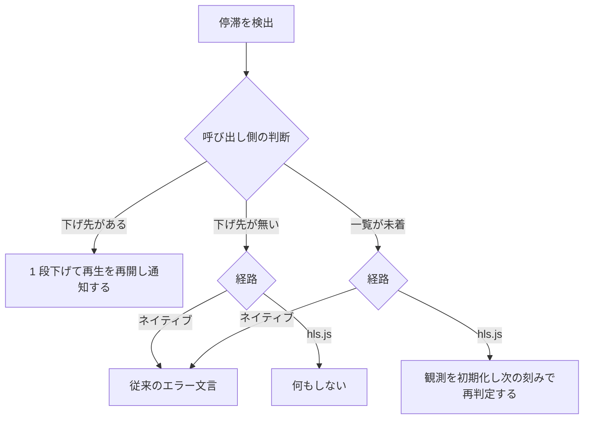

> [live.md](../live.md) の画質選択と自動降格。索引から辿る

### 画質選択と自動降格

画質は利用者が選べ、選択肢は設定した順のまま並べる。映像が止まったときは、画質を 1 段下げる自動降格を試す。降格が機能するのは回線（配信の転送）が律速のときだけで、エンコードが追いつかない停滞は直せない。選択は URL に持ち、自動で下げても URL は書き換えない。

#### 画質のセレクタ

選択肢はライブのプロファイル一覧 API から作り、設定した順のまま並べる。**選択肢が 1 件以下ならセレクタを出さない。** 選ぶ余地が無いコントロールは「機能しないコントロール」である。

一覧が 0 件になるのは `live.profiles` が未定義のときだけである。`live.enabled: false` でも profiles が書かれていれば一覧は返る（一覧 API は config の写しである。[api.md](../../api.md) §一覧の契約）。その構成では画面自体が「無効です」の分岐に落ちるので、セレクタは出ない。

選択肢の元は `GET /api/live-profiles`（`config.live.profiles` の名前と表示用の高さ）である。先頭が `?profile=` を省略したときの既定なので、サーバー側の決め方がそのまま既定の根拠になる。表示名には高さを付ける（0 は「スケールしない」なので名前だけ）。

根拠

- 表示名は名前に高さを付ける形: `hd（720p）`、高さ `height`、名前 `name`

#### 切替と URL

画質を切り替えてもセッションは作り直さず、離脱ヒントも送らない。選択は URL の検索パラメータに持ち、既定は書き戻さず、チャンネルを切り替えても保つ。

1 サービス = 1 ffmpeg が全プロファイルを同時に出力しているので、切替で替わるのは同じセッションのプレイリストの URL だけである（[api.md](../../api.md) §資源同定）。プレイヤーを unmount せず、再マウント用の鍵にも再生同意の判定の鍵にも触れない。**画質の切替を「同意を取り直す」操作と誤読させる形にしない。** 離脱ヒントは「このチャンネルを見るのをやめた」の合図で、画質の切替ではないので送らない。そのため、プレイヤーの離脱処理を画質に依存させない。

選択は `?profile=` に持つ。ルート定義の検証は形だけを見る（非空の文字列か）。落とすときは undefined を明示代入する。実在の判定はそこでは書けない。選べる名前は実行時に行を引く `GET /api/live-profiles` から来るので、照合は一覧を読めるページ側で行う。`?site=` と同じ分担である。

未知の名前は落として既定（先頭）を選ぶ。streamer は空の `?profile=` を既定に落とすが、未知の名前には 400 を返す。落とさないと、綴り違いの共有リンクや古いブックマークがエラー画面になる。

既定は URL に書き戻さず、明示的に選んだ値だけを載せる。既定はフロント（一覧の先頭）も streamer も同じ先頭プロファイルに解決するので、URL に書く意味が無い。

チャンネルを切り替えても画質を保つ（チャンネル一覧のリンクが `?profile=` を運ぶ）。画質は局ごとの設定にしない。「この端末の回線」の性質だからである。

根拠

- プレイヤーを unmount せず、再マウント用の鍵（`key`）にも同意判定の鍵（`playingKey` / `selectedKey`）にも触れない: `LivePlayer`、`key`、`playingKey`、`selectedKey`
- 離脱処理を画質に依存させない: `LivePlayer` の離脱 effect、`profile`
- 検証は形だけで、実在の判定はページ側で行う: `routes.tsx` の `validateSearch`、`pages/live.tsx`、`validLiveProfile`（`lib/live.ts`）
- 未知の名前への 400: `unknown live profile`
- 不正な値を落とすときの代入: `undefined`

#### 追っかけ再生の画質セレクタ

追っかけ再生にも画質セレクタを出す。選択は録画詳細の検索パラメータに持ち、切替でプレイヤーは作り直さない。

追っかけの画面は録画詳細（`/recordings/{id}#chase`）にある。プレイヤーは追っかけモードでプロファイルを受けて `?profile=` を組み立てられるので、streamer 側の配線は既にある。選択をハッシュ側に持たせると、ハッシュを変えるたびに録画詳細のコンポーネントを作り直し、再生位置の復元もやり直す。検索パラメータは再マウント用のキーに含めないので、画質を切り替えてもプレイヤーは unmount しない。

キー名は `?profile=` にしない。この画面には `encode.profiles`（完了後の VOD）と `live.profiles`（追っかけ）の 2 軸が同居し、素の `?profile=` ではどちらを読むのか決まらないためである。`?liveProfile=` は設定キーと一覧 API（`GET /api/live-profiles`）の名前に一致する。URL に明示された値は一覧で検証し、未知の値は既定（先頭）に落とす。一覧が 2 件以上のときだけセレクタを表示し、0 件・1 件では既定のプロファイルで再生する。

切替は同じ録画・同じ offset のセッションから別プレイリストを取得するだけで、離脱ヒントを送らない。profile は再開位置の軸に使わず、切替直前の再生位置を次のプレイリストに持ち越す。したがって画質を変えても、「続きから」の位置は画質ごとに分かれない。

録画終了後（`ENDLIST` 済み）でも、保持セッションが残る idle GC までは切り替えられる。保持ディレクトリに全プロファイルのプレイリストが残るためである。GC 後は現行の追っかけと同じ 404 になるので、UI に特別な分岐は置かない。偽 ffmpeg を使うテストで確かめた。実 ffmpeg では未測定である。

根拠

- 追っかけモードがプロファイルを受ける: `LivePlayer mode="chase"`、`profile` prop
- 追っかけの画面の場所と検索パラメータ名: `/recordings/$id`、`#chase`、`liveProfile`
- 録画終了後も保持セッションで切り替えられる（偽 ffmpeg）: `TestFinishedChaseProfileSwitchServesRetainedPlaylists`

#### 停滞の検出

映像が 12 秒進まなければ停滞とみなし、画質を 1 段下げる。閾値は経路によらず 1 つで、判定の信号だけが経路で違う。

回線が細い場所で、永久にリバッファするかエラーを出すかしかない状態を減らすための仕組みである。**機能するのは回線（配信の転送）が律速のときだけである。** 1 サービスの ffmpeg 1 本が全プロファイルを同時に出力しているので、クライアントが下げてもエンコードの負荷は変わらない。エンコードが追いつかずに止まる場合は、12 秒ごとに最下段まで下がり続けて効果が無い（この節の最後に書く、止まった理由を分けない判断の代償である）。

ネイティブ経路（Safari）では、stalled / waiting の既存の猶予が満了したら、従来のエラー表示の代わりにまず降格を試す。下げ先が無ければ現行どおりのエラー文言に落ちる。新しい失敗経路も新しい文言も作らない。

hls.js 経路では、計器の 1 秒ポーリングに相乗りして、再生位置が 12 秒進まないことを見る。stalled / waiting は MSE では正常時にも何度も出るので、信号に使えない。下げられないときは何もしない。現行の hls.js 経路に停滞の失敗経路は無く、ここで新設するとプロファイルが 1 件しかないデプロイの挙動まで変わるからである。

一時停止中と非表示タブでは数えない。video に自動再生は設定していないので、再生を押す前は再生位置が進まないのが正常である。非表示タブでは setInterval が間引かれるので、基準を捨てないと復帰時に誤発火する。

「進んだ」は値が変わったかで見る。ライブ同期の補正で再生位置は後退しうるので、増えたかでは見ない。waiting の回数とバッファ長は使わない。再生位置が 12 秒進まないなら、どちらも結論を変えない（同じ事象の別の代理変数である）。

止まった理由を「回線」と「配信側」に分けない。分けるには帯域の推定が要る（測っていない数字を出さない）。代償として、配信側（エンコード）が律速の停滞でも下げる。下げても負荷は変わらないので最下段まで進み、その画質がチャンネルを跨いで残る。利用者がセレクタで選び直せば戻る。

根拠

- 閾値は 1 つ（12 秒）: `liveStallTimeoutMs`
- 判定と下げ先: `observeStall`、`nextLowerProfile`、`StallHandling`（`lib/live.ts`、`lib/live.test.ts`）。境界は 11,999 ms / 12,000 ms のリテラルで検証する
- 配線: `live-player.test.tsx` で 12 秒判定、`paused` と非表示タブの抑止、進行中の除外、master の抑止を確認する。引き取られたときはエラーにせず、引き取られなくても hls.js 経路はエラーにしない
- 自動再生は設定していない: `autoPlay`
- 非表示タブで間引かれる: `setInterval`
- MSE では正常時にも何度も出るイベント: `stalled`、`waiting`
- 「進んだ」の比較は不一致で行う: `!==`
- 再生位置: `currentTime`

#### 停滞検出の状態の持ち方

自動再開を待っている間は一時停止による抑止を外し、再生が始まったかの記録は effect をまたいで持つ。どちらも、降格の直後に検出が止まるか誤発火するのを防ぐ。

切替の cleanup が `load()` で paused にした状態を「利用者が止めた」と読むと、降格先の配信も死んでいて canplay が来ない場合に停滞の検出ごと止まる。**黒いまま永久に何も出ない（降格もエラー表示も起きない）。** そこで抑止は再開待ちの間だけ外し、canplay が来たら戻す。

切替は effect を張り直すので、「一度でも再生が始まったか」を effect ごとに持つと、利用者が自分で一時停止した video を「まだ再生していない」と誤読する。誤読すると、自動降格の直後に WebKit が出す stalled を停滞と読み、健全な配信でもエラーや次の降格に進む（実測: 一時停止した要素は読み込み済みの状態でも 3.7 秒後に stalled を出す）。

effect を跨いで持つ結果として、一時停止したまま切り替えた先が無応答でも、再生を押すまでエラーは出ない（一時停止中の抑止と同じ扱い）。再生を押すと waiting で猶予が張り直される。

根拠

- 一時停止した要素が stalled を出す実測の状態: `readyState=4`
- 一時停止したまま切り替えた先の stalled は、両方向を固定する: `live-player.test.tsx` の「一時停止中に切り替えた先の stalled」
- 再開待ちの間だけ抑止を外す: `resumePending`、`canplay`
- 一時停止の抑止と再生済みの記録の対象: `<video>`

#### 下げ先の選び方

設定順に前方へ走査し、実効高さが現在より小さい最初の段を選ぶ。降格は片方向で、上げ直しはしない。

実効高さは、高さが 0 より大きければその値、0 または省略（スケールしない = 元のサイズ = 最重）なら無限大として扱う。`[hd 720, sd 480]` なら sd を選び、`[sd 480, hd 720]` なら下げない。

「配列は後ろほど軽い」という新しい契約は置かない。置くと `[sd, hd]` の構成で、停滞時に重い方へ上げてしまう。順序は運用者の宣言のまま使い、高さは「上がってしまう段」への拒否権としてだけ使う（帯域の完全な代理ではないが、拒否権なら誤りが起きても結果は「下げない」になる）。

上げ直しはしない。上げるには「もう足りている」の判定 = 帯域の能力推定が要り、フラッピング抑止用に測れない 2 つ目の数値も要る。上げたいときは利用者がセレクタで選ぶ。クールダウンは置かない。下げるとプレイヤーの effect が張り直されて計測が 0 に戻るので、次の発火には再び 12 秒の無進捗が要る（観測窓そのものがクールダウンである）。

根拠

- 下げ先の選び方: `nextLowerProfile`
- 実効高さの式: `height > 0 ? height : Infinity`
- 設定順の判定例: `[hd 720, sd 480]`、`[sd 480, hd 720]`、`[sd, hd]`

#### 降格を試さない場合

降格を試さないのは、利用者が画質を明示したとき、全プロファイルを束ねた master のとき、追っかけ再生のときである。画質一覧をまだ持っていないときは判定を保留し、ネイティブ経路の保留は現行どおりエラー文言に落ちる。

**明示選択は上書きしない。** `?profile=` の有無がそのまま「自動が有効か」である。自動で下げても URL は書き換えないので、手で選び直すと自動が止まる。これは追加コードなしで成立する。チャンネルを切り替えても下げた先を保つ（「この端末の回線」の性質と同じである）。自動で下がった段と同じ値を選んでも自動は止まらない（変更イベントが発火しない）。別の段を選べば止まる。セレクタに「自動」を常設しない判断の結果である（停滞が一度も起きないデプロイに UI を 1 行足さない）。

`live.captions: true`（全プロファイルを束ねた master）では下げない。そのときプレイリストは `?profile=` に関わらず同じ master を返すので、下げても何も変わらないのに「下げました」と表示することになる。判定は probe が読んだ本文で行う。api と streamer に別の config を配る構成では、一覧 API の方が実態と違う値を返しうるからである。「master かどうか」では判定しない。captions 無効時も音声レンディションのためにプロファイルごとの master が返るので、それで止めると自動降格が一度も動かない。違いは `#EXT-X-STREAM-INF` の本数である（プロファイルごとの master は 1 本。ffmpeg 9.0 で実測した）。

追っかけ再生では自動降格しない。下げ先（`?liveProfile=`）は追っかけの画面にもあるが、この降格はライブページの自動選択に配線されており、同じ下げ方を追っかけのセレクタへ広げるのは別の判断だからである。再生再開もライブだけにする。追っかけは開始位置の指定や保存位置の復元が canplay と競合しうるため、今回の自動降格の再開経路を広げない。

保留するのは、成功した一覧が未着か初回の取得に失敗したときである。判定は一覧の有無で行い、クエリのエラー状態は見ない。TanStack Query は再取得に失敗しても前回の一覧を残す。エラー状態で保留にすると、手元に一覧があるのに下げなくなる。「下げ先が無い」と同じ扱いにすると、hls.js 経路の観測は一度判定すると止まるので、その再生では二度と試さない。ネイティブ経路で保留をエラー文言に落とすのは、あちらの猶予が stalled / waiting でしか張り直せないからである。無応答の配信ではそのイベントが再発火しないので、待つと黒いまま何も出なくなる（実測: stalled のあと 20 秒待っても来ない）。

根拠

- master の判定は probe が読んだ本文で行う: `bundlesProfiles`、`Playlist`
- 自動で下がった段を選び直しても自動が止まらない（`change` が発火しない）: `change`
- 追っかけで降格しない配線: `mode="chase"`、`pages/live.tsx`、`autoProfile`、`startOffsetSeconds`
- 一覧が未着のときの保留と、「下げ先が無い」と同じ扱いの値: `'wait'`、`false`、`isError`、`StallHandling`、`pages/live.test.tsx` の「再取得が失敗しても」で固定する

#### 降格後の再生再開

降格のあとは、切替前に再生中だった場合だけ、canplay で再生を再開する。手動の画質選択も同じ扱いにし、切替時の cleanup から paused だけを読み、理由は区別しない。

初回の mount で再開を呼ぶと、「再生」ボタンによる同意の分離が成り立たなくなるので、再開は切替前に再生中だった場合に限る。再開を外すと、降格しても黒い画面のままになる。セグメント復旧後も再生位置が止まり、paused=true のままになることを実測した。

canplay を待つのは、直後の呼び出しでは間に合わないためである。切替の cleanup も `video.load()` を呼び、再生中だった要素を paused に戻す。`src` の代入や `attachMedia` の直後に `play()` を呼んでも、後続の load algorithm が paused を true に戻す。hls.js 経路では `play()` が呼ばれた後も paused=true だった。

エラー後の再読み込みで再開するのはネイティブ経路だけである。ネイティブの停滞エラーは waiting のまま paused=false である。hls.js の fatal エラーでは `destroy()` が `load()` を呼び、paused=true になる。その後は利用者が再生を押す。

根拠

- 再開しない場合の状態: `paused=true`、`paused=false`
- 停滞エラーの状態: `waiting`

#### 降格の通知

降格したら映像の左上に短く知らせ、原因は断定しない。通知は降格したその再生でだけ出し、消えた後も設定メニューの現在画質に「自動で下げた」と付ける。

文言は `映像が止まったため、画質を sd（480p）に下げました` の形で、プロファイル名は設定メニューの画質表示と同じ形にする。表示は短くして操作面をふさがない。原因を断定しない（「回線が細い」とは書かない。測っていない）。**この 1 回の知らせだけは aria-live を持つ。** 利用者が読める時間だけ表示する出来事であり、毎秒変わる計器とは性質が違うからである。

画質そのものはチャンネルを切り替えても保つが（「この端末の回線」の性質）、別のチャンネルで「映像が止まったため下げました」と言うのは事実と食い違う。そのため、通知には下げた再生の同定を一緒に持つ。

根拠

- プロファイル名の形は設定メニューの画質表示と同じ: `liveProfileLabel`
- 下げた再生の同定: `playingKey`
- 通知だけが読み上げられる: `aria-live`

#### 判定手段と実測

判定手段はユニット、画面、実ブラウザの 3 層である。実ブラウザでは、配信を止めてから 22〜23 秒で下げ先のプレイリストを取りに行き、復旧後も再生が続くことを測った。

閾値 12 秒の比較、停止中と非表示タブの抑止、下げ先と master 判定は、実時間を使わずにユニットテストで分けて確認する。画面では、自動選択なら降格して通知を出し、明示選択（`?profile=hd`）なら下げないことを両方向で確認する。下げ先が無い場合は、ネイティブ経路で既存のエラー表示に落ちる（`live.profiles` が 1 件のデプロイがこの経路に必ず入る）。

**実測（実バイナリ + 実ブラウザ）**: 実再生させてから配信を止めると、22〜23 秒で sd のプレイリストを取りに行く（12 秒の閾値 + 停止までの消費 + ポーリング）。通知とセレクタは下げた先に一致し、離脱ヒントは飛ばない。配信を復旧させると、そのまま再生が続く（再生位置が進み paused=false）。直す前の実装では ⑪ が NG 3 件となる。降格後の再開を外した版でも、⑪ の「復旧後に再生が続く」が落ちる。対照の明示選択側は緑のままで、切替に帰せることを確認した。

この降格は ⑦ の猶予を伸ばす。WebKit でセグメントが応答しない場合、猶予の満了で 1 回降格を試し、その先でまた停滞して初めてエラー表示になる（実測 31.5 秒。降格の導入前は 30 秒以内に収まっていた）。「永久に黒いままにならない」という ⑦ の主張は変わらないが、窓は 40 秒にしてある（窓そのものが「黒いままにならない」の上限である）。降格は段が尽きるまで繰り返すので、プロファイルが N 件あるデプロイではエラー到達が約 N × 12 秒に伸びる（e2e のフィクスチャは 2 件なので、⑦ は 1 回だけ降格する。実運用の見積もりはこの比例を掛ける）。

根拠

- 再開後の再生状態の実測値: `paused=false`
- 画面の両方向: `pages/live.test.tsx` で自動降格と明示選択、下げ先が無い場合のネイティブエラーを確認する
- 実ブラウザ: `web/e2e/live.mjs` の ⑪。再開を外した版で「復旧後に再生が続く」が落ちることも確認済み
- ⑦ の猶予測定: `web/e2e/live.mjs` ⑦

