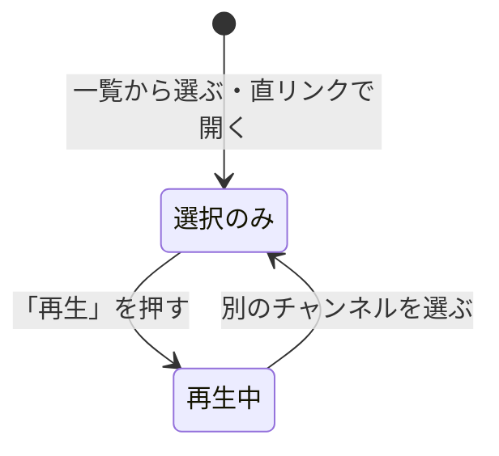

> [live.md](../live.md) のチャンネル選択と URL。索引から辿る

### サイトとサービスの同定・選択・リンク

チャンネルは site とサービス識別子の組で同定し、識別子は network を含む合成値にする。選ぶことと再生することは別のタップに分け、選んだだけではチューナーもセッションも使わない。ライブへの入口はサーバーのライブ有効設定に連動させる。

#### 変えない範囲

今回変えるのはライブの操作面と予定番組の見せ方だけで、配信・セッション・離脱ヒント・URL・音声切替・チューナー表示の意味は変えない。

画質・音声を切り替えてもライブセッションを作り直さず、画質の `?profile=` と音声の `?audio=`、チューナー状態の表示も維持する。**配信の資源同定やチューナー表示の意味を変える理由は無い。**

#### 選択中のチャンネルと画面配置

選択中のチャンネルは URL の検索パラメータに持ち、一覧のリンクは履歴を積まない。desktop ではプレイヤーとチャンネル一覧を並べ、映像の高さを上限に合わせる。

選択中のチャンネルは `?service=<Service.id>` に持つ。不正な値は undefined を明示代入して落とす。省略では消えない（[recordings.md](../recordings.md)「TanStack Router の `validateSearch` は無効な値を『省略』しても消えない」）。一覧のリンクを履歴の置き換えにするのは、ザッピングでブラウザ履歴が積み上がらないようにするためである。

映像の高さの上限は、局名・番組名・時刻の 3 行が初期 viewport に入る高さである。上限に当たった分の横幅はチャンネル一覧に回し、一覧を多段にする。高さだけを制限して動画を横に引き伸ばさない。`lg` 以上ではプレイヤー列を sticky にして、長い一覧のスクロール中も映像と番組情報を残す。sticky の上端位置は、居座りバナーとページヘッダーの実測高を足して決め、ページのスクロール箱は 1 つに保つ。phone の縦積みは変えない。高さ上限が適用される広い画面だけでプレイヤー幅を抑える。

根拠

- 不正な `?service=` を undefined の明示代入で落とす: `routes.tsx` の `validateSearch`、`undefined`
- 一覧のリンクは履歴を置き換える: `replace`
- sticky の上端位置にページヘッダーの高さを足す: `top`、`PageHeader`

#### チャンネルの同定

SI のサービス ID 単独では network をまたぐと一意でないので、チャンネルは site とサービス識別子の組で同定する。識別子は network を含む合成値で、番組表と録画の絞り込みも同じ形で運ぶ。

Mirakurun はネットワーク ID × 100000 + サービス ID の合成 id を使う。GR / BS / CS を混ぜる一覧では同じサービス ID が重なることがあるため、API は合成値を `Service.id` として返す。選択中のハイライトと再生中チャンネルの記憶も、site と `Service.id` の組で行う。`/live` の URL は `?service=<Service.id>&site=<site>` とする。`service` の値域は `/programs` と同じ生成スキーマで検証する。初期選択は、site と `Service.id` が一致すればそれを使い、無ければ番組を持つ先頭にする。

番組リストの放送中行には、予約ボタンの左に再生アイコンのボタンを置く。行に対する動作なので、展開領域のテキストリンクにはしない。対応する録画が無いときは「ライブで見る」で `/live?service=<Service.id>&site=<site>` へ進む。録画があるときは録画詳細 `/recordings/{recordingId}` へ進む。

高松の地上波だけを受信する実運用 mirakc では 19 サービス中の重複は 0 件だったが、この測定は GR の範囲しか覆わない。公式割当には、BS と 110 度 CS で同じサービス ID 101 を持つ実例がある。そのため GR / BS / CS を混ぜる一般の構成では、サービス ID 単独を identity にできない。

「この局の番組表」も番組表ピッカーの複数選択も録画の絞り込みも、同じ `?service=<Service.id>` の配列で運ぶ（1 局なら 1 要素）。ライブでは site も `?site=<site>` で運ぶ。録画では site が別軸（`?site=`）で、軸内は OR・軸間は AND。

根拠

- 同じサービス ID が重なる一覧と合成 id: `GET /api/sites/{site}/services`、`networkId`、`serviceId`、`networkId * 100000 + serviceId`、`Service.id`
- 公式割当で重なる例: `(network_id=4, service_id=101)`、`(network_id=6, service_id=101)`
- 初期選択の判定: `pickInitialService(services, requestedId, requestedSite)`（`lib/live.ts`）
- 放送中行の再生アイコンボタン: `Play`
- 放送中行の「ライブで見る」「録画を開く」の遷移先を合成 id で渡す: `components/program-row.tsx`、`ProgramListItem`、`composeServiceId`（`lib/service-id.ts`）

#### 選ぶことと流すことを分ける

選ぶこと（選択中のチャンネルを変える）と流すこと（プレイヤーをマウントする）は別のタップにする。選んだだけではチューナーもセッションも使わず、再生は確認ダイアログなしの「再生」1 タップで始まる。

`?service=` の変更だけでは probe もセッション（チューナー確保 + ffmpeg 起動）も起こさず、チャンネル一覧・現在番組・チャンネル種別の表示だけを変える。プレイヤーは「再生」を押すまでマウントしない。確認ダイアログは使わず、選択状態の画面そのものを値札として、再生は 1 タップにする。

「チューナーが空いています」等の肯定・保証は文言に書かない（下界主義。[data.md](../../data.md) §6.5 と同じ規律。mirakc には Rokuban から見えない消費者がいる）。摩擦をコストに比例させる方針上、デスクトップ LAN でも再生 1 押しより増やさない。ダイアログを重ねると、チューナーが有限でない環境の利用者にまで同じ摩擦を強いるためである。

再生同意の判定は選択ごとに求める。直リンクで来た場合も、チャンネル一覧で切り替えた場合も同じである。一度再生した後に B へ切り替え、A に戻っても、自動再開はしない。再度「再生」を押す。

#### 再生同意の判定をレンダー中に行う理由

再生同意の判定（再生中のキーと選択中のキーの一致）はレンダー中に行う。effect で戻す案は採らない。押していないチャンネルのセッションが残るためである。

effect で「選択が変わったら false に戻す」と、1 コミットだけ古い再生中フラグが残る。passive effect は子（プレイヤー）→親（ページ）の順に走る。そのため、選択中のキーが B に変わった直後の 1 コミットだけ、B 向けのプレイヤーが透過的にマウントされ、B 向けのプレイリスト要求が 1 件飛ぶ。jsdom と実ブラウザの両方で確認済みである。その直後に親の reset effect が走って unmount しても、もう遅い。

**streamer のセッションは、リクエストとは独立した context で回る。** そのためクライアント側の abort はセッション自体を止めず、押していないチャンネルのチューナー + ffmpeg が残る。離脱ヒントも期限を縮めるだけで 0 にはしないので、押していないチャンネルを取る時間は猶予（既定 8 秒）+ GC 周期となる。レンダー中に一致を判定すれば、選択中のキーが変わった時点で再生中でないと確定し、別のサービス向けの中間マウントを作らない。

根拠

- 再生同意は選択ごとに必要で、一致判定はレンダー中に行う: `pages/live.tsx` の `playingKey` / `selectedKey`、`LivePage`、`LivePlayer`
- effect で戻す案は 1 コミットだけ古いフラグが残る: `useEffect`
- 先行マウントでサーバー側のセッションが残る: `internal/streamer/session.go`、`context.WithCancel(context.Background())`、`AbortController.abort()`
- 中間マウントされるプレイヤー: `<LivePlayer serviceId={B}>`、`playlist.m3u8`

#### 直リンクと切り替えの扱い

直リンクやブックマークで開いても選択状態で止まり、自動再生しない。チャンネル切り替えにデバウンスは置かない。

再生開始の同意を取る構造は、通常のチャンネル一覧からの選択と直リンク（`/live?service=<Service.id>` の直開き）で区別しない。直開きだけ自動再生にすると、「タップで選んだときは同意が要るが URL 経由なら要らない」という一貫しない規則になる。その規則では、番組行の「ライブ」ボタン等の外部の入口から来た場合も、チューナーを暗黙に取ってしまう。

選択自体が probe もセッションも起こさないので、デバウンスする対象（選択の瞬間にコストのかかる処理）がそもそも発生しない。何も守らないものは置かない。チャンネル一覧のリンクはクリックで即座にナビゲートする。

根拠

- 外部の入口の例: `components/program-row.tsx`
- チャンネル切り替えに debounce を置かない（そのような定数は無い）: `pages/live.tsx`、`channelSwitchDebounceMs`

#### 番組表へのリンク

視聴中チャンネルの情報欄に、その 1 局の番組表へのリンクを置く。通常の push 遷移にし、戻るボタンで視聴中チャンネルへ戻れるようにする。

リンクは `/programs`（番組表）の `?service=` へ、視聴中の 1 局を配列 1 要素で渡す（[番組表](../programs.md)「番組リスト」の絞り込みと同じ形。絞り込みの値は配列）。チャンネル一覧のザッピングと違い 1 回だけの遷移なので、履歴を置き換えず、戻るボタンで視聴中チャンネルへ戻れる方が自然である。逆方向（番組表 → ライブ）には、ページ単位の入口を置かない（理由は[番組表](../programs.md)「番組リスト」の該当箇条書き）。

根拠

- 番組表へ渡す絞り込みの形: `service?: number[]`

#### ライブへの入口と無効時の表示

ライブへの入口はサーバーのライブ有効設定に連動させる。無効の環境で直リンクから来た利用者には、無効であることと設定という手がかりを出す。

`live.enabled: false` のとき streamer はライブのルートを一切登録しないので、入口を出しても行き先が無い。判断は `GET /api/capabilities` の `live` に一本化し、フロント側の入口を一つにする（ナビの出し分けは [shell.md](../shell.md)「無効な機能の項目は出さない」）。`/live` のルート自体は残す。**直リンク・ブックマークで来たときは「この環境ではライブ視聴が無効です」+ `live.enabled` という手がかりを出す。** ルートを消すと SPA の 404 になるだけで、運用者は原因（サーバー設定）に辿り着けない。無効のときはプレイリストを一度も取りに行かない。

「有効」と「今すぐ見られる」は別である。`live: true` は config の状態だけを表し、streamer が動いていない / チューナーが埋まっている場合は、入口が出たままプレイリスト取得の 404 / 503 として[playback.md](playback.md)のエラー分類に出る。

根拠

- 入口は能力 API の `live` に一本化する: `lib/capabilities.ts`、`GET /api/capabilities`、`live.enabled`

#### 無効の検出に必要な 2 つの対策

「無効」を検出するには、能力 API で入口を消すことと、API 配下の未登録パスを JSON 404 にすることの両方が要る。プレイリスト取得の成否だけでは検出できない。

`/api/` 配下を SPA フォールバックに落とすと、ライブのルートが無いパスは index.html を 200 で返す。そのため probe（`response.ok`）は通ってしまう。その後、hls.js / `<video>` が m3u8 として解釈できずに再生エラーになる。その結果、利用者には「壊れている」と見え、「無効」とは伝わらない。だから `/api/` 配下は JSON 404 にしてある。

根拠

- `/api/` 配下の未登録パスは JSON 404 にする: `internal/api/spa.go`、`spaOrAPINotFound`

#### 無効と断言する条件

「無効」と断言するのは、能力 API が「ライブは無効」を実際に返したときだけにする。取得に失敗したときは、無効とは言わず「利用できるかを確認できませんでした」と出す。この画面は原因（サーバー設定）を名指しするので、能力 API の状態を次のように分ける。

| 能力 API の状態 | 表示 |
|---|---|
| `false` | 「この環境ではライブ視聴が無効です」+ `live.enabled` の手がかり |
| `pending` | 読み込み中 |
| `unknown`（取得失敗） | 「利用できるかを確認できませんでした」 |
| `true` | ライブ視聴を有効として扱う |

入口側（ナビ）は逆に、未確定を無効として扱ってよい。気づかないうちに消えるだけで、誤った原因を主張しないためである（[shell.md](../shell.md)）。画面側で状態を一つにまとめると、`live.enabled: true` のデプロイで能力 API が瞬断しただけでも「設定が無効」と表示される。この画面が消したかった「原因にたどり着けない」問題を、別の形で再び起こす。まとめた実装では画面のテストが落ちることを確認済みである。

根拠

- 「無効」と断言する条件（`live: false` を受け取ったときだけ）: `live: false`
- 真偽値を 4 値に分ける: `useLiveEnabled()`、`useLiveCapability()`、`pending`、`unknown`
- 状態をまとめた実装で落ちる: `pages/live.test.tsx`

