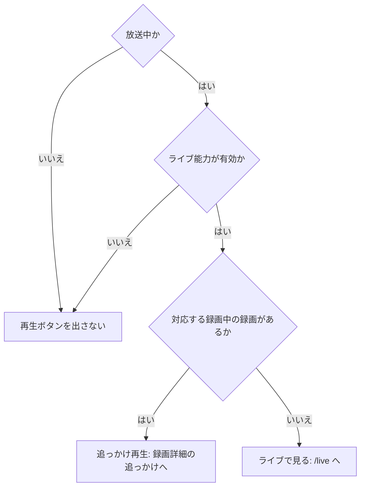
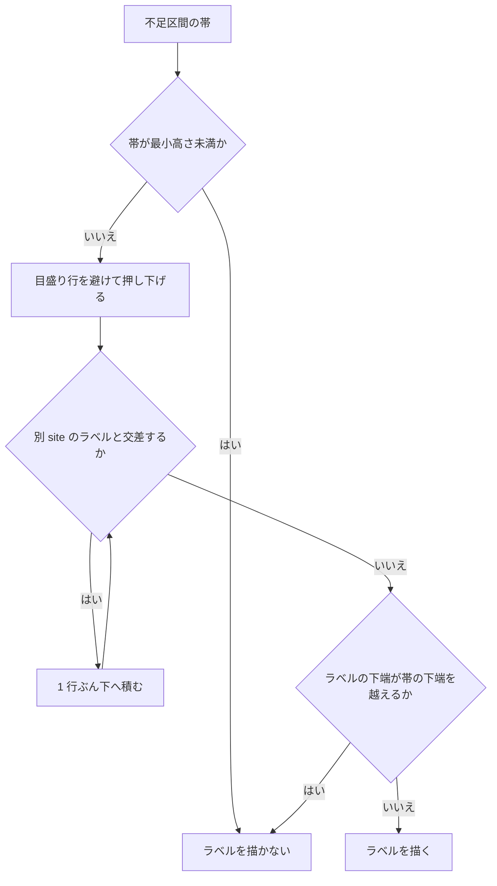
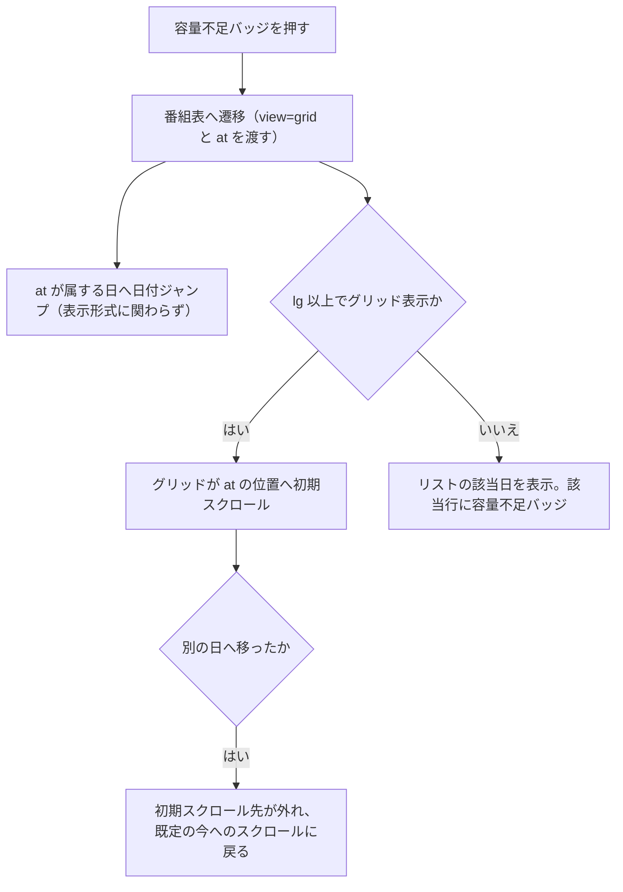

> [frontend.md](../frontend.md) の一部。索引から辿る

# 番組リストと番組表グリッド

番組表はリストを基本のビューとし、グリッドはデスクトップ幅で足す。全 site の番組を和集合で出し、容量不足は時間帯の帯で示し、番組は着色しない。

## 全 site の和集合

番組表は全 site へ問い合わせ、リストとグリッドの両方に結果の和集合を出す。同じ番組 ID が複数 site にあっても、行は site を含む識別で区別する。site 名を出すのは複数 site のときだけである。

`/api/sites` の全 site を対象にする。番組には取得元の site を付与し、行の identity は site と番組 ID の組で決める。サービス列の identity は site・ネットワーク ID・サービス ID の組で決める。サービス名・予約状態・詳細・予約操作はその site を引き継ぐ。単一 site の列幅・時刻・表示は従来どおりである。

複数 site のときは、同一値の共有 BS/CS を見分けられるよう、グリッドの列ヘッダとリスト行に site 名を表示する。単一 site では site 名を出さない。

容量超過は API が返す `overage.site` を落とさず、対応する site の列領域だけへ重ねる。予約一覧からのバッジは `/programs?view=grid&at=...` に遷移し、番組表が全 site を取得することで第 2 site の番組も表示対象になる。

根拠

- 番組の identity: `site:programId`
- サービス列の identity: `site:networkId:serviceId`

## リストを基本のビューにする。グリッドはその上に足す

**リストは基本のビューとして設計する。** モバイルの妥協物とは扱わない。グリッドはデスクトップ幅（lg 以上）でだけ出し、モバイルは常にリストのままにする。

番組表は本来デスクトップ形状（2 次元 × 数十チャンネル × 24 時間）である。グリッドを主・リストを従にすると、モバイルはグリッドの縮小版か単局表示になり、モバイル体験が構造的に犠牲になる。

グリッドの価値は同時性を空間に符号化することにある。見やすさを価値の中心には置かない。このドメインでは同時性がチューナー本数というハード制約に直結する（判定の設計は [data.md](../data.md) §6.5）。

根拠

- グリッドを出す幅: `lg`

### 実装で決めたこと

グリッドは、セルの高さを放送時間に比例させ、画面外を描かない自前の仮想化で作る。操作はセルの中に置かず、選択した番組をダイアログで開く。座標計算は React に依存しない純関数に分けてある。

根拠

- 座標系の純関数: `web/src/lib/epg-grid.ts`
- グリッド本体: `web/src/components/program-grid.tsx`

#### セルの高さと短い番組

セルの高さに下限を設けず、5 分番組は 5 分ぶんの高さにする。短い番組の選択は時間軸のズームで解決する。

見やすさのために下限を入れると、同時性の符号化が成り立たなくなり、グリッドの存在理由そのものが失われる。ズームは 3 段階を端末ごとに保存する。視覚的な高さの下限・隣接セルと重なるヒット領域・hover 専用の選択リストは採らない。どの倍率でも、高さと放送時間の比例を保つ。

セルが十分に高ければ 2 行の概要を出し、さらに高ければジャンル名も出す。足りないセルには、時刻と題名以外の本文を足さない。放送終了セルは減光して読み上げ名でも伝えるが、過去番組の詳細を開けるよう、無効化はしない。

未予約のスキップは、セルの高さで表示を分ける。高さが足りれば「スキップ中」の文字バッジを出す。足りなければ、本文のレイアウトを変えない右端マーカーだけを出す。5 分セルを含む短いセルは、読み上げと状態マーカーに留める。これらの高さの閾値は px で持ち、分では持たない。そのため、縮尺を上げるほど短い番組にも概要・ジャンル・文字バッジが出る。

根拠

- 過去番組の詳細を開けるようにする: `disabled` にしない
- スキップ状態の表示: `skip`

#### 列幅と仮想化

列幅はコンテナ幅に追従して上下限に収め、仮想化はライブラリを入れず自前で持つ。計測が 0 のときは間引かず全部描き、出し分けは JS で行い CSS で隠さない。

列幅の最小幅は番組名を 2 行で読める幅であり、列数が多く収まらないときは横スクロールを保つ。

仮想化を自前にするのは、縦軸が連続量で、番組セルは目盛りをまたぐ「区間」なので、行の並びを前提とする仮想化ライブラリの前提に合わないためである。可視判定は純関数 2 つに落ちるので、依存を増やすより検証しやすい。

DOM 計測が 0 のとき（未計測）は、全部描く方を選ぶ。jsdom のように計測できない環境で「空のグリッドなのにテストが通る」（CLAUDE.md の「非同期の空虚な成功」の変種）ことを、構造的に防ぐためである。

未検証: 「全サービス × 24 時間でスクロールが落ちない」は jsdom で計測できないため、実ブラウザで確認していない（縦横とも間引く実装は入っている）。受け入れは実機で行う。

グリッドの窓は 24 時間を 1 回で取得する。リストのような窓の積み上げにはしない。積み途中が「番組がない時間帯」と見分けられないためである。

グリッドとリストの出し分けは `matchMedia`（JS）で行い、CSS で隠さない。グリッドが自前のクエリ（全サービス × 24h）と仮想化を持つためである。表示形式の選択は画面幅で捨てない。画面を狭くするとリストに切り替わり、広げるとグリッドに戻る。

根拠

- 可視判定の純関数: `visibleTimeWindow`、`visibleColumnRange`
- 出し分けの対象となる選択値: `view`
- 出し分けの幅: `lg`

#### 容量超過の帯の受け口

容量超過の帯は、番組セルより上・ヘッダより下の「同一 site の列領域を縦断する層」で受ける。帯がクリックを受け取ると予約操作ができなくなるので、この層はポインタ操作を受け付けない。

座標は共通の変換関数を呼べば、番組セルと同じ座標に必ず乗る。時間軸列のラベルは専用の層に置き、別 site の同時刻ラベルは重ならない位置へ積む。現在時刻インジケータが、全体を覆う層の最初の利用者である。

根拠

- 帯を受ける prop: `ProgramGrid` の `siteOverlay`
- 操作を受け付けない指定: `pointer-events-none`
- 座標の変換関数: `spanToPx(axis, from, to)`
- 時間軸列のラベル層: `gutterOverlay`
- 全体を覆う層: `overlay`

#### セルの操作とダイアログ

セルの中に操作を置かず、選択した番組を通常のダイアログで開く。リストとダイアログは予約モデルと操作の意味を共有する。

リスト専用の行コンポーネントはマウントしない。共有するのは、予約モデル・詳細取得・encode の規則・予約 / 取消 / ライブ / 追っかけの操作の意味である。予約モデルは、時刻・題名・サービスと site・尺・有料・重なり警告である。

ダイアログは、リストのシェブロン・折りたたみ・行区切り・右端幅アニメーションを持たない予約パネルを描く。極小セルに操作をアンカーすると押せない番組ができる。そのため、セルを押した時点で選択済みの番組に操作面を出す。ただし要約直下を横断する帯にはせず、要約行の右側へ置く。

操作は、通常は予約 / 取消の固定列とする。放送中は再生ボタンを 1 本、その左に加える。対応する録画中の録画があるときは、同じ再生ボタンのリンク先だけを追っかけへ置き換える。

題名を先に読める状態と、開いた直後に 44px 以上の操作へ届く状態は、両立させる。操作面は詳細より前に置いて本文とスクロールさせる。閉じるボタンはスクロール領域の外へ残し、操作列はその左へ寄せて重なりを避ける。

根拠

- グリッドとリストで共有する番組操作: `ProgramRow`、予約モデル、encode 規則
- 操作列の配置: `web/e2e/design.mjs` の操作標的判定
- グリッドから選択ダイアログを開く: `ProgramRow` と `ProgramGrid`

#### 列の並びとサービス取得の失敗

列は「窓内に番組があるサービス」だけで、種別 → site → リモコン番号 → サービス ID → ネットワーク ID の全順序で並べる。サービス取得の失敗はグリッドではエラー扱いにする。

site をリモコン番号より上に置くのは、複数 site で地上波のリモコン番号が site をまたいで一致するためである（NHK 総合(1) 等）。リモコン番号を先に比べると、同じ番号の局が site ごとに 1 列おきへ交互に並ぶ。すると、容量超過の帯（同じ site の連続した列領域に描く）が 1 列ごとの走に分裂する。

サービス取得の失敗をエラー扱いにするのは、列が構造そのものなので、列 0 本を「番組がない」と区別できないためである。

根拠

- サービス ID とネットワーク ID: `serviceId`、`networkId`

#### ジャンル色と予約の印

ジャンル色は補助で、意味の本体は読み上げ用のラベルが持つ。予約済みは見える「予約」の文字と右端の墨の帯で示し、輪は選択中だけに残す。

知らないジャンルは「その他」に丸めない。ARIB の本物の「その他」（コード 15）と、分類できなかったことを区別するためである。色は Tailwind 標準パレットの淡い段に限定し、未知は既存トークンへ戻す。

予約の印に輪を使わないのは、予約に選択と同じ輪を足すと、ジャンルの左罫・選択中と形が重なり、差が太さだけになるためである。色は信号のみなので、予約にタリー / 琥珀 / destructive は足さない。5 分セルでも帯が残る。見た目の差は、実画素を見る e2e が判定する。

根拠

- 読み上げ用のラベル: `aria-label`
- 輪: `ring`、`ring-primary`
- 予約済みセルの実画素判定: `web/e2e/grid-reserved.mjs`

#### リストでの重なりの伝達

リストでは重なりが見えないため、グリッドとは別に画面幅に依存しない伝達手段が必要になる（後述「容量超過は番組ではなく区間に描く」）。

### 空間的なキーボードナビゲーション

セル間の移動は Tab の直列走査に加えて、矢印キーでも行う。矢印が空間移動として働くのは、個々のセルにフォーカスがあるときだけである。移動は選択状態やダイアログの開閉を変えない。

形を先に固定して行構造を偽らないため、次の判定基準を採る。

#### ロールとフォーカスの起点

グリッド全体は名前付きの region ロールのままとし、セルは個々のボタンの Tab 停止点を維持する。絶対配置で行が整列していないため、grid ロールとセルの gridcell ロールは使わない。aria-activedescendant と roving tabindex も追加しないので、読み上げは従来どおり領域名とセル名を読む。

Tab で領域自身に入ったときは、セルを自動選択せず、領域の通常のスクロールを維持する。矢印キーを空間移動として扱うのは、個々のセルにフォーカスがあるときだけである。これで、領域へ入った瞬間に「今のセル」を決める別の規則を持たずに済む。

根拠

- 領域のロール: `role="region"`
- セルの Tab 停止点: `<button>`
- 使わないロール: `role="grid"`、`gridcell`
- 使わない属性: `aria-activedescendant`

#### 上下左右の移動先

上下は、同じサービス列で開始時刻順に並ぶ前後の番組へ移る。番組間の空き時間は移動先を作らず、次の番組へ進む。番組が重なる場合も、区間の交差は使わず、開始時刻順の前後を使う。列の端では移動しない。

左右は、並び順で隣のサービス列だけを見る。フォーカス中の番組の開始時刻を半開区間に含む番組を優先する。該当しなければ開始時刻の差が最も小さい番組へ移り、同距離なら早く始まる番組を選ぶ。隣列が空、または列の端なら移動しない。

根拠

- 半開区間: `[startMs, endMs)`

#### スクロール追従と選択ダイアログ

移動先はまず番組データから決め、DOM に無ければ座標から先にスクロール位置を合わせて追従する。選択ダイアログが開いている間は、矢印キーでグリッドの空間移動は起きない。

仮想化で移動先が DOM に無い場合は、時刻軸と列の座標から先にスクロール位置を合わせ、次の描画でセルを探してフォーカスする。DOM にある場合も、可視範囲外なら同じ計算で追従する。矢印移動では、選択状態も選択ダイアログの開閉も変更しない。フォーカスは移動するが、番組の選択・ダイアログ表示は従来どおりセルを押したときだけ行う。

ダイアログはフォーカスをトラップして body 直下へ portal される。そのため、キー入力がグリッドの DOM 部分木を経由しない（実ブラウザで確認済み: `pnpm e2e:grid-navigation` ⑤）。レイアウトと仮想化を含む追従は実ブラウザで判定する。右移動と、仮想化された番組への下移動を確認する。

根拠

- スクロール位置: `scrollTop`、`scrollLeft`
- 選択状態: `aria-pressed`
- portal 先: `document.body`
- 追従の判定: `web/e2e/grid-navigation.mjs`

## グリッドで横スワイプによるナビゲーションを使わない

グリッドでは、横スワイプによるナビゲーションを使わない。Android のジェスチャーナビは左右端からの横スワイプが「戻る」なので、グリッドの横パンと確実に衝突する。

## 検索条件を番組表に重ねる

番組表は、検索条件に一致する番組を、番組を隠さずに見分けられるようにする。条件の入口はジャンル凡例で、条件は URL に載せて検索画面と共有する。グリッドは非一致セルを中立の地へ戻し、リストは一致が確定してから非一致を隠す。

### 条件の入口と URL

ジャンル凡例は条件レンズの入口でもあり、押したジャンルは URL に載せて検索画面と同じ検証を通す。詳細条件フォームは番組表に置かない。

押したジャンルは `/programs` の URL に `cond` として載せ、検索画面と同じ openapi 検証と正準化を通す。ジャンル以外の条件を含む `/search` からの遷移も同じ値を運ぶ。凡例の近くには、条件の要約・一致件数・検索画面へのリンクを出す。

根拠

- `cond` の型: `ProgramSearchRequest`
- 正準化: `canonicalSearchConditions`

### 一致判定と取得状態

一致判定は検索 API の応答だけから作り、番組と同じ識別で照合する。初回取得中と失敗時は通常の番組表示を保ち、失敗を一致 0 件として扱わない。

検索 API は `POST /api/programs/search` で、条件が無いときは呼ばない。検索結果のクエリは番組データのクエリ接頭辞の下に置くので、EPG・予約意図の既存の再取得で、番組データと一緒に取り直される。初回取得中と失敗時は、条件チップに状態を出す。確定済みの一致集合はバックグラウンド再取得中も保ち、再取得のたびに淡色や件数を戻さない。取得中に全番組を薄くしたり、失敗を一致 0 件として扱ったりしない。エラーには再試行を付ける。

根拠

- 番組と同じ識別: `site:programId`
- 番組データのクエリ接頭辞: `programsQueryKeyPrefix`

### グリッドでの見せ方

一致が確定した後も、番組を隠さない。非一致セルだけ、背景とジャンル色の左罫を中立の地へ戻す。文字・時刻・予約・スキップ・選択の表示は残す。一致は、セルの読み上げ用のラベルにも加える。

一致セルには追加の輪郭を付けない。縦に続く左罫で位置が分かる。選択の輪や予約印（右端の墨の帯）へ、同じ意味の輪郭を重ねずに済む。

根拠

- 読み上げ用のラベル: `aria-label`
- 選択の輪: `ring-primary`
- 一致 / 非一致セルの実画素とコントラスト（lg 幅で測る）: `web/e2e/programs-condition-lens.mjs`
- 受け入れフィクスチャの RGB 距離: 背景 14.9、ジャンル左罫 139.0
- 非一致セルのコントラスト比（ライト）: 番組名 17.72、時刻 4.83、予約印 16.97。ダークの番組名 16.97
- 非一致の背景: `genreTint`

### リストでの見せ方

リストは同時性を表現しないので、条件があるときは、一致集合が確定してから非一致を隠す。初回取得中・失敗時は、一覧を通常表示のままにする。

チップと日付ストリップの件数は、検索 API の一致を、選択中のチャンネルがあればそのチャンネルに絞ってから数える。表示される範囲と揃えるためである。判定そのものは検索 API のまま保ち、サービス一覧の取得状態には依存させない。日付ストリップは、番組開始時刻のローカル暦日で数える。日付境界をまたぐ番組も開始日の 1 件として扱い、UTC の日付へずらしたり翌日へ二重計上したりしない。

## 番組リスト: 時間順フラット + 日付・サービス絞り込み

番組リストは「今」から始まる時間順のフラットなフィードで、日付とチャンネルで絞り込む。絞り込みは URL に置き、サーバー側でかける。日付は 8 日先まで、チャンネルは複数選択できる。

### 連続フィードと先頭の整え

リストは常に「今」から始まり、上限は 8 日先の 0 時である。窓と重なって先頭に混ざる前日開始の番組は絞るが、今日を見ているときは絞らない。

上限は、どの日付を選んでも共通の「EPG のローリングウィンドウの終端」で、24 時で打ち切らない。sticky な日付ヘッダで日付境界を示す。

API が返す番組を、無条件にリストの先頭へ出さない。API は窓と重なる番組も返すため、読み込んだ最も手前の窓の開始時刻より前に始まった番組が先頭に混ざる。これを見せたままにすると、日付ヘッダと「いま見ている日」の導出が両方とも前日を指す。どちらもリストの先頭の番組から日を決めるためである。この不具合を実機で確認した。ページ側が、純関数で絞ってからリスト部品へ渡す。

今日を見ているとき、つまり先頭窓の開始時刻が下限（now を時で切り捨てた時刻）と一致するときは、絞り込まない。放送中の番組は起点が時刻境界なので、開始が起点より前になりうる。単純に切ると、その番組まで消える。

根拠

- 窓と重なる番組の先頭を整える: `filterProgramsFromListStart`、`lib/program-list.ts`、`pages/programs.tsx`
- 先頭窓の下限（今日を見ているときは絞らない）: `now`
- 窓との重なり条件: `start_at < window_end AND end_at > window_start`
- 先頭窓の開始時刻: `listStartMs`

### 重なり警告

重なり警告は取得済みの予約一覧から導出し、行ごとに overlaps API を呼ばない。この導出はリストとグリッドが共有し、予約詳細の単一番組だけが overlaps API を使う。

行ごとに overlaps API を呼ぶと、仮想化で行が表示されるたびに取得が増えるためである。

`GET /api/reservations` の各行を、site・番組 ID・状態・skip・開始時刻・尺で照合する。同じ site・別番組で、状態が孤児でなく、skip でなく、半開区間で重なる予約を表示する。予約状態にかかわらず出し、予約・取消後は一覧を更新する。

この導出は、サーバー overlaps API の、never-scheduled 単独の述語を近似するものである。never-scheduled 後に録画された放送イベントでは、両者の述語が異なる。

根拠

- 予約一覧から導く重なり: `GET /api/reservations`、`useReservationActions`、`lib/reservation-actions.ts`、`overlapsFor`、`never_scheduled_events`
- 照合の項目: `site`、`programId`、`state`、`skip`
- 重なり警告の予約条件: `state !== 'orphaned'`、`skip === false`

### リストの仮想化

リストは TanStack Virtual で仮想化する。ページ全体がスクロールするのでウィンドウ単位の仮想化を使い、行は通常のフローに残して前後をスペーサーで埋め、DOM 計測が 0 なら全部描く。

グリッドが自前実装を選んだ理由はリストには当てはまらない。リストは行の並びそのものなので、仮想化ライブラリの前提に素直に合う。内側にスクロール容器を持たないため、要素単位の仮想化は使わない。行は絶対配置と変換を使わず、可視範囲の前後を高さぶんのスペーサー（padding）で埋める。sticky な日付ヘッダは、通常のフローに乗った要素にしか効かないためである。行の高さは段階的開示で可変なので、実測する。

未計測のとき全部描く方を選ぶのは、jsdom がレイアウトを計算せず、実測が常に高さ 0 を読むためである。動的計測をそのまま使うと可視範囲の計算が正しくなくなる。グリッドの可視判定と同じく、未計測なら間引かない。

根拠

- 仮想化: `useWindowVirtualizer`、`useVirtualizer`、`components/program-list.tsx`
- 行を通常のフローに残す: `position: absolute`、`transform`
- 行の高さの実測: `measureElement`、`ProgramRow`
- 未計測なら全部描く: `lib/list-virtualization.ts`
- グリッドの可視判定: `visibleTimeWindow`、`visibleColumnRange`

### 日付ストリップ

日付ストリップは「いま見ている日」とジャンプ先を分け、ハイライトは可視範囲の先頭の番組から導く。日付の絞り込みもチャンネルの絞り込みも、横スクロールにしない。

ハイライトはジャンプ先とは別に表示しない。タップ直後は一致するが、スクロール後はハイライトだけが動く。

日付ストリップはヘッダのタイトル行の下に、フル幅で置く。日付とチャンネルは選択肢の性質が違うので、絞り込みの形も分けてある。横スクロールにしない理由は 3 つの実害である。

1. 単一選択なのに、選択中の値が画面外に出て読めなくなる。
2. 画面端からの横スワイプが、Android のジェスチャーナビの「戻る」と衝突する（前述「グリッドで横スワイプによるナビゲーションを使わない」と同じ衝突）。
3. ヘッダが伸びると、グリッドの高さ予算（ページヘッダの高さを引いた残り）が削られる。

根拠

- ジャンプ先の state: `dayOffset`（URL の `day` から初期化）
- 日付ストリップ: `components/day-strip.tsx`
- 「いま見ている日」の導出: `onVisibleDayChange`、`lib/program-list.ts` の純関数
- ページヘッダの高さ: `--page-header-height`

#### 日をまたぐ移動の扱い

未キャッシュの日へ移る間は、前のリストを残し、スケルトン表示に置き換えない。置き換えると文書高さが縮んで、スクロール位置がクランプされるためである。ジャンプ時はページ先頭へ戻す。プレースホルダ中は、前の日の可視範囲から「いま見ている日」を更新せず、選んだ日のハイライトを保つ。

グリッドはスクロールで日をまたがないので、ジャンプ先をそのままハイライトする。これは押下状態ではないので、現在位置を示す `aria-current="date"` を使う（`aria-pressed` は使わない）。今日のセルは「今」から始まり、それ自体が今を指す。そのため `今` という別枠のセルは無い。8 日分で件数に上限があるので、横スクロールなしの等幅グリッドに並べて、必ず 1 画面に収める。

根拠

- スケルトン: `ListSkeleton`
- スクロール位置: `scrollY`
- 現在位置を示す属性: `aria-current="date"`

### チャンネルピッカー

チャンネルの選択は、現在値を常に表示するトリガーボタンと、縦スクロールするポップオーバーで行う。グリッド表示中もトリガーを出したままにする。

扱う集合に上限が無いので、列挙を畳む。トリガーはページヘッダのタイトル行右端に置く。グリッド表示中も出すのは、選択がグリッドの列にも反映されるので、隠すと解除手段のない 1 列グリッドになるためである。

候補は「番組を持つサービス」から作る。マルチ編成のないサブサービスは番組を持たないので、自動的に消える。

根拠

- ピッカー: `components/channel-picker.tsx` の `ChannelPicker`
- ページヘッダの右端: `PageHeader`、`actions`

#### 複数選択と三状態チェックボックス

チャンネルは複数選択で、空集合は「すべて」を表し、行は親子の三状態チェックボックスにする。0 局はポップオーバー内だけの一時状態で、変更を通知しない。

複数選択にするのは、「見たい局だけをグリッドの列にする」という使い方に直結するためである。行は、親子の三状態チェックボックスにする。絞り込みなしでは、空集合が「すべて」と全候補のチェック済みを表す。局の行を外すと、その局以外の候補 ID を選択集合に持つ。「すべて」と種別見出しは、範囲内が全部チェック済みなら外し、一部または全部が外れていれば範囲内をチェックする。種別見出しの操作は、その種別の候補だけに適用する。種別が 1 つしかない候補集合では、見出しを押せる行にしない。操作後の集合が全候補と一致したら、空集合へ正準化し、URL に全局の ID を並べない。

0 局を一時状態にするのは、空集合が全局を意味し、URL で 0 局を表せないためである。全局から「すべて」を外した時点では変更を通知しない。0 局の間は「1 つ以上選んでください」と表示する。1 局以上選べばその選択を通知し、何も選ばず閉じれば全局へ戻す。

絞り込み欄に入力中は、「一致したものをすべて」と種別見出しの状態・操作範囲を、表示中の候補に限る。検索結果外の局の選択は、そのまま保つ。

根拠

- 全局以外の選択集合: `selected`
- 選択集合の型: `ChannelPicker` は `Service.id` の `ReadonlySet<number>`
- 正準化の基準: `ChannelPicker` に渡された `services`
- 変更の通知: `onChange`

### 絞り込み状態の URL

サービス絞り込みと日付は URL に置き、サービスは複数指定の OR、日付はローカル暦日で表す。at と day が矛盾するときは at の日を優先し、どちらも URL から削除しない。

サービスは `?service=<Service.id>`、日付はローカル暦日の `?day=YYYY-MM-DD` である。service ID は複数指定時に OR で扱い、空なら全サービスとする。配列は昇順に正準化し、選択履歴で URL やクエリキーが揺れないようにする。空集合は `undefined` で表す。

検証は、openapi.yaml から生成した zod スキーマに委ね、値域や正規表現を手で書き写さない。URL 固有の都合（文字列で届く / 単一値と配列が混ざる / 不正な要素だけ落とす）だけを、薄い層で繋ぐ。

選択日は、日付ストリップが出す今日から 8 日間だけを受け取る。範囲外の古い共有 URL は、既定の今日に落とす。既定の今日は URL に書かない。日付操作で履歴を汚さず、共有 URL を短く保つためである。`at` と `day` が矛盾するときは、「この瞬間を見る」という要求である `at` の日を優先し、どちらの値も URL から削除しない。

表示形式 `view` も URL 状態にしてある。容量不足バッジが、グリッドを明示して遷移するためである。URL に `view` が無い素の `/programs` では、端末ごとの `localStorage` に保存した前回値を初期値として使う。URL が常に優先されるのは、リンクが明示した表示形式を端末の前回値で覆さないためである。ピッカー操作は `replace` で navigate し、1 局ずつ選ぶたびに history を汚さない。

根拠

- service の URL 型: `ProgramsPageSearch.service`
- URL の検証: `lib/programs-search.ts`、`src/api/zod.ts`、`lib/url-search.ts`、`Service.id`
- 容量帯からの番組表リンク: `search={{ view: 'grid', at }}`
- 表示形式の URL 値: `list`、`replace`、`navigate`
- 容量不足バッジの遷移先: `view=grid`
- サービス絞り込みの URL: `?service=`

### サーバー側の絞り込みと候補

絞り込みはサーバー側でかける。ピッカーの候補は絞り込み結果から独立した情報から作るので、1 局に絞っても他局へ直接切り替えられる。

選択した `Service.id` の配列をページから渡し、返るのは選択したサービスの番組だけになる。100 サービス規模で、無絞り込みの 24 時間ぶんが実測 1.7 MB になり、全件取得してからクライアント側で絞る形は維持できないためである。

ピッカーの候補は、`Service.hasPrograms` から作る。表示中の（絞り込んだ後の）番組から候補を導くと、1 局に絞った瞬間に候補がその 1 局だけになり、他局へ直接切り替えられなくなる。`hasPrograms` は絞り込みの入力に一切依存しない。そのため候補集合が絞り込み結果から独立し、この問題が構造的に起きない。グリッドの列は、絞り込んだ後の番組（サーバーの返り値そのもの）から導く。選んだ局がそのまま列になればよく、独立させる理由が無い。

ピッカーが実際に表示・列挙できる集合は、「候補 ∪ 現在選択中の ID」である。選択は URL から入るので、候補に無い値も無視しない。名前が引けない古いブックマークは `チャンネル #<id>` に落とし、個別に解除できる形を維持する。同じサービス ID の別 network は合成 ID が違うので、同じ候補にまとめられない。

sticky な小見出しの位置は、ハードコードしない。ページヘッダが ResizeObserver で実測して、高さを親要素に書き出す。フィルタ行の増減や文字サイズでずれるためである。

根拠

- 選択した配列を渡すページ: `programs.tsx`
- 候補の元: `Service.hasPrograms`、`filterableServices`
- 表示・列挙できる集合の算出: `pickerServiceDomain`
- sticky の位置: `top`、`PageHeader`、`ResizeObserver`、`--page-header-height`
- 同じサービス ID: `serviceId`

### ライブ画面との行き来

ライブ視聴からは「この局の番組表」で厳密な 1 局へ飛べる。逆方向にはページ単位の入口を置かず、行単位の担当にする。

ライブ視聴（`/live`）からの遷移は、番組表と同じ `?service=<Service.id>` の 1 要素配列を使い、1 局のためだけの別形式は持たない。

逆方向（番組表からライブ）では、放送中の番組に「ライブ」ボタンを出す入口は、行単位の担当にする。ページ全体に 2 つ目のライブの入口を足すと、複数チャンネルを絞り込んでいるとき・放送中の番組が絞り込みの外にあるときに、どこへ飛ぶかを決める基準が無い。個々の番組から飛べる入口とも役割が重複する。

根拠

- 行単位の担当: `ProgramRow`

### 放送中番組と追っかけ

放送中の番組に対応する録画があれば、その番組の再生ボタンだけ追っかけへ切り替える。対応判定は、番組と録画の site・放送識別値・開始時刻で行う。番組 ID と録画 ID は別の identity なので、直接比べない。

リストとグリッドのダイアログは、番組一覧 API が返す optional な録画 ID を使う。サーバーが、番組の site・ネットワーク ID・サービス ID・イベント ID・開始時刻と、録画の同じ識別値を比較する。

対応する録画が録画中で、かつライブ能力が有効な場合だけ、録画詳細の追っかけへ向ける。対応録画がない場合は `/live` へ向ける。能力が無効・未取得・失敗ならボタンを出さない。終了・失敗・キャンセル・ごみ箱の録画は、追っかけへ向けない。録画状態の SSE 通知で、番組一覧も更新する。

時間窓の継ぎ足し（進行方向の自動読み込み）は [scroll.md](scroll.md)。

根拠

- 番組と録画の ID は別 identity: `programId`、`recordings.id`
- 録画 ID: `recordingId`
- 比較する識別値: `site`、`networkId`、`serviceId`、`eventId`、`startAt`
- 録画中の条件: `status = recording`
- 追っかけの行き先: `/recordings/{recordingId}#chase`

## 「既にジャンプ先になっている日」の再タップ

日付ストリップで、既にジャンプ先になっている日を再タップしたときは、読み込み済みのリストの中で、その日の先頭へスクロールする。タップは常に、その日へ移動する意味を持つ。

ジャンプ先の state を書き換えるだけで足りると思われていたが、タップした日がそれと同じ場合が抜けていた（実機で確認した不具合）。同じ値の state 更新は、React が再レンダーの理由にしないため、クエリもスクロールも一切動かない。ユーザーはスクロールで「いま見ている日」がジャンプ先から離れていることがある。その状態での再タップは「その日の先頭へ戻る」ことを期待しているので、state が変わらなくても何かしら起きる必要がある。

一致する場合は、クエリの起点を付け替えない。読み込み済みの番組の中から、その日の先頭の添字を引いて、仮想化のスクロール API を直接呼ぶ。添字は、「可視範囲の先頭から日を導く」関数と対になる、逆向きの純関数で引く。見つからなければ（まだ読み込んでいない日）何もしない。

リスト部品は、親から命令的に呼べる API を公開する。ページ側は、日の選択処理からそれを呼ぶだけである。ジャンプ先の state を書き換えるかどうかの分岐は、日の選択処理が持つ。

根拠

- ジャンプ先の state: `DayStrip`、`dayOffset`、`setDayOffset(同じ値)`
- いま見ている日: `visibleDay`
- 読み込み済みの番組: `programs`
- スクロール: `scrollToIndex`、`components/program-list.tsx` の `ProgramListHandle.scrollToDayOffset`、`virtualizer.scrollToIndex`
- 添字の純関数: `lib/program-list.ts` の `firstIndexForDayOffset`、対になる `visibleDayOffset`
- 命令的 API: `ProgramList`、`forwardRef`、`useImperativeHandle`、`ref`、`ProgramListHandle`
- 呼び出し側: `pages/programs.tsx`、`selectDay`

## 段階的開示

行には「時刻 / タイトル / サービス」だけを出す。説明の続き・出演者・映像音声属性は、展開時に取る。

展開時の取得は `GET /api/sites/{site}/programs/{programId}` である（[api.md](../api.md) の「EPG の読み取り」）。

## 展開領域から外への入口

実体へのリンクは展開領域に、行に対する動作は右端の操作列に置く。放送中の再生ボタンは、対応する録画中の録画があれば追っかけ、無ければライブへ向け、ライブ能力が無効なら出さない。

行本体（タップで展開）と右端の操作列（予約 / 取消 / 放送中の再生）は分ける（[reservations.md](reservations.md) §予約はワンタップ + トーストから取消）。

入口は次の 2 つである。

放送中（開始 ≤ 現在 < 終了）の番組では、右端の操作列にアイコンボタンを、予約ボタンの左に置く。行き先は、対応する録画中の録画があるかどうかで決まる。ボタン自体を出す条件は、次の図のとおりである。

対応する録画中の録画が無い場合は「ライブで見る」として、`/live?service=<Service.id>&site=<site>` へ遷移する。対応する録画が録画中の場合は、同じボタンを「追っかけ再生」として `/recordings/{recordingId}#chase` へ遷移する。録画 ID は、番組一覧 API が返す値をそのまま使う。`live.enabled` が無効なデプロイでは、主ナビと同じ判断で再生ボタン自体を出さない。

予約済みの番組では、展開領域に「予約の設定」を置き、`/reservations/$site/$programId` へ遷移する。overrides の編集は予約詳細画面の担当である。番組行の展開パネル（未予約時の encodeProfiles / keepOriginal 欄）は、ここを引き継がない。

放送中かどうかの判定は、展開されて描画される瞬間（とその後の再レンダー）で行い、専用の tick タイマーは持たない。このライブへの入口は番組 ID を運ばず、ネットワーク ID とサービス ID を渡す。そのため、番組境界を挟んで多少ずれても遷移先を誤らない。遷移先の `/live` 画面が自前で「いま何が流れているか」を再取得するので、正しい状態はそちら側にある。

根拠

- 入口の実装: `components/program-row.tsx`
- 放送中の条件: `startAt <= now < endAt`
- 録画中の条件: `status = recording`
- 録画 ID: `recordingId`
- 能力の判断: `lib/capabilities.ts` の `useLiveEnabled()`
- ライブへの入口が運ぶ値: `networkId`、`serviceId`

## 容量超過は番組ではなく区間に描く

チューナー不足は区間の帯で示し、番組を着色する案は採らない。番組の着色は勝敗の主張になるが、勝敗を決めるのは mirakc で予測できない。判定と根拠は [data.md](../data.md) §6.5 にある。

番組を着色すると「この番組が負ける」という主張になる。しかし決めるのは mirakc であり、Rokuban から見えない消費者（EPGStation の並走・ライブ視聴・EPG 収集）がいるので予測できない。

### 画面ごとの出し方

グリッド（lg 以上）では、超過区間を全チャンネル縦断の帯で着色する。区間は結合済みで返るので、描く帯は少ない。リスト・予約一覧・モバイルでは、同じ文言のバッジを出す。グリッドが出ないモバイルでも情報が届く。画面幅に依存しない伝達手段が別に必要、という要件である。

### 文言

文言は「この時間帯はチューナーが不足しています」にする。「この予約は競合しています」とは書かない。主張できるのは下界（超過している）だけで、収まることは保証できないためである。不足本数と詰まった種別まで出せるので、「BS が 1 本不足」と具体的に書く。

## 容量超過の帯とバッジ

帯とバッジは、座標を番組セルと同じ関数で決め、肯定的な文言を持たない。見えるラベルは時間軸列に出し、複数 site では site ごと・種別ごとの走に帯を分ける。鮮度は SSE と予約の変更に相乗りさせる。

交差判定と文言は純関数にまとめ、帯とラベルは専用の部品が持つ。予約一覧のバッジは別の部品である。座標は必ず共通の変換関数を通す。番組セルと同じ関数を通すことが、「帯とセルが同じ時刻で同じ位置に来る」ことの保証になる。

根拠

- 交差判定と文言の純関数: `web/src/lib/capacity.ts`
- グリッドの `overlay` に渡る帯と、`gutterOverlay` に渡る見えるラベル: `components/capacity-band.tsx`
- 予約一覧のバッジ: `components/capacity-shortfall-badge.tsx`
- 座標の変換関数: `spanToPx`

### 文言の持ち方

肯定的な文言は持たず、区間が返らないときは何も言わない。複数区間に跨る予約では種別を合併せず、最も不足の大きい区間を採る。

「競合なし」「収まります」は出さない。警告が出ないことは保証ではない（[data.md](../data.md) §6.5）。種別を合併しないのは、合併すると「どの区間でも成り立っていない主張」になるためである。

時間軸列は予約一覧のバッジより幅が狭いので、専用の短い形（「BS-1」）を持つ。バッジの全文（「チューナー不足（BS が 1 本）」）は、ここでは省略記号で切れて、種別も本数も読めなくなる。読み上げ用の全文は帯の読み上げ専用テキストが持つので、見た目だけ削ってよい。

短縮ラベルには警告アイコンを付ける。色（琥珀の文字）だけに頼ると、「BS-1」のような短い英数字が、日本語 EPG の時間軸列では実在のチャンネル名（NHK BS1 等）と読み違えられうる。

根拠

- 短い形: `shortageLabelCompact`
- バッジの全文: `shortageLabel`
- 読み上げ用の全文: `shortageRangeMessage`、`sr-only`

### 見えるラベルの置き場所

見えるラベルは時間軸列（gutter）に出す。局の列には出さない。帯の上端にアンカーし、高さは自分の内容ぶんだけ持つ。

局の列に出さないのは、帯の内側に出すと、帯の上端が番組セルの上端と重なったとき、セルの時刻文字と同じ px に描かれて両方読めなくなるためである。時間軸列は番組セルを一切置かないので、この列に出す限り衝突しない。

高さを内容ぶんに限るのは、帯の高さに引き伸ばすと、範囲内の時間軸の目盛りや現在時刻チップまで、不透明な地の下に隠してしまうためである。

#### 正時に始まる不足区間

不足区間が正時に始まると、ラベルは目盛りを避けて 20px 下にずれる。ただし押し下げると自分の帯の外へ出る 36px 未満の帯では、見えるラベルを描かない。

正時に始まると、目盛り（「00:00」等）と同じ位置に来る。番組境界は :00 / :30 に落ちることが多く、不足区間の境界も同じ単位なので珍しくない。ラベルはその行を避けて、20px（10 分ぶん）下にずれる。正時起点では常態で、ほぼ毎回この分岐を通る。

押し下げても自分の帯の外へは出さない。正時起点で、帯の高さが 20px + ラベル自身の高さ 16px = 36px（9〜18 分の帯）未満だと、押し下げた先が自分の帯の下端にはみ出す。はみ出した先は直後に隣接する帯の領域で、そこではその帯のラベルと同じ位置に重なる。この高さを下回るときは、見えるラベルを一切描かない。この規則は、正時起点で押し下げた結果の条件に限って適用する。

ラベルを描くかどうかと位置は、次の順で決まる。36px 未満の規則は、図の「目盛り行を避けて押し下げる」結果が、最後の判定で帯の下端を越える場合に当たる。

この場合に失うものを書いておく。番組表の画面上には、種別・本数まで言う手段が残らない。帯の色（琥珀）は BS / GR / CS で同一なので、種別を伝えない。予約一覧のバッジは別画面にある。帯自身は、ポインタ操作を受け付けない層の中にあるので、hover の手がかりも無い。見える範囲では、「この区間は何か不足している」までしか分からない。

もう一方の選択肢（位置をずらして描く）は、隣接する帯のラベルの下に完全に隠れて、警告そのものが消える。どちらを選んでも画面上の情報は削られるので、削れない方を消したという判断である。支援技術の利用者は、帯の読み上げ専用テキストで、種別・本数・時刻を含む全文を変わらず得られる。

根拠

- 目盛りを避ける退避: `avoidTickRow`
- 36px 未満でラベルを描かない条件（正時起点で押し下げた結果にだけ適用）: 20px の退避量 + ラベル高 16px
- hover の手がかりが無い理由（帯自身が overlay の中にある）: `pointer-events-none`、`program-grid.tsx`
- 読み上げ専用テキスト: `sr-only`、`shortageRangeMessage`

### site と走ごとの帯

帯は同じ site の連続した列領域へクリップし、時間軸列のラベルは重ならない位置へ積む。1 site は種別ごとに複数の走を持ち、帯は走ごとに出るが、読み上げ文は 1 site につき 1 回に絞る。

同一 site 内の不足区間は重ならない（サーバー側の判定がそう保証する）。全 site の和集合では別 site の区間が同時刻に来るので、クリップと積み上げが要る。1 site は、種別ぶんの列領域（走）を持つ。列の順序が種別（GR → BS → CS → SKY）を最外の tie-breaker に持つため、GR と BS を両方持つ site は、列上で非隣接な 2 本の走になる。グリッドは走ごとに帯の受け口を呼ぶ。帯（見た目）は走ごとに複数出るが、読み上げ文は 1 site につき 1 回に絞る。同じ超過区間の説明が、走の本数ぶん重複して読み上げられるのを防ぐためである。

帯の帰属（どの site の警告か）は、幅制約の無い経路だけに乗せる。時間軸列は、局の列から離れた 1 本の列に複数 site のラベルが積まれるため、複数 site では見た目だけでは帰属が読めない。短縮ラベルに site 名を足す余地は、実測できていない。そのため、複数 site のときは、site 名を入れるオプションを使う。入れる先は、title（マウス操作者向け native tooltip）と読み上げ文だけである。

根拠

- 列の順序: `orderServices`
- 帯の受け口と読み上げの絞り込み: `ProgramGrid`、`siteOverlay`、`CapacityBands`、`announce`
- site 名を入れるオプション: `shortageLabel`、`shortageRangeMessage` の `showSite`
- 短縮ラベル: `shortageLabelCompact`
- 読み上げ文: `sr-only`

### 鮮度と交差判定

鮮度は予約の更新通知に相乗りさせ、専用トピックは作らない。交差判定は予約自身の site と突き合わせ、クライアントに定数を持たせない。

更新は SSE の `reservations` トピックと予約 mutation 後の invalidate に相乗りさせる。容量超過と意図の状態は、予約集合・意図からの射影なので、専用トピックを作らない。別タブ・別クライアントの意図変更でも、番組表と番組リストを同時に更新する。

交差判定は、予約自身の site と突き合わせる。予約は site を返す。クライアントに定数を持たせないのは、他サイトの不足を自分の不足として出す形で、気づかないうちにおかしくなるのを避けるためである。フィクスチャが全部 `default` だと、定数を書いた実装でもテストが通ってしまう。そこで、`default` 以外のサイトの予約に自サイトの不足を当てるケースを置いてある。

skip / orphaned の予約にもバッジが出る。サーバーの需要計算はこれらを除外している（その予約は超過の原因ではない）ので、区間の性質としては真だが、因果の誤読を招きうる。フィルタするかは未決である。

根拠

- 意図の状態: `program_intents.action`
- 予約の site 識別: `Reservation`、`site`
- フィクスチャの既定 site: `default`

## 番組表への `at` 付きリンク

容量不足バッジは番組表へ飛び、不足区間の開始時刻と表示形式を URL に積む。遷移後は画面幅と表示形式で反映先が分かれ、時刻は URL から消さない。

飛び先は `/programs` で、不足区間の開始時刻を `at` に、表示形式を `view: 'grid'` に積む。ルートは `/programs` である（ホーム新設（[home.md](home.md)）前は `/` だった）。バッジ側は、飛び先に `Link` を使う（[reservations.md](reservations.md) §容量不足バッジから番組表へ）。

根拠

- バッジ URL: `lib/programs-search.ts`、`ProgramsPageSearch.at`（epoch ms）、`ProgramsPageSearch.view`、`view: 'grid'`、`Link`

### 遷移後の反映先

グリッドが選べる画面幅（lg 以上）ではバッジがグリッド表示を明示し、初期スクロールで時間帯の帯を見せる。選べない画面ではリストで、時刻の属する日への日付ジャンプに留める。グリッドが唯一「その時間帯」を帯で直接見せられる形だからである。反映先は次の図のとおりである。

lg 以上では、view=grid でグリッドを開き、`at` を初期スクロール位置に使う。表示形式が URL 状態なので、`at` の有無と画面幅から「グリッドにしたい」を推論する必要が無くなった。画面幅の判定は初回レンダーで同期的に読むので、保存した番組表が初回フレームからリストに切り替わらない。

利用者が手動でリストへ戻すと、URL の `view` も `list` に replace されるので、resize だけではグリッドへ戻らない。以前は resize のたびに再評価して自動切替を判定していた。`view` を URL に持たせたことで、「resize で切替を再検討する」という概念自体が無くなり、代わりにリンクを踏むたびグリッドが永続する。

lg 未満・リスト表示中は、グリッドが無い、または選ばれていないので、帯を出す手段が無い。次善として、`at` が属する日への日付ジャンプ（日付ストリップのジャンプ先）に留める。一覧の該当行自体には容量不足バッジ（画面幅に依存しない伝達手段）が出るので、日を合わせれば「その時間帯」に近づける。日付ジャンプは表示形式に関わらず機能する（グリッド表示中でも `at` の日にジャンプする）。

根拠

- グリッドの初期スクロール: `ProgramGrid` の `scrollToMs`
- 初回レンダーで同期的に読む: `useMediaQuery`、`matchMedia`
- 保存した表示形式: `list`、`replace`
- `at` の日付計算: `lib/day-offset.ts`、`dayOffsetForMs`

### `at` を URL に残す理由

時刻の指定は URL から消費・削除せず、残したままグリッドへ渡す値だけを条件付ける。消す実装は初回スクロールが正しく動かなくなる原因になった。

`at` は、1 回使ったら navigate で消す実装を試した。しかし、navigate の非同期解決がグリッドの初回スクロール確定より先に終わり、初回スクロールが「今」にしか向かなくなる退行を e2e で検出した。`view` を URL に持たせたことは、この競合を解消していない。

そこで `at` は URL に残したまま、グリッドへ渡す実際の値を、「いま見ている日が `at` の指す日と一致している間だけ」に条件付ける。

「今日」ボタンや日付ストリップで別の日へ移った瞬間に、この値は自動的に未指定へ戻り、以後の軸変更は「今」へスクロールする既定の挙動に戻る。URL を書き換える経路を持たずに、同じ保証を得られる。

グリッドの実際のスクロール位置は jsdom で測れないため、判定手段を実装より先に作った。

根拠

- 初期スクロールの競合と実装: `pages/programs.tsx` の `scrollToMs`、`ProgramGrid`、`useLayoutEffect`
- 判定手段（実装より先に作った）: `web/e2e/badge-links.mjs`
- 非同期 navigate による初回位置の退行: `e2e` の初回スクロール判定
- 別の日へ移ると未指定へ戻る: `scrollToMs`、`undefined`

### 既知の弱点と注意点

過去の時刻を指す指定では、グリッドは正確な位置へスクロールしない。精密な位置合わせは主張しない。注意点として、グリッド上の容量帯にはリンクを付けない。

既知の弱点: `at` が「今日」の過去の時刻（不足区間がもう終わっている等）を指す場合、グリッドは正確な位置へはスクロールしない。グリッドの初期スクロールは「軸の範囲内かどうか」しか見ていない。そのため、範囲内でも過去の `at` は、現在スクロール中の窓の先頭（`scrollTop = 0`）に落ちる。容量不足バッジが指す時間帯は、通常これから録画される予約の時間帯なので実害は薄い。ただし、精密な位置合わせは主張しない。

注意点: グリッド上の容量帯は、ポインタ操作を受け付けない。帯がクリックを受け取ると予約操作ができなくなるためである。リンクにするのはバッジ側だけで、グリッドのオーバーレイには触れない。

根拠

- 初期スクロールの実装: `ProgramGrid`、`components/program-grid.tsx` の `useLayoutEffect` のコメント
- スクロール位置: `scrollTop = 0`
- 帯がポインタ操作を受け付けない契約: `components/capacity-band.tsx`、`pointer-events-none`

