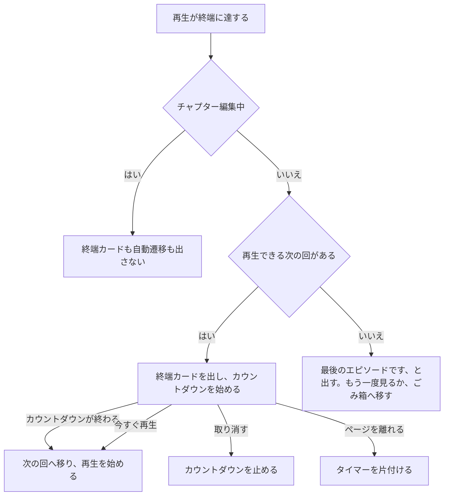

> [recordings.md](../recordings.md) の一部。索引から辿る

# 録画一覧・検索・再生

この文書は、録画の単体ページの構成と、次のエピソードへの移動、チャプター編集の下書きの扱いを決める。

## 録画単体の遷移先

録画は、録画 id を URL にした単体ページで見る。一覧内の展開では見ない。録画の id は取り込み（watcher）が一度作ったら変わらない、不可逆な事実の id なので、そのまま URL に使ってよい。

録画は一覧内展開でしか見られず単体の URL を持たなかったため、skip 理由（「重複（録画 #345）」）や予約 → 録画のリンクが行き先を持てなかった。遷移先は `/recordings/$id` である。「一覧内スクロール + 展開」は無限リストで対象が読み込み済みとは限らず成立しないため、別ルートにした。

予約詳細は事情が異なり、放送番組を表す `(site, programId)` を宛先にしている。予約の行は ruler が削除・再作成しうるので、行そのものは宛先にしない。

根拠

- 予約詳細の宛先: `pages/reservation-detail.tsx`、`(site, programId)`
- 録画 id が不可逆な事実の id である: `recordings.id`

### 本体と単体ページの分担

本体（プレイヤー・メタデータ・削除系操作）は録画詳細の部品が持ち、単体ページがこれを描画する。一覧はこの本体をインライン展開せず、行本体から単体ページへ移動する。

本体の対象は[playback.md](playback.md)「ブラウザ再生」節と「ドロップ統計」節である。以下の各節（ブラウザ再生の出し分け・ごみ箱の非表示規律）は単体ページに適用される。

根拠

- 本体の部品: `RecordingDetail`（`components/recording-detail-panel.tsx`）
- 単体ページ: `pages/recording-detail.tsx`

### 一覧の再検証

**単体ページのクエリキーは、一覧の invalidate に前方一致させる。** 先頭要素を一覧と揃えることで、削除・復元・完全削除・追加エンコード後に詳細も再検証される。

各 mutation の成功時に、同じ invalidate を呼ぶ。個別の mutation から prop で配線を渡す形は採らない。その形は配線を通し忘れても型エラーにならず、画面が古い表示のまま残る。最初の実装では追加エンコード後の配線が漏れ、実機でも「追加済み」表示が更新されなかった。

根拠

- 詳細も一覧 invalidate 対象: `recordingDetailQueryKey`、`getListRecordingsQueryKey`、`/api/recordings`（`lib/recording-detail-cache.ts`）
- 4 種の mutation 後に一覧を再検証する: `RecordingDetail`、`RecordingActions.invalidate`、`AddEncodeProfilesAction`
- 再検証 API: `queryClient.invalidateQueries({ queryKey: ['/api/recordings'] })`、`onSuccess`（`components/recording-actions.tsx`）
- prop 配線の漏れは型で検出できず、追加エンコード後に表示が古くなる: `onMutated`、`RecordingActions`

### ごみ箱の録画

録画の単体取得は、ごみ箱の録画も 200 で返す。単体ページは削除日時の有無で、[search.md](search.md)のごみ箱の出し分け規律をそのまま適用する。

対象の API は `GET /api/recordings/{id}` で、メタデータの可視性はメディア配信の 404 契約とは別の判断である（[api/rest.md](../../api/rest.md)「録画単体」）。

根拠

- 削除日時の有無でごみ箱の出し分けを決める: `deletedAt`

## 録画詳細の面積配分と構成

画面の面積は、視聴する人にとっての重要度で配る。同じ重みの見出し付きパネルを縦に並べず、「見る」「知る・次を見る」「整理・管理」「診断」の四層にする。

### 四層の内容

四層は、誰がいつ見るかで分ける。映像と操作バーは開いた人のほぼ全員が毎回見る。診断は問題が起きたときだけ見るので「記録」タブへ置く。

| 層 | 誰が・いつ見るか | 内容 | 置き場所 |
|---|---|---|---|
| 見る | 開いた人のほぼ全員が毎回 | 映像と操作バー | プレイヤー |
| 録画を知る・次を見る | 多くの人が毎回 | タイトル行、説明、シリーズ、次の回 | 映像の直下と右列 |
| 整理・管理 | ときどき | 版、ダウンロード、原本保持、追加エンコード、CM 操作、ルール、削除 | タブとメニューの中 |
| 診断 | 問題が起きたとき | 取り込み、エンコード、ドロップ、CM 検出結果、品質イベント | 「記録」タブ |

映像は 16:9 を保ち、タイトルと説明の先頭 2 行も初期画面に入る高さにする。タイトル行と説明は映像の直下に置き、シリーズ棚は desktop で映像の下の右列に置く。

### 映像の高さと幅の上限

映像の上に見出しを付けない。プレイヤーは 16:9 のまま、ページ見出し・チャプター要約・タイトル・説明の先頭 2 行が初期画面に入る高さに制限する。上限は、画面の高さから映像の上下に置く要素の高さの見積もりを引き、16:9 で幅に直した値とする。

映像・タイトル列・シリーズ棚を含む本文を映像の上限幅に揃えて中央に置き、下段の左端を映像に揃える。

実ブラウザの検査が、複数の画面サイズでの初期画面への収まりを測る。あわせて、棚の上端がタイトル行の上端と揃うことと、棚が下段の左列の右にあり右端が映像の右端に揃うことも測る。400×800 では棚を隠し、シリーズなし録画では映像と下段の左右位置と幅が揃うことも確認する。

根拠

- 初期画面の寸法と上限式の理由: `recording-detail-panel.tsx`
- 初期画面・シリーズ棚の位置・400×800 での棚非表示・シリーズ無し録画の揃え: `web/e2e/recording-detail-layout.mjs`

### 編集モードの配置

編集モードには、映像の高さの上限を掛けない。映像の横に区間一覧を置くため、通常時の上限式は成り立たない。チャプター編集は専用画面で行い、編集中はタブとシリーズ棚を隠す。

専用画面へは、再生設定から入る。下部ナビも高さの予算から引き、ページ自体はスクロールさせない。編集モードの本文幅が上限で絞られないことは、実ブラウザの検査が測る。デスクトップは左にプレイヤー、右に区間一覧、下に全幅のフィルムストリップを置く。スマートフォンはプレイヤー・フィルムストリップ・境界調整を上から並べ、区間一覧だけをスクロールさせる。

映像下端では「前後 3 秒」の隣に小さな速度ボタンを置き、通常再生と同じ 0.5〜2 倍を巡回する。400px 幅に収めるためこの形にする。編集用の速度は別に保存するので、CM 確認のために上げても普段の視聴速度には残らない。

編集に入る前の `<video>` は作り直さず、編集用の部品をプレイヤーの兄弟として足す。別の木に描き直すと再生位置が 0 に戻って止まるためである。

根拠

- 編集モードで本文幅の上限を外す: `web/e2e/chapters.mjs`

### タイトル行と説明

タイトル行はタイトル、局、放送日時（開始と終了）、尺、状態・取り込み・エンコード・ドロップのバッジを持つ。一覧と同じ条件の site と、説明の先頭二行も持つ。説明は押すと全文を開き、番組タブには繰り返さない。実録画時刻は、番組時刻と一致するなら出さず、ずれがある場合だけ出す。

映像の下では、タイトル行とタブを左列、同じシリーズの録画棚を右列に置く。棚はデスクトップだけに出し、スマートフォンには出さない。

ずれは「30 秒早く開始」「30 秒遅れて終了」のように出す。番組タブの実録画の開始と終了は秒まで出す。分までだと、30 秒のずれが番組の開始・終了と同じ表示になるためである。

### 番組枠の外の録画部分

番組の時間枠より前後を録画した部分は、シークバーの中に破線で示す。シークバーは複数の段に分けず、一本に収める。カット版の再生中は描かない。

割合は原本の時間軸で出したもので、カット版の動画には当てられない。破線が実際に描かれることは、実ブラウザの検査が画素で測る。

根拠

- 破線が描かれることを画素で測る: `web/e2e/recording-next-episode.mjs` ①

### タブの構成

画面には「番組 / 版 / 記録」のタブを置き、選択したタブの中身だけを描く。非選択タブは見出し一行ぶんの面積だけを使う。タブの選択状態は、画面内の React state に持ち、URL・hash・履歴には書かない。

初期選択はデスクトップでは「版」、スマートフォンでは「番組」にする。バッジを押したときは「記録」タブを選ぶ。詳細ページの hash は追っかけ再生の指定（`#chase`）に使われ、hash を変えると詳細ページの部品が作り直される。そのため、タブの切替で hash を変えない。

| タブ | 内容 | 表示条件 |
|---|---|---|
| 番組 | 物理チャンネル（種別と番号つき）、ずれがある実録画時刻、録画のしかた | 常時。ごみ箱ではこのタブだけ |
| 版 | ある版を一行ずつ（再生中の印、サイズ、ダウンロード、⋯）、原本 TS、原本保持、追加エンコード | ごみ箱以外で表示する内容があるとき |
| 記録 | 取り込み、エンコード、CM 検出、ドロップ、品質イベント | ごみ箱以外 |

録画のしかたは、ルールがあれば「ルール「名前」」とし、名前をルールへのリンクにする。ルールが無ければ「手動予約」など、録画の出自を出す。

根拠

- hash の変更で作り直される部品: `RecordingDetail`

### 「版」タブ

「版」タブには、手元にある版を一行ずつ並べる。原本 TS の行の下に原本保持と追加エンコードを置き、エンコード版の行末の ⋯ から版ごとの削除ができる。

#### 原本 TS の行

原本 TS の行はダウンロード / VLC のリンクを持つ。その下に原本保持の現在値、「この回だけ変える」、追加エンコードを置く。

凍結された保持値がルールの現在の既定と同じときだけ「（ルールの既定）」と付ける。違うときは何も言わない。ルールの既定が後から変わった場合を区別できないためである。

エンコードの全候補が追加済みなら、その旨だけの枠を作らない。エンコード後の原本削除を選ぶと再エンコードできない説明は残す。

#### エンコード版の行と削除

エンコード版のダウンロードは「版」タブだけに置き、プレイヤーの設定メニューには置かない。行末に ⋯ を置いて、「この版を削除」を出し、空く量を値札にする。原本も他の版も残らないときは操作を無効にし、録画ごと消す人をごみ箱へ誘導する。

確認ダイアログは、空く量と原本 TS を含む残る版を先に出し、録画単位の操作であることを末尾に書く。原本の有無、cut 版だけが残るか、原本保持が「常に保持」に切り替わるかで内容を出し分ける。再生中の版を削除したら、再取得後に残る版へ張り直す。版が無ければ再生元を選び直す。

一括削除は置かず、詳細から 1 本ずつ削除する。版が無いときは空の枠を作らない。

#### ごみ箱と録画中

ごみ箱では、再生・サムネイル・ダウンロードを出さない。録画中は取り込み中の原本だけを出し、中身の無いタブは表示しない。

### 「記録」タブ

「記録」タブは、取り込み・エンコード・CM 検出・ドロップを一行ずつ示す。異常はタイトル行のバッジにも示す。

CM 検出が局で直せる段階（`logo` / `area` / `adopt` / `match` / `resolution`）で失敗したときは、その行から局の CM ロゴ画面へ進める。`adopt` のリンクは「ロゴ候補を確認して採用する」、他の 4 段階は「CM 検出のロゴを教える」と出す。

ドロップの PID 表と品質イベントなどの詳細は、該当するデータがあるときだけ開ける。異常のない録画に「0」や「異常なし」の行を増やさない。

### ⋮ メニューとごみ箱

ページ見出しの右上の ⋮ メニューに、ルールを開く（右にルール名を付ける）、CM 検出のやり直し・停止、ごみ箱への移動を入れる。

メニューの記号は `⋮` である。原本が無い録画では、「やり直す」を押せない形で出す。再検出は原本から読むため、押すと API が 409 を返す。メニューの行の高さはラフどおりにする。部品の既定では詰まって窮屈になる。下限は、実ブラウザの検査がデスクトップとスマホの両方で測る。

ごみ箱への移動は、見終えたときの終端カードにも置く。これはカードがその場面で引き受ける整理操作である。完全削除はごみ箱に入った録画の画面だけに出し、確認ダイアログを通す。通常の録画のメニューから一クリックで完全削除できる状態にはしない。

根拠

- メニューの行の高さの下限をデスクトップとスマホで測る: `web/e2e/recording-detail-layout.mjs`

### 次のエピソードとシリーズ

シリーズへの入口は、どの状態でも幅ごとに 1 つだけ見せる。次のエピソードは再生できる録画だけから選び、終端では次の回へ自動で移る。

#### シリーズへの入口

棚がある幅（lg 以上）では、棚の見出しのシリーズ名を下線付きリンクにし、タイトルの下には出さない。棚が無い幅（lg 未満）と、ごみ箱では、タイトルの下に「シリーズ ニュース７ ›」と置く。見出し語と下線は、回のタイトルとシリーズ名が同じ録画でタイトルの繰り返しに見えるのを防ぐ。

リンク先のシリーズの画面は `/recordings/$id/series` である。操作バーには「このシリーズへ」を置かない。棚の見出しと役割が重なるためである。操作バーの右側には「次: 10/1(水)」を置き、スマホでは ▶▶ のアイコンだけにする。操作バーが無い状態では同じリンクをタイトル行のシリーズ名の隣に出し、バーがあるときは重ねない。

根拠

- 画面幅と録画状態ごとのシリーズへの入口: `web/e2e/recording-next-episode.mjs` ⑦（1280px・400px、エンコード版・原本のみ・録画中・ごみ箱）
- 再生できる次の回を選ぶ: `lib/series.ts` の `nextEpisode`

#### 終端カードと自動遷移

終端では映像の上に終端カードを出す。次の回があればカウントダウンして自動で次の回へ移り、無ければ「最後のエピソードです」と出して、もう一度見るかごみ箱への移動だけを出す。

チャプター編集中は、終端カードも自動遷移も出さない。

次の回があるときのカードは、サムネイル、「次のエピソード · N 秒後に再生」、次の回のタイトルと放送日時、カウントダウンの輪を持つ。「今すぐ再生」「取り消す」「この回をごみ箱へ」の 3 つのボタンを 1 行に置く。次の回が無いときのカードは、「最後のエピソードです」の下に、「もう一度見る」とごみ箱への移動だけを出す。

暗い映像の上でも読めるように、ボタンはカード専用の固定色にする。テーマのボタンは明るい地を前提としており、黒いカードでは白地に白文字になった。

未解決: 自動で進むことを嫌う人向けの設定は足していない。

根拠

- 終端カードのコントラスト比 4.5 以上とカウントダウン: `web/e2e/recording-next-episode.mjs` ②、`AUTO_ADVANCE_SECONDS`

#### 次の回へ移るときの状態

次の回へ移るとき、詳細の部品を作り直さず、全画面と再生を保つ。自動で移った先は再生を始め、全画面で見ていたなら全画面を保つ。

ページ側で部品の同一性を決める値は hash だけにして、録画 id を含めない。全画面は全画面要素が DOM から消えると解除される。プレイヤーの枠は再生元ごとに作り直されるため、全画面は再生元が替わっても残る再生グループに要求する。枠の下の警告・検出中表示・チャプターエディタも全画面に含める。全画面中は枠を先頭に置き、溢れた分は縦にスクロールさせる。枠と操作バーを画面外へ追い出さないためである。

録画ごとの state は、id の変化を見て既定に戻す。詳細の部品はタブ・説明の展開・追っかけの位置・選んだ画質を戻し、プレイヤーも id の変化で選んだ画質を捨てる。編集モードは入った録画を覚え、別の録画へ移ると抜ける。下書きを保ったまま次の回が編集モードで開き、終端で止まらず進む経路を作らないためである。未保存のまま移ろうとした場合は SPA 遷移を止め、編集を続けるか下書きを捨てるかを画面内で選ばせる。

移動先の詳細は、一覧の行を先にキャッシュへ入れてから描く。スケルトン表示でプレイヤーを一度消さず、描画後に stale な行を取り直す。自動遷移、操作バーの次のエピソード、棚からの移動はいずれも履歴を積み、「戻る」で前の回へ戻れる。

根拠

- 全画面と録画ごとの state: `RecordingDetail`、hash だけを持つページの `key`
- 次の回への移動で状態を戻し、未保存なら遷移を止める: `web/src/pages/recording-detail.test.tsx`「次の回へ移ると…」の 4 件、`web/e2e/recording-next-episode.mjs` ⑨
- 詳細の先行キャッシュ: `seedRecordingDetail`（`lib/recording-detail-cache.ts`）
- 実ブラウザで再生・全画面・履歴を測る: `web/e2e/recording-next-episode.mjs` ④
- 原本のみの回への自動遷移で全画面と再生が続くことと、全画面で枠と操作バーが画面に収まること: `web/e2e/recording-next-episode.mjs` ⑪

#### シリーズの棚

棚はシリーズの録画を新しい順に並べ、過去の回も含める。見出しに本数と合計サイズ（原本とエンコード版の和）を出す。棚は「次のエピソード」の問い合わせとは分け、シリーズの録画を新しい順に 1 回取得する。次の回の問い合わせを流用すると過去の回が抜け、件数も誤る。

1 ページの上限に達したら「N 本以上」とだけ出し、合計サイズは出さない。棚の行を押すとその録画の詳細へ移る。まとめて操作する機能はシリーズの画面に任せる。録画中の録画は、開いている回でも「録画中」と出し、「再生中」とは出さない。

各行のサムネイル下端に、視聴の進み線を重ねる。視聴済みは全幅、途中まで見た回は保存位置の割合で、未視聴には出さない。線はホームの「次に見る」と同じ部品を使う。

根拠

- 棚の取得と進み線: `seriesOf`、`ThumbnailProgressLine`

### タブ構成で保つ操作規律

操作は、対象との結び付きで置き分ける。再生位置・前後移動・選択中の画質・チャプター編集は映像を見ながら使うので、プレイヤーとその直下に置く。原本保持・追加エンコード・ダウンロードなど録画資産の管理は「版」タブに、取り込み・品質イベント・ドロップなどの診断は「記録」タブに置く。

#### 空の診断行

データが空の診断行は表示しない。特にドロップがすべて 0 の録画には、ドロップのバッジ、要約行、PID 表を出さない。「異常あり」のような共通見出しも作らない。正常な取り込み進捗は、値があるときに表示してよい。信号の強さはタイトル行のバッジで示し、タブや行の並び順を異常の重さの順にはしない。

#### 畳む内容とチャプター操作の出し分け

長い内容を畳む場合は、CM 検出器の結果と PID 表だけを対象にし、初期状態で閉じる。診断の存在自体を閉じたパネルに隠さない。

畳むにはネイティブな `
` を使う。

前後チャプターと CM スキップは、スパンがありカット版を再生していないときに使える。「チャプターを直す」は、保存版があり、自動検出が終わり、カット版以外を再生している場合に再生設定へ出す。原本だけの録画、ごみ箱、検出中、カット版再生では出さない。

#### 状態ごとの入口

状態ごとの主な入口は次の通り。希少で破壊的な操作だけを overflow に置く。原本保持と追加エンコードは入力を伴う管理操作なので「版」タブに残す。

| 状態 | 主な入口 |
|---|---|
| 通常、エンコード済みあり | 再生 |
| 録画中、ライブ有効 | 再生枠。通常表示はポスター上の再生ボタン、`#chase` 直リンクはそのまま開始 |
| 放送終了後・ingest commit 前、ライブ有効 | 再生枠は追っかけ。`#chase` 直リンクはそのまま開始 |
| 録画中、ライブ無効 | ブラウザ再生なし。取り込み状態を表示 |
| エンコードも依頼済みプロファイルも 0 件、原本あり | 「版」タブで追加エンコード |
| 依頼済みプロファイルあり | 待機・実行中・再投入待ちを状態バッジで示す |
| ごみ箱 | 復元。完全削除は確認後に実行 |

### 検出器の結果

CM 検出器の結果は、検出済みで検出区間が 0 件なら一文で伝え、区間が 1 件以上あるときはチャプター情報に応じて出し分ける。自動チャプターが 1 件以上あれば省き、読み込み中は何も出さず、それ以外は出す。

検出結果の有無は、量子化前の検出区間で決める。出し分けを評価するのは CM 検出が検出済みの場合だけで、区間が 0 件なら `
` を作らない。

検出区間が 1 件以上ある場合の出し分けは次の通り。

| チャプター情報 | 検出器の結果 |
|---|---|
| 原本のみで編集できない | 出す |
| チャプターを読み込み中 | 何も出さない |
| チャプターの取得失敗 | 出す |
| 編集の持ち主がユーザー | 出す |
| 自動、区間が 0 件 | 出す |
| 自動、区間が 1 件以上 | 省く |

省く判断には、API が返すフレーム丸め済みの区間一覧を使う。丸め前の検出区間と等価とはみなさない。1 フレーム未満の区間は丸め後に消えうる。Go の量子化処理を TypeScript に複製して比較しない。

根拠

- 検出結果の有無を決める量子化前の検出区間: `cmDetection.ranges`
- 省く判断に使う API の区間一覧と編集の持ち主: `spans`、`source = 'user'`

### 下書きと保存値

通常再生は保存済みの値を使い、専用の編集画面は下書きを扱う。保存は取得時と同じ版番号を付けて全体置き換えで送る。重なりの正規化は、クライアントの下書きで操作が確定した時点に行い、サーバーへの保存後には行わない。

#### 通常再生と編集画面の値

通常再生の目盛り・自動スキップ・前後チャプターは、保存済みの値を使う。専用編集画面ではフィルムストリップの境界を選ぶと、そのフレームへ移動して一時停止する。← → で選択を移したときも同じである。

ドラッグはプレビュー中に下書きを変えず、ポインターを離した時に新しい境界へ移動して一時停止する。±1 秒・±1 フレームと `,` / `.` も、境界を動かした後のフレームへ移動して止まる。入力欄・シークバー・メニューの中を除き、`,` は 1 フレーム戻し、`.` は 1 フレーム進める。

境界を動かす操作は、キー・±ボタン・長押し・ドラッグ・再生位置に合わせるのどれも同じ経路を通る。下書きの正規化と「元に戻す」の履歴を通り、動かした先の境界が合併で消えたときは残った最寄りの境界を選んで、そこへ移動する。

#### 長押しと連続送り

±ボタンは押下と同時に 1 回動かし、450ms 押し続けたら 200ms ごとに送る。長押しの seek は実ブラウザで測ったが、対象はローカルの小さな fixture だけで、ネットワーク越しの実録画は未測定である。

初回遅延が無いと、200ms を超えるクリック・タップで 2 フレーム動いてしまう。450ms は OS のキーリピートの初回遅延（おおむね 250〜500ms）に揃えた。200ms は 1 秒に 5 回で、1 フレームの違いを目で追える速さである。

長押し全体は「元に戻す」1 回で押す前へ戻る。`,` / `.` の OS キーリピートも同じく 1 件にまとめる。動かした先の境界が合併で消えたら連続送りを止める。続けると、利用者が押していない別の境界を動かし始めるためである。seek 中に次の操作が来たときは、ブラウザで処理中の 1 回が終わってから最後に選ばれた境界へ移る。

測定では、ボタンを 1.5 秒押し続けて 7 フレーム送る。seeking から seeked までの最大は Chrome で 17〜33ms、WebKit で 16〜39ms で、200ms 間隔の seek が重ならず、離した後は最後の境界のコマ中央で止まった。対象はローカルの fixture（非カット MP4 と原本 HLS）である。

根拠

- 長押しとフレーム境界の seek 測定: `recording-playback-timeline.mjs`。対象はローカル fixture（非カット MP4 と原本 HLS）で、ネットワーク越しの実録画は未測定

#### 境界の直後の表示

境界のフレームを表示して一時停止している間は、「境界の直後（次の区間の先頭）」と表示する。再生中や境界から離れた後は表示しない。

区間は `[start, end)` なので、境界上のフレームは後ろ側の区間に属する。

#### 下書きの正規化

下書きの区間は、境界のドラッグを離す・±1 秒 / ±1 フレーム・再生位置へ合わせる・区間を追加する・「切る」を切り替える操作の確定時に、クライアントで重ならない形へ正規化する。ドラッグ中もこの規則をプレビューへ適用し、離した後の下書きと形を揃える。

| 重なりの形 | 結果 |
|---|---|
| cut と非 cut が重なる | cut を残して非 cut の重なりだけを削る |
| 非 cut が cut に挟まれる | 両側へ同じラベルを残す |
| cut が全体を覆う | 非 cut を取り除く |
| 同じ cut 値でラベルが同じ、または片方に無い | 重なりを和にする |
| 同じ cut 値でラベルが異なる | 優先側を残し、相手の重なりを削る |

優先側は、今回動かした境界を持つ区間、または追加した区間である。境界を共有する前後の区間は、両方を操作対象とする。操作対象が同じ優先度で競合すれば、時間上で先に始まる区間を残す。同じ cut 値とラベルの区間は接しても一つにまとめ、ラベルが違えば境界を保つ。

#### 元に戻す

「元に戻す」と Ctrl / ⌘+Z は、確定した一操作を戻す。ラベル欄ではフォーカス中の変更を一手にまとめ、欄にフォーカスがある間の Ctrl / ⌘+Z は文字入力側へ渡す。「最初からここまで切る」と「ここから最後まで切る」は、録画の先頭・終端までの cut 区間を追加する。

サーバーの検証は今まで通り、量子化後の重なりを拒否する。切り取りで生まれた 1 フレーム未満の断片は、量子化で空になりうるので、クライアントの正規化が落とす。サーバーの量子化は最寄りのフレーム境界への丸めで、1 フレーム以上の区間は空にならない。そのため判定に Go の量子化の複製は要らない。利用者が元から持つ区間は落とさず、サーバーが拒否する。

合併をサーバー保存後に行うと、画面の下書きと保存値がずれる。そのため、クライアントの下書きで操作が確定した時点に行う。

根拠

- 量子化後の重なりを拒否するサーバー側の検証: `Validate`

#### 境界の調整ボタン

調整ボタンを選んだ境界にだけ出す理由は 2 つある。1 つは、境界ごとに 6 個ずつ並べると、境界が増えるほど面積を取り、どのボタンがどの境界に作用するかを目で追わされることである。もう 1 つは、フレーム単位の仕上げが映像を見ながら 1 か所ずつ詰める作業なので、「いま見ている境界」が 1 つに定まっていれば足りることである。

選択はカードの強調と同じ 1 つの値で、← → は編集画面のどこにフォーカスがあっても前後の境界へ移す（入力欄・シークバー・メニューの中を除く）。境界の時刻と再生位置はミリ秒まで出す。秒単位では +1 フレームの結果が見えない。

#### 再生帯とフィルムストリップ

再生型は映像下端の帯にまとめ、「前後 3 秒」「境界まで」「境界から」と編集中の再生速度のボタンを同じ場所に置く。フィルムストリップの調整行は境界の値と編集操作に使い、再生ボタンを重ねない。再生帯に集めると、スマホ幅でも映像と再生操作を同時に見ながら選べる。400×800 の帯で、再生・時刻・3 つの再生型・速度が枠内に収まり重ならないことを実ブラウザで確認する。

ストリップの 1 マスは、10 秒のシークタイル 1 枚をそのまま縮めて出す。シークプレビューと同じ格子画像を使い、別の画像は取りに行かない。拡大は 1 マスの幅がタイルの実画素幅（160px）を超える手前で止める。それ以上広げると 1 枚が引き伸ばされて粗くなるだけで、タイルは 10 秒ごとなので情報は増えない。開いた直後の範囲は、入る前の再生位置の周りにする。

#### 保存と確認

下書きに変更があるときは、「保存」で API の全体置き換えへ、取得時と同じ版番号を送る。保存・確認・自動に戻すはいずれも成功後に編集画面を閉じる。未保存の下書きがあるときだけ、アプリ内の移動なら画面内の確認、リロードやタブを閉じる操作ならブラウザ標準の確認を出す。

自動層が未変更かつ stale でなければ「このまま確認」を押せる。GET が返す区間一覧と版番号をそのまま PUT し、明示的な操作でユーザー層へ引き取る。自動層が空でも確認できる。これは CM なしとして全編を残す判断を表す。検出失敗・CM 区間なし・安全弁で CM なしに倒れた結果も、見えている状態を確定する操作として扱う。

編集の持ち主がユーザーで内容が未変更なら、主ボタンは押せない。「自動に戻す」は編集所有の行を削除し、持ち主がユーザーのときだけ使える。

アプリ内の移動（下書きが変わった状態での「やめる」や SPA 遷移）では、画面内で「変更を捨てる / 編集を続ける」を選ばせ、ブラウザ標準の `confirm()` は使わない。リロードとタブを閉じる操作では、ブラウザ標準の確認（beforeunload）を未保存の下書きがあるときだけ登録する。版の更新が検出された場合も下書きは残し、最新値からやり直す操作を明示する。

根拠

- API の版管理と全体置き換え: GET の `spans` / `version`、PUT、`source` の `user`
- 画面内の下書き確認とブラウザ標準の確認を分ける: `confirm()`、`beforeunload`

### 版タブへの入口

プレイヤーの空状態（エンコードが無い録画）には、版タブへ移すボタンを持たない。追加エンコードはタブを開いて行う。未解決: 空状態から版タブを開く入口が要るかは、利用者の迷い方を見てから決める。

### 原本サイズの二つの役割

原本サイズは「版」タブの原本 TS の行に、操作対象の値札として置く。エンコード済みが 0 件のとき、プレイヤーの空状態にある VLC リンクは唯一の視聴手段なので消さない。「版」タブの原本 TS のダウンロード / VLC リンクとは別に、両方を並存させる。原本 VOD で live プロファイルが 0 件の分岐にある VLC リンクも同じ扱いである。
