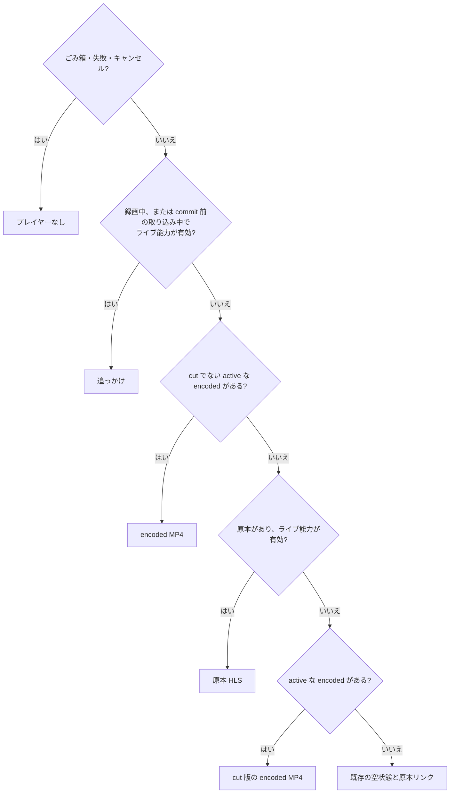

> [recordings.md](../recordings.md) のブラウザ再生。索引から辿る

## 録画のブラウザ再生

詳細画面の再生枠にはプレイヤーを 1 つだけ置き、再生元は録画の状態から 1 か所で選ぶ。録画中はライブ能力が有効なら追っかけを使う。完了後は cut でない active な encoded があれば encoded MP4、無くてライブ能力と原本があれば原本 HLS を使う。ごみ箱・失敗・キャンセルの録画にはプレイヤーを出さない。

### 再生元の選び方

再生元は、録画の状態・取り込みの進み具合・ライブ能力の有無・原本と encoded の有無から決める。決める場所を 1 か所にして、状態ごとに別々の再生面や開始操作を増やさない。

原本と cut 版の両方がある録画では、「版」タブから各 encoded を再生できる。原本が残り、ライブ能力が有効なら、同じタブから原本 HLS へ戻れる。cut だけの録画は原本 HLS を既定にして編集できるようにし、比較・確認のため cut 版を選んだ間はチャプター編集を止める。

根拠

- 取り込み中の追っかけ条件: `finished`、`ingest.state`、`pending`、`transferring`

### 再生元を替える時機

再生中の録画状態の更新だけでは再生元を替えない。再生元のエラーと画面の開き直しでは、最新の録画状態から選び直し、現在位置を録画開始からの秒で渡す。

状態更新のたびに切り替えると、録画終了やエンコード完了の通知だけで再生が中断される。そのためこの切替時機にする。範囲外シークの扱いは再生元で分かれる。版タブで明示的に選んだ原本 HLS は、範囲外シークでは選び直さず、新しい offset で張り直す。encoded のプレイヤーは範囲外シークを通知しないので、版タブで選んだ encoded もシークでは替わらない。自動選択の追っかけと原本 HLS は、範囲外シークで選び直す。

### 同じ再生元での張り直しと切替時の位置

選び直した結果が今と同じ再生元なら、詳細画面は替えず、プレイヤー自身が張り直す。追っかけは新しい offset のセッション、原本 HLS は新しい offset の playlist で張り直し、どちらも同じ映像要素のまま再生を保つ。

`<video>` を作り直すと一時停止するためである。全画面も枠を作り直さないので保つはずだが、全画面は未検証。ingest commit 後は新しい追っかけセッションを作れないため、追っかけが入力エラーになったときは REST で録画を取り直して再生元を選び、範囲外のシークも原本 HLS / encoded へ移る。再生元が替わるときは、再生中だったかも持ち越す。カット版 encoded では、今再生しているファイルの keep 区間で位置を写す。

切替時の `currentTime` の停止は、実ブラウザ E2E で測り、2 秒以下を合格にする。フィクスチャの HLS segment は 2 秒なので、1 segment 分の読み込み余地を認めながら、それ以上続く停止を検出できる。

根拠

- カット版の位置の写像に使う keep 区間: `keepRanges`

### 終端での停止

再生が終端に達したら、再生元を選び直さず、終了の状態のまま止める。終端はファイルの終端を指すので、移った先に見る続きは無い。

追っかけの `ENDLIST` は、streamer が録画ファイルの終端まで変換したときにだけ付く（[api/media.md](../../api/media.md) の追っかけの節）。終端は、mirakc が録画終了を返し最後の Range も空だったとき、または record が消えた後に読んだ位置がコミット済み原本の終端と一致したときとする。この判定は壁時計の録画時間や録画完了取得の前後によらない。

壁時計の録画時間と比べて「手前で終わった」と判定する案は採らない。真の終端位置を完了後の再生元へ渡し、原本 HLS で範囲外の 416 になりうるためである。

根拠

- 終端での再生元の維持: `ended`
- 壁時計の録画時間で終端を判定しない: `endedAt - startedAt`

### 再生元のエラーと再試行

通常の再生元エラーは、同じ再生元で張り直し、続けて 2 回までで止めてからエラー表示にする。追っかけ入力の失敗だけは別扱いにして、同じ再生元を自動では張り直さない。

idle GC で消えた追っかけの再取得も、通常の経路に含む。追っかけ入力の失敗後、streamer は録画 ID ごとに 10 秒間、新しいセッションの作成を止める。動作中の健全な offset は引き続き共有する。新しいセッションが必要な要求には `502` と `Retry-After` を返す。

`Retry-After` 付きの `502` だけを、容量不足の `503` と区別して入力失敗とし、同じ再生元を自動で張り直さない。利用者は cooldown 後に「再読み込み」を押せる。idle GC による通常の再取得は、この cooldown に入らない。`Retry-After` の無い `502` はプロキシ由来として、他のエラーと同じく再生元を選び直す。

一度も再生していないセッションのエラーでは、位置を作らず、保存位置・先頭から・シークで選んだ offset をそのまま持ち越す。0 秒を明示すると保存位置を上書きして先頭から始めるため、0 秒は送らない。

### 再生を始める操作

追っかけと原本 HLS は変換セッションを作るので、詳細を開いただけでは起動せず、ポスターの再生ボタンを押した時点で変換を始める。encoded MP4 は変換セッションを作らないので、通常の encoded プレイヤーをそのまま表示する。

ホームの「録画中」帯や番組表から使う `/recordings/{id}#chase` は、「開いたら再生する」直リンクとして残す。画質の設定は、元が live profile でも encoded profile でも別名前空間なので、再生元が変わった先ではその側の既定に戻す。

### 録画中のポスター

録画中のポスターには、保存位置の「続きから」・録画済み時間・予定終端までの録画済み範囲・「先頭から見る」を並べる。録画先端はプレイヤーをマウントせずローカル時計で更新するので、再生前に streamer へ要求を送らない。

保存位置が無いときは「再生」だけを出し、同じ操作を 2 つ並べない。時間軸は映像と同じ 16:9 の枠の中の下端に重ね、再生の前後で枠の寸法を変えない。枠の外に帯を足すと、押した直後にページが跳ぶためである。

原本 HLS のポスターは、視聴済みの操作も枠の中に置く。サムネイルは録画中だと未生成が普通なので、取れなければ画像を外して背景だけを出す。再生ボタンは、押した操作のままプレイヤーを自動再生で始める（`#chase` 直リンクも同じ）。番組の軸は 60 分を超えても合計分で表示する（70 分 12 秒は `70:12`）。

### 経路ごとの再生方式

active な encoded がある完了録画は、MP4 の progressive 再生と Range で再生する。原本だけが残る完了録画は、streamer が一時 HLS に変換してブラウザで再生する。

encoded MP4 は、streamer の `GET /api/media/recordings/{id}/file?profile=<name>` を、controls の無い `<video>` の src に渡す。映像の下端には自前の再生操作バーを重ねる。encoded MP4 の経路では HLS / hls.js を使わない。原本だけが残る完了録画は、streamer の一時 HLS 経路（`/api/sites/{site}/recordings/{id}/original-vod/playlist.m3u8`）で再生する。原本自体は MPEG-2 TS のまま読み、変換したファイルは保存しない。原本 HLS の詳細は [api/media.md](../../api/media.md)「録画原本のブラウザ再生」にある。

原本 TS 自体は `<video>` の src に渡さない。VLC 等で開ける原本リンクは残すが、プレイヤー内のダウンロードには置かない。

### 画質と音声の選択

画質は操作バーの設定メニューで選ぶ。原本 HLS と追っかけでは、音声は標準 / 主 / 副の 3 択を常にメニューへ出し、切り替えても playlist と HLS セッションを作り直さない。

利用可能な MP4 プロファイルは active な encoded のみとする。設定メニューの「画質」に選択肢を置き、サイズがあれば付け、サイズの無い資産もプロファイル名を出す。原本だけの完了録画は、live の HLS プロファイルで一時変換する。複数あれば同じメニューで画質を選べる。音声の切替で変えるのは、選択中のプレイヤーの音声トラックだけである。

根拠

- 利用可能な MP4 資産と音声トラックの切替: `Recording.encodedAssets`、`profile`、`sizeBytes`、`LivePlayer`

### 再生位置の保存と端末の好み

**再生位置は原本時間軸の ms で保存する。** 追っかけ・原本 HLS・encoded MP4 は同じ録画行の値を共有し、画質プロファイルでは分けない。

カット版だけは、再生開始時に固定した keep 区間で原本時間軸と相互変換する。位置は 15 秒ごと、pause / seeked / pagehide で保存し、2 秒未満は削除する。同じページ内の画質切替では video が作り直される。詳細クエリの再開位置は開いた時点の値なので、直前の位置を原本 ms でプレイヤー ref に持ち越し、新しい keep 区間で写して復元する。保存の成否には依存しない。

90% 到達の視聴済み PUT が通ったら、録画クエリを取り直し、ボタンと未視聴の印を更新する。速度だけは端末ごとの好みなので `localStorage` に残し、既存の `localStorage` 位置キーは起動時に削除する。再生速度は `ratechange` で端末に保存し、VOD と追っかけ再生で共有して、各 `<video>` の `defaultPlaybackRate` に適用する。

追っかけの offset は開始バイト位置による推定値である。原本 HLS・encoded の位置と映像上で一致する精度は未検証である。再生元を切り替えた後の原本時間軸はその再生元の時刻で表示するため、切り替えた時点で映像が飛んで見える場合がある。

根拠

- 位置保存の API と端末の好み: `/api/recordings/{id}/playback-position`、`localStorage`
- 画質切替で同じページの位置を保つ: `RecordingPlayer`「同じページ内の画質切替」、`resumePositionMs`、`keepRanges`
- 追っかけ位置の精度は未検証: `chaseStartByteOffset`

### 原本 HLS のシークバーと時間軸

原本 HLS は変換中の EVENT playlist なので、シークできる範囲は変換の先端まで伸びる。時間軸の分母は、録画の終了時刻があれば、録画ファイル先頭から終了時刻までの実尺とする。

予定尺や変換先端は分母にしない。ファイル先頭は、録画を始めた時刻と番組の開始時刻の遅い方である。録画を始めた時刻はチューナーを開いた時刻で、ファイル先頭ではない。終了時刻が無い録画は予定尺を代用し、分母が 0 ならシークバーは機能しない。

現在位置は、セッションの offset と再生中の位置の和で原本時間軸に直す。現在セッションの offset から seekable 終端までなら同じセッション内で移動し、範囲外は pointer up 時に新しい offset で張り直す。変換済み範囲は seekbar に描かず、変換完了も待たない。範囲は seekable 終端で判定し、バッファでは判定しない。WebKit は先端の 3 target duration 手前より先への代入を seekable 終端に丸めるので、その先は張り直す。

DB の実尺に基づくシークバーでは、末尾付近の offset が映像終端を越え、416 になりうる。エラーにはせず、最後に取れた offset を下限に手前へ丸めて張り直す。

根拠

- 原本 HLS の時間軸: `endedAt`、`durationMs`、`startedAt`、`startAt`、`started_at`、`max(startedAt, startAt)`
- セッション内の位置と範囲外 seek: `session offset + video.currentTime`、`seekable`
- 末尾付近 offset の 416 を後退丸めで張り直す: `web/e2e/recording-original-vod.mjs` ⑤-f

### 原本 HLS の開始位置の再表明

開始位置は、offset 0 や続きから位置が無い場合も明示し、再生可能になった時点でもう一度設定する。WebKit の native HLS は、明示しないと ENDLIST の無い playlist のライブ端近くから始めるためである。

canplay 後に再生すると、受け付けた位置もライブ端へ動く。これは自動再開、操作バーの ▶、映像クリック、一時停止中の範囲外 seek 後の ▶ で起きる。再生開始の経路ごとに分けず、セッションを張った後の最初の playing でもう一度明示する。利用者がシークしたら再表明を解除する。再生中に張り直したときは再生を続ける。

手動 ▶ の経路では初回 play() の拒否を模擬し、テストから位置を戻さず測る。fixture は 6 segment の EVENT playlist から始まり、待機中は 1 秒ごとに 1 segment 伸びる。測定は Playwright WebKit 26.5 の `currentTime` で、押下前は 0 / 1 / 3 秒待った。

| 操作 | 再表明あり | 再表明なし |
|---|---:|---:|
| 押下 1 秒後（待ち 0 / 1 / 3 秒） | 0.64 / 0.73 / 0.65 秒 | 3.64 / 3.75 / 3.65 秒 |
| 映像クリックの 1.5 秒後 | 1.26 秒 | 4.30 秒 |
| 一時停止中に範囲外 seek 後、offset 31 から ▶ | 1.68 秒 | 17.15 秒でライブ端へ飛ぶ |

根拠

- ライブ端への丸めに対する再表明: `web/e2e/recording-original-vod.mjs` ⑤-a・⑤-d・⑤-manual・⑤-route
- 原本 HLS の再開位置と ENDLIST のない先端の確認: `web/e2e/recording-original-vod.mjs`

### 続きから再生の開始

続きから再生は「始まる前のシーク」として扱い、保存位置を秒に切り下げた offset のセッションで始める。1 秒未満の端数は開始位置に渡す。

offset 0 のまま保存位置を渡すと、位置が変換済みの端より先になり、変換待ちになる。25 分先なら J4125 の 4〜6 倍速で 4〜6 分（推定）。offset 0 に 4.5 秒を渡した 1 回の測定では、Chromium は端を待ち、WebKit はセッション先頭へ丸めた。fixture の最初の EVENT は 2 秒で、2 秒ごとに伸びる。

保存位置より前への巻き戻しは、既存の範囲外 seek として扱う。終端を越えた 416 も既存の後退丸めで扱い、端数は捨てる。開始 offset は録画ごとに最初の保存位置で固定する。固定しないと、再生中の保存で位置が動くたびにセッションを張り直す。移動先は、offset の起点と `currentTime` の和で判定する。

根拠

- 1 秒未満の端数を開始位置に渡す: `startPosition`
- 続きから再生の移動先の判定: `web/e2e/recording-original-vod.mjs` ⑧〜⑪、`offset の起点 + currentTime`
- 開始 offset を最初の保存位置で固定し、再生中の保存で張り直さない: `live-player.test.tsx`「…最初の保存位置で固定し…」

### 原本 HLS で視聴済みにする信号

終端の 90% 到達で視聴済みにするのは、変換が終わって終端が確定した後だけである。

信号は、hls.js では level details が `live === false` になることと `ended` イベントである。ネイティブ HLS は ENDLIST を直接見られず、`ended` だけを信号にする。

根拠

- ENDLIST 後だけ視聴済みにする信号: `live === false`、`ended`

### 操作バーの配置

操作バーは、デスクトップでは映像下端の帯 1 本、スマホでは映像のタップで開く暗い幕にする。ボタンは 2 組持たず、同じ要素の置き場だけを CSS で変えて、状態とアクセシブル名を 1 つに保つ。

デスクトップ（`md` 以上）では、シークバーの下の行に、左から再生、前 / 次のチャプター（チャプターがありカット版でないときだけ）、ミュート / 音量、時刻、いまのチャプター名を置く。右には字幕（CC）、視聴済み（✓ のトグル。完了録画だけ）、設定（歯車）、PiP、全画面を置く。シークバーには現在位置のつまみを置き、タイルの下に「時刻 · チャプター名」を出す。バーの色は映像の上で読めるよう固定し、ライト / ダークで変えない。PiP は `document.pictureInPictureEnabled` のときだけ出す。

スマホ（`md` 未満）では映像のタップで操作を出す。枠全体を暗くし、中央に前のチャプター / 再生・一時停止 / 次のチャプターを大きく置く。右上に字幕と歯車、下に時刻・チャプター名・✓・全画面・シークバーを置く。ミュート / 音量は置かず、PiP は設定シートの行に移す。

中央の DOM 順はデスクトップの再生、前、次にそろえ、スマホの前、再生、次は `order` で並べ替える。Tab で操作する主なデスクトップでは、見た目とフォーカス順を一致させる WCAG 2.4.3 が適用される。スマホに残る不一致は、読み上げのスワイプ順にだけ影響する。

タッチで映像を押しても再生 / 一時停止はせず、暗い幕を押すと操作を閉じる。幕は click で閉じる。pointerup で閉じる案は採らない。pointerup で消すと続く click が下の `<video>` に届き、再生が止まるためである。`md` 未満でもマウスで幕を押せば、映像のクリックと同じく再生 / 一時停止する。

根拠

- モバイル操作幕と中央ボタンの並び: `web/e2e/chapters.mjs` ①-a・⑧・⑨

### 操作バーのボタン

操作バーの右側には、次のエピソードへの移動、視聴済みの切り替え、字幕の近道を置く。

再生できる次のエピソードがあれば、「次: 10/1(水)」（▶▶ のアイコン。スマホはアイコンだけ）を置く。次のチャプター（▷|）とは別のアイコンにする。終端カードは映像の上に重ねる（[detail.md](detail.md) §次のエピソードとシリーズ）。✓ は固定の名前「視聴済み」の押下トグルにする。プレイヤー外のボタンは、押した後の動作（視聴済みにする / 未視聴に戻す）を名前にする。字幕（CC）ボタンは設定メニューの字幕スイッチと同じ操作の近道で、オンの間は下線を付ける。

### 操作バーのチャプター名と一覧

時刻の横にいまのチャプター名を出し、押すとチャプター一覧を開く。一覧は見るためのもので、編集の操作も編集フォームへの移動も置かない。

名前は「· 気象情報 ›」の形で出し、区間の隙間は「本編」と出す。名前を押すと、設定メニューと同じ置き場（デスクトップは小窓、スマホは画面下のシート）にチャプター一覧を出す。一覧は「時刻・チャプター名」を時刻順に並べ、いまのチャプターに ✓ を付け、行を押すとその位置へ飛ぶ。全画面は抜けず、全画面中も全画面要素の中に出す。

キー操作は設定メニューと同じで、Esc で閉じると名前のボタンにフォーカスを戻す。設定メニューとは同時に開かない。チャプターが無い録画（カット版を含む）では、名前も「›」も出さない（`web/e2e/chapters.mjs` ⑦ ⑧）。

### 設定メニュー

**設定メニューは「アイコン・項目名・現在値 ›」の行リストにする**（動画サービスの定石）。基本の行は CM を飛ばす・字幕・再生速度・画質の 4 つで、原本 HLS と追っかけでは音声も加える。

2 択はスイッチ、3 択以上は「›」で下の階層に入る。下の階層は、同じ枠の中身を「‹ 見出し」と選択肢に差し替え、選択中に ✓ を付ける。選択肢を選ぶとメニューを閉じる。プルダウンやボタンの羅列は使わない。フォームの部品をバーから開くだけでは、直感的に操作できないためである。

デスクトップのメニューは映像の上、歯車の真上に小窓で開き、シークバーを覆わない。スマホのメニューは画面の下からのモーダルのシートで、背後を暗くし、シートは画面の下半分に収める。並びは画質を一番上にし、PiP の行を足す。原本 HLS と追っかけもエンコード版と同じ順にし、音声の行は画質の隣に置く（デスクトップは画質の直前、スマホは直後）。どちらもメニューは全画面要素の内側（プレイヤー枠の中）に描く。外に描くと全画面中に設定を変えられないためである。形は `web/e2e/chapters.mjs` ⑦ ⑧ が実ブラウザで測り、原本 HLS の順は `web/e2e/recording-original-vod.mjs` ① が測る。

メニューの行は ↑ / ↓ / Home / End で見た目の順に移り、→ で下の階層へ入る。Esc / ← / 「‹」で 1 段戻り、最上位の Esc で閉じて歯車にフォーカスを戻す。メニューの外を押すと閉じる。

### 操作バーを持つ再生面とチャプター編集

操作バーを持つのは、ブラウザで再生できる encoded と原本 HLS のプレイヤーである。ライブ視聴・原本 HLS VOD・encoded VOD は同じ自前の操作バーを使う。

ライブ側の操作バーは [live.md](../live.md) にある。原本 VOD では変換済み範囲を描かず、画質（複数候補があるとき）と音声を設定メニューに置く。操作バーの枠（自動非表示・フォーカス・映像タップ・全画面・PiP）は、encoded と同じフックを使う。

原本だけが残る完了録画は、live.enabled が有効で HLS 再生できるときに、チャプターの目盛り・一覧・CM 自動スキップ・編集 UI も使う。原本 HLS の変換中でも編集できる。境界は録画先頭からの ms で保存し、エディタは固定した録画尺を使うため、変換中に `<video>.duration` が伸びても保存値やエディタの末尾は変わらない。HLS の変換セッションは再生ボタンを押した時点で始め、編集モードに入るだけでは作らない。

live.enabled が無効でブラウザ再生できる encoded も無い場合は、チャプターを確認する手段が無い。HLS 再生できない録画・資産が無い録画・ごみ箱では、視聴済み / 未視聴の切り替えをプレイヤーの外に残す。

根拠

- 同じ操作バーを使うライブ視聴: `pages/live.tsx`

### プレイヤーの外に置くもの

カット版の作り直し案内はプレイヤーの直下、チャプター編集は専用画面に置く。ダウンロードはプレイヤーのメニューに置かない。

定石の VOD プレイヤーは、設定メニューにダウンロードを置かない。原本 TS のダウンロード / VLC リンクと、版ごとの encoded のダウンロードは、録画詳細の「版」タブに置く。

### 操作バーの表示と隠し方

デスクトップでは映像をクリックすると再生 / 一時停止し、操作バーは停止中・ポインタ操作の直後・キーボードフォーカス中に表示する。再生中にポインタが止まって 3 秒経つと隠す。

具体的には、停止中、ポインタを動かしてから 3 秒以内、またはバー内にキーボードフォーカス（`:focus-visible`）がある間は操作バーを表示する。**マウスで押したボタンに残ったフォーカスは数えない。** 数えると再生中ずっと映像に被るためである。隠れたバーは `inert` なので、枠内のキー入力（Tab を含む）でバーを出してから処理し、再生中のキーボード利用者が Tab でバーに届くようにする（`web/e2e/chapters.mjs` ⑥）。

### 全画面

全画面は、映像と操作バーを含む枠を持つ再生グループの要素に要求する（理由は [detail.md](detail.md) §次のエピソードとシリーズ）。ページの全画面キーも同じ経路を通る。

ページの全画面キーは `F` である。要素全画面を持たない iPhone Safari では `video.webkitEnterFullscreen()` に落ちる。その場合は Safari のネイティブ全画面 UI となり、タイルプレビューは出ない。iPhone Safari 実機での再生・全画面確認は未実施であり、Playwright WebKit の結果を実機確認の代わりにしない。未解決: 実機確認は別の issue で追跡する。

### 字幕と操作バーの重なり

操作バーを表示して字幕が重なるときは、字幕の行を操作バーの上へ引き上げる。native HLS が字幕 cue を JavaScript に公開しない WebKit では、この引き上げは何もしない。

JavaScript が読める WebVTT cue の行を、プレイヤー高さと下端の帯（時刻・シークバー）の高さから計算して上げる。スマホの暗い幕は枠全体に敷くので、幕の高さは数えない。WebKit はブラウザ既定の字幕位置を画素差分で観測するだけで、実装の検証にはならない。測定は `web/e2e/subtitles.mjs` と `web/e2e/recording-original-vod.mjs` にある。

### ページのキー操作

ページのキー操作は、入力欄などにフォーカスがある間は働かず、video にフォーカスがある場合は使える。

対象外の要素は、入力欄・選択欄・リンク・ボタン・`role="slider"`・編集可能領域である。シークバーが `role="slider"` を持ち、← / → を自分で処理するため、グローバルの 10 秒シークと二重処理しない。

### シークバーとタイルプレビュー

シークバーは操作バーの中に 1 本だけ置き、再生済み割合、チャプターの目盛り、タイルプレビューを描く。追っかけ再生も同じシークバーを使う。

追っかけ再生で差し替えるのは、軸（番組開始からの経過）と「録画済み / 未録画 / 予定終端」の描画、シーク先の解決だけである（[live.md](../live.md)「録画中の追っかけ再生」）。

マウスを動かすと、`/api/media/recordings/{id}/seek-tiles` の該当タイルが seekbar の上に出て、同じ座標計算でクリック / ドラッグした位置へシークする。タイルはサーバー側の固定値（10 秒間隔・10 列）で、純関数が「再生位置 → 格子位置」を出す。seekbar は `role="slider"`、`aria-valuenow` / `aria-valuetext` を持つ。← / → は 10 秒ずつシークし、Home / End は先頭 / 終端へ移る。タイルの読み込みと位置判定は `web/e2e/seek-tiles.mjs` が実ブラウザで測る。

根拠

- 再生位置から格子位置を出す純関数: `lib/seek-tiles.ts`

### タイルプレビューの出し方

タイルプレビューはマウスだけに出し、最初にポインタが触れたときにだけタイルを取りに行く。タイルが無い録画ではプレビューを出さない。

タッチでは seekbar のタップ / ドラッグがシークだけを行う。タップには離脱のイベントが来ないので、出すとプレビューが映像を覆ったまま残る。

プレビューの幅は、帯の幅の 4 割まで（上限 320px、16 の倍数に切り捨て）にする。狭い窓で映像の大半を覆わないためである。`transform: scale` は文字まで縮めて読めなくするので使わず、タイルの寸法そのものを縮める。スマホの配置では時刻の行の上に出す。幅 768px 未満ではシークバーが時刻の行の下に来るので、そのままバー直上に出すとラベルが時刻の行に重なるためである。

マウント時に先読みしないのは、3 時間の録画で 2 MB 程度を、一度もホバーしない利用者にも払わせることになるためである。

タイルが無くても、シークバーはシークと再生済み割合のために出る。タイルが無いのは、未生成・生成失敗・タイル導入前に原本を消した録画である。配信側は未生成なら 404 を返し、クライアントはそれを「プレビューを出さない」として扱うので、再生面は影響を受けない。ホバーの位置は実ブラウザでしか測れない（jsdom は `getBoundingClientRect()` が常に 0）ので、判定は `web/e2e/seek-tiles.mjs` にある。

### ごみ箱ビューの再生面

ごみ箱ビューでは、サムネイル・プレイヤー・原本リンクを一切出さず、チャプターも取らない。復元してから見る運用にする。

配信側の原本取得処理などは、ごみ箱に入った録画を 404 にする契約である（[api.md](../../api.md) §メディア配信）。そのため出しても必ず 404 になる。ごみ箱では encoded の一覧を返さないのも同じ理由である（プレイヤーを出さないので揃える必要がない）。チャプターの取得（`GET /api/recordings/{id}/chapters`）を発行しないのは、プレイヤーを出さない画面でチャプターだけ持っても、描く先が無いためである。

根拠

- 原本取得処理と、ごみ箱の録画を 404 にする契約: `GetOriginalMediaAssetForServing`、`recordings.deleted_at IS NOT NULL`
- ごみ箱で返さない encoded の一覧: `encodedAssets`

### 録画再生で共有する単位と外枠

追っかけと原本 HLS は、録画内のある秒を起点にする HLS セッションとして、開始位置の扱いを共通のフックにまとめる。再生の外枠は、新しいフックを作らず、既存の共通フックに寄せる。

#### 開始位置の扱いを共有する

セッション開始後の offset は、両方が使う共通のフックが持つ。呼び出し元は開始の意図を渡して現在位置の報告を受け取り、配信元ごとに異なる規則は呼び出し元に残す。

呼び出し元は、明示の offset・保存位置・先頭から、のどれで始めるかを渡す。開始の意図が変わったら新しいセッションとして始める。

ライブ視聴のページは一つのプレイヤーのままライブと追っかけを切り替え、詳細画面はプレイヤーを作り直す。どちらも開始意図を渡す形で扱い、親に offset の張り直しを頼むコールバックは無くす。これで、追っかけと原本 HLS のセッション外シーク、保存位置からの開始、張り直し後の再生意図を同じ規則にまとめる。

セッション起点の写像・時間軸の範囲と印（ライブ端・予定終端・ホバー位置）・シーク先の丸め・離脱 URL は `lib/playback-mode.ts` の純関数で導出する。原本 HLS の起点はフレーム格子へ写し、追っかけは整数秒を使う。追っかけの軸は伸びるライブ端まで、原本 HLS は固定した録画尺までである。native HLS と hls.js の選択はこれらの計算を変えないので、計算の入力にしない。

計算した軸は state に置かず、props・セッション・操作 state から毎レンダー組み立てる。ライブと追っかけは同じ `LivePlayer` のインスタンスのまま切り替わるため、導出値を保持すると前のモードの値が残る。表示位置・プレビュー・ホバーはモードとセッションの組が変わると初期値へ戻す。戻さないと、ライブと追っかけを往復したときに前の位置が戻る。

playlist URL・シーク確定・エラー文言は `LivePlayer` に残す。シーク確定は state と ref を更新してセッションを張り直すので、純関数にできない。416 後の後退再試行も、成功した offset と段階幅を ref に持つため `LivePlayer` に置く。

根拠

- 一つのプレイヤーのままライブと追っかけを切り替えるライブ視聴のページ: `pages/live.tsx`、`LivePlayer`
- 詳細画面でプレイヤーを作り直す手段: `key`
- 無くす、親に offset の張り直しを頼むコールバック: `onChaseOffsetChange`

#### 外枠の共通フックと再生元ごとの差

ファイル再生と、原本 HLS・追っかけ・ライブは、同じ外枠のフックと同じ操作バーを使う。シークの意味と字幕 track の選択は、再生元ごとに渡す。

ファイル再生と、原本 HLS・追っかけ・ライブは別のプレイヤーである。再生バーの操作は見た目と対象が同じなので、再生元ごとに分けない。ページキー、全画面対象、字幕 cue の位置、定期・pagehide 保存の共通部分もこのフックに置く。キーごとの適用範囲と動作は [chapters.md](chapters.md) §キー操作を唯一の表に置く。

| 振る舞い | ファイル再生 | 原本 HLS | 追っかけ | ライブ |
|---|---|---|---|---|
| F の全画面対象 | 共有の再生グループ | 同左 | 同左 | 同左 |
| ショートカットを無視する要素 | 共通のセレクタ | 同左 | 同左 | 同左 |
| 字幕 cue を操作バーの上へ移す | ○ | ○（WebKit の native HLS は ×） | 同左 | 同左 |
| 字幕として扱うトラックの判定 | 再生元ごとに決める | 同左 | 同左 | 同左 |
| 視聴済みを保存する | ○ | ○ | × | × |
| 再生速度を選べる | ○ | ○ | ○ | × |

ページショートカットを無視する要素は、入力欄・選択欄・リンク・ボタン・編集可能領域・`[role="slider"]` である。`<video>` は除外しない。追っかけでは尺が伸び続けるため、0〜9 の割合シークと視聴済み判定は行わない。追っかけの速度設定は録画再生と共有するが、録画中の WebKit は EVENT playlist を 1 倍に固定し、完了後に保存速度へ戻す。

字幕として扱うトラックの判定は、再生元ごとに行い、共通化しない。HLS 字幕 track は Chromium と WebKit の両方で `kind="subtitles"` と実測した。Chromium は HLS cue の負の `line` と、表示画素の下端が操作バーの上端より上にあることを測る。WebKit の native HLS は track を公開するが cue を JavaScript に公開しないため、`cue.line` を書き換える引き上げは機能しない。字幕の表示前後のスクリーンショット差分はブラウザ既定の配置の観測であり、実装の検証ではない。そのため NG の判定にはしない。字幕の位置と全画面対象は jsdom では測れないため、実ブラウザで判定する。

未解決: WebKit の native HLS では字幕 cue を操作バーの上へ上げられない。上の表で WebKit の native HLS だけ × なのはこのためである。ファイル再生の字幕は `<track>` の WebVTT で、WebKit でも `cue.line` が負になることを `web/e2e/subtitles.mjs` ① で測った。

根拠

- 共通の外枠フックと、別のプレイヤーの置き場: `usePlayerFrame`、`recording-player.tsx`、`live-player.tsx`
- 字幕 track と cue の測定: `web/e2e/recording-original-vod.mjs`、`web/e2e/subtitles.mjs`
- ファイル再生の字幕 track と `cue.line`: `web/e2e/subtitles.mjs` ①

#### 操作バーの部品の分け方

操作バーは一つの部品を保ち、再生元のモードの値は受け取らず、必要な事実を受け取る。シークバーの描画規則は共通にし、時間軸の作り手は再生元ごとに分ける。

シークバーは時間軸の記述（範囲、使えない区間、印、ホバー表示、シーク可否）を描画する。固定尺・追っかけ・ライブの番組軸は、それぞれの規則を持つ純関数で作る。操作バーは再生速度を変えられるか、音声の選択肢があるかを受け取り、ライブ固有の印・診断・設定名・ボタン配置は呼び出し元が差し込む。描画規則を共通にするのは、ファイル再生のプレイヤーと原本 HLS・追っかけ・ライブのプレイヤーが同じ操作バーを使うためである。時間軸の作り手を一つにまとめないのは、3 種がそれぞれ異なる範囲と印を導出するためである。

根拠

- 操作バーの一つの部品と、モードを受け取らない設計: `RecordingPlaybackControls`、`playbackMode`
- 同じ操作バーを使う両プレイヤー: `recording-player.tsx`、`live-player.tsx`

### 視聴状態（続きから・視聴済み）

**再生位置と視聴済みの印は、サーバーに世帯でひとつの値として置く。** 作るのはこの 2 つだけで、「いつ何を見たか」の履歴は作らない。

以前の決定「サーバー側視聴履歴は作らない」はこれで覆す。localStorage のままでは、リビングの TV で見始めた続きをスマホで開けない。未視聴の印も端末ごとに食い違い、どちらが正しいかを利用者は判定できない。これは [design.md](../design.md) §個人化の「サーバーへ移す条件」に当たる。Rokuban は利用者を持たないので（[api/deployment.md](../../api/deployment.md) §認証）、値は世帯グローバルで、利用者ごとの表にはしない。

localStorage を続ける案は採らない。端末をまたぐ「続きから」を捨てることになり、未視聴の印が端末ごとに食い違うためである。位置はローカルに置き、視聴済みの印だけをサーバーに置く案も採らない。TV からスマホへの続きが解けず、そのうえ「終端で位置を消し、印を立てる」が 2 つの書き先に割れるためである。

履歴を作らないのは、「続きから」にも「未視聴」にも要らず、置けば推薦や分析へ用途が広がるためである。

2 つは寿命が違うので表を割る（不変条件 9 / 12）。どちらも `recordings` の衛星表で、書き手は api ロールである。`recordings` を書く watcher / reconciler ではないので本体の列にしない（不変条件 13）。

| | 再生位置 | 視聴済みの印 |
|---|---|---|
| 主キー | `recording_id` | `recording_id` |
| 寿命 | 何度も上書きされ、見終えたら消える | 一度だけ立つ。取り消しは DELETE |
| 行の不在 | 続きが無い | 未視聴 |

見直している録画では両方の行が同時にある。そのため 1 つの状態列にもまとめない。`recordings` の行は本番では DELETE されないので、衛星表の行を掃除する役は作らない。掃除役を足すと 2 人目の書き手になる（不変条件 12）。

#### 再生位置の基準軸は原本の秒

**保存する位置の基準は、非カット版の録画先頭からの経過時間（ms）とし、画質プロファイルでは分けない。** カット版の秒と原本の秒の変換は、クライアントが行う。

カット版の秒と原本の秒の変換の材料は、いま再生しているファイルの凍結済み keep 区間である。カット版を作り直しても、保存される原本の秒はずれない。無効化の規則も要らない。主キーに軸やプロファイルを入れる案は採らない。カット版は同じプロファイル名のまま作り直されて時間軸が変わる（上記「カット版」）。名前で分けると古い軸の秒が残り、非カット版どうしでも続きが割れるためである。

復元する秒が CM（keep 外）に落ちたときは、次の keep 区間の先頭へ寄せる。区間による変換は、字幕の時刻の付け替えとして worker にもある。端の扱い（字幕は捨てる・クリップ、位置は寄せる）は違うが、区分線形の変換そのものは同じ導出である。

未測定の残差は、カット版の区間ごとの半フレーム窓、ドロップで PTS が飛んだ録画での keep 区間と `currentTime` のずれ、実録画の GR/BS での同一シーン比較である。

非カット版はどのプロファイルもこの軸を共有する。原本 HLS はセッションの offset を足し戻してこの軸へ変換する。追っかけも同じ変換を前提にするが、開始点をバイト位置で決める別経路で、`-ss` は使わない。そのため下の測定の対象外であり未測定である。カット版の切り出しは、チャプターの原点を入力の最早 `start_time` とみなして切っている。

ブラウザが報告する `requestVideoFrameCallback` の `mediaTime` は、経路ごとに測る。測定には `web/e2e/recording-playback-timeline.mjs` を使う。期待値は、非カット MP4 を ffprobe して得た各目印フレームの PTS である。チャプターの軸が非カット版の経過時間だからだ。原本 HLS（offset 0 と offset 10 秒）と非カット MP4 を、この期待値と比べる。参考値として、原本 TS の「目印 PTS - 入力全ストリームの最小 `start_time`」との差もログに出す（判定には使わない）。合成 MPEG-2 TS は 30000/1001fps で、音声は映像より 694.011ms 先行する。目印は 10 秒 offset の前後に置く。

原本 HLS は、offset を 30000/1001 のフレーム格子へ丸めて `-ss` に渡し、同じ格子上の起点を `mediaTime` に足して録画軸へ戻す。offset 10 秒の実際の起点は 9.976633 秒であり、整数の 10 秒を足すと 23.37ms ずれる。映像出力の B フレームも無効にする。合成 fixture で Chrome + hls.js の表示が 66.73ms 遅れるためである。これらの測定は、`web/e2e/recording-playback-timeline.mjs` の目印フレームで行う。

次の表のセルは「非カット MP4 基準の差 / 参考: 原本 PTS 基準の差」である。原本 PTS 基準の差は判定に使わない。

| 経路 | HLS offset 0 | HLS offset 10 | 非カット MP4 |
| --- | ---: | ---: | ---: |
| Playwright Chromium + hls.js | 0.00ms / +6.69ms | 0.00ms / +6.69ms | 0.00ms / +6.69ms |
| WebKit native HLS | 0.00ms / +6.69ms | 0.00ms / +6.69ms | 0.00ms / +6.69ms |

この fixture では両ブラウザの目印フレームすべてが 1ms 以内で一致した。この判定はソフトウェア libx264 の合成 fixture に限り、実録画やハードウェアエンコーダーは未測定である。未解決: 実録画（GR/BS）での同一シーン比較は未測定。

根拠

- 再生位置の変換材料（凍結済み keep 区間）: `media_asset_cuts.keep_ranges`
- 追っかけの開始点（バイト位置）: `chaseStartByteOffset`
- カット版の切り出し: `internal/ffargs/cut.go`

#### 視聴済みは放送イベントで束ねて読む

視聴済みの印は押した録画の行 1 つに立て、読むときは同じ放送イベントの全行を束ねて、どれかに印があれば視聴済みとする。位置は束ねず、行ごとに持つ。

放送イベントは、ネットワーク・サービス・番組開始時刻の組で識別する。**「見た」は放送の内容についての事実である。** 録画の行ごとに読むと、2 拠点で同じ放送を録った場合や、ごみ箱に入れてから録り直した場合に、片方だけ未視聴に残る。

束ねる母集団は、削除済み・supersede 済みの行も含む全行とする。live な行に絞ると、見てからごみ箱へ入れた時点で、もう片方が未視聴に戻る。未視聴に戻す操作は、同じ放送イベントの全行の印を消す。押した行だけ消すと、束ねた読みでは視聴済みのまま残る。印を他の行へ複製しない。書き手が意図していない行を作ることになる。

位置を束ねないのは、2 拠点の録画は録画開始の時刻が違うので、原本の軸がずれるためである。位置は行ごと、印は放送イベントごとという非対称は意図したものである。

根拠

- 放送イベントの識別: `(network_id, service_id, program_start_at)`

#### いつ視聴済みにするか

**終端の 90% に達したら視聴済みにし、その行の位置を消す。** 尺が伸びている間は判定しない。先端の 90% は「見終えた」を意味しないためである。

閾値は Jellyfin / Plex の既定に倣った。判定はクライアントが `<video>.duration` で行う。api はファイルの実際の長さを知らない。尺が伸びている間とは、追っかけ中と、変換中の原本 HLS を指す。90% を超えた後は位置を書かない。書くと見終えた録画が「続きから」に戻る。手動の「視聴済みにする / 未視聴に戻す」も置く。他の手段で見た番組に印を付けるためである。同じ録画を 2 台で同時に見たときは、後から書いた方が勝つ。世帯スケールなのでガードしない。

同じプレイヤーの書き込みは、前のものが完了するまで次を送らない。先に出した位置 PUT が後から出した視聴済み PUT を追い越すと、視聴済みが消した位置行を PUT が作り直し、見終えた録画が「続きから」に戻る。サーバー側でガードしないのは上の決定のためで、順序はクライアントが守る。

pagehide の keepalive は待てないので、この列に載せずに即送る。未完了の書き込みがあれば追い越しうるが、窓は直前の 1 往復だけなので受け入れる。

#### 移すもの・移さないもの

端末の localStorage に残すのは個人設定だけで、既存の再生位置は移行しない。catalog エクスポートには視聴済みの印を入れ、位置は入れない。

再生速度とその他の個人設定は、端末ごとの好みで事実ではないので、localStorage に残す。localStorage にある既存の再生位置は移行しない。見ている途中の録画が一度だけ先頭に戻る。

catalog エクスポートの印は取り戻せない事実だが、落ちても全件が未視聴に見えるだけで済むので、安全な側として扱う。そのため `schemaVersion` は上げない（分類ルールの配列を足したときと同じ扱い。[storage.md](../../storage.md) §8）。
