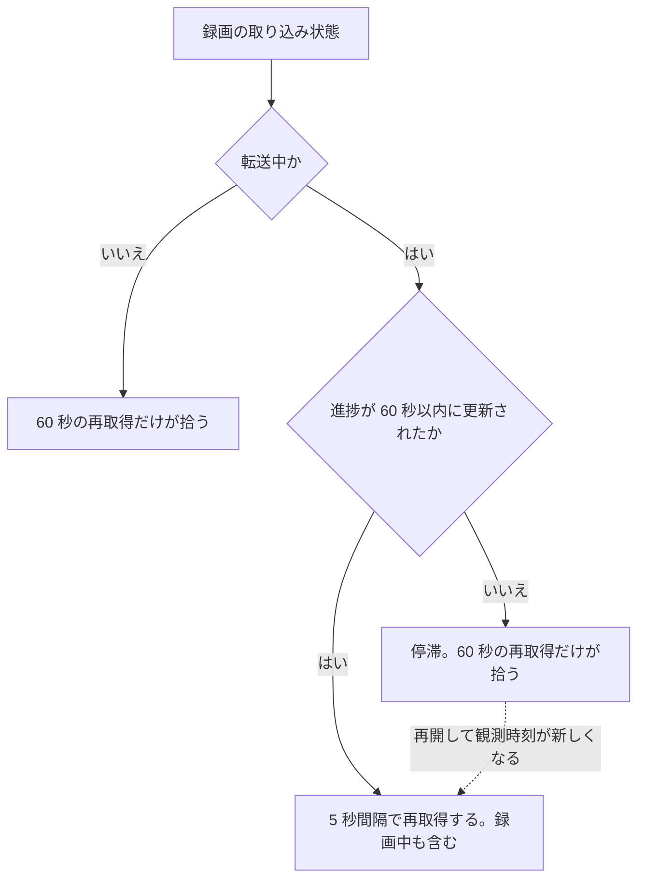
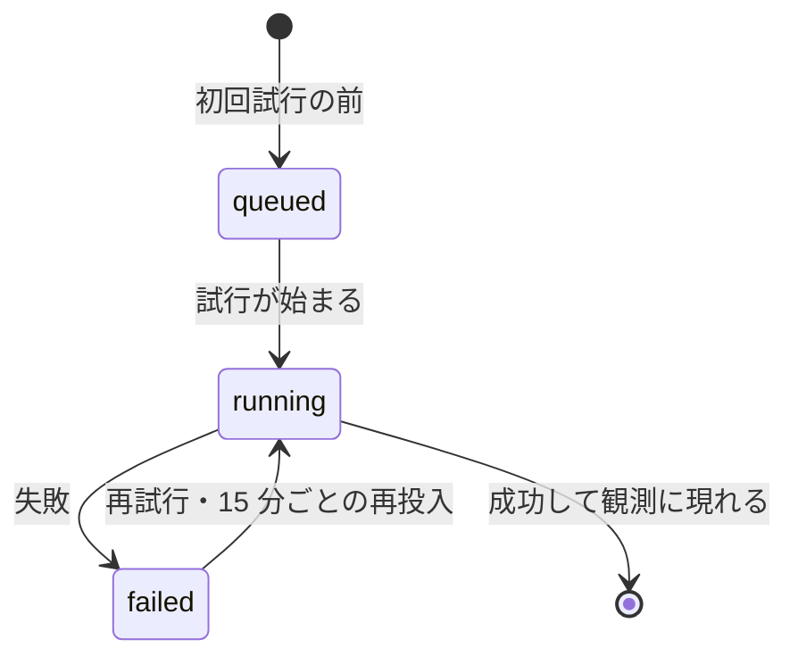
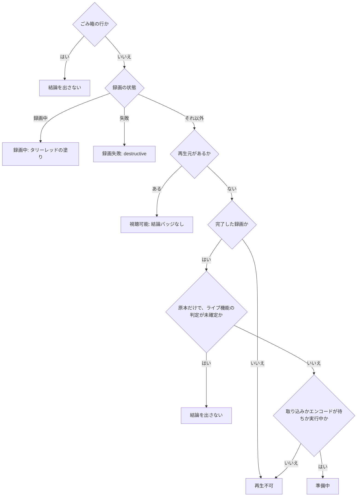
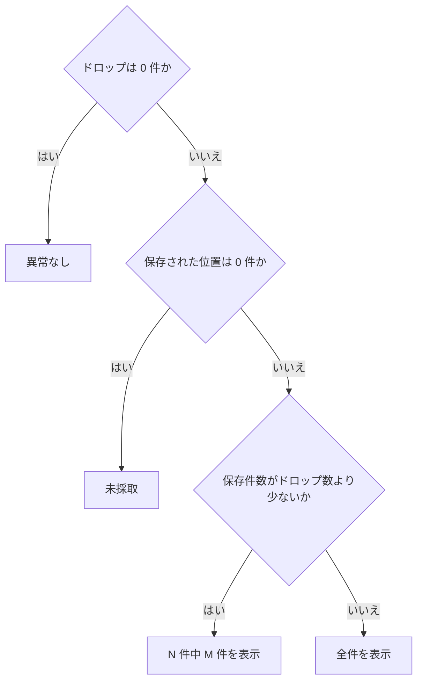

> [recordings.md](../recordings.md) の録画状態と統計。索引から辿る

## 出自ラベルは行のメタデータ列に置く

出自（ルール / 手動 / 帰属なし）のラベルは、行のメタデータ列の先頭に常に出す。メタデータ列は、site バッジの次からサービス名・日時と続く並びである。

結論・取り込み・エンコード・ドロップのバッジ群は、この録画の状態やパイプラインがどこで止まっているかを説明する。出自は別の軸なので、その間に挟まない。

根拠

- 出自ラベルの値: `source`
- 状態を説明するバッジ群: `RecordingVerdictBadge`、`IngestBadge`、`EncodeStatusBadges`、`DropBadges`
- 並びに含まれるサービス名: `serviceName`

## 取り込み中であることを画面に出す

取り込みの状態は、行のバッジに待ちと取り込み中を、詳細の欄に転送量を出す。録画中は割合を出さずバイト数だけにする。取り込みが来ない録画には、来ない未来を断定しないよう何も出さない。進捗は REST の再取得で収束させる。

録画の完了（`status = finished`）は mirakc 側の録画完了であって、取り込み完了ではない。原本がコミットされるまで再生も事後エンコードもできないのに、それを表すものが `sizeBytes` の省略しか無かった。そこで `Recording.ingest` を 2 段に分けて出す。`Recording.ingest` は、サーバーが DB 行から毎回導出する（[recording/ingest-followup.md](../../recording/ingest-followup.md) §5.6）。

### 行のバッジと詳細の欄

行のバッジは待ちと取り込み中を出し、録画詳細の「取り込み」欄は、分母が取れていれば転送量まで出す。録画中は割合を出さず、バイト数だけにする。

行のバッジは「取り込み待ち」「取り込み中 42%」で、分母が無ければ「取り込み中 1.2 GB」とする。進捗が 60 秒以上更新されていなければ「（停滞）」を付ける。録画詳細の欄は、分母が取れていれば「転送中 1.2 GB / 3.4 GB（35%）」まで出す。

**録画中は割合を出さない。** 追従 ingest は録画開始から走るので、録画中の分母は「mirakc がその時点で観測しているサイズ」であり、最終サイズではない。書けたバイト数がそれを追い越すことがあり、割合にすると「録画全体の 100% を取り込んだ」と読める誤った表示になる（実機で観測した）。録画中はバイト数だけを出し、% は分母が確定する録画終了後から出す。

根拠

- 行のバッジ: `IngestBadge`
- 録画詳細の「取り込み」欄: `RecordingDetail`、`<dl>`
- 録画中の分母を追い越す書き込み量: `writtenBytes`

### 何も出さない場合

言うことが無いときは行を並べない。取り込み済みで原本がある録画、取り込み状態そのものが無い録画、取り込みジョブが来ない録画には、何も出さない。取り込みジョブが来ない録画に「取り込み待ち」を出すと、来ない未来を UI が断定することになる。

取り込み状態そのものが無いとき（API が古い）は、推測で埋めない。

取り込みジョブが来ない録画（失敗・取り消し）は、取り込み状態が「不明」で返るので何も出ない。サイズについて直したはずの誤りを、待ちについて作り直す形である。待ちの根拠を同期の行の存在に取ると、これが起きる。根拠は、watcher が取り込みを投入する条件と同じ述語（同期の状態が録画中または完了）に揃える。**状態の名前が「これから起きる」を含むなら、起きる根拠を述語として書けるか確かめる。**

リトライで消えなかった進捗行が残っていても、「不明」になる。worker は cancel / fail を観測したとき、進捗行を消してからジョブを終端する。ただしその DELETE は、失敗してもログだけで続行する。server 側の導出が失敗・取り消しの観測を転送中より優先するので、二度と取り込まれない録画が「取り込み中（停滞）」を名乗り続けることはない。

根拠

- 取り込み状態そのものが無い（API が古い）: `ingest`
- 取り込み済みで原本がある録画: `committed`、`sizeBytes`
- 取り込みジョブが来ない録画: `failed`、`canceled`、`state`、`unknown`
- 待ちの根拠を揃える述語（同期の状態が録画中または完了）: `pending`、`record_sync`、`record_sync.status`、`recording`、`finished`
- 進捗行の消し損ない（失敗・取り消しの観測を転送中より優先する）: `failed`、`canceled`、`transferring`

### 録画中の取り込み

録画中の行にも取り込みを出す。watcher が録画開始の時点で取り込みを投入し、worker が録画に追従するため、開始直後の数秒は「取り込み待ち」、その後は「取り込み中」になる。

以前は「録画中に取り込みの数字は動かない」前提で、ここを伏せていた。追従では数字が動く。停滞を出さないことの根拠も変わった。追い付いている状態は正常なので、worker が観測時刻を進める（[recording/ingest-followup.md](../../recording/ingest-followup.md) §5.6）。

根拠

- 録画中の行にも取り込みを出す: `status = 'recording'`、[recording/ingest.md](../../recording/ingest.md) §5.1
- 追い付いても進める観測時刻: `observed_at`

### 色と「原本は削除済み」の判定

取り込みの表示に色は使わない。「原本は削除済み」と言えるのは、取り込みが完了していて、かつサイズが無いときだけである。

停滞も含めて取り込みの表示は状況の説明であって、タリー（いま電波に乗っている）でも destructive（取り返しがつかない）でもない（[design.md](../design.md)「色は信号のみ」）。停滞は文言で言う。

`sizeBytes` の省略は、「取り込んだ後に消した」と「まだ取り込めていない」の両方を含む。そのためこれだけを見ると、権限不足で ingest がリトライ中の録画に、「削除済み」と読める表示が出る。サーバーが「原本の行が状態を問わず存在するか」を見て `committed` を返すので、UI 側はその区別をそのまま使える。

根拠

- サーバーが原本の行を見る条件: `kind='original'`、`state`

### 進捗の更新間隔

進捗は REST の再取得で収束させる（SSE はヒント。不変条件 5）。5 秒間隔を張るのは、進捗の数字がいま動いている間だけにする。待ちや停滞した転送は短い周期を張らず、60 秒の再取得が拾う。

一覧は無限リストなので、常時ポーリングすると積んだページ全部を取り直すことになる。そのため短い周期は、進捗の数字が動いている録画があるときだけ張る。

短い周期を張らないもの（状態としては未完了でも）と、その代わりに何が収束させるかは次の通り。待ち（`pending`）は、いつ始まるかがこちらから分からない。失敗し続けている ingest もここに落ちる。権限不足でディレクトリの作成に失敗する場合、進捗行が書かれる前に落ちるので、River が再試行し続ける間ずっと待ちのまま残る（実環境で起きた失敗の仕方）。停滞した転送中（`transferring`）は、River のバックオフ待ちや、discard 後に record_sweep（5 分周期）が再投入するのを待っている状態である。分オーダーでしか動かないものを 5 秒で叩かない。再開すれば観測時刻が新しくなって、自動で短い周期に戻る（自己回復する）。

録画中（`status = 'recording'`）は、短い周期を張る側である。watcher が録画開始時点で ingest を投入し、worker が追従するので、進捗が新しい間は 5 秒周期の対象になる。追い付いた状態（書き込み量が止まって見える）は、上記の停滞した転送中と同じ扱いである。観測時刻が健全なポーリングで進む限り、短い周期を保つ。

いずれも [shell.md](../shell.md) の 60 秒の invalidate が拾うので、周期が落ちるだけで、収束は続く。**「終わっている画面はポーリングしない」を保つには、未完了の状態すべてを短い周期の対象にしてはならない。** `record_sync` 行が消えない以上、「未完了」は恒久的に残りうる。そのため失敗録画が 1 件でも読み込み済みページにあれば、ポーリングが恒久化する。

根拠

- 短い周期を張る判定: `lib/ingest.ts`、`hasLiveIngestProgress`
- 5 秒の再取得間隔: `ingestRefetchIntervalMs`
- 60 秒の invalidate: `lib/events.ts`、`operationalRefreshIntervalMs`
- 失敗し続ける待ちの経路: `MkdirAll`、`record_sync`
- 停滞の自己回復: `observedAt`
- 録画中も短い周期の対象: `status = 'recording'`、`written_bytes`、`observed_at`

### 5 秒周期のコスト

この 5 秒周期は録画時間の間ずっと続くが、実測したコストは許容範囲なので周期は変えない。録画が無いときと比べて、CPU もレイテンシも差が見えなかった。

録画中の一覧を開きっぱなしにしたときに相当する負荷（5 秒ごとに一覧を 1 回叩く）を、実環境で測った。api ロールの CPU は 1 ポーリングあたり 3.3 / 4.6 / 4.2 ms だった。この値は録画が無いときの 3.8 ms と同じで、同じ DB へ ingest が書き込む競合は測れなかった。一覧のレイテンシは p50 で 40〜52 ms（keep-alive・ポートフォワード経由）で、録画が無いときの 39.8 ms と差が無い。1 時間の録画に換算すると、api の CPU は約 2.9 秒（1 コアの 0.08%）で、ブラウザへ落とすバイトは約 12 MB になる。

5 秒という間隔そのものは、worker が進捗を書き直す最短間隔（2 秒）より粗い。間隔を決めているのは画面の数字が動く速さであって、サーバーの負荷ではない。

積んだページ数には線形に影響する。ページの深さには影響しない。同じ一覧クエリを録画行数 50 / 400 / 4,000 / 40,000 行で計測した。中央値は順に 1.7 / 2.3 / 2.3 / 2.8 ms である。page 2〜8 もほぼ同じ値だった。キーセットなので、行を読み飛ばす後戻りが無い。無限リストの定期再取得はページを逐次引く。同時に使う DB 接続は 1 本である。

「一覧を開いたまま放置」は、この周期に当たらない。背面タブでは再取得を発火しない既定になっている。この既定を固定するテストはこのリポジトリに無い。依存の既定に頼っている箇所である。

根拠

- 定期再取得がページを逐次引く: `useInfiniteQuery`、`infiniteQueryBehavior`（`await` ループ）
- 背面タブで発火しない既定: `refetchIntervalInBackground`（既定 false）
- 発火しない判定の実装（`@tanstack/query-core` 5.102.8）: `queryObserver`、`focusManager.isFocused()`
- 後戻りの無いキーセット（`OFFSET` を使わない）: `OFFSET`

## エンコードの待ち・実行中・失敗を画面に出す

エンコードの待ち・実行中・失敗は、まだ観測に現れていないプロファイルだけをバッジで出し、失敗だけを目立つ色にする。進捗の割合は SSE で重ね、完了と失敗の権威は REST の状態に置く。

目標のプロファイル（`Recording.encodeProfiles`、desired）と再生可能な観測（`Recording.encodedAssets`、observed）の差だけでは、「まだ来ていない」としか言えない。いま走っているのか、失敗して再試行待ちなのかは区別できなかった。そこで `Recording.encodeStatus`（openapi.yaml）をバッジで出す。desired のうち observed にまだ現れていないプロファイルだけを、`queued` / `running` / `failed` のいずれかで列挙する。バッジは一覧の行と単体ページのヘッダーで、取り込みバッジの隣に置く。

根拠

- エンコード状態のバッジ: `EncodeStatusBadges`
- 隣に置く取り込みバッジ: `IngestBadge`

### バッジの出し方

バッジは待ち・実行中・失敗を、プロファイル名を前置して出す。失敗だけを destructive の色にし、状態が省略されたときは何も描かない。

実行中は、進捗イベントを受け取るまで `%` を出さない。worker が実入力を ffprobe して得た duration を分母にし、ffmpeg の進捗出力の経過時間から割合を作る。duration を取得できない場合や SSE を取りこぼした場合は、架空の割合で埋めず「エンコード中」のままにする。

プロファイル未設定・全プロファイル完了済みの録画では、`encodeStatus` が省略される。そのためバッジは何も描かない。機能しないキュー画面や空の進捗バーを出さない判断は、サーバー側のこの省略で表現されている。フロントはそれをそのまま描くだけでよい。

**失敗だけを destructive にする。** ドロップのバッジと同じ判断で、実害があるので色で目立たせる。待ちと実行中は、取り込みのバッジと同じ中立色にする（状況の説明であって信号ではない。[design.md](../design.md)「色は信号のみ」）。

バッジにはプロファイル名を前置する（`h264: エンコード失敗`）。事後追加で複数プロファイルを依頼した録画では、「どのプロファイルが失敗したか」が言えないと運用判断に使えない（ドロップ統計の種別列と同じ判断）。

根拠

- 進捗の割合の出どころ: `-progress pipe:1`、`out_time`
- 色を揃えるバッジ: `DropBadges`、`IngestBadge`
- 省略される状態: `encodeStatus`

### 待ちと失敗の意味

待ちは「来る根拠」があるものしか出ない。失敗しても、再試行のたびに実行中へ戻る。

待ちが「来る根拠」があるものしか出ないのは、サーバー側の導出による。ごみ箱の録画とプロファイル自体が丸ごと省略されるので、フロントは何もフィルタしない。失敗は「二度と来ない」の断定ではない。River の既定リトライのたびに、実行中へ戻る。録画単位の恒久失敗（入力ファイルの破損など）でも、ワーカーが 15 分ごとに再投入するたびに実行中へ戻る。待ちへは戻らない。試行行は成功するまで消えないので、待ちは初回試行の前だけである。判断の詳細は [schema/recordings/satellites.md](../../schema/recordings/satellites.md) の試行表の節にある。

ホームに出す場合は、失敗録画と同じ「異常」の置き場に合わせる想定である。ただし本機能自体はホームへの統合を含まない。一覧・単体ページで何も表示しない状態と区別できれば足りるためである。

根拠

- 15 分ごとに再投入するワーカー: `EncodeReconcileWorker`
- 判断の詳細の置き場: `recording_encode_attempts`
- 状態の値: `queued`、`running`、`failed`

### 進捗の SSE と収束

完了と失敗の権威は REST の状態で、60 秒周期の再取得で収束する。進捗イベントは割合を重ねるためだけに使い、保存しない。

完了・失敗の権威は引き続き REST の `encodeStatus` / `encodedAssets` である。`encode-progress` SSE は接続中だけ届く揮発テレメトリで、「実行中」の文言に割合を重ねるためだけに使う。durable な状態が実行中でなくなったら、最後の値を破棄する。`progress=end` や 100% だけで完了を断定しない。

進捗はテーブルへ保存しない。再起動後に不要な秒単位の値で WAL・dead tuple・vacuum 対象を増やさないためである。worker → PostgreSQL NOTIFY → notifier の EventHub → SSE という best-effort 経路で、最大 1 回/秒だけ運ぶ。画面を途中から開いた場合は、REST 由来の「実行中」を先に出し、次のイベントから割合を表示する。

待ち・実行中・失敗の収束は、既存の 60 秒周期の再取得（録画一覧を取り直す周期）にも乗る。背面タブでは定期取得を投げず、前面へ戻ったときはウィンドウのフォーカス時の再取得が拾う。進捗イベントを取りこぼしても、durable 状態の完了・失敗判定はこの再取得で正しく収束する。

根拠

- 進捗の SSE: `encode-progress`、`progress=end`
- 60 秒周期の再取得（`/api/recordings` を取り直す）: `operationalRefreshIntervalMs`、`web/src/lib/events.ts`
- 前面へ戻ったときの再取得: `refetchOnWindowFocus`

### 待機列の全体像は録画一覧に置く

待機列の全体像は専用ページを作らず、録画一覧のヘッダー内にある管理情報行に「待機中 N 件 / 実行中 N 件」として置く。件数の単位は録画 × プロファイルで、ごみ箱の録画は含まない。

通常時はストレージ残高の要約と同じ行に収め、録画一覧へ到達した時点で容量とエンコード待機列の全体像を同時に確認できるようにする。単一世帯では件数を常時監視する頻度が低く、既存の録画行へ絞り込めれば全体像と個別の状態を同じ画面で確認できるためである。見る頻度やジョブ数が増え、履歴や所要時間の予測が必要になった時点で、専用ページを検討する。

件数は `GET /api/encode-queue` が、desired で未観測のプロファイルと、ユーザーが明示した作り直し要求から導出する。ごみ箱の録画、原本が active でない録画、試行回数が上限に達したプロファイルは数えない。実行中の試行行があるものが実行中で、それ以外が待機中である。単位は録画 × プロファイルである。1 本に 2 プロファイルあれば 2 件になり、録画数とは一致しない。ボタンは現在のライブラリタブを絞り込むため、複数プロファイルの録画があれば件数と表示行数は一致しない。件数を押すと、`GET /api/recordings?encodeState=queued|running` で該当録画へ絞り込む。

この件数に `encode-progress` SSE は使わない。SSE は接続中の ffmpeg 進捗率を、録画行と録画詳細のバッジへ重ねるためだけの揮発テレメトリで、待機列の権威ではない。ホームにも同じ件数を複製しない。録画一覧が全体像の置き場であり、0 件でも「待機中 0 件 / 実行中 0 件」と確認できる。

## 録画が見られるかを結論で示す

録画一覧の行と録画詳細の見出しは、「この録画を見られるか」の結論を、録画中・録画失敗・準備中・再生不可のときだけバッジで示す。見られる録画には結論を出さない。行の語に「要対応」は使わない。

結論は、録画の状態・再生元・取り込みとエンコードの進行から決める。再生元は録画詳細と同じ選び方で選び、状態の絞り込みは DB の `status` をそのまま使う。

根拠

- 結論の決定: `recordingVerdict`
- 録画詳細と同じ再生元の選び方: `selectRecordingPlaybackSource`

### 結論の優先順

結論は、録画中・録画失敗・視聴可能・準備中・再生不可の順に判定する。

原本だけの録画は、ライブ機能が有効なときに視聴可能となる。取り込みの停滞した転送も、準備中に含む。キャンセルされた録画も再生元がないので、再生不可とする。

根拠

- 録画中と録画失敗の判定に使う録画の状態: `status = recording`、`status = failed`

### ライブ機能の判定が未確定のとき

ライブ機能の判定が未確定の間は、原本だけの録画を再生できないと断定しない。

この断定を避けるのは、ライブ機能の capability が `pending` または `unknown` の間である。能力 API の読み込み中や一時的な失敗で、「再生不可」が一覧全体に現れるのを防ぐ。この未確定の判定は「準備中」より先に行うので、エンコード中でも結論を出さない。能力が `enabled` なら視聴可能、`disabled` ならエンコード中は準備中、それ以外は再生不可と判定する。

### 結論バッジの扱い

見られる録画は結論を表示せず、見られない理由が準備中ならその状態を出す。

「完了」を無印にするのは、録画処理が完了した事実だけでは視聴可能か分からないためである。結論の後ろには取り込み・エンコード・ドロップの内訳バッジを並べ、判断の根拠を示す。ごみ箱の行には結論を出さない。削除日時がその行で確認すべき状態である。

行の語に「要対応」は使わない。視聴可能でもエンコードに失敗した録画はあり、「要対応」だけでは視聴可否を隠してしまう。必要な対処はエンコード失敗やドロップの内訳バッジを destructive で示す。

## ドロップ統計はバッジ + PID 表

ドロップ・エラー・スクランブルは、0 でないものだけを色付きバッジで出し、PID 別の内訳は詳細ページだけが持つ。未計測は全値 0 と区別し、位置を採っていない録画は「未採取」と出す。

0 のものは出さないので、正常な録画ではバッジが 1 つも出ない。

### バッジと PID 表の置き場

録画行ではドロップのバッジをメタデータ列の末尾に置き、詳細では状態・取り込み・エンコードの直後に置く。

録画行では行長に制約があるため、末尾に置く。詳細では、異常の信号を連ねて読めるよう、状態・取り込み・エンコードの直後に置く。PID 別内訳は詳細ページだけが持ち、狭幅で列が収まらないときは、表の容器だけを横スクロールさせる（ページ本体は横スクロールさせない）。

### 未計測と計測済みの区別

未計測は要約の省略で表し、計測済みの全値 0 と区別する。

`dropSummary` は、原本 TS の計測記録と保存サイズが一致するときだけ返る。計測記録のサイズが原本と一致するごみ箱の録画では、要約を保つ。PID 別内訳も同じ判定で返し、未計測は空配列になる。未計測と計測済みの空の区別は、`dropSummary` の有無で行う。

### PID の種別列

PID 表には、映像・音声・PAT などを示す種別列を置く。分類できなかった PID は、種別を空にして PID 数値だけを出す。

PID 数値だけの統計では、「映像が壊れたのか EIT が数回落ちただけか」を区別できず、運用判断に使えない（[recording.md](../../recording.md) §1「例外の境界」）。分類の失敗で、統計そのものを隠さない。

### ドロップ位置の表示

ドロップ位置は「録画開始からの経過」と原本内の byte offset で表示する。位置が 0 件でドロップがあれば「未採取」、ドロップも 0 なら「異常なし」、保存件数が真の件数より少ないときだけ「N 件中 M 件を表示」と出す。

PCR を観測できなかった、または PCR の逆行 / PCR を運ぶパケット自身の discontinuity で時計を無効にした位置は、時刻不明とし、位置そのものは隠さない。位置は PID ごとに上限があるので、保存件数が真の `drops` より少ないときは「N 件中 M 件を表示」と出す。

**ただし保存が 0 件なら「N 件中 0 件」とは出さない。** ドロップ位置を採る前に ingest した録画は、`drops > 0` でも位置を 1 件も持たない。同じ文言にすると、上限で切り詰めたのか元から採っていないのかが、読者に区別できない。位置が 0 件かつ `drops > 0` は「未採取」、`drops` も 0 なら「異常なし」として出し分ける。
