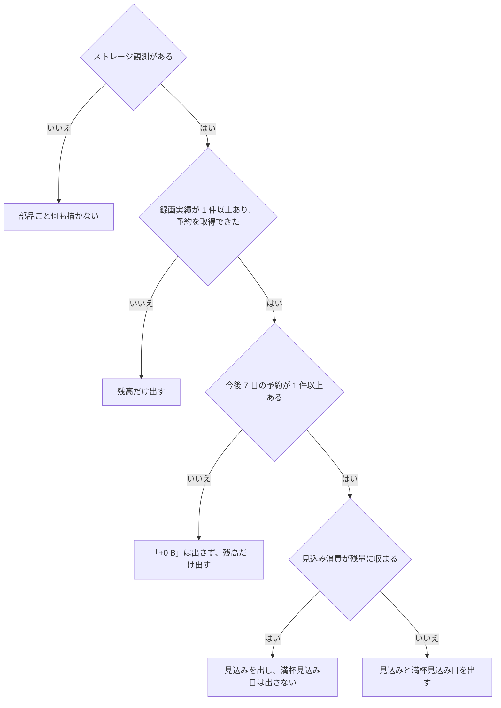

> [recordings.md](../recordings.md) のストレージ残高。索引から辿る

## ストレージ残高と満杯見込み

録画一覧のヘッダーには、通常時は空き容量と詳細への入口だけを常置する。今後 7 日の予約による見込みは警告の有無に関わらず詳細側に置き、満杯見込み日と、1 時間を超えた観測の「古い可能性」は要約に残す。

### 常置する情報と詳細

録画一覧のヘッダー領域に、ストレージ残高とエンコード待機列をまとめた管理情報行を置く。常置するのは空き容量と詳細への入口だけで、詳細を開くとアーカイブと、設定されている場合のローカルスクラッチを、名前・総容量・使用済み・空き・観測時刻に分けて表示する。

常置を空きだけにすると、視聴対象へ向かう録画行の位置を下げずに、必要な容量情報へは 1 操作で到達できる。録画一覧で容量を確認できれば単一世帯には足りるため、専用ページは作らない。見る頻度やストレージ root の種類が増えた時点で専用ページを検討する。

根拠

- アーカイブとローカルスクラッチの root 名: `media`、`scratch`
- 管理情報行の位置と実装: `RecordingFilters` の下、`components/storage-balance.tsx`
- 予約見込みの表示場所: 「要約に出すかどうかは警告に連動させない」

### 要約に残す警告

情報量を減らすために警告を隠してはいけない。満杯見込み日と、1 時間を超えた観測の「古い可能性」は要約に残す。古くない通常の観測時刻は、展開側の root ごとの表示が持つので要約に出さない。

展開側の追加行に観測時刻を重ねて二重にしない。ストレージ観測そのものが無いか取得できない場合の沈黙は従来どおりである。エンコードの「待機中 N 件 / 実行中 N 件」も、0 件を含めて省略しない。

根拠

- 古い観測の判定の語: `stale`

### 要約に出すかどうかは警告に連動させない

見込み・満杯見込み・観測時刻の出し分けは、警告状態に依存させない固定則にする。見込みは常に展開側、満杯見込みは常に要約、観測時刻は古いときだけ要約に出す。連動させると、見込みも観測時刻もどこにも出ない抜け穴ができる。展開側の追加行は見込みだけを持ち、観測時刻は重ねない。root ごとの表示が既に持っているためである。

この抜け穴は、警告でもないのに何も出ない形で、要約表示を実装したレビューで発覚した。

根拠

- 録画一覧の管理情報行の簡易表示: `compact`

#### 到達距離の合否

視聴対象への到達距離（固定ヘッダー・下部ナビに隠れないこと、必要スクロール量）の合否と実測値は、実ブラウザの設計検査「視聴対象への到達距離」の節が権威である。ここに px 値を転記すると数値が二重管理になり、必ず食い違う。

根拠

- 到達距離の合否と実測値の権威: `e2e/design.mjs`「視聴対象への到達距離」

#### 見込みの導出元と参照する root

見込みの導出は純関数に集約し、表示部品は取得と表示の出し分けだけを持つ。見込みが参照する root は、アーカイブだけである。

表示部品が取得する API は 3 つ（`GET /api/storage` / `GET /api/recordings` / `GET /api/reservations`）である。`/recordings` はストレージを最も直接に消費する画面であるため、全体像の設置先にした。

参照するアーカイブ（`storage.media_dir`）と違い、ローカルスクラッチは取り込みの一時領域で、録画の最終的な保存先ではない。そのため残量の表示には含めるが、今後の予約による消費見込みには使わない。出所は [storage/contract.md](../../storage/contract.md) の §残量の観測と、同ファイル §5「2 階層: 録画バッファとアーカイブ」である。

根拠

- 見込みの導出を集約する純関数: `lib/storage-forecast.ts`
- 取得と出し分けだけを持つ部品: `StorageBalance`
- 見込みが参照する root: `media`。参照しない root: `scratch`

### 4 つの沈黙

沈黙は 4 通りある。観測が無ければ部品ごと何も描かず、録画実績か予約が取れなければ残高だけを出す。予約が正当に 0 件でも「+0 B」は出さず、見込み消費が残量に収まれば満杯見込み日は出さない。でっち上げの既定値は置かない。

ストレージ観測が無いとは、`GET /api/storage` の結果にアーカイブの root の行が無いことである。初回観測前や、statfs の失敗が続くときに起きうる。

録画実績が 0 件のとき、または予約の取得が未解決か失敗のときは、残高だけ出し、「+Y GB の見込み」と「満杯見込み」は出さない。予約が正当に 0 件（取得は成功したが、今後 7 日の窓に予約が無い）のときも「+0 B」は出さない。この 2 つは表示結果が同じでも、内部では別の経路を通る（次の小見出し）。

見込み消費が残量に収まるときに満杯見込み日を出さないのは、下界主義による。「主張は下界に限る」という容量表示の考え方と同じ精神である。

根拠

- アーカイブの root の行が無い: `root === 'media'`
- 下界主義の同じ考え方: `lib/capacity.ts`「主張は下界に限る」

#### 取得失敗と正当な 0 件の区別

**取得失敗と正当な 0 件を混同しない。** 予約の取得が失敗または未解決なら、見込みを算出しない。予約が正当に 0 件なら見込みを算出し、0 バイトにする。

`undefined` を `[]` に置き換えると、取得失敗時に「今後 7 日の予約で約 +0 B の見込み」と、欠損データから肯定を捏造する。プローブでは実際に「空き 931.3 GB今後7日の予約で約 +0 B の見込み観測: 8/13 15:57」と描画されることを確認済みである。録画一覧の取得結果が未解決なら、平均ビットレートも未解決のまま渡し、`0` にフォールバックしない。

根拠

- 予約取得失敗と正当な 0 件の分岐: `estimateStorageForecast`、`hasEstimate`、`hasEstimate: false`
- 予約日程の入力: `lib/storage-forecast.ts` の `upcomingReservationSchedule`
- 予約 0 件の出力: `projectedConsumptionBytes`、`projectedConsumptionBytes: 0`
- 録画取得が未解決のとき平均ビットレートを作らない: `recordings`、`averageBitrate`

#### エラー表示

取得失敗はすべて、上記の沈黙（残高だけ出す）に縮退させる。ヘッダーの補助情報 1 つのために、専用のエラー表示を割かないためである。

根拠

- 専用のエラー表示の部品: `ErrorState`

### 母数: 直近 20 件の finished 録画

母数は直近 20 件の完了した録画とし、失敗した録画と原本の実サイズが無い録画は除く。固定日数は採らない。録画頻度が運用ごとに大きく違い、少ない側では標本が枯渇し、多い側では 1 回の取得上限 200 件を超えるためである。

取得には `GET /api/recordings?status=finished&limit=20` を使う。`finished` に絞る理由は、`failed` が途中までのサイズを番組全尺の長さで割ることになり、平均ビットレートを実際より低く見積もるためである。原本の実サイズが無い録画（原本削除済み、または未 ingest）も除く。

根拠

- 直近 20 件を使う上限: `lib/storage-forecast.ts` の `recentRecordingSampleLimit`
- 録画状態の絞り込み: `status=finished`
- 番組の放送時間と ingest 済み原本の実サイズ: `Recording.durationMs`、`Recording.sizeBytes`
- 失敗した録画が途中までのサイズを持つ: `failed`、`sizeBytes`、`durationMs`

#### 見込みの振れる方向

各録画のサイズは原本の TS だけで、エンコード派生物を含まない。そのため見込みは、原本も残す設定（既定）では過小に、エンコード後に原本を削除する設定では過大に振れる。一方向の保証は書かない。

エンコードプロファイルを設定しているルール（既定は原本を常に保持する設定。[storage/retention.md](../../storage/retention.md)）では、実消費が原本と派生物の和なので、見込みは過小に振れる。エンコード完了後に原本を削除する設定のルールでは、実消費が派生物のサイズ（原本の 1/4〜1/10、同 doc）へ縮む。原本サイズを今後も一定と仮定するこの見込みは、そのぶん過大に振れる。

どちらの方向にも振れることを前提にしており、ルールの値札の「見込み」と同じく一方向の保証は書かない。

根拠

- 原本 TS のみでエンコード派生物を含まない: `sizeBytes`
- 既定の原本保持: `keepOriginal: always`
- エンコード後に原本を削除する設定: `keepOriginal: until_encoded`
- 一方向の保証を書かない同じ方針: `lib/rule-cost.ts` の「見込み」

### 鮮度: 1 時間を超えたら「古い可能性」

鮮度は画面側で判定し、観測から 1 時間を超えたら「古い可能性」と出す。1 時間は観測間隔の実装詳細とは独立に選んだ固定の安全マージンである。

`GET /api/storage` の観測時刻は「観測ループが止まっていても行は消えない」契約（[storage/contract.md](../../storage/contract.md) §残量の観測）なので、鮮度は画面側で必ず判定する。

根拠

- 観測時刻: `observedAt`
- 1 時間の判定基準: `lib/storage-forecast.ts` の `observationStaleAfterMs`

#### 閾値と観測間隔

観測間隔の値はフロントへ輸入せず、「5 分の N 倍」で基準を定義しない。この値は worker 側の実装詳細で、API の契約に含まれないためである。1 時間は、独立に選んだ固定の安全マージンとする。

worker の観測間隔は現在 **5 分固定**である。worker の設定構造体にフィールド自体はあるが、起動処理がその値をどこからも埋めていないため実質デッドで、運用者は変更できない。1 時間は、現在の 5 分間隔に対して 12 倍の余裕があり、1 回の失敗パスや再起動直後の遅延では誤って「古い」と出ない。一方で観測ループが本当に止まっていれば、1 時間以内に検知できる。将来この間隔が実際に設定可能になり、既定より大きく延ばす運用が出てきた場合は基準が弱くなるため、そのときに見直す。

根拠

- 観測間隔の既定値: `internal/worker/storage.go` の `defaultStorageSyncInterval`
- 設定にあるが埋められていないフィールド: `worker.Config.StorageSyncInterval`、`cmd/rokuban/server.go`

#### 取り直す周期との関係

行自体は 5 分周期の定期 invalidate で取り直す。この周期と 1 時間の判定基準は、独立に選んだ別の値である。前者は「得るものが無い頻度で REST を引かない」ため、後者は「1 回の失敗パスで誤検知しない」ための安全マージンとして選んだ。

取り直しの周期は、[docs/api/sse.md](../../api/sse.md) の「ストレージ」グループにある。

### 消費見込み: 今後 7 日、skip=true は数えない

消費見込みは、今後 7 日に開始する予約の消費を合算する。スキップされて同期されない予約は数えない。満杯見込み日は、予約を開始順に並べて消費を積み上げ、残量を最初に超える瞬間とする。ただし近似が残るので、目安であって確約ではない。

#### 対象窓と数える予約

対象窓は今後 7 日で、ルールの値札やルールの時間帯条件と同じ 1 週間周期に揃えている。スキップされた予約は数えない。

`GET /api/reservations` は絞り込みパラメータを持たないため全件を取得し、クライアント側で `[now, now+7日)` に開始する予約だけを合算する。

**`skip === true` の予約は消費に数えない。** `skip` は有効な設定の `effective.skip` である。true の間、reconciler は mirakc に同期しないので、ディスクを消費しない。`state`（active/detached/orphaned）は表示用の導出値なので、同期可否のフィルタには使わない。同期の可否を決める値は `effective.skip` だと、[recording/reservation-model.md](../../recording/reservation-model.md) §4.3 が定めている。

根拠

- 対象窓の日数: `forecastWindowDays`
- 値札と同じ 1 週間周期: `lib/rule-cost.ts`
- 同期可否を決める値: `effective.skip`、`skip === true`（reservation-model.md §4.3）

#### 満杯見込み日の求め方

満杯見込み日は、予約を開始順に整列した消費イベント列の累積消費が、残量を最初に超える瞬間として報告する。一様分布は仮定せず、均等に分布する線形外挿は採らない。

各予約の開始時刻と尺は、`GET /api/reservations` で既に取得済みである。

「見込み消費を 7 日間に均等に分布する」線形外挿は、予約が窓の終盤や冒頭に偏ると、実際より早い、または遅い満杯見込み日を出す。後者は下界主義に反する過小警告の方向になる。

根拠

- 開始時刻順の消費イベント列を作る: `upcomingReservationSchedule`、`startMs`
- 累積消費が残量を超える瞬間: `estimateStorageForecast`、`projectedFullAtMs`
- 窓の終盤・冒頭に偏る 2 方向を固定する: `lib/storage-forecast.test.ts`「予約が窓の終盤/冒頭 1 件に集中しているとき」の 2 テスト

#### 残る近似

近似はなお残り、この列挙は閉じていない。重なる予約を直列として扱う近似は、同時開始なら遅い満杯見込みを、長い予約に短い予約が重なるだけなら早い満杯見込みを出す。

現時点で分かっている近似は少なくとも次の 3 つである。1 つ目と 2 つ目は、上の「母数」の節で述べた近似の再掲で、3 つ目が今回追加で見つかったものである。

1. 平均ビットレートが、直近の標本の外挿であること
2. 原本のサイズだけを使い、エンコード派生物を含まないこと
3. 重なる予約を、直列（開始順に 1 本ずつ消費）として扱うこと

3 つ目の近似は、実際に並行して録画される予約（複数チューナー構成では普通）があっても合成レートにはしない。この近似も両方向に振れる。同時に始まる複数の予約では、直列近似は実際より遅い満杯見込みを出す（過小警告・危険な方向）。実測では、同時開始の 6 時間予約 2 本が残量を消費するとき、直列近似は 2.78 時間後と報告するが、実際の合成レートでは 1.39 時間後に満杯になる。

長い予約の途中に短い予約が重なるだけなら、直列近似は実際より早い満杯見込みを出す（過大警告・安全側だが不正確）。実測では、24 時間予約に 30 分予約が重なるケースで、直列近似は 10 分後と報告するが、実際は約 23.67 時間後である。

誤差の大きさは、重なる予約のうち長い方の尺で頭打ちになる（実測で数時間〜約 1 日程度）。上記の一様分布の系統誤差（最大で窓の長さそのもの、7 日）より小さいが、ゼロではない。実装は変えていない。重なりを合成レートで扱うには、予約どうしの重なり区間を都度計算する必要があり、このタスクのスコープを超える。値札の精度を上げるコストが、今の下界主義的な運用判断への寄与に見合うほど高くないという判断である。

この 3 つ（と、まだ見つかっていない近似があるかもしれないこと）のために、「満杯見込み日」はあくまで目安であって確約ではない。ルールの値札の「見込み」と同じく、一方向の保証（「多めには出ない」等）は書かない。

根拠

- 重なる予約の 2 方向の近似を固定する: `lib/storage-forecast.test.ts` の「既知の近似」2 テスト
- 値札の「見込み」と同じ方針: `lib/rule-cost.ts`

