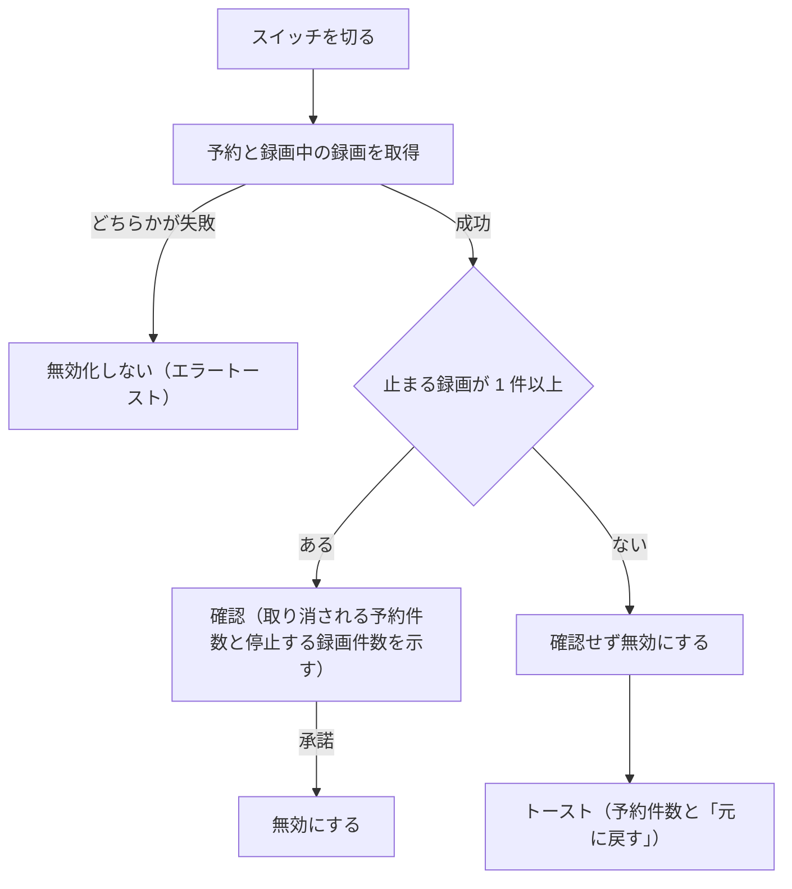
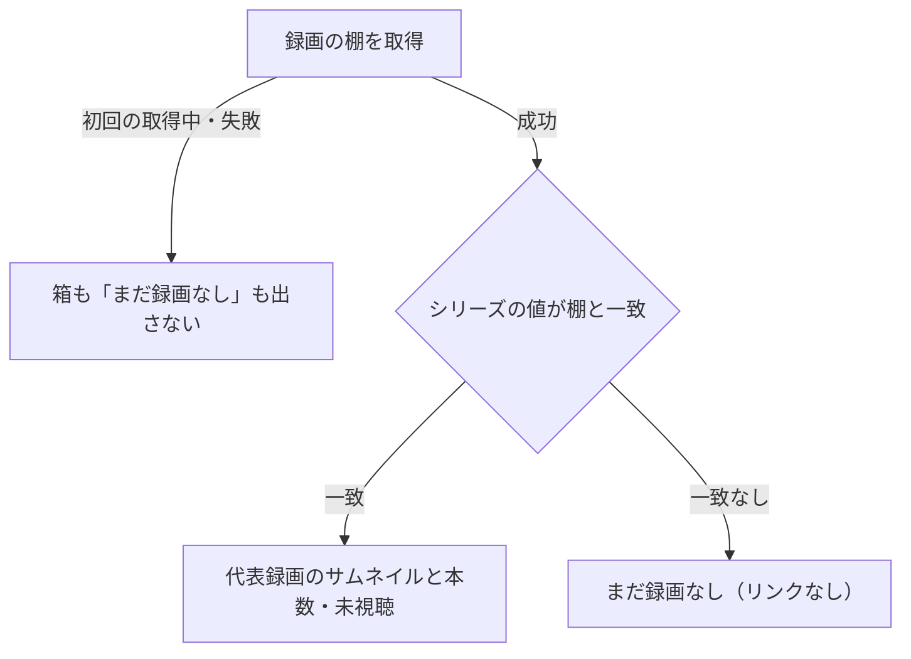
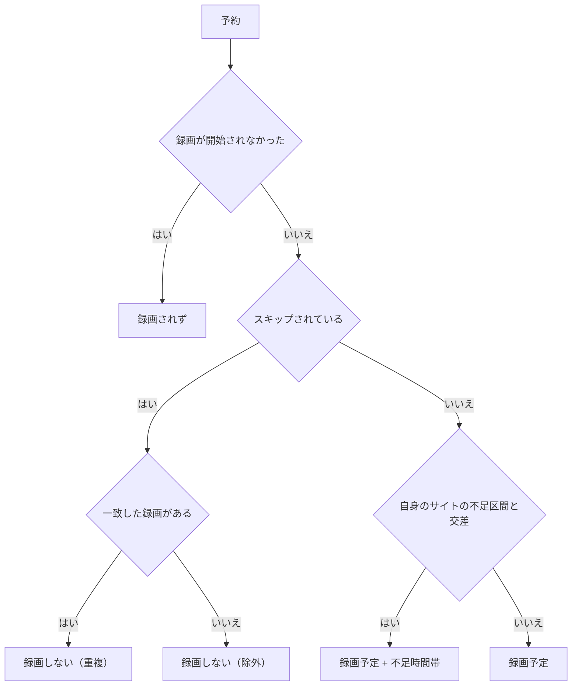

> [frontend.md](../frontend.md) の一部。索引から辿る

# 予約の UI

予約の画面は、操作を 1 タップで済ませ、取り返しをトーストに持たせる方針で作る。予約詳細・ルール一覧・予約一覧・容量不足バッジの判断を、節ごとに置く。

## 予約はワンタップ + トーストから取消

予約と取消は確認ダイアログを挟まず、1 タップで実行してトーストで知らせる。取り返しはトーストの「元に戻す」が持つ。

### 誤タップの緩和

確認ダイアログを挟まない代わりに、誤タップは操作列の分離と、実行直後のトーストの 2 つで緩める。

右端の列は行に対する動作の操作列とし、予約・取消・放送中のライブを置く。行本体（詳細展開）のタップ領域と分離し、各ボタンは最小 44px を確保する。実行直後にトーストで「予約しました [取消]」を出す。確認より速く、かつ取り返しがつく。

### 行メニュー

細いポインタでは予約一覧の行を右クリックの対象にし、粗いポインタでは独自メニューを出さない。行メニューの「予約を取消」は、一覧の予約操作と同じ取消・Undo 付きトーストを使う。

シリーズ見出しは次回予約を、展開後の各話はその予約をメニュー操作の対象にする。メニューの先頭に「開く」「新しいタブで開く」「リンクをコピー」を置く。Shift+右クリックはブラウザのメニューへ渡す。粗いポインタでは、タップによる展開やリンクを保つ。行メニューから確認ダイアログは増やさない。

### 楽観的更新

予約と取消の結果は対象行へ即時に反映し、サーバーの値に追いついたら楽観状態を外す。操作中の行だけを処理中にする。

追いついたかどうかは、SSE と REST の再取得で判定する（レベルトリガー）。処理中の状態を全行に渡すと、1 件予約する間にリスト全行のボタンが無効化される。検索結果の予約ボタンもこの共通経路を使う。

根拠

- 全行に渡してはいけない処理中の状態: mutation の `isPending`

### 予約状態が取れていない間

予約状態を 1 件も取得できていない間は、未予約行の予約操作を止める。古い値が残っている間は止めない。

番組表・検索結果のいずれも、予約一覧の取得失敗で番組の表示自体は隠さない。しかし押せてしまうのが最悪の選択肢になる。ルール由来の予約に手動予約の意図を送ると、手動予約の行が残り、以後ルールが再評価されなくなっても居座る恒久的な変化になるからである。

古いが既知の値が残っている間（初回成功後の再取得だけが失敗した）は止めない。止めるべきは 1 件も持っていない状態だけである。

根拠

- 手動予約の意図: `record` intent
- 居座る手動予約の行: `program_intents`

### 取消の取り返し

取消にも予約と対称に、トーストと「元に戻す」を置く。ただし詳細画面は、取消後に一覧へ遷移する形を保つ。

一覧・グリッドの取消トーストに「元に戻す」を足す。詳細画面の取消も、確認ダイアログを挟まず Undo にする。

遷移を残すのは、取消した予約がスキップの意図だけの行だと、ruler が次のパスで削除するからである。遷移せず留まると、詳細の GET が 404 になってしまう。旧実装が遷移していたのはこれを避けるためで、正しかった。トーストの提供元はルーティングの外側にあるので、トースト本体と Undo のクロージャは遷移後も生きる。「遷移はする。取り消した対象への取り返し手段だけは持たせる」の両立で足りる。

根拠

- 次のパスで削除される行: `skip` 意図だけの予約行
- 遷移後も生きるトースト: `ToastProvider`

### Undo が送る意図

Undo は、取消した予約がルール由来か手動かで送る意図を変える。手動予約の逆操作は同じ意図を打ち直せば足りるが、ルール由来の予約に同じ操作をすると別の意味になるからである。

ルール由来の予約に同じ意図を送ると、「明示的に主張した予約」に変わり、以後ルールがマッチしなくなっても居座ってしまう。ルール由来の逆操作は、意見を取り下げてルール評価に戻す別の操作にする。

## エンコード設定は予約後に変える

エンコード設定は予約時に聞かない。主操作を 1 タップに保つためで、変えたい場合は予約成功トーストの「設定」と、番組リストの展開パネルの「予約の設定」から入る。

これが「この番組だけ別のエンコードで」の入口である。展開パネルでは、予約済みの行にだけ「予約の設定」を出す。

### 予約直後の詳細の 404

予約の意図を送った直後は、ruler が予約行を作るまで詳細の GET が 404 になりうる。404 は「まだ無い」と「もう無い」を区別できないので、両方で真になる文言にする。

手動リロードは案内しない。行ができ次第、SSE による再取得で自動的に表示される。

根拠

- 詳細の 404 の原因: `reservations` 行
- 自動表示の経路: SSE の invalidate

### 番組リストの操作列はホバー / フォーカスした行だけ立てる

番組リストの行右端の操作列は畳んでおき、ホバー・フォーカス・展開のときだけ幅を開く。塗りの「予約」を毎行に常時並べると、最上位の画面で中間頻度の操作が地になるからである。

#### 開く条件

放送中の行では、予約ボタンの左にライブボタンも置く。

細いポインタ（マウス・トラックパッド）では、行のホバーまたはフォーカスで開く。タッチと粗いポインタはホバーが無いので、展開中の行だけ開く。

キーボードは `:focus-visible`（見た目のフォーカスリングを伴うフォーカス）で開く。プレーンな `:focus` で開くと、マウスクリックやタップの直後に残るフォーカスも含むので、折りたたみ直した直後もその名残りだけで開いたままになる。

#### 開閉の代償

列を開くと横方向ではタイトルの切れ位置が開閉のたびに動くが、縦方向のレイアウトシフトは起きない。

列を開くと行トグルが縮み、その右端のシェブロンが左へスライドして操作ボタンのスペースを空ける。放送中の行は、予約ボタンにライブボタンの分を足して開く。以前は列幅を常時確保していたが、ボタンが出ていない間の空きが不恰好なので畳む方式にした。

**代償として横方向はタイトルの truncate 位置が開閉のたびに動く。** 実機で確認し、許容と判断した。

縦方向は避ける。ボタンは 44px、行は 56px 以上なので行の高さは変わらず、番組リストの仮想化の再計測を誘発しない。行の高さが開閉で変わらないことは、e2e が通常行と放送中の行で実測する。

根拠

- 再計測を誘発しないこと: 仮想化の `measureElement`
- 高さが変わらないことの実測: e2e `reserve-visibility.mjs` の ①-c

#### 畳む手段

畳む手段は幅 0 とはみ出しの非表示にし、透明度は採らない。幅 0 の領域はヒットテストの標的を持たないので、折りたたみ行の操作列を生座標でタップしても予約が成立しない。

透明度は見た目を消すだけで、ヒットテストも tab 順序も残す。「見えないのに実際にはタップできる」標的になり、行本体と分離したタップ領域（§予約はワンタップ + トーストから取消）を自ら成り立たなくしてしまう。旧実装で実測した欠陥である。

根拠

- 畳む手段: 幅 0 + `overflow-hidden`
- 採らない手段: `opacity`

## 予約詳細は base / overrides を 1 画面に統一する

予約詳細は、ルール由来の予約と手動予約を同じ 1 つの画面で扱い、由来で編集画面を分けない。ruler が書く基本値と api が書く上書き値が同形のデータだからである。

根拠

- ruler が書く基本値: `base`
- api が書く上書き値: `overrides`（同形の jsonb）

### 画面への入口

予約一覧の行に加え、番組リストの行からも来る。予約済みの番組行を展開すると「予約の設定」でここへ遷移する（[programs.md](programs.md) §展開領域から外への入口）。

上書き値の編集はこの画面の担当で、番組行の展開パネル自体は編集欄を持たない。

### 機能しないコントロールは置かない

編集できる項目だけを編集欄にする。プロファイルと原本保持はルールの作成・編集と予約の上書きで編集でき、優先度は表示のみにする。

プロファイル一覧は `GET /api/encode-profiles` で取る（設定名だけ。機微情報なし）。エンコード完了まで原本を残す設定は、プロファイルが空だとクライアントでも止め、API も 400 を返す。

予約の上書きの PATCH は、「既存の上書き + このパッチ + ルールの基本値」をマージした実効値で判定する。そのため、原本保持だけを送る、プロファイルだけを reset するといった、1 リクエストでは見えない組み合わせも、実効値として空プロファイルなら弾かれる。

優先度は、reconciler が mirakc への差分反映（優先度差分での schedule 再作成）を既に持っている。しかし編集 UI はまだ無く、値は表示のみである。

根拠

- 編集できる項目: `encodeProfiles`、`keepOriginal`
- 空プロファイルで弾く設定: `keepOriginal: until_encoded`
- 判定に使う実効値: 「既存 override + このパッチ + ルールの base」

### 番組情報の置き場と欠落時の扱い

番組の説明と拡張情報は、題名の塊（題名・局・開始時刻・尺の行、重なり警告）の下に置く。EPG 側で番組情報が消えて 404 になったときは、その詳細だけを隠し、予約の状態と設定は表示し続ける。

説明が塊の間に入ると、局・時刻が題名から離れ、拡張情報が長い番組では画面外へ押し出される。404 は再試行せず、初回の応答で読み込み中表示ごと消す。

予約詳細で文言を出すのは 5xx だけにする。5xx だけが一時的なサーバー側の失敗を示し、404 以外の 4xx とネットワークエラーは利用者に取れる手がなく、詳細を隠すだけでも困らない。この規則は予約詳細だけのもので、番組一覧・番組表の展開パネルは番組情報そのものが目的なので、どのエラーでも「番組情報の取得に失敗しました」と出す。

局名・開始時刻・尺の行は、番組表へのリンクにする（`at` の扱いは [programs.md](programs.md) §番組表への `at` 付きリンク）。

### 取消の置き場

取消は、詳細ヘッダーの「予約のその他の操作」メニューに置く。破壊的操作は頻度 3 段（[design.md](design.md) §頻度 3 段）の「端」で、主操作と同格に並べると押し間違いの面積が増えるからである。

確認ダイアログを挟まない代わりに、押した後の取り返しはトーストの「元に戻す」が持つ（§予約はワンタップ + トーストから取消）。

## ルール一覧から一時停止する

ルール一覧の各行に有効スイッチを置く。録画中の番組があるときだけ確認を挟み、それ以外は確認なしで無効にして、「元に戻す」付きのトーストを出す。

### 無効化の流れ

無効化の前に、予約と録画中の録画を取得する。どちらかの一覧取得に失敗したときは無効化しない。

確認には、取り消される予約件数と停止する録画件数を示す。元に戻す操作は、ルールを有効に戻す。有効に戻すときは確認も件数の取得も挟まない。

根拠

- 無効化前の取得と分岐: `pages/rules.tsx` の `toggleEnabled`
- 有効化に確認を挟まないこと: `toggleEnabled` の `!rule.enabled` 分岐

### 件数の数え方

予約件数は、同じルールに由来する有効な予約だけを数える。手動予約はルールにマッチしていても件数に含めず、そのまま残す。

録画中の録画も、同じルールに由来するものだけを数える。手動予約の録画は、ルールにマッチしてルール ID が付いていても数えない（録画は止まらない）。

根拠

- 数える予約: 同じ `ruleId` の `source = rule` の active 予約
- 数えない予約: `source = manual`
- 数えない録画: `rule_id` が付いた手動予約の録画

### 録画予定の件数

有効なルールの「録画予定 N 件」は、ルール ID が一致する予約すべての結論を集計し、録画予定と不足時間帯の予約だけを数える。

予約一覧の取得前・失敗時は件数を出さない。不足時間帯の件数は、容量超過を取得できたときだけ付ける。

根拠

- 集計する結論: `reservationVerdict`

### ヒントとしてのルール更新

ルール更新は ruler の評価を早めるヒントであり、予約を同期的には削除しない。スイッチ更新後に予約一覧を再取得しても、次回評価までは対象予約が残りうる。

### 「無効」バッジ

「無効」バッジも残す。バッジは一覧を読み流すときの状態表示、スイッチは操作対象であり、片方だけではもう片方の役割を満たさない。

## 予約詳細 → ルールの入口

予約詳細は、予約にルールがあるときだけ「ルール」フィールドを出し、名前のリンクでルールの編集画面へ送る。録画詳細の入口（[recordings.md](recordings.md) §録画 → ルールの入口）と同じ手を使う。

### 名前の引き方

ルールの名前は、ルール一覧のキャッシュから引く。ルール専用の単体取得は使わない。

同名のルールには `#<id>` を名前に付け、名前が重複していないときは補助ラベルを付けない。一覧に見つからない間だけ `#N` に落とす。使わない単体取得は `GET /api/rules/{id}` である。

根拠

- 出す条件: `reservation.ruleId`
- 名前を引く一覧: `useListRules()`（パラメータなし = 常に全件）
- 見つからない判定: `rules.find`
- 使わない単体取得: `useGetRule`

### リンク先

原則「固有名詞はリンク」に従い、ルールの識別そのものをリンクテキストにし、リンク先は検索画面のルール指定にする。

ルールの識別は名前 or `#N` である。`/rules` に単一ルート（`/rules/{id}`）は無いので、リンク先は `/search?ruleId=N` にする。ルール一覧のルール名リンクと同じ遷移先で、ルールの実質的な編集画面である。

根拠

- 同じ遷移先のリンク: `RulesPage` のルール名リンク

## 予約一覧の日付・出自・ルール絞り込み

行のルール名リンクとルール絞り込みは別の操作にする。名前リンクは録画・予約詳細と同じ編集先へ揃え、行内の押せる場所を増やさない。絞り込みは、全予約で数えたメニュー件数をルールが広く拾いすぎていないかの点検にも使う。

ルールの絞り込みと要確認の絞り込みは、独立した URL 条件にする。ルール選択のたびに要確認の条件を気づかないうちに外すと、利用者が選んだ条件が消える。代わりに選択中の要確認チップは 0 件でも残し、どのチップも選ばれない状態を作らない。

行の中身は、行全面リンクより手前に積むためだけに重なり順を持つ。行の `li` に独立した重なり順を与えないと、その重なり順が sticky の日付見出しとヘッダーを越えて描かれる。時刻欄は積まない（積むとタップが行リンクに届かない）。

根拠

- 独立した URL 条件: `ruleId` と `only=attention`（外してはいけない `only`）
- 重なり順を持つもの: `z-index`

## 予約一覧をシリーズでまとめる

予約一覧の既定は実効シリーズ表示で、同じシリーズの予約を「次に録る回」が早い順にまとめる。ヘッダー右の切替で、時間順の表示にもできる。

### 表示の切り替え

ヘッダー右の「シリーズ / 時間順」の切り替えは、同じ予約一覧の中の端末設定である。

同じ `/reservations` の中で切り替わる。要確認とルールの絞り込みは、絞り込んだ後の予約集合に適用する。

表示切替は端末に保存する（[design.md](design.md) §端末ごとの個人設定）。「時間順」では従来の日付見出し・出自・予約行を保つ。開閉状態は URL と `localStorage` のどちらにも保存しない。

根拠

- 絞り込みの条件: `only=attention` と `ruleId`

### シリーズ行の中身

1 行は 1 つの実効シリーズである。シリーズのない予約は、同じ空の値どうしでまとめず、題名を名前にして予約ごとに 1 行にする。

次回候補は、スキップされていない最も早い予約にする。全件がスキップなら最初の予約を出す。「今後 N 本」と結論別バッジの件数は、スキップを含む予約行の件数で数える。

行にはシリーズ名、次回の日時・局・尺・出自、「今後 N 本」、録画されず・重複・除外・不足時間帯の件数を出す。結論バッジを集約し、「ルール外 N」は出さない。色は既存の信号色に揃え、録画しない結論は無彩色にする。

2 件以上の行は開閉し、各回を日時・シリーズ名を除いた題名・尺・その回のバッジで並べる。各回は予約詳細へのリンクにする。1 件だけの行は、行全体を予約詳細へのリンクにする。

右端の印は、開閉できる行を ∨（開くと ∧）、遷移する行を › にする。同じ › にすると、押して開くのか移るのかを押す前に読めない。

根拠

- 実効シリーズ: `Reservation.series`（`series` が null の予約は同じ null どうしでまとめない）
- 次回候補の判定: `skip=false`

### 複数サイトの扱い

予約のサイトは行から落とさない。同じ放送を複数サイトで予約していれば、各予約を別の 1 本として数える。

各回のサイトは、複数サイトを構成しているときだけ出す（録画と同じ判定。[shell.md](shell.md) §サイトの扱い）。行の予約が 1 サイトでも、構成が 2 拠点なら出す。行の予約のサイト数で決めると、他拠点の予約を消した途端に表示が変わるからである。

根拠

- 落とさない値: 予約の `site`
- 録画と共通の判定: `shouldShowRecordingSite`

### 録画ライブラリの状況

シリーズ行の右側は録画ライブラリの状況を示し、棚の取得が成功しているときだけ照合結果を出す。取得中と失敗の間は、箱も「まだ録画なし」も出さない。

棚は予約 API と別に取得する。非 null のシリーズと棚の値を突き合わせ、値が null の棚は照合しない。

「棚が無い」と「棚をまだ知らない」は違う。未確認を「無い」と読ませると、録画が溜まっているシリーズを未録画と主張してしまう。一方、再取得中は成功済みの結果を使い続ける。棚は周期と録画の通知で再取得されるので、そのたびに箱を消すと行が組み直されるからである。再取得が失敗すると取得状態がエラーになるため、古い棚を主張し続けることはない。

#### 一致したときの表示

一致する棚があれば、代表録画のサムネイルと録画本数・未視聴数を出し、箱は録画のシリーズ画面へリンクする。

表示は「録画 N 本」「未視聴 M」で、未視聴が 0 本なら「すべて視聴済み」と表示する。箱とモバイルのメタ情報は、代表録画 ID を起点に `/recordings/{id}/series` へリンクする。

#### 棚が無いときの表示

棚が無い場合、デスクトップでは破線の空枠と「まだ録画なし」を出してリンクを作らない。スマートフォンでは箱を省き、メタ情報に文言だけを出す。ハブは録画 ID を起点にするので、録画の無いシリーズのハブは作れない。だからリンクにしない。

棚の値と代表 ID は予約 API に結合しない。両 API のキャッシュ寿命が異なるためである。

根拠

- 別に取得する API: `GET /api/recording-shelves`
- 照合する値: `Reservation.series` と `RecordingShelf.value`（`value=null` の棚は照合しない）
- 取得状態: 成功は `isSuccess`、再取得失敗は取得状態が error

### 行内の操作の配置

行本体の開閉ボタンと予約詳細リンクは、ヘッダー領域を覆う層に置く。番組ハブ、出自、容量不足バッジは、独立した兄弟要素を手前に置き、対話要素を入れ子にしない。

主動作（開閉・予約詳細）は 44×44px 以上、ハブと出自は 24×24px 以上を実ブラウザで測る。展開後の見出しは、時間順の日付見出しと同じ CSS 変数を `scroll-margin-top` に使い、sticky なヘッダーの下へ戻す。判定の中身は [web/e2e/README.md](../../web/e2e/README.md) に置く。

根拠

- 戻す位置の指定: `scroll-margin-top`

## 予約が録られない理由を出す

予約が録られない理由は、結論バッジと詳細の結論文で示す。重複排除の判定根拠は、詳細の結論文に「録画しません（重複: 録画 #id・類似度 0.83）」まで出す。

この表示は機能の受け入れ条件そのものとして定めた（[recording.md](../recording.md) §3.1「なぜスキップされたかを説明可能にする」）。

### 予約の結論の決め方

予約の結論は 1 つの関数に集約し、一覧・シリーズ・詳細・要確認で共有する。評価順は「録画されず」「録画しない（重複 / 除外）」「録画予定・不足時間帯」「録画予定」で、最初に当たったものが結論になる。

状態の enum の訳を結論として表示しない。「録画が開始されなかった」は、この放送イベントで schedule が一度も観測されず、録画試行も無かったことを示す。「EPG から消失」とは読ませない。この状態とスキップが同時に立つ場合も、「録画されず」が優先される。

スキップの予約は容量需要にならないため、同じ不足区間と交差していても「録画しない」の結論が優先され、不足の修飾を付けない。

根拠

- 結論の集約先: `lib/reservation-labels.ts` の `reservationVerdict`
- 訳を結論にしない enum: `state`
- 録画が開始されなかった状態の導出: `orphaned`（`internal/api/handler.go`）、録画試行は `recordings` 行
- スキップの導出: `skip`
- 実装との照合: `reservationVerdict` の分岐順（`orphaned`、`skip`、不足区間の交差）

### 録画するかを決めないもの

ルール条件を外れた予約は、録画するかを決めない。決めるのはスキップの判定である。

そのため、この状態を状態バッジにせず、手動 / ルールの出自に「ルール条件外」を付ける。

ルール条件を外れたが手動の意図や上書きが残っている行であることを、結論と区別して読める。

根拠

- ルール条件を外れた状態: `detached`
- 録画を決めるもの: `skip`

### 不足区間の補足

不足区間は、その予約自身のサイトの時間帯と交差するときだけ、既存の容量不足バッジで補足する。容量超過の取得が未了または失敗なら、不足の修飾を出さず「録画予定」に留める。これは予定を伝えるだけで、チューナーに収まる保証ではない。

予約の番組 ID は URL の宛先であって、利用者が読むフィールドではない。そのため詳細画面のフィールドとしては出さない。

根拠

- 容量不足バッジ: `CapacityShortfallBadge`
- 容量超過の取得結果: `overages`
- 出さないフィールド: `reservation.programId`

### スキップの導出

スキップは列に持たない。基本値・上書き値・番組の意図の 3 つからの導出値なので、API が解決済みの真偽値を返す。クライアントで jsonb を合成させない。

根拠

- 導出の材料: `base` + `overrides` + `program_intents.action`
- 導出値: `skip`

### 一覧と詳細での表示

予約一覧・シリーズ行では結論を 1 つだけ表示し、不足時間帯は容量不足バッジで補足する。予約詳細では、見出しの直下に同じ結論を文で出し、「状態」欄は置かない。

一覧では、通常の「録画予定」は無印、「録画されず」は destructive、「録画しない（重複 / 除外）」は無彩色にする。容量不足バッジは番組表へのリンクを持つ既存のものを使う。重複の結論には、詳細で一致した録画へのリンクと類似度を含める。

詳細画面の「重複（録画 #id）」は実体への参照なので、その録画単体ページ（[recordings.md](recordings.md) §録画単体の遷移先）へのリンクにする（原則「固有名詞はリンク」）。この文はどのリンクにも入れ子にならない位置（詳細画面のフィールド）に出すので、`<a>` の入れ子の心配は無い。

根拠

- 入れ子を避ける対象: `Link`、`<a>`

### 予約行が消えた後

予約行が ruler によって消えた後も、番組表の番組セルと番組リストの番組行は、スキップの意図を表示する。

番組セルは、高さに余裕があれば「スキップ中」の文字バッジを出し、余裕がなければ右端の状態マーカーだけを出す。未予約行の右端にある「解除」は、`DELETE .../intent` で意見を取り下げ、ルール評価へ戻す。ルールが番組にマッチしていれば、次の評価で予約が再び実体化する。

上書き値がある番組は予約行が残るため、予約一覧の「録画しない（除外）」結論と詳細説明を使う。録画の意図が重複判定に勝ったケースでは、根拠を残したままスキップが外れるので、「重複と判定したが録る」と表示できる。

根拠

- スキップの意図: `intent = 'skip'`
- 重複判定に勝つ意図: `action = 'record'`（根拠を残したまま `skip = false`）
- 上書き値: `overrides`

### 要確認の絞り込み

予約一覧の見出し下に「すべて」と「要確認」のチップを置く。要確認は、「録画されず」と不足時間帯の結論を持つ予約で、選択は URL に載せ、既定の全件表示は URL に書かない。

URL の条件は `?only=attention` である。件数は、それぞれのチップに付けて出す。ルール条件を外れただけの予約は含めない。

#### 0 件のとき

要確認が 0 件なら、機能しないチップは置かない。URL で指定されている場合は、「確認が要る予約はありません」とだけ表示する。何も出ないことは録画可能の保証ではないので、緑にはしない。

#### 容量が確認できないとき

容量超過 API が未取得または失敗している間は、容量不足を要確認の件数の下界として扱う。「録画されず」の分だけで確定できる要確認は出したまま、容量分の判定だけを保留する。チップとリンクは消さない。

既定の一覧は表示したまま、容量を確認できず要確認の判定が不完全であることと、再試行ボタンを示す。`?only=attention` では、この状態で「確認が要る予約はありません」と確定しない。再取得に失敗した場合は、キャッシュに残った古い超過区間も最新の確認結果として使わない。再試行が成功してから、バッジと件数を更新する。

容量不足の区間とスキップの理由は、行内の結論で読めるようにする。要確認が実運用で 10 件を超えるまで、理由別の絞り込みは足さない。

#### 「録画されず」を出せる期間

「録画されず」を出せるのは、放送終了から EPG の保持の猶予期間（既定 24 時間）までである。

猶予期間の設定キーは `epg.retention_grace` である。予約は番組スナップショットの GC とともに CASCADE 削除されるため、それ以降はホームの要対応から消えても「録れた」保証にはならない。肯定的な「録画漏れはありません」は出さない。

根拠

- 予約の削除: `reservations` は `program_snapshots` の GC とともに CASCADE 削除される
- 絞り込みの条件: `detached` だけの予約は含めない
- チップの件数表示: 「すべて（`n`）」「要確認（`m`）」

## 容量不足バッジから番組表へ

一覧の容量不足バッジは番組表へのリンクにし、不足区間の開始時刻を指して開く。行本体の詳細リンクとの入れ子は、行本体のリンクを見えない全面カバー層にして解く。

一覧の容量不足バッジ（[programs.md](programs.md) §容量超過の帯とバッジ）は、「この時間帯」と言うだけで、見る手段が無かった。

### リンク先とパラメータ

リンク先は番組表で、不足区間の開始時刻を指して開く。

ルートは `/programs` である（ホーム新設（[home.md](home.md)）前は `/` だった）。不足区間の開始時刻は `at`（epoch ms の search param）に積み、表示形式を明示する指定（グリッド）も積む。

遷移先（番組表）での `at` の扱いは [programs.md](programs.md) §番組表への `at` 付きリンクを参照する。

根拠

- 表示形式の指定: `view: 'grid'`
- リンクの実装: `Link`

### バッジを詳細リンクの中に置かない

バッジは行本体の詳細リンクの中に置かない。対話コンテンツの入れ子はコンテンツモデル上不正で、クリックの宛先が不定になるからである。

具体的には、`<a>` の中に `<a>` を置く形である。

「不定」は誇張でなく、実測に基づく言葉である。入れ子のままクリックしたときの宛先は viewport 幅で変わり、1280px では外側（詳細ページ）が、375px では内側（バッジの番組表リンク）が勝った。同じ DOM 構造で挙動が割れること自体が、宛先を仕様として約束できないことの証拠であり、入れ子を解くべき理由そのものである。どちらか一方が常に勝つなら、勝つ方を仕様にして済ませる余地があった。

### 行本体をフローから外す

行本体のリンクをフローから外し、見えない全面カバー層にする。バッジを行本体リンクの外（後続の兄弟）へ動かす案は、配置の規則から外れるので採らない。

実機の幾何を測ると、バッジが chevron の右に出て縦の列が揃わなくなり、モバイル幅では行本体リンクの幅が半分以下に減って、タイトルが余計に削られた。

問題の原因は、行本体そのものが子要素を抱えた `<a>` で、バッジという別の対話要素と競合することである。「バッジが行の中にある」ことは原因でない。そこで行の中身（タイトル・バッジ列・chevron）は元の配置のまま通常フローに残し、`<li>` を位置の基準にして、行本体のリンクだけを見えない全面カバー層にする。

容量バッジを positioned にするだけでよく、z-index は指定しない。重ね順では positioned な要素が non-positioned な要素より常に上で、同じ z-index auto なら DOM 順になる。そのため、バッジが行本体リンクより手前に来てクリックが届く。Bootstrap の `stretched-link` と同じ手である。バッジと行本体は、どちらも `<li>` の子で入れ子ではない。

根拠

- 全面カバー層の実装: `pages/reservations.tsx`
- 同じ手: Bootstrap の `stretched-link`
- 指定しないもの: `z-index`

### 行本体リンクの名前

行本体のリンクには、行を一意に識別できる情報（タイトル・局名・時刻・時間・結論）を入れ、出自や容量バッジの文言は入れない。リンクは子要素を持たない（空のリンク）ので、名前は属性で明示する。

名前の明示には `aria-label` を使う。採否の基準は、行を一意に識別できる情報かどうかである。出自や容量バッジの文言は識別情報ではないうえ、通常フロー要素として残るので、ブラウズ（矢印キー走査）では読める。

局名を落とすと、同時刻・別局（同名ニュースの裏かぶり）で 2 本のリンク名が完全に一致する。「行の中に局名のテキストが居る」ことを見るテストは、この状態でも通る。したがって、名前検索そのものを見る。

バッジ側の読み上げの規律は変えていない。`<a>` のアクセシブルネームは、`aria-hidden` な子を無視し `sr-only` な子は含めて計算される。外側を `span` からリンクに替えても、計算される名前（時刻を主語にした文）は変わらない。

根拠

- 名前の明示: `aria-label`
- 名前検索そのものを見るテスト: `getByRole('link', { name: ... })`
- バッジ側の規律: `aria-hidden` / `sr-only` / `span`

### 副情報の行の折り返し

副情報の行（局名・時刻・尺・出自・結論・容量バッジ）は折り返す。折り返さない実装では、360px 幅で長い局名と結論バッジが右端の chevron に食い込む。折り返さない形に戻して再ビルドし、実測した。

結果は overflow が 37px と 25px で、子の右端 353 が chevron 左端 328 を超えた。同じ形の行は他の一覧にもある。jsdom は overflow も要素の重なりも測れないため、判定は実ブラウザ（手順は `web/e2e/README.md`）に置く。

根拠

- 同じ形の行: `recording-row.tsx`、`home.tsx`
- 実ブラウザの判定: `web/e2e/reservations-mobile.mjs`

### 44px の対象外

容量バッジは、「予約はワンタップ + トーストから取消」§の 44px の対象外である。冒頭の「行右端の列 + 44px」は、行の主動作（予約・取消・再生）に適用する配置の規則である。

容量バッジは行の主動作でなく、行内テキスト（メタ情報の行）の line-height に拘束された inline の見た目を保つ。ただし、見た目は広げず、擬似要素で実効のヒット寸法を共通下限へ合わせている。デザイン検査は visual と hit の両方を実ブラウザで測り、この擬似要素と行全面リンクより手前の重なり順も判定する。

44px の用途別基準と全操作標的の 24px 下限は、[design.md](design.md)「操作標的の寸法は基準を先に決めて実測する」に分けて記録する。

根拠

- ヒット寸法を合わせる擬似要素: `::before`
- 実ブラウザの検査: `e2e:design` ④-A

