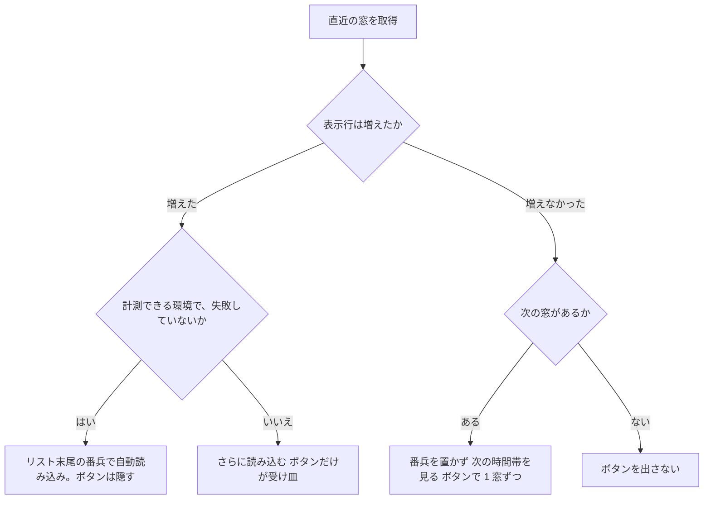

> [frontend.md](../frontend.md) の一部。索引から辿る

# 番組リストの時間窓の読み込み

番組リスト（[programs.md](programs.md)「番組リスト」）に時間窓を継ぎ足す仕組みを扱う。窓は進行方向（未来側）にだけ継ぎ足す。

**この領域は jsdom で原理的に検出できない壊れ方を繰り返した経緯がある**（[web/e2e/README.md](../../web/e2e/README.md) 冒頭）。

根拠

- 窓の管理: `pages/programs.tsx`
- 仮想化: `components/program-list.tsx`
- 純関数: `lib/program-list.ts`

## 進行方向の読み込み

通常は、時間窓ぶんずつの自動読み込みを行い、ボタンをその受け皿にする。直近の窓が新しい表示行を 1 行も追加しないときだけ、自動をやめて手動で 1 窓ずつ進める。自動が失敗した後と、計測できない環境でもボタンが受け皿になる。

直近の窓の結果で、読み込み方は次のように分かれる。

### 通常時の自動読み込み

リスト末尾の番兵を IntersectionObserver で見て、次の窓を取得する。失敗したら自動を無効化し、ボタンとエラー表示に落とす。さもないと、失敗したまま無限にリクエストを投げ続ける。「さらに読み込む」ボタンは、自動が効いている通常時は隠すが、消しはしない。番兵が発火しない環境・キーボード操作・失敗後の再試行の受け皿として残る。

クエリのページの形は、取得した半開区間そのもの（開始と終了の時刻）にしてあり、抽象的なカーソルにしていない。

根拠

- 時間窓の幅: `windowHours`
- 次の窓の取得: `fetchNextPage()`
- ページの形: `pages/programs.tsx` の `useInfiniteQuery`、`{ startMs, endMs }`（`step` のような抽象カーソルにしていない）

### 空の窓は手動で進める

**直近の窓が新しい表示行を 1 行も追加しないときは、番兵を置かず手動で進める。** 先頭の窓が空でも、番組を表示した後の窓が空でも同じ扱いにする。次の窓があれば「次の時間帯を見る」を表示し、1 押下で時間窓を 1 つだけ取得する。番組が追加された窓では通常の自動読み込みへ戻る。

窓の境界に重なる番組の重複だけだった場合も、表示行の追加とは数えない。連続する空窓ではこのボタンを残す。後続の取得が失敗したときは、既存の「続きの取得に失敗しました」と同じボタンでその窓を再試行する。最終窓ではボタンを出さない。この判定は番組ページ固有で、録画一覧の自動読み込みの意味は変えない。

空窓の末尾を番兵で監視すると、自動読み込みが空窓を連鎖して走ってしまうため、空窓では番兵を外す。

根拠

- 次の窓があるか: `hasNextPage`（最終窓は `hasNextPage === false`）
- 空窓の判定: `pages/programs.tsx` の `latestWindowIsEmpty`

### 計測できない環境

計測できない環境では、IntersectionObserver 自体を作らない。jsdom は番兵が常時可視と判定されるおそれがあり、際限なく読み込みを走らせてしまうためである。この環境ではボタンだけを受け皿にする。

レイアウトとスクロール位置が jsdom で計測できないので、仮想化とスクロール位置の指定も使わず、合否判定は実ブラウザの e2e で行う。

根拠

- 計測できるかの判定: `lib/list-virtualization.ts` の `domLayoutMeasurable()`
- 使わない機構: 仮想化、IntersectionObserver、`scrollToIndex`
- 合否判定の場所: `web/e2e/`、`web/e2e/README.md`

## 遡行（前の時間窓の先頭挿入）はしない

前の時間窓の先頭挿入はしない。先頭挿入の位置復元が、仮想化と sticky ヘッダに構造的に衝突し、実機での退行 3 回分の機構を要したためである。到達経路も「日付の帯で未来の日へジャンプして、上端まで戻り、押す」の一択で、代替（日付の帯で前の日をタップ）が既にある。

根拠

- 日付の帯: `DayStrip`
- 実機での退行の記録: `web/e2e/README.md`

## ボトムタブの裏に隠れる行

ボトムタブは画面に固定したオーバーレイのままにし、ドキュメント最下端までスクロールしたときに末行を完全に読める「到達可能性」だけを保証する。途中のスクロール位置で行がタブの裏に入ることは受け入れる。

内側スクロール容器にする案（A）と、タブを専有領域にする案（B）は、仮想化・位置復元・バナーのオフセット・既存 e2e の載せ替えを伴い、実機ツールバーへの影響も未測定である。390×844 の実測で 29px の重なりを消す対価に見合わない。実機で実害が出て、内側スクロール容器でもツールバーが畳まれると確認できたら、（A）と（B）を再検討する。「見えない」だけなら、タブを半透明にする案（F）を先に試す。

初回表示だけ `window.scrollBy` で押し出す案（D）は、末尾で消す量を先頭行の日付ヘッダ裏へ移すだけなので採らない。`sticky` でタブを文末に置く案（E）は、空間を文書末尾に確保するだけで途中の重なりを解消しないため採らない。

根拠

- 末行を読めるようにする余白: `--bottom-nav-height`
- 画面への固定: `fixed`
- 案 A の対象: `<main>`
- 案 D の手段: `window.scrollBy`

## テストの範囲

フレーム単位の跳ねやスクロール位置合わせの見た目は、jsdom では検証できない。レイアウトを計算しない環境だからである。そのため、この環境では仮想化そのものをバイパスし、スクロール位置の指定も呼ばない。判定は実機（Playwright を使った実ブラウザでの計測）で行う。

矩形の取得が常に 0 を返すことも、同じ理由である。「いま見ている日」のスクロール追従も、自動テストでは検証できない。純関数の導出ロジック自体はテスト済みである。グリッドの「受け入れは実機で行う」（[programs.md](programs.md)）と同じ扱い。

根拠

- 常に 0 を返す: `getBoundingClientRect`
- 仮想化をバイパスする側: `ProgramList`、`scrollToIndex` を呼ばない
- 実ブラウザの計測の置き場: `web/e2e/`
- 矩形の取得: `getBoundingClientRect`

