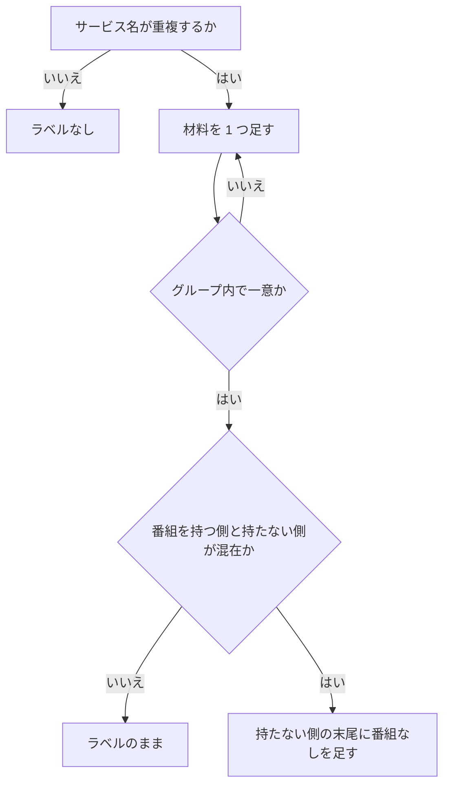

> [frontend.md](../frontend.md) の一部。索引から辿る

# 検索

検索は、ルールの条件を保存前に試す画面である。検索とルールは条件の入力部品と変換を共有し、保存前には件数と時間の見込みを値札として出す。

## 検索は独立ルート `/search`

検索は番組表とは別の画面で、ルールの条件を保存前に試す場所である。番組表は EPG を時間軸で眺める画面なので、関心事が違う。結果の番組は、ruler が同じ条件でマッチさせる番組と同じ集合になる。

### 検索画面の役割

検索は、ruler と同じ条件コンパイラを呼ぶ「ルールの条件を試す画面」である。保存時に新たに生じる容量不足は検索結果に混ぜず、独立したプレビュー API で導出し、仮定の値札は検索画面にだけ置く。

ここで当たりを確認してからルールにできる。**検索 API と ruler 経路の programId 集合が一致する**ことは、テストで保証されている。検索条件は番組表と `cond` で往復でき、検索結果から同じ条件を重ねた番組表のグリッドへ移れる。

このプレビュー API は、予約・意図・録画履歴まで読む。仮定の値札を保存操作がある検索画面にだけ置くのは、番組表の閲覧状態に持ち込まないためである。

根拠

- ruler と同じ条件コンパイラ: `internal/rulequery`
- 検索結果から番組表のグリッドへ移る URL と往復: `cond`

### 結果の表示と状態

検索結果は番組表と同じ行の部品で、開始時刻順に並べる。未検索と 0 件は別の状態として扱い、サイトの一覧を取得中は検索操作を無効にして理由を出す。

未検索と 0 件を構造的に別の状態として扱う。文言が入れ替わらないようにするためである。サイトの一覧の取得に失敗したときは、エラーと再試行を表示する。対象サイトが無い検索を、反応のない操作にしない。

行本体のタップで詳細を展開し、右端の予約列は番組表と同じ開閉規則（hover・フォーカス・展開）にする。単発予約はルールを作成せず、番組表と同じ予約操作（楽観更新・トースト・取消 Undo）を通す。複数 site の結果では site 名も行に表示する。

並びは開始時刻順で、同時刻は site、programId の順で固定する。日付が変わる箇所には番組表と同じ見た目の日付ヘッダを出す。ただし番組表と違って固定表示にはしない。行は番組表と同じ語彙で表示するので、行ごとに日時を繰り返さない。

検索結果は表示に必要な最小情報だけを使い、初期表示で番組詳細を取りに行かない。行を展開したときだけ説明・出演者・映像音声を取得する。検索結果の行数は予約見込みの行数と一致する。結果行の identity は site と programId の組で、site は検索条件で選ぶので結果のパスには含めない。

根拠

- 未検索の判定と 0 件の判定: `isIdle`、`success && 空`
- 番組表と共通の行: `ProgramRow`
- 番組表と共通の予約操作: `useReservationActions`
- 日付ヘッダを固定表示にしない: `sticky`
- 結果行の identity: `site`、`programId`
- 表示に使う最小項目: `name`、`serviceId`、`durationMs`、`isFree`
- 番組詳細 API: `GET /api/sites/{site}/programs/{programId}`

### リクエストの形とフォームの検証

検索リクエストは問わない次元をキーごと落とす。フォームが止めるのは、送るとサーバーが正しく処理できないものと、気づかないうちに誤った絞り込みになるものだけで、矛盾した範囲は 0 件が正しい答えなので検証しない。

「問わない」次元は、リクエストのキーごと落とす。`null` は明示しない。不変条件 10（意味を持たない行を作らない）の精神を、リクエストにも適用する。

矛盾した範囲（下限が上限より大きい）は、0 件が正しい答えなので検証しない。曜日ビットが 0 のときだけ止めるのは、条件コンパイラが範囲外エラーを返し、API がそれを 400 に変換せず 500 になるためである。これは実装上の理由である。

根拠

- 問わない次元はキーごと落とす: `null`、不変条件 10
- 曜日ビット 0 の範囲外エラー: `rulequery`

### サイトの絞り込み

サイトは条件フォームに絞り込みの軸として出す。軸内は OR で、空なら全サイトを対象にする。レジストリと下書きの和集合が 2 つ以上のときだけ、サイトのチップを出す。録画一覧の絞り込みも同じ判定規律である。

サイトは検索 API（`POST /api/programs/search`）の本文の `sites` として送る。`GET /api/recordings` の `?site=` と同じ規約である。チップの選択肢と表示判定の取り方は、下記「サイトチップの選択肢は…」に書いた。

チップは下書きの `sites` を編集し、検索リクエストの組み立て・ルール条件から下書きへの変換・ルール入力の組み立てがそのまま運ぶ。

根拠

- 検索 API: `POST /api/programs/search`
- 録画一覧 API と同じ規約: `GET /api/recordings`、`?site=`、`sites`
- サイト下書き: `ConditionFields`、`SearchDraft.sites`
- 条件変換: `buildSearchRequest`、`conditionsToDraft`、`buildRuleInput`

### サービス候補とサービス名の解決

条件フォームのサービス候補と結果行のサービス名は、全 site のサービスの和集合から引く。サービス名は network とサービス ID の組で引く。site は識別子の一部と見なさず、存在のスコープとして扱う。

条件フォームのサービス候補は、検索対象の `sites` とは別の理由で全 site の和集合にする。保存されたルールは全 site で評価される（`sites` が空なら全サイト）。先頭 site の観測だけから作ると、その site が受けていないチャンネルを条件として名指しできない。site は存在のスコープでしかなく、識別子の一部ではない。そのため、識別子を問う選択肢は、識別子の集合（`Service.id` で畳んだ和集合）で答える。1 site の観測では答えない。この和集合は `/rules` にも同居している。

結果行のサービス名も同じ和集合で解決する。結果が複数 site にまたがりうるので、先頭 site の観測だけでは他 site だけが受けているサービスの名前を引けない。サービス名は networkId と serviceId の組で引く。serviceId 単独は network をまたぐと一意でない。番組詳細 API は合成済みのサービス識別子を返さないため、番組側で組み直す。

ジャンルの未知コード（12 と 13 の予備）は、数値のまま出す。「その他」に丸めると、ARIB の本物の「その他」（15）と区別できない。これは番組表のジャンル表示と同じ規律である。

根拠

- 全 site のサービス候補: `lib/all-sites-services.ts`、`Service.id`、`/rules`
- サービス選択の OR と全 site: `?site=`、`sites`
- 結果行のサービス名は `${networkId}:${serviceId}` で引く（番組詳細 API が合成済み `Service.id` を返さないため）: `${networkId}:${serviceId}`
- 番組詳細 API: `GET /api/sites/{site}/programs/{programId}`
- ジャンルの未知コードの規律: `lib/genre.ts`

### 同名サービスの補助ラベル

名前が重複する同名サービスにだけ補助ラベルを付ける。材料はサービスが既に返す値だけで、番組 ID は分解せず、グループ内で一意になるまで順に足す。地上波は 3 桁チャンネル番号から始める。

マルチ編成のサブサービスは、主サービスと同じ名前を持つことがある。重複しないサービスには何も付けない。

補助ラベルの材料は、サービスが既に返す値だけである。programId は分解しない。材料は上から順に足し、同名のグループ内で一意になったところで止める。地上波の最初の材料は、視聴者がリモコンで読む規格の 3 桁チャンネル番号である。リモコン番号を 2 桁にゼロ埋めし、末尾にサービス番号（serviceId の下位 3bit）+ 1 を付ける。

材料の順は、地上波が 3 桁番号、物理チャンネル、networkId と serviceId である。BS と CS は 3 桁番号を復元できないので、種別、物理チャンネル、networkId と serviceId の順にする。同じ名前のグループ内では、全候補に同じ段数の材料を付けて表示の形を揃える。

3 桁番号を採るのは、視聴者がリモコンで読む番号と同じ粒度で主とサブを見分けられるためである。リモコン番号の出所は、番組表のチャンネルピッカーがリモコン番号バッジに使っているものと同じである。この復元式は規格が定めた割り当て規則そのものなので、測った site の外にも当てはまる。ただし域外局とリモコン番号が衝突する受信機は、3 桁番号に枝番 `051-1` を付ける。実機の表示と 1 文字単位で一致するとは限らない。

#### 「番組なし」のヒント

同名グループに番組を持つ側がいるときだけ、持たない側に「番組なし」を足す。これは今このサービスを条件にしても 0 件というヒントであり、主とサブを示すラベルとして使わない。全員が番組を持たないグループでは出さない。

サブサービスは番組を持たない状態になることがある。マルチ編成のないサブサービスでは、`Service.hasPrograms` が false になる。ルールがそのサービスも参照できるよう、API 自体は絞り込まない。false のサービスだけを条件にしたルールは、現時点で番組に 1 件もマッチしない。

そのため、同名グループに番組を持つ側がいるときだけ、持たない側の末尾に「番組なし」を足す。「番組なし」は主とサブを示すラベルとして使わない。示すのは「今このサービスを条件にしても 0 件」というヒントだけである。全員が false のグループ（初回 EPG 取得前は全サービスが false）では出さない。

`hasPrograms` は放送内容で変わる状態であり、識別子ではない。識別には使わず、ID による区別が終わった後の補助表示にだけ使う。

#### サービスの種別を API に足さない理由

サービスの種別は API に加えない。届くサービスでは実質一定で、形を広げる利益がない。ワンセグは取り込み前に除外され、実測でも届くサービスは全件が同じ種別だった。

mirakc-arib のサービス scanner は、音声映像サービスでない種別を取り込み前に除外する。ワンセグはその対象なので、Rokuban にはそもそも届かない。届くサービスは実測（高松 mirakc 19 件）でも全件が種別 1 だった。

根拠

- 補助ラベルの実装と材料の順: `lib/service-label.ts`、`serviceDisambiguator`
- 材料にする値: `networkId`、`serviceId`、`Service`
- 番組表のチャンネルピッカー: `channel-picker.tsx`、`ChannelPicker`、`secondaryLabel`
- ChannelPicker への補助ラベル追加は対象外
- 番組なし表示と API 契約: `Service.hasPrograms`、`openapi.yaml`
- 種別を足さない: `epg_services.type`
- サービス種別の取り込み除外: mirakc-arib `IsAudioVideoService`
- ワンセグの除外コード: `0xC0`
- サービス種別の観測: 高松 mirakc 19 件がすべて `type=1`

### チップの折り返し

補助ラベルのあるチップは親の幅を超えうるので、チップ自身の中で折り返させる。合否はレイアウトの判定なので jsdom では測れず、実ブラウザ 320px の実測で出す。

縮まない flex-basis が内容の最大幅を要求するため、これが無いとページ全体が横に伸びる。

根拠

- チップの折り返し: `Chip`、`components/ui/chip.tsx`
- 実ブラウザの判定: `web/e2e/chip-overflow.mjs`
- jsdom はレイアウトを測れない: `jsdom`

### 主操作の置き場

主操作（検索・条件をクリア）は条件フォームの後ろに置き、入力から送信までを上から下へ進める。画面下への固定は、ソフトウェアキーボードとタブバーが可視領域を占めるため採らない。

値入力には検索用の Enter キーヒントを付け、フォームの Enter 送信で検索できるようにする。

保存 UI は検索フォームの外にある別フォームなので、名前欄の Enter はルールを作成し、検索を再実行しない。送信が決着したら、結果の先頭（「検索結果」セクション）へスクロールとフォーカスを移す。合否は実ブラウザの検索フォームの確認で測る。座標とフォーム送信は jsdom では測れない。

根拠

- 値入力の Enter キーヒント: `enterKeyHint="search"`
- 結果の先頭へ移る: `検索結果` セクション
- 実ブラウザの検索フォームの確認: `web/e2e/issue-1232-search.mjs`、`pnpm e2e:issue-1232-search`
- 入力と送信の実装: `components/condition-fields.tsx`

### テキスト条件の入力

1 行目は常に編集可能な状態で出し、入力値があるときだけ条件として実体化する。空欄の選択はローカルに残し、明示的な削除だけがその行の選択を捨てる。

空欄のまま対象・モード・チップを選んでも、検索条件の配列は空に保つ。

**テキスト条件の 1 行目は、「条件を追加」を押した先に初めて出す形にしない。** 条件フォームの先頭に来るので、これだけで「最初に打つ場所」がクリック無しで届く。

空欄の行の選択はローカル state に残し、後で値を入れたときに条件へ反映する。空欄を条件配列に置くと、検索・保存が入力エラーで止まる。選択を捨てると、再入力時に意図が消える。単一行を全消ししたら未実体化へ戻す。複数行のうち 1 行を空にしたときは、編集位置を保つため勝手に消さない。明示的な削除（X）だけが、その行の選択も捨てる。

配列が空の間は「条件を追加」と X を出さず、「指定なし（すべての番組が対象）」を出す。

共用の条件説明には、「検索すると」のような画面固有の動詞を入れない。条件フォームは、検索からの新規作成と既存ルール編集で共用する。どちらの操作でも同じ意味になる文言にする。条件ゼロのルールで問題になるのは、検索結果が全件になることではない。録画が走り続けることであり、これが文言を共用する理由である（下記「条件ゼロのルールは全番組にマッチする」）。

モバイルでは、値入力を専用の行に分ける。360px と 390px では、対象とモードを同じ行に残し、値入力を次の行で利用可能な幅いっぱいにする。旧一行レイアウトを実ブラウザで再現すると、値入力の幅は 360px で 62px、390px で 92px しかなかった。デスクトップでは従来どおり一行レイアウトを保つ。実ブラウザの判定がこの breakpoint と、要約のキーボード開閉・日本語入力編集・種別解除を固定する。

根拠

- 条件フォームの 1 行目の実体化（値を入れたときだけ配列に置く）: `SearchDraft.textMatches`
- 条件フォームの部品: `<ConditionFields>`
- モバイルのテキスト条件の実ブラウザ判定: `web/e2e/search-mobile.mjs`

### 詳細条件の折りたたみ

詳細条件は初期状態で折りたたみ、テキスト条件だけを常に表示する。URL や保存値から復元しても閉じたままにして要約で示し、閉じた中に検証エラーがあるときだけ自動展開する。

検索画面はまずキーワードを入力して結果を確かめる画面なので、テキスト条件は常に表示する。残りのチャンネル種別・ジャンル・時間帯・無料/有料・放送時間・期間・サイト・チャンネルは、条件フォームの折りたたみ節へまとめる。新規作成・既存ルール編集も `/search` で、この同じ詳細条件を使う。URL（`cond` / `ruleId`）や `localStorage` から条件を復元しても、詳細は閉じたままにする。現在の下書きだけを、「設定中の詳細条件: N件」と条件種別ごとの短い要約で示す。

要約の X は、その種別全体を下書きから解除する。自動検索や URL 更新はしない。要約から開けばその場で編集できる。閉じた詳細内の検証エラーがあるときだけ、自動展開して修正欄を見せる。

根拠

- 折りたたみ節: `ConditionFields` の `collapsible`
- 復元元: `cond`、`ruleId`、`localStorage`

### サービス節を末尾に置く理由

サービス節を最後に置くのは、非同期で高さが変わる節が後続の同期節を押して、レイアウトシフトを作るのを避けるためである。残差は 0 にならないが、しきい値以下に収まる。レイアウトを変えたら可視状態も含めて測り直す。

サービス一覧は非同期で、読み込み中の 1 行から複数行のチップへ変わる。

非同期の節を先に置くと、後続の同期節が下へ押されて CLS を作る。これは Lighthouse で検索モバイルが要改善域に出た実測である。CLS の計測でも、390x844 で 0.165 だった。サービス節を末尾に置いたうえでの残差は、24 局のフィクスチャで詳細節を明示的に開いて測り、390x844 で約 0.03、1280x900 で約 0.016 だった。いずれもしきい値 0.10 以下である。

測る前提には注意がある。Layout Instability API は、移動した描画済み要素を数える。押された要素が折り目の外へ出ることはあっても、ページから無くなるわけではない。検索画面は条件フォームの後ろに値札・ルール保存・検索結果を同じ 1 本の縦カラムで積むので、押される要素は残り、残差も 0 ではない。

検索画面は詳細節を初期非表示にしている。しかし CLS の計測は、非同期のサービス節が表示中のフォームを押す従来のシナリオを維持するため、詳細節を明示的に開いて測る。フォームを折りたたむなどサービス節より下の内容を上へ移すと、測定時の可視状態が変わる。レイアウトを変更するときは、可視状態も含めて測り直す。

#### 動線上の代償

サービス節を末尾に置く代償は、チャンネル絞り込みが初画面より下になることである。これは受け入れる。チップ列の高さは変動するので、高さの予約もスケルトンも予約値が恣意的になり、採らない。

チップ列はサービス数と幅ごとの折り返しで高さが変わる。高さの予約もスケルトンも「何行ぶん予約するか」を先に決める必要があり、高さを多く予約すると空白が残り、少なく予約するとシフトが残る。

チャンネル絞り込みが初画面より下になるので、検索とクリアは条件の後ろに置き、値欄から Enter でも検索できるようにする。画面下固定はソフトウェアキーボードとタブバーが操作欄を占めるため採らない。

条件フォームは、検索・新規作成・既存ルール編集で同じ順序を使う。動線の代償が受け入れられないと判断したときは、並べ替えをやめてスケルトン側に寄せる設計判断になる。CLS の計測スクリプトは、そのまま判定に使える。

根拠

- 同期節と非同期のサービス節: `<ConditionFields>`、`pages/search.tsx`、`<form>`
- CLS の fixture と画面: `web/e2e/cls.mjs`、`pages/search.tsx`、24 局
- 折り目外へ動く節: `<ConditionFields>` の service field、検索フォームの後ろにある値札・ルール保存・検索結果
- CLS の初期状態: 390x844 で 0.165
- 詳細節を開いた CLS: 390x844 で約 0.03、1280x900 で約 0.016
- CLS のしきい値: 0.10
- CLS の判定（詳細節を開いて測る）: `cls.mjs`、`web/e2e/cls.mjs`
- チップ列の位置: 390x844 で top=1027、折り目から 183px 下。計測は `web/e2e/cls.mjs`

## 検索とルールは同じ条件 UI を双方向に共有する

検索とルールは同じ条件の入力部品を使い、条件の相互変換は往復テストで固定する。片方だけに次元が増えると、「試した条件」と「保存される条件」が食い違う。

### 条件の入力部品と相互変換

条件の入力は 1 つの部品だけにし、検索画面の新規作成と既存ルール編集で使う。下書きとルール入力の相互変換は 1 か所に置き、往復テストで固定する。

検索リクエストとルール入力の条件部分は同形で、サーバーは同じ条件コンパイラを通る。この同一性を UI 側でも保つため、条件の入力は 1 つの部品だけにする。

下書きとルール入力の相互変換は 1 か所に置き、**往復テストで固定する**。分と ms、ローカル壁時計と UTC の取り違えは、UI 越しには見えにくいためである。

根拠

- 同形の型: `ProgramSearchRequest`、`RuleInput`
- 同じ条件コンパイラ: `internal/rulequery`
- 条件入力の部品: `components/condition-fields.tsx`、`<ConditionFields>`
- 下書き: `SearchDraft`
- 相互変換: `lib/program-search.ts`、`buildRuleInput`、`conditionsToDraft`

### 検索・ルール・番組の行き来

検索からルールへは検索リクエストの結果を流用し、変換を 2 箇所に書かない。ルールから検索へ条件を写す処理は、ルールごとに 1 回だけ行う。番組からは番組名のキーワード条件で検索へ渡す。

検索からルールへは、検索画面の「この条件でルールを作成」で進む。`?ruleId` を伴わない通常の検索から使う。条件は検索リクエストの組み立て結果をそのまま流用する。新規ルールの名前候補は、除外でないキーワード条件を「・」で連結する。それが無ければ、解決できたサービスが 1 件のときのサービス名・ジャンル・最初の時間帯を、既存のラベルで連結する。名前欄を編集するまでは条件に追従させる。保存後はユーザーが確定した名前として保持し、条件変更で作り直さない。導出値と確定した事実を同じ列に載せないためである。

番組から検索へは、番組詳細の「この番組名で検索」で進む。タイトル全文を `name` のキーワード条件として `/search?cond=` へ渡す。`sites` は含めない。保存ルールは全 site で評価されるためである。

ルールから検索へは、`/search?ruleId=N` で、そのルールの条件を下書きに写して自動検索する。**ハイドレーションは `ruleId` ごとに 1 回だけ**行い、ref でガードする。refetch のたびに写すと、ユーザーが条件を編集した直後に入力が巻き戻る。

根拠

- 検索からルール: `?ruleId`、`buildSearchRequest`
- 導出値と確定した事実を分ける規律: 不変条件 9
- 番組から検索: `name`、`/search?cond=`、`sites`
- ルールから検索: `/search?ruleId=N`、ref
- ハイドレーションの 1 回ガード: `ruleId`

### ルール保存の入口と上書き

既存ルールを開いたときの保存は上書きを既定にし、別ルールとして保存する経路は副動作として残す。ルール作成と上書きの入口は検索画面に一本化する。

`?ruleId=N` で開いた画面の保存は、上書きを既定の動作にする。検索画面はマッチする番組を見ながら条件を詰められるので、そこが実質のルール編集画面になる、という判断である。以前は「ここでの編集は元のルールを変更せず、保存すると別の新しいルールになる」としていたが、編集体験として一本化した。

元のルールを残したまま別のルールとして保存する経路も、副動作として残す。押し間違えないよう、主動作と見た目を変える。名前が元のルールと同じままこの副動作を押すと、「のコピー」を付ける。ルール名は一意でなく、同名のルールには一覧側で `#<id>` が付く。コピー元と意図的に別の名前であることを、通常の表示だけで読めるようにするためである。

ルール作成と既存ルールの上書きの入口は、検索画面に一本化する。新規作成も `/search` へ案内する。値札（件数・時間の見込み）と一致する番組の一覧が、常に作成ボタンの近くに出る検索画面へ入口を揃えるためである。`/rules` の作成フォームには、そのどちらも無かった。

強制はしておらず、`/search` でも検索せずに保存まで進める。その間の値札は「検索すると…」の案内だけになる。`/rules` はルールの一覧・有効切替・削除だけを持ち、一覧のルール名リンクから既存ルールの条件を変える `/search?ruleId=N` を開く。検索画面ならマッチする番組を見ながら条件を詰められる。編集フォームが UI を持たない項目も引き継ぐので、`/rules` に同じ上書きフォームを残す必要はない。

根拠

- 上書き: `PATCH /api/rules/{id}`
- 別ルールとして保存する副動作: `POST /api/rules`
- コピー名: `〜 のコピー`
- 同名ルールの区別: `rules.name`、`#<id>`
- 既存ルール編集フォーム: `RuleEditForm`、`preserve`

### UI が持たない次元と sites の扱い

UI が持たない次元は勝手に埋めず引き継ぐ。サイトのチップの選択肢はレジストリと下書きの和集合から作る。サイトの絞り込みはスコープ軸で、条件ゼロの警告・確認の対象から外れない。

UI が持たない次元は勝手に埋めない。`sites` は条件 UI（サイトチップ）の次元なので、検索リクエストの組み立ての一部としてそのまま送る（空は全サイト）。UI が今も持たない項目だけを、ルール入力の組み立てで引き継ぐ。ルール更新は子テーブル全置換なので、落とすとユーザーの設定が気づかないうちに消える。

サイトチップの選択肢は「レジストリの site」と「下書きが既に持つ site」の和集合にする。表示するかどうかの判定（2 つ以上か）もこの和集合で取る。`?ruleId=` で開いたルールが保持するサイトに、レジストリから消えた site 名が残っていることがある。和集合に含めれば、チップとして見え、明示的に外せる。

レジストリの一覧だけを選択肢や表示判定に使うと、レジストリが 1 site に縮んだ環境で、下書きが別の site を持つケースが「見えない」に戻る。消えた site はチップごと消え、画面内で外す手段が無くなる。以前はこれが未解決の問題だった。`sites` を条件 UI に出していなかったため、フォーク（`POST`）だけが 400 `unknown site` になっても、画面内で外せなかった。レジストリ照合の免除は `PATCH` にしか適用されない。

`sites` はスコープ軸であって、条件ではない。サイトのチップだけを選んだ下書きは、「条件ゼロ（全番組が対象）」の警告・確認の対象から外れてはならない。判定は 2 箇所にあり、どちらも `sites` を条件として数えない。片方だけ揃えると、一覧では「条件なし」の警告が出るのに、保存時の確認だけスキップされる食い違いが起きる。

条件ゼロのルールは全番組にマッチする。検索では「絞り込まない」が正しい問いでありうるが、ルールでは録画が走り続ける。保存時に明示的な確認を挟み、一覧でも警告として出す。作った後に気付ける経路も要る。

根拠

- 検索リクエストの組み立て: `buildSearchRequest(draft)`
- UI が持たない項目の引き継ぎ: `description`、`dedupe*`、`filenameTemplate`、`metadata`、`buildRuleInput`、`preserve`
- 子テーブル全置換: `UpdateRule`
- 消えた site の残り方: `?ruleId=`、`rule_sites`、`sites`、`POST`、`PATCH`、400 `unknown site`
- 条件ゼロの判定 2 箇所: `lib/program-search.ts` の `hasNoConditions`、`components/rule-condition-summary.ts` の `summarizeRuleConditions`

## 保存前の値札（件数・時間の見込み）

ルールは保存すると録画を消費し続けるので、保存前に件数と時間の見込みを値札として出す。値札は検索結果から 7 日あたりで導く数字で、警告として使わない。

### 値札の出し方

値札は警告として扱わず、しきい値で色を変えたり保存を止めたりしない。時間は検索レスポンス全件の所要時間を合計し、値札のための追加の HTTP は発生しない。

ルールは保存した時点から、チューナーとストレージを消費し続ける。保存前に見えるのはマッチする番組リストだけで、量としてのコストが見えなかった。そこで「この条件でルールを作成」「上書き保存」の近くに、値札の部品を常置する。見込みの件数と時間は、純関数が 7 日あたりで出す。

**値札は警告ではない。** しきい値で色を変えたり、保存を止めたりしない。多いか少ないかの判断はユーザーのものである。文字色は他の情報表示と同じ補助色を使う。警告色は「条件ゼロ」「期間指定の恒久化」用、destructive は「失敗した」用で、どちらも意味が違うので流用しない。

GB 換算はやらない。ビットレートの実測の出所が未決で、件数と時間は検索結果だけから導出でき、未決に依存しないため、そこをスコープの切れ目にしている。

時間は、検索レスポンス全件の所要時間を合計して出す。検索 API は表示に必要な networkId、serviceId、開始時刻、所要時間、名前、無料かどうかを各行に載せる。そのため値札は、表示中の先頭 N 件や番組詳細 GET の完了状況に依存しない。値札のために追加の HTTP は発生しない。

「未検索」と「検索したが 0 件」を混同しない。どちらも件数は 0 だが、条件を指定し忘れているのか、正しく絞り込めているのかは区別が要る。これは上記「未検索と 0 件を構造的に別の状態として扱う」と同じ精神である。

根拠

- 値札の部品: `RuleCostSummary`（`components/rule-form.tsx`）
- 見込みの計算: `lib/rule-cost.ts` の `estimateRuleCost`（純関数）
- 警告色: `--warning`、破壊色: `--destructive`
- 検索レスポンスの項目: `networkId`、`serviceId`、`startAt`、`durationMs`、`name`、`isFree`
- 件数と時間の使用: `durationMs`

### 件数の数え方

件数は、検索 API が返す全件の行数をそのまま数え、番組 ID で畳まない。畳むと、複数 site で走る録画の本数を過小報告する。

母数は厳密で、畳まない行数がそのまま件数になる。検索 API は条件コンパイラの結果を、件数の上限なしでそのまま表示用の行として返す。ページングも上位 N 件の打ち切りも無い。したがって件数は、常に全件の行数から厳密に出せる。

**programId で畳んではいけない。** 同一放送が複数 site でマッチすれば、複数行になる。ruler はマッチした全 site で予約を作る（N 予約が既定）。畳むと、実際に走る録画の本数を site 数ぶん過小報告する。件数が数えるのは「ruler が作る予約の見込み数」であり、「マッチする番組数」とは別の量である。

根拠

- 検索 API: `POST /api/programs/search`
- 結果をそのまま返す関数: `rulequery.MatchPrograms`
- 件数の上限が無いことの確認: `LIMIT`、`internal/rulequery/query.go`
- 件数: `totalCount`
- 畳まない: `programId`

### 7 日換算の近似と期間条件

件数と時間は 7 日に正規化するが、分母は近似で、見積もりの方向は保証しない。期間条件で絞った検索では、8 日分を 7 日換算という根拠を出さず、週あたりの見込みが小さく出ると明記する。

ルールの曜日条件は 1 週間周期なので、固定分母を使う。

EPG の前方保持は目安 8 日だが、既定 24 時間の保持猶予により、過去番組も検索に残る。条件を指定しない検索は、過去 24 時間と未来約 8 日、計約 9 日を含み得る。そのため過大になる場合がある。刈り取りの述語は、終了時刻が基準時刻から保持猶予を引いた時刻より前、である。さらに条件コンパイラには「未来だけに絞る」述語が無い。開始時刻を暦上の範囲で絞るのは期間条件の 2 箇所だけで、検索条件で明示しない限り有効にならない。時間帯条件も開始時刻を読むが、曜日と壁時計の時刻に落とすだけで、暦上の範囲は絞らない。

反対に、前方へ丸 8 日ぶん番組が入っているとは限らず、過小にもなり得る。実際の前方の量は未計測であり、「多めには出ない」といった片方向の保証は書かない。厳密な値には、現在時刻・窓の終端・保持猶予を照合する追加問い合わせが必要になる。値札 1 つのための追加コストに見合わないため、固定分母を使う。

期間条件で絞った検索では、「8 日分を 7 日換算」という根拠を出さない。その根拠は「検索結果は EPG の前方保持ぶんの観測」という前提に立つ。期間を絞った検索は観測スパンがその期間そのものになるため、前提が成り立たない。8 日分でないのに 8 日分と言うと偽の根拠になり、過小に見せることを隠してしまう。代わりに、「期間条件で絞っているため、週あたりの見込みは実際より小さく出ます」と明記する。

#### 値札の根拠は実行した検索から取る

値札の数値と根拠は、同じ実行した検索から導く。根拠だけをフォームの現在値から取ると、再検索までの間ズレ、偽の根拠が付き直す。

期間の有無の判定は、実行した検索から取る。下書きからは取らない。検索リクエストの組み立てが空の期間をキーごと落とすので、キーの有無がそのまま判定になる。

数値は実行済みの検索の産物である。根拠だけをフォームの現在値から取ると、再検索するまでの間ズレる。期間を入れて検索したあとに欄を空にするだけで、「8 日分を 7 日換算」という偽の根拠が、期間で絞った数値に付き直す。逆向きも同様である。

新規作成・既存ルール編集のフォームにも、期間の有無を見る同じ名前の判定がある。それは、「この下書きを保存すると恒久的な期間制限になる」という下書きについての警告である。そちらは下書きから導くのが正しい。同じ式に見えて由来が違う。

根拠

- 見込みの分母と EPG 保持窓: `epgWindowDays`、`PruneEpgPrograms`、`retention_grace`、`epg.retention_grace`、[../data/projections.md](../data/projections.md)「ローリングウィンドウ（8 日 + 猶予）」
- 刈り取りの述語: `end_at < 基準時刻 - retention_grace`
- 番組表側の 8 日上限: `limitMs`、[programs.md](programs.md)「EPG のローリングウィンドウの終端」
- 過去番組を含む検索範囲と期間条件: `rulequery`、`start_at`、`periodStartAt`、`periodEndAt`
- `rulequery` に未来だけの述語は無い。時間帯条件は曜日と壁時計の時刻だけを見る
- 番組表の残り日数は 7〜8 日で揺れる。前方保持量は未計測
- 未計測の挙動を断言しない規律: `CLAUDE.md`「測っていない挙動を断言しない」
- 実行した検索から根拠を取る: `draft`、`search.variables`、`buildSearchRequest`
- 下書きについての警告: `CreateRuleForm`、`RuleEditForm`、`hasPeriod`

### 保存で追加される容量不足

保存で追加される容量不足は専用の API で導出し、値札の隣に出す。保存後の不足区間から、保存前に同じかそれ以上の不足がある部分を除いたものを追加として示す。区間が 0 件・取得中・取得失敗のどれでも「収まる」とは表示せず、放送済みの番組は候補にしない。

「追加」は区間の集合差ではない。保存後の不足区間から、保存前に同じ site で同じかそれ以上の不足本数がある部分だけを除いた残りである。

専用 API は `POST /api/capacity/preview` で、入力は実行した検索条件と任意のルール ID である。候補から、予約済み・skip 意図・fulfilled・重複排除で skip になる番組を除く。残りを既存需要に加え、容量計算で再評価する。ルール編集時は、そのルールの現予約を需要から外し、候補として改めて判定する。

既存不足が 1 本から 2 本へ悪化した部分も表示する。各区間に日時・詰まった種別・不足本数を出し、複数 site のときは site 名も付ける。区間リンクは `/programs?view=grid&at=<開始>&cond=<検索条件>` で、「この時間帯の一致番組を番組表で見る」と案内する。仮定の不足帯は番組表に出ないので、リンクの対象を番組に限る。

値と説明は、実行した検索から導く。実行した検索の条件を容量 API とリンクへ使い、フォーム下書きの条件は使わない。区間が 0 件・取得中・取得失敗のどの場合も、「収まる」とは表示しない。取得失敗は確認できなかったことを伝える。成功した 0 件と取得中は、何も描画しない。何も描かないことは、収まることの保証を意味しない。取得中に「確認中」の行を描くと、検索より遅く返るプレビューが 0 件のとき、描画済みの結果一覧が 1 行ずれる（CLS）。

放送済みの番組は候補にしない。EPG の番組は放送済みを保持猶予ぶん残すが、終了が現在時刻以前の番組は録れない。需要に加えると、偽の不足を主張してしまう。**フォームの「有効」を外して保存するケース**（新規ルール、または有効なルールの編集）でも、プレビューは有効なルールとして数えるので、実際より多めに出る。保存済みの無効なルールを編集するときだけ、需要ゼロとして扱う。

根拠

- 容量プレビュー API: `POST /api/capacity/preview`、`ruleId`
- skip 意図: `program_intents.action = 'skip'`
- 容量の再評価: `capacity.Compute`
- 実行した検索の条件: `search.variables`
- 値札の部品: `RuleCostSummary`
- 保持猶予ぶん残る放送済み番組: `epg_programs`
- 区間リンク: `/programs?view=grid&at=<開始>&cond=<検索条件>`

