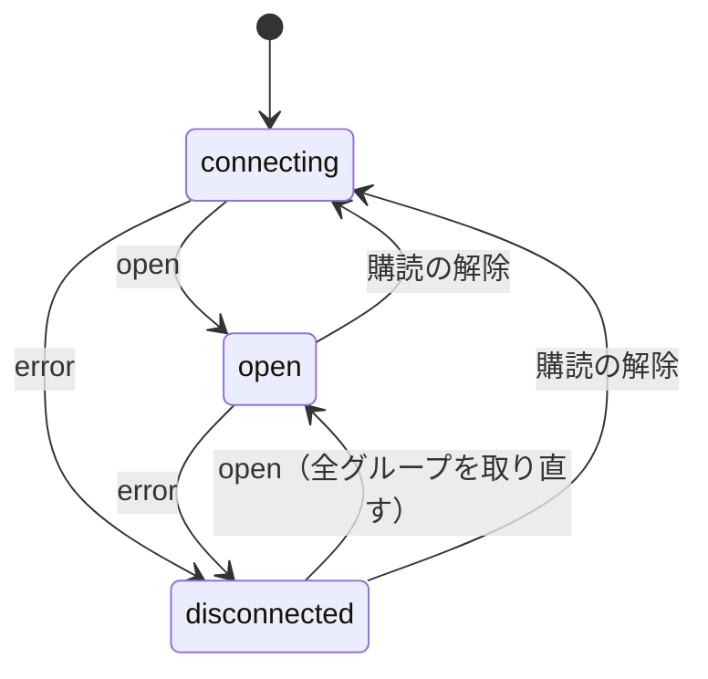
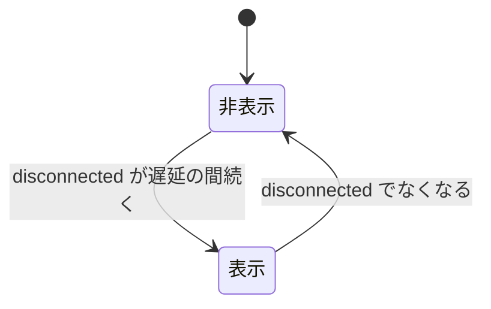

> [frontend.md](../frontend.md) の一部。索引から辿る

# 共通シェル

画面をまたいで共有する骨格（ナビゲーション・生成クライアント・リアルタイム通知・文書設定）をここに置く。

## ナビゲーション: モバイル = ボトムタブ / デスクトップ = サイドバー

ルート定義は 1 つで、レイアウトだけをブレークポイントで切り替える。モバイルは画面下端のボトムタブ、デスクトップは左のサイドバーで操作する。どちらも端末の安全領域を避けて置く。

### 安全領域の余白

ボトムタブは画面下端に密着させず、下端の安全領域に最低限の余白を足して空ける。横向きの左右端の余白は、共通シェルとボトムタブに適用する。上端は足さず、下端はタブと再生設定シートが各自で扱うので、共通シェルには重ねない。

シェル内の sticky header も、同じ余白の内側へ入る。

- iOS のホームインジケータと重なると最下段が押せなくなる。実害が大きい
- Android のジェスチャーナビは下端からの上スワイプがホームなので、スクロール中に指が滑ると誤爆する

ブラウザのビューポートはシステムナビゲーションバーの下には入らない。Web ページのボトムバーが Android の戻る・ホームボタンと重なることはなく、懸念は上の 2 点だけで、どちらも余白で解決する。安全領域の値を 0 以外にするには、HTML の viewport で全面表示を指定しておく必要がある。

上端の余白は、standalone 表示を設定していないので足さない。ノッチ付き iPhone の横向きはサイドバーが出る幅なので、余白が守る対象はサイドバーと本文（ヘッダーは本文の内側）である。ボトムタブへの左右の余白は、サイドバーが出ない狭い横向き端末のためにある。

根拠

- ボトムタブの下端の余白: `env(safe-area-inset-bottom)`
- 横向きの左右端の余白: `env(safe-area-inset-left/right)`
- 全面表示の指定が無いと値が 0 になる: `index.html` の `viewport-fit=cover`、`env()`
- サイドバーが出る幅の境界: `md`

### ボトムタブの高さ変数

タブの高さは CSS 変数に持ち、本文の下パディングと共有する。**この変数はタブの実際の描画高さと一致していなければならない。** 足りないと、最下端で行がタブに食い込む。境界線ぶんは構造的に揃うが、タブ本体の高さや padding には追従しない。変えるときは計算も直し、実測で確かめる。

本文の下パディングはこの変数をそのまま使うので、足りなければ最下端で行がタブに食い込む。境界線ぶんは別の変数を nav の上枠幅と高さの計算の両方で使う。確認には、CI では回らない実測スクリプトを使う。

最下端以外のスクロール位置での重なりは、これでは消えない。仕様として受け入れている（[scroll.md](scroll.md)「ボトムタブの裏に隠れる行」）。

根拠

- 高さの変数: `--bottom-nav-height`
- 境界線ぶんの変数: `--bottom-nav-border`、nav の `border-top-width`
- 計算を直す場所: `index.css`
- 実測スクリプト（CI では回らない）: `web/e2e/programs-bottom-nav.mjs`

### デスクトップのサイドバー

サイドバーはビューポートに sticky で固定し、本文だけがスクロールする。ハンバーガートグルで展開とアイコンのみのレールを切り替えられ、完全には隠さない。

固定配置と本文側の手動 margin の組み合わせは採らない。flex のフローに残したまま高さだけを固定すれば、本文の左オフセットは flex レイアウトが自動で確保するためである。画面が低くて項目が入りきらないときは、ナビ項目側だけ縦にスクロールする。

#### 折りたたみ

トグルで展開とレールを切り替える。**完全には隠さない。** トグル自体をレールの先頭に常駐させ、どのページからでも展開に戻せるようにするためである。畳んだ状態でもラベルは DOM から消さず、読み上げ名を失わない。畳み状態はブラウザに保存し、再読み込みでも復元する。

#### 畳んだ項目の名前

折りたたんだ項目の視覚的な名前は、Base UI の Tooltip で示す。共有 Provider に初回遅延を設け、隣接項目へ移動したときはすぐに表示する。title 属性は使わない。Tooltip もリンクへ aria-describedby で結ばない。読み上げ名を重ねないためである。この表示と、展開中は出さないことは、Chromium の実測スクリプトで確かめる。

根拠

- サイドバーの実装: `components/app-shell.tsx` の `Sidebar`
- 採らない固定配置: `position: fixed`
- ラベルを読み上げ専用にする: `sr-only`
- Tooltip を使い title 属性を使わない: `title`、`aria-describedby`
- Chromium 実測: `sidebar-tooltips.mjs`
- 畳み状態の保存先: `localStorage`

### 項目の並びは頻度順、モバイルは 4 タブ + 「その他」

ナビ項目の定義は、デスクトップのサイドバーとモバイルのボトムタブで 1 つを共有する。並びは触る頻度で決める。実装順は使わない。モバイルでは最上位の 3 項目だけを常時タブに置き、残りを「その他」シート 1 個に畳む。

#### 頻度の 3 段

触る頻度は 3 段に分ける（[design.md §頻度 3 段](design.md)）。

| 段 | 項目 | 置き場 |
|---|---|---|
| 最上位 | ホーム・番組・録画 | 常に最短の入口 |
| 中間 | 予約・ライブ | 最上位の次 |
| 端 | 検索・ルール | 意図して探しに行く位置 |

ホームはホーム画面の新設（[home.md](home.md)）で、最上位の先頭に加わった。サイドバーは全項目を頻度順に並べるだけでよい。

#### 常時タブに 3 個、残りは「その他」

ボトムタブは頻度の低い項目を畳んで、最上位のタブを広く取ると決めた。誤タップ対策は根拠にしない。根拠は頻度の低いものを畳んで場所を稼ぐことである。畳まずに全項目を並べた場合の値は、測り直しておらず比較対象が無い。

実測（390px 幅、Chromium）では 4 タブ = 97.5px/個で、最小タップ領域 44px は満たしている。以前の「6 タブ = 65px/個」は、その後の項目追加で比較対象として古くなった。「畳む」という結論そのものは、項目数が増えても変わらない。畳まなければ最上位のタブがいまより狭くなる一方だからである。そのため、根拠として古くなった数字だけを落としてある。

この割り当てを利用者に入れ替えさせない。並べ替えを渡すと、頻度の割り当てという主張自体が消える。判断は [design.md](design.md) §端末ごとの個人設定は localStorage に置く にある。

#### 予約を「その他」へ戻した理由

予約は常時タブから「その他」へ戻した。ホームが今夜〜明日の予約の確認そのものを持つようになり、確認の頻度がホームに移ったためである。この割り当ても元の仮説と同じく実測ではない。単一世帯の運用なので、自分の行動で検証してよい（design.md も同じ扱い）。

ホーム新設前は、「今夜これで録れているか」を録画と同じ頻度で確認する対象という仮説で、予約を中間段から常時タブに繰り上げていた。ホームの今夜〜明日の予約セクションがその確認を引き受けた（[home.md](home.md)）。

#### 「その他」シート

「その他」はシートで出す。中身はリンクだけなので、中身の高さで止まる録画一覧のシートと揃えると、低いシートに収まる。つまみ・角丸・セーフエリア・中央の見出し・右の「完了」も同じ見た目にする。ツールバーのパネルとは変更理由が異なるため、部品は共有しない。

シートは固定されたボトムバーの上に重なる。画面下端に接するかは jsdom では測れないので、実ブラウザでの合否を専用の e2e が担う。

根拠

- ナビ項目の共通定義: `components/app-shell.tsx` の `navItems`
- 常時タブと「その他」への振り分け: `useNavItems` の `primary` / `more`
- 常時タブの数: `MOBILE_PRIMARY_COUNT`
- 共有しない部品: `ToolbarPanel`
- 実ブラウザでの合否: `e2e/issue-1224-sheet.mjs`

### 無効な機能の項目は出さない

サーバー側で無効な機能のナビ項目は、落として出さない。今はライブ視聴だけが対象である。判断は能力 API に一本化し、取得前と取得失敗の間は「無効」として扱う。

サーバー側の設定キーは `live.enabled: false` である。

#### 判断の入口は 1 つ

判断は能力 API に一本化し、フロント側の入口も 1 つに限る。ライブへの入口はナビと番組行の両方にあるので、判断が入口ごとにばらけると「ナビからは消えたが別の場所からは行ける」状態になりやすい。

能力 API は `GET /api/capabilities` である。

根拠

- フロント側の入口: `lib/capabilities.ts`
- ナビから落とす処理: `useNavItems`

#### 未確定は「無効」として扱う

未確定（取得前・取得失敗）は「無効」として扱う。「有効」として扱うと、無効なデプロイで入口が一瞬出てから消え、押せば「無効です」の画面になって、消したかったものが復活する。代償は、有効なデプロイで初回描画のあいだナビ項目が 1 つ遅れて現れることである。

取得結果は使い回されるので、この遅れはページ遷移のたびには起きない。使い回す期限は `staleTime` である。

#### 原因を名指しする画面は 4 値を見る

この fail-closed が追加のコストなしで済むのは、入口を出すかの判断に限る。原因を名指しする画面は、未確定を区別できる 4 値を見る。偽にまとめてしまうと、能力 API が瞬断しただけの有効なデプロイで、誤った原因を指す。

能力の入口は 2 つの形を配っている。真偽値と、取得前・不明・有効・無効の 4 値である。未確定を偽にまとめたまま「サーバーの設定で無効です」と書くと、誤った原因を運用者に指す（[live.md](live.md)）。理由を出さずに消えるナビと、理由を述べる画面では、必要な確信の強さが違う。

根拠

- 2 つの配り方: `lib/capabilities.ts`、真偽値の `useLiveEnabled`、4 値の `useLiveCapability`
- 4 値: `pending` / `unknown` / `enabled` / `disabled`

#### 常時タブと「その他」の切れ目

常時タブとその他の区切りは、無効な項目を除外した後の並びに対して取る。除外前に切ると、将来この形の項目が常時タブ側に来たときだけ、ボトムタブが 3 個 + その他に痩せる。

今の並びでは差は出ない。ライブは既に「その他」側にいるためである。

#### 「その他」トリガーの現在地

「その他」トリガーのアクティブ表示は、配下の項目のいずれかが現在地のときに立てる。トリガーが表すのは「その他」という集合の現在地で、ページ自体は個々のリンクが表し、個々のリンクは自分のページに居るときだけ現在地を持つ。そこでトリガーには、リンクとは別の属性値を使い分ける。

配下の項目は予約・ライブ・検索・ルールである。個々のリンクは、自分のページに居るときだけ `aria-current="page"` を持つ。トリガーには `aria-current="true"` を使う。両方向とも、リテラルな期待値でテストに固定している。

根拠

- 現在地の属性の使い分け: `aria-current="page"`、`aria-current="true"`
- リテラルな期待値での固定: `app-shell.test.tsx`

## サイトの扱い: site の出所で切る

サイトのレジストリを、site を必要とする画面の入力にする。画面全体へ「現在 site」を注入する仕組みは持たない。**区切りは「その site を誰が名乗ったか」にあり、画面の単位にも、呼ぶエンドポイントの URL の形にも無い。**

レジストリは `GET /api/sites` が返す。

### 出所の 6 分類

site の出所は、行が運ぶ・URL が運ぶ・出所が無い・検索 API のサイト軸・レジストリが運ぶ・site を持たない資源の 6 つに分かれる。画面や資源との対応は次の通り。

| site の出所 | 画面・資源 |
|---|---|
| 行が運ぶ | ホーム・予約一覧・録画一覧・ブレーカーバナー |
| URL が運ぶ | 予約詳細 |
| 出所が無い | 番組表・ライブ |
| 検索 API のサイト軸 | 検索 |
| レジストリが運ぶ | 録画検索のチャンネル選択肢・条件フォームのサービス選択肢 |
| site を持たない資源 | ルール一覧・エンコードプロファイル・ストレージ残高・能力・録画詳細 |

#### 行が運ぶ

予約・録画・容量超過・ブレーカーの一覧は、全サイトの行が混ざって出る。api は site に束縛されないためである（不変条件 1、[api.md](../api.md)「既定は全サイトを返す」）。行から始まる操作は、行の site を使う。対象は予約詳細への遷移・容量バッジの交差判定・ブレーカー再開である。

対象の API は `GET /api/reservations` / `/api/recordings` / `/api/capacity/overages` / `/api/breakers` である。

#### URL が運ぶ

予約詳細は、行から持ってきた site を URL に載せ、そのまま資源同定に使う。取消・上書き・重複警告もその site で行う。

URL の形は `/reservations/$site/$programId` である。

#### 出所が無い

番組表とライブは、mirakc に「何があるか」を訊く入口で、site の出所が無い。そこでレジストリの全 site へ問い合わせ、番組・サービス・チューナーの値に site を付けて和集合にする。行の操作・宛先もその site を使う。

#### 検索 API のサイト軸

検索は path parameter に site を持たない。body の空の site 配列が、検索対象を全 site にする。結果行の site を詳細取得に使う。

この配列のフィールドは `sites` である。

#### レジストリが運ぶ

録画検索のチャンネル選択肢と、検索・ルールの条件フォームのサービス選択肢は、レジストリの全 site からサービス一覧を引いて作る。条件フォームは、適用（ruler の評価）自体が全 site を跨ぐので、選択肢も同じ全 site の union にする。**同じサービスは、site をまたいでも 1 つの選択肢である。**

選択の identity は `Service.id` で、site は別軸の `?site=` で絞る。

録画一覧の述語は、site を `ANY`、チャンネルを `(network_id, service_id)` の行値 `IN` で引く。条件フォームの適用は ruler の評価で、これ自体が全 site を跨ぐ。

根拠

- 選択肢を作る入口: `lib/all-sites-services.ts`
- 述語の形: `ANY`、`(network_id, service_id)`、`IN`

#### site を持たない資源

ルール一覧・エンコードプロファイル・ストレージ残高・能力の API に、site は無い（アーカイブ用ストレージが単一なのは [api.md](../api.md)）。録画詳細も id が site 非依存だが、観測対象の録画が運ぶ site は、多サイト構成のときに表示する。

対象の API は `/api/rules` / `/api/encode-profiles` / `/api/storage` / `/api/capabilities` である。録画詳細の URL は `/recordings/$id` である。

ストレージ残高は、この単一の観測に、上段の全サイト分の録画・予約から作った見込みを重ねる。site で絞らない。

根拠

- ストレージ残高の表示: `components/storage-balance.tsx`

### URL の形は判別子にならない

サイトをパスに含む URL の形は、判別子にならない。site を持つ名前のブレーカー再開と予約詳細は、どちらもこの形を取り、site は行や URL から来る。先頭サイト固定ではない。逆に、site を含まない URL の一覧が、全サイトの行を返す。「どのエンドポイントを呼ぶか」で見ず、「その site を誰が名乗ったか」で見る。

対象の形は `/api/sites/{site}/...` である。例は `POST /api/sites/{site}/breakers/{name}/resume` と `GET /api/sites/{site}/programs/{programId}/reservation` である。

ブレーカー再開はさらに一段複雑である。行が運ぶ site は、site を持たない `delete_reconcile` では空文字列になる。その場合は、行から始まる操作でも、site を含まない `POST /api/breakers/{name}/resume` を呼ぶ。

根拠

- site 無しの判定: `components/circuit-breaker-banner.tsx` の `isSiteless`

### 1 つの画面が複数の段にまたがる

1 つの画面が、複数の出所にまたがることがある。画面の単位で出所は決まらない。検索は、リクエストは全 site、条件フォームはレジストリ、結果は行が運ぶ site と、3 段にまたがる。

ルール画面（`/rules`）は、ルール行そのものが site を持たない（`GET /api/rules`）。録画一覧（`/recordings`）は、一覧もチャンネル選択肢も全サイトを対象にし、選択肢と述語を `(site, networkId, serviceId)` で結ぶ。

検索（`/search`）は 3 段にまたがる。検索リクエスト（`POST /api/programs/search`）はサイトをパスに持たず、body の空 `sites` で全 site を対象にする。条件フォームのサイトチップとサービス選択肢は、レジストリが運ぶ全 site から作る。そして検索結果は行が運ぶ。

結果はフラットな配列で、1 行が表示に要る `networkId` / `serviceId` / `startAt` / `durationMs` / `name` / `isFree` を持つ。`sites` を空以外にすれば、現在サイト以外の行も返る。結果行のサービス名解決は、行の `site` / `networkId` / `serviceId` を使う（[search.md](search.md)）。

### 全 site の番組表・ライブ

全 site の番組表とライブでは、画面内の各値が site を運ぶ。番組とサービス列の identity に、site を含める。同じ id が複数 site に現れても、React key・予約状態・宛先が衝突しないようにするためである。

番組の identity は `site:programId`、サービス列の identity は `site:networkId:serviceId` とする。容量超過の帯は、`overage.site` を保ったまま、グリッドの対応する時間帯へ重ねる。

### サイト切り替え UI は持たない

**サイト切り替え UI は持たない。** 多サイトの運用実績が無い状態で、切り替えの形（グローバルなセレクタか画面ごとか、URL に載せるか）を先に決めると、その形が合っているかの判定基準を持たないまま固定することになる（不変条件 11）。

### 多サイトでの気付きやすさ

多サイトでの気付きやすさは、実ブラウザ E2E で固定する。第 2 サイトの予約・録画は一覧に出て、録画は複数サイト構成のときだけ site を出す。未解決: 予約一覧の時間順の行と畳んだシリーズ行には site 名が出ず、同じ局・番組が複数 site にあると、それらの行では区別できない。

番組表は site ごとの列と番組セルを描き、予約・録画・容量超過の行は各行の site を保つ。第 2 サイトの予約・録画は、一覧に出る。「他サイトの予約が無い」ようには見えない。予約は行の site を宛先に使うので、詳細まで辿れる（予約一覧のテストで固定）。録画は複数サイトを構成しているときだけ、行と詳細に site を出す。単一サイトではノイズになるので出さない。

容量不足バッジは `/programs?view=grid&at=...` へ遷移する。番組表が全 site を取得するため、site を URL に追加しなくても、第 2 site の対象番組を落とさない。バッジの判定自体は、予約行の site と overage の site の組で行う。

予約一覧は、行の操作先には `site` を使う。可視の site 名はシリーズ表示の各回にしか出さない。

根拠

- 予約一覧の多サイト固定: `pages/reservations.test.tsx`「多サイトの予約一覧」

### 分類の軸を取り直した経緯

分類を「Rokuban の DB 由来 / mirakc 由来」の 2 段で切る案は採らない。ブレーカー再開と予約詳細が反例になり、1 画面で両側にまたがるルール画面も落ちるためである。軸を「site の出所」に取り直したのが上の分類である。

ブレーカー再開と予約詳細は、どちらも `/api/sites/{site}/...` を、行や URL の site で呼ぶ。ルール画面は `/rules` である。

この節の記述は、サイトレジストリの API を入れたときに検索の文書から移設した。「先頭以外はそもそも見えない」という記述を、全サイトを返す一覧 API に合わせて直す際である。

根拠

- 移設元の文書: `docs/frontend/search.md`
- 移設のきっかけになったレジストリ API: `GET /api/sites`

## 生成クライアントの型を実行時の事実に合わせる

生成クライアントの型には、実行時にフックへ届くことのないエラーレスポンスの形が含まれる。この差を 1 箇所の関数で埋め、エラーレスポンスの型は消さずに残す。エラーの本文も画面まで運ぶ。

### 成功バリアントへの絞り込み

orval の生成型にはエラーレスポンスの形も含まれるが、HTTP 層は非 2xx で throw するので、フックに届くのは成功バリアントだけである。この差は、status を実行時に確かめる 1 箇所の関数で埋める。エラーレスポンスを OpenAPI から消す道は採らない。エラーの形は契約の一部で、生成物の差分で破壊的変更を検知したいためである。

生成される union は `{status, data}` で、throw するのは `customInstance`、フックが返す値は `data` である。差を埋めるのは `api/unwrap.ts` である。エラーレスポンスを消せば型は単純になるが、その検知ができなくなる。

根拠

- 型の差を埋める 1 箇所: `api/unwrap.ts`
- 生成される union: `{status, data}`
- 非 2xx で throw する: `customInstance`
- フックが返す値: `data`

### エラーの本文を UI まで運ぶ

エラーの本文も UI まで運ぶ。**400 を気づかないうちに 0 件にしない。** メッセージを見せないと、ユーザーは「書き方が悪いのか該当なしなのか」を区別できない。

当初、非 2xx で throw する層は本文を捨てていた。そこで status と body を持つエラー型と、成功側の絞り込みと対になる失敗側のメッセージ関数を置いた。典型は不正な正規表現である（Postgres の ARE をサーバーが検証して 400 を返す）。

根拠

- status + body を持つ型: `ApiError`
- 失敗側の半分: `apiErrorMessage`、対になる `unwrap`

## リアルタイム通知 --- SSE + invalidateQueries パターン

通知は SSE で配り、クライアントは通知を契機に問い合わせを無効化して取り直す。接続時に現在状態を再送し、以降は差分を送る。mirakc と同じ設計に揃えるので、クライアントの再接続処理が対称になる。

### SSE を配るロール

SSE を配るのは api でなく notifier ロールである。複数レプリカでも各レプリカが NOTIFY を購読して配るだけなので追加基盤は要らず、api は長寿命接続を持たないのでサーバーレスに載せられる。

notifier を複数レプリカにしても、Postgres の NOTIFY を購読して配るだけなので、Redis アダプタのような追加基盤は要らない。配信の経路は `/api/events` である。

notifier をロールとして分けたことで、api は SSE という長寿命接続を持たなくなり、サーバーレス（scale-to-zero）に本当に載せられるようになった（[overview.md](../overview.md)）。

### 取りこぼしを定期の取り直しで拾う

**接続断中の変更は再接続時の取り直しで、接続が生きたまま落ちた通知はグループごとの定期 invalidate で拾う。** SSE トピックを持たないグループは、定期が唯一の周期なので、通知が落ちたときの上限として決めず、唯一の周期として決める。

レベルトリガーの「定期」の側は、クライアントのイベント購読が持つ。定期 invalidate は前面タブのみで回る。

再接続時とは、切断を観測した後の接続の確立である。`staleTime` は stale と判定する期限であり、再取得を起こすタイマーではない。これに頼ると、古い表示が無期限に残る。グループの周期と対象は [api.md](../api.md) §SSE の表にある。

SSE トピックを持たないグループ（ストレージ残高）には、個別の通知という経路が最初から無い。収束するのは定期 invalidate と、再接続時の全グループ invalidate（と mount / window focus）だけである。したがって周期は、通知が落ちたときの上限として決めず、これが唯一の周期として決める。

通信設計の詳細は [api.md](../api.md) を参照。

根拠

- 定期の側の実装: `lib/events.ts`
- 再接続を観測するイベント: `open`

### 切断中を画面に出す --- `ConnectionBanner`

切断していることは、画面に帯で出す。上の定期 invalidate と再接続時 invalidate は、切断していても画面が追いつくための経路であり、切断そのものを利用者に知らせる経路ではない。api ロールのダウン・プロキシのタイムアウト・ネットワーク断のどれでも、画面は最後に見た状態を出し続け、新しく見えてしまう。

#### 接続状態の遷移

接続状態は接続中・接続済み・切断中の 3 つで、遷移はブラウザの EventSource の open と error の 2 つのイベントだけで決める。切断中は error の後・次の open の前で定義し、初回の接続では取り直さない。

接続の状態を読む属性は、再接続中もずっと接続中を返すので使えない。初回の接続で取り直すと、各クエリの mount 時の取得と二重になる。

#### 帯を出すタイミング

帯は、切断中が一定の遅延だけ続いたときに出る。遅延なしで出すと、EventSource が瞬断でも自分で再接続するため、瞬断のたびに点滅する。追加の error が来ても、タイマーは再セットしない。最初の error からの経過だけを見る。

遅延の途中で接続が戻ると、タイマーは解除されて帯は出ない。

#### 文言と色

文言は「更新通知が止まっています」で、「更新が止まっています」とは言わない。定期の取り直しは接続状態と無関係に回り続けるためである。色は信号色を使わず、止まっているだけで異常ではない。オンライン判定の組み込み属性も使わない。

グループごとの定期 invalidate は、接続状態を見ず、ページの可視状態だけで回り続ける。SSE が切れていても、前面タブなら各グループの周期で収束し続ける。「最終接続」も同じ理由で、最後に SSE が繋がっていた時刻であり、画面の鮮度そのものを指さない。

オンライン判定の組み込み属性は、偽のときだけ確実で、真は保証にならない（プロキシ側の障害を見逃す）ので使わない。信号色を使わないのは、止まっているだけで、異常ではないからである。

#### 帯を 1 つの sticky コンテナにまとめる

切断の帯とサーキットブレーカーの居座り帯は、1 つの sticky コンテナにまとめる。個別に sticky にすると同じ位置で重なる。このコンテナが合計の描画高さを変数に publish するので、ページヘッダーはその 1 つだけを見ればよい。

両方を個別に sticky にすると、同じ位置のきょうだいとして重なる。sticky は兄弟の高さを自動で避けないためである。全ページ共通のページヘッダーは、合計高さの CSS 変数 1 つだけを見る。

根拠

- 接続状態の保持と読み出し: `lib/events.ts` の `useServerEvents`、`useConnectionState`
- 状態の値: `connecting` / `open` / `disconnected`
- 遷移を決めるイベント: `EventSource`、`open` / `error`
- 使えない属性: `readyState`、`CONNECTING`
- 帯を出す側: `components/connection-banner.tsx` の `ConnectionBanner`、遅延の `disconnectedBannerDelayMs`
- 定期 invalidate が見る値: `visibilityState`
- 使わない判定: `navigator.onLine`（`false` のときだけ確実で、`true` は保証にならない）
- 帯をまとめる側: `app-shell.tsx` の `StickyBanners`、`CircuitBreakerBanner`、`sticky top-0`
- 合計高さの変数: `--sticky-banners-height`、`PageHeader`

## `<html lang>` は ja

UI が日本語なので、文書の言語は日本語にする。英語のままにすると、ブラウザのフォント選択と禁則処理・行分割の挙動が変わる。

根拠

- 採らない値: `lang="en"`

## PWA は入れない

PWA は入れない。ホーム画面追加は魅力的だが、go:embed と S3+CDN の immutable / no-cache 規約に service worker を足すと、配信経路の話が複雑になる。得るものと釣り合わない。
