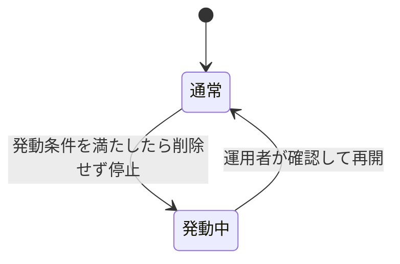
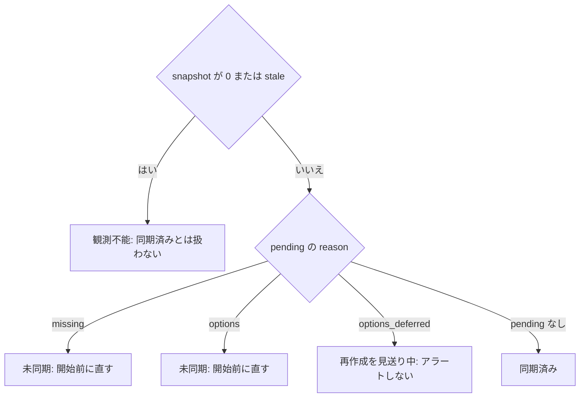

> [operations.md](../operations.md) §2「アラート設計」の一部。索引から辿る。

## 2. アラート設計

アラート設計を、異常の種類ごとの節に置く。

### scrambled > 0（B-CAS / 復号障害）

scrambled > 0 は、ドロップ数とは別枠のアラート対象とする。放送品質の問題とは区別し、エッジ環境の異常として扱い、B-CAS カードの接触、pcscd の生死、decode-filter の設定を確認する。

EPGStation ドロップログの scramble 列と同じ役割である。復号が正常ならスクランブル制御値は常にゼロのはずなので、**scrambled > 0 は B-CAS カード接触不良・pcscd 死亡・decode-filter 設定漏れのようなエッジ環境の異常**を意味する。

<details><summary>根拠</summary>

- 復号が正常なら常にゼロの値: `scrambling_control`

</details>

### エッジディスク残量（未 ingest 滞留）

エッジのディスク残量を、未 ingest の record の総量と突き合わせてアラートする。このアラートは回線断を検知できないので、回線断は同期の最終成功時刻の停滞で別に見張る。

ingest が詰まって未 ingest の record が溜まり続けるシナリオへの備えである（[ストレージ](../storage.md) のサイジング指針と対）。

回線断は `rokuban_sweep_last_success_timestamp_seconds{site}` と `rokuban_epg_sync_last_success_timestamp_seconds` の停滞で見張る。断が `epg.retention_grace` を超えると encode 意図が落ちる（[ストレージ運用](storage.md)「N 日は容量だけでは決まらない」）。

#### 回線断を検知できない理由

**エッジとクラウドの回線が切れている間に始まった録画は、このアラートに現れない。** 未 ingest 総量が数えるのは、終了済みとして観測済みの record だけである。その行は watcher が mirakc を観測して初めて作られるので、断のあいだこの値は平らなままになる。録画中に断が始まったぶんも、終了済みへの更新が復帰後になるので同じである。

#### 数えない record

中途終了した record（取消・失敗）の滞留も数えない。これらは取り込まれず、エッジから回収もされない（[ingest](../recording/ingest-retry.md) §5.3 層 3）。後継の無い途中終了の中身はエッジのディスクに残り続けるが、このアラートには現れない。

<details><summary>根拠</summary>

- 未 ingest 総量が数える行: `record_sync` の `status='finished'`
- 観測済みの終了状態: `finished`
- 数えない途中終了の状態: `canceled` / `failed`

</details>

### 大量削除サーキットブレーカー発動

ブレーカーが発動したら、削除の対象を確認し、正当と分かった場合だけ手動で再開する。発動中は導出削除が一切実行されないので、待ち時間を置かずに即座に通知する。

EPG の一時欠損（mirakc 再起動・再スキャン・SI 取得不良）が起きると、素朴な ruler は予約を大量に「不要」と判定する。reconciler がそれを mirakc へ忠実に反映して一斉に DELETE してしまう（EPGStation#692 の障害クラス）。

そこで 1 回の ruler パスでの削除数に閾値（`ruler.max_deletes_per_pass`）を設け、超えたら削除せず停止してアラートする。削除エンジンの物理 unlink にも、ソースを問わず 1 パスの物理削除が閾値（件数・ライブラリ比率・総バイト数。例: 5% または 100 GB）を超えたら停止してアラートする。

#### 発動の見張り方

「いま止まっているか」を直接表すメトリクスで見張る。発動回数のカウンタでは、この問いに答えられない。

見るのは `rokuban_circuit_breaker_tripped{site,breaker}` である。既存の `*_circuit_breaker_trips_total` は「何回発動したか」しか答えられない。ブレーカーは手動で再開するまで止まり続けるラッチなので、知りたい情報は「いま止まっているか」である。



**1 が続く間、導出削除は一切実行されない。** これは reconcile が収束できていない状態を表さず、人間の確認を待っている状態を表す。放置すると mirakc 側に不要な schedule が残り続けるため、`for` の待ち時間を長く取らず即座に通知する。

発動中でも削除以外は動く（予約の作成・base の更新・schedule の作成・番組終了後の GC）。障害の形は「消えないものが残る」であり、録画は止まらない。慌てて再開せず、`detail` を確認してからにする。

#### ブレーカーの種類

ブレーカーは 3 種類あり、守る対象と再開の手順がそれぞれ違う。

| ブレーカー | 守る対象 |
|---|---|
| `ruler_deletes` | ルール評価から導出された予約削除 |
| `reconcile_total_loss` | desired が空なのに自分の schedule が観測されている全損 |
| `delete_reconcile` | 1 パス分の物理 unlink |

#### ruler_deletes の確認と再開

消されようとしている番組を確認し、正当なときだけ再開する。

`GET /api/breakers` の `detail` で、消されようとしていた番組を確認する。正当なら `POST /api/sites/{site}/breakers/ruler_deletes/resume` で再開する。`site` は一覧のレスポンスにある値を使う。

#### reconcile_total_loss の確認

発動したら、DB の状態を確認する。

DB 接続と `reservations` の中身を確認する。このブレーカーの判定は件数の閾値ではないので、発動したら本当に異常である。

#### delete_reconcile の確認と再開

物理削除の規模を確認し、内訳が要るときは DB を直接クエリして、正当なら再開する。

このブレーカーが守る 1 パスは、ごみ箱の猶予超過・`until_encoded` の派生物完備・ユーザーが外したエンコード版・予約名付き temp と staging の回収の 4 ソースをまとめた物理 unlink である。4 ソースの判定条件は [storage/retention.md](../storage/retention.md) にある。

`ruler_deletes` と異なり、`detail` に対象の抜粋は載らない。呼び出し側が渡すのは総数だけで、サンプルの型にもファイルを表す欄が無い。ファイルを確認できるとは未検証なので、そうは書かない。

規模は `GET /api/breakers` の `pending` と `threshold` で確認する。対象の内訳が要るときは DB を直接クエリする。ごみ箱・`until_encoded` 待ち・外した版の 3 ソースは `media_assets` と [`storage.stores` の FS 置き場](../configuration/keys.md#置き場の規則)の `media_asset_copies` を結合して引く。外した版の録画とアセットは view `removed_encoded_assets` で引ける。公開前孤児の候補は `orphan_files` の `rel_path` と `first_seen` で引く。孤児は定義上、コピー表に無いファイルなので、`media_asset_copies` との照合では引けない。`first_seen` はエイジング判定の根拠なので、内訳の確認にも使える。

正当なら `POST /api/breakers/delete_reconcile/resume` で再開する。このブレーカーは site を持たないので、site をパスに含めない。

<details><summary>根拠</summary>

- delete_reconcile が呼び出し側から受け取る値は総数だけ: `breaker.Sample{Total: total}`、`internal/worker/delete_execute.go`
- ファイルを表す欄が無い型: `breaker.Sample` / `SampleProgram`

</details>

### 未解決の canonical orphan

aging を超えて未登録の canonical file が残っているときは、候補を DB で確認し、登録漏れなら正式な経路で回復する。不要と確認できたファイルだけを手動で整理する。canonical file は自動削除されない。

`rokuban_orphan_files_unresolved > 0` がこの状態を表す。このゲージは削除 reconcile の通常パスで更新されるため、最終完走時刻も併せて見る。

`SELECT rel_path, first_seen FROM orphan_files ORDER BY first_seen;` で候補を確認する。対象ファイルと `media_asset_copies` を照合し、DB 復旧後の登録漏れや公開失敗の残骸かを調べる。ファイルが無くなるか、`storage.stores` の FS 置き場のコピーとして登録されると、次の reconcile で候補が消える。

### 開始時刻超過で recording.started 未観測

開始時刻を過ぎても録画の開始が観測されないときは、待ち時間を置かずに通知する。検出窓が「開始 + 猶予 〜 終了時刻」に限られるので、待ち時間を番組長より長く取ると、短い番組の遅延を一度も通知しないまま取りこぼす。

アラートは `rokuban_reconcile_start_delayed > 0` で出す。番組が終わればゲージは自然にゼロへ戻る。`for` を長く取らないこと。

`rokuban_recordings_failed_total{reason}` が同時に増えているなら、mirakc が理由を返しているのでそちらが一次情報になる。**増えていないのにこのゲージが立つのが最も危険な状態である。** mirakc が失敗を報告せずに録画を始めていないことを意味する（EPGStation#724 のクラス）。

検出に失敗したパスでは、ゲージは 0 にならず最後に成功したパスの値を保つ。失敗は `rokuban_reconcile_start_delay_errors_total{site}` の増加で見る。

### 開始前の未同期または観測不能

予約の受付が DB に成功しても、mirakc に実効 schedule が反映されたとは限らない。開始が近い予約のうち反映されていないものを、観測不能と未同期に分けてアラートする。アラート式の閾値は、現時点ではリポジトリに固定せず、Prometheus 側の運用値にする。

#### 見る系列

未同期の種類ごとの予約数、最も近い開始時刻、snapshot の最終成功時刻の 3 種類を、サイトごとに使う。次の表に並べる。

| 系列 | 意味 |
|---|---|
| `rokuban_presync_pending{site,reason="missing"}` | 番組が終わっていない予約のうち schedule が観測されないものの数（skip は除き、options を解決できない予約は含む） |
| `rokuban_presync_pending{site,reason="options"}` | schedule が `scheduled` 状態で、設定が desired と食い違う予約の数 |
| `rokuban_presync_pending{site,reason="options_deferred"}` | 設定が食い違うが、再作成を見送っている予約の数 |
| `rokuban_presync_pending_earliest_start_timestamp_seconds{site,reason}` | 同じ reason の pending のうち最も近い開始時刻 |
| `rokuban_schedule_snapshot_last_success_timestamp_seconds{site}` | schedule 全量 snapshot が DB に整合した形で最後に確定した時刻（0 は未確立） |

`options` は、priority・`program:{programId}` tag・明示 `contentPath` のどれかが desired と一致しない場合に数える。この差分は reconciler が再作成できる。`options_deferred` は、state が `scheduled` ではないため再作成を見送っている。放送終了を待つか、必要なら手動介入する。

pending が 0 の reason には、開始時刻の系列が出ない。0 を出すと `earliest - time() < lead` が常に真になり、健全な状態で鳴るからである。

件数の gauge だけでは、8 日先の予約 1 件と 2 分後開始の予約 1 件が同値になり区別できない。開始が近いかどうかは `rokuban_presync_pending_earliest_start_timestamp_seconds` で判定する。

#### 判定の順序

判定は、観測不能、missing、options、options_deferred、同期済みの順に読む。snapshot が 0 または stale なら、pending の値が 0 でも「同期済み」とは扱わない。



`options` は reconciler・mirakc・DB を確認して開始前に直す対象である。`options_deferred` は現在の schedule state では原理的に再作成できない対象で、担当者のアクションが異なる。

collector の DB 読み取りに失敗したときは、pending と snapshot の系列自体が出ず、`rokuban_presync_scrape_errors_total{site}` が増える。0 への置換でアラートを消さない。

#### アラート式

観測不能を先に通知し、fresh な snapshot に対してだけ、開始が近い直せる未同期を通知する。

論理形は次の通り。`<snapshot_stale_seconds>` と `<lead_seconds>` は、環境ごとの recording rule と alert rule の値に置き換える。

```promql
# 先に観測不能を通知する。
time() - rokuban_schedule_snapshot_last_success_timestamp_seconds
  > <snapshot_stale_seconds>

# fresh な snapshot に対してだけ、開始が近い「直せる未同期」を通知する。
# 十分先の予約（earliest - time() >= <lead_seconds>）は鳴らさない。
(
  rokuban_presync_pending_earliest_start_timestamp_seconds{reason=~"missing|options"}
    - time() < <lead_seconds>
)
and on (site)
(
  time() - rokuban_schedule_snapshot_last_success_timestamp_seconds
    <= <snapshot_stale_seconds>
)
```

**`options_deferred` はアラートしない。** 録画中の番組の priority を変えると、録画が終わるまで（数時間）`earliest` が過去のまま非ゼロが続くのが正常だからである。これは `update_deferred` と同じ判断である（[monitoring.md](monitoring.md) §reconcile）。`missing` / `options` と別系列にしたのは、この reason を上のアラート式から除外するためである。調査の入口は [troubleshooting.md](../runbook/troubleshooting.md) にある。

`for:` は 1 scrape 分の揺らぎ吸収だけに使う。「pending が続いた時間」を測る用途には使わない。開始までの残り時間は上式が `earliest - time()` で直接見ているので、`for` を長く取る必要はない。

#### 通知の経路

アラートは Alertmanager へ送り、サイトと reason をルーティングに残す。

通知は Prometheus の alert rule から Alertmanager へ送り、`site` と `reason` をルーティングに残す。`missing` / `options` は、開始前に reconciler・mirakc・DB を確認する通常の未同期ルートにする。

reconciler・mirakc・DB を見ても `missing` の原因が見つからないときは、reconciler の Error ログ `reconciler: resolving effective options` を探す。options を解決できない予約があると、その `program_id` がこのログに出る。予約の base か `program_overrides` に型の合わない値が入っているので、その値を直す。

観測不能は、同期状態の断定より優先する。担当者が reconciler の投入元・worker / ScaledJob の起動状態・DB 接続を確認する入口にする。

#### lead の決め方

開始前に確認できる猶予は、通知までの遅延の p95/p99 に、運用者の介入余裕を足して決める。

`<lead_seconds>` は次の式で決める。p95/p99 の実測値を代入する。

```text
lead >= (
  定期投入間隔 + KEDA poll + Pod 起動 + reconcile パス時間
  + 作成した schedule の再観測 + 通知到達
) の p95/p99 + 運用者の介入余裕
```

未測定の範囲は、定期投入から通知到達までの p95/p99、mirakc の POST 後に schedule が再観測されるまでの遅延、サイトごとの EPG 時刻変更頻度である。実測後に alert rule の閾値を変更し、アプリケーションを再ビルドしない。

#### snapshot の確定と marker

snapshot の確定時刻は DB の marker に残り、メトリクスは常駐 Pod の collector がそれを読む。

常駐 `PeriodicJobs` では reconciler が full snapshot を確定する。常駐プロセスの `/metrics` は DB の marker を読む。ScaledJob `--once` では、ジョブ Pod 自身の process gauge は scrape しようとせず、常駐 Pod の collector が同じ marker を読む。

ジョブ未投入・Pod 未起動・パス失敗では marker が進まない。復旧して full snapshot がコミットされ、desired と observed の差分が解消すれば、marker は新しくなり pending は 0 に戻る。

予約の削除・再実体化を跨いでも、collector はその時点の `(site, program_id)` と DB の desired / observed を再計算する。`synced` 成功状態を永続化して古い成功を残すことはない。

#### 同期成功率の母集団

同期成功率を将来測るなら、母集団はサイトと放送イベントの組にする。

将来「開始までに同期できた割合」を測る場合の母集団は、サイトと放送イベントの `(site, program_id)` 単位にする。測定 lead より前に desired が確定し、明示 skip でない候補のうち、開始前に options 一致を確認できたものを分母にする。

直前に作られた手動予約、開始後の操作、EPG の開始時刻変更で旧イベントと新イベントを跨いだ候補は、別の母集団に分ける。skip は分母から除外する。現スコープではこの履歴を保存せず、collector は現在の desired / observed と snapshot 鮮度だけを出す。
