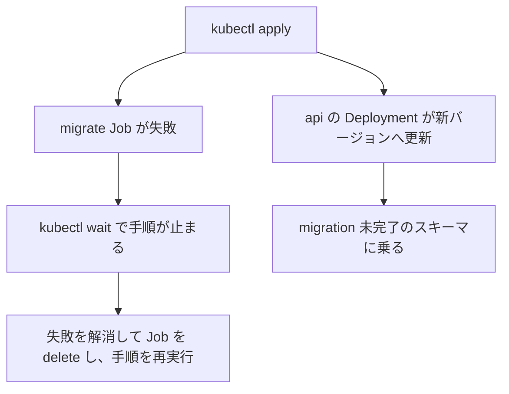

> [operations.md](../operations.md) §3「DB 運用」の一部。索引から辿る。

## 3. DB 運用

DB 運用の判断を、輻輳時の隔離・接続・拡張・EPG の書き込み負荷・バックアップの順に置く。

### 輻輳時の隔離

DB が輻輳しても止まらない処理と、DB に依存し続ける処理がある。保証は処理ごとに条件が付き、故障モードを常に「収束の遅れ」とは一般化しない。

これは「ユーザー操作で DB が詰まったら録画やエンコードに影響しないか」という懸念への対策である。**DB 輻輳時の運用上の保証は、以下の処理ごとの条件付きである。**

#### 録画

録画は、mirakc に番組終了前まで同期済みの予約に限って、DB 停止から分離される。スケジュールは mirakc 側に永続化済みで、録画実行は mirakc が自律的に行う。

ただし mirakc 自身、録画バッファ、チューナーが動作していることが条件である。新規・変更予約は、reconciler が期限内に同期できなければ録画されない。

根拠

- mirakc 側に永続化されるスケジュール: `schedules.json`

#### ingest

実行中の ingest は、転送中のバイト I/O だけを見れば DB の外側にある。ジョブ全体は DB に依存する。開始時の参照、進捗の書き込み、公開点であるコミットが必要になる。

4 分の slice ごとに temp と SHA-256 checkpoint を保存し、同じ River job を snooze して再開する。プロセス死では JobRescuer が同じ job を回収する。DB 障害で接続やコミットを失えば、録画バッファに record が残り、再試行できる範囲では収束する（詳細は [ingest](../recording/ingest-retry.md) §5.3）。

根拠

- 開始時に参照する表: `record_sync`
- 公開点のコミット: `media_assets`

#### encode

実行中の encode は、ffmpeg のバイト処理だけを見れば DB の外側にある。公開も DB のコミットで決まる。

投入時に `max(1h, 録画実尺 × profile rate)` の締切を args に保存する。River の JobRescuer はその締切後に同じ job ID を再試行する。ドメイン試行数を保存し、公開 tx で fencing token として照合する。

試行ごとの scratch は別ディレクトリにする。締切後も cancel を無視する古い ffmpeg が動いていても、出力は衝突しない。

公開前に一時ファイルを canonical と同じディレクトリへコピーする。ファイルパスの filesystem lock と DB transaction を取り、行を読み直してから rename する。canonical は直接書かない。既に active で（カット版は凍結区間も）同じ内容なら、成功で飛ばして何も置かない。

パスが計画時と違い、行が active なら、River の snooze で再計画する。行が active でなければ成功で飛ばす。RWX のメディア越しにファイルロックが効くかは未検証である。cancel を無視する処理やネットワーク filesystem の停止は、job timeout で止められない。k8s の liveness が最後の停止手段になる（詳細は [k8s 運用](k8s.md)）。

根拠

- ドメイン試行数の保存先: `recording_encode_attempts`
- ファイルパスの列: `rel_path`
- canonical を直接書かない: `O_TRUNC` で書かない
- ファイルロック: `flock`

#### 長時間の滞留

ingest の滞留が長引くと、予約から encode policy を解決できず、ポリシーを失うことがある。

ingest が `epg.retention_grace` を跨ぐと、既定値で凍結される。作成時点で予約も意図も無ければ、出自は帰属なしになる。

原本の保持・エンコードの扱い、回線断を含む滞留の測り方は [ストレージ運用](storage.md) §4 と [ストレージ](../storage.md) §6 を参照する。

根拠

- 出自の列: `source`
- 帰属なしの値: `unattributed`

#### ルール評価

ルール評価は UI と同期しない。ルール編集 API は、編集を書いて再評価ジョブを投入するだけで即応答する。

#### コネクションプールの上限

接続プールの上限はロール別に分け、api が全コネクションを食い潰して worker や reconciler が待つ事態を防ぐ。

プロセスは常に 1 個のコネクションプールしか持たず、担う全ロールが共有する。「ロール別」は、複数プールを作ることを指さない。そのプロセスの roles 集合と束縛サイト数から、唯一のプールの上限を決めることを指す。

`db.max_conns` を明示すればその値を使う。未指定なら、ロールごとの budget を roles の分だけ合計する。1 サイト束縛時の budget は次の通り。monolith（`--all`）では全ロール分の合計になる。

| ロール | budget |
|---|---|
| api | 10 |
| worker | 床 8 |
| watcher | 3 |
| notifier | 3 |
| streamer | 4 |

1 プロセスが N サイトを束縛できる（`--sites`）ため、watcher は束縛サイトごとに advisory lock 用コネクションを 1 本専有し続ける。2 サイト目以降は budget にも自動で上乗せする。

根拠

- プロセスのプール作成: `cmd/rokuban/server.go` / `internal/db.NewPool`
- 唯一のプールの上限: `MaxConns`
- ロール budget の合算と worker の下限: `internal/db.roleConnBudget`
- 束縛サイトごとの追加 budget: `internal/db.perSiteConnBudget`
- watcher の advisory lock 専用接続: `role.RunSingleton`

#### worker の budget

worker の budget は、床 8 の固定値で、実測に基づく値ではない。

内訳は River の LISTEN 1 本と、ジョブ claim・進捗書き込み・`/metrics` のバックログクエリ等の短いクエリである。

**どのジョブも Work の間に接続を保持し続けないので、`ingest.concurrency` や束縛サイト数では増えない。**

#### 接続数の fail-fast

接続数を明示指定するときは、専有される接続の数から下限を求め、足りなければ起動時に失敗させる。

数える対象は「解放が別の接続取得に依存する専有」である。内訳は watcher の advisory lock（1 サイトあたり 1 本）と、worker / notifier の LISTEN である。合計に余地 1 本を足した値が、`db.max_conns` の下限になる。

lock をプール外の接続で張る案は採らない。`db.max_conns` がプロセスの接続上限だという契約を破るためである。

根拠

- 下限の計算: `internal/db.minRequiredConns`

#### API 系クエリのタイムアウト

API 系クエリには、データベース側のタイムアウトを設定する。クエリ単位の context timeout だと、付け忘れた 1 本が必ず生まれるので、接続の起動時パラメータで一括適用する。

適用するのは `statement_timeout` で、接続の `RuntimeParams`（起動パケットの session default）に置く。設定は `db.api_statement_timeout` で、未指定なら 30s である。

api ロールを含むプロセスのプール全体に適用される。monolith で api と worker / watcher を同居させると、worker 側のクエリにも同じ上限がかかる。世帯スケールの通常クエリを十分に上回る既定値にしてあるので実害は想定していない。ロールを分離すれば、worker 単独プロセスには適用されない。

`statement_timeout` は行ロック待ちにも効く。Postgres は「クエリの実行時間」と「ロック待ちの時間」を区別しない。monolith で `record_sweep` 等が別トランザクションの行ロックを長く待つと、中断されうる。River が再試行するが、意図しない再試行が増える兆候として覚えておく。

根拠

- 起動時パラメータ: `RuntimeParams`
- 行ロックを待ちうるジョブ: `record_sweep`

### transaction pooling は通さない

transaction pooling は通さない。接続が要求ごとに入れ替わると、LISTEN と advisory lock を使うロールが正しく動かなくなるためである。

worker は River の LISTEN を使い、1 個の Listener を elector と job-available 通知で共有する（River 0.47.0 で確認済み）。watcher は advisory lock、notifier は SSE 用の LISTEN を使う（[data.md](../data.md) §2 / §3）。将来ハイブリッド構成を実装するときは、必要な pooler 対応の形をその PR で改めて決める。

根拠

- Listener の共有: `notifier.New`
- 確認済みの River バージョン: `river@v0.47.0`

### managed PostgreSQL の `btree_gist`

managed PostgreSQL が拡張の作成を許可しないと、migration がそこで止まる。権限エラーになったら、DB 管理者が同じ文を事前に実行してから、migration を再実行する。

#### migration が止まったとき

チャプター区間の排他制約を作る migration は、拡張の追加に失敗するとそこで止まり、後続の migration に進まない。

先に `btree_gist` を追加する文が失敗すると、`migrate up` が止まる。k8s では [`migrate-job.yaml`](../../deploy/k8s/base/migrate-job.yaml) の Job が失敗し、手順は `kubectl wait` で止まる。api の Deployment は同じ `kubectl apply` で新しいバージョンへ更新されており、migration 未完了のスキーマに乗る。Job の失敗を解消してから、Job を delete して手順を再実行する（順序と理由は [deploy/k8s/README.md](../../deploy/k8s/README.md) §使い方）。

根拠

- 排他制約: `EXCLUDE`
- 拡張の追加先スキーマ: `public`

#### 拡張の権限

PostgreSQL 標準の拡張 btree_gist は trusted extension なので、対象 DB の作成権限があれば作れる。ただし managed provider がこの拡張を許可するかは、接続先ごとに違う。

作成に要るのは、対象 DB の `CREATE` 権限である（[btree_gist](https://www.postgresql.org/docs/current/btree-gist.html)）。

`IF NOT EXISTS` は、既存の拡張があると作らずに notice を返す。成功しても新規作成権限の証明にはならない。権限エラーの対処では、エラーを握りつぶす変更や migration の書き換えはしない。

本番相当の managed 環境での実測は未実施である。確認の手順は [runbook/managed-postgres.md](../runbook/managed-postgres.md)。

### DB の文字分類（`LC_CTYPE`）

DB の文字分類が日本語を語の文字として扱わないと、日本語の番組では正規表現の検索・ルールと重複排除が効かない。rokuban は起動時にこれを検査し、満たさない DB では起動しない。

正規表現の検索・ルールの `\w` と大文字小文字の無視、および重複排除に使う pg_trgm の `similarity()` は、どちらも DB の `LC_CTYPE` の文字分類に従う。`LC_CTYPE` が `C` だと、日本語や全角英字を含む正規表現の検索・ルールが当たらず、日本語タイトルの類似度は 0 になる。

`migrate up` は migration の適用後に、各ロールは起動時（DB の接続プールを作るとき）に、これらの挙動を確かめる。日本語を扱えるロケールは `en_US.utf8`・`C.UTF-8`・`ja_JP.UTF-8`・ICU と複数あり、ICU でも ctype が `C` なら満たさない。そのためロケール名では判定しない。

公式の `postgres:17` イメージの既定（`en_US.utf8`）はそのまま使える。自分でロケールを選ぶ場合は、libc の `C.UTF-8` を推奨する。公式イメージに含まれ、照合順序が言語に依存しない。

検査に失敗すると rokuban は起動しない。`LC_CTYPE` は DB 作成後に変更できないため、条件を満たすロケールを指定して DB を作り直す。未 migrate の DB（pg_trgm が無い）では、ロケールではなく `migrate up` を先に実行するよう案内する。

根拠

- migrate 後の検査: `MigrateUp`
- 全ロールのプール作成時の検査: `NewPool`（どちらも `checkLocaleSupport` を呼ぶ）
- 既定 DB で成功すること: `TestNewPool`
- C ロケール DB で 3 つの検査がすべて落ち、エラーに名前と `datctype` が載ること: `TestNewPoolRejectsUnsupportedLocale`
- 未 migrate の DB で `migrate up` の案内になること: `TestNewPoolRejectsUnmigratedDatabase`
- `C.UTF-8` の推奨: `postgres:17` で `CREATE DATABASE … TEMPLATE template0 LOCALE 'C.UTF-8'` の DB は 3 つの検査がすべて真（2026-10-18 実測）。テストでは固定していない

### EPG churn / autovacuum

検索は世帯スケールでは遅くならない。EPG テーブルは 1 日に何度も大量に upsert されるので、遅くなるとしたら書き込みと autovacuum の追従である。対策はバッチ upsert、GIN fastupdate、**テーブル別 autovacuum チューニング**の 3 つである。

テーブル別チューニングは、たとえば EPG テーブルに対して `autovacuum_vacuum_scale_factor` を小さく設定する。

EPG テーブルは 8 日分 + 猶予のローリングウィンドウであり、永遠に太らない。検索性能自体は、世帯スケール（数万〜20 万行）では問題にならない。

### Postgres datadir とエンコード scratch の分離

**両者を同じディスクに置かない構成を推奨する。** monolith モードでは、Postgres のデータディレクトリとエンコードの scratch が同じディスクに載りやすい。実際に競合しやすいのはロックよりディスク I/O である。

### バックアップ

バックアップは catalog エクスポートを基本とし、pg_dump は推奨だが必須ではない。世帯スケールでは catalog と任意の pg_dump で十分で、WAL アーカイビングは過剰である。

保護対象は「ルール・録画履歴・media_assets・ドロップ統計・tombstone・手動オーバーライド」のみで、数 MB である。EPG プロジェクションは mirakc から再構築可能で、ジョブキューは一時的である。

#### catalog エクスポート

worker の定期ジョブが、コアデータを JSON でメディアストレージ自身の配下に書き出す（日次 + 世代保持）。メディアが生き残る障害では、この書き出し（catalog）も一緒に生き残る。

書き出し先は `catalog/` 配下である。pg_dump に依存しない（公式イメージに postgres クライアントを同梱しなくてよい）アプリレベルのエクスポートである。

1 世代は 1 ディレクトリ（`catalog/catalog-<時刻>/`）で、**`manifest.json` を最後に書き終えたものだけが完成世代である。** 判定基準の詳細は [storage.md](../storage.md) §8 にある。

#### catalog の健全性確認

catalog の健全性は、専用の検証コマンドで確認する。manifest の存在を目視するだけでは確認にならない。

健全性の確認は `rokuban catalog verify` で行う。DB に触らず、完成世代が 1 つも無ければ非ゼロ終了する。何世代が完成しているか、rescue が使う世代、落ちた世代とその理由を出す。**`manifest.json` の存在は必要条件でしかなく、完成判定はサイズと sha256 の照合まで含む。**

#### rescue は健全性確認に使わない

rescue は破壊的な操作なので、健全性の確認には使わない。使うのは DB を失った後だけである。

`rokuban rescue` は、検証の後に必ず DB へ書き、live DB を catalog スナップショットで**上書きする**。録画の状態・削除日時・パージ日時と、asset の状態・削除日時を catalog の値で上書きし、id シーケンスを巻き戻す。健全な DB に対して実行すると、catalog を書き出した時点まで状態が巻き戻る（削除済み asset の復活を含む）。

根拠

- 上書きされる録画の列: `recordings.status` / `deleted_at` / `purged_at`
- 上書きされる asset の列: `media_assets.state` / `deleted_at`

#### pg_dump

フル忠実度が欲しい場合の、日次 pg_dump 構成例をドキュメントに記載する。pg_dump は推奨だが必須ではない。
