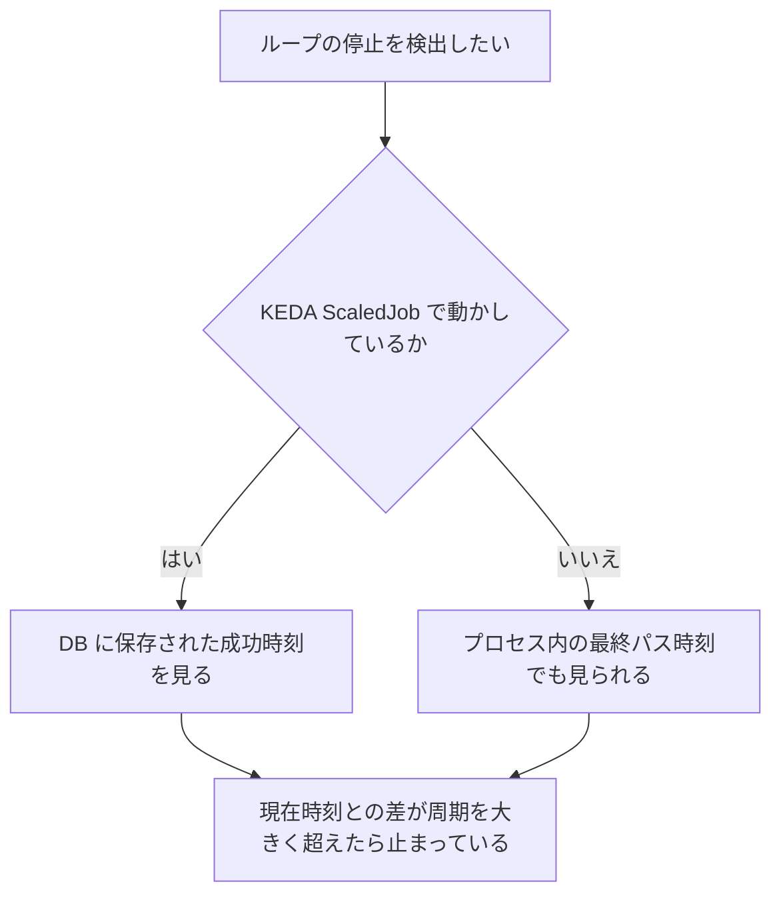

> [operations.md](../operations.md) §1「ジョブ化されたループの監視」の一部。索引から辿る。

### ジョブ化されたループの監視

ループの停止は、ジョブが投入されて完走しているかで検出する。ロックが取れているかは見ない。最後に成功した時刻からの経過時間が、周期を大きく超えたら止まっていると判断する。

ruler / reconciler / record_sweep（watcher の 3 段構えのうち (c) 定期全量突き合わせ）は River のジョブである。advisory lock が取れているかは、停止の検出に使わない。



#### 停止を見分けるメトリクスと症状

止まり方ごとに、見るものが違う。

| 見るもの | 意味 |
|---|---|
| `rokuban_reconcile_last_pass_timestamp_seconds` | プロセス内のゲージ。`time() - この値` が周期を大きく超えたら止まっている。KEDA ScaledJob の構成では使えない。予約同期の完走は DB に保存されず、このゲージだけが持つ（理由は下の節）
| `rokuban_ruler_last_success_timestamp_seconds{site}` / `rokuban_sweep_last_success_timestamp_seconds{site}` | DB に保存された site 単位の成功時刻。`time() - この値` が周期を大きく超えたら、ScaledJob でも止まっている |
| `rokuban_encode_reconcile_last_success_timestamp_seconds` / `rokuban_thumbnail_reconcile_last_success_timestamp_seconds` / `rokuban_ts_scan_reconcile_last_success_timestamp_seconds` | DB に保存された全件パスの完走時刻。ScaledJob でも止まっているかを検出できる |
| `rokuban_delete_reconcile_last_success_timestamp_seconds{store}` | DB に保存された置き場ごとの削除 reconcile の完走時刻 |
| `rokuban_storage_root_observed_timestamp_seconds{store,root}` | DB の `storage_sync` に保存された root ごとの最後の観測時刻 |
| `river_job` の `state='available'` が滞留 | 投入はされているが誰も引いていない（worker が 0 か、キューを引いていない） |
| `river_job` の ingest キューで `state='running'` が上限に張り付き、`available` が滞留している | ingest の枠不足。`ingest.concurrency` が録画数に対して小さく、UI では取り込み待ちが続く |
| `river_job` が増えない | **投入自体が止まっている。** `worker.periodic_jobs: false` なのに CronJob が動いていない、あるいはリーダーが不在 |

最後の行が k8s 特有の注意点である。k8s は `worker.periodic_jobs: false` で出荷しており、投入元は CronJob だけである（[データ層](../data.md) §2）。`rokuban enqueue` を叩く CronJob が設定されているかを最初に疑う。

#### 常駐 Pod のゲージが使えない理由

プロセス内の最終パス時刻は、ScaledJob 構成では scrape できず、常駐 Pod の値も成功時刻を表さない。成功時刻は、DB に保存された値で見る。

`rokuban_reconcile_last_pass_timestamp_seconds` は、プロセス内のゲージである。ジョブを走らせたプロセスは 1 件消化して終了する（`--once`）ので、その値を scrape できる窓が実質的に無い。常駐している Pod（api / notifier / watcher / streamer）はそのジョブを一度も走らせないので、値は成功時刻を表さない。

ruler / record_sweep / 全件パスの reconcile（encode / thumbnail / ts_scan）/ 削除 reconcile にはプロセス内の最終パス時刻ゲージが無い。鮮度は、上の表の DB に保存された系列だけで読む。`ruler_pass` と `record_sweep` は、成功したパスの最後に `loop_success_markers` に site の行を upsert する。処理が途中で失敗した場合は marker を更新しないので、DB-backed の値は「最後に成功した時刻」であり、「最後に試みた時刻」ではない。

予約同期（reconcile）の鮮度は、DB-backed の `rokuban_schedule_snapshot_last_success_timestamp_seconds{site}` で読む。常駐 Pod や別の worker が scrape しても、同じ DB の値になる。reconciler のジョブが未投入・未起動・途中失敗のどの場合も、最後に確定した snapshot からの経過時間として見える。

パスの完走だけは DB に系列が無い。snapshot はパスの前半で確定し、その後にパスが失敗すると、snapshot だけが進んでパスは完走しない。そのため reconcile だけは、完走時刻のプロセス内ゲージを残している。

`rokuban_presync_pending` は snapshot の鮮度を代用しない。snapshot が古い、または 0 のときは、「未同期」と断定せず、まず観測不能として扱う。freshness と pending の判定順、常駐構成と ScaledJob 構成の収集元・復旧条件は、[アラート設計](alerts.md) にまとめる。

全件パスの reconcile（encode / thumbnail / ts_scan）と、置き場ごとの削除 reconcile も同じ作りにした。完走の記録は `loop_success_markers` の `reconcile_pass` と `delete_reconcile` の行に持つ。storage sync は表を足さず、既存の `storage_sync.observed_at` を読む。どの Pod が scrape しても、同じ DB の値が出る。

完走の記録には次の規則がある。

- 記録するのは全件パスだけである。targeted pass（`recording_id` 指定）は記録しない。
- 記録に失敗したパスはエラーを返し、完走として数えない。
- thumbnail は、シークタイルの一覧を取れなかったパスでは記録しない。
- 削除 reconcile の完走時刻は、FS の置き場と派生物用の S3 の置き場を置き場名で分けて記録する。
- 削除 reconcile のパスが失敗したときは、完走時刻を進めない。
- ブレーカーで止めた削除 reconcile のパスは完走として記録する。止める前に、孤児の監査と pending の再開を終えているためである。
- ブレーカーで止めている間は `rokuban_circuit_breaker_tripped{breaker="delete_reconcile"}` が知らせる。この系列の `site` ラベルには置き場名が入る。
- 候補ごとの投入の失敗では、記録を止めない。

#### アラート式の集約と初回パス

全件パスの完走時刻と置き場ごとの系列は、どの Pod でも同じ値を出す。式は集約して、Pod の数だけ同じ系列が重ならないようにする。

```
time() - max(rokuban_encode_reconcile_last_success_timestamp_seconds) > 閾値
time() - max by (store) (rokuban_delete_reconcile_last_success_timestamp_seconds) > 閾値
time() - min by (store) (rokuban_storage_root_observed_timestamp_seconds) > 閾値
```

storage は root ごとに系列を持つので、`min by (store)` で置き場の中で最も古い root を見る。片方の root だけが止まっても、その置き場の系列が閾値を超える。

新しい表は導入直後は空なので、初回のパスが完走するまで系列は 0 を出す。0 は「一度も完走していない」であって、止まった時刻ではない。アラートは、導入して 1 周期待ってから有効にする。

それ以降も 0 が続くなら、未投入として扱う。0 のまま続くことは「CronJob を最初から忘れた」状態そのものなので、式から 0 の系列を外さない。投入元（CronJob）を確認する。

継続を持つパス（encode / thumbnail / ts_scan）は、候補が多いとページごとに完走時刻を書く。値の意味は「定期パスが回っている」であり、「全候補を見終えた」ではない。候補の残りは、継続ジョブのログで確認する。

#### CronJob による定期投入

定期投入を切った構成（k8s の出荷形）では、定期ジョブの投入元は CronJob だけである。手動で走らせたいときも、同じ投入コマンドを使う。

切るのは `worker.periodic_jobs: false` の設定である。

手動で走らせたいときは `rokuban enqueue <job>` を使う。既に待機中なら投入せず終了コード 0 を返すので、cron から重ねて叩いても安全である。

ジョブが site と置き場のどちらに束縛されるかで、投入する引数と CronJob の立て方が変わる。

| 種別 | ジョブ | `--site` / `--store` | CronJob の立て方 |
|---|---|---|---|
| site 束縛 | `rokuban enqueue --help` の「site 束縛ジョブ」 | 多サイトでは必須（1 site なら省略可） | サイトごとに 1 本（`--site tokyo` 等） |
| 置き場ごと | 同「置き場ごとのジョブ」 | FS 置き場が複数なら必須（1 つなら省略可） | FS 置き場ごとに 1 本 |
| site 非依存 | 同「site 非依存ジョブ」 | どちらも付けない | 全体で 1 本 |

site に束縛しないことは、全体で 1 回という意味ではない。置き場ごとのジョブは FS 置き場ごとに投入する。全体で 1 回投入するのは `--site` も `--store` も取らないジョブだけである。フラグの要否と各分類のジョブ一覧は `rokuban enqueue --help` が権威である。

site 非依存ジョブを site ごと（または置き場ごと）の CronJob から叩くと N 回投入される。River の一意制約で 1 本に合流はするが、CronJob の意図が読めなくなる。

<details><summary>根拠</summary>

- `rokuban enqueue --help` における範囲の一覧: `cmd/rokuban/enqueue.go` の `RequiresSite` / `RequiresStore`
- site / store の引数解決: `TestResolveEnqueueJobScope`

</details>

#### CronJob を忘れたときの症状

投入元を CronJob だけにする構成では、CronJob を忘れると、そのジョブが一度も投入されない。症状と検出に使うメトリクスは、ジョブごとに違う。

対象は `worker.periodic_jobs: false` の構成である。

`storage-sync` の CronJob を忘れると、`storage_sync` が一度も投入されない。`GET /api/storage` が永遠に空配列を返す。検出は、`rokuban_storage_root_observed_timestamp_seconds{store,root}` の鮮度で行う（式は「アラート式の集約と初回パス」）。

`encode-reconcile` と `thumbnail-reconcile` を忘れた場合の症状は、目立たない。ヒントを落とした録画だけが、派生物を持たないまま残る（[ingest](../recording/ingest-followup.md) §5.5）。検出は、`rokuban_encode_reconcile_last_success_timestamp_seconds` の鮮度で行う。thumbnail とシークプレビュー用タイルは同じパスが埋めるので、`rokuban_thumbnail_reconcile_last_success_timestamp_seconds` を見る。投入を忘れれば値が進まない。

`ts-scan-reconcile` を忘れた場合は、scan 記録のない原本が残る。検出は、`rokuban_ts_scan_reconcile_last_success_timestamp_seconds` の鮮度で行う。投入を忘れれば値が進まない。`rokuban_ts_scan_jobs_total` は ingest のヒントでも増えるので、投入停止の検出には使わない。

thumbnail reconcile の候補から除外される既知の原本欠落は、`rokuban_media_assets_missing{kind="original"}` で確認する。これは、ファイルが復旧して delete reconcile がマーカーを消すまで、定期パスが同じ失敗を作り続けないためのガードである。

#### record_sweep の起動契機

record_sweep の起動契機は、定期投入だけである。既定間隔は 5 分で、ruler / reconciler と違って前倒し投入のヒント経路はない。

`rokuban_sweep_last_success_timestamp_seconds{site}` を監視する。record_sweep が DB marker を更新するのは、schedules と records の一覧取得に成功し、failed schedule と record の突き合わせも全件成功したときだけである。サービス一覧の取得失敗はこの条件に含めない。前回のキャッシュで続行し、キャッシュに無いサービスは failed schedule の突き合わせの失敗として現れるからである。

そのため、決定的に失敗する record が 1 件あるだけで marker は止まり、`rokuban_sweep_last_success_timestamp_seconds{site}` のアラートが鳴る。原因の record は `sweep: processing record` ログの `record_id` で特定する。失敗したパスは再試行せず、次の定期投入が再試行である。原因を取り除けば、次のパスで marker が進む。

前倒し投入のヒント経路がないことは、[録画エンジン](../recording.md) §3.3「record_sweep の起動契機」にある。取りこぼしの大半は SSE の (a)(b) が吸収する。record_sweep は定期パスとして収束させる保険という位置づけで、5 分間隔で十分と判断している。

SSE 再接続をヒントにする案は採らない。mirakc クライアントの SSE 購読が再接続を内部に隠しているため、呼び出し側へ再接続を通知できないためである。

<details><summary>根拠</summary>

- `record_sweep` の間隔: `cmd/rokuban/workerspec.go` の `newWorkerSpec`
- SSE 再接続を呼び出し側へ通知できない: `internal/mirakc.Client.Subscribe`

</details>
