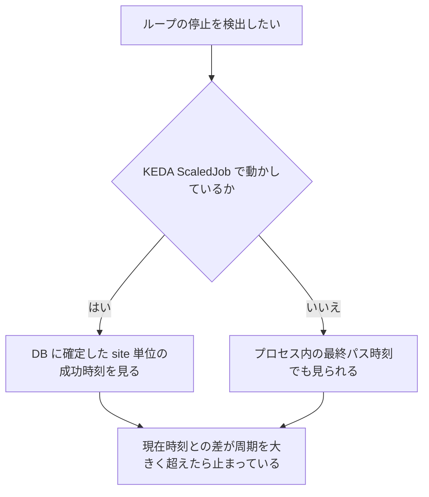
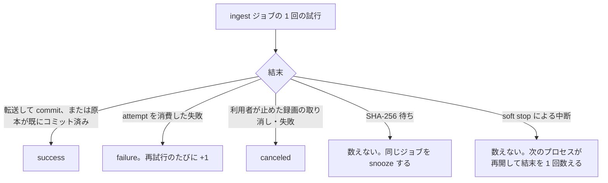
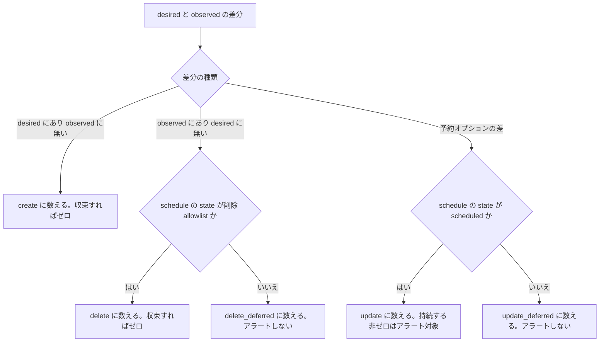

> [operations.md](../operations.md) §1「監視メトリクス」の一部。索引から辿る。

## 1. 監視メトリクス

この節は、メトリクスの公開の仕組み、実装済みメトリクスの一覧、ループごとの読み方、メトリクスに異常が出ていなくても安全とは言えない場合をまとめる。

### エンドポイント

どのロールのプロセスでも、メトリクスのエンドポイントを scrape できる。監視基盤は、ホスト名の許可リストを気にせず、Pod の IP やサービス名で叩ける。

#### 公開するプロセスと形式

Prometheus の text exposition format で返す。**ロールに関わらずすべてのプロセスが公開する。**

経路は `GET /metrics` である。worker だけの Pod でも滞留メトリクスを scrape したいので、HTTP リスナーは常に 1 本立てる。OpenAPI には載せない。text format であり、生成クライアントの対象外だからである。

#### Host allowlist の免除

メトリクスとヘルスチェックのエンドポイントは、ホスト名の許可リストの対象外にする。

`/metrics` と `/healthz` / `/readyz` は Host allowlist を免除する。監視基盤は Pod IP やサービス名で叩くため、allowlist に載せようがない（IP は動的）。allowlist の内側に置くと、k8s の liveness / readiness probe と Prometheus の scrape が 400 で落ちる。DNS rebinding が守ろうとしているのは、ブラウザ経由でデータを読み書きされることである。機密を含まないインフラ用エンドポイントを免除しても、防壁は薄くならない。

#### メトリクスの 2 種類

メトリクスは、そのプロセスで起きた事象を数えるものと、scrape のたびに DB から取り直すゲージの 2 種類を使い分けている。

プロセス内のカウンタとヒストグラムは、再起動でリセットされる。Prometheus はカウンタのリセットを扱えるので問題にならない。DB を引くゲージは、scrape のたびに正しい状態を DB から取り直す。プロセス内に溜めないので、どのロールが scrape されても同じ値になる。「イベントはヒント、正しい状態はテーブルの再読で得る」と同じ考え方である。

根拠

- メトリクスの実装の置き場: `internal/metrics`

#### 録画と取り込みのメトリクス

録画失敗は理由別のカウンタで、取り込みの滞留は DB を引くゲージで見る。

| メトリクス | 型 | 意味 |
|---|---|---|
| `rokuban_recordings_failed_total{reason}` | Counter | `recording.failed` の理由別件数 |
| `rokuban_records_broken_total{reason}` | Counter | `recording.record-broken` の理由別件数 |
| `rokuban_ingest_bytes_total` | Counter | ingest バイト数 |
| `rokuban_ingest_duration_seconds` | Histogram | ingest 所要時間。中断は含まない |
| `rokuban_ingest_jobs_total{result}` | Counter | ingest の結果別件数 |
| `rokuban_uningested_records{site}` | Gauge（DB） | 未 ingest record 総量（件数） |
| `rokuban_uningested_record_bytes{site}` | Gauge（DB） | 未 ingest record 総量（バイト） |
| `rokuban_uningested_backlog_scrape_errors_total{site}` | Counter | 上の 2 つの取得失敗回数 |

ingest の所要時間に中断を含めない理由と、結果別件数の数え方は ingest の節にある。未 ingest のゲージが数えるのは、終了したと観測済みのぶんだけである。

録画失敗は観測した時点で数える。予約の照会や mirakc への問い合わせより後に置くと、それらが失敗したときに取りこぼす。物事がうまくいっていないときこそ数えたい。

PID 別のドロップ内訳はメトリクスにしない。PID × 録画数でカーディナリティが増えすぎるためである。`drop_stats` テーブルと `/api/recordings/{id}/drop-stats` で見る。

根拠

- 未 ingest のゲージが数える対象: `finished`
- 所要時間が中断を含まない理由と対応する結果別件数: `ingest_jobs_total`

#### エンコードと派生物のメトリクス

エンコード・サムネイル・シークタイルは、ジョブの結果別件数と、reconcile の最終完走時刻で見る。

| メトリクス | 型 | 意味 |
|---|---|---|
| `rokuban_encode_duration_seconds` | Histogram | encode 1 件の所要時間 |
| `rokuban_encode_jobs_total{result}` | Counter | encode の成功・失敗・再計画の件数 |
| `rokuban_thumbnail_duration_seconds` | Histogram | thumbnail 1 件の所要時間 |
| `rokuban_thumbnail_jobs_total{result}` | Counter | thumbnail の成功・失敗件数 |
| `rokuban_seek_tiles_duration_seconds` | Histogram | シークプレビュー用タイル 1 件の所要時間 |
| `rokuban_seek_tiles_jobs_total{result}` | Counter | シークタイルの成功・失敗件数 |
| `rokuban_thumbnail_reconcile_last_pass_timestamp_seconds` | Gauge | thumbnail / シークタイルの reconcile の最終完走時刻 |
| `rokuban_thumbnail_reconcile_candidates` | Gauge | 直近の thumbnail reconcile が見た不足録画数 |
| `rokuban_encode_reconcile_last_pass_timestamp_seconds` | Gauge | 最後に完走した encode reconcile パスの時刻 |
| `rokuban_encode_reconcile_candidates` | Gauge | 直近パスの候補窓に入った、不足プロファイルか満たされていない作り直しがある録画数 |
| `rokuban_encode_reconcile_unsatisfiable{profile}` | Gauge | 凍結済みの desired が現在のプロファイルに無い録画数 |

`replan` は、計画が古く snooze で再計画した件数であり、失敗ではない。thumbnail reconcile の最終完走時刻は、投入停止を `time() -` で検出するために使う。不足録画数が数えるのは poster のぶんだけである。シークタイルは別の窓で数えるが、同じパスが埋めるので、鮮度はこの 1 本で足りる。不足録画数が行上限に張り付くときは、バックログが上限以上ある。

encode reconcile のパスは、ヒントを落とした録画を拾うバックストップである。止まっても症状が目立たないので、最終完走時刻を見る（[ingest](../recording/ingest-followup.md) §5.5）。

凍結済みの desired が現在の `encode.profiles` に無い録画が非ゼロなら、プロファイルの改名や削除で、その名前の過去録画が永久にエンコードされない。投入しても `unknown encode profile` で弾かれるので、パスは投入せず数えるだけにしている。

#### 予約同期のメトリクス

予約同期の収束は差分ゲージで、同期の停止は最終成功時刻で見る。

| メトリクス | 型 | 意味 |
|---|---|---|
| `rokuban_reconcile_pending_diff{action}` | Gauge | reconcile 差分数 |
| `rokuban_reconcile_schedules_total{action}` | Counter | 実際に差分を消した量 |
| `rokuban_reconcile_schedule_lost_total` | Counter | 再作成で DELETE 成功後に POST が失敗した回数 |
| `rokuban_reconcile_circuit_breaker_trips_total` | Counter | 全損シグネチャでの発動回数 |
| `rokuban_circuit_breaker_tripped{site,breaker}` | Gauge | いま止まっているか（1 = 発動中） |
| `rokuban_reconcile_last_pass_timestamp_seconds` | Gauge | 最後に完走したパスの時刻 |
| `rokuban_reconcile_start_delayed{site}` | Gauge | 開始時刻を過ぎたのに録画が始まっていない予約数 |
| `rokuban_reconcile_start_delay_errors_total{site}` | Counter | 開始遅延の検出に失敗した回数 |
| `rokuban_presync_pending{site,reason}` | Gauge（DB） | 開始前から録画中の、未収束の予約数 |
| `rokuban_presync_pending_earliest_start_timestamp_seconds{site,reason}` | Gauge（DB） | pending のうち最も開始が近い番組の開始時刻 |
| `rokuban_schedule_snapshot_last_success_timestamp_seconds{site}` | Gauge（DB） | 予約状況の全量取り込みが最後に成功した時刻 |
| `rokuban_presync_scrape_errors_total{site}` | Counter（DB） | presync の収集に失敗した回数 |

差分ゲージは、収束すればゼロに戻る。アラートはこちらで取る。`rokuban_reconcile_schedule_lost_total` は 0 以外がアラート対象である。意味は reconcile の節にある。

`rokuban_reconcile_circuit_breaker_trips_total` が数えるのは、全損シグネチャでの発動である。件数の閾値ではない。意味が変わってもメトリクス名を据え置いたのは、既存のダッシュボードとアラートを壊さないためである。`rokuban_circuit_breaker_tripped` はラッチなので、アラートはこちらで取る。`breaker="delete_reconcile"` は site が空文字列になる。

`rokuban_presync_pending_earliest_start_timestamp_seconds` は、件数だけでは判別できない「開始が近い未同期」と「十分先の未同期」を区別する。pending が 0 の reason には系列が出ない。スナップショットの時刻は、予約状況（観測した schedule）の全量 upsert と stale 削除と marker 更新を同一トランザクションでコミットした最後の時刻である。未確立は 0 で、`presync_pending` と対で観測不能を判定する。

`rokuban_presync_scrape_errors_total` は、presync collector の DB 読み取りか observed options の解釈に失敗した回数である。失敗時は pending とスナップショットを 0 として報告しない。

根拠

- スナップショットの全量取り込み: `schedule_sync`

#### ruler と sweep のメトリクス

ruler と record_sweep は、パスの所要時間と作成・削除の件数を見て、停止は最終成功時刻で検出する。

| メトリクス | 型 | 意味 |
|---|---|---|
| `rokuban_ruler_pass_duration_seconds` | Histogram | ruler 1 パスの所要時間 |
| `rokuban_ruler_reservations_total{action}` | Counter | ruler が作成・更新・削除した予約数 |
| `rokuban_ruler_program_id_reuse_total` | Counter | 番組 ID の再利用を疑った観測件数 |
| `rokuban_ruler_circuit_breaker_trips_total` | Counter | 大量削除ブレーカーの発動遷移回数 |
| `rokuban_ruler_last_pass_timestamp_seconds` | Gauge | 最後に成功した ruler パスの時刻 |
| `rokuban_ruler_last_success_timestamp_seconds{site}` | Gauge（DB） | `ruler_pass` が site 単位で成功した最後の時刻 |
| `rokuban_sweep_last_pass_timestamp_seconds` | Gauge | 最後に成功した record_sweep パスの時刻 |
| `rokuban_sweep_last_success_timestamp_seconds{site}` | Gauge（DB） | `record_sweep` が site 単位で成功した最後の時刻 |
| `rokuban_loop_pass_marker_scrape_errors_total{site}` | Counter（DB） | 成功 marker を scrape できなかった回数 |

DB を引く 2 つの時刻は、marker 未確立なら 0 になる。`rokuban_ruler_program_id_reuse_total` が数えるのは、終了済み snapshot と EPG の開始時刻が 24 時間超ずれた `program_id` の観測件数である。再利用を検出しても挙動は変えない。

#### EPG とチューナーのメトリクス

EPG とチューナーの射影は、投影件数で空になっていないことを、最終成功時刻で止まっていないことを見る。

| メトリクス | 型 | 意味 |
|---|---|---|
| `rokuban_epg_sync_duration_seconds` | Histogram | EPG 全量同期の所要時間 |
| `rokuban_epg_programs_projected` | Gauge | 直近パスの投影件数 |
| `rokuban_epg_channels_without_programs` | Gauge | 番組を返さなかったチャンネル数 |
| `rokuban_epg_sync_last_success_timestamp_seconds` | Gauge | 最後に成功した同期の時刻 |
| `rokuban_tuners_projected{site}` | Gauge | 直近のチューナー同期で投影した本数 |
| `rokuban_tuner_sync_last_success_timestamp_seconds{site}` | Gauge | 最後に成功したチューナー全量同期の時刻 |
| `rokuban_capacity_overages{site}` | Gauge | チューナー不足区間の数 |

チューナーの投影本数は、射影が空になっていないかを見るために出す。チューナー不足区間は、非ゼロは信頼できるが、ゼロは保証ではない（「警告が出ないことは保証ではない」）。

#### 削除とストレージのメトリクス

物理削除の量は件数とバイト数で、ストレージの観測は root ごとの鮮度と容量で見る。

| メトリクス | 型 | 意味 |
|---|---|---|
| `rokuban_delete_reconcile_deleted_total{source}` | Counter | 物理削除したアセット件数 |
| `rokuban_delete_reconcile_bytes_total{source}` | Counter | 物理削除で解放したバイト数 |
| `rokuban_delete_reconcile_last_pass_timestamp_seconds` | Gauge | 最後に成功した削除 reconcile パスの時刻 |
| `rokuban_media_assets_missing{kind}` | Gauge | 実体ファイルが無いと確認できた media_asset 数 |
| `rokuban_orphan_files_unresolved` | Gauge | 登録されないまま残っている canonical file の数 |
| `rokuban_store_marker_mismatch_total{store}` | Counter | 置き場の目印を確認できず、操作を見送った回数 |
| `rokuban_missing_asset_scan_suspected_storage_failure_total` | Counter | 置き場名が未設定の旧構成で、0 件走査を検出して記録を見送った回数 |
| `rokuban_storage_sync_last_success_timestamp_seconds` | Gauge | 全 root を観測できたパスの時刻 |
| `rokuban_storage_root_last_success_timestamp_seconds{root}` | Gauge | root ごとに最後に観測できた時刻 |
| `rokuban_storage_total_bytes{root}` / `rokuban_storage_used_bytes{root}` / `rokuban_storage_available_bytes{root}` | Gauge | root ごとの直近観測バイト数 |

`rokuban_media_assets_missing` が数えるのは、有効（active）なのに実体ファイルが無いと確認できた media_asset である（孤児回収の逆方向。[ストレージ](../storage/retention.md) §7「孤児回収の逆」）。単発の走査揺れでは増減しない（`missing_asset_age` 連続後に確定する）。ゼロは大丈夫の証明ではない（「警告が出ないことは保証ではない」）。

`rokuban_store_marker_mismatch_total{store}` は、設定した置き場名と `.rokuban-store` が一致しない、または目印を読めないときに操作を見送った回数である。起動時と操作ごとに増えるため、同じ障害中は再試行のたびに増える。

`rokuban_orphan_files_unresolved` は、`media_assets` に登録されない canonical file のうち、`orphan_age` を超えて残っている数である。

非ゼロは調査が必要である。canonical file は自動削除しない。削除 reconcile は個別の Warn を上限 20 行まで出し、超過分を件数でまとめる。

`rokuban_missing_asset_scan_suspected_storage_failure_total` は `storage.media_store_name` が空の構成で使う。走査でファイルを観測せず active 行がある場合に、欠損検出を見送った回数である（「警告が出ないことは保証ではない」）。

`rokuban_storage_sync_last_success_timestamp_seconds` は、1 root でも失敗した部分成功では進まない。root ごとのゲージと対で見る。root（`media` / `scratch`）ごとの最終観測時刻は、片方だけ恒久的に動かなくなっているケースを特定するために使い、この鮮度でアラートを組んでよい（「警告が出ないことは保証ではない」）。容量の 3 本は、`GET /api/storage` を経由せず Prometheus 側で容量アラートを組むために出す。

根拠

- 欠損ゲージが数える状態: `state='active'`

#### ライブ視聴のメトリクス

ライブ視聴のセッション数と開始失敗・退避・回収は、プロセスごとのメトリクスで見る。

| メトリクス | 型 | 意味 |
|---|---|---|
| `rokuban_live_active_sessions{kind}` | GaugeVec | ライブ / 追っかけ / 原本 VOD のセッション数 |
| `rokuban_live_session_start_failures_total{reason}` | Counter | ライブ / 追っかけセッションの開始失敗数 |
| `rokuban_live_session_evictions_total{reason,result}` | Counter | 起動失敗からの再試行のために退避したセッション数 |
| `rokuban_live_idle_gc_reclaimed_total` | Counter | idle GC が回収したセッション数 |
| `rokuban_live_leave_hints_total{result}` | Counter | 離脱ヒントの受信数 |
| `rokuban_live_idle_gc_last_pass_timestamp_seconds` | Gauge | 最後に完走した idle GC パスの時刻 |

セッション数のゲージは per-process なので、全体は Prometheus 側で sum する（[k8s 運用](k8s-streamer.md) §5「streamer のスケール」）。`kind` の値は `live` / `chase` / `original_vod` である。開始失敗の `reason` の値は、実装の呼び出し箇所が権威で、`session_limit` や `ffmpeg_error` などがある。退避のラベルは、ライブ視聴の節にある。

離脱ヒントの `result` は `deadline_shortened` / `no_session` / `no_effect` の 3 値である。回収数と対で読む。ヒントは停止命令ではないので、回収数とは一致しない（差が開いていれば共有セッションが多い）。`no_effect` が定常的に出るなら、猶予が `live.idle_timeout` 以上で、ヒントが機能しない設定になっている。

根拠

- 開始失敗の reason の値の権威: `internal/streamer/session.go` の `LiveSessionStartFailures`

#### 鮮度と取得失敗の扱い

ゲージには最後に成功した時刻を必ず対で持たせ、取得に失敗したときは 0 を報告しない。

ゲージは値が凍結する。`pending_diff` や `epg_programs_projected` だけでは、「収束した」と「ループが動いていない」を区別できない。シングルトンがロックを取れていない場合や、定期ジョブが投入されなくなった場合は、`time() - <last_*_timestamp> > 閾値` で検出する。実際に定期ジョブの一意性の設定ミスで EPG の定期同期がワンショット化していたトラブルがあり、この指標があれば気づけた。

ロール分割（KEDA ScaledJob）構成でアラートに使う成功鮮度は、DB 側の 5 本である。対象は、前掲の `rokuban_presync_pending` 系列 3 本（pending / earliest / snapshot）である。加えて、`rokuban_ruler_last_success_timestamp_seconds{site}` と `rokuban_sweep_last_success_timestamp_seconds{site}` を使う。プロセス内ゲージの `rokuban_reconcile_pending_diff` は、reconciler のジョブを実行した Pod でしか値を持たない。その Pod は `--once` で終了するため、scrape 窓が無い（「ジョブ化されたループの監視」）。

reconcile 差分数はゲージにする。カウンタ（`rokuban_reconcile_schedules_total`）は単調増加なので、「収束しているか」を表せない。ゼロに戻らないまま続くのは、reconcile が収束できていないということである。例は、mirakc が作成を拒否し続ける場合と、サーキットブレーカーが削除を止めている場合である。アラートはゲージ側で取る。

滞留メトリクスは、取得に失敗したときに 0 を報告しない。0 を出すと「滞留なし」と区別できず、滞留アラートを気づかないうちに無効化してしまう。代わりに専用のエラーカウンタを進める。

根拠

- 凍結する指標の例: `pending_diff` / `epg_programs_projected`
- 定期同期がワンショット化した設定ミス: `UniqueOpts`
- 差分ゲージの別名: `reconcile 差分数`
- 単調増加で収束を表せないカウンタ: `..._schedules_total`

#### 未実装のメトリクス

エッジディスク残量は、Rokuban のメトリクスにない。mirakc 側の値であり、Rokuban からは観測できない。node_exporter などで別に取る。

### 録画品質

録画失敗の理由別件数や、パケットのドロップ統計などを継続して計測する。mirakc の追従品質には、EDCB ほどの長期実績がないためである（[録画エンジン](../recording.md) 参照）。

| メトリクス | ソース | 用途 |
|---|---|---|
| `recording.failed` 理由別カウンタ | watcher が mirakc SSE または `record_sweep` の schedules / records API から観測（理由は表の下） | 録画失敗の傾向分析、mirakc 品質の実測 |
| `recording.record-broken` | watcher が mirakc SSE から受信（理由付き、複数回あり） | 録画中の異常検出 |
| ドロップ統計（PID 別 continuity counter 不連続 / TEI） | `ts_scan` が原本を全量読む | EPGStation のドロップログ相当。PID 別サマリを格納し UI で表示 |
| scrambled カウンタ | `ts_scan` が `scrambling_control` ビットを数える | B-CAS / 復号障害の検出（[アラート設計](alerts.md) の対象） |

`recording.failed` の理由は構造化されている。値は `start-recording-failed` / `io-error` / `pipeline-error` / `need-rescheduling` / `schedule-expired` / `removed-from-epg` である。

根拠

- ドロップ統計の PID 別サマリの格納先: `drop_stats`

### ジョブ化されたループの監視

ループの停止は、ジョブが投入されて完走しているかで検出する。ロックが取れているかは見ない。最後に成功した時刻からの経過時間が、周期を大きく超えたら止まっていると判断する。

ruler / reconciler / record_sweep（watcher の 3 段構えのうち (c) 定期全量突き合わせ）は River のジョブである。advisory lock が取れているかは、停止の検出に使わない。

#### 停止を見分けるメトリクスと症状

止まり方ごとに、見るものが違う。

| 見るもの | 意味 |
|---|---|
| `rokuban_*_last_pass_timestamp_seconds`（`reconcile` / `ruler` / `sweep`） | `time() - この値` が周期を大きく超えたら止まっている。KEDA ScaledJob の構成では使えない |
| `rokuban_ruler_last_success_timestamp_seconds{site}` / `rokuban_sweep_last_success_timestamp_seconds{site}` | DB に確定した site 単位の成功時刻。`time() - この値` が周期を大きく超えたら、ScaledJob でも止まっている |
| `river_job` の `state='available'` が滞留 | 投入はされているが誰も引いていない（worker が 0 か、キューを引いていない） |
| `river_job` の ingest キューで `state='running'` が上限に張り付き、`available` が滞留している | ingest の枠不足。`ingest.concurrency` が録画数に対して小さく、UI では取り込み待ちが続く |
| `river_job` が増えない | **投入自体が止まっている。** `worker.periodic_jobs: false` なのに CronJob が動いていない、あるいはリーダーが不在 |

最後の行が k8s 特有の注意点である。k8s は `worker.periodic_jobs: false` で出荷しており、投入元は CronJob だけである（[データ層](../data.md) §2）。`rokuban enqueue` を叩く CronJob が設定されているかを最初に疑う。

#### 常駐 Pod のゲージが使えない理由

プロセス内の最終パス時刻は、ScaledJob 構成では scrape できず、常駐 Pod の値も成功時刻を表さない。成功時刻は、DB に確定した値で見る。

`rokuban_*_last_pass_timestamp_seconds`（`reconcile` / `ruler` / `sweep`）は、プロセス内のゲージである。ジョブを走らせたプロセスは 1 件消化して終了する（`--once`）ので、その値を scrape できる窓が実質的に無い。常駐している Pod（api / notifier / watcher / streamer）はそのジョブを一度も走らせないので、値は成功時刻を表さない。

ruler と record_sweep については、この既存ゲージを互換性のために残したまま、DB-backed の site ラベル付きメトリクスを追加した。`ruler_pass` と `record_sweep` は、成功したパスの最後に site 単位の衛星表を upsert する。処理が途中で失敗した場合は marker を更新しないので、DB-backed の値は「最後に成功した時刻」であり、「最後に試みた時刻」ではない。各 marker は常駐プロセスの scrape から読めるため、`time() - <metric> > 閾値` を ScaledJob 構成の停止検出に使える。

予約同期（reconcile）の鮮度には、この実測を踏まえて、DB-backed の `rokuban_schedule_snapshot_last_success_timestamp_seconds{site}` を新設した。常駐 Pod や別の worker が scrape しても、同じ DB の値になる。reconciler のジョブが未投入・未起動・途中失敗のどの場合も、最後に確定した snapshot からの経過時間として見える。

`rokuban_presync_pending` は snapshot の鮮度を代用しない。snapshot が古い、または 0 のときは、「未同期」と断定せず、まず観測不能として扱う。freshness と pending の判定順、常駐構成と ScaledJob 構成の収集元・復旧条件は、[アラート設計](alerts.md) にまとめる。

根拠

- 成功 marker を upsert する衛星表の書き手: `ruler_pass` / `record_sweep`

#### CronJob による定期投入

定期投入を切った構成（k8s の出荷形）では、定期ジョブの投入元は CronJob だけである。手動で走らせたいときも、同じ投入コマンドを使う。

切るのは `worker.periodic_jobs: false` の設定である。

手動で走らせたいときは `rokuban enqueue <job>` を使う。既に待機中なら投入せず終了コード 0 を返すので、cron から重ねて叩いても安全である。

site 束縛ジョブと site 非依存ジョブで、`--site` の要否が違う。

| 種別 | ジョブ | `--site` | CronJob の立て方 |
|---|---|---|---|
| site 束縛 | `rokuban enqueue --help` の「site 束縛ジョブ」 | 多サイトでは必須（1 サイトなら省略可） | サイトごとに 1 本（`--site tokyo` 等） |
| site 非依存 | 上記以外 | 付けない（付けるとエラー） | 全体で 1 本（サイトごとに立てない） |

site 非依存にする理由は、単一の資源（アーカイブ・プロファイル・DB 全体）を相手にすることである。`catalog-export` と `storage-sync` は、アーカイブ（+ スクラッチ）が単一なので、site の属性を持たない。`encode-reconcile` は、エンコードのプロファイルとアーカイブがどちらも単一である。`thumbnail-reconcile` は、サムネイルの名前空間とアーカイブが単一である。`ts-scan-reconcile` は、共有アーカイブ上の原本を走査する。`delete-reconcile` は、単一の物理ストレージ全体を走査する。

これらのジョブをサイトごとの CronJob から叩くと、N 回投入される。River の一意制約で 1 本に合流はするが、意図が読めない。

根拠

- `rokuban enqueue --help` における site 要否の一覧: `cmd/rokuban/enqueue.go` の `RequiresSite`

#### CronJob を忘れたときの症状

投入元を CronJob だけにする構成では、CronJob を忘れると、そのジョブが一度も投入されない。症状と検出に使うメトリクスは、ジョブごとに違う。

対象は `worker.periodic_jobs: false` の構成である。

`storage-sync` の CronJob を忘れると、`storage_sync` が一度も投入されない。`GET /api/storage` が永遠に空配列を返す。

`encode-reconcile` と `thumbnail-reconcile` を忘れた場合の症状は、目立たない。ヒントを落とした録画だけが、派生物を持たないまま残る（[ingest](../recording/ingest-followup.md) §5.5）。検出は、`rokuban_encode_reconcile_last_pass_timestamp_seconds` の鮮度で行う。thumbnail とシークプレビュー用タイルは同じパスが埋めるので、`rokuban_thumbnail_reconcile_last_pass_timestamp_seconds` を見る。投入を忘れれば値が進まない。

`ts-scan-reconcile` を忘れた場合は、scan 記録のない原本が残る。検出は、`rokuban_ts_scan_reconcile_last_pass_timestamp_seconds` の鮮度で行う。投入を忘れれば値が進まない。`rokuban_ts_scan_jobs_total` は ingest のヒントでも増えるので、投入停止の検出には使わない。

thumbnail reconcile の候補から除外される既知の原本欠落は、`rokuban_media_assets_missing{kind="original"}` で確認する。これは、ファイルが復旧して delete reconcile がマーカーを消すまで、定期パスが同じ失敗を作り続けないためのガードである。

#### record_sweep の起動契機

record_sweep の起動契機は、定期投入だけである。既定間隔は 5 分で、ruler / reconciler と違って前倒し投入のヒント経路はない。

`rokuban_sweep_last_success_timestamp_seconds{site}` を監視する。record_sweep が DB marker を更新するのは、schedules と records の一覧取得に成功し、failed schedule と record の突き合わせも全件成功したときだけである。サービス一覧の取得失敗はこの条件に含めない。前回のキャッシュで続行し、キャッシュに無いサービスは failed schedule の突き合わせの失敗として現れるからである。

そのため、決定的に失敗する record が 1 件あるだけで marker は止まり、`rokuban_sweep_last_success_timestamp_seconds{site}` のアラートが鳴る。原因の record は `sweep: processing record` ログの `record_id` で特定する。失敗したパスは再試行せず、次の定期投入が再試行である。原因を取り除けば、次のパスで marker が進む。

前倒し投入のヒント経路がないことは、[録画エンジン](../recording.md) §3.3「record_sweep の起動契機」にある。取りこぼしの大半は SSE の (a)(b) が吸収する。record_sweep は定期パスとして収束させる保険という位置づけで、5 分間隔で十分と判断している。

SSE 再接続をヒントにする案は採らない。mirakc クライアントの SSE 購読が再接続を内部に隠しているため、呼び出し側へ再接続を通知できないためである。

根拠

- `record_sweep` の間隔: `cmd/rokuban/workerspec.go` の `newWorkerSpec`
- SSE 再接続を呼び出し側へ通知できない: `internal/mirakc.Client.Subscribe`

### ruler

ruler の削除は、ルールに合わなくなったことによるものと、番組終了から猶予が過ぎたための掃除を分けて数える。前者だけが大量削除のサーキットブレーカーの対象で、後者は停止明けに大量に出ても正常である。

`rokuban_ruler_reservations_total{action}` の `updated` が毎パス予約数と同じ値で増え続けるなら、差分書き込みが機能していない（[録画エンジン](../recording.md) §3.1）。

#### ruler のメトリクス

ruler の停止はパス時刻のゲージで、書き込みの異常は予約数のカウンタで見る。

| メトリクス | 説明 |
|---|---|
| `rokuban_ruler_pass_duration_seconds` | 1 パス（全ルール x 全射影番組）の所要時間。射影の件数に上限があるので伸び続けることはない |
| `rokuban_ruler_reservations_total{action}` | ruler が書いた予約の action 別件数（値は下の節） |
| `rokuban_ruler_program_id_reuse_total` | 終了済みの旧 snapshot と EPG 射影の開始時刻が 24 時間超ずれた行の観測件数（読み方は下の節） |
| `rokuban_ruler_circuit_breaker_trips_total` | 大量削除で停止した回数。EPG の一時欠損を疑う入口 |
| `rokuban_circuit_breaker_tripped{breaker="ruler_deletes"}` | 1 の間は導出削除が一切走らない（手動再開まで止まるラッチ）。いま止まっているかに答える |
| `rokuban_ruler_last_pass_timestamp_seconds` | 最終パス時刻。`time() - この値` でパスが止まっていることを検出する |
| `rokuban_ruler_last_success_timestamp_seconds{site}` | DB に確定した site 単位の最終成功時刻。ScaledJob ではこちらで停止を検出する |

最終パス時刻を使うのは、ゲージが凍る問題への対策である。ブレーカーのゲージは、カウンタと違って「いま止まっているか」に答える。

#### 予約の action の値

予約の action を集計するときは、削除の導出を他の削除と混ぜない。削除を表す値のうち、サーキットブレーカーを通るのは削除の導出だけだからである。

通るのは `deleted` だけである。

`rokuban_ruler_reservations_total{action}` の `action` は次の値を取る。

| action | 内容 | ブレーカー |
|---|---|---|
| `created` / `updated` | 予約の作成・更新 | 削除ではない |
| `deleted` | ルールがマッチしなくなった EPG 由来の導出削除 | 対象 |
| `released` | ユーザーが投資を手放す書き込みによる削除 | 通らない |
| `gc` | 番組終了 + 猶予経過の時間駆動の削除 | 対象外 |
| `fulfilled` | 録画・ingest 完了（原本 `media_asset` あり）による削除 | 通らない |

`released` は、ユーザーが投資を手放す書き込みをしない限り起きない（[録画エンジン](../recording.md) §3.2）。`gc` は、停止後の再開で大量に消えるのが正常である。`fulfilled` の根拠は [録画エンジン](../recording.md) §3.1「録画・ingest 完了後の fulfilled 削除」にある。

`ruler.retract_grace` で見送った件数は、このメトリクスに無い。パスごとに再計上される水準なので、カウンタに乗せると増加率の意味が成り立たなくなる。ブレーカーのラッチと見分けたいときは、`ruler: pass complete` ログの `grace_protected` フィールドを見る。

#### program_id 再利用カウンタの読み方

再利用のカウンタは、再利用イベントの数ではない。件数は warn ログで重複を除いて読む。

対象は `rokuban_ruler_program_id_reuse_total` である。warn ログの `program_id` で重複を除く。

ruler の各パスで観測するたびに進むので、snapshot が更新されるまで、同じ不一致を複数回数えうる。snapshot を追従させるのは、desired ∪ skip 意図 ∪ 既存予約だけである。`program_overrides` だけが支える snapshot は追従されず、`retention_grace` の間ずっと数え続ける。検出は読み取り専用で、再利用を検出しても挙動は変えない。

根拠

- snapshot を追従させる範囲（desired ∪ skip 意図 ∪ 既存予約）: `followSnapshots`

### ingest

取り込みのジョブは、失敗しても打ち切らず、再試行し続ける。エッジに到達できている間は、エッジのリングバッファが溜まり続けるので、未取り込みの録画の総量で見張る。回線断の間は、この総量では見えない。

#### 結果の 3 値の数え方

ingest の結果は成功・失敗・取消の 3 値で数え、値域は増やさない。

`rokuban_ingest_jobs_total{result}` の値域は `success` / `failure` / `canceled` の 3 値である。値域は増やさない（低カーディナリティが前提）。

`failure` と他の 2 値では、失敗率の分母が違う。`failure` は attempt を消費した試行なので、River の再試行で毎回 +1 される。`success` と `canceled` は、ジョブごとに 1 回である。

`success` は、転送して commit した場合と、原本が既にコミット済みだった場合である。`failure` は、attempt を消費した試行である。中断を含まない分だけ意味が狭く、**録画中の rolling update はここに乗らない。** `canceled` は、取り消し・失敗した録画（利用者が止めた録画）である。`failure` に混ぜない。混ぜると、失敗率に取消が積まれて本物の失敗が埋もれる。

#### 結果に数えないもの

SHA-256 待ちと River の soft stop（graceful stop）は、3 値のどれにも数えない。

SHA-256 待ちは、同じ River job を snooze し、結果の 3 値と duration に数えない。snooze は attempt を消費しない。待ちの間の録画は `rokuban_uningested_records` に残り、hash 到着後の完了または失敗を 1 回だけ数える。

中断はジョブの結末ではない。River は attempt を消費せず行を `available` に戻し、次のプロセスが再開して、そこで結末を 1 回だけ数える。中断が繰り返されているかは、`rokuban_uningested_records` と `_bytes` で見る。

#### 中断を数えるカウンタを足さない理由

中断を数えるカウンタは足さない。中断の +1 は、プロセスが終了する直前の窓でしか起きないためである。

結果に `interrupted` を足さない。窓は、既定の soft stop 猶予 5 秒と completer の flush である。終了したプロセスは scrape できないので、その窓に scrape が重ならなかった分は失われる。失われる割合は scrape 間隔次第で未測定である。

1 件消化モード（ScaledJob）では、`success` と `failure` の +1 も同じ窓に入る。「`success` / `failure` なら安全」と読める形にしない。

根拠

- 既定 5 秒の soft stop 猶予: `SoftStopTimeout`

#### 未取り込みの滞留の見張り方

エッジディスク残量と突き合わせて、アラートの基礎にする。

未 ingest record 総量は、`finished` として観測済みで、まだコミットされていない record の量である。エッジのリングバッファの中身そのものではない。回線断のあいだに始まった録画や、録画中だったぶんは含まれない（[アラート設計](alerts.md)「エッジディスク残量」）。ingest のバイト数と所要時間は、転送パフォーマンスの監視に使う。

ジョブは諦めず再試行し続ける。max attempts で dead-letter にすると、record が宙に浮くためである。長時間の転送失敗でエッジのリングバッファが溜まり続けるのが、エッジに到達できている間の主な運用リスクであり、このメトリクスで可視化する。到達できていない間（回線断）は、このメトリクスでは見えない。上の「エッジのリングバッファの中身そのものではない」を読む。

### encode reconcile

候補数のゲージが非ゼロでも、異常ではない。エンコード実行中の録画も数えるためである。

対象は `rokuban_encode_reconcile_candidates` である。このゲージは 1 ページが見た候補数を表す。ページと継続の仕組みは [ingest](../recording/ingest-followup.md) §5.5 にある。

参照構成は `--once` のジョブ Pod を scrape しないので、ゲージでは継続状況を追えない。`max_over_time(rokuban_encode_reconcile_candidates[1h])` も使えない。上限に達したページは `encode_reconcile: candidate window is full; continuation enqueued` のログで確認する。

### TS scan

ヒントを落とした scan は、定期 reconcile が再投入する。投入の停止は、定期 reconcile が最後に完走した時刻からの経過時間で検出する。

| メトリクス | 説明 |
|---|---|
| `rokuban_ts_scan_jobs_total{result}` | scan ジョブの成功・失敗件数 |
| `rokuban_ts_scan_duration_seconds` | 原本の全量読み出しと DB 更新にかかった秒数 |
| `rokuban_ts_scan_dropped_packets_total` | scan 中に観測したドロップパケットの累計 |
| `rokuban_ts_scan_error_packets_total` | scan 中に観測した transport error の累計 |
| `rokuban_ts_scan_scrambled_packets_total` | scan 中に観測したスクランブルパケットの累計 |
| `rokuban_ts_scan_reconcile_last_pass_timestamp_seconds` | ts_scan reconcile の最終完走時刻。投入停止は `time() -` で検出 |

各 scan の成否は、`rokuban_ts_scan_jobs_total` と River のジョブ状態で確認する。

### reconcile

予約同期の差分を表すゲージは、ゼロに戻らず非ゼロが続くときにアラートする。録画中のために意図的に見送った差分は別に数えてあり、アラートしない。

#### 差分ゲージの action

差分ゲージはラベルで分かれ、アラートに使うものと使わないものがある。

| メトリクス | 説明 |
|---|---|
| `rokuban_reconcile_pending_diff{action="create"\|"delete"}` | desired（reservations）と observed（schedule_sync）の存在の差分。通常はゼロ付近に収束する |
| `rokuban_reconcile_pending_diff{action="delete_deferred"}` | desired にないが state allowlist で削除を見送った数 |
| `rokuban_reconcile_pending_diff{action="update"}` | 予約オプション（priority / tag）の差分のうち、このパスで反映しようとした件数 |
| `rokuban_reconcile_pending_diff{action="update_deferred"}` | 差分はあるが schedule の state が `scheduled` でないため、意図的に触らなかった件数 |
| `rokuban_reconcile_schedules_total{action="recreated"}` | 予約オプションの差分反映で DELETE → POST の再作成が成功した件数 |
| `rokuban_reconcile_schedule_lost_total` | 再作成で DELETE には成功したが POST が失敗した回数 |

`delete` は、削除 allowlist の `scheduled` / `finished` / `failed` だけを数える。`delete_deferred` は、録画中・追従中または未知 state なら非ゼロが正常なので、アラートしない。

`update` は収束する。持続する非ゼロはアラート対象であり、原因は mirakc が POST を拒否し続けている場合か、1 パスあたりの再作成上限が低すぎる場合である。

`update_deferred` は、アラートしない。録画中の番組の priority を変えると、録画が終わるまで（数時間）非ゼロが続くのが正常である。`update` と分けてあるのはこのためである（[録画エンジン](../recording.md) §3.2「再作成のガード」）。

`rokuban_reconcile_schedule_lost_total` は、再作成で schedule が消えたまま残った回数である。**0 以外はアラート対象である。** レベルトリガーで次パスが再作成するが、その間に開始時刻を越えると取りこぼす（[録画エンジン](../recording.md) §3.2「DELETE 成功 → POST 失敗」）。

`pending_diff` の `update` と `update_deferred` を分けているのは、このゲージの読み方が「ゼロに戻らないまま続く = 収束できていない」だからである。意図的に見送った差分を混ぜると、正常なユーザー操作でアラートが鳴り、ゲージがアラート不能になる。

根拠

- 1 パスあたりの再作成上限: `MaxRecreatesPerPass`

#### presync_pending の reason

開始前から録画中の未収束数は、差分ゲージの DB 版である。skip と終了済みは数えない。

`rokuban_presync_pending{site,reason}` は、`pending_diff` の DB 版である。開始前から録画中の未収束を数え、skip と終了済みは除外する。

`reason` は 3 値で、それぞれ `pending_diff` の `action` に対応する。

| reason | 意味 | 相当する action |
|---|---|---|
| `missing` | schedule 不在 | DB 版の `rokuban_reconcile_pending_diff{action="create"}`（ただし options を解決できない予約は `missing` にだけ入り、`create` には入らない） |
| `options` | `scheduled` state で直せる priority / program tag / 明示 `contentPath` の不一致 | `{action="update"}` |
| `options_deferred` | state allowlist により今は再作成できない同じ不一致 | `{action="update_deferred"}` |

根拠

- reason の 3 値: `reason="missing"` / `reason="options"` / `reason="options_deferred"`

### 開始遅延検出器

開始時刻を過ぎても録画が始まらない予約は、定期 reconcile のループで検出し、メトリクスに件数を出す。録画開始は mirakc に任せていて Rokuban からは防げないので、mirakc 側の不具合への保険として置く。

検出の対象は、開始時刻を過ぎたのに `recording.started` が観測されない予約である。検出値は `rokuban_reconcile_start_delayed{site}` に出る（アラートの取り方は [アラート設計](alerts.md)）。

mirakc 側の未知の不具合への保険であり、EPGStation#724（チューナー再接続ハングで開始が 10 分遅延）のような事例に対応する。レベルトリガーの枠内で安価に実装できる。

### ライブ視聴

ライブ視聴のセッション退避を数えるカウンタは、退避の理由と再試行の結果をラベルに持つ。

対象は `rokuban_live_session_evictions_total{reason,result}` である。`reason` は `upstream` / `session_limit` を取る。`result` は `retry_succeeded` / `retry_failed` / `retry_abandoned` を取る。

`retry_abandoned` は、退避完了後、mirakc の解放待ちの間に呼び出し元が切断して再試行しなかった件数である。mirakc 側の失敗（`retry_failed`）とは区別する。

### 警告が出ないことは保証ではない

メトリクスや警告が出ていないことを、大丈夫の保証と読んではいけない。設計上ここは全部「警告を見逃す」側に偏らせてあり、過剰に警告しない代わりに警告が出ないことが保証にならない、という取引になっている。

以下は、「出ていない = 大丈夫」と読んではいけない観測を、1 箇所にまとめたものである。

#### チューナー容量と射影で警告が出ない場合

チューナー容量の警告が空でも、収まるとは限らない。射影が空なら、警告そのものが出せない。

| 警告が出ない状態 | 何を意味しないか | 何を見るか |
|---|---|---|
| `/api/capacity/overages` が空 | 収まるとは限らない。並走 EPGStation・ライブ視聴・EPG 収集は見えず、mirakc の `excluded_channels` は `/api/tuners` に載らないので知る術がない | `rokuban_tuners_projected` が 0 でないこと |
| 同上（射影が空） | 射影が 1 行も無いサイトは何も主張しないので、同期が動かなくなると警告が気づかないうちに消える | `tuner_sync` の行と `rokuban_tuner_sync_last_success_timestamp_seconds{site}` の鮮度 |

#### ドロップ統計で警告が出ない場合

ドロップ統計が空、または分類が無いことは、ドロップが無いことを意味しない。

| 警告が出ない状態 | 何を意味しないか | 何を見るか |
|---|---|---|
| `drop-stats` の `pidType` が無い | 分類できなかっただけで、ドロップ統計そのものは正しい | `packets` / `drops` は種別と独立に信頼できる |
| `drop-stats` が `[]` | ドロップ無しとは限らない。未計測と再計測待ち（in-place 更新後）も空を返す | `Recording.dropSummary` の有無（有りで `[]` なら計測済みの空） |
| `pidType` が `other` | 音声の可能性がある。LATM AAC は `other` に落ちる | 4K / 8K を録ったなら疑う |

`pidType` の分類は、自前のストリーム種別の表を作らず、音声かどうかの判定は外部ライブラリの値域に従う。

根拠

- ストリーム種別の表を作らない: `stream_type`
- 音声判定に従うライブラリの値域: `gots` の `IsAudioContent()`

#### 重なり・ブレーカー・開始遅延で警告が出ない場合

重なりの数が 0 でも、ブレーカーが空でも、開始遅延が 0 でも、問題が起きていない保証にならない。

| 警告が出ない状態 | 何を意味しないか | 何を見るか |
|---|---|---|
| `/api/sites/{site}/programs/{programId}/overlaps` の `count = 0` | 録れるとは限らない（他サイトや mirakc の他の消費者は数えていない） | 重なりの手動確認（[docs/runbook/](../runbook.md) 側） |
| `/api/breakers` が空 | 削除が正しかったとは限らない。閾値を下回る削除はすり抜け、明示操作由来の削除（`action="released"`）はそもそもブレーカーを通らない | `rokuban_ruler_reservations_total{action="deleted"}` の増え方 |
| `rokuban_reconcile_start_delayed` が 0 | 録画が始まったことの確認ではない（猶予 3 分の内側は検出しない） | `recordings.started_at` |

#### ストレージ観測で警告が出ない場合

ストレージの行が載っていることや、欠損ゲージが 0 であることは、観測が続いていることを意味しない。

| 警告が出ない状態 | 何を意味しないか | 何を見るか |
|---|---|---|
| `GET /api/storage` に root が載っている | 最新の観測とは限らない | 各要素の `observedAt` の鮮度 / `rokuban_storage_root_last_success_timestamp_seconds{root}` |
| `rokuban_media_assets_missing` が 0（または全 kind の系列が消えている） | 「実体無しの資産が無い」を意味しない | 設定済み置き場では `rokuban_store_marker_mismatch_total{store}`、名前未設定の旧構成では `rokuban_missing_asset_scan_suspected_storage_failure_total`、かつ `rokuban_delete_reconcile_last_pass_timestamp_seconds` |

1 root の statfs が失敗すると、前回の観測行をそのまま残す。そのため、行の存在だけでは観測が続いていることを保証しない。

欠損ゲージが 0 でも安心できない理由は 2 つある。マウントが落ちている、または空マウントを疑ったパスは、記録自体を見送る。その間、このゲージは前回値のまま凍結する。もう 1 つは疑いを経ない凍結で、走査エラーや DB エラーでパスが途中 return した場合に、ゲージに触れないまま終わり、疑いのカウンタも進まない。

見る指標のうち、前者は疑い経路の凍結を、後者はエラー経路の凍結を捕まえる。

`rokuban_store_marker_mismatch_total{store}` が増えたら、その置き場の mount と `.rokuban-store` の内容を確認する。名前未設定の旧構成では `rokuban_missing_asset_scan_suspected_storage_failure_total` が 0 件走査時の見送りを示す。どちらの見送り中も `rokuban_media_assets_missing` は更新されず、前回値のままになる。

#### worker の停止と drain で警告が出ない場合

worker の scrape が落ちても、サーバーが exit 0 で終わっても、それだけでは正常終了とも異常終了とも決められない。

| 警告が出ない状態 | 何を意味しないか | 何を見るか |
|---|---|---|
| worker Pod の scrape が落ちた（`up == 0`） | 死んだとは限らない | 同時刻に `stopping river client` の ERROR が出ていないこと |
| `rokuban server` が exit 0 で終わった | drain が成功したとは限らない。drain の失敗は終了コードには出ない | ログの `stopping river client`（ERROR）をアラート対象にする |

drain 中は HTTP を先に閉じてからジョブを走らせ続けるので、`--soft-stop-timeout` のあいだ `/metrics` も `/healthz` も落ちる。scrape の欠落は停止のたびに出る。猶予を数時間に取る encode 構成では、scrape が落ちる時間もその間ずっと続く。

`rokuban server` の drain の失敗は、ERROR ログにだけ出る。予算切れで戻った場合、実行中だったジョブの行は一時的に `running` のまま残る。回収する経路は、ジョブごとに次の通りである（[§5](k8s.md)「Deployment 併用時」）。

| ジョブ | 回収する経路 |
|---|---|
| ingest | JobRescuer（既定 6 分） |
| encode | 保存した締切後の JobRescuer |
| cm_detect（ロゴ候補解析を含む） | cm_detect の reconcile |
| その他のジョブ | JobRescuer |

根拠

- cm_detect の回収を担う reconcile: `cm_detect_reconcile`
- drain の失敗を ERROR ログに落とし、終了コードに出さない: `riverClient.Stop` の戻り値の扱い

### チューナー故障はライブ画面の 1 行で見せる

チューナーの故障は、ライブ画面のチャンネル一覧の脇に、チューナーの本数と故障数を 1 行で出す。ただし mirakc は故障を常に無しと返すので、実用上の価値は併記した観測の鮮度の方にある。

故障の情報は、どこにも出力しておらず、容量の計算で数えるかどうかの判定に使うだけである。これを見る手段が UI 以外に無いか、専用メトリクスがあるかを先に確かめた。実装済みメトリクスの `rokuban_tuners_projected` と `rokuban_tuner_sync_last_success_timestamp_seconds` は、どちらも射影の本数と鮮度のゲージで、故障を出すゲージは無い。アラート設計にもチューナー故障の節が無い。したがって UI に出さない選択は、「既存の手段で足りるから省く」ことにならず、新設そのものを見送ることになる。

出す場所は、毎日開く画面かどうかで選んだ。専用の「チューナー」ページを新設する案もあったが、疑ってから開く画面では「警告が無い = 大丈夫」という誤読は解けない。ライブ画面は、チューナーを実際に取る操作の直前に開く画面なので、故障が意味を持つ瞬間に居合わせる。そこでライブ画面のチャンネル一覧の脇に、「チューナー n 本（故障 m）」の 1 行を出す形にした。故障 0 本のときは「（故障 m）」を出さない。

ただし、mirakc は故障の項目を実装しておらず、常に false を返す（根拠は[データ層](../data/capacity.md) §6.5）。現行の mirakc では、故障の表示は出ない。同じ 1 行に `observedAt` の鮮度（射影ループが止まっていないか）を併置してあるので、**実用上の値はそちらにある。** 射影ループの停止は、実際に捉えられる。故障のほうは、Mirakurun 互換 API の契約として読む形だけ残してある。

根拠

- 故障を出すゲージが無い: `is_fault`
- 故障の列と、故障を数えるかの判定に使う箇所: `tuner_sync.is_fault` / `internal/capacity` / `cap(A)`
- mirakc が実装していない項目: `isFault`

