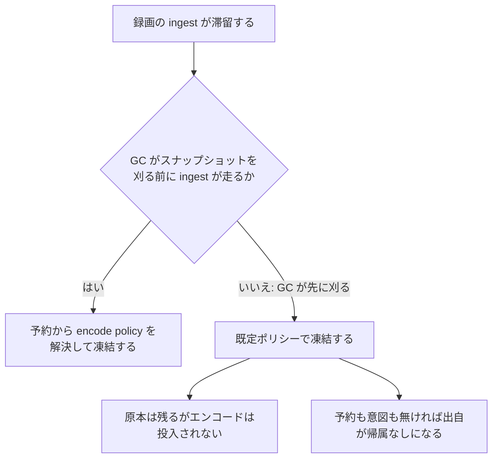

> [operations.md](../operations.md) §4「ストレージ運用」の一部。索引から辿る。

## 4. ストレージ運用

ストレージ運用の判断を、原本の FS 契約・録画バッファ・アーカイブ・災害復旧の順に置く。

### 原本 ingest 先の FS 契約

原本の ingest 先は、ファイルの同期、クローズ時のエラー報告、同一 FS 内の atomic rename、rename 後の親ディレクトリの同期を信頼できる FS に限る。ingest を引く worker は起動時に、実際の操作列が一度成功することを probe で確かめる。

この契約が対象にするのは `storage.media_dir` である。ファイル `fsync`、`Close` のエラー報告、同一 FS 内の atomic rename、rename 後の親ディレクトリ `fsync` を信頼できる root に限定する。

#### 対象内と対象外

ローカル FS・JuiceFS・NFS は対象内で、FUSE S3 は対象外である。

ローカル FS / JuiceFS / NFS は対象内である。ただし NFS export は `sync`、client mount は `hard` を推奨する。NFS の open 中 unlink による `.nfsXXXX`（silly rename）は、canonical orphan として報告されることがある。自動削除はせず、ファイルを閉じた後に状態を確認する。

geesefs / s3fs / AWS Mountpoint など FUSE S3 は、原本にも派生物にも使わない。atomic rename、file / parent `fsync`、`Close` のエラー、ロックの意味論を、ファイルの公開根拠として信頼できないためである。派生物を S3 に置く場合は API を使う。

#### 起動時の probe

ingest を引く worker は起動時に、実際の操作列が一度成功することを probe で確かめる。

worker は ingest キューを購読する起動時に、temp 作成、file `fsync`、`Close`、同一ディレクトリ内 rename、親ディレクトリ `fsync` の順で probe を行う。この probe は、実際の操作列が一度成功することだけを確認する。パス文字列から FS の種類や意味論を推測する検査ではない。

#### ingest の一時ファイルと orphan

ingest の一時ファイルは、canonical path と同じディレクトリに作られる。プロセス死で残った ingest temp は、mtime 猶予と aging（既定 7 日 + 14 日）の後に回収する。

rename 後の DB 失敗で残った canonical orphan は、aging 後に Warn と `rokuban_orphan_files_unresolved` で報告し、手動調査まで保持する。rescue の catalog 無し走査は、temp を original として復元しない。

### 録画バッファのサイジング

録画バッファ（mirakc の録画先、エッジのローカルディスク）は、ingest が詰まったときの滞留分で容量を決め、速度はレイテンシを優先して見る。容量アラートとセットで運用する。

対象は mirakc の `recording.basedir` である。録画バッファの容量アラートは、[監視メトリクス](monitoring.md) の「未 ingest record 総量」と [アラート設計](alerts.md) のエッジディスク残量アラートである。

#### 容量

容量の支配項は、ingest が詰まったときの滞留分である。同時録画数は支配項にならない。回線断・クラウド側障害時は、未 ingest の record が溜まり続ける。

推奨値は「**N 日分の全録画を保持できる容量**」である（地デジ約 7 GB/時で見積り）。

#### 速度

速度要件はレイテンシである。書き込みは 1 録画あたり約 2 MB/s（地デジ 17 Mbps）で、同時 8 本でも 16 MB/s に過ぎないので、絶対帯域は問題にならない。

怖いのは他 I/O との競合によるレイテンシスパイクである。ingest pull のサイト単位 1〜2 本キャップは、このための決定でもある。

#### N 日は容量だけでは決まらない: `epg.retention_grace` との交点

滞留を N 日まで許すなら、ディスクだけでなく、EPG の保持猶予も N 日以上にする。encode 意図が生き残る滞留の上限は、猶予で決まるためである。

> **滞留を N 日まで許すつもりでリングバッファをサイジングするなら、`epg.retention_grace >= N` にする。**

録画の encode policy は、ingest が原本をコミットする瞬間に、`program_snapshots` 経由で予約から解決して凍結される（[ストレージ](../storage.md) §6）。その `program_snapshots` は、放送終了 + `epg.retention_grace`（既定 24h）で GC される。GC は DB の時計だけで動き、エッジに到達できるかどうかを見ない。

根拠

- encode policy の項目: `keepOriginal` / `encodeProfiles`
- 凍結時に解決元となる表: `program_snapshots`

##### 猶予を跨いだ ingest の帰結

GC がその番組のスナップショットを刈った後に ingest が走ると、その録画は既定ポリシーで凍結される。原本は常に残すが、エンコードは投入されない。データは失われない。

作成時点で予約も意図も無かった録画は、出自が帰属なしになり、ルールへの紐付けも外れる。復帰は障害復旧時に一括で起きるので、まとまった件数が同時にこうなりうる。

事後回復の手段は `POST /api/recordings/{id}/encode-profiles`（追加のみ）**だけ**である。エンコード reconcile の定期パスは拾わない。desired が空なので候補にならないためである（[ストレージ](../storage.md) §6）。

根拠

- 既定ポリシー: `keep_original='always'` / `encode_profiles=[]`
- 帰属なしになる出自: `recordings.source = 'unattributed'`
- 紐付けが外れる列: `rule_id` が NULL になる
- 拾わない定期パス: `encode_reconcile`

##### GC 自身が止まる障害

GC 自身が止まる障害では、結果が変わる。worker 全停止や DB 到達不能のように、ルール評価のパスごと止まる障害では、断のあいだ GC も進まない。

復帰時は、sweep + ingest とルール評価のパスの競争になる。ingest が先に走れば、意図は守られる。どちらが先かはジョブの実行順に依存する。未検証である。

決定論的に上の結果になるのは、GC は動き続けたが、その録画の ingest だけが猶予を跨いで遅れた場合である。

根拠

- GC を含むルール評価のジョブ: `ruler_pass`

##### 猶予を上げる代償

猶予を上げるのは無料ではない。同じキーが EPG 射影のローリングウィンドウも駆動するので、番組の保持と欠測行を作る窓が広がる。

N 日にすると、`epg_programs` に全サービスの放送済み番組が N 日ぶん残る。

終了済み番組に対して欠測行が作られる窓も、同じだけ広がる（増加量は未検証）。欠測行の GC 閾値は `retention_grace + 30日` なので、行の寿命も N + 30 日に追従して伸びる。表の件数には上限があるままである。

詳細と、GC 側を滞留と連動させない理由、確認しているテストは、[ストレージ](../storage.md) §6「凍結が依存する寿命と、エッジの滞留の交点」にある。

根拠

- 同じ猶予で駆動される射影の GC: `PruneEpgPrograms`
- 欠測行の表: `never_scheduled_events`

##### 滞留の型と見るメトリクス

見張るメトリクスは、その record が終了済みとしてクラウドに観測されていたかで分かれる。リンクが生きているかでは分かれない。どちらも閾値は、悪い状態が保持猶予を超えて続いたかである。

終了済みは `finished` の状態を指し、保持猶予は `epg.retention_grace` である（[監視メトリクス](monitoring.md) の一覧）。

| 滞留の型 | 見るメトリクス |
|---|---|
| 観測済みの ingest 詰まり | `rokuban_uningested_records{site}` / `rokuban_uningested_record_bytes{site}` の増加 |
| 回線断中の録画 | `rokuban_sweep_last_success_timestamp_seconds{site}` / `rokuban_epg_sync_last_success_timestamp_seconds` の停滞 |

観測済みの ingest 詰まりは、worker 停止・ストレージ障害・キュー詰まりで起きる。断の直前に `finished` として観測済みの record もこちらである。回線断の型は、断の最中に始まった録画と、断が始まった時点でまだ録画中だった録画である。

後者では、未 ingest メトリクスは増えない。バックログの述語は `record_sync.status = 'finished'` で、その行は watcher が mirakc を観測して初めて作られ、更新される。断の最中に始まった録画は行そのものが無く、断が始まった時点で `status='recording'` だった録画も gauge に現れない。`finished` への更新には復帰後の再観測が要るので、断のあいだ gauge は平らなままである。**滞留量のアラートだけでは回線断を検知できない。**

> 「アンカーがある（案 1 で留め置ける）」と「gauge に出る」は別の条件である。案 1 は述語を自分で選べるので `status='recording'` の観測でも足りる（[ストレージ](../storage.md) §6）。gauge の述語は `finished` 固定で選べない。

根拠

- バックログを数えるクエリ: `GetUningestedRecordBacklog`（`internal/db/queries/metrics.sql`）

### アーカイブの速度要件

アーカイブ（Rokuban のメディアストレージ。ローカル FS / 条件付き NFS / JuiceFS）は低速で良い。ただし原本の ingest 先として、上の強い FS 契約を満たす必要がある。

#### スループット

**平均スループットは、1 日の録画総量 / 24 時間以上あればよい。** 瞬間的な変動は録画バッファが吸収するので、リアルタイム性は一切要求されない。エンコードの読み出しもバッチなので遅くて良い。

#### 再生時のシーク

唯一レイテンシが人間に見えるのは、再生時のシークである。原本削除ポリシーと組み合わせた「視聴は H.265 派生物、原本は別の低頻度領域」という運用を採る。

### disaster recovery（catalog + rescue）

rescue は、DB を失った後にだけ使う。live DB を catalog の内容で上書きするので、健全性の確認には使わない。

確認は `rokuban catalog verify` で行う（[DB 運用](database.md) のバックアップ節）。`rokuban rescue` はストレージを走査して復元する。

#### rescue が復元するもの

完成世代が catalog にあれば照合してメタデータごと復元する。catalog に無いファイルは、サイトの前置が付いたものに限り、推定できる範囲で素の asset として登録する。

`catalog/` に完成世代（manifest まで書き終えた世代ディレクトリ。[storage.md](../storage.md) §8）があれば、照合してフルメタデータ（番組情報・ドロップ統計・保持ポリシー）ごと復元する。最新世代が不完全なら 1 世代前へ落ち、飛ばした世代を理由付きで出力する。

catalog に無い `sites/{site}/` 前置付きファイルは、ディレクトリ規約・ファイル名から推定できる範囲で「素の asset」として登録する。UI から見えて再生できる状態に戻す。前置の無い動画ファイルは Warn を出して登録しない。

#### 復旧中の運用

復旧中はメディアを変更する worker を止め、終了後に再開する。ファイルと asset row は共通 lock で守るが、catalog は録画・保持ポリシーも上書きするためである。欠損ファイルの扱いと共有ストレージの lock 要件は [rescue の契約](../storage/rescue.md#rescue-の世代選択とフォールバック) を参照する。

実装は `rokuban import epgstation` の in-place 登録機構と同型なので共有する。

#### DB 喪失時も維持される不変条件

**「放送データのコピーが常に 1 つ以上」は DB 喪失時も維持される。** エッジ record の削除は ingest の DB コミット後に起きる。コミット直後に DB を失ってもファイルはアーカイブに残る。canonical orphan は報告だけなので、rescue が再登録できる。

cleanup は mirakc の basedir に絶対に触らない（エッジ側削除は ingest の検証済み削除のみ）。
