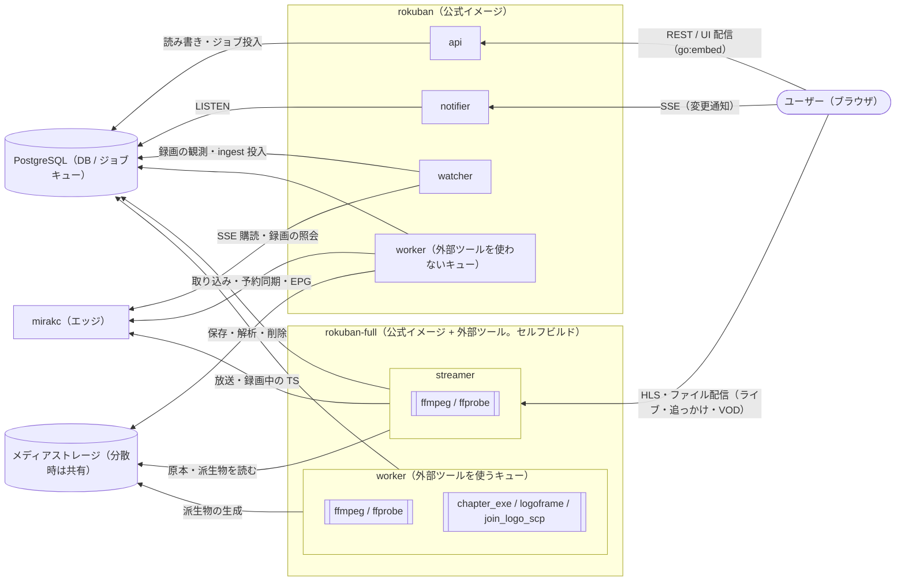
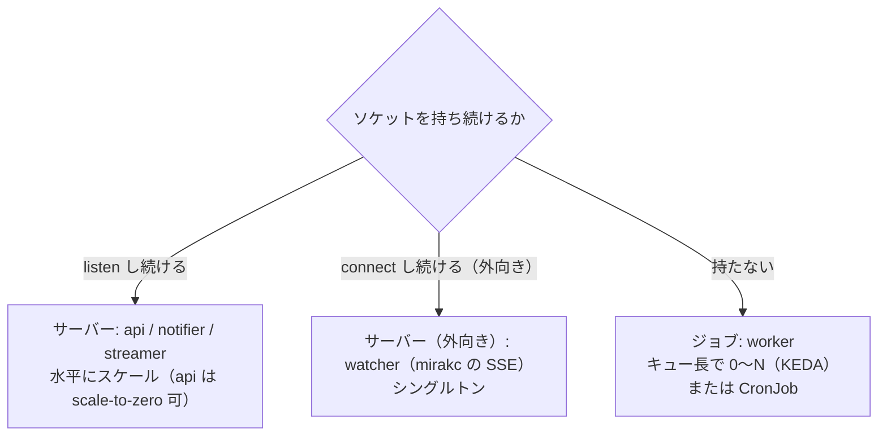

# 全体アーキテクチャ

Rokuban は、クラウドネイティブに設計された録画サーバー。

## 前提: ロールを分けて動かせること

宅内のチューナーとクラウドに処理を分け、各ロールをホストまたぎ・複数レプリカで動かせることを、最初から要件にする。そのため、ロール間の連携は DB と HTTP に限り、正しさに関わる状態と排他も DB に置く。

守ることは 4 つある。第 1 に、ロール間をプロセス内の通信で結ばない。連携は DB と HTTP を介すので、後からネットワーク越しに分けられる。第 2 に、正しさに関わる状態は DB にだけ置く。待ち行列・実行管理・タイマーをプロセスのメモリに持たない。

第 3 に、api ロールはファイルシステムに依存しない（不変条件 1）。メディアストレージを持たないホストにも置ける。第 4 に、ジョブとリーダーの排他は DB で取る。同じジョブは行ロックで 1 つのワーカーだけが確保し、watcher のようなシングルトンは advisory lock でリーダーを選ぶ（[データ層](data.md) §2）。

## 基本方針

録画のようにリアルタイムでハードウェアに依存する仕事はエッジの mirakc に委譲し、それ以外はサーバー側で弾力的に処理する。サーバー側に残る仕事は、コントロールプレーン・メディアパイプライン・ライブラリ/UI の 3 つである。Rokuban は TS のストリーム処理を行わない。

mirakc に録画を委譲すると（詳細は [recording.md](recording.md) 参照）、サーバー側に残る仕事は性質の異なる 3 つに分解できる。

1. コントロールプレーン。ルール評価、予約（desired state）の生成、mirakc への宣言的同期を行う。k8s コントローラと同型である
2. メディアパイプライン。録画完了イベントを受けて、取り込み、エンコード、サムネイル、公開へ進む。イベント駆動のジョブ処理である
3. ライブラリ/UI。番組表検索、録画一覧、再生を担う。読み取り中心の Web アプリである

**Rokuban は TS のストリーム処理を行わない。** ストリーム処理は mirakc が、変換は ffmpeg が担う。バックエンドはオーケストレーションと I/O を行う。

補足として、原本のコミット後に、非同期の解析ジョブが読み取り専用の統計（PID 別 continuity counter 不連続 / TEI / scrambling_control）を採る。詳細は [recording.md](recording.md) の ingest パイプラインを参照。

### 保証の境界

この文書が書くのは設計の目的と、コードと既存テストで経路を確認した範囲である。クラウド上の可用性や性能は保証しない。録画を保証するのは、mirakc に番組終了前まで同期済みの予約だけである。

設計目的は、リアルタイムで期限のある録画をエッジの mirakc に委譲し、DB を状態の権威とする処理をサーバー側で再試行可能なジョブに分けることである。

コード上は、ロール分割と定期 reconcile、予約同期を実装し、既存テストで経路を確認している。これはクラウド上の可用性や性能を保証する記述ではない。

運用条件として、ingest には mirakc への接続、録画バッファの保持、書き込み可能なメディアストレージ、DB のロック・コミット経路が必要になる。分散配置では、メディアストレージを共有できることも必要になる（詳細は [ストレージ契約](storage/contract.md) §3–5）。

レベルトリガーと crash-only は、定期投入の経路が動いている範囲で成り立つ。「イベントを取りこぼしても定期 reconcile で収束する」「どこで落ちても再起動すれば収束する」という性質である。定期投入の経路は River の定期ジョブか k8s CronJob である（[data.md](data.md) §2 / [operations.md](operations.md) §5）。`worker.periodic_jobs: false` で CronJob を欠くと、落ちたイベントは永久に拾われない。crash-only はプロセス単位の性質で、`--all` ではロール単独の復旧は起きない。

実機で検証していない範囲は、クラウド実機での挙動、長期の分散運用、帯域・容量の妥当性である。これらはこの概要だけでは判定しない。実際の配置では [運用](operations.md) の検証項目と各コンポーネントの既存試験を使う。

<details><summary>根拠</summary>

- ロール分割・定期 reconcile・予約同期の実装: `cmd/rokuban/server.go`、`internal/reconciler`、`internal/worker`
- 定期投入の経路（River の定期ジョブ）: `PeriodicJobs`

</details>

### 保証する構成と機能の範囲

保証する構成は、単一ホストの全ロール同居と、k8s の参照実装の 2 つだけである。保証しないことは削除を意味せず、保証外の構成のための経路も取り除かない。

保証の軸は「条件を決めたら確実に録れ、録れたものを迷わず観られる」ことに置く。宅内チューナーとクラウドを分けられる構造（mirakc への委譲・ロール分割・複数 site）は、差別化として維持する。ただし、構成の組み合わせごとに動作を保証するものではない。

保証する構成は次の 2 つに限る。

- 単一ホストの `--all`（1 プロセスが全ロールを兼ねる）
- k8s の参照実装（`base/` と `site/` を 1 組以上）

これ以外の構成は、保証しない。動作しないと決めたわけではない。api のサーバーレス配置、scale-to-zero、serverless Postgres がこれに当たる。後述の「サーバーレスデプロイとハイブリッド構成」の配置条件は設計として残すが、検証と不具合対応は保証する構成を優先する。クラウドストレージで検証の対象にするのは、派生物を S3 に置いて直接配信する経路だけである。

機能の範囲は次の通り。エンコードで保証する経路は、原本と視聴用の 1 種である。カット版は、その 1 種が持つ属性として扱い、複数のプロファイルを同時に派生させる組み合わせは保証しない。検証は原本の保全と再生の互換性に集中させる。ライブは機能を増やさず、遅延と安定性に集中する。SRT や WebRTC などの別出力は持たない。外部プレイヤーとの連携は、録画とライブの資源を IPTV の m3u と XMLTV へ投影する形で賄う（未実装）。ブラウザ側のデータ放送、オフライン保存、再生中のキャプチャ、外部動画の取り込みは中核から遠いので、開発を保留する。

**「保証しない」は削除を意味しない。** 保証外の構成を理由に、site の名前空間や api の DB-only 経路を取り除かない。取り除くと、移行の費用だけがかかり、保証する構成の保守費は減らない。

<details><summary>根拠</summary>

- 参照実装のディレクトリ: `deploy/k8s/`（`base/` と `site/`）

</details>

## 構成図

構成図は、各ロールと PostgreSQL・mirakc・メディアストレージの間で、接続を張る向きと用途を示す。線の無い組み合わせは触らない。lint が判定するのは、api が mirakc・ファイルシステム・ffmpeg に依存しないことと、exec を使えるロールの限定である。



### 線の意味と lint の範囲

矢印は接続を張る向き（リクエストの向き）で、ラベルはその用途を表す。**線の無い組み合わせは触らない。**

lint が判定するのは次の 2 つの境界である。api は mirakc・ファイルシステム・ffmpeg に依存しない（不変条件 1）。os/exec を使えるのは worker・streamer と、起動時にツールを検査する設定の読み込み部だけである（不変条件 4）。それ以外の線は lint では判定していない。

<details><summary>根拠</summary>

- 境界を判定する lint の設定: `.golangci.yml`（depguard）
- ファイルシステムへの依存を禁じる対象: `internal/mediapath`
- exec を使えるパッケージ: `os/exec` を使う worker・streamer と、起動時にツールを検査する `internal/config`

</details>

### 外部ツールの置き場所

外部ツールは、それを exec するロールの箱の中に描いてある。rokuban-full は公式イメージに ffmpeg と CM 検出のツールを足したもので、どちらのイメージも同じ単一バイナリで、ロールは起動時に選ぶ。

rokuban-full はユーザーがセルフビルドする（後述の「イメージ戦略と配布物」）。ロールは起動時の `--roles` で選ぶ。

k8s では、どのキューがどちらのイメージを使うかをマニフェストのイメージ指定が決める。外部ツールを要するキューの ScaledJob だけが rokuban-full を指すことは、テストが判定する。Docker Compose の monolithic mode（`--all`）は、全ロールを rokuban-full の 1 プロセスで動かす。

<details><summary>根拠</summary>

- rokuban-full のビルド: `Dockerfile.full`
- k8s のイメージ指定: `deploy/k8s/` のマニフェストの `image:`
- ScaledJob だけが rokuban-full を指すことの判定: `deploy/k8s/workloads_test.go`

</details>

### PostgreSQL 一本の範囲

ここでいう PostgreSQL 一本は、Rokuban のアプリケーション DB とジョブキューに限る。システム全体では、mirakc の予約と録画バッファ、Rokuban のメディアストレージも永続状態・永続データとして存在する。メディアストレージの書き込み順序、共有要件、録画バッファとの分離は、[ストレージ契約](storage/contract.md) §3–5 を基準とする。

nginx は構成図上の「箱」に描かない。推奨デプロイパターンの一部として位置づける（後述）。

## 単一バイナリ、ロールで分割

単一バイナリを、全ロール 1 プロセスの monolithic mode と、ロールごとに分ける distributed mode の両方で最初から動かす。単一レプリカ・水平スケール・scale-to-zero は別の保証で、scale-to-zero は api の DB-only なリクエスト経路に限る。

ユーザーの大半は、ミニ PC や自宅サーバー 1 台で動かす。マイクロサービス前提の設計は、その層を切り捨てる。そこで、Loki / Tempo と同じ monolithic mode / distributed mode を最初から設計に入れる。

2 つの形は次の通り。

- `rokuban server --all`: 全ロールを 1 プロセスで動かす（自宅向け。Docker Compose で Postgres と 2 コンテナ）
- k8s ではロールごとに Deployment を分割する。api は水平スケール、worker はキュー長で 0〜N（KEDA）、watcher はシングルトン（Postgres アドバイザリロックでリーダー選出）

単一レプリカで配置できること、複数レプリカへ水平スケールできること、scale-to-zero できることは、別の保証である。単一レプリカの配置は、monolithic / distributed の形の選択である。水平スケールは、ロールごとの DB・メディア・接続・排他条件を満たす場合に選べる。scale-to-zero は、長寿命接続を持たない api の DB-only なリクエスト経路に限る。notifier / watcher / streamer は接続を保持するため常駐が必要で、worker はキューが空なら 0 にできるが、ジョブ実行中は資源を保持する。いずれも api のリクエスト単位の scale-to-zero とは意味が異なる。

### ロール分類の基準: ソケットを持ち続けるか

**ロールはプロセスの形を表し、判定はソケットを持ち続ける必要があるかの 1 つだけである。** キュー駆動の仕事はすべて worker ロールで、周期実行はロールの根拠にならない。SSE を扱うことはロールの根拠になる。

どの仕事をするかは、ロールの軸に採らない。



この基準は後から書かれた。初版は分類の軸を「どの仕事をするか」に取り、ruler / reconciler / watcher をシングルトンロールとして並べていた。基準を明文化した結果、ruler / reconciler / record_sweep は worker のジョブになり、`/api/events` は notifier に分かれた。形を先に固定して判定基準を後から書いた代償である（不変条件 11。[invariants.md](invariants.md) §11）。

この基準を採る理由は、ソケットの寿命がプロセスの寿命の下限を決めることにある。接続を張り続ける必要があれば、そのプロセスは 0 にスケールできない。仕事が始まってから終わるまでで完結するなら、0 にスケールできる。デプロイ形態（Deployment か Job か、KEDA でゼロスケールできるか）はここで決まる。DB を触るか、mirakc を触るか、周期実行かといった観点は、デプロイ形態を変えない。

コード上はただの modular monolith で、IPC は最初から作らない。ロールは後からでもネットワーク越しに分けられる。ロールの詳細と分散デプロイ時の構成は [operations.md](operations.md) を参照。

<details><summary>根拠</summary>

- 初版でシングルトンロールとして並べていたもの: `ruler` / `reconciler` / `watcher`
- worker のジョブになったもの: `ruler`、`reconciler` の同期パス
- notifier に分かれた SSE のパス: `/api/events`

</details>

#### 基準の帰結

この基準から、キュー駆動の仕事はすべて worker に集まり、周期実行はロールの根拠にならない。SSE を扱うことはロールの根拠になるが、SSE を 1 つのロールに集約する理由は無い。

キュー駆動で 0〜N の形をした仕事はすべて worker ロールである。どのキューを引くかはデプロイ時のパラメータで、ロールの軸ではない。ルール評価（ruler）、reconciler の同期パス、watcher の定期全量突き合わせ（record_sweep）もここに含まれる。キューごとにロールを増やすと、取り込み・エンコード・サムネイルごとのロールが際限なく増える。

周期実行は、ロールの根拠にならない。「定期的に動く」はスケジューラの仕事で、Docker では River の定期ジョブ、k8s では CronJob が投入する。同じジョブ本体が両方から呼ばれる（[data.md](data.md) §2）。

SSE を扱うことは、ソケットを持ち続けるので、ロールの根拠になる。ただし SSE だからといって、1 つのロールに集約する理由は無い。notifier（ブラウザへ送る）と watcher（mirakc から受ける）は、機構が同じでも、相手・向き・障害時の影響範囲が無関係である。そのため別ロールのまま置く（[api.md](api.md) §SSE）。

<details><summary>根拠</summary>

- 周期実行を投入する River の機構: `PeriodicJobs`
- キューごとにロールを増やした場合に生まれる名前: `ingester` / `encoder` / `thumbnailer`

</details>

## 設計原則

設計原則は 3 つある。すべてのループはレベルトリガーで動き、すべてのコンポーネントはどこで落ちても再起動で収束し、ジョブは冪等に書く。

### レベルトリガー

すべてのループは「現在の desired と observed の差分を消す」だけである。イベント（SSE / NOTIFY）は高速化のヒントであり、取りこぼしても定期 reconcile で収束する。

### crash-only

すべてのコンポーネントは、どこで落ちても再起動すれば収束する。インメモリの必須状態を持たない。唯一の例外はライブ視聴セッションである。使い捨て状態なので、落ちたらクライアントの再接続で済む。

### 冪等

ジョブは at-least-once 実行を前提に冪等に書く。詳細は [data.md](data.md) の River（ジョブキュー）の節を参照。

## HTTP 配信層と nginx

nginx は必須コンポーネントにしない。ただし、前段に置ける設計を HTTP 層の要件として最初から織り込む。

全ロールを 1 プロセスで動かす `--all` では、nginx なしでも全機能が動く。この自己完結性は維持する。

そのうえで、リバースプロキシ・フレンドリー性（`X-Forwarded-Host` 解釈（opt-in）、ルート相対パス徹底、WebSocket 不使用）と X-Accel-Redirect オプションを要件にする。

用途別の判断、リバースプロキシ要件一覧、nginx リファレンス構成は [api.md](api.md) を参照。

## 認証

**Rokuban はアプリ内に認証・認可機構を一切持たない。** 日本の著作権法上、放送の録画が適法なのは私的使用（30 条）の範囲内であり、Rokuban は構造的に単一世帯用アプリである。

ユーザーアカウント・マルチテナント・共有リンクは、将来も含めてスコープ外である。認証が必要な構成ではリバースプロキシに委譲する。アプリ内に残る唯一のセキュリティ要件は、DNS rebinding 対策の Host ヘッダー検証だけである。

法的根拠とその結果の詳細は [api.md](api.md) を参照。

## イメージ戦略と配布物

公式配布物は、ffmpeg を含まないコンテナイメージと素のバイナリの 2 つだけで、ffmpeg 入りのイメージはユーザーが同梱の Dockerfile でセルフビルドする。ffmpeg の exec は worker と streamer ロールに限る。

自分のためのビルドは再配布ではないので、GPL の遵守事務も特許プールの問題も生じない。

<details><summary>根拠</summary>

- ユーザーが自分用にビルドするファイル: `Dockerfile.full`

</details>

### ベースイメージ

**ベースイメージを distroless/static に置き換えると、そのまま Docker Compose の healthcheck が動かなくなる。** 攻撃面を縮めたいという動機は正しい。だがそれは、healthcheck を別の手段に作り替える判断と一緒でなければ成立しない（Go 側に自己チェック用のサブコマンドを持たせる等）。イメージだけ差し替えるのは変更にならない。

ベースイメージは Debian の slim 版に、証明書と HTTP クライアントを足したものである。実行ユーザーは非特権ユーザーにする。同梱する HTTP クライアントは `curl` 1 つだけで、healthcheck が HTTP を叩く手段を必要とするためである。

<details><summary>根拠</summary>

- ベースイメージ: `debian:trixie-slim` と `ca-certificates` と `curl`（`Dockerfile`）
- 実行ユーザー: `nobody`
- healthcheck が `curl` を使う箇所: `docker-compose.yml` の `curl -sf .../healthz`

</details>

### ライセンス表示と notice

第三者ライセンスの notice は、公式イメージ内だけで確認でき、lockfile に基づく Web 依存と実ビルド依存から生成する。本番依存の追加・更新や、notice からの項目の除外があると、CI の検査が失敗する。

公式イメージには、本体のライセンスと notice を置く。

notice には、Go バイナリの実ビルド依存、Go 標準ライブラリ、Web の画面に組み込む本番 Web 依存のソース archive・著作権表示・ライセンス全文を含める。Debian ベースイメージと apt パッケージのライセンス情報は Debian 側の配布物に任せ、ここでは重複させない。

notice は `npm run third-party-notices` で生成する。生成器は追加のランタイム依存を持たず、CI のジョブが検査モードで実行する。

<details><summary>根拠</summary>

- 置き場所: `/usr/share/doc/rokuban/LICENSE` と `/usr/share/doc/rokuban/THIRD_PARTY_NOTICES`
- 組み込む Web 依存: `web/dist`
- 実ビルド依存の取得: `go list -deps ./cmd/rokuban`
- 検査の実行: `generated-diff` ジョブの `--check`

</details>

### ffmpeg の exec の境界

この判断を支える規律として、ffmpeg / ffprobe の exec は worker と streamer ロールに閉じ込める。api ロールが ffmpeg を要求したとたんに、公式イメージだけで動く構成（サーバーレス api を含む）が成り立たなくなる。どのロールが ffmpeg を要求するかが、そのまま配布物の境界になっている。

## サーバーレスデプロイとハイブリッド構成

予約・ルールの書き込みも DB だけで完結し、mirakc への同期は別の reconciler が非同期に行うので、api ロールはサーバーレス（Cloud Run / Lambda 等）で scale-to-zero にできる。SSE は api に置かず notifier ロールへ分ける。録画を保証するのは、mirakc に番組終了前まで同期済みの予約だけである。

レベルトリガー設計の結果として、書き込みも DB だけで完結する。Postgres が使え、同期を担う reconciler が別に動いている構成なら、api をサーバーレスにできる。

API は desired state を Postgres に書くだけで、mirakc への同期は reconciler が非同期に収束させる。API の書き込みだけでは録画予約は確定しない。reconciler が放送開始前までに mirakc へ同期できなかった新規・変更予約の録画は保証されない。

<details><summary>根拠</summary>

- 同期を担う: `reconciler`

</details>

### SSE の置き場所

**SSE を api ロールに置いてはならない。** 振り分け先が api 自身になるので、api を scale-to-zero にできなくなる。ハイブリッド構成では、SSE は CDN のパスルーティングで notifier ロールへ振り分ける。

SSE は notifier ロールに分離されており、api は mirakc にもファイルシステムにも長寿命接続にも依存しない、純粋なリクエスト/レスポンス層である。api の scale-to-zero はこの経路の配置条件であり、全ロールに共通する保証ではない。

SSE は長寿命接続なのでサーバーレスには乗せず、`/api/events` だけを notifier ロールへ振り分ける（詳細: [api.md](api.md)）。notifier は mirakc への到達性を必要としない（Postgres の NOTIFY を配るだけ）ため、クラウド側に常駐プロセスとして置いても、自宅側に置いても成立する。

### 推奨のハイブリッド構成

クラウド側に Postgres・api・notifier・CDN、自宅側に mirakc と watcher / worker / streamer を置く。worker が自宅側にあるのは、mirakc やファイルシステムへの到達性を要するキューがあるためで、キューの割り当てだけで置き場所が決まる。

api は公式イメージで scale-to-zero にし、notifier は常駐させる。自宅側は外向き接続で DB を見る。

```
[クラウド]  Postgres (Neon 等) + api (公式イメージ, scale-to-zero) + notifier (常駐) + CDN/Access
[自宅]      mirakc + watcher/worker/streamer (full) — 外向き接続で DB を見る
```

worker が自宅側にあるのは、キューの置き場所に制約があるためである。ロールの都合は理由にならない。mirakc への到達性を要するキューと、アーカイブのファイルシステムを要するキューは、自宅側に置く。DB しか触らない ruler のキューは、どちらでも動く。ロールを増やさず、キューの割り当て（`worker.queues`。デプロイ時のパラメータ）だけで置き場所が決まるのは、ロールがプロセスの形だけを表しているからである。

キュー × 置き場所 × site 軸の表（キュー名の site 修飾を含む）は [operations.md](operations.md) §5 を参照。サーバーレスの置き場所の選定、ハイブリッド構成の運用詳細は [operations.md](operations.md) を参照。

<details><summary>根拠</summary>

- mirakc への到達性を要するキュー: `reconciler` / `epg` / `watcher` / `ingest`
- アーカイブのファイルシステムを要するキュー: `encode` / `thumbnail` / `cleanup`
- DB しか触らないキュー: `ruler`
- 自宅側に置くロール: `worker`

</details>

### 自宅サーバーが落ちたとき

自宅サーバーが落ちていても、Postgres が利用可能なら、番組表・録画一覧・予約操作は DB の desired state として扱える。メディア視聴と ingest は、自宅側の mirakc・録画バッファ・メディアストレージへの到達が必要と割り切る。

録画を保証するのは、mirakc に番組終了前まで同期済みの予約だけである。復帰後の reconciler が期限を過ぎてから同期しても、その放送を取り戻すことはできない。

## mirakc への依存の受容

mirakc への依存は受容する。エンジン抽象化も EDCB ドライバも作らない。賭け金が見た目より小さいので、この判断で足りる。

### 決定: 受容する

mirakc は単一メンテナ OSS であり、スキーマ自体を mirakc の形（programId / RecordingOptions / tags）に合わせている。そのため「継ぎ目は reconciler/watcher に局所化」という保険は、言うほど厚くない。それでも受容できるのは、賭け金が見た目より小さいためである。

### 影響範囲は限られる（意図せず得ている保証）

mirakc の形をしているのは、短命な導出状態だけで、ライブラリと履歴は無傷で持ち越せる。番組 ID は放送規格の識別子から合成されるので、エンジンを載せ替えても再合成できる。

エンジンを載せ替えるときに書き直すのは、reconciler / watcher / ingest の取得部と予約まわりのスキーマだけである。

| 分類 | 内容 |
|---|---|
| mirakc 非依存（永続・本当の資産） | ルール / 録画履歴 / media_assets / ドロップ統計 / tombstone / overrides |
| mirakc の形（短命・導出） | reservations の base / schedule_sync |
| 外部識別子（長寿命の契約） | 番組 ID |

ルール・録画履歴・media_assets・ドロップ統計・tombstone・overrides は、ライブラリの全部にあたる永続の資産である。reservations の base はルールから毎回再計算され、schedule_sync は observed としてエンジンから再同期される。

番組 ID の `programId` は、`(site, programId)` が API のパスとクライアントのクエリキー階層に入り、資源同定そのものになった。影響範囲としては、短命・導出の行より一段重い。クライアントのブックマークとキャッシュキーという、DB のマイグレーションより差し替えコストが高い場所に染み出しているためである。

desired / observed の分離とレベルトリガーの結果として、エンジンを載せ替えても、ライブラリと履歴は無傷で持ち越せる。

<details><summary>根拠</summary>

- 番組 ID と資源同定: `programId`、`(site, programId)`、`docs/schema/principles.md` §1-5

</details>

#### 番組 ID の依存の重さ

番組 ID への依存は、API 契約への浸透の見た目ほど高くつかない。ID は放送規格の値から合成されるので、エンジンを載せ替えても再合成できる。

`programId` は mirakc 固有の連番 ID ではない。NID（ネットワーク識別）/SID（サービス識別）/EID（イベント識別）という、ARIB（地上波・BS/CS 放送の標準規格）由来の値から合成される（Mirakurun 互換の合成規則）。エンジンを載せ替えても、放送波そのものの NID/SID/EID は変わらない。新エンジンの上に同じ合成規則（または新エンジンが提供する同値の識別子）を被せれば、`programId` を再合成できる。

したがって、この依存は mirakc というプロセスの内部 ID には縛られていない。縛られているのは、ARIB という止まらない外部標準である。実際の載せ替えコストは、表の見た目（API 契約への浸透）ほど高くない。

### 保険（すべて安価）

保険は 3 つあり、どれも安価である。移行判断のトリガーは設置済みで、mirakc 固有の概念は永続テーブルに漏らさず、最終手段として pin & fork が成立する。

第 1 に、移行判断のトリガーは設置済みである。recording.failed 理由別集計 / record-broken / ドロップ統計 / 開始遅延検出器 / scrambled カウンタがあり、「品質問題が実測されたら再検討」の観測基盤は既存決定で完了している。詳細は [recording.md](recording.md) の録画品質実測の節を参照。

第 2 に、mirakc 固有の概念を永続テーブルに漏らさない規律を置く。rules / media_assets / 履歴に mirakc 固有フィールドを持ち込まないことを明文化し、影響範囲に上限があることを維持する。

第 3 に、pin & fork が現実的な最終手段である。mirakc は Apache-2.0 で、放送 TS フォーマットとチューナードライバは変化が極めて遅いドメインなので、上流が止まっても「動いているバージョンに固定して数年運用」が成立する。

「マージンなし・PSI/SI 追従にユーザー側の回避ノブがない」点は残る。これは mirakc の設計思想への同意そのものであり、ノブを足すことは思想と矛盾する。品質メトリクスが問題を示したときに初めて再検討する。

## 関連ドキュメント

この文書から辿る先は、録画・データ・ストレージ・API・フロントエンド・設定・運用の各設計文書である。

- [recording.md](recording.md): 録画エンジン。mirakc への委譲と予約同期
- [data.md](data.md): データ層。PostgreSQL 一本化（ブローカーレス設計）
- [storage.md](storage.md): メディアストレージ。ファイルシステム契約
- [api.md](api.md): API 設計
- [frontend.md](frontend.md): フロントエンド
- [configuration.md](configuration.md): 設定
- [operations.md](operations.md): 運用・デプロイ
