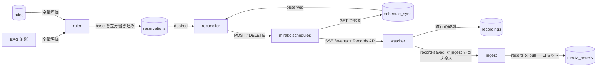

# 録画エンジン: mirakc への委譲と予約同期（索引）

録画の実行は [mirakc](https://github.com/mirakc/mirakc) に全面的に委譲する。Rokuban はルールエンジンと予約の宣言的同期に徹する。

## データフロー

ルールと EPG から予約を作り、mirakc の schedule と同期し、録画の結果を取り込んで media asset にするまでの流れを示す。

## 節 → ファイル

本文は分割してあり、節番号は分割前のままである。コードコメントの「recording.md §3.2」などは、この表で該当ファイルを引ける。

分割した本文は `docs/recording/` にある。

| 節 | 内容 | ファイル |
|---|---|---|
| §1 | 方針、例外の境界、ブラウザの境界 | [recording/delegation.md](recording/delegation.md) |
| §2 | mirakc に任せること | [recording/delegation.md](recording/delegation.md) |
| §3 §3.1 | ruler（ルール評価と予約生成） | [recording/ruler.md](recording/ruler.md) |
| §3.2 | reconciler（宣言的同期） | [recording/reconciler.md](recording/reconciler.md) |
| §3.2 | ファイル名テンプレート（`filenameTemplate`） | [recording/contentpath.md](recording/contentpath.md) |
| §3.2 | 大量削除サーキットブレーカー | [recording/breaker.md](recording/breaker.md) |
| §3.2 | 番組終了後の GC（ruler の 1 パス内 `runGC`） | [recording/ruler.md](recording/ruler.md) |
| §3.3 | watcher（SSE 購読・状態反映） | [recording/watcher.md](recording/watcher.md) |
| §4 | 予約モデル（`program_intents` と `program_overrides`） | [recording/reservation-model.md](recording/reservation-model.md) |
| §5 §6 | ingest パイプラインと B-CAS 復号の責務境界 | [recording/ingest.md](recording/ingest.md) |
| §7 §8 §9 | schedule options、録画品質の実測、落とした機能 | [recording/reference.md](recording/reference.md) |

節ごとの主な話題は次の通り。

- §1: 例外の境界（PSI の読み取り範囲）、ブラウザにも同じ境界を適用する
- §2: PSI/SI 追従は終了だけ、onair tracker を採らない判断、Records API、SSE 再送
- §3.1 と §3.2: 全量評価と差分書き込み、複数ルール解決、tags 対応付け、再作成のガードとレート制限
- §3.2 のサーキットブレーカー: ラッチ、全損ガード、再開 API
- §3.3: 3 段構え、record 処理の冪等性、品質メタデータ、開始遅延検出器
- §4: base / overrides 分離、jsonb を許す条件、detached のライフサイクル、manual 予約との統一
- §5 §6: 転送方式、非同期 TS 統計解析、リトライ 3 層、worker、B-CAS

読む順の目安は次の通り。

- ruler を触る → §3.1 と §4（予約モデル）。削除まわりは [recording/breaker.md](recording/breaker.md) も
- reconciler を触る → §3.2（[reconciler.md](recording/reconciler.md) を軸に、ファイル名なら [contentpath.md](recording/contentpath.md)、削除の安全弁なら [breaker.md](recording/breaker.md)）と §7（schedule options）
- watcher を触る → §3.3
- ingest / tsstat を触る → §1 の「例外の境界」と §5・§6
- ブラウザで放送 TS・字幕・データ放送を扱いたくなった → §1 の「ブラウザにも同じ境界を適用する」
- 予約 API を触る → §4

## 用語

分割本文で定義済みの用語の早見表である。定義の権威は、正典列が指す節にある。

| 用語 | 定義 | 正典 |
|---|---|---|
| ruler | ルールと EPG を評価して `reservations` の base を作るループ | §3.1 [ruler.md](recording/ruler.md) |
| reconciler | desired と observed の差を mirakc へ反映するループ | §3.2 [reconciler.md](recording/reconciler.md) |
| watcher | mirakc の `/events` を購読し、`recordings` に反映するループ | §3.3 [watcher.md](recording/watcher.md) |
| ingest | 録画完了後に record を pull してアーカイブへコミットする処理 | §5 [ingest.md](recording/ingest.md) |
| streamer | ライブ視聴を担うロール。録画エンジンの外 | [overview.md](overview.md) / [api.md](api.md) |
| site | mirakc インスタンスの識別子（`site` 列と `/api/sites/{site}/...`） | [configuration.md](configuration.md) |
| base | ruler が計算する予約のフィールド群（`reservations.base`） | §4.2 [reservation-model.md](recording/reservation-model.md) |
| overrides | ユーザーが上書きしたフィールドだけの疎な jsonb（`program_overrides` 表） | §4.2 同上 |
| effective | base に overrides を重ねた値 | §4.2 同上 |
| desired | あるべき schedule の集合（`reservations`） | §3.2 [reconciler.md](recording/reconciler.md) |
| observed | mirakc の現状（`GET /api/recording/schedules`、`schedule_sync`） | §3.2 同上 |
| orphaned（導出値） | 番組終了後に schedule が無く、`never_scheduled_events` に欠測行がある予約 | §4.3 / [schema.md](schema.md) §3 |
| active / detached（導出値） | `(rule_id, base)` から導出する予約の状態 | §4.3 §4.4 |

用語の補足は次の通り。表のセルに書ききれない条件を、ここに置く。

watcher は、record の状態を `recordings` に反映し、録画中または録画済みの record について ingest を投入する。base は `reservations.base` に載り、ruler だけが書く。overrides は `program_overrides` 表に載り、api だけが書く。effective は base と overrides を重ねた値で、mirakc に同期され、ingest と encode が参照するのは常にこれである。

orphaned は、`never_scheduled_events` の欠測行があり、本物の `recordings` 行が無いときに導出する。detached は、かつてのルールが凍結した base を持つ予約で、実質は manual である。active と detached は、`(rule_id, base)` から読むたびに導出する。

> 関連ドキュメント: [overview.md](overview.md)（全体アーキテクチャ）/ [data.md](data.md)（データ層）/ [schema.md](schema.md)（スキーマ）/ [storage.md](storage.md)（メディアストレージ）/ [operations.md](operations.md)（運用）
