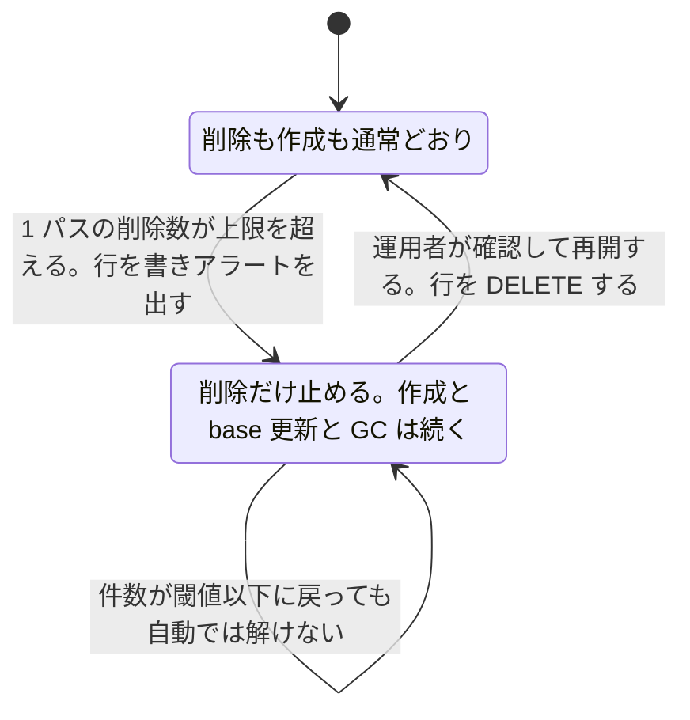

> [recording.md](../recording.md) §3.2「reconciler」の一部（大量削除サーキットブレーカー）。索引から辿る。

#### 大量削除サーキットブレーカー

**大量削除ブレーカーは、ruler の 1 パスあたりの削除数に上限を設ける。超えたら削除を止めてアラートを出し、手動で確認した後に再開する。** EPG の一時欠損で予約が一斉に消えるのを防ぐための仕組みである。

上限は `ruler.max_deletes_per_pass` で設定する。予約は「ルール x EPG」から導出される。そのため EPG の一時欠損（mirakc 再起動・再スキャン・SI 取得不良）があると、素朴な ruler は予約を大量に「不要」と判定する。reconciler はそれを mirakc へ忠実に反映して一斉 DELETE する。EPGStation#692（予約と録画が勝手に消える）はこの障害クラスの実例である。

##### 対象と対象外の区別

ブレーカーが数えるのは、ルールが base を供給していた予約が desired から外れた削除だけである。ユーザー（運用者）が投資を手放す書き込みをしない限り起きない削除は、数えず、ラッチ中でも実行する。

desired は「(ルール勝者 − intent skip) ∪ investment（record 意図 ∪ overrides）」から決まる。そのため `toDelete`（既存予約のうち desired から外れた行）には、EPG の unmatch とユーザーの明示操作の両方が現れる。ブレーカーの外に置くのは、このうち明示操作だけである。

判定は削除文の `WHERE` が適用の瞬間に行う。Go 側の読み取りに移すと、読みと適用の間に書き込まれた意図を消してしまう窓が戻る。`program_investments` が空であることに加えて、次のどちらかが立てば対象外になる。

- `reservations.rule_id IS NULL`: いまルールが base を供給していない行
- `program_intents.action='skip'`: ユーザーが「録るな」と書いた

`rule_id IS NULL` だけでは、ユーザー由来の証明にならない。この列は EPG の変化だけでも NULL になる。投資を持つ行はルールが外れても desired に残るので、そのパスで upsert される。`internal/store/pgstore/rulerpass.go` の `resolved` CTE が凍結するのは `base` と dedup 根拠 2 列だけである。`rule_id = EXCLUDED.rule_id` がそのまま NULL を書く。

<details><summary>根拠</summary>

- 明示操作の判定が削除文の `WHERE` にあること: `internal/db/queries/ruler.sql` の `DeleteReleasedReservationsBySiteAndProgramIDs`
- EPG unmatch で凍結されるのは `base` と dedup 根拠 2 列だけであること: `internal/store/pgstore/rulerpass.go` の `resolved` CTE
- EPG unmatch で `rule_id` に NULL が書かれること: `rule_id = EXCLUDED.rule_id`

</details>

##### 削除の経路ごとの分類

EPG の unmatch とルール編集による削除は対象で、intent skip・intent クリア・最後の投資だった overrides の削除などユーザーの明示操作による削除は対象外である。次の表は、削除候補に現れる行だけを分類する。

ここでいう削除候補は `toDelete` の行である。ルール削除と GC は `toDelete` を通らないので、下記「止められる場所は ruler だけ」の表に置く。

| 削除の経路 | 満たす条件 | ブレーカー |
|---|---|---|
| EPG の unmatch で勝者が消えた（投資なし） | どちらでもない（`rule_id` が残る） | 対象 |
| ルール編集で勝者が変わった | どちらでもない（`rule_id` が残る） | 対象 |
| intent skip を書いた | `action='skip'` | 対象外 |
| intent クリア（`DELETE .../intent`） | `rule_id IS NULL` | 対象外 |
| 最後の investment だった overrides の削除 | `rule_id IS NULL` | 対象外 |
| EPG 欠損中に投資を消した（境界 (c)） | `rule_id IS NULL`（欠損で NULL 化済み） | 対象外 |

ルール編集は EPG の unmatch と区別できないので、対象のままにする。

##### 守備範囲を保つ条件

ブレーカーの守備範囲を保っているのは、投資が無いことを求める条件のほうである。ルールが外れた行は、その印が書かれた時点で必ず投資を持っていたので、ブレーカーの外に出るには投資を消す書き込みが別途要る。

投資が無いことを求める条件とは `NOT EXISTS program_investments` である。`rule_id IS NULL` の行は、その NULL が書かれた時点で必ず投資を持っていた。NULL を書く経路は 2 つあり、どちらも投資ありの行だけが残る。

ruler の upsert が NULL を書くのは「勝者なしで desired」、つまり投資ありの行だけである。`rules` の FK `ON DELETE SET NULL` も同じで、`DeleteRule` が同一 tx で投資なしの行を先に消すので、生き残るのは投資ありの行だけになる。

したがってブレーカーの外に出るには、投資を消す書き込みが別途必要になる。それができる経路は次の 3 つだけである。

- per-program の api 3 本（`DELETE .../intent` / `DELETE .../overrides` / `PUT .../intent{skip}`）。`openapi.yaml` のパスは `{programId}` を含み、バルクは無い
- 運用者が明示的に走らせる catalog rescue の復元（`internal/store/pgstore/catalog_restore.go`）。`program_intents` を upsert するので record を skip で上書きしうる。バルクだが EPG に駆動されない
- `program_snapshots` の GC CASCADE。予約行も一緒に落ちるので `toDelete` に現れない

EPG 同期・ruler・reconciler はこの 2 表（`program_intents` / `program_overrides`。`program_investments` はこの 2 表から作る view）に一切書かない。そのため EPG がおかしくなっても、ブレーカー外の削除件数は人が書いた回数で頭打ちになる。

<details><summary>根拠</summary>

- catalog rescue が intent を upsert すること: `internal/store/pgstore/catalog_restore.go`

</details>

##### 明示操作を対象外にする理由

intent クリアを対象に混ぜたままにすると、ラッチが無期限であるぶん、番組が録画され続ける実害も無期限に続く。失うのはディスクとチューナーで、ブレーカーが守ろうとしているものより重い。そのため明示操作は対象外に置く。

intent クリアは `effective.skip` を立てない。クリアは「意見なし」を表し、「録るな」とは違うからである。そのためラッチ中に残る予約行は `listDesired`（`reservation.EvaluateSyncCandidates` の `Skipped`）からも除外されず、reconciler は schedule を消さない。番組は録画され続ける。

intent skip 側の実害は、もともと予約一覧の表示上の残留だけだった。`intent.action='skip'` が `effective.skip` を立てるので録画は防がれる。それでも「明示操作は対象外、ただし skip を除く」という例外を増やさないため、同じ側に置く。

<details><summary>根拠</summary>

- ラッチ中でも intent クリアの削除が止まらないこと: `TestRunPass_LatchDoesNotWithholdIntentClearDelete`
- intent クリアの削除を件数に含めないこと: `TestRunPass_IntentClearDeletesDoNotCountTowardBreaker`
- ラッチ中でも intent skip の削除が止まらないこと: `TestRunPass_LatchDoesNotWithholdSkipIntentDelete`
- skip の予約を mirakc に作らないこと: `TestReconciler_SkippedReservationNotScheduled`
- intent クリア中も予約が desired に残ること: `reservation.EvaluateSyncCandidates` の `Skipped`

</details>

##### 分類の限界

限界は 3 つある。ルール由来の unmatch と明示操作が重なった行は区別できず、対象のままにする。EPG 欠損中にユーザーが投資を消すと、本来残る予約が外で消えるが、復旧後に自己修復する。

「明示操作は必ず即座に効く」「EPG では絶対に起きない」とは書かない。3 つの限界は次の通り。

(a) ルール由来の unmatch と明示操作が同じ番組で重なった場合（`rule_id` が残ったままの行の意図を消した）は、前者と区別できないのでブレーカー対象のままにする。ブレーカーが発動しているのはまさにルール x EPG が大きく動いたときなので、保守的な扱いを選ぶ

(b) 削除候補になる前提として、EPG 射影に番組が残っている必要がある。射影から消えた番組の凍結は別の防御である。EPG が復旧すれば次パスで自動的に解け、ラッチと違い人間の再開を待たない

(c) EPG 欠損中は投資を持つ行の `rule_id` が一斉に NULL に落ちる。その最中にユーザーが投資を消すと、健全な EPG ならルール由来で残ったはずの予約がブレーカーの外で消える。EPG 復旧後の次パスでルールが作り直すので自己修復する。ただしこの削除は、明示操作だけが原因とは限らず、EPG 欠損も絡んでいる

テストが測っているのは (c) の前半、つまり `rule_id` の NULL 化と、投資がある間は消えないことの両方だけである。

<details><summary>根拠</summary>

- EPG unmatch で `rule_id` が NULL になり、投資がある間は消えないこと（(c) の前半）: `TestRunPass_EpgUnmatchNullsRuleIDButInvestmentBlocksRelease`

</details>

##### 録画済みデータと直前 unmatch

EPG や予約側の状態変化から、録画済みデータの削除に到達する経路は無い。録画済みデータに至る自動削除経路は、retention reconcile だけにする。放送開始直前の unmatch は、ブレーカーより先に猶予が受け止める。

これは不変条件である。EPG・予約側の状態変化から録画物の削除に到達するパスは作らない。

録画済みデータとは `media_assets` のことである。

`programId` が EPG から消えた予約は、即削除せず猶予を置く。mirakc 自身も removed-from-epg を理由付き failed として通知してくる。導出値 `orphaned` はこの用途ではない。`orphaned` は「番組終了後に schedule が観測されなかった欠測があり、本物の録画試行が無い」を意味する。この値は `never_scheduled_events` と `recordings` から読むたびに導出する（[schema.md](../schema.md) §3）。

放送開始直前の unmatch は、このブレーカーより先に `ruler.retract_grace`（[ruler.md](ruler.md)「直前 unmatch の猶予」）が受け止める。猶予で `toDelete` から外れた行は、ブレーカーの分子にも分母にも入らない。EPG 欠損時、開始直前の予約は猶予で残り、開始が遠い予約はこのブレーカーで止まる。二段の防御になる。

##### 止められる場所は ruler だけ

削除件数の上限を持つのは ruler だけで、reconciler には置かない。reconciler からは、どの削除の経路も「desired に無い schedule がある」としか区別できず、置いても誤発火するだけである。削除する時点で「録画しない」決定は DB に確定済みなので、守れるものも無い。

reconciler が「消すべき schedule」と判断する経路は、desired（reservations）を減らす操作の数だけある。ruler のブレーカーの対象かどうかで束ねると、次の 5 通りに分かれる。

| 経路 | ruler の `MaxDeletesPerPass` の対象か |
|---|---|
| ruler が EPG の変化から導出削除した | 対象。ruler のブレーカーが既に通している |
| ルール編集（無効化・条件変更）で勝者が変わった | 対象。`rule_id` が残るので EPG 由来の unmatch と区別できない |
| ユーザーの明示操作で desired から外れた（intent skip、intent クリア、最後の investment だった overrides の削除） | 対象外。上記の `WHERE` が適用の瞬間に判定する |
| ユーザーの明示操作のうちルール削除（`DeleteRule`） | 対象外。`toDelete` も `MaxDeletesPerPass` も経由しない |
| 番組終了後の GC が予約行を刈った | 対象外。`runGC` という別経路で、`toDelete` を通らない |

明示操作の削除は、カウントにも入れずラッチ中でも実行する（上記「大量削除サーキットブレーカー」）。ルール削除は、API ハンドラ（`internal/api/rules.go`）が同一トランザクションで `reservations` を直接 DELETE する。GC は `runPassForSite` の `toDelete` を通らない（[ruler.md](ruler.md)「番組終了後の GC」と下記「GC は対象にしない」）。

ruler のブレーカーが通しているのは EPG 由来の導出削除（ルール編集で勝者が変わる経路を含む）だけで、明示操作・ルール削除・GC はブレーカーの外にある。reconciler から見ると、どの経路も「ruler あるいは API ハンドラが既に処理して DB にコミット済み」の状態でしか観測されない。

reconciler にもう一段ブレーカーを置くと、ユーザーが取消した予約・ルール削除の一括処理に誤発火する。ルール削除は、内訳を提示する確認 UI で安全性を保証済みである。GC の正常な一括削除（「長時間停止していた場合、再開後に溜まった期限切れ行を一括で消す」）にも誤発火するだけだった。

守る価値もない。reconciler が DELETE する時点で、「録画しない」決定は DB にコミット済みである（不変条件「コミット = DB 行」）。誤りなら止めるべき場所は ruler である。reconciler で止めるのは「DB に合わせることを拒否する」ことにしかならず、mirakc に不要な schedule を残し続ける。

###### 全損だけを守るシグネチャ

全損は、desired が空という形で捕まえる。件数の閾値を外すと、バグや障害で desired が空になったときに、自分が作った全 schedule を削除する経路が無防備になるからである。

その desired を返すのは `listDesired` である。

```
desired が空 かつ 自分の tag が付いた schedule が 1 つ以上観測されている → 削除せず発動
```

GC・ユーザー操作では他の予約が残るので誤発火しない。全損だけを捕まえる（`breaker.ReconcileTotalLoss`）。

##### 発動はラッチ

**ブレーカーは発動したら、人間が確認して再開するまで削除を止め続ける。** 件数が閾値以下に戻っても自動では解けない。止めるのは削除だけで、予約の作成や base の更新は続く。

「手動確認後に再開」にはラッチが必要で、それはプロセスをまたぐ永続状態である（`circuit_breakers` 表。[schema.md](../schema.md) §3.6）。レベルトリガー設計の中で数少ない導出できない状態で、誰かが確認したという事実は再取得できない。行の存在そのものが「発動中」を表す。停止していない状態を表す行は無く、再開は行の DELETE である。



自動復帰させないのは、「一瞬止まって復帰した」がアラートに残らず、EPG が繰り返し欠損する状況を見逃すからである。EPG が回復して候補がゼロになれば実害はない。

止めるのは削除だけである。発動中でも予約の作成・base の更新・schedule の作成は続く。レベルトリガーで収束させたい他の差分は止めない。GC も発動中に動く（理由は下記「GC は対象にしない」がそのまま当てはまる）。

`detail` には「何が消されようとしていたか」の抜粋（最大 20 件の programId と題名）を焼く。手動確認には対象が見える必要があるからである。

###### 再開の API

再開は、site ごとのブレーカーなら site を含むパスへの POST で行う。site を持たないブレーカーだけは別のパスにする。

再開は `POST /api/sites/{site}/breakers/{name}/resume` である。資源の PK が `(site, name)` であることに合わせた。`DELETE /api/sites/{site}/breakers/{name}` は採らない。運用者から見た操作は「確認したので再開する」であり、「行を削除する」は実装詳細だからである。

site を持たないブレーカー（`delete_reconcile`。`internal/breaker.IsSiteless`）だけは `POST /api/breakers/{name}/resume` で再開する。理由は `internal/worker/delete_reconcile.go` の `DeleteReconcileWorker` doc コメント参照。

ブレーカー名を足すときは、`internal/breaker.All` と `openapi.yaml` の enum の両方に足す。resume は `All` で検証するので、`All` を落とすと 400 になる。const と `All` の対応は `all_test.go`、`All` から enum への対応は `breakers_test.go` が検出する（enum 側だけの余分はどちらも検出しない）。

##### GC は対象にしない

番組終了後の GC（[ruler.md](ruler.md)「番組終了後の GC」）は、削除数の上限の対象にしない。GC の削除対象は時刻の比較だけで決まり EPG の状態に一切左右されず、長時間停止後に溜まった期限切れ行を一括で消すのは正常だからである。

上限とは `MaxDeletesPerPass` である。

ブレーカーが守るのは、「ルール x EPG」の評価結果から導出される削除だけである。EPG の一時的な欠損・フリッカーに引きずられて予約を大量に消してしまうトラブル（上記 EPGStation#692 のクラス）を防ぐためのものだからである。reconciler/ruler が長時間停止していた場合、再開後に溜まった期限切れ行を一括で消すのは正常な挙動になる。ここをブレーカーで止めると、実害のない削除が積み上がり続けるだけになる。
