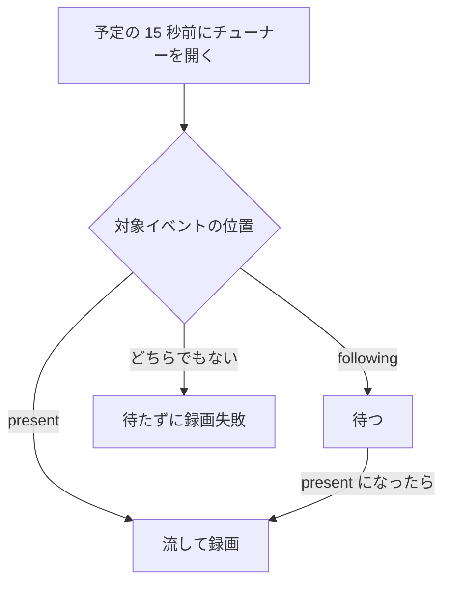

> [recording.md](../recording.md) §1「方針」・§2「mirakc に任せること」の一部。索引から辿る

## 1. 方針: mirakc への全面委譲

録画はリアルタイムでハードウェアに依存するので、エッジの mirakc に全面的に委譲する。サーバー側に残るのは、ルール評価・予約の生成・mirakc への宣言的同期というコントロールプレーンだけである。TS のストリーム処理は行わず、例外は原本のコミット後の読み取り専用の統計採取だけである。

**「録画（リアルタイム・ハードウェア依存）はエッジの mirakc に、それ以外はサーバー側で弾力的に」**

コントロールプレーンは、k8s コントローラと同型のレベルトリガーのループで動作する。予約は desired state として生成する。統計採取は、原本のコミット後に非同期の解析ジョブが行う（[ingest](ingest.md) §5.2）。TS のストリーム処理とは、録画・demux・変換のことである。

### 例外の境界

PSI（PAT / PMT）を読むのは、PID の種別（映像・音声）を統計に出すためで、記述子は一切読まない。記述子を読まないことが歯止めの本体で、機械的に判定でき、EIT の解析も自動的に排除される。

この境界を条文として固定する。PSI で読む範囲は、PAT / PMT から ES の PID と種別までである。

PID 数値だけの統計では、映像が壊れたのか、EIT が数回落ちただけなのかを区別できず、運用判断に使えない。そこで解析ジョブが PSI を読む。

| 許す | 許さない |
|---|---|
| PAT / PMT のセクション再構成 | 記述子を一切読まない |
| ES ループの PID と種別の読み取り | 他テーブルの解析 |
| 固定 PID の静的表による命名 | ES ペイロードの解釈 |
| PID と種別の対応を統計メタデータとして記録 | PSI を根拠にした EPG プロジェクションの補正 |
| 適応フィールドの不連続指標と PCR の読み取り | TS の書き出し・変換・demux |

表の見方は次の通り。記述子には `component_tag` も含む。固定 PID は PAT / CAT / NIT / SDT / EIT / TOT で、解析は要らない。他テーブルは TDT / EIT / SDT / NIT / TOT である。ES ペイロードの解釈には、字幕のデコードや映像解析が入る。不連続指標と PCR の読み取りは、ドロップ位置の経過時刻に限る。TS の書き出し・変換・demux は、この不変条件の本体である。

根拠

- 許さない記述子: `component_tag` も含む
- 読んでよい ES ループの項目: `elementary_PID` と `stream_type`
- 読んでよい適応フィールドの項目: `discontinuity_indicator`

#### 記述子の扱い

EIT の解析が自動的に排除されるのは、EIT の中身が記述子だからである。記述子を取得する関数を呼んでいたら、レビューで落ちる。

根拠

- 機械判定の条件: `Descriptors()` を呼んでいたらレビューで落ちる

#### 字幕と文字スーパー

字幕と文字スーパーは区別しない。守りたいのは映像と音声なので、ストリーム種別だけで足りる分類にとどめる。

ARIB では両者とも private PES で、区別には記述子タグ 0x52 の `component_tag` が必要になる。

この割り切りで、ARIB 固有の知識がコードベースに一切入らない。`stream_type` は ISO/IEC 13818-1 の標準値だからである。既存依存の gots が必要なものを全て持っており、自前実装はセクションの取り回しだけになる。

根拠

- 字幕と文字スーパーの種別: `stream_type = 0x06`（private PES）。区別に要るのは記述子タグ 0x52 の `component_tag`
- 既存依存: gots の `IsVideoContent()` / `IsAudioContent()`

#### 解析の失敗と PMT の更新

PSI 解析の失敗は、ingest の失敗にしない。種別が不明なら PID 数値のまま表示する。壊れた PMT で、転送や原本のコミットを失敗させない。

PMT は原本内で更新されうる。version の更新や、番組の境目での PID の再割り当てである。同一 PID の分類が途中で変わった場合は、最後に見たものを採用する。

### ブラウザにも同じ境界を適用する

フロントエンドも放送 TS を解釈しない。ブラウザが扱うのは ffmpeg の出力だけで、放送 TS を渡して再生や解読をさせる経路は持たない。ARIB 固有の知識をコードベースに入れないためである。hls.js が ffmpeg の書いた TS セグメントを demux するのは、この境界の対象外である。

放送 TS とは、mirakc が返すストリームと録画原本のことで、ブラウザが扱う ffmpeg の出力は HLS / fMP4 / WebVTT になる。理由はサーバー側と同じで、ブラウザで demux・ARIB 字幕・BML を扱えば、その知識が `web/src` に入る。保証する範囲（[overview.md](../overview.md) §保証する構成と機能の範囲）の機能は、どれもブラウザで放送 TS を扱う必要がない。

#### hls.js の demux

hls.js が MPEG-TS のセグメントを demux するのは、この境界の対象外である。ライブと追っかけ再生のセグメントは、ffmpeg が書いた MPEG-TS である。中身は H.264 / AAC と、ffmpeg が作り直した PAT / PMT / SDT で、放送由来の SI・ARIB 字幕・データ放送は含まない。字幕は ffmpeg が WebVTT に変換して別に書く。

境界は、器の形式では引かない。放送由来の構造を読むかどうかで引く。

#### 機能ごとの判定

放送 TS を読む場所で機能を分けると、原本の再生とオフライン保存は境界に整合し、データ放送とブラウザでの変換・復号は整合しない。

| 機能 | 放送 TS を読む場所 | 判定 |
|---|---|---|
| 原本 MPEG-2 のブラウザ再生 | ffmpeg（streamer） | 整合 |
| オフライン保存 | なし | 整合 |
| 実況コメントの時刻合わせ | ingest が TOT を読む | 例外表の改訂が要る |
| データ放送 | ブラウザ | 非整合 |
| ブラウザでの放送 TS の変換・復号 | ブラウザ | 非整合 |

表の補足は次の通り。原本 MPEG-2 は、ffmpeg が HLS に変換してから再生する。オフライン保存は HLS や encoded を保存する。

実況コメントの時刻合わせには、サーバー側の例外表の改訂が要る。TOT の固定部（`JST_time`）だけを許す方針で、改訂は実況を読む側と同じ PR で入れる（未解決）。データ放送はブラウザで DSM-CC / BML を解読するので非整合で、採るなら先にこの境界を改める。

ブラウザでの放送 TS の変換・復号（WASM 等）も非整合である。MPEG-2 → H.264 のビットストリーム変換の実測でも、帯域・再生バッファ・ソフトウェアデコードの代償が大きかった。

#### 機械判定

境界は 2 つの機械判定で守る。Go は import を 1 つのパッケージに閉じ、Web は放送 TS を扱うライブラリを本番の依存から締め出す。

Go は `.golangci.yml` の depguard（`ts-inspection`）が、gots の import を `internal/tsstat` に閉じる。Web は `web/tests/broadcast-ts-boundary.test.ts` が検査する。e2e の計器が基準として放送 TS を読むことは許すので、`devDependencies` は対象にしない。

---

## 2. mirakc に任せること

mirakc の録画機能は、分散システムのバックエンドとして都合の良い性質を持つ。予約は mirakc 側で永続化され、チューナーの調停も mirakc に一元化され、録画物と状態の変化は API とイベントで取り出せる。

### schedule API による予約

予約の登録は、mirakc の schedule API に番組 ID 単位で行う。スケジュールは mirakc 側で永続化されるので、Rokuban が落ちていても録画は走る。

根拠

- 登録: `POST /api/recording/schedules`（programId 単位）
- 永続化先: `recording.basedir/schedules.json`

### チューナー調停

チューナーの調停は、mirakc の優先度機構に一元化する。ライブ視聴・録画・（併用する場合の）KonomiTV 等が同じ mirakc に載っても、いざという時は録画が勝つ。

根拠

- 優先度機構: `X-Mirakurun-Priority` 相当 + schedule options の `priority`

### PSI/SI 追従 --- 追従するのは終了だけ

録画が追従するのは番組の終了だけである。終了は放送波の EIT に従って終端で切る。開始は追従せず、予定の少し前にチューナーを開くだけなので、開始が大きく繰り下がると録画失敗になり、遅れて録ることはない。

終了は、TS 内の EIT[p/f] に追従する。既定のプログラムフィルタが録画ストリームの EIT[p/f] からイベント時刻を取り、その終端で切る。

#### 開始の追従

開始は追従しない。賭けている。予定の 15 秒前に対象イベントがまだ following に見えている範囲の繰り下げなら録れ、それより大きな繰り下げは録画失敗になる。

mirakc は、EPG 予定時刻の 15 秒前にチューナーを開くだけで、その時刻自体は放送波を見ていない。プログラムフィルタはそこから EIT[p/f] を見て、対象のイベントが present なら流し、following なら待つ。どちらでもなければ、待たずに失敗する。

待たせる `--wait-until` は、録画経路では一切渡されない。`server.program-stream-max-start-delay` は `/api/programs/{id}/stream` 専用の設定で、予約録画には効かない。

つまり繰り下げに耐えるのは、予定の 15 秒前に、対象イベントがまだ following に見えている範囲だけである。数分押している程度なら following のまま残るので、実境界で録れる。p/f の並びが入れ替わるほどの繰り下げは録画失敗になり、遅れて録ることはない。延長・繰り下げの通知と、理由付きの失敗は、ここを観測するためにある。

根拠

- 対象イベントの照合に使う識別子: `eid`
- 終了に追従するフィルタ: 既定の `filters.program-filter`（`mirakc-arib filter-program`）。`--end-margin=2000`
- チューナーを開く時刻: 予定の 15 秒前（`PREP_SECS`）
- 待たずに失敗する経路: `might have been canceled` を出して `stop_`
- 待たせる引数: `--wait-until`
- 予約録画に効かない設定: `server.program-stream-max-start-delay`（`/api/programs/{id}/stream` 専用）
- 繰り下げの通知と理由付きの失敗: `recording.rescheduled` / `need-rescheduling` / `removed-from-epg`、失敗は `recording.failed`

#### 録画の開始時刻

録画行の開始時刻を、実開始として読んではいけない。watcher が入れるのはチューナーを開いた時刻そのままなので、構造的に「予定 − 15 秒」になる。

実測では、正常終了した録画は全て `-00:00:14.99` だった。値は mirakc の record の開始時刻である。

開始遅延の猶予（`reconciler.start_delay_grace`）は、この前提に乗っている。予定に猶予を足した時刻を過ぎても開始時刻が無ければ、mirakc 側の異常とみなす検出器であって、実開始のずれを測る道具ではない。

根拠

- 実開始として読んではいけない列: `recordings.started_at`
- 開始時刻の列の略称: `started_at`
- 開始時刻の出どころ: mirakc の `record.Recording.StartTime`
- 猶予の設定: `reconciler.start_delay_grace`

### onair tracker は採らない --- 観測は継続受信の副産物としてのみ採る

onair tracker は採らない。多重化波ごとにチューナーを恒久的に専有する単価を払って、得られるのは表示ラベルだけで、同じ単価で厳密に優れた買い物がある。観測は、他の目的で既に継続受信している構成の副産物としてのみ採る。

開始まで追従させる、あるいは「今放送中」を放送波から得るには、mirakc の `onair-program-trackers` が要る。チューナー本数の問題は、採らない理由にならない。理由は、同じ単価で厳密に優れた買い物があることである。

#### 恒久的なチューナーの単価

「今」の事実（EIT[p/f]）は放送波の中にしかなく、外部の番組表は予定しか配らない。読むには、多重化波 1 本あたりチューナー 1 本を恒久的に払う必要がある。この単価は、総本数に依らない。

`onair-program-trackers.local` は、この単価を払って、表示ラベルだけを、サービス単位の直列ポーリングで返す。専用のチューナーは他と共有されない。実測では、tune の TTFB が約 2.1 秒（recdvb + PX-S1UD / GR）で、1 サービスに約 7 秒かかる。実運用の 19 サービス構成では 1 周 135 秒になり、mirakc が想定する 60 秒周期に収まらない。

#### timeshift との比較

同じ単価なら、timeshift のほうが優れる。チューナーを多重化波に固定して同一波の全サービスで共有し、実イベント境界を連続で返した上に、追っかけ再生と全録が付く。

timeshift の設定は `timeshift.recorders` である。実イベント境界は `EventStart` / `EventUpdate` / `EventEnd` である。

tracker の出力は timeshift の真部分集合で、遅延だけが大きい。チューナーが潤沢な構成でも、tracker を選ぶ理由が無い。

> **観測のために新たに恒久専有チューナーを増やさない。観測は、他の目的（timeshift / 全録）で既にその多重化波を継続受信している構成の副産物としてのみ採る。**

#### remote tracker と将来の timeshift

remote tracker も使えない。GR は network_id が地域ごとに別なので、他サイトの観測は、こちらのサービスについて何も言わない。全国共通の BS/CS を配れる方向には受信設備が無い。onair はサイトローカルな概念で、全国で共有できる 1 つの観測にはならない。

将来 timeshift を入れるなら、観測は追加コスト 0 で付いてくる。ただし mirakc は timeshift の観測を `/api/onair` に結線していないので、そこは上流に足す話になる。採らない側の結果は、「いま放送中」を予定を根拠にして出し、それを画面で明示することである（[frontend/live.md](../frontend/live.md)「いま放送中」は予定であって観測ではない）。

根拠

- tracker の設定: `onair-program-trackers` / `onair-program-trackers.local`（`uses.tuner` は専用で他と共有されない）
- 継続受信で観測を得る設定: `timeshift.recorders`
- timeshift の観測の結線先: `/api/onair`（mirakc は結線していない）

#### 放送境界の conformance

mirakc の放送境界の挙動は、正常系とは別コンテナで、4 つの病態として測定している。判定は mirakc の実際の record と SSE の結果を機械判定するもので、Rokuban の期待値は実装しない。

測定は `internal/mirakc/conformance` が行い、対象は `mirakc 4.0.0-dev.0` 相当の pin である。テストログにも、イベント ID と録画開始時刻・失敗理由を残す。

| ケース | 測定している挙動 |
|---|---|
| 前番組延長 | present が別イベントで、長さ未定の間 |
| `running_status=2` | 予約対象が present だが「数秒後に開始」 |
| present / following | present は前番組、following が予約対象 |
| event_id 振り直し | 予約対象が消え、同じ時間帯に別イベントが現れる |

最初の 3 ケースでは、record のイベント ID は対象で、録画開始時刻は対象の予定より早い。前番組延長では、今回の観測は数秒から十数秒だった。present / following では、録画パイプラインが対象の予定より早く始まり、今回の観測は数秒から十数秒だった。event_id の振り直しでは、`recording.failed` にはならず、予約対象のイベント ID の record が finished まで残る。置換されたイベント ID は録らない。

ARIB TR-B14 の「開始判定は following の `start_time` を使う」という解釈そのものは、このテストの範囲では規格根拠を確認していない（未検証）。上の結果は `mirakc 4.0.0-dev.0` 相当の pin に対する mirakc の観測であり、規格解釈の根拠としては扱わない。

根拠

- 測定対象の pin: `mirakc 4.0.0-dev.0`
- 放送境界の 4 病態を測る conformance: `internal/mirakc/conformance/TestBroadcastPathologies`
- 前番組延長の長さ未定: `duration=0xFFFFFF`
- 判定に使う値: `event_id` / `recording.startTime` / `startAt`

### Records API

録画物は HTTP で取り出せるので、エッジとサーバーの間に共有ファイルシステムが要らない。

根拠

- 取り出し: `GET /api/recording/records/{id}/stream`

### SSE 再送

mirakc のイベント配信は、接続時に既存の全 record の保存イベントを再送する。watcher が落ちていた間のイベントを取りこぼしても、再接続すれば現状と突き合わせて回復できる。実質は at-least-once と状態同期である。

この再送と、同一 record への保存イベントの複数回配信は、`mirakc 4.0.0-dev.0` 相当の pin に対して conformance が判定している。他のバージョンでは未判定である。

根拠

- イベント配信: `/events` SSE。再送されるのは既存全 record の `recording.record-saved`
- 保存イベントの略称: `record-saved`
- 判定している conformance: `internal/mirakc/conformance`
- 接続時の再送: `TestConformance/RecordSavedResentOnConnect`
- 同一 record への複数回配信: `TestConformance/RecordSavedFiresMultipleTimes`

