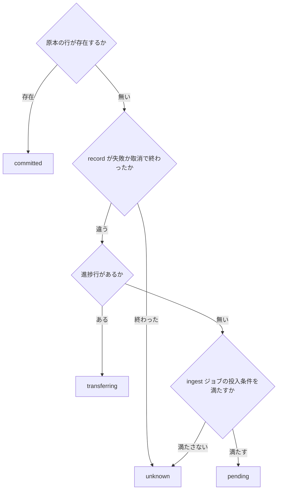

> [recording.md](../recording.md) §5「ingest パイプライン」のうち、負荷分担・完了後のフロー・進捗表示（5.4〜5.6）。索引から辿る。

### 5.4 負荷分担: worker

**ingest の同時実行数は、mirakc サイト単位で「チューナー数 + 全速 pull の許容本数（1〜2）」にする。** 律速になるのはエッジ側のアップリンク帯域とディスクで、クラウド側は律速にならない。ハイブリッド構成では、worker を増やしても速くならない。

stream の負荷が乗るのは worker（ingest ジョブ、KEDA で 0〜N）であり、reconciler は数百件のメタデータ diff を回すだけの軽いジョブのままである。ボトルネックがエッジ側にある理由は、ハイブリッド構成では自宅アップリンク帯域が律速であることと、エッジでは録画中の書き込みと pull の読み出しが同じディスクで競合することである。pull がディスクを飽和させて録画をドロップさせては本末転倒になる。

同時実行数は `ingest.concurrency` で絞る（サイト別キュー or River の同時実行数設定）。worker の水平スケールが効くのは、encode（CPU バウンド、入力はクラウド側ストレージ）の方である。

根拠

- 負荷が乗る転送: `records/{id}/stream`
- 同時実行数の式: `チューナー数 + 全速 pull の許容本数（1〜2）`

#### 追従が使う枠と優先度

追従は 4 分の区切りごとに枠を返し、優先度 1 で次の空き枠を先に取る。追い付きの優先度は 2 で、N 本の同時録画には N 個の追従枠が必要になり、残りの枠だけが全速 pull に回る。

追従は番組長のあいだ枠を占有し続けず、4 分の Work ごとに snooze して枠を返す。次の Work が同じジョブを続ける。枠を返している間は全速 pull が使えるが、追従ジョブは優先度 1、追い付きは 2 なので、次に空いた枠は追従が先に取る。4 分ごとに一時的に追い付きへ渡る分の競合は残る。

この余り枠は 2 つの仕事を兼ねる。追従後も全速 pull は、障害復旧後のバックログ・record_sweep の再投入・遅れて枠を得た追従の追い付きとして残る。枠を録画数ちょうどにすると、全速 pull が枠待ちで詰まる。逆に録画数に合わせて広げると、復旧中の全速 pull が並列に走ってエッジの録画書き込みと競合する。録画が無いときは全枠が全速 pull に回るが、邪魔する録画書き込みも無い。

追従は追い付きより優先する。watcher は投入時にどちらかを知っているので、追従を 1、finished 後の追い付きを 2 にし、queue adapter がジョブへ渡す。バックログ消化中に始まった生録画の追従が、枠待ちで後ろに回らないようにするためである。

根拠

- 優先度の指定: `jobq.Priority`

### 5.5 ingest 完了後のフロー

ingest のコミット後は、エンコードなどのジョブをヒントとして一度だけ投入し、失敗してもコミット済みの取り込みは戻さない。ヒントは落ちうるので、DB の状態から不足分を拾う定期パスが正しい状態を決める。

**同一トランザクションでの投入はしない。** 原本のコミット後に、対象録画を指定したエンコード用の補完ジョブを best-effort で積む。判定は定期パスと同じ query を使うため、ヒント側に不足分の判定を持たない。投入に失敗してもログのみで、コミット済み ingest は巻き戻さない。

落としたヒントは、定期パスが埋める。ヒント投入の失敗とエッジ record の削除成功（[ingest-retry.md](ingest-retry.md)「層 3: 完全性検証とコミット」）が両方起きると、そのヒントは二度と飛ばない。エッジに record が残っていないので、record_sweep も ingest ジョブを再投入しない。ヒントだけに頼ると、コミット済みの録画が誰にも再投入されず、気づかないうちにエンコードされないまま残る。

根拠

- 補完ジョブ: `internal/worker/encode_reconcile.go`（既定 15 分周期）

#### エンコードの定期パス

定期パスは、期待するエンコード結果から実際にある結果を引いた不足分だけを投入する。対象は原本がコミット済みで、ごみ箱に入っていない録画に限る。

専用クエリが desired（`recording_encode_policy.encode_profiles`）から observed（active な `encoded` の `media_assets`）を引いた不足分を、一括で取得する。取得するのは不足している `(recording_id, profile)` であり、それを queue に投入する。権威は DB の状態であって、「ヒントが飛んだかどうか」ではない（不変条件 5）。

ここでの原本は、`kind='original'` が active でコミット済みの行である。ingest 未完了の録画とユーザーが捨てた録画は、掘り起こさない。エンコードは site の属性を持たない（アーカイブもプロファイルも単一）ので、このジョブは record_sweep のような site 単位でなく、全体で 1 本になる。

`worker.periodic_jobs: false` の構成では、`rokuban enqueue encode-reconcile` を CronJob から叩く。一覧は [operations/monitoring.md](../operations/monitoring.md) の CronJob 一覧にある。

#### 失敗する仕事を作らない規律

**繰り返すパスは「投入しても必ず失敗する仕事」を作ってはならない。** ヒントは一度きりなので、設定から消えたプロファイルを投入して失敗させるのは、運用者への通知として妥当である。15 分ごとに同じことをすると、失敗を無限に作り続ける。

定期パスは、desired を現在の `encode.profiles` に存在する名前だけに絞る。落とした録画は数えて出す（`rokuban_encode_reconcile_unsatisfiable`）。プロファイルを改名すると、その名前で凍結済みの過去録画が一斉にここへ落ちる。

根拠

- 設定から消えたプロファイルの失敗: `unknown encode profile`
- 落とした録画の数: `rokuban_encode_reconcile_unsatisfiable`

#### 失敗したエンコードの再投入

上限内の失敗は再投入し、試行上限後は利用者の再要求を待つ。

active な encoded が無ければ 15 分ごとに再投入する。試行上限に達した `failed` 行は候補から外れ、再要求によって行が消えると候補に戻る。`running` 行は次の reconcile が古い試行を終端化できるよう残す。

River の一意制約は pending 系の状態にしか効かず、discarded 済みの引数には合流しないので、discarded になっても定期パスは再投入する。意図どおりなのは、権威がジョブ履歴でなく `media_assets` の有無だからである。試行上限の除外は River でなくドメインの試行表で行う。

#### 候補窓の継続

全件パスは候補をページに分け、続きの位置をジョブ引数で引き継ぐ。「TS scan の定期パス」と同じ継続ジョブの方式である。

録画 ID 昇順の 1000 件でページを作り、満杯なら最後の ID を引数に継続ジョブを投入する。次のジョブを拾った worker は、`--once` で作り直されても後ろから続ける。ちょうど上限のページは、追加の問い合わせなしには末尾か分からないので、空ページを 1 回実行する。短いページは連鎖を止め、次の定期パスが先頭から始める。

連鎖が末尾まで進めば、定期パスの開始時にあった候補をすべて調べる。途中でカーソルより前に加わった ID は次の定期パスで拾う。各ページは最大 1000 件の録画を調べ、作り直し要求も通常候補と同じ録画 ID の窓に入る。API は要求の commit 後に対象録画のヒントを投入するため通常は即時だが、ヒントを失い、継続連鎖中にカーソルより前の録画へ要求が入った場合だけ次の定期パスまで待つ。

継続状況は、ページ満了ログ `encode_reconcile: candidate window is full; continuation enqueued` で見る。参照構成は `--once` のジョブ Pod を scrape しない。

定期パス `{}` は、実行中の同じ引数のジョブに合流し、二重に積まれない。rescuer は worker の Timeout（encode_reconcile は 5 分）が過ぎるまで running の行を回収しないので、二重に走ることもない。継続ジョブは別引数なので定期パスと並走しうるが、encode ジョブは `(recording_id, profile)` で合流するので二重エンコードにはならない。

根拠

- 窓: ID 昇順
- 上限: `encodeReconcileRowLimit`（1000）
- 継続テスト: `TestEncodeReconcileWorker_ContinuationSurvivesFreshWorker`

#### thumbnail の定期パス

サムネイルも、ingest 後の投入が落ちた穴を定期パスで埋める。定期パスは active な原本と派生物の差分を拾い、サムネイルのジョブを積む。ingest 後の即時パスと全件パスは、同じ候補の条件を使う。

ingest 後の投入が失敗し、その後に `DeleteRecord` が成功すると、edge record からは再投入できない。`thumbnail_reconcile` がこの穴を埋める。候補からは、ごみ箱と `missing_media_assets` の原本を除外する。`worker.periodic_jobs: false` の構成では `rokuban enqueue thumbnail-reconcile` を CronJob から叩く。

対象録画の即時パスは、poster、再選択、seek tiles の順に確認する。seek tiles も ingest 直後に候補になるため、15 分周期を待たない。全件パスは pending 中の thumbnail ジョブを River の一意制約で合流させ、候補窓を recording ID 順に回す。

missing poster、再選択、seek tiles の窓は別々の recording ID カーソルを持つ。満杯の窓が 1 つでもあれば、3 つの再開位置を 1 本の継続ジョブに載せる。窓ごとに継続ジョブを分けると、満杯の窓の数だけ継続チェーンが並走し、どの窓を評価するかを選ぶ引数も要る。`--once` で worker が作り直されても、次のページは継続ジョブの引数から開く。対象録画の即時パスは継続位置を読まず、窓が満杯になっても継続ジョブを積まない。

上限未満のページを返した窓は末尾に達している。継続ジョブの Done フラグがそれを引き継ぎ、ほかの窓が続く間もその窓を照会しない。Done フラグが無いと、短い窓が次のページで先頭から読み直され、先頭の候補を毎ページ投入し直す。すべての窓が短ければ継続ジョブを積まない。ちょうど上限の窓は、次の空ページで末尾と分かる。

継続ジョブの投入に失敗した場合は、ログに残してパスを成功で終える。`--once` では、先頭に満杯の恒久候補がある間、後ろの候補へ進む手段は継続ジョブだけである。失敗するとその周期の残りのページを失い、次の定期パスが先頭から連鎖を作り直す。定期パスの kind は MaxAttempts 1 で再試行しないので、エラーにしても得るものは無い。

継続ジョブは引数が違うので、定期パス `{}` と並走しうる。thumbnail ジョブと seek_tiles ジョブは `recording_id` で合流し、二重に走っても、後から公開する側は既存を見て捨てる。ffmpeg の抽出は 2 回走る。

根拠

- 3 つの独立カーソルが fresh worker をまたぐこと: `TestThumbnailReconcile_ContinuationSurvivesFreshWorker`
- 短い窓が別窓の継続中に再走しないこと（再選択・seek tiles が最短の場合）: `TestThumbnailReconcile_ExhaustedWindowNotRestarted`
- 短い窓が別窓の継続中に再走しないこと（missing が最短の場合）: `TestThumbnailReconcile_ShortWindowsStayDoneWhileLongerWindowContinues`
- 窓が満杯になる条件（RowLimit 1）でも対象パスが継続を積まないこと: `TestThumbnailReconcile_TargetedPassFiltersAllCandidatesAndLeavesFullStateAlone`
- 短いページでは継続しないこと: `TestThumbnailReconcile_EnqueuesMissingSeekTiles`
- 継続投入の失敗を成功で終えること: `TestThumbnailReconcile_ContinuationEnqueueFailureReturnsSuccess`
- 公開済みなら後から来た thumbnail の公開を捨てること（`published` が false）: `TestPublishGeneratedMediaAssetSkipsWhenDerivedAlreadyActive`
- 公開済みなら後から来た thumbnail と seek_tiles の公開を捨てること: `runDerivedPublicationSkips`（`internal/store/contracttest/mediapublish.go`）
- 公開が rel_path のロック下で直列になること: `TestThumbnailWorkerPublishesUnderRelPathLock`、`TestSeekTilesWorkerPublishesUnderRelPathLock`

#### CM 検出とロゴ候補の定期パス

CM 検出と局ロゴ候補も定期パスで補完する。

CM 検出の録画候補は recording ID 順、ロゴ候補は `(network_id, service_id)` 順の別窓で拾う。両方のカーソルを 1 本の継続ジョブに載せる理由と、短い窓の Done フラグは thumbnail と同じである。worker が `--once` で作り直されても、各窓は引数の位置から続ける。満杯の窓がなければ継続ジョブは積まない。

継続ジョブは定期パス `{}` と並走しうる。cm_detect ジョブは `(recording_id, recording_duration_ms)`、cm_logo_candidate ジョブは局・録画・ロゴ領域の更新時刻・録画尺で合流する。二重に走っても、遅れて来た試行の結果は捨てられる。

継続ジョブの投入に失敗した場合は、ログに残してパスを成功で終える。次の定期パスが先頭から再確認する。

根拠

- 両窓が複合キーを含む引数で fresh worker をまたぐこと: `TestCMDetectReconcile_ContinuationSurvivesFreshWorker`
- 短い窓が別窓の継続中に再走しないこと: `TestCMDetectReconcile_ExhaustedWindowNotRestarted`
- 短いページで継続しないこと: `TestCMDetectReconcileEnqueuesCandidateOnlyWithoutCandidateRow`
- 継続投入の失敗を成功で終えること: `TestCMDetectReconcile_ContinuationEnqueueFailureReturnsSuccess`
- 遅れて来た cm_detect の試行結果が捨てられること（試行回数の不一致）: `TestCMDetectCountsDeadAttemptsAndFencesLateResults`
- 遅れて来た cm_logo_candidate の試行結果が捨てられること（`attempted_at` の不一致）: `TestCMLogoCandidateLateAttemptCannotChangeRecreatedCandidate`

#### TS scan の定期パス

TS の統計も、コミット後のヒントと定期パスの二重で埋める。定期パスは未計測の原本を候補にする。読み出しに失敗した scan に終端記録は作らず、後続の reconcile が再投入する。

`ts_scan` は active な original を先頭から全体読み、`tsstat.Counter` で `drop_stats` / `drop_positions` を置き換える。`media_asset_ts_scans` には計測サイズを記録し、サイズが変われば再計測する。ごみ箱の録画と `missing_media_assets` の原本は候補から除外する。計測済みの判定は view `current_ts_scanned_originals` にまとめてある。理由は [削除エンジン](../storage/retention.md) の「削除可否の述語に名前を与える」を参照。

候補は recording ID の keyset pagination で拾う。ページが上限に達したら、次のカーソルを持つ reconcile ジョブを投入する。KEDA の `--once` で reconcile ワーカーが再起動しても、先頭に未計測の失敗が残る候補集合から後続ページへ進める。scan の timeout は有限（6 時間。未検証）で、プロセスが死んだ `running` ジョブは River の rescuer が回収する。scan は冪等で再実行できるので、advisory lock は持たない。timeout が最長の原本より短いと、その原本の scan は timeout と再試行を繰り返す。

継続ジョブの投入に失敗した場合は、ログに残してパスを成功で終える。次の定期パスが先頭から再確認する。

ingest の commit 後に scan をヒント投入し、既定 15 分の reconcile が取りこぼしを拾う。`worker.periodic_jobs: false` では `rokuban enqueue ts-scan-reconcile` を CronJob から実行する。scan は ingest の後に原本を全量読む。追加読み出しのコストは未検証である。

読み出しに失敗した scan の再投入は、上記のとおり後続の reconcile が行う。削除条件が scan 完了を要求するようになった後は、恒久的な読み出し失敗がある原本は保持され続ける。

根拠

- TS scan の継続カーソルが新しい worker で再開すること: `TestTSScanReconcile_ContinuationSurvivesFreshWorker`
- 継続投入の失敗を成功で終えること: `TestTSScanReconcile_ContinuationEnqueueFailureReturnsSuccess`
- 計測済みの判定: view `current_ts_scanned_originals`
- サムネイルの補完ジョブ: `thumbnail_reconcile`
- TS scan の補完ジョブ: `ts-scan-reconcile`

### 5.6 転送の途中経過を見せる

ingest worker が転送中に書けたバイト数を衛星表へ写し、API が取り込みの進捗として返す。リトライ中かどうかは返さず、最後に観測した時刻の古さで停滞を読ませる。

finished は mirakc の録画完了を指す。取り込みの完了は原本のコミットで決まる。原本がコミットされるまでブラウザ再生も事後エンコードもできないが、その時間帯を表すものが `sizeBytes` の省略しか無かった。そのため遅い回線（実測で数百 KB/s 台）では、**止まっているのか進んでいるのか判別できなかった。**

根拠

- 完了の状態: `recordings.status = finished`
- 進捗の衛星表: `recording_ingest_progress`（[schema/recordings/satellites.md](../schema/recordings/satellites.md) §5）
- API の返し先: `Recording.ingest`

#### 進捗の書き込みと間引き

転送開始を表す 0 は間引きの時計に含めず、最初にファイルへ書けた値は直ちに記録する。その後の更新は最短 2 秒間隔にする。バイトを書けた試行が終わるときは最新値を記録し、0 バイトの試行は観測時刻を更新しない。

継続ストリームで DB 書き込みが Copy バッファ単位に増えないようにするためである。接続断を含め、バイトを書けた転送試行が終わるときは、間引かれていた最新値を記録してから再開または終了する。0 バイトの試行は進捗ではないので、`observed_at` を更新しない。

間引きは既存の進捗書き込みと同じ最短 2 秒なので、追従中の DB 書き込みは録画 1 本あたり秒 0.5 行に留まる。これに接続断ごとの 1 行が加わる。正常 Range では flush しない。接続断の再試行はここを通らないため、「0 バイトの試行は進捗ではない」という規律は失敗経路側に残る。

根拠

- 転送開始を表す値: `written_bytes=0`

#### 進捗の置き場

進捗は衛星表に置く。ジョブ引数にも、mirakc の観測を持つ同期表にも置かない。理由は 3 つとも別方向である。

- ジョブ引数に持たせると、UI が River の内部表を読むことになる
- mirakc の観測を持つ同期表は書き手が watcher なので、転送の進捗を足すと 1 表 2 書き手になる（不変条件 12）
- 録画の本体表の列にすると、書き手が脊椎（watcher / reconciler）でない状態が脊椎に混ざる（不変条件 13）

根拠

- 持たせない場所 1: ジョブ引数 `river_job.args`
- 持たせない場所 2: `record_sync`
- 持たせない場所 3: `recordings` 本体の列

#### 進捗の分母

分母は、watcher が観測した mirakc の record の長さである。転送開始時に読んで進捗の表へ写し、追従中は追い付き時の status 観測で更新する。録画中の分母は最終サイズでないので、UI は % を出さない。

**分母は `record_sync.content_length` である。** watcher が mirakc record の `content.length` として観測済みの値を使う。HEAD の `Content-Length` は転送完了後の照合（[ingest-retry.md](ingest-retry.md)「層 3: 完全性検証とコミット」）にしか取っておらず、転送中には使えない。この分母は完全性の照合に使わない。照合は録画済みの確認後に、HEAD の長さと `content.sha256` で行う。ファイル stat は api ロールがファイルシステムに触れない（不変条件 1）ので、分母にできない。

mirakc が length を返さない record では、分母を NULL のままにし、UI は % を出さずバイト数だけを出す。でっち上げた分母は置かない。この分母が録画中も非 null で時間とともに増えることは、`mirakc 4.0.0-dev.0` 相当の pin に対する判定で、他のバージョンでは未判定である。`records/{id}/stream` の `Content-Length` ヘッダ（録画中は不明）とは別物である（「Range と HEAD の前提」参照）。録画中の最初の観測は 0 でありうる（実測）。

0 は「mirakc が length を返さない」場合の NULL とは違う。非 null な `*int64(0)` として `watcher.go` の `contentLengthPtr` をすり抜けるので、上記の NULL ガードでは捕まらない。0 を分母にした場合の UI の挙動は本稿の対象外である。

Work 開始時に分母を固定すると、録画が伸びて `written_bytes` が分母を追い越し、UI が「取り込み中 100%」を録画中ずっと出し続ける。Web 側は `min(100, ...)` で頭打ちにするので、事実と違う値が % として出る。そのため分母は追い付き時の status 観測で更新する。`GetRecord` は空 Range の後だけ呼ぶため、更新も追い付き時に限る。

録画中に読めるのは「mirakc がその時点で観測しているサイズ」であり、`writtenBytes` がそれを追い越すことがある。割合にすると、「録画全体を取り込み済み」と読める誤った表示になる。分母が確定するのは録画終了後で、% はそこから出す（`web/src/lib/ingest.ts` の `ingestDisplay`）。分母が NULL のときも、バイト数だけを出す。

根拠

- 分母の由来: `record_sync.content_length`（`content.length`）
- 録画中の length 観測: `TestConformance/RecordingInProgress`
- 追い付き時の分母と observed_at: `TestIngestWorker_FollowingCaughtUpKeepsProgressFresh`

#### 停滞の判定

**リトライ中を取り込み待ちと区別する値は API に持たない。** 代わりに進捗を最後に観測した時刻を返し、停滞はその古さで読ませる。追従が正常に追い付いている間も観測時刻を進めるので、停滞と誤判定しない。

区別するには `river_job` を API 契約に露出させるか、失敗の観測という別寿命の値を進捗行に混ぜる（不変条件 9 / 12）必要がある。代わりに `observed_at` を返す。UI の停滞しきい値は 60 秒である。既定のストール検知（`ingest.stall_timeout` = 30 秒）で正常に再接続している往復を、「停滞」と呼ばないためである（`web/src/lib/ingest.ts` の `ingestStaleAfterMs`）。

追従の待ちは「停滞」と呼ばない。stall timer は Range 本文の読み取り中だけ動く。信号断で録画ファイルが伸びない間は、空 Range の後に status を読み、待って再試行する。消費側の逆圧は stall 判定に入らない。

健全な status 観測は、0 バイトでも `observed_at` を進める。追い付いている状態は、追従が正常な状態そのものである。バイトを書けたときだけ進めると、正常に追従できている録画ほど UI の停滞判定（60 秒）に引っかかり、「取り込み中（停滞）」と表示される。未知の status と失敗経路は進捗として記録しない。

根拠

- 露出させない内部表: `river_job`
- 最後に観測した時刻: `observed_at`
- 停滞しきい値: `web/src/lib/ingest.ts` の `ingestStaleAfterMs`（60 秒）
- 既定のストール検知: `ingest.stall_timeout`（30 秒）
- 追い付き時に進捗の観測時刻を保つこと: `TestIngestWorker_FollowingCaughtUpKeepsProgressFresh`
- 未知 status を job 内で再試行すること: `TestIngestWorker_UnknownStatusRetriesInJobWithoutRestart`

#### API の状態の導出

API の状態は 4 値で、原本の有無を最優先に導出する。次に取消・失敗の観測を見て、取り込み待ちは watcher がジョブを投入する条件と同じ述語に揃える。

状態は列に焼いた値でなく、毎回導出する（`internal/api/recordings.go` の `ingestProgressFromFields`）。最優先で見るのは、原本 `media_assets` 行の有無である。

`kind='original'` の行が、`state` を問わず存在すれば `committed` である。`state='deleted'`（取り込んだ後に削除した）でも `committed` のままにするのは、「取り込めなかった」と「取り込んだ後に消した」を混同しないためである（原本がいまあるかは `sizeBytes` の有無が答える）。取り残された進捗行がコミット済みの録画に「取り込み中」を名乗らないのも、この優先順位による（権威は `media_assets` 側。不変条件 5）。

原本の次に優先するのは、record が失敗または取消で終わった観測である。この観測は進捗行より先に見る。worker は cancel / fail の観測後に進捗行を消し、ジョブを終端する。DELETE が失敗してもログだけで続行するため、進捗行が残ることがある。残った行があると、二度と取り込まれない録画を「取り込み中（停滞）」と表示する。この述語は `has_ingestable_record` の否定にしてはならない。未知の status では共有 reader が再試行を続けるため、進捗行は生きた観測である。終端する status の集合は、worker の `errIngestRecordEndedAbnormally` と一致させる。

取り込み待ち（`pending`）の根拠は、watcher が ingest ジョブを投入する条件と同じ述語に揃える（`record_sync.status` が `recording` または `finished`）。`record_sync` 行の存在を根拠にしてはならない。行は `failed` / `canceled` の record にも作られ、Rokuban はこの行を消さない（本番に `DELETE FROM record_sync` の経路は無い）。そのため ingest ジョブが一度も投入されない録画が、永久に「取り込み待ち」を名乗る。`pending` は「これから来る」の断定なので、来る根拠が述語として書けないものを入れない（表示側の規律は [frontend/recordings.md](../frontend/recordings.md)「取り込み中であることを画面に出す」）。

途中ファイルのサイズは、`sizeBytes` に混ぜない（不変条件 3。コミット = DB 行）。進捗は `ingest.writtenBytes` という別のフィールドで、原本 `media_assets` 行が生まれる tx の中で進捗行が消える。

根拠

- 状態の導出: `internal/api/recordings.go` の `ingestProgressFromFields`
- 終端する status の集合: `errIngestRecordEndedAbnormally`
- 転送中の表示と書き込み間引き: `TestIngestWorker_ProgressVisibleDuringTransfer`、`TestIngestProgressReporter_ThrottlesContinuedWrites`
- 接続断時だけ進捗を flush すること: `TestIngestWorker_ProgressFlushesInterruptedBurst`、`TestIngestWorker_CleanRangeEndsDoNotFlushProgress`
- 進捗のフィールド: `ingest.writtenBytes`

