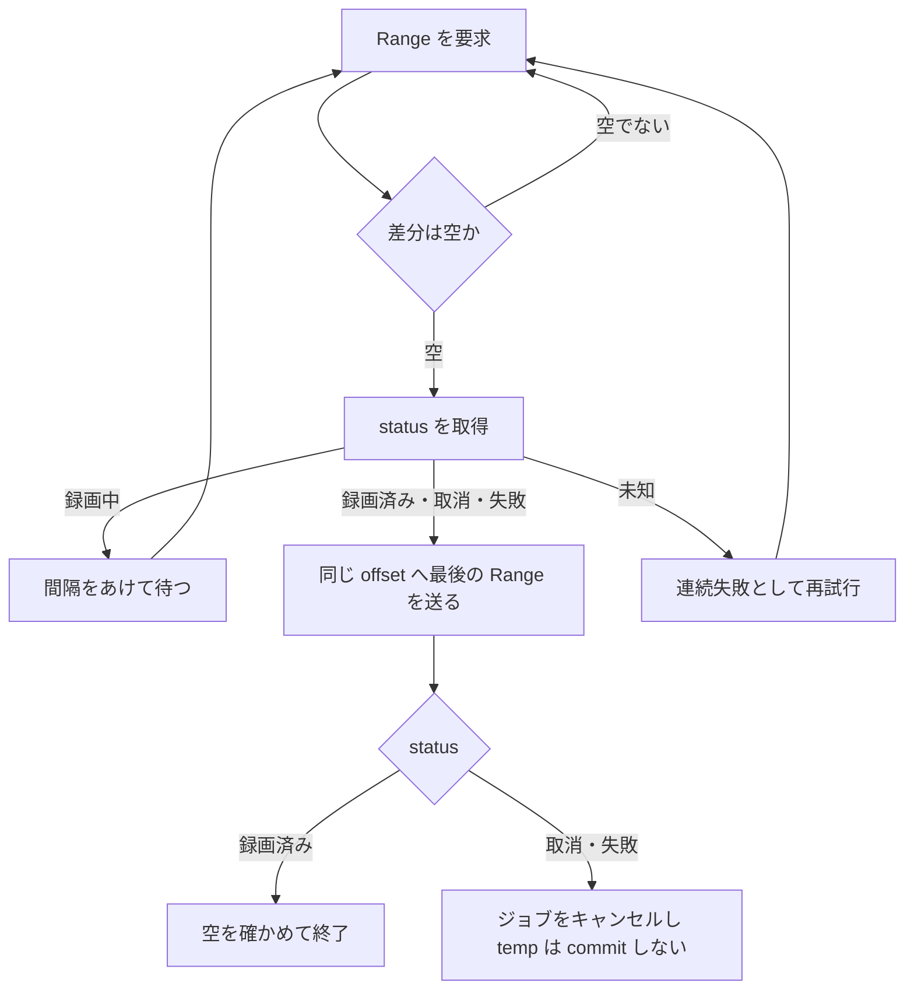
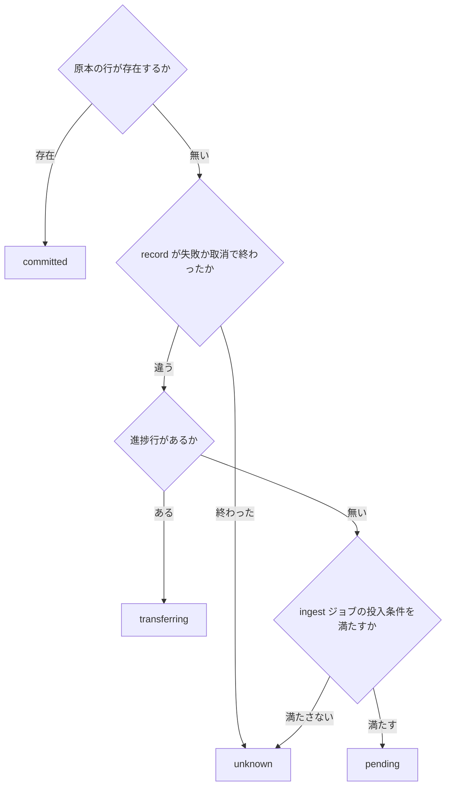

> [recording.md](../recording.md) §5「ingest パイプライン」・§6「B-CAS 復号の責務境界」の一部。索引から辿る。

## 5. ingest パイプライン

mirakc のエッジから Rokuban のアーカイブストレージへ録画データを取り込む一連の処理。**録画開始と同時に始まり、録画に追従する。**

### 5.1 転送方式: API pull 固定

ingest は mirakc の保存ディレクトリを直接読まず、全構成で API の HTTP pull に統一する。直読みでもディスク I/O は減らず、コピー自体が録画を守る耐障害設計になっているからである。

「monolith モードなら mirakc の basedir を直接読めるのでは」という案を検討し、HTTP loopback 経由を維持すると結論した。「同居時の basedir 直読み」は、loopback が実測でボトルネックになった時の最適化オプション（YAGNI）として残す。契約は、**mirakc とは常に API、自身のストレージとは常にファイルシステム**の 2 面で固定する（[storage.md](../storage.md) 参照）。

根拠

- 転送の入口: `records/{id}/stream` による HTTP pull

#### 直読みを採らない理由

直読みでも節約できるのは loopback の負荷だけで、ディスク I/O は減らない。コピーが録画を守る耐障害設計になり、コードパスも 1 本にできる。所有権も明確になる。

理由は次の 4 つである。

- basedir（リングバッファ）からメディアストレージへのコピー自体は必要で、直読みで節約できるのは loopback TCP のオーバーヘッドだけである。1 日数本・数十 GB では無視できる。追従では各ポーリングが返すのが直前の間隔ぶんの伸び（放送レートで数 MB）なので、その読み出しはページキャッシュに乗っており実ディスク読みはほぼ生じない
- 録画はシステム内で唯一のリアルタイム・リトライ不能な操作なので、ローカルディスクへ録画し、完了後にリトライ可能な転送をする、という分離は変えない。mirakc に最終保存先へ直接書かせる案は採らない。録画中の NAS/FUSE ストールが放送の欠損に直結するためである。ドロップスキャンも転送パスがあるからタダで載る
- HTTP pull は monolith / 分散 / ハイブリッドの全構成で動く唯一の方法である
- basedir は mirakc の所有物で、Rokuban は API 越しの客に徹する

#### Range による追従

ingest は初回から Range 付きで追従し、空の差分に追い付いたときに読む record の status で録画の終了を判定する。通常の追従と切断後の再開を、同じ HTTP 契約で扱うためである。

reader は、最初の要求から Range を N=0 の位置で送り、各応答をリクエスト時点のサイズまでの有限な差分として読む。先頭からの追っかけ再生だけは最初に mirakc の非 Range 追従配信を使い、その本文が閉じた後を同じ reader が Range で続ける。

**record の status が録画終了の真実である**（不変条件 5）。本文が空の Range に追い付いたときだけ status を読み、空ではない差分を読んだ直後には取り直さない。未知の status は終了とみなさず、連続失敗として再試行する。

録画中なら待って Range を再要求する。通常の要求は 500ms 以上あけ、追い付いた状態が続けば 1 秒まで間隔を広げる。録画済み・取消・失敗の後は、同じ offset へ最後の Range を送り、空であることを確かめる。取消と失敗は ingest の status hook がジョブをキャンセルし、temp を commit しない。

追い付いた Range は、204・416・206 の 0 バイトで返りうる。録画中は終端のサイズを持たない Content-Range の組み立てが first/last を検査しないため、206 になる。これらの応答は接続障害として数えず、status を再取得する。未知の status・本文の切断・stall は、共通の連続失敗回数とバックオフを使う。204 は content file がまだ 0 バイトの状態で、録画開始直後に出る。これも同じく待つ。

根拠

- 追従する reader: `RecordFollowReader` が `Range: bytes=N-` を N=0 から送る
- status の取得: `GetRecord`
- 追い付き時に返りうる応答: `204` / `416` / `206`
- 録画中の 206: `ContentRange::without_size` が first/last を検査しない

#### Range を無視した 200 の扱い

Range を無視した完全な応答は、offset が 0 のときだけ受理する。offset が 0 より大きいときは、原因がログに残る形で失敗させる。

**Range を無視した 200 は offset 0 だけ受理する。** RFC 9110 はサーバが Range を無視して完全な表現を返すことを許す。offset 0 では本文が求めた差分と同一なので、そのまま受理してよい。

offset > 0 では本文が先頭から始まる。そのまま追記すると先頭から offset ぶんが二重になる。先頭を捨てて読むと、ポーリングごとに offset バイトを再転送する O(n^2) が気づかないうちに起きる。どちらも取らず、原因がログに残る形で失敗させる。フィルタを併用すると mirakc は Range を無視するので、この分岐はその構成でだけ到達しうる（ingest はフィルタなしで pull する）。

根拠

- 受理するのは offset 0 の `200` だけ。offset > 0 は失敗させる

### 5.2 TS 統計の解析ジョブ

原本の TS 統計は、コミット後の解析ジョブがファイルから読んで採る。ingest 自身は TS のバイト列を解釈しない。

ingest は mirakc の status・長さ・SHA-256 を確認して原本をコミットする。コミット後に解析ジョブが active な原本をファイルから読み、188 バイト境界の統計を採る。

採取する統計は、PID ごとの continuity counter 不連続、transport_error_indicator、scrambling_control の 3 つである。PID 別サマリを media_assets に紐づくテーブルへ格納し、UI で表示する。解析ロジックは `internal/tsstat`、呼び出し元は `internal/tsscan` の解析ジョブに限る。

計測記録は計測したサイズを持つ。現在の原本サイズと一致する計測記録ができるまで、エンコード後に原本を消す方針の原本は削除対象にならない。解析後の全量読み出しにかかる追加コストは未検証である。

根拠

- 解析ジョブ: `ts_scan`
- 計測したサイズの記録: `media_asset_ts_scans`
- 削除対象にならない原本の方針: `until_encoded`

#### 判定の規約（誤検知を出さないために必要なもの）

実放送で誤検知を出さないために、NULL パケットや規格が許す重複などを除いて数える。この規約を守って初めて、既知の良品でドロップが 0 になる。

continuity counter の不連続を数えるだけでは、実放送で大量の誤検知が出る。実測した既知の良品（NHK 総合、5.3GB / 2841 万パケット）では、`discontinuity_indicator` が 230 回立っていた。規約は次の通り。

| 規約 | 扱い |
|---|---|
| NULL パケット（PID 0x1FFF） | CC は意味を持たないので統計対象外 |
| payload なしパケット（`adaptation_field_control` が `00` / `10`） | CC は増えない。増えていたら payload 付きパケットの欠落として数える |
| `discontinuity_indicator` | CC の不連続は正常。基準を取り直す |
| CC が直前と同じ + payload が同一 | 規格が許す重複。1 回までは正常、2 回以上は異常 |
| CC が直前と同じ + payload が相違 | 重複ではなく 15 個（16n-1）欠落。CC が一周して直前と一致している |
| PID の初回パケット | 基準がないので数えない |
| `transport_error_indicator` | error に数え、CC の追跡から外す（後述） |
| `transport_scrambling_control` | `00` 以外を異常として数える |

**16 の倍数の欠落は原理的に検知できない。** CC は 4 ビットなので、ちょうど 16n 個欠落すると CC が期待値と完全に一致し、payload を見ても正常な次のパケットと区別がつかない。これは規格上の限界で、他実装も同じである。

#### 検証方法

既知の良品に対する差分テストで誤検知がないことを確かめ、検知側は同じファイルをメモリ上で壊して確かめる。

差分テストは、別実装で drop / error / scrambled がいずれも 0 と確認済みの .m2ts を `ROKUBAN_TEST_TS_FILE` に指すと有効になる。ファイルは巨大かつ著作物なのでリポジトリには置かない。

clean なファイルでは、誤検知がないことしか確かめられない。そこで検知側は、同じファイルをストリーム処理中にメモリ上で壊して検証する（欠落・TEI・scrambling を注入する）。ディスクに改変コピーは作らない。

根拠

- 既知の良品に対する差分テスト: `internal/tsstat/integration_test.go`

#### [tspacketchk](https://github.com/kaikoma-soft/tspacketchk) との差分

判定ロジックは tspacketchk とほぼ一致している。違えているのは、TEI パケットの CC を信用せず、追跡を打ち切って次のパケットで基準を取り直す 1 点だけである。

重複を payload 比較で見分ける点と、payload なしパケットの CC を検査する点は、同実装から取り入れた。**TEI パケットの CC を信用しない。** tspacketchk は TEI 時に error を数えつつ CC を更新するため、直後のパケットで drop も 1 数える。1 つの破損が error と drop の両方に計上される。Rokuban は TEI 時に継続性の追跡を打ち切り、次のパケットで基準を取り直す。破損の実数を二重に数えないことを優先した。

### 5.3 リトライ設計（3 層）

ingest の失敗は 3 層で回復する。接続断はジョブ内で Range 再開し、プロセス死はジョブ契約の区切りと回収で拾い、最後に完全性を検証してからコミットする。

#### Range と HEAD の前提

転送は Range で途中再開でき、長さは HEAD で転送せずに取れる。ただし録画中の HEAD は長さを返さないので、HEAD を打つのは録画完了後に限る。

`GET /records/{id}/stream` は Range ヘッダーに対応するので、`Range: bytes=N-` で途中再開できる。録画中の Range 応答は `Content-Range: bytes N-M/*` のように総サイズが `*`（不明）になる（実測。Content-Length 自体は具体値を返す）。

フィルタを併用すると、mirakc は Range を無視して 200 を返す（エラーは出ない）。ingest は素の TS が欲しいのでフィルタなしで pull する。この 200 の扱い（途中再開の offset > 0 では拒否）はソース確認で得た挙動で、conformance テストはフィルタを併用しないので未判定である。

HEAD エンドポイントは、転送せずに正確な Content-Length を取れる。ただし録画中は Content-Length を返さない。`HeadRecordStream` は `-1` を返し、その `-1` をそのまま長さとして使うと、ingest がゼロ長ファイルを正しいものとして扱いかねない。そのため HEAD を打つのは、下記「層 3」のとおり録画完了後に限る。実測では録画中に `-1` を返し、完了後は Content-Length と一致する。ここまでの実測は `mirakc 4.0.0-dev.0` 相当の pin に対する判定であり、他の版では未判定である。

根拠

- 測定対象の pin: `mirakc 4.0.0-dev.0`
- 完了後の Range と HEAD の Content-Length: `internal/mirakc/conformance` の `TestConformance/CompletedRecordStreamAndDelete`
- 録画中の Range と HEAD の Content-Length=-1: `internal/mirakc/conformance` の `TestConformance/RecordingInProgress`
- Range を無視した 200 の扱いをソースで確認した箇所: `mirakc-core/src/web/api/recording/records/stream.rs`

#### 層 1: 接続断の再開（ジョブ内リトライループ）

本文が一定時間止まったら閉じ、一時ファイルに書けた位置から Range で再開する。リトライ上限は連続した一時障害の数で数え、散在する失敗は累積しない。

reader は、読み取り中の本文が止まったときだけ stall timer を動かす。`ingest.stall_timeout`（既定 30 秒）を超えた本文を閉じ、temp に書けた offset から Range を再開する。消費側の `Write` が遅い間は `Read` が呼ばれないため、その時間を mirakc の stall と誤認しない。

reader は `Range → 追い付き時の status → 待つ` を繰り返す。待ちはジョブ内（queue にジョブを戻さない）なので、temp file と offset が同じ Work の中で生き続ける。slice が終わると層 2 が temp と SHA-256 state を保存して同じ Args を snooze する。

接続断のたびに、進捗を書き出す。Range 本文がバイトを返した後にエラー（読み取りエラー・stall）で終わったら、reader は再試行の前に最新の書き込み位置を進捗の書き出しへ渡す。正常に終わった Range では呼ばない。追従中は 500ms ごとに Range が終わるので、間引きを無視すると秒 2 行になる。temp への書き込みエラーは mirakc の一時障害として再試行せず、Work に返す。

リトライ上限は「連続した一時障害」の数である。数時間の録画中に散在する失敗で上限に達しないよう、累積しない。204・416・206 の 0 バイトは接続失敗ではない。連続 5 回まで再試行し、6 回目で Work を失敗させる。

**録画中の worker 再起動は temp の末尾から再開する。** `SoftStopTimeout` を超える SIGTERM でも、次のジョブは DB の進捗値を使わない。同じ temp のサイズを Range の開始点にする。

根拠

- 本文の止まりを見る reader: `RecordFollowReader`。進捗の書き出しは `progress.flush`
- 接続失敗として数えない応答: `204` / `416` / `206` の 0 バイト

#### 層 2: ジョブ契約によるプロセス死の回収

転送を 4 分の区切りに分け、区切りごとに途中状態を保存して同じジョブを再配送するので、再開は全量のやり直しにならない。プロセス死で止まったジョブは、約 6 分で回収されて再試行対象になる。

##### 区切りと回収の時間

ジョブの timeout は 5 分で、転送の区切りは 4 分、残り 1 分は後処理に使う。プロセス死で止まったジョブは、回収の既定の 6 分が経つと再試行対象になる。

後処理は HEAD、SHA-256 確認、fsync、DB commit である。区切りを有限にすることで、録画全体の長さや低速回線に依存せず、queue adapter が停止した Work を回収できる。

回収の既定は 6 分で、ingest の timeout 5 分と既定 job timeout 1 分より長い。River adapter の JobRescuer は設定した閾値とジョブの timeout の長い方を待つ。そのため約 6 分で再試行対象になる。長い timeout を持つ kind は、その timeout が経過するまで待つ。

SIGTERM による停止では Work context が `Canceled` になる。5 分の deadline 超過は `DeadlineExceeded` として失敗に数え、停止中断は最終結果のメトリクスへ数えない。checkpoint 保存が区切りに達する前の停止では、次の Work が最後の保存位置から残りを replay する。

##### チェックポイントと replay

区切りごとに途中状態を保存して同じジョブを再配送する。再配送は試行回数を消費しない。再開では保存が使えれば残りだけを replay し、使えなければ先頭から全量を replay する。

区切りでは temp を fsync し、SHA-256 の binary state と offset を `.checkpoint` sidecar に保存して `jobq.Snooze(0)` を返す。

checkpoint の offset が temp サイズ以下なら、保存した hash state を復元して残りのバイトだけを replay する。checkpoint が無い・破損している・offset が temp サイズを超える場合は、先頭から全量 replay する。replay 自体が区切りに達した場合も途中状態を保存して snooze するため、大きな temp の再試行が毎回先頭から始まらない。

SHA-256 state の書き込みと読み出しは、temp の flock を保持したまま行う。checkpoint は temp と同じ削除条件に従い、mtime 猶予と aging による orphan 回収の対象になる。checkpoint が無効な場合に全量 replay へ戻すのは、状態ファイルだけが temp の正しさを決めないためである。

この経路では、ingest の job-id advisory lock や `record_sweep` による River 行の生 SQL 回収を使わない。`record_sweep` は mirakc の record を定期取得し、欠けた ingest job の投入を補う。temp の flock は同じ record の書き込みを直列化し、公開時は DB の一意 reservation と rel_path lock が採用を決める。

##### KEDA Job での再開

KEDA で 1 件ずつ動かす Job は、区切りごとに終了して次の Pod が再開する。そのため KEDA の検出から Pod 起動までの時間が、各区切りに加わる。

`--once` の KEDA Job は、Work が snooze を返すと 1 件を消化した扱いで終了する。

4 分は replay と転送に割り当てる上限である。1 分の後処理を足した Work timeout 5 分が、回収の既定 6 分より短くなるように選んだ。Pod 起動時間はクラスタとイメージ状態に依存するため、運用クラスタの起動時間を測り、通常の起動時間に対して十分長い区切りであることを確認する。

根拠

- ジョブの timeout: `IngestJobArgs.Spec().Timeout`（5 分）。回収はこの `Spec.Timeout` と閾値の長い方を待つ
- 回収の既定: `worker.rescue_stuck_jobs_after`（既定 6 分）
- 区切りで保存する sidecar: `.checkpoint`。再配送の依頼は `jobq.Snooze(0)`
- Work timeout と有限区切り: `TestIngestWorker_TimeoutFitsBeforeRescue`
- checkpoint 後の snooze が試行回数を消費しないこと: `TestIngestWorker_SHA256WaitSnoozesJobWithoutMetrics`

#### 層 3: 完全性検証とコミット

転送したバイト列の長さと SHA-256 を照合し、一時ファイルの永続化を終えてから DB にコミットして公開する。**DB コミットが公開点であり、mirakc 側の record の削除はコミット後だけである。**

##### 長さと SHA-256 の照合

pull 完了後に、書き込んだバイト数を HEAD の長さと照合する。finished を観測した record では、転送したバイト列の SHA-256 も mirakc の値と照合する。

SHA-256 は、Range 再開を含む全バイトを 1 パスで計算する。stream レスポンスの Digest / ETag ヘッダーは使わない。

mirakc が finished 後にハッシュを計算中のとき、`content.sha256` が `null` または欠落することがある。finished record と HEAD の長さが temp のサイズに一致し、期限前なら、temp を同期して進捗行を消す。同じ Args を snooze して待つため、worker 枠を占有しない。次の Work は record 固有 temp を使い、毎回 temp を replay しない。jobqfake の連続した再配送で `attempt=1` が保たれる。hash 到着後は `verified` で commit する。

空文字・空白付きの値は正規化し、64 文字の hex でない値は警告を出してスキップする。Content-Length が不明（`-1`）なら、長さの照合だけをスキップする。長さまたは SHA-256 が不一致なら `hash mismatch` / `size mismatch` で失敗し、commit と edge record の削除へ進まない。不一致は通常の River 再試行に戻し、専用メトリクス `rokuban_ingest_hash_mismatches_total` で観測する。

##### SHA-256 待ちの期限

待ちの期限は、転送済みバイト数を速度見積もりで割って決め、mirakc の録画終了時刻を起点にする。期限後もハッシュが無ければ、SHA-256 の照合を省いてコミットする。

起点が nil または未来なら、temp の mtime を使う。報告された実測は 2.35 GB の読み直しに約 4 分（約 9.8 MB/s）で、25% の余裕を含めて 7.8 MB/s とする。計測点が 1 件のため設定キーにはしない。下限は 10 秒で、地デジ 30 分（約 3.8 GB）では約 8 分、BS 2 時間（約 20 GB）では約 43 分になる。

期限後は `timeout_skipped` で commit する。HEAD の長さが不明（`-1`）なら、転送完了を先に判定できないため、待たずに commit する。実機での新しい待ち時間は未検証である。

##### 公開の順序

公開は、一時ファイルの永続化、ロックの取得、予約の INSERT、rename、DB commit の順に行う。この順序を入れ替えて、DB が指す実体を先に公開してはならない。

照合を通ったら、canonical rel_path と同じディレクトリに作った record 固有 temp の fsync と Close を行う。区切りでの fsync（checkpoint 保存の直前）とは別に、replay した既存部分を含めて完了時にも行う。バッファごとには行わない。

その後の短い確定区間で、rel_path 固有 filesystem lock を取得し、original の media_assets 行を INSERT して一意性を予約する。INSERT は commit まで他セッションに見えない。lock と transaction を保持したまま temp を canonical に atomic rename し、親ディレクトリを fsync してから DB transaction を commit する。

rename 前の失敗では、temp を残して次の試行へ渡し、pull を続けられる。ただし長さ / SHA-256 の不一致と `canceled` / `failed` は、中身が不採用と確定しているので temp を消す。rename 後の親ディレクトリ fsync または DB commit が失敗した場合は transaction を rollback し、canonical file は orphan として aging 後に報告する。名前だけでは公開済みか判定できないため、自動削除はしない。mirakc record は削除しない。rename と DB commit の順序を反転させて、DB が指す実体を先に公開してはならない。

##### fsync の失敗と再試行

ファイルの fsync・Close・rename・親ディレクトリの fsync のどれかが失敗したら、DB 登録も record 削除も行わず、ジョブを失敗させる。mirakc の record は削除しないので、データ喪失は構造的に起きない。

fsync を入れる理由には、電源断のほかに、Linux の遅延した書き込みエラーがある。ENOSPC や I/O エラーは Close では報告されず、fsync でしか上がらない。

rename 後の親ディレクトリ fsync は、新しい directory entry の永続化を確定する。

rename 後の親ディレクトリ fsync または DB commit の失敗では、temp はすでに canonical へ移動済みである。DB commit が成立しなかった場合、次の ingest は orphan 回収を待たずに全量 pull を開始し、同じ rel_path へ再度 rename する。残った canonical orphan は、再試行の rename で置き換わるか、人が調査して回復・削除するまで残る。

DB commit が成立して応答だけ失われた場合は、次の冪等性チェックで転送を省略する。

##### 途中で終わった record は資産にしない

**取消または失敗で終わった record の、途中までのバイトは資産にしない。** 原本行の存在は「録れた」と読まれて後継の録画が取り消されうる上、エッジの部分ファイルは後継の試行に上書きされうる安定しない事実でもあるからである。

理由は次の 3 つである。

- original 行の存在は「その放送イベントは録れた」と読まれる。ruler は status を見ずに original の有無で予約を外す。取消した番組を録画中に再予約した場合、前の試行の部分を commit すると、予約が外れて後継の録画が取り消される
- エッジの部分ファイルは安定した事実ではない。content path は番組ごとに決まり、mirakc は同じ番組の次の試行で同じファイルを切り詰めて書く。終端を観測した後の最後の drain は、後継のバイトを読みうる
- 後継の無い `failed` でも、完結していない原本の行は何も主張できない（不変条件 10）。取消は予約を手放した結果であり、部分を残す意図を表す書き込みは存在しない

##### 転送失敗が続いたときの滞留

長時間の転送失敗が続くと、エッジのリングバッファに未取り込みの record が溜まり続ける。ジョブが捨てられても、mirakc 側の record は DB commit 後にしか削除されないので、データは失われない。

取り込みジョブ自体は River の既定の試行上限のままで、上限に達すると discard（dead-letter）されうる。それでも record が宙に浮かないのは、mirakc 側の record が DB commit 成功後にしか削除されないためである。discard された後も、5 分周期の定期全量突き合わせが同じ finished record を見つける（[watcher.md](watcher.md) §3.3 の (c)）。そして同一トランザクションで ingest ジョブを再投入し続ける。

運用上の主なリスクはこのディスクの滞留なので、「未 ingest の record 総量」をメトリクス化してエッジのディスク残量と突き合わせ、アラートする（[storage.md](../storage.md) のサイジング指針参照）。

##### 滞留がエンコード方針に及ぼす影響

滞留が EPG の保持猶予を跨ぐと、その録画のエンコード方針は予約から解決できず、既定値で凍結される。エンコードは投入されないが、原本は残るのでデータは失われない。

猶予は `epg.retention_grace`（既定 24h）である。`recordings.source` と `rule_id` がどうなるかは、その録画の `recordings` 行が作られたのが GC より前か後かで分かれる。作成時にまだ予約が引ければ、どちらも通常どおり書かれ、影響は encode policy の凍結だけにとどまる。

作成が GC 後にずれ込んだ場合は、`rule_id` が NULL になり、`source` も `unattributed` に落ちる。**このケースは下記 §5.5 の `encode_reconcile` でも回復しない。** desired が空になるので候補に入らないためである。

詳細と、滞留の型ごとに見るメトリクスが分かれること（未 ingest 総量は回線断の滞留を数えない）は、[storage.md](../storage.md) §6「凍結が依存する寿命と、エッジの滞留の交点」と [operations.md](../operations.md) §4 にある。

##### 取消・失敗の record の回収

取消または失敗で終わった record は、誰も回収しない。削除に purge を付けて素直に回収すると後継の録画のファイルまで消えるので、してはならない。

ingest は commit しないのでエッジの record を消さず、mirakc にも record の保持期限は無い。後継の試行が同じ content path を上書きした場合、中身は後継の commit 時の purge で消え、record の JSON だけが残る。中身が残り続けるのは、後継が無い場合（番組途中の失敗、再予約されない取消）だけである。

**この record を `purge=true` で素直に回収してはならない。** mirakc の `remove_record` は、content path を共有する別の record を見ずにファイルを消す。後継の録画のファイルまで消える。未解決: 同じ content path を持つ生きた record が無いものだけを回収する経路と、残った部分を手動で原本に採用する経路。どちらもまだ書き手が無い。

根拠

- hash 待ちで同じ Args を再配送し、`attempt=1` を保つこと: `TestIngestWorker_SHA256WaitSnoozesJobWithoutMetrics`
- late hash の到着後に verified commit すること: `TestIngestWorker_CompletesUntilLateContentSHA256`
- SHA-256 待ちの期限起点: `TestIngestSHA256WaitDeadline`、起点は `recording.endTime`
- 長さ不明のときの照合スキップ: `ingest.go` の `expectedLen >= 0` ガード
- 原本の有無で予約を外す ruler の関数: `ListFulfilledProgramIDsBySite`
- discard されうる ingest worker: `IngestWorker`。再投入する処理: `processRecord`
- 突き合わせのジョブ: `record_sweep`
- 公開の要素: `fsync` / `Close`、`rel_path`
- 回収で素直に使えない mirakc の削除: `purge=true`、`remove_record`

#### 冪等性: コミット済みなら転送をやり直さない

原本がコミット済みなら、ジョブは転送せず、エッジの record の削除だけを再試行して終わる。止めないと全量を再ダウンロードして、欠けたファイルを配ることになる。

`media_assets` に `kind='original'` の行が既にコミットされていれば、転送しない。エッジ record の削除は、失敗してもログのみで ingest 自体は成功扱いにしている。そのため mirakc 側に record が残ったまま、record_sweep 経由で同じ record の ingest ジョブが再投入されうる。ここで止めないと、新しい試行が canonical file を置き換えて全量を再ダウンロードし、streamer は不変条件 3（コミット = DB 行）に反して欠けたファイルを配ることになる。

根拠

- コミット済みの判定: `IngestWorker.hasOriginalMediaAsset`

#### 同じ rel_path の競合: 一意 reservation で採用を決める

DB の一意な予約を先に取った取り込みが公開を完了して採用される。後発は先発の結果を待って失敗し、その一時ファイルは回収に委ねられる。転送中は canonical path へ書かないので、転送自体は並行してよい。

canonical path へ転送中のバイトが存在しないため、異なる record の ingest は、それぞれの record 固有 temp へ並行して pull できる。同じ record は temp の flock で直列化する。公開時は rel_path filesystem lock と DB の一意 reservation を使い、同じ canonical path の ingest と通常削除の競合を直列化する。canonical orphan は削除せず、aging 後に報告する。通常削除も同じ lock を使うため、公開と unlink の競合は直列化される。

各 transaction の original INSERT が部分一意索引を予約する。先に INSERT した transaction が rename・親 directory fsync・DB commit を完了すれば、その内容が canonical file の勝者になる。後発 transaction の INSERT は先発の commit / rollback を待ち、先発が commit した場合は unique violation で失敗する。後発の temp は失敗時の規約に従って残るので、canonical file は勝者の内容のまま保たれ、残った temp は orphan 回収に委ねられる。

転送前の判定は安価なヒントにすぎず、転送中は lock を保持しない。最終判断は一意索引と適用時の状態遷移に残る。

##### ロックの範囲

rel_path の filesystem lock は、公開と通常削除の区間だけに使う。canonical path に直接転送しないので、転送全体の job lock heartbeat や lock 喪失による cancel は不要である。

ingest commit と通常削除は、同じ rel_path の予約 lock file に対する POSIX `flock` を保持する。対象区間は rename / unlink から DB commit までである。

##### RWX 越しの排他

別ノードの 2 レプリカ構成で、RWX の media 越しの排他ロックが効くかは未検証である。効かなければ、旧実行と代替実行が同じ一時ファイルへ書きうる。

2 レプリカ構成は、`maxReplicaCount: 2` と RWX の media PVC である。

この書き込みは、旧実行が生きたまま lock だけを失ったときに起きる。SIGKILL されたプロセス自身はもう書かないが、RWX ではカーネルが未書き込みのページを後から書き戻しうる（未検証）。heartbeat が応答待ち上限を超えて接続が閉じられる既存の窓に加え、lease 方式では 30 秒以上止まったプロセスと、DB から分断されたが生きている worker でも代替実行が走る。そのぶん当たる確率が上がる。

##### 再試行と孤児の扱い

再試行は録画固有の一時ファイルで再開し、ロックが同時書き込みを防ぐ。一時ファイルの孤児は、mtime 猶予とエイジングの後に回収される。

孤児と追加 I/O について、中身の不一致または record の cancel / fail では temp を消し、それ以外の失敗では次の試行へ残す。ingest temp は mtime 猶予（既定 7 日）とエイジング（既定 14 日）の後に回収する。temp の回収は同じ flock に参加し、実行中の ingest と競合した場合は次の pass へ延期する。

rename 後に残った canonical orphan は aging 後に報告し、自動削除しない。replay は同じ temp のローカル読み直しなので、scratch 経由の全長コピーは追加しない。追加コストは replay・temp の rename・親 directory fsync である。

##### 弱い FS への直接書き込み

**弱い FS へ原本を直接書く設計は、将来課題へ戻した。** FUSE の rename 非対応や fsync / Close の不確かな意味論に合わせる必要があるためである。

本 issue では `storage.media_dir` を強い FS に限定し、FUSE S3 は派生物専用の領域に限る。

根拠

- 転送前のヒント: `checkRelPathConflict` / `GetLiveMediaAssetByRelPath`
- 2 レプリカ構成の前提: `maxReplicaCount: 2`
- 原本を置く領域: `storage.media_dir`

### 5.4 負荷分担: worker

**ingest の同時実行数は、mirakc サイト単位で「チューナー数 + 全速 pull の許容本数（1〜2）」にする。** 律速になるのはエッジ側のアップリンク帯域とディスクで、クラウド側は律速にならない。worker を増やしても速くならない。

stream の負荷が乗るのは worker（ingest ジョブ、KEDA で 0〜N）であり、reconciler は数百件のメタデータ diff を回すだけの軽いジョブのままである。ボトルネックがエッジ側にある理由は 2 つある。

- ハイブリッド構成では自宅アップリンク帯域が律速である
- エッジでは録画中の書き込みと pull の読み出しが同じディスクで競合する。pull がディスクを飽和させて録画をドロップさせるのは本末転倒である

同時実行数は `ingest.concurrency` で絞る（サイト別キュー or River の同時実行数設定）。worker の水平スケールが効くのは、encode（CPU バウンド、入力はクラウド側ストレージ）の方である。

根拠

- 負荷が乗る転送: `records/{id}/stream`
- 同時実行数の式: `チューナー数 + 全速 pull の許容本数（1〜2）`

#### 追従が使う枠と優先度

追従は 4 分の区切りごとに枠を返し、優先度 1 で次の空き枠を先に取る。追い付きの優先度は 2 で、N 本の同時録画には N 個の追従枠が必要になり、残りの枠だけが全速 pull に回る。

追従は番組長のあいだ枠を占有し続けず、4 分の Work ごとに snooze して枠を返す。次の Work が同じジョブを続ける。枠を返している間は全速 pull が使えるが、追従ジョブは優先度 1、追い付きは 2 なので、次に空いた枠は追従が先に取る。4 分ごとに一時的に追い付きへ渡る分の競合は残る。

この余り枠は 2 つの仕事を兼ねる。追従後も全速 pull は、障害復旧後のバックログ・record_sweep の再投入・遅れて枠を得た追従の追い付きとして残る。枠を録画数ちょうどにすると、全速 pull が枠待ちで詰まる。逆に録画数に合わせて広げると、復旧中の全速 pull が並列に走ってエッジの録画書き込みと競合する。録画が無いときは全枠が全速 pull に回るが、邪魔する録画書き込みも無い。

追従は追い付きより優先する。watcher は投入時にどちらかを知っているので、追従を 1、finished 後の追い付きを 2 にし、queue adapter がジョブへ渡す。バックログ消化中に始まった生録画の追従が、枠待ちで後ろに回らないようにするためである。

根拠

- 優先度の指定: `jobq.Priority`

### 5.5 ingest 完了後のフロー

ingest のコミット後は、エンコードなどのジョブをヒントとして一度だけ投入し、失敗してもコミット済みの取り込みは戻さない。ヒントは落ちうるので、DB の状態から不足分を拾う定期パスが真実を決める。

**同一トランザクションでの投入はしない。** 原本のコミット後に、対象録画を指定したエンコード用の補完ジョブを best-effort で積む。判定は定期パスと同じ query を使うため、ヒント側に不足分の判定を持たない。投入に失敗してもログのみで、コミット済み ingest は巻き戻さない。

落としたヒントは、定期パスが埋める。ヒント投入の失敗とエッジ record の削除成功（上記「層 3」）が両方起きると、そのヒントは二度と飛ばない。エッジに record が残っていないので、record_sweep も ingest ジョブを再投入しない。ヒントだけに頼ると、コミット済みの録画が誰にも再投入されず、気づかないうちにエンコードされないまま残る。

根拠

- ヒントのジョブ: `encode_reconcile`
- エッジ record の削除: `DeleteRecord`
- 補完ジョブ: `internal/worker/encode_reconcile.go`（既定 15 分周期）

#### エンコードの定期パス

定期パスは、期待するエンコード結果から実際にある結果を引いた不足分だけを投入する。対象は原本がコミット済みで、ごみ箱に入っていない録画に限る。

専用クエリが desired（`recording_encode_policy.encode_profiles`）から observed（active な `encoded` の `media_assets`）を引いた不足分を、一括で取得する。取得するのは不足している `(recording_id, profile)` であり、それを queue に投入する。真実は DB の状態であって、「ヒントが飛んだかどうか」ではない（不変条件 5）。

ここでの原本は、`kind='original'` が active でコミット済みの行である。ingest 未完了の録画とユーザーが捨てた録画は、掘り起こさない。エンコードは site の属性を持たない（アーカイブもプロファイルも単一）ので、このジョブは record_sweep のような site 単位でなく、全体で 1 本になる。

`worker.periodic_jobs: false` の構成では、`rokuban enqueue encode-reconcile` を CronJob から叩く。一覧は [operations/monitoring.md](../operations/monitoring.md) の CronJob 一覧にある。

#### 失敗する仕事を作らない規律

**繰り返すパスは「投入しても必ず失敗する仕事」を作ってはならない。** ヒントは一度きりなので、設定から消えたプロファイルを投入して失敗させるのは、運用者への通知として妥当である。15 分ごとに同じことをすると、失敗を無限に作り続ける。

定期パスは、desired を現在の `encode.profiles` に存在する名前だけに絞る。落とした録画は数えて出す（`rokuban_encode_reconcile_unsatisfiable`）。プロファイルを改名すると、その名前で凍結済みの過去録画が一斉にここへ落ちる。

根拠

- 設定から消えたプロファイルの失敗: `unknown encode profile`
- 落とした録画の数: `rokuban_encode_reconcile_unsatisfiable`

#### 再試行の挙動の変更

このパスが入るまで、25 回失敗して discarded になったエンコードのジョブはそこで止まっていた。これからは、エンコード結果が生まれない限り 15 分ごとに投入し直す。

River の一意制約は pending 状態にしか効かず、discarded 済みの引数には合流しない。真実は River のジョブ履歴でなく `media_assets` の有無なので、レベルトリガーとしては意図どおりである。ただし**恒久的に失敗するエンコードは「気づかないうちに諦める」から「延々と再試行する」に変わる**。

#### 候補の窓の回し方

候補は録画 ID の昇順で 1000 件に切り、窓は前のパスが止まった位置の続きから開く。末尾に達したら先頭へ戻る。

このパス自身は候補を減らさない。減らすのは encode の完了である。そのため「毎パス先頭から」窓を開くと、永久に満たせない候補（録画単位の恒久失敗）が先頭に溜まったとき、それより後ろの録画に到達できなくなる。再開位置はプロセスローカルで、永続化しない。1000 件は「1 パスのコストの上限」という意味だけを持つ純粋なつまみになり、被覆は候補集合の大きさに応じて有限パス数で完了する。

窓が埋まったパスは、`rokuban_encode_reconcile_candidates` ゲージで見える。`resume_after` フィールドを持つ Warn / pass-complete Info ログでも見える。回転が進んでいることを確かめる唯一の手段である。再開位置を失う（プロセス再起動）と、挙動は「毎パス先頭から」に戻るだけで、悪化はしない。

根拠

- 窓の順序: `recording_id` 昇順
- 窓が埋まったことの観測: `rokuban_encode_reconcile_candidates`、ログのフィールド `resume_after`

#### thumbnail の定期パス

サムネイルも、ingest 後の投入が落ちた穴を定期パスで埋める。定期パスは active な原本と派生物の差分を拾い、サムネイルのジョブを積む。ingest 後の即時パスと全件パスは、同じ候補の条件を使う。

ingest 後の投入が失敗し、その後に `DeleteRecord` が成功すると、edge record からは再投入できない。`thumbnail_reconcile` がこの穴を埋める。候補からは、ごみ箱と `missing_media_assets` の原本を除外する。`worker.periodic_jobs: false` の構成では `rokuban enqueue thumbnail-reconcile` を CronJob から叩く。

対象録画の即時パスは、poster、再選択、seek tiles の順に確認する。seek tiles も ingest 直後に候補になるため、15 分周期を待たない。全件パスは pending 中の thumbnail ジョブを River の一意制約で合流させ、候補窓を recording ID 順に回す。

#### TS scan の定期パス

TS の統計も、コミット後のヒントと定期パスの二重で埋める。定期パスは未計測の原本を候補にする。読み出しに失敗した scan に終端記録は作らず、後続の reconcile が再投入する。

`ts_scan` は active な original を先頭から全体読み、`tsstat.Counter` で `drop_stats` / `drop_positions` を置き換える。`media_asset_ts_scans` には計測サイズを記録し、サイズが変われば再計測する。ごみ箱の録画と `missing_media_assets` の原本は候補から除外する。計測済みの判定は view `current_ts_scanned_originals` にまとめてある。理由は [削除エンジン](../storage/retention.md) の「削除可否の述語に名前を与える」を参照。

候補は recording ID の keyset pagination で拾う。ページが上限に達したら、次のカーソルを持つ reconcile ジョブを投入する。KEDA の `--once` で reconcile ワーカーが再起動しても、先頭に未計測の失敗が残る候補集合から後続ページへ進める。scan の timeout は有限（6 時間。未検証）で、プロセスが死んだ `running` ジョブは River の rescuer が回収する。scan は冪等で再実行できるので、advisory lock は持たない。timeout が最長の原本より短いと、その原本の scan は timeout と再試行を繰り返す。

ingest の commit 後に scan をヒント投入し、既定 15 分の reconcile が取りこぼしを拾う。`worker.periodic_jobs: false` では `rokuban enqueue ts-scan-reconcile` を CronJob から実行する。scan は ingest の後に原本を全量読む。追加読み出しのコストは未検証である。

読み出しに失敗した scan の再投入は、上記のとおり後続の reconcile が行う。削除条件が scan 完了を要求するようになった後は、恒久的な読み出し失敗がある原本は保持され続ける。

根拠

- TS scan の継続カーソルが新しい worker で再開すること: `TestTSScanReconcile_ContinuationSurvivesFreshWorker`
- 計測済みの判定: view `current_ts_scanned_originals`
- サムネイルの補完ジョブ: `thumbnail_reconcile`
- TS scan の補完ジョブ: `ts-scan-reconcile`

### 5.6 転送の途中経過を見せる

ingest worker が転送中に書けたバイト数を衛星表へ写し、API が取り込みの進捗として返す。リトライ中かどうかは返さず、最後に観測した時刻の古さで停滞を読ませる。

finished は mirakc の録画完了を指す。取り込みの完了は原本のコミットで決まる。原本がコミットされるまでブラウザ再生も事後エンコードもできないが、その時間帯を表すものが `sizeBytes` の省略しか無かった。そのため遅い回線（実測で数百 KB/s 台）では、**止まっているのか進んでいるのか判別できなかった。**

根拠

- 完了の状態: `recordings.status = finished`
- 進捗の衛星表: `recording_ingest_progress`（[schema/recordings.md](../schema/recordings.md) §5）
- API の返し先: `Recording.ingest`

#### 進捗の書き込みと間引き

転送開始を表す 0 は間引きの時計に含めず、最初にファイルへ書けた値は直ちに記録する。その後の更新は最短 2 秒間隔にする。バイトを書けた試行が終わるときは最新値を記録し、0 バイトの試行は観測時刻を更新しない。

継続ストリームで DB 書き込みが Copy バッファ単位に増えないようにするためである。接続断を含め、バイトを書けた転送試行が終わるときは、間引かれていた最新値を記録してから再開または終了する。0 バイトの試行は進捗ではないので、`observed_at` を更新しない。

間引きは既存の進捗書き込みと同じ最短 2 秒なので、追従中の DB 書き込みは録画 1 本あたり秒 0.5 行に留まる。これに接続断ごとの 1 行が加わる。正常 Range では flush しない。接続断の再試行はここを通らないため、「0 バイトの試行は進捗ではない」という規律は失敗経路側に残る。

根拠

- 転送開始を表す値: `written_bytes=0`

#### 進捗の置き場

進捗は衛星表に置く。ジョブ引数にも、mirakc の観測を持つ同期表にも置かない。理由は 3 つとも別方向である。

- ジョブ引数に持たせると、UI が River の内部表を読むことになる
- mirakc の観測を持つ同期表は書き手が watcher なので、転送の進捗を足すと 1 表 2 書き手になる（不変条件 12）
- 録画の本体表の列にすると、書き手が脊椎（watcher / reconciler）でない状態が脊椎に混ざる（不変条件 13）

根拠

- 持たせない場所 1: ジョブ引数 `river_job.args`
- 持たせない場所 2: `record_sync`
- 持たせない場所 3: `recordings` 本体の列

#### 進捗の分母

分母は、watcher が観測した mirakc の record の長さである。転送開始時に読んで進捗の表へ写し、追従中は追い付き時の status 観測で更新する。録画中の分母は最終サイズでないので、UI は % を出さない。

**分母は `record_sync.content_length` である。** watcher が mirakc record の `content.length` として観測済みの値を使う。HEAD の `Content-Length` は転送完了後の照合（層 3）にしか取っておらず、転送中には使えない。ファイル stat は api ロールがファイルシステムに触れない（不変条件 1）ので、分母にできない。

mirakc が length を返さない record では、分母を NULL のままにし、UI は % を出さずバイト数だけを出す。でっち上げた分母は置かない。この分母が録画中も非 null で時間とともに増えることは、`mirakc 4.0.0-dev.0` 相当の pin に対する判定で、他の版では未判定である。`records/{id}/stream` の `Content-Length` ヘッダ（録画中は不明）とは別物である（上記「HEAD エンドポイントあり」参照）。録画中の最初の観測は 0 でありうる（実測）。

0 は「mirakc が length を返さない」場合の NULL とは違う。非 null な `*int64(0)` として `watcher.go` の `contentLengthPtr` を素通りするので、上記の NULL ガードでは捕まらない。0 を分母にした場合の UI の挙動は本稿の対象外である。

Work 開始時に分母を固定すると、録画が伸びて `written_bytes` が分母を追い越し、UI が「取り込み中 100%」を録画中ずっと出し続ける。Web 側は `min(100, ...)` で頭打ちにするので、嘘が % として出る。そのため分母は追い付き時の status 観測で更新する。`GetRecord` は空 Range の後だけ呼ぶため、更新も追い付き時に限る。

録画中に読めるのは「mirakc がその時点で観測しているサイズ」であり、`writtenBytes` がそれを追い越すことがある。割合にすると、「録画全体を取り込み済み」と読める嘘になる。分母が確定するのは録画終了後で、% はそこから出す（`web/src/lib/ingest.ts` の `ingestDisplay`）。分母が NULL のときも、バイト数だけを出す。

根拠

- 分母の由来: `record_sync.content_length`（`content.length`）
- 録画中の length 観測: `TestConformance/RecordingInProgress`
- 追い付き時の分母と observed_at: `TestIngestWorker_FollowingCaughtUpKeepsProgressFresh`

#### 停滞の判定

**リトライ中を取り込み待ちと区別する値は API に持たない。** 代わりに進捗を最後に観測した時刻を返し、停滞はその古さで読ませる。追従が正常に追い付いている間も観測時刻を進めるので、停滞と誤判定しない。

区別するには `river_job` を API 契約に露出させるか、失敗の観測という別寿命の値を進捗行に混ぜる（不変条件 9 / 12）必要がある。代わりに `observed_at` を返す。UI の停滞しきい値は 60 秒である。既定のストール検知（`ingest.stall_timeout` = 30 秒）で正常に再接続している往復を、「停滞」と呼ばないためである（`web/src/lib/ingest.ts` の `ingestStaleAfterMs`）。

追従の待ちは「停滞」と呼ばない。stall timer は Range 本文の読み取り中だけ動く。信号断で録画ファイルが伸びない間は、空 Range の後に status を読み、待って再試行する。消費側の逆圧は stall 判定に入らない。

健全な status 観測は、0 バイトでも `observed_at` を進める。追い付いている状態は、追従が正常な状態そのものである。バイトを書けたときだけ進めると、正常に追従できている録画ほど UI の停滞判定（60 秒）に引っかかり、「取り込み中（停滞）」と表示される。未知の status と失敗経路は進捗として記録しない。

根拠

- 露出させない内部表: `river_job`
- 最後に観測した時刻: `observed_at`
- 停滞しきい値: `web/src/lib/ingest.ts` の `ingestStaleAfterMs`（60 秒）
- 既定のストール検知: `ingest.stall_timeout`（30 秒）
- 追い付き時に進捗の観測時刻を保つこと: `TestIngestWorker_FollowingCaughtUpKeepsProgressFresh`
- 未知 status を job 内で再試行すること: `TestIngestWorker_UnknownStatusRetriesInJobWithoutRestart`

#### API の状態の導出

API の状態は 4 値で、原本の有無を最優先に導出する。次に取消・失敗の観測を見て、取り込み待ちは watcher がジョブを投入する条件と同じ述語に揃える。

**API の状態は 4 値で、原本 `media_assets` 行の有無を最優先に導出する**（列に焼いた値ではない。`internal/api/recordings.go` の `ingestProgressFromFields`）。

`kind='original'` の行が、`state` を問わず存在すれば `committed` である。`state='deleted'`（取り込んだ後に削除した）でも `committed` のままにするのは、「取り込めなかった」と「取り込んだ後に消した」を混同しないためである（原本がいまあるかは `sizeBytes` の有無が答える）。取り残された進捗行がコミット済みの録画に「取り込み中」を名乗らないのも、この優先順位による（真実は `media_assets` 側。不変条件 5）。

原本の次に優先するのは、record が失敗または取消で終わった観測である。この観測は進捗行より先に見る。worker は cancel / fail の観測後に進捗行を消し、ジョブを終端する。DELETE が失敗してもログだけで続行するため、進捗行が残ることがある。残った行があると、二度と取り込まれない録画を「取り込み中（停滞）」と表示する。この述語は `has_ingestable_record` の否定にしてはならない。未知の status では共有 reader が再試行を続けるため、進捗行は生きた観測である。終端する status の集合は、worker の `errIngestRecordEndedAbnormally` と一致させる。

取り込み待ち（`pending`）の根拠は、watcher が ingest ジョブを投入する条件と同じ述語に揃える（`record_sync.status` が `recording` または `finished`）。`record_sync` 行の存在を根拠にしてはならない。行は `failed` / `canceled` の record にも作られ、Rokuban はこの行を消さない（本番に `DELETE FROM record_sync` の経路は無い）。そのため ingest ジョブが一度も投入されない録画が、永久に「取り込み待ち」を名乗る。`pending` は「これから来る」の断定なので、来る根拠が述語として書けないものを入れない（表示側の規律は [frontend/recordings.md](../frontend/recordings.md)「取り込み中であることを画面に出す」）。

途中ファイルのサイズは、`sizeBytes` に混ぜない（不変条件 3。コミット = DB 行）。進捗は `ingest.writtenBytes` という別のフィールドで、原本 `media_assets` 行が生まれる tx の中で進捗行が消える。

根拠

- 状態の導出: `internal/api/recordings.go` の `ingestProgressFromFields`
- 終端する status の集合: `errIngestRecordEndedAbnormally`
- 転送中の表示と書き込み間引き: `TestIngestWorker_ProgressVisibleDuringTransfer`、`TestIngestProgressReporter_ThrottlesContinuedWrites`
- 接続断時だけ進捗を flush すること: `TestIngestWorker_ProgressFlushesInterruptedBurst`、`TestIngestWorker_CleanRangeEndsDoNotFlushProgress`
- 進捗のフィールド: `ingest.writtenBytes`

---

## 6. B-CAS 復号の責務境界

B-CAS の復号はエッジの責務である。スクランブルが残っていれば、原本解析で検出する。

### 6.1 復号はエッジ（mirakc パイプライン）の責務

復号は、mirakc が編成する外部ツールがエッジで行う。mirakc から出る TS は復号済みなので、Rokuban のシステム内に暗号化された TS は現れない。

MULTI2 スクランブルの復号（B-CAS カードによる鍵処理 + デスクランブル）を実行するのは、mirakc 本体でなく、mirakc が編成する外部ツールである。構成は次の 2 通りである。

1. チューナーコマンド段で復号する。`recpt1 -b25` 等がチューナー読み出しと同時に libaribb25 + PC/SC カードリーダーで復号する。mirakc には `tuners[].decoded: true` を設定する
2. mirakc のフィルタで復号する。`filters.decode-filter` に arib-b25-stream-test（libaribb25 系）等を指定する

どちらでも mirakc の録画パイプラインと Web API（ライブ・records `/stream`）から出る TS は復号済みである。したがって **Rokuban のシステム内に暗号化された TS は一切現れない**。B-CAS カード・カードリーダー（pcscd）・libaribb25 の用意は、ISDBScanner と同様、エッジ環境構築時のセットアップ事項としてインストールドキュメントで扱う（アーキテクチャの構成要素ではない）。

ドキュメントでは、正規の B-CAS カード + PC/SC リーダー構成のみを扱う。カードエミュレーション類は法的にグレーなため扱わない。

### 6.2 scrambled カウントは復号障害の検出器

原本解析で数える scrambling_control ビットは、復号が正常なら常にゼロのはずである。**scrambled > 0 は放送品質でなくエッジ環境の異常**（B-CAS カード接触不良・pcscd 死亡・decode-filter 設定漏れ）を意味する。そのためドロップ数とは別枠のアラート対象とする（EPGStation ドロップログの scramble 列と同じ役割）。
