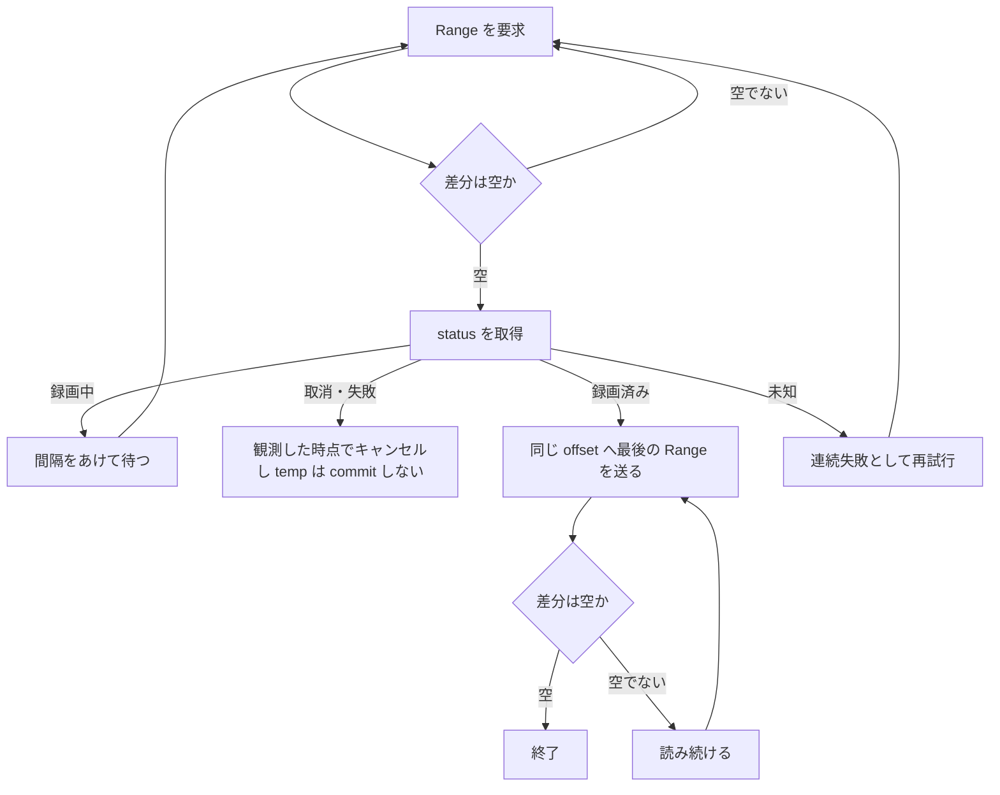

> [recording.md](../recording.md) §5「ingest パイプライン」のうち、転送方式と TS 統計の解析ジョブ（§5 の冒頭、5.1〜5.2）。索引から辿る。

## 5. ingest パイプライン

mirakc のエッジから Rokuban のアーカイブストレージへ録画データを取り込む一連の処理。**録画開始と同時に始まり、録画に追従する。**

### 5.1 転送方式: API pull 固定

ingest は mirakc の保存ディレクトリを直接読まず、全構成で API の HTTP pull に統一する。直読みでもディスク I/O は減らず、コピー自体が録画を守る耐障害設計になっているからである。

「monolith モードなら mirakc の basedir を直接読めるのでは」という案を検討し、HTTP loopback 経由を維持すると結論した。「同居時の basedir 直読み」は、loopback が実測でボトルネックになった時の最適化オプション（YAGNI）として残す。契約は、**mirakc とは常に API、自身のストレージとは常にファイルシステム**の 2 面で固定する（[storage.md](../storage.md) 参照）。

根拠

- 転送の入口: `records/{id}/stream` による HTTP pull

#### 直読みを採らない理由

直読みでも節約できるのは loopback の負荷だけで、ディスク I/O は減らない。コピーが録画を守る耐障害設計になり、コードパスも 1 本にできる。所有権も明確になる。

理由は次の 4 つである。

- basedir（リングバッファ）からメディアストレージへのコピー自体は必要で、直読みで節約できるのは loopback TCP のオーバーヘッドだけである。1 日数本・数十 GB では無視できる。追従では各ポーリングが返すのが直前の間隔ぶんの伸び（放送レートで数 MB）なので、その読み出しはページキャッシュに乗っており実ディスク読みはほぼ生じない
- 録画はシステム内で唯一のリアルタイム・リトライ不能な操作なので、ローカルディスクへ録画し、完了後にリトライ可能な転送をする、という分離は変えない。mirakc に最終保存先へ直接書かせる案は採らない。録画中の NAS/FUSE ストールが放送の欠損に直結するためである
- HTTP pull は monolith / 分散 / ハイブリッドの全構成で動く唯一の方法である
- basedir は mirakc の所有物で、Rokuban は API 越しの客に徹する

#### Range による追従

ingest は初回から Range 付きで追従し、空の差分に追い付いたときに読む record の status で録画の終了を判定する。通常の追従と切断後の再開を、同じ HTTP 契約で扱うためである。

reader は、最初の要求から Range を N=0 の位置で送り、各応答をリクエスト時点のサイズまでの有限な差分として読む。

**record の status が録画終了の権威である**（不変条件 5）。本文が空の Range に追い付いたときだけ status を読み、空ではない差分を読んだ直後には取り直さない。未知の status は終了とみなさず、連続失敗として再試行する。

録画中なら待って Range を再要求する。通常の要求は 500ms 以上あけ、追い付いた状態が続けば 1 秒まで間隔を広げる。取消・失敗は、観測した時点で ingest の status hook がジョブをキャンセルし、temp を commit しない。最後の Range は送らない。録画済みの後は、同じ offset へ最後の Range を送り、空であることを確かめる。

追い付いた Range は、204・416・206 の 0 バイトで返りうる。録画中は終端のサイズを持たない Content-Range の組み立てが first/last を検査しないため、206 になる。これらの応答は接続障害として数えず、status を再取得する。未知の status・本文の切断・stall は、共通の連続失敗回数とバックオフを使う。204 は content file がまだ 0 バイトの状態で、録画開始直後に出る。これも同じく待つ。

根拠

- 追従する reader: `RecordFollowReader` が `Range: bytes=N-` を N=0 から送る
- status の取得: `GetRecord`
- 追い付き時に返りうる応答: `204` / `416` / `206`
- 録画中の 206: `ContentRange::without_size` が first/last を検査しない

#### Range を無視した 200 の扱い

**Range を無視した完全な応答は、offset が 0 のときだけ受理する。** offset が 0 より大きいときは、原因がログに残る形で失敗させる。

RFC 9110 はサーバが Range を無視して完全な表現を返すことを許す。offset 0 では本文が求めた差分と同一なので、そのまま受理してよい。

offset > 0 では本文が先頭から始まる。そのまま追記すると先頭から offset ぶんが二重になる。先頭を捨てて読むと、ポーリングごとに offset バイトを再転送する O(n^2) が気づかないうちに起きる。どちらも取らず、原因がログに残る形で失敗させる。フィルタを併用すると mirakc は Range を無視するので、この分岐はその構成でだけ到達しうる（ingest はフィルタなしで pull する）。

根拠

- Range を無視した応答の扱い（RFC 9110 が許す完全な表現）: `200`

### 5.2 TS 統計の解析ジョブ

原本の TS 統計は、コミット後の解析ジョブがファイルから読んで採る。ingest 自身は TS のバイト列を解釈しない。

ingest は mirakc の status・長さ・SHA-256 を確認して原本をコミットする。コミット後に解析ジョブが active な原本をファイルから読み、188 バイト境界の統計を採る。

採取する統計は、PID ごとの continuity counter 不連続、transport_error_indicator、scrambling_control の 3 つである。PID 別サマリを media_assets に紐づくテーブルへ格納し、UI で表示する。解析ロジックは `internal/tsstat`、呼び出し元は `internal/tsscan` の解析ジョブに限る。

計測記録は計測したサイズを持つ。現在の原本サイズと一致する計測記録ができるまで、エンコード後に原本を消す方針の原本は削除対象にならない。解析後の全量読み出しにかかる追加コストは未検証である。

根拠

- 解析ジョブ: `ts_scan`
- 計測したサイズの記録: `media_asset_ts_scans`
- 削除対象にならない原本の方針: `until_encoded`

#### 判定の規約（誤検知を出さないために必要なもの）

実放送で誤検知を出さないために、NULL パケットや規格が許す重複などを除いて数える。この規約を守って初めて、既知の良品でドロップが 0 になる。

continuity counter の不連続を数えるだけでは、実放送で大量の誤検知が出る。実測した既知の良品（NHK 総合、5.3GB / 2841 万パケット）では、`discontinuity_indicator` が 230 回立っていた。規約は次の通り。

| 規約 | 扱い |
|---|---|
| NULL パケット（PID 0x1FFF） | CC は意味を持たないので統計対象外 |
| payload なしパケット（`adaptation_field_control` が `00` / `10`） | CC は増えない。増えていたら payload 付きパケットの欠落として数える |
| `discontinuity_indicator` | CC の不連続は正常。基準を取り直す |
| CC が直前と同じ + payload が同一 | 規格が許す重複。1 回までは正常、2 回以上は異常 |
| CC が直前と同じ + payload が相違 | 重複ではなく 15 個（16n-1）欠落。CC が一周して直前と一致している |
| PID の初回パケット | 基準がないので数えない |
| `transport_error_indicator` | error に数え、CC の追跡から外す（後述） |
| `transport_scrambling_control` | `00` 以外を異常として数える |

**16 の倍数の欠落は原理的に検知できない。** CC は 4 ビットなので、ちょうど 16n 個欠落すると CC が期待値と完全に一致し、payload を見ても正常な次のパケットと区別がつかない。これは規格上の限界で、他実装も同じである。

#### 検証方法

既知の良品に対する差分テストで誤検知がないことを確かめ、検知側は同じファイルをメモリ上で壊して確かめる。

差分テストは、別実装で drop / error / scrambled がいずれも 0 と確認済みの .m2ts を `ROKUBAN_TEST_TS_FILE` に指すと有効になる。ファイルは巨大かつ著作物なのでリポジトリには置かない。

clean なファイルでは、誤検知がないことしか確かめられない。そこで検知側は、同じファイルをストリーム処理中にメモリ上で壊して検証する（欠落・TEI・scrambling を注入する）。ディスクに改変コピーは作らない。

根拠

- 既知の良品に対する差分テスト: `internal/tsstat/integration_test.go`

#### [tspacketchk](https://github.com/kaikoma-soft/tspacketchk) との差分

判定ロジックは tspacketchk とほぼ一致している。違えているのは、TEI パケットの CC を信用せず、追跡を打ち切って次のパケットで基準を取り直す 1 点だけである。

重複を payload 比較で見分ける点と、payload なしパケットの CC を検査する点は、同実装から取り入れた。**TEI パケットの CC を信用しない。** tspacketchk は TEI 時に error を数えつつ CC を更新するため、直後のパケットで drop も 1 数える。1 つの破損が error と drop の両方に計上される。Rokuban は TEI 時に継続性の追跡を打ち切り、次のパケットで基準を取り直す。破損の実数を二重に数えないことを優先した。
