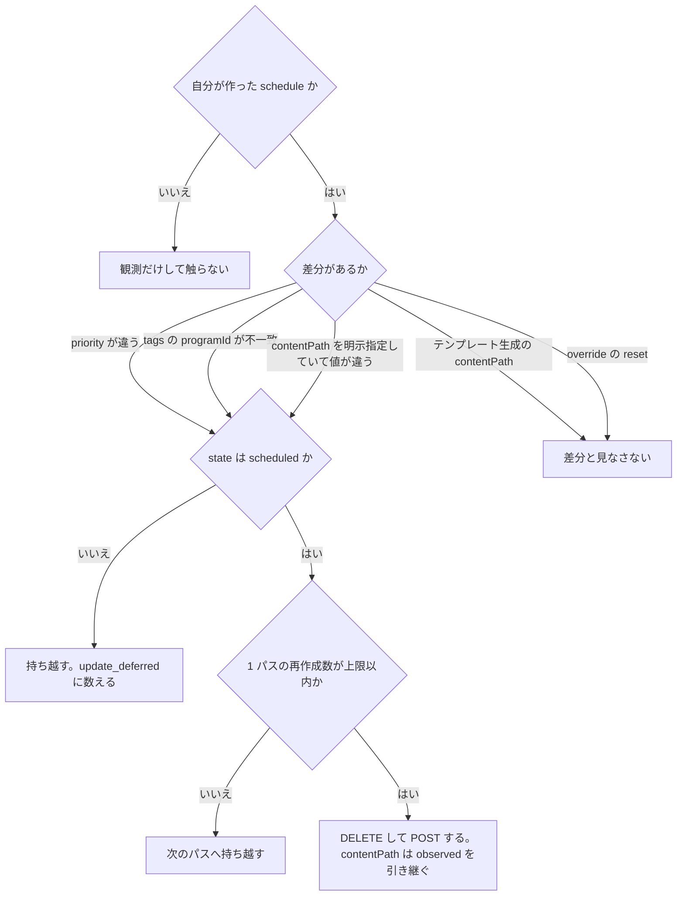

> [recording.md](../recording.md) §3「Rokuban 側のコンポーネント」の一部。索引から辿る。ファイル名テンプレートは [contentpath.md](contentpath.md)、大量削除サーキットブレーカーは [breaker.md](breaker.md)。

### 3.2 reconciler（宣言的同期）

**reconciler は、予約（desired）と mirakc の観測結果（observed）の差分を消す、レベルトリガーの宣言的同期ループである。** 差分は作成と削除の呼び出しで消す。ruler と同じ形のジョブとして動き、定期パスが状態の権威で、ruler パスの完了は投入を早めるヒントにすぎない。

`reservations`（desired）と `schedule_sync`（observed: `GET /api/recording/schedules` の観測結果）の差分を POST/DELETE で消す。何度落ちても再実行で収束し、時刻精度もプロセス生存性も要求されない。

#### 観測の確定

観測結果の保存は 1 つのトランザクションで確定し、DB に整合した observed が残ったときだけ観測の鮮度を進める。失敗したらパス全体を失敗させ、次のパスに収束を委ねる。

`schedule_sync` の全量 upsert、今回返らなかった stale 行の削除、サイト単位の `schedule_sync_snapshots` マーカー更新は、同一トランザクションで確定する。マーカーは「GET が返った」だけでは進まず、DB に整合した observed snapshot が残ったときだけ進む。これにより reconciler が ScaledJob の `--once` で動く構成でも、常駐プロセスの DB-backed `/metrics` から観測鮮度を見られる。

この同一トランザクション化により、`observeSchedules`（stale 削除・マーカー更新を含む）の失敗時の挙動が変わった。以前はログだけを残してパスを続行していたが、今はトランザクション全体が失敗して `RunPass` がエラーを返す。次パスがレベルトリガーで収束させる。不完全な observed をマーカー更新まで進めて「新鮮」と誤認させるより、パス全体を失敗させて次パスに委ねる方が安全という判断である。

#### schedule の作成ルール

mirakc に作る schedule には programId を埋め込んだタグを付け、録画先のパスはテンプレートから初回作成時にだけ生成する。終了済みの番組には作成しない。

tags 対応付けでは、mirakc schedule の `tags` に programId を埋め込む（例: `program:1234`）。手動で mirakc に入れられた schedule との判別もタグで可能である。programId は EPG にある間ずっと安定している。reservations 行は ruler の判断で削除・再作成されることがあるため、tag には programId を使い、reservations 側の列は使わない（不変条件 9「導出器が作るキーを宛先にしない」）。

contentPath 生成では、`recording.basedir` 相対パスを必須とする。ファイル名テンプレート（[contentpath.md](contentpath.md)）の展開もここで行う。生成はテンプレートから初回作成時のみ行う。以後の再作成（後述の差分反映）は、明示 override（`overrides.contentPath`）があればその値、無ければ observed（mirakc に登録済みの schedule）の contentPath を引き継ぐ。これにより実質固定される（`reservations.base` に生成値を書き戻すコードは無い）。

終了済み番組は作らない。番組の終了時刻（`program_snapshots.start_at + duration_ms`）を過ぎた予約には `POST` しない。放置すると mirakc が数秒で `need-rescheduling` として failed にし、`recordings` に content_length=0 の failed 行を量産する。判定は「番組終了後の GC」（[ruler.md](ruler.md)）とは別の判定である。`never_scheduled_events` への欠測記録（`recordNeverScheduled`）と同じ式・同じ材料を使う。ずらすと同じ予約が毎パス作成対象のまま残って POST を送り続ける。

#### 起動契機

reconciler は ruler と同じ形の River ジョブで、シングルトンにはしない。起動契機は定期とヒントの 2 つで、定期パスが状態の権威、ヒントは投入を早めるだけである。排他はサイト単位の一意制約で保証し、advisory lock は使わない。

ジョブの実体は `internal/worker` の `ReconcilePassWorker` である。周期的・冪等・パスを跨ぐ状態を持たないという性質が ruler / epg_sync と同じである（サーキットブレーカーの閾値判定もパスごとに読み直す）。そのため排他は `UniqueOpts`（サイト単位）で保証し、advisory lock は使わない（[データ層](../data.md) §2）。ヒントを落としても定期パスが拾う。

| 契機 | 種別 | 投入するもの |
|---|---|---|
| 定期（既定 30 秒） | 権威 | River `PeriodicJobs` か k8s CronJob（[データ層](../data.md) §2） |
| ruler パスの完了 | ヒント | ruler_pass ワーカー |

ruler パスの完了は、パス完了時に ruler_pass ワーカーが投入する。base が変われば mirakc に反映すべき差分が増えるためである。ヒントは `UniqueOpts{ByArgs, ByState}` で合流する。

api は reconcile を直接投入しない。ルール、意図、上書きの書き込みでは、store の commit 後に `ruler_pass` を投入し、失敗はログに残す。ruler パスの完了が reconcile へのヒントになるので、予約の変更が mirakc へ反映されるまでの待ちは ruler パス 1 回ぶんの秒オーダーで済み、定期の最大 30 秒を待たない。

意図・上書きのヒントを失っても、定期の ruler パスが永続状態から予約を再計算する。投入に成功すれば、次の定期パスを待たずに ruler が起動する。

#### 予約オプションの差分反映

**reconciler は予約の存在だけでなく、有効なオプションと mirakc の観測結果の差分も反映する。** mirakc に更新 API が無いので反映は再作成になり、差分の対象は最小にする。優先度とタグの不一致は反映し、テンプレート生成のファイル名は初回の値に固定して反映しない。

effective options と `schedule_sync.options`（mirakc の観測結果）の差分を消す。ruler が base を毎パス再計算する以上、ルール編集で既存予約の effective が変わる。そのためこれは編集 UI の前提ではない。ruler の前提である。

mirakc に schedule の更新 API は無い（`GET` / `POST` / `GET{id}` / `DELETE{id}` の 4 つだけ）。反映は DELETE → POST の再作成になり、その間 schedule が存在しない窓ができる。

##### 差分の対象

差分の対象は、優先度と、不一致のタグと、明示指定された contentPath だけである。差分にするのは自分が作った schedule に限る。

| フィールド | 差分対象 | 理由 |
|---|---|---|
| `priority` | する | チューナー調停の優先度。編集の実質的な唯一の変更対象 |
| `contentPath` | `overrides.contentPath` が明示指定されているときだけ | 下記「contentPath の固定」 |
| `preFilters` / `postFilters` | 現状しない | 常に空で運用しており差分が生じない |
| `logFilter` | しない | 未使用 |
| `tags` | する（不一致のときだけ） | ingest が record と予約を突き合わせる経路 |

`tags` の不一致も再作成の契機にする。schedule に古い・別の値の tag が残っていると録画が別の予約に紐付くので、`priority` が一致していても tag が食い違えば再作成する。不一致判定は「tags の `program:{programId}` が desired な programId と一致するか」である。自分が作った schedule（`mirakc.IsOurs` が true）で、かつ `mirakc.FindProgramTag` の値が desired な `programId` と一致しないものすべてが再作成の対象になる。programId は EPG にある間ずっと安定なので、正しくタグ付けされた schedule が「同じ予約」の生存中に不一致を起こすことはない。

差分の対象にするのは自分が作った schedule だけである。tag のない schedule（mirakc を直接叩いた・別のツールが作った）は観測はするが触らない。外部が作った schedule と取り合いになるのを避けるためで、既存の DELETE 側と同じ判定を使う（`mirakc.IsOurs` が false なら対象外。rokuban の tag があれば true）。

##### contentPath の固定

テンプレートから生成した contentPath は、初回の値に固定して以後変更しない。追従させると、EPG 更新のたびに schedule が消えて作り直される。ユーザーが明示指定した値だけは、差分として反映する。

reconciler は番組名からパスを生成するので、EPG の番組名が変われば生成結果も変わる。これを差分と見なすと、EPG 更新のたびに schedule が消えて作り直される churn になる。

`overrides.contentPath` で明示指定した値は、差分反映の対象になる。ファイル名を変えたい場合は、ユーザーが overrides で明示的に指定する。差分書き込みという設計は desired が安定していることを前提として要求する（同率 priority のタイを全順序で解消したのと同じクラスの問題。§3.1）。

固定の実体は `reservations.base` への書き戻しではない。`base` / `reservations` の列に contentPath を焼く書き手は存在しない。固定を実現しているのは、再作成時に observed の contentPath を引き継ぐことである。実装は `internal/reconciler/reconciler.go` の `recreateSchedule` で、下記「再作成時に引き継ぐ contentPath」に書く。

この固定は「同一 schedule の再作成の間」だけ有効な機構上の性質である。schedule が mirakc 側で外部に削除されて observed が無くなった場合（EPG が一度消えて再実体化した等）は、次パスがテンプレートから新規生成する通常の作成として扱われ、固定は及ばない。

差分対象にするのは `opts.ContentPath` が非 nil かつ非空のときだけである。desired は `SanitizeContentPath(*opts.ContentPath)`、比較相手は observed の生値にする（POST する値と比較する値を同じにして 1 パスで収束させる）。この区別に列も伝播も要らない。`reservations.base` に contentPath を載せる書き手が存在しないからである（ruler の `computeBase` が意図的に除外している）。そのため effective の非 nil はユーザーの明示指定と同値になる。ruler が base に contentPath を載せた瞬間にこの同値が崩れ、テンプレート生成値が差分に混ざって churn が戻る（これが今でも先に浮かぶ壊し方）。

###### 再作成時に引き継ぐ contentPath

再作成の POST は、テンプレートから再生成せず、observed の contentPath を引き継ぐ。再生成すると、priority を変えただけでファイル名が変わってしまうからである。

「差分と見なさない」だけでは、priority 変更で再作成するときに何を入れるかが決まらない。再生成すると EPG の番組名が変わっていれば別のパスになる。引き継げば「初回生成値に固定し以後変更しない」が文字どおり保たれる。引き継ぐ値は自分が書いたものの往復だが、mirakc 側を直接触られていた場合の保険として `SanitizeContentPath` は通す。明示 override があるときだけそれが observed への引き継ぎに勝ち、その場合もテンプレート再生成には落ちない（決定は `schedulesync.ExplicitContentPath` の 1 箇所に集約してある）。

##### 反映しない変更

override の削除（reset）と録画開始後の変更は、既存の schedule に反映しない。reset は戻り先がテンプレート生成値という安定でない値で、反映すると作り直しが戻るからである。

set は常に反映・reset は常に非反映で、priority を同時に触ったかどうかには左右されない。再作成は `state == "scheduled"` の allowlist の下でだけ起きる。そのため録画開始後の変更は反映されない（未反映は `rokuban_reconcile_pending_diff{action="update_deferred"}`）。ファイルが 1 バイトも書かれていない schedule だけを張り替えるので、宛先変更で原本が取り残される経路は無い。

##### 比較が依存する前提

contentPath の比較は、mirakc が登録された値を正規化せずそのまま返すことに依存する。この前提は、mirakc の特定の pin に対してだけ判定している。

具体的には `options.contentPath` をそのまま返す前提で、`mirakc 4.0.0-dev.0` 相当の pin に対してだけ判定している。正規化して返す実装だと、毎パス再作成になる。観測するには、`rokuban_reconcile_pending_diff{action="update"}` がゼロに戻らないことと、`reason=content_path` の再作成ログの反復を見る。

根拠

- `contentPath` の往復: `internal/mirakc/conformance` の `TestConformance/ContentPathRoundTrip`

#### 再作成のガード

**再作成は、予定済みの状態の schedule にだけ行う。** ガードは状態で判定し、時刻の閾値は使わない。許可する状態を列挙する allowlist にし、禁止する状態を列挙する blocklist は採らない。blocklist だと、mirakc が増やした未知の状態を触ってよいものとして扱うからである。

具体的には、`state == "scheduled"` のときだけ再作成する。blocklist（「`tracking` / `recording` の予約は触らない」）は採らない。理由は 2 つある。`rescheduling`（延長追従中）も `finished` / `failed` も、削除して作り直してよい状態ではない。また、mirakc が将来状態を増やしたとき、blocklist は未知の状態を「触ってよい」ものとして扱ってしまう。allowlist は未知の状態を触らない。

state の文字列は `internal/mirakc` に定数として置く。持ち越した件数はログに出す。気づかないうちに落とすと「収束しない」の原因が見えなくなる。

#### 削除のガード

desired に無い自分の schedule は、許可した状態のときだけ DELETE する。許可するのは予定済みと、終端の終了済み・失敗である。追跡中・録画中・延長追従中・未知の状態は、次のパスへ持ち越す。削除用の許可は、再作成用とは別の集合にする。

状態の名前では、`scheduled` と終端の `finished` / `failed` を許可する。`tracking` / `recording` / `rescheduling` と未知 state は次のパスへ持ち越す。

削除用 allowlist は再作成用と別にする。終端 schedule は片付けとして DELETE できるが、オプション差分を反映する再作成には使えない。`IsDeleteAllowed` と `IsRecreateAllowed` は別々の集合を定義する。

持ち越した件数は `rokuban_reconcile_pending_diff{action="delete_deferred"}` とログに出す。state で見送った schedule は `delete` として数えず、全損ブレーカーの削除候補にも含めない。開始時刻を過ぎても `scheduled` のままの schedule（開始遅延）は allowlist に入るので、desired から外れれば DELETE する（録画はまだ動いていない）。

根拠

- 削除可能な state の集合: `TestIsDeleteAllowed`
- recording / unknown state の schedule を持ち越すこと: `TestReconciler_DefersDeletingSchedulesInRecordingOrUnknownStates`

#### 1 パスの再作成数に上限を設ける

**1 パスの再作成数には上限を設け、超えた分は次のパス以降に持ち越して数パスで収束させる。** 大量削除ブレーカーとは別の機構で、再作成の削除はブレーカーの件数に混ぜない。

ルールの priority を編集すると、マッチしている全予約が再作成対象になる。N=200 なら 1 パスで 400 回の mirakc 呼び出しになる（予約単位の編集だけを想定した見積もりはこれを数え落とす）。`MaxRecreatesPerPass`（既定 20）でレート制限し、レベルトリガーで数パスに分けて収束させる。持ち越した件数はログに出す（気づかないうちに切り捨てると「全部反映した」ように見える）。

これは `MaxDeletesPerPass`（大量削除サーキットブレーカー。[breaker.md](breaker.md)）とは別の機構である。ブレーカーは「導出された削除」を止めるもので、超えたら何も削除しない。こちらは単なるレート制限で、上限までは実行して残りを次パスに送る。再作成の DELETE をブレーカーの数に混ぜない。混ぜるとルールの priority 一括変更でブレーカーが誤作動する（再作成は desired の消滅ではない）。

#### DELETE 成功 → POST 失敗

削除に成功して作成に失敗すると、schedule が消えたまま次のパスまで残り、その間に開始時刻を越えると録画を取りこぼす。再作成の対象は開始まで間がある状態だけなので、窓は小さい。観測は専用のカウンタとエラーログで行う。

観測には専用のカウンタメトリクスと `slog.Error` を使う。`quality_events` には書けない。それは `recordings` テーブルの列で、まだ開始していない番組には recordings 行が存在しないことがある。再作成の対象は `scheduled`（開始まで間がある）だけである。

upstream への要望として、`priority` の部分更新 API があれば、再作成の窓ごと消える。`RecordingOptions` 全体を差し替える汎用 PUT より通りやすく、mirakc 側が触る内部状態（スケジューラのキュー）も小さい。priority は開始前の schedule に対して mirakc のスケジューラが素直に扱える性質のフィールドでもある（予約オプション一覧表のとおり、録画開始後は効かない可能性が高い・未測定）。
