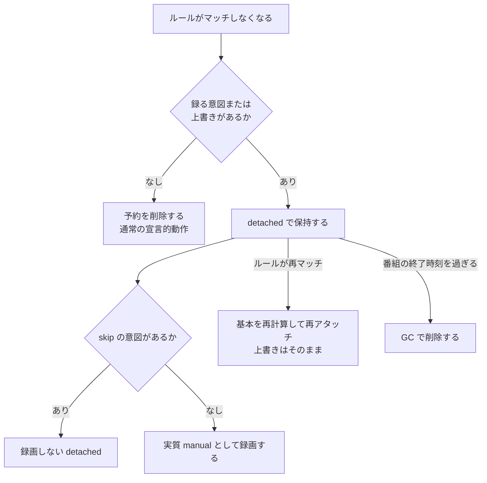

> [recording.md](../recording.md) §4「予約モデル」の一部。索引から辿る。

## 4. 予約モデル: base / overrides 分離

予約は、ruler が計算する基本の部分と、ユーザーが上書きしたフィールドだけの部分に分けて持つ。ユーザーの意図を、ruler が再生成する行には書かない。

### 4.2 base / overrides の分離

予約の内容は、ルールが計算する基本の部分と、ユーザーが上書きしたフィールドだけの部分に分ける。基本は ruler だけが、上書きは api だけが書き、実際に使うのは両者を合わせた値である。そのため、EPG 更新で再計算してもユーザーの意図は消えない。

**なくしたい形は「ユーザーの意図を、コントローラが再生成する行に書く」ことである。** この形からは 2 つの症状が出る（EPGStation v2.10.0 の運用で実際に観測した）。①除外がルール予約単位なので、複数ルールがマッチしていると別ルールの予約が生きて録画される。②除外フラグが導出状態（予約行）にあるので、EPG 更新でルーラーが予約を再生成するとフラグごと消える。以下の設計は両方を構造的になくす。

#### 基本と上書きの分担

予約の行は、基本・上書き・実効値の 3 つで考える。基本は ruler が書き、上書きは api が書き、実効値は両者を合わせたものである。reconciler が mirakc に同期し、ingest と encode が参照するのは、常に実効値である。

基本は、ruler が「ルール x EPG」から計算するフィールド群（priority・エンコードプロファイル・保持ポリシー・ファイル名など）である。上書きは、ユーザーが上書きしたフィールドだけを持つ疎な jsonb である。UI は、上書き中のフィールドにマーカーを表示し、フィールド単位と予約単位の「ルールに戻す」（上書きを消すだけ）を出す。

<details><summary>根拠</summary>

- 基本の置き場: `reservations.base`（書き手は ruler だけ）
- 上書きの置き場: `program_overrides` 表（書き手は api のユーザー操作だけ）
- 実効値: effective = base + overrides

</details>

#### 意図と導出行の分離

ユーザーの意図は、ruler が導出する行とは別の表に置く。1 行が「ユーザー意図の永続記録」と「ruler の導出結果」を兼ねると、昇格・取消の分岐・削除の例外という 3 つの複雑さが派生するからである。表を分ければ、この 3 つは要らなくなる。

ruler が基本だけを書く規律でも、上書きは守れる。それでも表を分けるのは、次の 3 つが要らなくなるからである。

| 1 表だったときに必要だったもの | 意図を分けた後 |
|---|---|
| 昇格（手動予約の行にルールがマッチしたときの実効値の保存と skip 偽の焼き付け） | 不要。意図は据え置きで、ルールの参照と基本が変わるだけ |
| 取消の分岐（再生成者がいるか） | 不要。無条件に skip の意図を書いて導出行を落とす |
| 削除の例外（上書きがあれば消さず detached） | 不要。意図は別表なので、導出行を消しても失われない |

意図と上書きの寿命は、放送の寿命に揃える（番組終了後に GC）。

<details><summary>根拠</summary>

- 昇格の焼き付け: `skip:false`
- 取消の書き込み: `intent{skip}`
- 参照が変わる列: `rule_id`
- 削除の例外の状態: detached
- 導出行の表: `reservations`

</details>

#### skip の優先順位

skip は上書きのキーにせず、意図の表の action 列で表す。列にするので、基本の skip に対する優先順位が明示的に決まる。重複排除が基本に skip を立てても、ユーザーの「録る」意図が勝つ。jsonb のマージに細工を仕込まなくてよい。

実効値の skip は、`effective.skip = (action = 'skip') OR (意図がなく base.skip)` で決まる。意図があれば action が skip を決め切る（「録る」なら false で上書きする）。

**この式は両方向をテストする。** action が skip のときだけ skip を真にする実装は、式の片側しか満たしていない。その実装では「録る」の意図が基本の skip を打ち消さず、「重複と判定された番組をユーザーが録れと指定しても録られない」として現れる。

<details><summary>根拠</summary>

- 意図の列: `program_intents.action`（`record` / `skip`）
- 式の片側だけの実装: `action = 'skip'` のときだけ `skip = true` を書く。`action = 'record'` が base 側の skip を打ち消さない

</details>

#### ruler の再計算と競合

ruler は EPG 更新のたびに基本を丸ごと再計算してよい。上書きは別表にあるので構造的に触れず、3-way merge は要らない。ルール側の変更は、上書きしていないフィールドにだけ自動で伝播する。これはユーザーの直感と一致する。

ruler は予約の表を、api は意図と上書きの表を書くので、書き込みは競合しない。ruler のパスはサイト単位で排他である（[データ層](../data.md) §2）。api が予約の表を書くのは、ルール削除 API の同期削除 1 本だけである。そこも WHERE の NOT EXISTS を適用の瞬間に再評価するので、並行して書き込まれる手動予約を消してしまう窓は生じない。

ruler はルール一覧と desired をトランザクションの外で読み、中で書く。そのため、ルール削除と同時に走ったパスが外部キー制約で失敗し、再試行になる形は残る（§4.4）。

<details><summary>根拠</summary>

- ruler が書く表: `reservations`
- api が書く表: `program_intents` / `program_overrides`
- 失敗する制約: `rule_id` の FK 制約

</details>

#### 予約オプション一覧

予約のオプションは、フィールドごとに、基本はルール、上書きはユーザー、skip の基本は ruler の重複排除が書く。書き手と効く時期は、次の表にまとめる。

`reservation.Options` は、基本・上書き・実効値に共通の形である。表の列は、フィールド・書き手・効く時期・定義の節である。

| フィールド | 書き手 | いつ効くか | 定義の節 |
|---|---|---|---|
| `skip` | base のみ（ruler の重複排除） | 同期対象の判定 | §4.2 / [ruler.md](ruler.md) §3.1「重複排除」 |
| `priority` | base: 勝者ルール / overrides: ユーザー | schedule の再作成で反映 | [reconciler.md](reconciler.md) §3.2「予約オプションの差分反映」 |
| `contentPath` | overrides のみ | scheduled の間だけ反映 | [reconciler.md](reconciler.md) §3.2「予約オプションの差分反映」 |
| `filenameTemplate` | base: ルールの `filename_template` / overrides: ユーザー | schedule 初回作成時だけ | [contentpath.md](contentpath.md)（記法・使えるフィールド・検証） |
| `encodeProfiles` | base: ルール / overrides: ユーザー | 凍結される瞬間まで（§4.5） | §4.5 / [ストレージ](../storage.md) §6 |
| `keepOriginal` | 同上 | 同上 | 同上 |

skip の基本は、ruler の重複排除だけが立てる。ユーザーの「録るな」は、上書きの対象から外し、`program_intents.action` が担う。実効値の skip が、mirakc への同期対象の判定（`listDesired`）を決める。

priority は、mirakc の schedule の再作成（DELETE + POST）で反映される。**録画開始後の recorder には効かない可能性が高い。**

contentPath には、ルール側に対応するフィールドが無い。明示指定した値は既存の schedule にも反映される。次の reconcile が DELETE + POST で張り替えるが、`state == "scheduled"` の間だけで、録画開始後は反映されない。テンプレートから生成した値（`filenameTemplate` や既定の形式）は、初回の生成値に固定され、EPG の番組名が変わっても動かない。上書きの削除（reset）は既存の schedule には反映されない。空文字は API が 400 で拒否する（消すのは `reset`）。

filenameTemplate は、schedule の初回作成時の contentPath の生成に使う。`contentPath` と両方が指定されたら `contentPath` が勝つ。既存の schedule には反映されない。`contentPath` と違い、展開結果が EPG の番組名で動くためである。

encodeProfiles と keepOriginal は、ingest が原本をコミットするトランザクションの中で、`recording_encode_policy` 行として焼かれる（凍結される）瞬間まで効く（§4.5）。

#### overrides API の形

上書きは、値を書くか、消すフィールド名を reset の配列に挙げて指定する。null では消さない。null では「消す」と「変更しない」を区別できないためである。同じフィールドを値と消去の両方に書いたり、未知のフィールド名を消去に書いたりしたら 400 にする。

- `PATCH /api/sites/{site}/programs/{programId}/overrides` は、値を書いたフィールドの上書きを設定する。`reset` 配列に名前を挙げたフィールドは、上書きを削除する。どちらにも現れないフィールドは変更しない
- `DELETE /api/sites/{site}/programs/{programId}/overrides` は、番組単位の「ルールに戻す」である（`action` は触らない）

`null` で消す形は採らない。Go の `*T`（oapi-codegen が optional に生成する形）は「キーが無い」と `null` を区別できない。null 方式では「消す」が「変更しない」に変わり、気づかないうちに正しく動かなくなる。明示的な `reset` 配列なら曖昧さがない。同じフィールドを値と `reset` の両方に書いたら 400 にする（意図が不明なので推測しない）。`reset` に未知のフィールド名があったら 400 にする（タイポを見過ごさない）。

skip は PATCH では扱わない（`action` 列が担う）。取消は `PUT /api/sites/{site}/programs/{programId}/intent {action: skip}` で行う（§4.4「取消」参照）。

マージは、Go 側で `reservation.Options` の型付きフィールドとして行う。SQL で `overrides || $1::jsonb` や `overrides - $1::text[]` とやらないのは、下記「jsonb を許す条件」のためである。同じ番組への PATCH は `program_snapshots` の行を先にロックし、ロック後に既存上書きを読み直して直列化する。読み取りより後でロックすると、別フィールドへの同時 PATCH が互いの更新を上書きしうる。宛先は `(site, programId)` なので、`reservations` 行の存在に依存しない。

<details><summary>根拠</summary>

- 同時 PATCH の直列化: `TestPatchOverridesLocksSnapshotBeforeReadingExistingOverrides`

</details>

#### overrides は `program_intents` とは別の表に置く

意図の表は「録る・録らない」だけを持ち、パラメータの上書きは別の表に分ける。この 2 つは独立した主張で、同じ行に置くと、パラメータだけ上書きして録る録らないは意見なし、という状態を表せないからである。そのうえ「ルールに戻す」が手動予約を消す誤答が起きる。

```
program_intents                  program_overrides
  site, program_id      (PK)       site, program_id      (PK)
  action  NOT NULL                 overrides  jsonb NOT NULL
    ('record' | 'skip')
```

番組の事実のスナップショット（`program_start_at` 等）は、どちらの表にも無い。両者とも `(site, program_id)` の FK（`ON DELETE CASCADE`）で `program_snapshots` を参照する（[スキーマ](../schema.md) §3.7）。

##### 1 表にしたときの誤答

**1 つの行に 2 つの主張を同居させると、パラメータだけの上書きを表現できない。** 行が空になったとき、もともと何を主張していたのかも行から読めず、「ルールに戻す」が手動予約を消す誤答が起きる。

ユーザーが番組について主張しうることは 2 つあり、独立している。①録る・録らない ②パラメータの上書き。action が NOT NULL なので、「パラメータだけ上書きした。録る録らないについては意見なし」を表せない。priority を 1 つ変えるだけで、`action='record'`（= 録れ）を主張させられる。

その結果、行が空になったとき「この行はもともと何を主張していたのか」が読めず、`reservations.rule_id` に問い合わせる必要が出る。`rule_id` は別表の値で、しかも直近の ruler パスのスナップショットである。それは次の場合に誤答する。

> 手動予約（`intent{record, {priority:7}}`）に後からルールがマッチして `rule_id` が埋まった状態で「ルールに戻す」を押す → `rule_id IS NOT NULL` なので意図の行が消える → 手動予約だったものが純粋なルール由来になり、その後ルールを編集して外れるとユーザーの手動予約が消える。

##### 表を分けた効果

表を分けると、「ルールに戻す」は上書きの行を消すだけになり、意図に触らないので手動予約が巻き込まれない。意味を持たない行は、空 = 行が無いので表現不可能で、掃除の規則が要らない。

| | 1 表だったとき | 分離後 |
|---|---|---|
| 「ルールに戻す」 | 掃除規則（`rule_id` で分岐） | 上書きの行を DELETE するだけ。意図に触らないので手動予約が巻き込まれる経路が存在しない |
| 意味を持たない行 | CHECK で禁止する必要がある | 表現不可能（空 = 行が無い） |
| 何も指定しない `PATCH {}` | 掃除規則が発火して意図を消しうる | 消すものが無いので何も起きない |
| dedup skip（重複排除） | priority を触っただけで無効化される | 意図の行が無いので `base.skip` が効く。手動予約（`intent{record}` あり）は正しく勝つ |

##### STI を採らない理由

「型階層ではないものに STI を使わない」という判断である。区別したいのは①②の presence の直積（4 通りのうち 1 つが禁止）であって、判別子ひとつで決まるサブタイプではない。判別子を無理に立てると、Single Table Inheritance の定番の欠点がそのまま出る。サブタイプごとの NOT NULL が書けず、整合性がスキーマから CHECK とアプリコードへ移る。

#### jsonb を許す条件

上書きの内容に jsonb を許すのは、内容でクエリも制約もしない不透明なペイロードだからである。内容でクエリするなら型付き列にし、Go に渡すだけなら jsonb にする。不透明なものは不透明に扱うので、内容を検査する制約は置かない。

jsonb にした `overrides` は、`program_overrides` 自身のロジックでは一切使われず、予約のパラメータを上書きするためだけに存在する。したがって `CHECK (jsonb_strip_nulls(overrides) <> '{}')` のような内容を検査する制約は置かない。技術的には可能である（`jsonb_strip_nulls` は IMMUTABLE なので CHECK に書けて `{"priority":null}` も弾ける）。しかし「クエリはしないが制約はする」という中途半端な状態が一番悪い。**不透明なペイロードなら不透明に扱う。** 同じ理由で、マージは SQL で行わず、Go 側で型付きに行う。

この規則は、他のテーブルの表現も説明する。

| 場所 | 表現 | 内容でクエリするか |
|---|---|---|
| `rules` | 型付き列 + 子テーブル | する（ユーザーが編集し UI が一覧・フィルタ） |
| `reservations.base` | jsonb | しない |
| `program_overrides.overrides` | jsonb | しない |
| `recording_encode_policy.keep_original` / `encode_profiles`（`recordings` を指す衛星表） | 型付き列 | する（プロファイル別の録画一覧） |
| `schedule_sync.options` | jsonb | しない（mirakc 固有。不変条件 7） |

「オプションの組」を独立したテーブルに正規化することは採らない。`base` と `overrides` を判別子付きの 1 表に寄せることは、上記の STI をやり直すことに等しい（base は完全、overrides は疎で、書き手が ruler と api で、寿命も違う）。繰り返し現れる実体は Go の型 `reservation.Options` で、マージ点も `Effective()` の 1 箇所に既に正規化されている。

#### ruler から見た load-bearing な行

ruler が予約を存在させる番組は、ルールにマッチした番組から skip の意図を除いたものに、録る意図のある番組と、上書きの行がある番組を加えたものである。上書きの行の存在も予約を存在させる。

```
desired = (ルールにマッチした番組 − intent.action='skip')
        ∪ {intent.action='record' の番組}
        ∪ {program_overrides に行がある番組}
```

上書きの行が予約を存在させるのは、§4.3「overrides あり → 削除せず detached で保持。意図は番組単位のユーザーの投資」の要求そのものである。action が答えているのは「録画するか」、行の存在が答えているのは「この番組にユーザーの投資があるか」で、別の問いなので両立する。

### 4.3 ライフサイクル: detached・再アタッチ・GC

ルールがマッチしなくなった予約は、録る意図も上書きも無ければ削除する。あれば、削除せずルールから切り離した状態（detached）で保持し、手動予約と同じように録画する（録画しない意図があれば録画しない）。切り離した行を消すのは番組の終了後だけで、除外の意図は予約が消えても別表に残る。



録る意図も上書きも無い予約には、skip の意図だけがある場合と、意図も上書きも一切ない場合がある。どちらも削除する。

<details><summary>根拠</summary>

- 保持の判定: `program_investments` view に行がある
- 切り離した状態の名前: `detached`

</details>

#### 切り離した予約の同期

切り離した予約も、mirakc への同期対象から外してはならない。「実質 manual として録画する」とは、reconciler が schedule を作るという意味だからである。同期の可否は、実効値の skip が決める。state は決めない。

同期対象から除外してよいのは、その放送イベントに欠測行がある予約だけである。番組が終了しているので、schedule を作る意味がない。表示の orphaned は、この欠測に加えて本物の録画行が無いときに導出する。

<details><summary>根拠</summary>

- 同期対象の絞り込み: `effective.skip`（`listDesired`）
- 欠測行: `never_scheduled_events`
- orphaned の導出元: `never_scheduled_events` と `recordings`

</details>

#### state は導出値

state は列に保存せず、API が読むたびに導出する。導出値は同期対象のフィルタには使わず、UI 表示のための派生値として扱う。列に焼くと、実装が前パスからの遷移を書くことになり、片側の分岐しか持たなくなる。

state は 2 種類の別の情報を答えている（[スキーマ](../schema.md) §3「active / detached / orphaned は API が都度導出する」）。

| 値 | 正体 |
|---|---|
| orphaned | 番組終了後に schedule が観測されなかった欠測行があり、本物の録画試行が無い |
| active / detached | ルールの参照と基本から導出できる値 |

導出値を「同期対象か」のフィルタとして使ってはならない。active と detached は、UI 表示（マーカー）のための派生値として扱う。列に焼いた実装が片側の分岐しか持たない例として、ルールを削除した経路がある。この経路は FK が先にルールの参照を落とすので、detached にならない（[invariants.md](../invariants.md) §9「式」）。

<details><summary>根拠</summary>

- 値の名前: `orphaned` / `active` / `detached`
- orphaned の導出元: `never_scheduled_events` と `recordings`
- active / detached の導出式: `(rule_id, base)` から導出。`detached ⟺ rule_id IS NULL AND base IS NOT NULL`
- 先に落ちる参照: `rule_id`

</details>

#### 除外の意図の寿命

skip の意図そのものは削除しない。予約行は desired に入らないので消えるが、除外は意図の表に残る。そのため、EPG の一時不整合で予約行が消え、回復後に ruler が新規生成しても、除外は生き残る。

この行の FK は番組スナップショットを指すので、予約行の削除では落ちない。症状②（除外が外れる。§4.2 冒頭）は、EPG フリッカー経由では再発しない。

ルールが再マッチしたら、基本を再計算して再アタッチする（上書きはそのまま）。EPG がちらついても除外は生き残る。切り離した行の削除は、番組の終了時刻を過ぎた後だけにする。ユーザー意図の寿命を放送の寿命に揃えるためである。programId の一意性は切り離した行にも適用されるので、再マッチ時の重複予約は構造的に生まれない。

除外が外れるのは、ユーザーが自分で意図を消すか、録る意図に書き換えたとき（取消の打ち消し・スキップの解除・予約）だけになる。

<details><summary>根拠</summary>

- 除外の置き場: `program_intents`（FK は `program_snapshots`）
- 一意性: programId 一意性

</details>

#### ルール削除の扱い

個別に編集した予約（録る意図か上書きがある予約）は、ルールを消しても手動予約と同等に残り、編集のない予約は削除する。削除の確認ダイアログには件数を出さず、削除後のトーストに内訳を出す。件数は、消すか消さないかの判断を変えないからである。

ルール自体の削除も、同じ規則で扱う。録る意図も上書きも無い予約は削除し、あるものは残す。この規則は `program_investments` view の定義そのものである。ユーザーが個別に編集した予約が、ルールを消しても手動予約と同等に生き残るのは、意図が番組単位のユーザーの投資であり、ルール削除とは別の意図だからである。skip の意図だけの予約は、投資に数えず削除する。録画ドメインでは録り逃しが不可逆で、余計な録画は消せば済むので、迷ったら録る方を選ぶ。

ルール削除の UX は可視化で解決する。削除 API は内訳（予約 N 件を削除、M 件は編集済みのため detached 化）を返し、UI はそれを削除後のトーストに出す。両方 0 件なら数字を出さない。何も起きていない削除に数字を付けても、読み手の判断は変わらないからである。

確認ダイアログに件数は出さない。件数は「消すか消さないか」の判断を変えないからである。内訳は削除の実行結果だが、原理的には押す前にも数えられる。ただし、数えるための GET を API 定義に足す必要があり、判断を変えない件数のためには足さない。

事前に伝えるのは、押した後で取り返せない結果の方である。重複排除を有効にしたルールでは、「履歴も比較のスコープから外れる」を警告する（[ruler](ruler.md) §3.1「ルールの削除は履歴のスコープを消す」）。detached の行は、予約一覧にマーカー付きで現れ、個別に削除できる（§4.4 の取消分岐）。残る行は定義上「ユーザーが触ったものだけ」なので、件数は常に少なく、1 件ずつ説明可能である。

<details><summary>根拠</summary>

- 投資の定義: `program_investments` view
- トーストの実装: `web/src/pages/rules.tsx` の `deleteRuleResultMessage`
- 削除前の件数: `DeleteRule` が削除の前に `CountReservationsByRuleWithIntent` で同じ述語を数える
- 警告: `deleteRuleWarning`
- API 定義: `openapi.yaml`

</details>

### 4.4 manual 予約との統一

手動予約は、基本の部分を持たず、録る意図だけがある縮退形である。ルール由来の予約と同じコードパスで扱う。予約の由来は列に保存せず、意図とルールの有無から API が都度導出する。1 列にまとめると、手動予約した番組の録画履歴が恒久的にルール由来と記録される。

複数ルールがマッチしたときは、最高 priority のルールが基本を供給する。勝者が入れ替われば基本が変わるだけで、意図は生存する。

state は「今、誰が基本を供給しているか」の答えにすぎない。基本が無ければ誰もいない。active はルールが毎パス再計算し、detached はかつてのルール（凍結された基本）である。§4.3 のとおり、これはルールの参照と基本からの導出値であり、同期の可否を決めるフィルタに使ってはならない（列としては撤去済みで、API が都度計算する）。

<details><summary>根拠</summary>

- 手動予約の形: base を持たず `program_intents` に `action = 'record'` だけがある
- 基本が無い状態: base = NULL。ルールが毎パス再計算する状態は `active`
- 導出元: `(rule_id, base)`

</details>

#### 予約の由来の扱い

予約が手動かルール由来かは、予約の列に保存しない。録る意図の有無とルールの参照の有無から、API が都度導出する。1 列にまとめると、手動予約した番組の録画履歴が恒久的にルール由来と記録される。

2 つの事実は別々に読める。「ユーザーが録れと言った」は意図の `record`、「いまルールが基本を供給している」はルールの参照の有無である。

**この 2 つを 1 列にまとめてはならない。** 導出器は、手動予約にルールがマッチすると、手動からルール由来へ不可逆に書き換える。watcher がそれを永続資産にコピーするので、手動予約した番組の録画履歴が、恒久的に「ルール由来」と記録される（[invariants.md](../invariants.md) §9）。

録画側の由来は、作成時に一度だけ焼くスナップショットである。予約も録る意図も引けない場合は「帰属なし」とする。

<details><summary>根拠</summary>

- 手動予約の意図: `program_intents.action='record'`
- ルールが供給している状態: `rule_id IS NOT NULL`
- 録画側の由来: `recordings.source`。引けない場合の値は `unattributed`
- 予約側の由来: `source`

</details>

#### manual 行にルールがマッチしても昇格は要らない

手動予約済みの番組にルールがマッチしたとき、ruler はルールの参照と基本を埋めるだけで、意図には触らない。意図は別表にあるので、ユーザーの上書きは定義上失われない。実効値を保存するための細工は不要である。

ルールがマッチしなくなったら、基本は凍結され（ruler は上書きしない）、ルールの参照が外れて実質 manual として動く。意図は無関係に生き続ける。逆方向（ルール予約済みの番組への手動予約）は、行が既にあるので「予約済み」を返すだけである。

手動予約を「その番組 1 つにマッチする自動生成ルール」として表現する統一は採らない。rules がワンショットの行で埋まり、ユーザーが書いた永続資産と、導出される短命な行の寿命が混ざる。

<details><summary>根拠</summary>

- 埋める列: `rule_id` と base。触らない表: `program_intents`
- 不要になる細工: `skip:false` の焼き付け

</details>

#### 取消は `PUT .../intent {action: skip}`。api は `reservations` に触れない

予約の行を消すだけにすると、消された行と最初から無かった行を ruler が区別できず、次の全量パスが復活させてしまう。そのため、取消では api は意図の表に skip を書くだけにして、行の削除は ruler が次の全量パスで行う。例外はルール削除 API の同期削除だけである。

`PUT /api/sites/{site}/programs/{programId}/intent {action: skip}` は `program_intents` を書くだけである。`reservations` の行は同一トランザクションで削除しない（導出行 `reservations` の書き手は ruler だけにする）。行の削除は、ruler が次の全量パスで「意図に基づいて desired から除外された」ことを検出して行う（非同期）。`insertRulerPassHint` で ruler_pass を即座に投入するので、実質秒オーダーである。フロントエンドは楽観更新で、一覧の見た目を即時反映する。行の状態による分岐はない。

api が行を直接消さない理由は、ruler 側の GC ロジックと同じである。DELETE は「録画するな」という負の意図ごと情報を破壊する。意図が別表に残るので、勝者ルールが入れ替わっても、全ルールがマッチしなくなっても、再アタッチされても、除外は一貫して守られる。

##### ルール削除 API の同期削除

ルール削除 API は、削除の内訳の件数を返す必要があり、非同期にすると成功を返したのに一覧に残る窓が生まれる。そのため予約を同期で直接削除する。明示操作は同期でブレーカー対象外という既存の線に乗り、削除の条件を実行の瞬間に再評価するので、手動予約も消さない。

対象の API は `DELETE /api/rules/{id}`（§4.3「ルール削除の扱い」）である。呼ぶのは `internal/api/rules.go` の `DeleteRule` から `DeleteReservationsByRuleWithoutIntent` である。

この「ruler だけ」の原則には、例外が 1 つある。ルール削除 API は、ルール削除と同一トランザクションで予約を直接 DELETE する。手抜きに見えるが、次の 4 点から導かれる結果である。
1. 要求は、§4.3 の「削除 API は内訳（削除 N 件・detached M 件）を返す」である。DELETE 自体のロウカウントが要るのは deleted 側だけで、detached 側は削除前の別 COUNT（`CountReservationsByRuleWithIntent`）から得る
2. 非同期化は採らない。削除前の COUNT だけ返し、実削除は ruler の次パスに委ねる形である。「削除 API は成功を返したのに一覧にまだ残っている」窓が生まれ、その削除が大量削除サーキットブレーカーの導出削除カウントに合流してしまう
3. 明示操作は同期で、ブレーカー対象外という既存の線に乗る（[breaker.md](breaker.md)「大量削除サーキットブレーカー」が明示操作を対象にしない理由と同じ側）
4. 1 つの表に書き手が 2 人いる形（不変条件 12 の兆候）である。だが `DeleteReservationsByRuleWithoutIntent` の WHERE 句は、`program_investments`（intent / overrides）を DELETE 実行の瞬間に再評価する。そのため「適用の瞬間の窓」（並行して書き込まれる手動予約を消してしまう）は生じない。詳細は `internal/db/queries/rules.sql` の同クエリのコメントを参照

##### 意図を捨てる操作

意図そのものを捨てたい（「この番組についての指定をなかったことにする」）場合は、意図の表の行を消す。ルールがマッチしていれば、その後の全量パスで普通のルール予約として作り直される。「ルールに戻す」は上書きの表の行を消すだけで、意図の表に触れない。

意図を捨てる API は `DELETE /api/sites/{site}/programs/{programId}/intent` で、`program_intents` の行を消すだけの操作である。`DELETE .../overrides`（ルールに戻す）は `program_overrides` の行を消すだけで、`program_intents` に触れない。

実装は `internal/api/program_overrides.go` の `DeleteProgramOverrides` である。回帰テストは `internal/api/reservations_overrides_test.go` にある。両者は対になる。それぞれが自分の表の行を消すだけで、互いの表に波及しない。

### 4.5 録画開始後の編集

録画開始後も録画に反映されるのは、エンコード関連の指定が、原本の取り込みコミットで凍結されるまでである。ほかのフィールドは、録画開始後には反映されないものが多い。取り込み完了後の変更は、その録画には反映されない。次にルールがマッチする別の録画には反映される。

各フィールドが録画開始後にいつまで効くかは、§4.2「予約オプション一覧」の表にまとめてある。UI は、開始後に意味を持つフィールドを区別して表示する。この内容は、overrides API のフィールド説明（`openapi.yaml`）にも同じことを書く。API だけを見ている利用者が、「上書きしたのに反映されない」で行き詰まらないようにするためである。

#### フィールド別の効き目

録画開始後の編集は、priority と明示指定のファイル名では反映されないか、反映されない可能性が高い。エンコード関連の指定は、原本の取り込みコミットで凍結される瞬間までなら反映される。フィールドごとの要点は次の通り。

- `priority` は schedule の再作成で反映されるが、録画開始後の recorder には効かない可能性が高い
- `contentPath`（明示指定）は、`state == "scheduled"` の間なら既存の schedule にも反映される（録画開始後は反映されない）
- `filenameTemplate` とテンプレート生成の contentPath は、既存の schedule には反映されない（初回生成値に固定。まだ schedule が作られていない予約にだけ効く）
- `encodeProfiles` と `keepOriginal` の効き目は、ingest が原本 media_asset をコミットするトランザクションの中で凍結される瞬間までである。録画開始後の変更でも、放送終了・ingest 完了より前なら、この録画に反映される

<details><summary>根拠</summary>

- 凍結の実体: `recording_encode_policy` 行の INSERT
- 凍結の対象: ingest が原本 `media_asset` をコミットするトランザクション

</details>

#### 凍結の上限

「ingest 完了まで効く」には上限がある。凍結の導出元は、放送終了から猶予（既定 24h）が過ぎると GC される。そのため、エッジに record が滞留して ingest がそれより遅れると、指定は効かず既定値で凍結される。原本は残るのでデータは失われないが、エンコードは投入されない。

猶予の設定キーは `epg.retention_grace` で、導出元は `program_snapshots` と CASCADE で連なる 3 表である。これは、エッジのリングバッファのサイジングと `epg.retention_grace` の関係である。[ストレージ](../storage.md) §6「凍結が依存する寿命と、エッジの滞留の交点」に書いてある。

#### 凍結の設計の所在

凍結の設計の権威は、[ストレージ](../storage.md) §6「原本 TS の保持ポリシー」にある。ingest コミット時に凍結する理由は、導出元の短命な表への依存を断つためである。参照のまま依存させると、原本削除と再エンコードが正しく動かなくなる。

導出元は `reservations` / `program_intents` / `program_overrides` で、放送終了 + 猶予後に GC される。衛星表 `recording_encode_policy`（行の存在 = 凍結済み）の設計も、同 §6 にある。凍結の例外（事後追加・保持ポリシーの上書き・版を 1 本ずつ減らす）も同 §6 にある。

### 4.6 スコープ外

「この番組シリーズは常に...」のような永続的例外は、ルール側の機能である。overrides（予約の寿命 = 短命）には載せない。必要になったら別途検討する。
