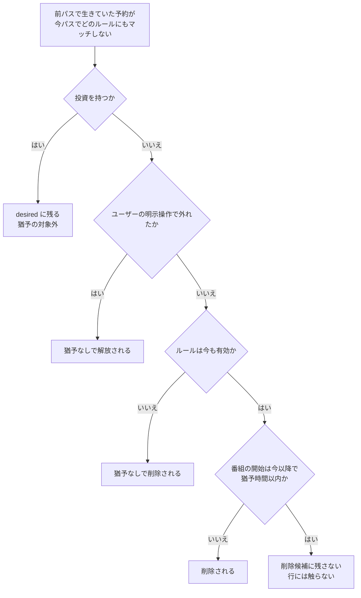
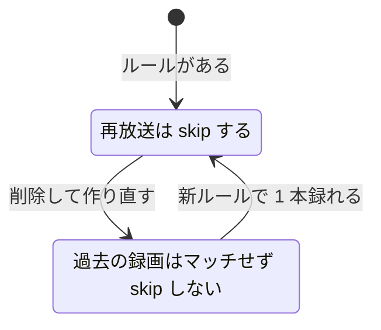

> [recording.md](../recording.md) §3「Rokuban 側のコンポーネント」の一部。索引から辿る。

## 3. Rokuban 側のコンポーネント

ruler は、全ルールと全番組を毎パス評価して予約の元になる値を作り、変わった行だけを書く。定期パスが状態の権威で、イベントは投入を早めるヒントにすぎない。複数ルールの解決、直前の猶予、重複排除、サイトの扱い、予約の寿命（fulfilled 削除と GC）は、この評価の上に決めてある。

### 3.1 ruler（ルール評価 → 予約生成）

ruler は EPG の番組をルールと突き合わせ、あるべき予約（desired）の元になる値を生成・更新する。手動予約もルール由来の予約も同じ表に入り、区別は保存せず、予約の意図から導出する。

**区別を列に保存してはならない。** 導出器が不可逆に書き換え、永続資産（録画履歴の `source`）に漏れる（[reservation-model.md](reservation-model.md) §4.4）。

ルールエンジンは Rokuban 側に置く。mirakc はルールベース自動予約をスコープ外と明言しており（contrib にサンプルがある）、まさに「ルール = サーバー、録画エンジン = エッジ」という分割を想定した作りになっている。

<details><summary>根拠</summary>

- 予約の表（desired state の base を持つ）: `reservations`
- 手動予約とルール由来の区別の導出元: `program_intents.action`（`record` の有無）
- 区別を保存すると漏れる先: 録画履歴の `source`

</details>

#### 評価は全量、書き込みは差分

**ruler は 1 パスで全ルールと全射影番組を評価し、差分駆動にしない。** 書き込みだけは差分にして、値が実際に変わった行だけを更新する。

全量にするのは、desired 予約が変わる契機が 3 つあり、EPG の変更はそのうち 1 つでしかないからである。契機ごとに差分駆動で拾えるかは、次の表の通り。

| 契機 | 差分駆動で拾えるか |
|---|---|
| EPG の番組が変わった | 拾える（変更行の検出が必要） |
| ユーザーがルールを編集した | 拾えない（EPG は変わっていない） |
| 時間が経過して番組がウィンドウに入った | 拾えない |

差分駆動にすると契機ごとに経路が分かれ、取りこぼしが独立したバグになる。全量評価なら経路は 1 本で、どの契機でも次のパスで収束する（レベルトリガー）。

加えて全量評価でないと成立しないものが 2 つある。

- 大量削除サーキットブレーカー（[breaker.md](breaker.md)）の「削除数が総数の N% 超過」は、desired 集合の全体が 1 パスで手に入らないと分母が定義できない
- 競合判定は集合の性質である。1 ルールの予約が増減すると他の予約の競合状態が変わるので、部分評価と相性が悪い（EPGStation が影響範囲の予約を引き直しているのは同じ理由）

規模は問題にならない。EPG プロジェクションはローリングウィンドウで常に件数に上限がある（[データ層](../data.md) 参照）で、実測で 19 サービス x 8 日 = 2680 行。数百ルールとの突き合わせは pg_trgm GIN 込みで秒未満。評価は Postgres の集合演算で行うので、予約 1 件ずつのループにはしない。

<details><summary>根拠</summary>

- EPGStation が影響範囲の予約を引き直す処理: `updateRule` が `findTimeRanges` を使う

</details>

##### 差分で書く理由

毎パス全予約を書き直すと、変更通知が全行について毎パス飛び、クライアントの再取得が鳴り続ける。そのため、値が実際に変わった行だけを更新する。

予約の表には SSE 用の行トリガーがあり、書き直すたびに NOTIFY が飛ぶ。差分書き込みなら、churn と bloat も避けられる。更新時刻が「値が実際に変わった時刻」という意味を保つ。

<details><summary>根拠</summary>

- 通知の発生源: `reservations` の SSE 用の行トリガー
- 差分の条件: `WHERE base IS DISTINCT FROM ...`
- 更新時刻の意味: `updated_at` は base が実際に変わった時刻

</details>

##### 起動契機

定期パスが状態の権威で、ルール・意図・上書きの書き込みと EPG 同期の完了は投入を早めるヒントにすぎない。ヒントを落としても定期パスが拾う。起動契機は次の表の 3 つである。

| 契機 | 種別 |
|---|---|
| 定期（既定 10 分） | 権威 |
| ルール・意図・上書きの書き込み | ヒント |
| EPG 同期の完了 | ヒント |

定期の投入は、デプロイ形態に応じて River `PeriodicJobs` か k8s CronJob が行う（[データ層](../data.md) §2）。ルール・意図・上書きの書き込みでは、store が書き込みと同じ tx で入力の版を進め、api は commit 後に `ruler_pass` を投入する。EPG 同期では、epg_sync ワーカーが完了時に入力の版を進めてからヒントを投入する。ヒントが失われても、定期パスが永続状態から再計算する。

ヒントは合流する。実行中のパスに編集のヒントが合流しても、そのパスは書き込み tx の版照合で版の不一致を検出し、読み直して編集を反映する。照合が 3 回続けて一致しなければ、ジョブへエラーを返して再試行に任せる。

<details><summary>根拠</summary>

- ルール書き込み後のヒント投入: `Enqueue`
- 版を進める箇所: pgstore の `bumpRulerInputRevision`（ルール・意図・上書き）、`EpgSyncWorker.Work` の `BumpRulerInputRevision`（EPG 同期）
- ヒントの合流: `UniqueOpts{ByArgs, ByState}`
- 編集を反映するテスト: `TestRunPass_RuleEditDuringPassReevaluates`
- 新旧パスの競合テスト: `TestRunPass_StalePassCannotOverwriteNewerPass`
- 照合上限のテスト: `TestRunPass_InputRevisionMismatchLimit`

</details>

##### EPGStation の実績

EPGStation も全量評価であり、差分駆動を実装した上で無効化していて、正しさは周期的な全量パスが保証している。Rokuban は、予約 1 件ずつを TypeScript で処理することから来る、要素間の待ち、ログの抑制設定、手動予約の割り込み実行権の 3 点を真似しない。

```ts
this.updateManage.on(EPGUpdateEvent.PROGRAM_UPDATED, () => {
    // NOTE this.config.epgUpdateIntervalTime の周期で予約情報を更新させるため無効化
    // this.notify();
});
```

EPG 更新完了で全手動予約と全ルールを評価する。ルール編集時のみ部分評価を持つが、正しさを保証しているのは周期的な全量パスの側である。

真似しない点は次の通り。

- ループの各要素間の sleep（ルール 100 個 + 手動予約 100 件で sleep だけで 2 秒）
- 全量更新のログが多すぎて必要になった抑制設定
- 手動予約の追加が全量更新に割り込むための優先度付き実行権

<details><summary>根拠</summary>

- 差分駆動を無効化している箇所: `EPGUpdater.ts`
- 全量評価の呼び出し: `reservationManage.updateAll()`
- ルール編集時の部分評価: `updateRule(ruleId)`
- 要素間の sleep: `Util.sleep(10)`
- ログの抑制設定: `isSuppressReservesUpdateAllLog`

</details>

#### 複数ルール解決

1 つの番組に複数のルールがマッチしても、desired 予約は番組につき最大 1 つで、予約オプションは最高 priority のルールから採る。同率なら先に作られたルールが勝つ。勝者が毎パス入れ替わらないよう、順序は全順序で決める。

オプションは priority、エンコードプロファイル、保持ポリシーである。記録するのは勝者だけである。負けたルールは base に何も供給しないので保存しない。必要になれば、有効なルールを順に回して同じ集合が得られる。

勝者決定を全順序にするのは、同率タイを不定のままにすると、全量パスごとに勝者が入れ替わって base の差分書き込みが発火し続けるからである。mirakc に更新 API がないため、reconciler が schedule を DELETE + POST で作り直し続けるフラッピングになる。差分書き込みは勝者決定の決定性を前提として要求する。

同率なら新しい方を勝たせる案は採らない。古い方（先に作られた方）を勝たせる。同率の新ルール追加が既存予約の base を動かさないためである。勝たせたければ priority を上げる。暗黙の新旧より、明示的な優先度操作を選ぶ。

除外はルール単位の仕組みを採らず、番組単位のオーバーライド（予約の skip フラグ）で行う。どのルール経由でマッチしていても一貫して除外される。EPGStation#538（複数ルールにマッチした番組を除外できない）は、予約がルール単位で管理されていたために起きた不整合である。Rokuban は programId ベースなので構造的に防げる。

<details><summary>根拠</summary>

- 勝者だけを記録する列: `reservations.rule_id`
- 負けたルールの集合を再現する関数: `store.ProgramSearch.MatchProgramIDsForRule`
- 負けたルールが何も供給しない対象: `base`
- 勝者の順序: `ORDER BY priority DESC, id ASC`（同率なら先に作られたルールが勝つ）

</details>

#### 直前 unmatch の猶予

放送直前に番組表が書き換わり、ルールの条件から外れた予約は、開始まで猶予時間以内ならルールが有効な限り残す。手違いで消すほうが余分に録るより損失が大きいからである。ルールの無効化やユーザーの明示操作で外れたものは対象外とする。

##### 猶予が必要な理由

番組表は放送直前まで書き換わり、その拍子にルールの条件から外れた予約は、猶予が無いと次のパスで削除される。題名が 1 文字直っただけで録り逃す経路が開き、既存の防御はこの経路を塞がない。

「[新]」が付く、サブタイトルが入る、誤字が直る、といった書き換えがある。開始 30 分前でも起きる。既存の防御がこの経路を塞がないのは、大量削除サーキットブレーカーが件数で止めるだけで、programId が EPG から消えた予約への猶予も番組が消えた場合のみだからである。

denpa は同じ問題に、「開始 N 時間前以降はルールから外れても引っ込めない。ただしルールごと削除・停止されたぶんは直前でも引っ込める（人が押した結果だから）」で答えている。その根拠は「手違いで消す方が余分に録るより高い」である（[予約モデル](reservation-model.md) §4.3 と同じ判断で、迷ったら録る）。Rokuban も `ruler.retract_grace`（既定 1h、0 で無効）で同じ猶予を入れる。

**方針は変えない。** 全量評価・差分書き込み・レベルトリガーを保つ。猶予は desired の導出規則に足すのであって、予約行に「猶予中」の列は焼かない（不変条件 9）。

##### 猶予の判定

前のパスで生きていた予約が今のパスでどのルールにもマッチしなくなっても、番組の開始が現在から猶予時間以内で、そのルールが今も有効なら、削除候補に残さない。行には触らない。

判定の条件の組み合わせは次の図の通り。



行には触らないので、base も rule_id も前パスのままである。判定にスナップショットの開始時刻を使う案は採らない。スナップショットは「射影にまだ居る予約すべて」に追従するので、unmatch のパスでも通常は追従済みである。ただし猶予の正しさを、その同期対象の広さや同一パス内の実行順序に結合させたくない。EPG 射影の開始時刻を直接見れば、他の書き込みの並びに依存しない。

mirakc が録画に入った schedule は reconciler の削除ガードが守る（[reconciler.md](reconciler.md) §「削除のガード」）。開始時刻を過ぎても scheduled のままの schedule は守らない（録画はまだ動いていない）。終了後に予約行を落とすのは既存の GC である。

<details><summary>根拠</summary>

- 「生きていた」の判定: 前パスで `rule_id IS NOT NULL`
- 猶予の窓: `epg_programs.start_at`（射影の最新値）が `now()` 以降かつ `now() + retract_grace` 以内
- 今も有効なルール: `enabled`
- 開始を過ぎても守らない状態: `scheduled` のままの schedule
- 削除候補から外す対象: `derivedDeletes`
- 見ない側の開始時刻: `program_snapshots.start_at`
- 見る側の開始時刻: `epg_programs.start_at`（射影 `epg_programs` を直接見る）

</details>

##### 猶予の対象外

猶予の対象にならないのは、投資を持つ行、ユーザーの明示操作で外れた行、無効化されたルールの行である。ユーザーが直接した操作が、直前の猶予に呑まれて解放されなくなるのを避けるためである。

投資（record 意図 ∪ overrides）を持つ行は、desired に残るので削除候補にすら入らない。ユーザーの明示操作（intent skip / intent クリア / 最後の investment だった overrides の削除）で desired から外れた行も、猶予の対象外である。

猶予を掛けるのは、その削除をすり抜けた残りにだけである。その削除とは、ユーザー（運用者）が投資を手放す書き込みをしない限り起きない削除である。rule_id が前パスから非 NULL のままユーザーが skip の意図を立てた行まで猶予が守ると、「これは録らない」という直接の明示操作が一生解放されなくなる。

ルールの無効化は猶予の対象外である。denpa と同じく「ルールごと削除・停止されたぶんは直前でも引っ込める」。対象の絞り込みは、行のルールが今も有効であることを条件にする。「ルールの編集で条件を狭めた」は EPG 由来の unmatch と区別できない（[breaker.md](breaker.md) が同じ整理）ので、こちらは猶予の対象のままにする。録り過ぎを選ぶ非対称である。

ルールの削除は同一 tx で投資なしの行を先に消す既存経路なので、猶予に関係なく影響を受けない。

<details><summary>根拠</summary>

- 投資を守る view: `program_investments`
- 明示操作で外れる例: `intent{skip}` を立てる
- すり抜けた残りの削除: `DeleteReleasedReservationsBySiteAndProgramIDs`
- 猶予の対象の絞り込み: `internal/db/queries/ruler.sql` の `ListRetractGraceProtectedProgramIDsBySiteAndProgramIDs`。条件は `EXISTS (rules ru WHERE ru.id = r.rule_id AND ru.enabled)`
- ルールの削除の経路: `DeleteRule`

</details>

##### 猶予中の行の扱い

猶予中の行は見た目 active のままで、導出の式は変わらない。猶予でそのパスの削除から外れた行は、大量削除サーキットブレーカーの分子にも分母にも入らない（[breaker.md](breaker.md)「大量削除サーキットブレーカー」の猶予との関係）。

active の導出は変わらない（[reservations.md](../schema/reservations.md) §「active / detached / orphaned は API が都度導出する」）。導出の式は `rule_id IS NOT NULL` のままである。「ルール外れ・直前のため維持」という別の見せ方を UI に足すかどうかは検討したが、既存の `active` 表示で足りると判断し見送った（`openapi.yaml` を触る変更になるので、必要になれば別 issue で決める）。

猶予やラッチで削除を見送られた行（desired ではないがまだ reservations に居る）の `program_snapshots` も、番組が射影にある限り追従し続ける。さらに、予約が無く skip 意図だけが残る行も同じ対象に含める。snapshot は番組の事実であり、skip 意図という不可逆な事実ではない。そのため意図を保ったまま最新の終了時刻へ追従させ、GC の CASCADE で意図を道連れにしない（[reservations.md](../schema/reservations.md) §3.7「射影にある間は更新、消えたら凍結」）。凍結が起きるのは、予約または skip 意図が残っていても番組そのものが射影から消えたときだけである。

#### 重複排除（再放送スキップ）

再放送のスキップは、同じルールで録画済みの履歴とのタイトルの類似度で判定する。誤って抑制された放送は、予約側の「録る」意図で個別に勝たせ、**履歴側に除外の印は作らない**。

##### 類似度で判定する理由

EPGStation#704 の教訓として、囲み文字（:heavy_multiplication_x::heavy_multiplication_x:等）を一律除去する正規化は「前編/後編」の区別まで消して誤判定する。記号除去 + 完全一致は採らない。pg_trgm の類似度ベースで設計し、閾値はルール単位で調整可能にする。

pg_trgm の類似度は DB の `LC_CTYPE` に依存する。日本語を語の文字として扱わない DB では日本語タイトルの類似度が 0 になるため、起動時に実際の挙動を検査する（要件は [DB 運用](../operations/database.md) §3「DB の文字分類（`LC_CTYPE`）」）。

判定に使った根拠（マッチした履歴、類似度）を予約に記録し、UI で「なぜスキップされたか」を説明可能にする。

##### 誤抑制の上書き

誤って抑制された放送は、予約側の「録る」意図で個別に勝たせる。履歴側の除外印は作らない。

EPGStation#473 の要望（この番組を重複扱いにする / しないを手動で上書きする）のうち、予約側は実装済みである。予約の「録る」意図が重複排除の skip に勝つ合成は、予約の有効オプションを解く 1 箇所で行う（§4.2）。1 本録れた時点でその録画が新しい抑制元になって、以降の再放送はまた弾かれる（下記「ルールの削除は履歴のスコープを消す」と同じ一過性）。

特定の録画を比較対象から外す印は、同じ状態に恒久の構造を足すだけになるので採らない。抑制が 1 本外しても止まらないのは閾値がそのシリーズに対して低いときで、直すのは `rules.dedupe_threshold` / `dedupe_window` である（外した次に録れた 1 本が同じ抑制元になる）。逆向き（録れていない番組を今後スキップさせる）は紐づける `recording_id` が無く、意味は予約側の `action = 'skip'` そのものである。

ただし、予約側の印は射影に出ている放送にしか付けられない。まだ EPG に無い先の放送を先回りして「重複扱いにしない」とは言えない。

<details><summary>根拠</summary>

- 「録る」意図が skip に勝つ合成: `program_intents.action = 'record'` が dedup の `base.skip` に勝つ。解く関数は `reservation.EffectiveOptions`
- 抑制が止まらないときに直す設定: `rules.dedupe_threshold` / `dedupe_window`
- 逆向きの意味: 予約側の `action = 'skip'`

</details>

##### 判定規約

判定の候補は、同じルールで録画が完了した履歴だけである。ごみ箱に入れた録画も比較に使い、時間窓が無ければ無制限に遡る。決めたことは次の表の通り。

| 項目 | 決めたこと |
|---|---|
| 比較対象 | 同じルールの録画だけ |
| 状態 | 完了のみ |
| 削除済み | 絞らない |
| 時間窓 | 未指定なら無制限 |
| 勝者 | 類似度最大の 1 件 |

実装は `internal/store/pgstore/rulerpass.go` にあり、候補の集合を jsonb で渡す集合演算 1 文である。比較対象は同じ `rule_id` の `recordings` だけにする。「同じルールが同じ番組シリーズを指している」前提に乗り、グローバルな突き合わせはしない。ルールを削除すると履歴は比較対象から外れる（下記「ルールの削除は履歴のスコープを消す」）。

状態は `status = 'finished'` のみとする。`recording`（進行中）も `failed` も「録れた」とはみなさない。

`deleted_at` では絞らない。ごみ箱に入れても物理削除しても行は tombstone として残り、重複排除は機能する契約である（[スキーマ](../schema.md) §5）。`deleted_at IS NULL` を足すのは契約違反であり、書き忘れの修正にはならない。

時間窓は `rules.dedupe_window` が NULL なら無制限である。`rules` の CHECK は `dedupe_enabled` のとき `dedupe_threshold` だけを要求し、window は任意である。勝者は類似度最大の 1 件で、tie-break は `recordings.id ASC` とする。

<details><summary>根拠</summary>

- 比較対象: 同じ `rule_id` の `recordings`
- 状態: `status = 'finished'` のみ
- 削除済みの扱い: `deleted_at` で絞らない。`deleted_at IS NULL` を足すのは契約違反
- 時間窓: `rules.dedupe_window` が NULL なら無制限。`rules` の CHECK は `dedupe_enabled` のとき `dedupe_threshold` だけを要求する
- 勝者: `DISTINCT ON (program_id)` で類似度最大の 1 件。tie-break は `recordings.id ASC`

</details>

##### 自分自身の録画の除外

自分自身の録画は比較から除外する。除外しないと、録画が完了した次のパスで類似度 1.0 の自己一致が必ず起きる。重複排除が、無関係な状態機械の状態まで変えてしまう。

除外は `(network_id, service_id, event_id)` の不一致で行う。放送済み番組の予約は GC（終了 + `retention_grace`）まで残り、EPG 射影も同じ地平まで番組を保持する。そのため、録画が `finished` になった次のパスで similarity = 1.0 の自己一致が必ず起きる。実装中に除外述語を外して再現済みである。

害は表示だけではない。`effective.skip = true` になると `reconciler.listDesired` から落ち、`recordNeverScheduled` / `detectStartDelays` の入力からも外れる。**重複排除が無関係な状態機械の DB 状態を変えてしまう。**

##### 比較にサイトを入れない理由

site は比較に入れない（同一放送は全サイトで同じ programId を持つという前提。Mirakurun の ID 合成規則からの演繹で未検証。[スキーマ](../schema.md) §1-5）。マッチした全サイトで予約を作る N 予約が既定なので、サイト間の共食いも同時に防ぐ必要がある。

##### 勝者の決定性

tie-break を決定的にするのは必須である。同じ類似度の録画が複数あるときに勝者が毎パス入れ替わると、差分書き込みが発火し続けて NOTIFY が鳴り止まない。mirakc に更新 API がないため、reconciler が schedule を DELETE + POST で作り直し続けるフラッピングになる（本節「複数ルール解決」の priority 同率タイと同じクラスの問題）。

##### 根拠の記録と凍結

「録る」意図が重複排除の skip に勝っても、根拠の 2 列は消さない。UI が「重複と判定したが録る」と説明できるようにするためである。根拠は、ルールが値を供給している間だけ毎パス作り直す。

基本の値（ルールが供給する値）の skip を立てる**唯一の経路が重複排除**である。ユーザーの「録るな」は `program_intents.action` が担う。`action = 'record'` が重複排除の skip に勝つ合成は、`reservation.EffectiveOptions` の 1 箇所で解く（§4.2）。

根拠 2 列（`dedup_match_recording_id` / `dedup_similarity`）は base と同じ凍結規則に従う。ルールが base を供給している間は毎パス作り直し、マッチが無ければ NULL に戻す（前パスの根拠を残さない。不変条件 9）。`rule_id` が外れたら base と一緒に凍結する。base だけ凍結して根拠を消すと、「なぜ skip なのか説明できない base」が残るためである。FK を張っていないので、参照先の録画が消えた場合もこの毎パスの作り直しが孤立を解消する（[スキーマ](../schema.md) §3）。

##### 類似度検索と索引

類似度検索に pg_trgm の GIN 索引は効かない。家庭用の履歴規模では素の走査で足りるので、隠れたセッション状態を持ち込む前に実測する。

`gin_trgm_ops` が加速するのは `%` / `<%` / LIKE / 正規表現で、`similarity()` の関数呼び出しはインデックスに乗らない。`%` は閾値を GUC `pg_trgm.similarity_threshold` から読み、ルール単位の閾値は読まない。そのため `rules.dedupe_threshold` と直接は噛み合わない（前段フィルタにする手順は `internal/store/pgstore/rulerpass.go` のコメントに残してある）。

##### ルールの削除は履歴のスコープを消す

ルールを削除すると、そのルールで録った履歴は比較対象から外れ、同じ条件で作り直しても過去の録画は 1 件もマッチしない。1 本録れれば以降の再放送はまた弾かれる。条件を変えたいだけなら、編集する。



比較のスコープは、生きている `rules` の行が定義している。ルールを削除すると 2 段階で履歴が効かなくなる。

1. `recordings.rule_id` は `rules` への FK `recordings_rule_id_fkey` が `ON DELETE SET NULL` なので、そのルールで録れた履歴の `rule_id` が NULL に落ちる。以後どのルールの比較対象にもならない
2. 同じ条件でルールを作り直しても id は新しくなるので、過去の録画は 1 件もマッチしない。直後のパスでは重複としてスキップされなくなる（実際に余分に録れる量は下記のとおり一過性）

**これは仕様である。** ルールが生きていれば skip し、削除→作り直し直後は skip せず、新ルールで 1 本録れるとまた skip する。条件を大きく変えたいだけなら、編集する。`PATCH /api/rules/{id}`（UI のルール名リンク）は id を保つので履歴も保たれる。削除して作り直すと、履歴が効かなくなる。

`deleted_at` の tombstone 契約（前掲の判定規約）と非対称に見えるが、守っている主語が違う。tombstone が守るのは「録画したという不可逆な事実」で、ユーザーがファイルを消しても事実は残る。ルール削除で失われるのは比較の枠で、事実は失われない。`recordings` の行は 1 行も減っていない。この非対称で起きるのは「余計に録る」ことで、「録り逃し」は起きない（[予約モデル](reservation-model.md) §4.3 の、迷ったら録る方針と同じ）。

新ルールの下で 1 本録れれば、以降の再放送はまた弾かれる。`base.skip` が true に戻り、根拠 2 列は新しい録画を指す。節末の根拠欄にある dedupe のテストが、削除→作り直し→1 本録れるとまた skip、の 3 段階で測っている。これは履歴が積み直るまでの一過性の過剰録画になる。この一文が受け入れ可能かどうかの分かれ目で、偽なら結果は「窓の中の再放送を全部録り直す」に戻る。

<details><summary>根拠</summary>

- record 意図後に次の録画が抑制元になること: `TestRunPass_DedupeRecordIntentThenNewRecordingSuppressesAgain`
- ルール削除後に履歴のスコープが切れ、1 本録ると再抑制されること: `internal/ruler/dedupe_test.go` の `TestRunPass_DedupeHistoryLeavesScopeOnRuleDelete`
- 段階 3 で `base.skip` が true に戻り、根拠 2 列が新しい録画を指すこと: 同じ `TestRunPass_DedupeHistoryLeavesScopeOnRuleDelete`

</details>

##### 履歴を残す案を採らない理由

履歴の FK を外して旧ルールの id を残す案は採らない。作り直したルールは新しい id を持つので、症状が消えない。ルール名をキーにする代替も、同名の別ルールの履歴を気づかないうちに混ぜるので採らない。

作り直したルールが新しい id を持つ以上、前節の 2 が残る。履歴に旧 id を保存しても、新ルールの比較対象にはならない。

削除→作り直しをまたいで効かせるには「ルール名をキーにする」等の別の同定が要る。しかし名前キーは、いま乗っている前提より弱い前提に置き換わる。加えて、恒久に解決しない `ruleId` を履歴に残すと、「一覧が未解決だから解決できない」という一時的な状態の表示（[フロントエンド](../frontend/recordings.md)「ルール名の解決」）と区別が付かなくなる。

##### 削除時の確認ダイアログ

ルールの削除の確認ダイアログは、重複排除が有効なルールに限り、この結果を事前に伝える。文面は上の測定に合わせ、「次の再放送を録り直す / 1 本録れれば以降はまた弾かれる」までを言う。

重複排除の設定自体を編集する UI は現状無い。重複排除が有効なルールは、`POST` / `PATCH /api/rules` を直接叩いて作ったものに限られ、この確認文に到達する経路も今はそこだけになる。

<details><summary>根拠</summary>

- 確認文を出す処理: `web/src/pages/rules.tsx` の `deleteRuleWarning`
- 重複排除が有効なルール: `dedupeEnabled`
- 設定を編集する UI が無いこと: `web/src` で `dedupe*` に触るのは `buildRuleInput` の `preserve` と skip 理由の表示だけ

</details>

#### サイトの扱い

**ルールはサイトに従属しない。** サイトは条件の 1 次元として絞り込み、マッチした全サイトで予約を作って全部録る。サイトの選好や自動フェイルオーバーの仕組みは持たない。

ルールはグローバルな永続資産で、rules に site 列はない。サイトは `rule_sites` 子テーブル（指定なし = 全サイト。他の条件テーブルと同じ規約）で絞り込む。FK は張らず、代わりに書き込み時にレジストリと照合して未知の site 名を 400 にする（タイポを保存して「どのサイトにも一致しない条件」として無音で失敗させない）。照合の範囲と、レジストリから site が消えたときの扱いは [スキーマ](../schema.md) の `rule_sites` 節に置いてある。

実体化はマッチした全サイトで予約を作る（N 予約が既定）。同一放送は全サイトで同一 programId を持つ（Mirakurun の ID 合成規則からの演繹。未検証）ため `(site, program_id)` ごとに予約行ができ、全部録る。これは意図された既定値である。複数録画してドロップ統計で選別するワークフローを基本の使い方として扱い、サイト選好・自動フェイルオーバーという機構を持たない。チューナー競合は mirakc の調停に任せ、負けは `need-rescheduling` として観測される（競合の可視化と開始遅延検出器がこの運用を支える）。絞りたければ `rule_sites` が唯一の機構である。

NID/SID は放送規格のスコープでサイトに依存しないため、地上波の条件は地域が違えば構造的にマッチしない（NID が違う）。全サイトマッチが実際に効くのは BS/CS と同一地域の複数サイトのみ。

サイト名は安定識別子として扱い、オンラインのリネームはサポートしない（SQL 付け替えを伴う運用作業）。無断リネームは旧サイトの射影が stale になり導出削除として現れるため、サーキットブレーカーが受け止める。

#### 録画・ingest 完了後の fulfilled 削除

原本が存在する放送イベントは、録画と取り込みが完了している。そのため、EPG の保持猶予を待たずに予約を desired から外す。観測された事実に基づく確定的な寿命終了なので、大量削除サーキットブレーカーの対象にならない。

予約は mirakc に同期すべき schedule を表す。原本 `media_asset`（`kind='original'`、state 不問）が存在する放送イベントは、`epg.retention_grace`（既定 24h）を待たずに desired から外す。判定は放送イベントキーで行う（導出器が作る予約 id で引かない。不変条件 9 / [invariants.md](../invariants.md) §9）。削除は同じパスの後段で行う。

対象の一覧は `internal/db/queries/ruler.sql` の `ListFulfilledProgramIDsBySite` が返す。原本を後から tombstone しても、録画・ingest が完了した事実は戻らないので fulfilled のままである。これは `keepOriginal=until_encoded` でエンコード後に原本を消す運用が、予約を再表示させないための回帰である。

fulfilled 削除は観測された事実（ingest 完了）に基づく確定的な寿命終了で、EPG 欠損に起因する導出削除ではない。したがって `program_investments`（record 意図・overrides）や EPG 射影の残存に依存しない。大量削除サーキットブレーカーの対象にもならない。

ingest は原本 `media_asset` の INSERT と同じ transaction で `recording_encode_policy` を凍結する。そのためこの削除が走るのは凍結の lookup より後になる（凍結との競合は生じない）。

録画が finished でも原本がまだ無い録画（ingest 待ち・転送中）と欠測（`never_scheduled_events`）は fulfilled ではない。これらは従来どおり予約に残し、要確認に含める。

<details><summary>根拠</summary>

- 判定する処理: `collectDesired`
- 削除する query: `DeleteFulfilledReservationsBySiteAndProgramIDs`
- fulfilled 候補を返す query: `internal/db/queries/ruler.sql` の `ListFulfilledProgramIDsBySite`
- tombstone 済み原本の予約削除: `TestRunPass_FulfilledReservationTombstonedOriginalStillRemoved`
- investment がある予約の fulfilled 削除: `TestRunPass_FulfilledWithInvestmentStillRemoved`
- fulfilled 削除をブレーカー件数から除くこと: `TestRunPass_FulfilledDeletesDoNotCountTowardBreaker`
- 原本コミット前の予約を残すこと: `TestRunPass_UnfulfilledReservationRemainsUntilOriginalCommitted`

</details>

#### 番組終了後の GC

終了した番組の予約・意図・上書きは、番組の終了から EPG の保持猶予を過ぎると、スナップショットと一緒に物理削除する。録画履歴は失われない。**GC は大量削除サーキットブレーカーの対象外で、発動中でも動く。**

対象は `reservations` / `program_intents` / `program_overrides` の物理削除（GC）と `never_scheduled_events` の物理削除である。これらは ruler の 1 パス内で、全サイト評価の後に 1 回だけ行う。実装は `internal/ruler/ruler.go` の `runGC` である。DELETE は 2 本ある。1 本目は `program_snapshots` が対象で、`start_at + duration_ms < now() - 猶予` を満たす行を消す。

これは `reservations` の active/detached/orphaned を問わない。`(site, program_id)` FK が `ON DELETE CASCADE` なので、`reservations` / `program_intents` / `program_overrides` はスナップショットと一緒に落ちる。猶予には既存の `epg.retention_grace`（既定 24h、EPG プロジェクションのローリングウィンドウと同じ設定）をそのまま流用する。専用の設定項目を増やさず、「EPG から消える」と「予約・意図として GC される」の寿命を揃える。

2 本目は `never_scheduled_events` が対象である。この表は `program_snapshots` への FK を持たないため 1 本目の CASCADE では消えない。そこで `retention_grace + 30日` を超えた行だけを独立に刈る。この表の読者（`never_recorded` の導出・容量需要・重複判定）は通常どおり `reservations` 行を経由して届くが、`program_id` 再利用で新番組が旧番組と同じキーから到達可能になる経路ではこの寿命差が実害を持つ。`program_id` 再利用の発生頻度と判定基準は未検証で、ruler は現在検出だけを行う。

`recordings` はこの 2 本の削除で録画履歴（recordings/media_assets）を失わない。

GC は大量削除サーキットブレーカー（`MaxDeletesPerPass`）の対象にせず、ブレーカー発動中でも動く。GC の削除対象は時刻の比較だけで決定的に定まり、EPG の状態には一切左右されないためである（理由の全体は [breaker.md](breaker.md)「GC は対象にしない」）。
