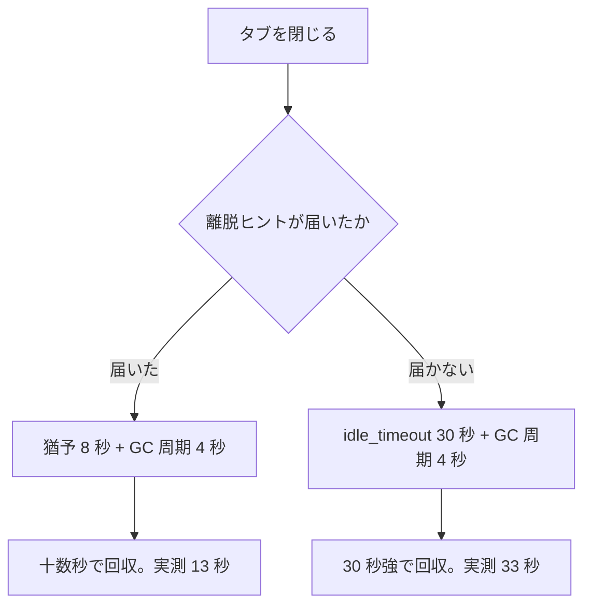

> [runbook.md](../runbook.md) の一部。索引から辿る。

## ライブ視聴の確認手順

ライブ視聴の確認は 2 段に分かれる。**①は実 mirakc と実チューナーが要り、streamer が実際に ffmpeg を起動してチューナーを取るところを見る。** ②は mirakc が要らず、ブラウザ側の配線だけを見る。

②が見るのは、hls.js の動的 import、MSE への実再生、チャンネル切替時の cleanup である。

### ① idle GC と実再生（実 mirakc が必要）

実 mirakc と実チューナーでライブ再生を始め、タブを閉じたあとにチューナーが回収されるところまでを確かめる。前提は、ライブ視聴を有効にし、ffmpeg が PATH にあり、画質プロファイルを 1 つ以上設定してあることである。

前提の設定は `live.enabled: true`、`live.ffmpeg`、`live.profiles` の 3 つで、[config.example.yml](../../config.example.yml) の `live:` 節に書いてある。

**`live.enabled` が false（既定）だと、そもそもライブに辿り着けない。** その場合は主ナビに「ライブ」が出ず、`/live` を直接開くと「この環境ではライブ視聴が無効です」になる。`config.compose.yml` の `live:` 節も `enabled: false` である。設定が効いているかは `curl -s http://localhost:40773/api/capabilities` の `live` が `true` かで確かめられる。

```sh
# config.compose.yml の live.enabled を true にしてから
docker compose restart rokuban
```

手順は次の 5 つである。実配信での一時停止確認（手順 5）は未実施である。

1. ブラウザで `/live` を開き、チャンネルを選ぶ。この時点ではまだ何も始まらない（選択と視聴開始は分離してある）。「再生」ボタンを押すと数秒で再生が始まる。
2. 別ターミナルでメトリクスを見る。

   ```sh
   curl -s http://localhost:40773/metrics | grep rokuban_live
   # rokuban_live_active_sessions{kind="live"} 0
   # rokuban_live_active_sessions{kind="chase"} 0
   # rokuban_live_idle_gc_reclaimed_total 0
   # rokuban_live_leave_hints_total{result="deadline_shortened"} 0
   # rokuban_live_idle_gc_last_pass_timestamp_seconds 1.7...e9
   ```

   ライブ再生中は `rokuban_live_active_sessions{kind="live"}` が `1`（見ているチャンネル数）になる。
3. ブラウザのタブを閉じる（または別チャンネルへ切り替える）。離脱ヒントが届けば十数秒で `rokuban_live_active_sessions{kind="live"}` が `0` に戻り、`rokuban_live_idle_gc_reclaimed_total` が `1` 増える。詳細は「離脱ヒントと回収時間」に書いた。
4. チューナー本数が少ない環境で、複数チャンネルへ連続で「再生」を押す。上限に達したときの応答は「同時視聴数の上限」に書いた。
5. 実配信で一時停止しても誤ってエラーにならないことを確認する（未実施）。詳細は「一時停止の確認」に書いた。

#### 離脱ヒントと回収時間

タブを閉じたあとにチューナーが戻るまでの時間は、離脱ヒントが届いたかどうかで決まる。届けば十数秒、届かなければ 30 秒強かかる。

十数秒は猶予 8 秒（`3 × segment_seconds + 2s`）に GC 周期 4 秒ぶんの遅れを足した値で、実測は 13 秒だった。同時に `rokuban_live_leave_hints_total{result="deadline_shortened"}` も `1` 増えているはずである。**ここが増えずに回収された場合、ヒントは届いていない。** その場合の回収は `live.idle_timeout` 既定 30 秒 + GC 周期 4 秒 = 30 秒強後になる（実測 33 秒）。



この秒数は偽 mirakc + 偽 ffmpeg に対する実バイナリ（`rokuban server --roles streamer`）で実測した（ヒントあり 13 秒 / ヒント無し 33 秒）。`rokuban_live_active_sessions{kind="live"}` が 0 に戻るまでを 1 秒間隔でポーリングした。実チューナー・実 ffmpeg では未測定である。ffmpeg の停止に掛かる時間だけ伸びうるので、この手順で確かめる。

同じチャンネルを 2 つのタブで開いて片方だけ閉じると、`rokuban_live_leave_hints_total` は増えるが `rokuban_live_active_sessions{kind="live"}` は `1` のまま下がらない。残っているタブのセグメント要求が idle 期限を戻すためである。これがヒントを「停止命令」にしなかった理由そのものである（[api.md](../api.md) §ライブ視聴の HLS）。偽 mirakc に対する実バイナリでは実測済みである（2 秒ごとに `leave` を送りながらセグメントを取り続ける形で 20 秒間、セッションは落ちなかった。ヒント 10 回に対し回収 0 回）。

#### 同時視聴数の上限

同時視聴数が上限に達した場合も、チューナー自体が枯渇した場合も、503 が返る。画面には「チューナー不足または同時視聴数の上限」と、30 秒待つ案内が出る。チャンネルを選ぶだけではセッションは起きず、積まれるのは「再生」を押した本数だけである。

`live.max_sessions`（既定 4）に達した時点では 503 `too many concurrent live sessions on this process` が返る。チューナー自体が枯渇した場合は 503 `live stream unavailable` が返る。

**チャンネル選択自体（`?service=<Service.id>` を切り替えるだけ）はセッションを起こさない。** 選択と視聴開始は分離してあるため、ここで積まれるのは実際に「再生」を押した本数だけで、通り過ぎただけのチャンネルは対象外である。

以前あった 400ms のデバウンス（ザッピングでセッションが積まれないようにする緩和）は、選択自体がコスト 0 になったことで存在理由が消え、削除した。押して留まったチャンネルの前セッションは、離脱ヒントが届けば十数秒、届かなければ 30 秒強残る（手順 4）。

#### 一時停止の確認

実配信で一時停止してもエラー画面にならないことは、確認できていない（未実施）。一度でも再生が始まった後の一時停止中は、失敗と見なさないようにしてある。

停滞は再生位置の進み方で観測する。再生前と一時停止中は位置が進まないのが正常なので、猶予を数えない。実配信での確認は未実施である。e2e の固定フィクスチャは `#EXT-X-ENDLIST` を持つ VOD 形で、実配信のローリングウィンドウとは挙動が異なる可能性がある。

実機で再生し、一時停止して 30 秒放置し、エラー画面が出ないことを見る。再開して再生が続くことも見る。

<details>
<summary>根拠</summary>

- 一時停止中を停滞と見なさない分岐: `paused`、`observeStall`、`live-player.test.tsx`
- 分岐を jsdom が測る: `live-player.test.tsx`

</details>

#### 画質の切替でチューナーが増えないことの確認（偽 mirakc + 偽 ffmpeg で足りる）

画質を切り替えても、1 サービスにつき ffmpeg が 1 つ、mirakc のチューナーが 1 本のままであることを確かめる。実チューナーは要らず、偽 mirakc と偽 ffmpeg で足りる。

見るのは「1 サービス = 1 ffmpeg = mirakc の 1 チューナー」が画質の切替で保たれることだけである。そのため、mirakc に何も要求しない偽 mirakc で確かめられる。`live.profiles` を 2 つ以上書いた config で `--roles streamer` を起動し、同じ `(networkId, serviceId)` に対して違う `?profile=` を順に取る。

実測の結果は次の通り（実バイナリ + 偽 mirakc + 実 ffmpeg 9.0.2。偽 mirakc は 90 秒の TS を実時間で流す）。

- `?profile=hd` → master は `hd.0.m3u8`（映像）と音声 `hd.1`〜`hd.3.m3u8` を指す。偽 mirakc の stream 要求は 1 件、`rokuban_live_active_sessions{kind="live"}` は `1`
- `?profile=sd`（切替）→ 同じセッションの別 master（`sd.0.m3u8` …）が返る。stream 要求も gauge も 1 のまま
- `?profile=does-not-exist` → 400（セッションを起こす前に拒否する）

**実チューナーでは未測定である。** 以下の手順で確かめる。

```sh
# 偽 mirakc（`GET /api/services/{id}/stream` だけ実装し、要求数を数える）
# 偽 ffmpeg（`internal/streamer/live_test.go` の installFakeLiveFFmpeg と同じ脚本）
B=http://localhost:40773/api/sites/default/networks/{networkId}/services/{serviceId}/live/playlist.m3u8
curl -s "$B?profile=hd" | tail -1            # 先頭のプロファイル
curl -s "$B?profile=sd" | tail -1            # 別プロファイル（同じセッション）
curl -s http://localhost:40773/metrics | grep 'rokuban_live_active_sessions{kind="live"}'
```

#### 追っかけの画質切替でセッションが増えないことの確認（偽 mirakc + 偽 ffmpeg で足りる）

追っかけ再生で画質を切り替えても、セッションが増えないことを確かめる。同じ録画・同じ offset のセッションから別プロファイルの playlist を取るだけなので、実チューナーは要らず、偽 mirakc と偽 ffmpeg で足りる。

見るのは `rokuban_live_active_sessions{kind="chase"}` が増えないことである。`live.profiles` を 2 つ以上書いた config で `--roles streamer` を起動し、偽 mirakc と偽 ffmpeg を用意する。

```sh
B=http://localhost:40773/api/sites/default/recordings/1/chase/playlist.m3u8
curl -s "$B" | tail -1                 # 先頭のプロファイル
curl -s "$B?profile=sd" | tail -1     # 同じ録画の別プロファイル
curl -s http://localhost:40773/metrics | grep 'rokuban_live_active_sessions{kind="chase"}'
```

実バイナリ（`rokuban server --roles streamer`）+ 偽 mirakc + 偽 ffmpeg で測定した。結果は `?profile=hd` / `?profile=sd` とも 200、active sessions は 1 だった。偽 mirakc の録画 stream 要求は 1 件、`?profile=does-not-exist` は 400 `unknown chase profile` だった。オフセット付きでも同じ `/chase/offset/{offset}/playlist.m3u8` を 2 プロファイルで取り、offset を跨いでいないことを確認する。実チューナー・実 ffmpeg での追っかけ画質切替は未測定である。

#### 音声（二重音声の主 / 副）の確認（実放送が必要）

二重音声の主 / 副が正しく分かれて聞こえることは、二重音声の放送でしか確かめられない。実放送の音声が想定どおりの形かは未検証である（[api/media.md](../api/media.md) §音声）。

想定する形は、SCE 2 つと `channel_configuration=2` の組み合わせである。手元で測ったのは次の 2 つである。

- 実バイナリ + 偽 mirakc + 実 ffmpeg で、合成した二重音声（440Hz / 880Hz のモノラル AAC 2 本を 1 フレームに継いだ TS）を流した。`hd.1`（標準）は L 440 / R 880、`hd.2`（主）は 440 / 440、`hd.3`（副）は 880 / 880 だった（HTTP 越しにデコードして左右の周波数を測った）
- ブラウザ側の切替は `pnpm e2e:live-audio`（下記 ②）

実放送では、番組表で「二か国語」「副音声」の番組を選んで次を確かめる。

1. 標準で、主と副が左右に分かれて聞こえる
2. 主音声で、主だけが両耳から聞こえる
3. 副音声で、副だけが両耳から聞こえる
4. 副音声を 15 秒以上聴いてから標準へ戻しても止まらない（ライブの窓より後で戻る切替）

番組名・放送局・手順を issue に残す。BS と地上波の両方があれば両方を見る。

### ② ブラウザ側の配線（mirakc 不要）

mirakc を使わずに、ブラウザ側の配線を Playwright の e2e で確かめる。HLS プレイリストとセグメントはブラウザ側で丸ごと差し替えるので、streamer 側でライブ視聴を有効にする必要すら無い。

e2e のスクリプトは `web/e2e/live.mjs` である。

**jsdom で測れない領域は、実装より先に判定手段を作る。** この ② はその教訓の実例である（CLAUDE.md「テスト規律」）。

#### 差し替えるもの

e2e は、サーバーの応答の一部を Playwright の route で差し替え、実サーバーの設定に依存しないようにしてある。サーバーは「サービス一覧を返す」以外の実仕事をしない。

`GET /api/capabilities` も同じく差し替えている。立てていないサーバーだと画面が「無効です」になって①〜⑥が全滅するためである。`GET /api/live-profiles` も差し替えている。実サーバーは config の `live.profiles` を返すが、⑨ は「2 件以上あるデプロイ」を前提にするので固定する。

#### サービス ID の渡し方

e2e に渡すチャンネルは、SI の serviceId で指定する。ページ URL が使う合成 id への変換は、スクリプトが起動時に引く。ネットワーク ID が投入した行と食い違うと、ページ遷移の前に例外で落ちる。

`E2E_LIVE_SERVICE_A` / `_B` に渡すのは SI の `serviceId`（下の投入例なら 9001 / 9002）である。セグメント / プレイリスト / 離脱ヒントの URL に載るのも SI の `(network_id, service_id)` そのものなので、そちら側の読み替えは要らない。一方 `/live` のページ URL は他画面と同じ `?service=<Service.id>`（合成 id）を使う。スクリプトは起動時に `GET /api/sites/{site}/services` から対応する `Service.id` を引く。

**`E2E_LIVE_NETWORK_ID`（既定 `1`）は投入した行の `network_id` と揃える。** ここが食い違うと、合成 id を引く処理が一致するサービスを見つけられない。その結果、`page.goto` の前に例外で落ちる（`E2E_LIVE_NETWORK_ID=2` で実測。exit 1）。`E2E_LIVE_SITE` を間違えた場合も、同じ処理が 404 を名指しして落ちる。

⓪ はさらに、選ばれたチャンネルそのものを assert する。チャンネル一覧の現在位置の印がちょうど 1 件で、その遷移先に要求した `Service.id` が載っていることを見る。引く関数は「投入した行が見つかるか」までしか見ない。この assert が無いと、要求件数の判定だけは通り続けて「要求した id が実際に選ばれた」という主張が抜け落ちる。

⓪ が直開きするのは B（`E2E_LIVE_SERVICE_B`）である。既定のフォールバック先（番組を持つ先頭）は、この投入例では A になる。要求先が既定と同じだと、この assert は「要求が反映された」と「一致に失敗して既定に落ちた」を区別できない。A で判定していたときの実測では、初期チャンネルの選択を `serviceId` 一致に変異させても ⓪ が緑のまま通った。B に変えると同じ変異で落ちる（印が 2 件になり遷移先も違う）。

<details>
<summary>根拠</summary>

- スクリプトが合成 id を引く: `resolveServiceId`
- 一致を見る assert: `aria-current="page"`、`href`
- 変異で落ちる確認: `pickInitialService`

</details>

#### 準備と実行

e2e には、EPG プロジェクションに最低 2 つのチャンネルが要る。mirakc からの実同期でも、直接 INSERT でも足りる。初回のみ準備し、そのあとビルドして e2e を回す。

準備（初回のみ）は次の INSERT である。

```sh
# EPG プロジェクションに最低 2 つのチャンネルが要る。mirakc からの実同期でも、
# 以下のような直接 INSERT でも足りる（`has_programs` は epg_programs の
# 存在から導出されるので番組行も入れる）
psql "$DATABASE_URL" -c "
INSERT INTO epg_services (site, network_id, service_id, type, logo_id, remote_control_key_id, name, channel_type, channel, has_logo_data)
VALUES ('default', 1, 9001, 1, 0, 1, 'E2E チャンネル A', 'GR', '13', false),
       ('default', 1, 9002, 1, 0, 2, 'E2E チャンネル B', 'GR', '15', false);
INSERT INTO epg_programs (site, program_id, network_id, service_id, event_id, start_at, duration_ms, end_at, name, description)
VALUES ('default', 900101, 1, 9001, 1, now() - interval '5 minutes', 3600000, now() + interval '55 minutes', 'テスト番組 A', ''),
       ('default', 900201, 1, 9002, 1, now() - interval '5 minutes', 3600000, now() + interval '55 minutes', 'テスト番組 B', '');
"
```

実行は次の通り。

```sh
cd web && pnpm build
go build -o /tmp/rokuban ./cmd/rokuban
/tmp/rokuban server --roles api --config dev.local.yml &
E2E_LIVE_NETWORK_ID=1 E2E_LIVE_SERVICE_A=9001 E2E_LIVE_SERVICE_B=9002 node web/e2e/live.mjs
```

ブラウザは初回だけ取得する。WebKit も要る（⑥がそれでしか測れない）。

```sh
pnpm exec playwright install chromium webkit
```

初回実行は ffmpeg で固定フィクスチャ（testsrc + sine を H.264/AAC でエンコードした 40 秒ぶん）を生成する。`os.tmpdir()` にキャッシュする（`E2E_LIVE_REBUILD_FIXTURE=1` で強制再生成）。ffmpeg が無い環境・Chrome が無い環境では、その判定だけを「未測定」として報告し（NG にはしない）、残りは続行する。

#### 再生の入口と経路の判定（⓪〜⑥）

⓪〜⑥ は、再生開始の入口と hls.js による再生を判定する。詳細はスクリプト冒頭のコメントにある。

0. 選択と視聴開始の分離。`/live?service=<Service.id>` を開いた直後はプレイリスト / セグメント要求が 0 件である（route の差し替えで観測）。「再生」ボタンを押して初めて要求が飛ぶ。

   併せて、要求した `Service.id` が実際に選ばれたことも見る。チャンネル一覧の現在位置の印がちょうど 1 件で、その遷移先に要求した id が載っていることを確かめる。1 件でなく 2 件付くのは `serviceId` 単独で同定していたときの失敗の仕方で、ユニットテストで固定した。ffmpeg 不要（フィクスチャを使わない）で bundled Chromium だけで測れるため、①〜⑥ と異なり、前提が無い環境でも未測定として飛ばさない。①〜⑥ は「再生」ボタンを押した後の挙動を見るものなので、ページ遷移の後にこのボタンを押す手順を挟んでいる。
1. hls.js の動的 import チャンク（`assets/hls-*.js`）が実際に要求される。
2. MSE がアタッチされる。`video.currentSrc` が `blob:` になる。`src` は hls.js が `sourceopen` 後に object URL を revoke するので短命であり、これだけを見ると取り逃がす。
3. 実 Chrome のみ（`channel: 'chrome'`。bundled Chromium は H.264/AAC 非対応）で、`video.play()` 後に `currentTime` が進み、`videoWidth > 0` になる。あわせて遅延・バッファの計器（「放送から約 n 秒 / 先読み n 秒」）が実際に数値になり、`NaN` を描画していないことも見る（`docs/frontend/live.md` §遅延・バッファの計器）。
4. チャンネル切替後、旧チャンネルへのセグメント要求が 0 件になる（プレーヤーの effect cleanup が実際に機能していることの検証）。
5. 503（本文つき）でエラー文言が出て、再読み込みで復帰する。
6. Playwright WebKit でも hls.js の動的 import、MSE のアタッチ、実再生を確認する。ここでは Safari 実機の対応確認は行わない。

<details>
<summary>根拠</summary>

- 選択と視聴開始の分離: `page.route`、`page.goto`
- 2 件付く失敗の仕方の固定: `aria-current="page"`、`href`、`serviceId`、`pages/live.test.tsx`
- cleanup の検証: `LivePlayer`

</details>

#### 画質・字幕・離脱ヒントの判定（⑧〜⑪）

⑧〜⑪ は、チャンネル切替の離脱ヒント、画質の切替、字幕、停滞時の自動降格を判定する。

8. チャンネル切り替えで離脱ヒントが実際に飛ぶ（`POST .../live/leave`。④ と同じ切り替え操作を観測する）。jsdom では原理的に測れない。`navigator.sendBeacon` が jsdom に無いため、ユニットテストが見ているのは差し替えた関数が呼ばれたかという配線だけである。実ブラウザが本当にネットワーク要求として送出するかは、ここでしか出ない。離れた側（A）にだけ飛ぶことを見る。これから見るチャンネル（B）には飛ばないことも見る。
9. 画質（プロファイル）の切替（issue #869 / M4-21）。一覧（`GET /api/live-profiles`）をわざと保留したまま「再生」を押し、後から届かせてもプレイリストを取り直さないことを見る。プレーヤーに導出した既定を渡す実装だと、一覧の到着で `profile` が変わって `<video>` が作り直され、先頭から再生し直しになる。

   あわせて、選択中の画質で `?profile=` が実際に要求に載ること、切替で離脱ヒントを送らないこと、切替を跨いで音量とミュートが保たれることを見る。この 4 点は `key={activeProfile}` を足す変異で 4 件とも落ちることを確認してある。音量・ミュートは「復元しなくても通る」ので、この 2 件が守っているのは切替で `<video>` を作り直さないことの側である（`docs/frontend/live.md`）。
10. 字幕の表示が画質の切替で失われないか（issue #869）。フィクスチャに字幕レンディション（master playlist + WebVTT）を持たせ、利用者が切ってから切り替えても `hidden` のままであることを Chromium + hls.js 経路で見る。字幕の表示状態は `MANIFEST_PARSED` で設定し直す。
11. 停滞したら画質が 1 段下がる（issue #871）。まず実再生させ（`currentTime` が進むことを確かめる）、そのうえで配信を止める。`?profile=` が無いときは、1 段下がった先（`sd`）のプレイリストを取りに行くことを見る。通知（`映像が止まったため、画質を sd（480p）に下げました`）と画質セレクタの表示が下がった先に一致することと、離脱ヒントを送らないことも見る。

    さらに配信を復旧させ、そのまま再生が続くこと（`currentTime` が進み `paused=false`）を見る。配信側が実際にセグメントを配ったことも見る。`currentTime` の前進だけでは、「切替で 0 秒から読み直して 1 本だけ再生した」場合と区別できないためである。切替は `load()` で `paused` を戻すので、ここを見ないと「画質だけ下げて黒いまま」を見逃す。

    利用者が明示的に選んだ画質（`?profile=hd`）では下げない側も見る（同じ障害の起こし方・同じ待ち時間で、自動側が実際に下がっていることが前提にあるので「下がらない」が空虚な成功にならない）。停滞の閾値（12 秒）は実時間なので、この判定だけで 1 分半ほどかかる。実測では、自動は 22〜23 秒で降格し、復旧後は再生が続く。降格を待つ窓は 30 秒、復旧を待つ窓はプレイリストの再取得間隔から導く（`docs/frontend/live.md` §フロントエンド実装）。

<details>
<summary>根拠</summary>

- 離脱ヒントが実ブラウザから飛ぶ: `navigator.sendBeacon`
- 一覧の到着で `<video>` が作り直される: `profile`、`<video>`、`key={activeProfile}`
- 字幕の適用と判定: `MANIFEST_PARSED`、`hidden`、`web/e2e/live.mjs` ⑩
- 切替で再生が戻る: `load()`、`paused`

</details>

#### 音声の切替（`web/e2e/live-audio.mjs`。サーバーも DB も不要）

音声の主 / 副の切替は、サーバーも DB も使わず、ビルドしたフロントエンドだけで確かめられる。

`pnpm preview` だけで回る（`/api/**` とライブの HLS を route で差し替える）。ライブの HLS は ffmpeg が L 440Hz / R 880Hz のステレオから実時間で書き続ける。

```sh
cd web && pnpm build
pnpm preview --port 4173 --strictPort &
E2E_URL=http://localhost:4173 pnpm e2e:live-audio
```

変異で落ちることを確かめてある。ffmpeg の引数から再生時刻の埋め込み（PDT）を外すと ① の「標準へ戻る」で落ちる。プレーヤーの hls.js への適用を外すと主 / 副で落ちる。② は 11 回中 1 回、副を選んでも `audioTracks` が揃わず落ちた（原因は未特定。PDT の有無とは無関係だった）。落ちたら 10 秒後の `enabled` の並びが出る。

<details>
<summary>根拠</summary>

- ffmpeg の引数から外すと落ちる再生時刻の埋め込み: `program_date_time`
- 外すと主 / 副で落ちる適用: `LivePlayer`

</details>

### CI では回さない

ライブ視聴の確認は、CI では回さず、ローカルの受け入れ確認として手で回す。実サーバー・実データに依存するためで、①はさらに実 mirakc・実チューナーも要る。

`web/e2e/checks.mjs` と同じ理由（実サーバー・実データ依存）である。①は実 mirakc / 実チューナーも要るため、輪をかけて CI に載せられない。②のみなら理論上は、サーバー + Postgres + Chrome があれば CI でも回せる。ただし、実 Chrome チャンネルのインストールと ffmpeg の用意が CI イメージに新しい依存を足すため、現時点ではローカル受け入れ確認の位置づけのままにしてある。
