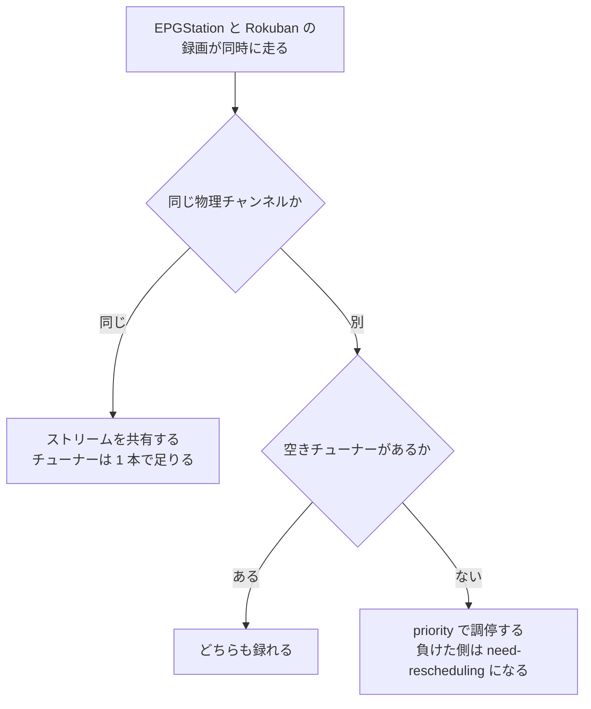

> [runbook.md](../runbook.md) の一部。索引から辿る。

## EPGStation との並走

EPGStation と同じ mirakc を共有してよい。チューナーの調停は mirakc が行うので、Rokuban が EPGStation の録画を奪うことはない。ただし物理的な制約は残る。

視聴・寿命・移行の出口基準と切替手順は [cutover.md](cutover.md) にある。

### 同一チャンネルなら競合しない

同じ物理チャンネルなら、EPGStation と Rokuban が同時に録ってもチューナーは 1 本で足りる。mirakc が同じ物理チャンネルのストリームを複数の購読者で共有するからである。

たとえば EPGStation が GR/27 をライブ視聴していて、Rokuban が GR/27 を録画する場合がこれに当たる。

### 別チャンネルはチューナー数で競合する

チューナーが 1 本しかない環境では、別チャンネルの録画が重なるとどちらかが録れない。並走中は、チャンネルが重ならない番組で試すのが安全である。

負けた側は `recording.failed` の `need-rescheduling` になる（`rokuban_recordings_failed_total{reason="need-rescheduling"}`）。調停は `priority` で行い、Rokuban の既定は 10 である。EPGStation 側の優先度と揃えるのも安全である。

根拠

- 負けた側の失敗の種類: `recording.failed`、`need-rescheduling`
- 調停の基準: `priority`

### EPG 収集もチューナーを使う

mirakc の EPG 収集ジョブも物理チャンネルごとにチューニングするのでチューナーを使い、この時間帯に録画を入れると競合しやすい。収集が特定チャンネルで失敗すると、そのチャンネルの番組が返らなくなる。

ジョブは mirakc の `update-schedules` で、既定は 08:21 / 20:21、timeout は 10 分である。

このジョブが特定チャンネルで失敗すると、そのチャンネルの番組が `/api/programs` から返らなくなる。Rokuban は**番組を返さなかったチャンネルのプロジェクションを消さない**ようにしてある。それでも `rokuban_epg_channels_without_programs` が 0 以外で続くなら、mirakc 側の収集失敗を疑う。

### 二重録画に注意

シャドー運用中は、同じ番組の予約を片方だけに入れる。Rokuban と EPGStation の両方に同じ番組の予約があると、同じ番組を 2 回録り、ディスクとチューナーを二重に消費する。

tag が違うので互いに相手の schedule を消さない。reconciler は Rokuban の tag が付いていない schedule を触らない。

根拠

- 触らない schedule の判定に使う tag: `program:{programId}`

