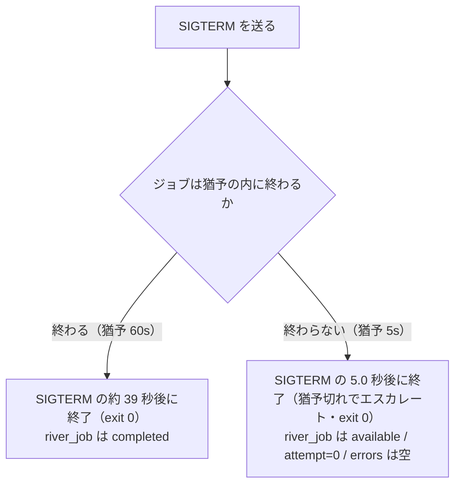
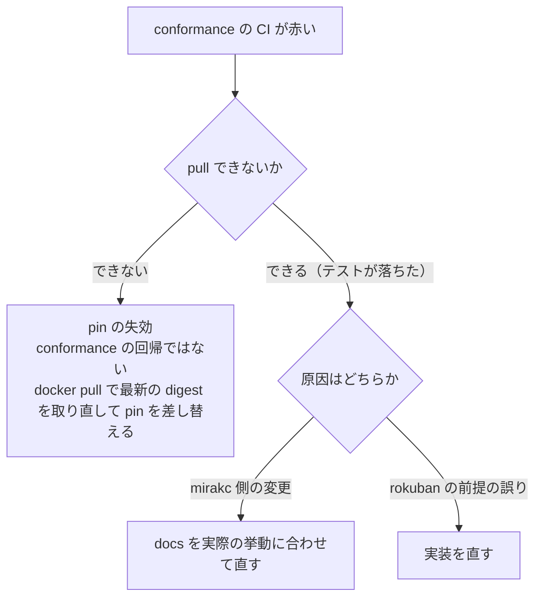

> [runbook.md](../runbook.md) の一部。索引から辿る。

## 開発時のテスト

開発時のテストには、docker compose で立てた postgres を使える。渡した URL が指す DB は直接使われず、そこからパッケージごとに別の DB を導出して使う。

テストで録画や原本 asset を作るときは、`internal/db/dbtest` の `Recording` と `OriginalAsset` を使う。

`docker compose up -d postgres` で立てた postgres をテストに使える（`scripts/init-test-db.sh` が `rokuban_test` を作る）。

```sh
export ROKUBAN_TEST_DATABASE_URL="postgres://rokuban:<password>@localhost:5432/rokuban_test?sslmode=disable"
go test ./...
```

**この URL が指す DB は直接使われない。** テスト用 DB の準備処理はここからパッケージごとの DB 名を導出する（`rokuban_test_api` 等）。プロセスごとに 1 回だけ DROP → CREATE → マイグレーションしてから、各テストは TRUNCATE で空にする。

パッケージが DB を共有しないので、`go test ./...` の並行実行で衝突しない（以前は advisory lock で直列化していた）。待たされた側がロック待ちのタイムアウトで落ちて CI が flaky になっていた。マイグレーションは、テストごとには走らず、プロセスごとに 1 回だけ走るので速い。

派生 DB は実行後も残る（次回の実行が DROP して作り直す）。失敗時の事後調査に使える。掃除したいときは次のコマンドを使う。

```sh
psql -h localhost -d postgres -tAc \
  "select datname from pg_database where datname like 'rokuban_test\_%'" |
  xargs -I{} psql -h localhost -d postgres -c 'DROP DATABASE {}'
```

ホストで既に PostgreSQL が 5432 を使っている場合は `.env` の `POSTGRES_PORT` を変えて、URL 側も合わせる。

mirakc を相手にするテストは `internal/mirakc/mirakctest` の fake を使う。fake はテストが置いた状態を返すだけで、録画の状態遷移などの mirakc の振る舞いは真似しない。実物の振る舞いは conformance テストだけが判定する。応答を止める・途中で切る・遅らせるテストと SSE のテストだけは、httptest のハンドラを手書きする。

<details><summary>根拠</summary>

- テスト用 DB の導出と TRUNCATE: `testutil.SetupDB`
- ロック待ちのタイムアウト: `lock_timeout`

</details>

### k8s の故障注入

強制終了した worker の仕事の再実行と、接続断の間に失った mirakc の schedule の再照合を、使い捨ての kind + KEDA suite で検査する。実デプロイのキュー・Pod・media volume を通すためである。

検査するのは、worker process を強制終了した後に River の JobRescuer が encode job を再実行することと、PostgreSQL 接続断の間に失った mirakc schedule の再照合である。どちらも単体テストや Compose smoke test では、実デプロイのキュー・Pod・media volume を通らない。そのため専用の使い捨て kind + KEDA suite を実行する。

```sh
./deploy/k8s/e2e/run.sh --faults
```

`run.sh` は `kind-rokuban-e2e` / `rokuban-e2e` を固定して使い、Docker daemon と kind / kubectl / kustomize 等を要求する。故障注入先はこの名前空間に限られ、本番 context や任意の既存クラスタは対象にしない。PostgreSQL test outage は DB Pod / data dir を削除せず Service endpoint を外して起こす。中断時は trap が selector と CronJob を戻す。

この動的 suite は encode source 作成・worker kill・saved timeout の経過待ちがあるため CI では回さない。CI は fault scripts の shellcheck と Kubernetes manifest schema を検査する。

`internal/worker` の recovery / deletion、DB 接続復旧、media asset 公開を変える PR の作者は、PR 前に `run.sh --faults` を回す。`deploy/k8s/e2e/faults/` を変える PR の作者も同じである。既定の `--faults` は F1〜F3 を走らせる。`E2E_FAULTS_ONLY=03` は F3 だけの判定に使えるが、一部実行なので成功時も終了コードは 2 になる。判定内容と注入の仕組みは [kind + KEDA harness](../../deploy/k8s/e2e/README.md) を参照。

### 実機に依存するテスト

実機（mirakc）や実録画データに依存するテストは、各自のローカルにだけ置く。

置き場は `test/integration/` である。環境依存性が大きいため追跡対象外（`.gitignore`）にしてある。

```sh
MIRAKC_URL=http://192.168.1.10:40772 \
ROKUBAN_TEST_TS_FILE=/path/to/clean.m2ts \
  go test ./test/integration/ -v
```

### SIGTERM の drain を実バイナリで確かめる

soft stop の猶予を変えたときに回す手順である。猶予より長く走るジョブはテストでは作れないので、猶予を跨ぐ側を実バイナリで測る。

`--soft-stop-timeout` を触ったときはこれを回す。**テストでは猶予より長く走るジョブを実際に走らせられない**（テストの所要が猶予そのものになるため、実際のテストは猶予を数秒に絞って両方向を見ている）。長い猶予（数十秒〜）を跨ぐ側は実バイナリでしか測れない。

<details><summary>根拠</summary>

- 猶予を数秒に絞って両方向を見るテスト: `TestServerCmd_SigtermDrainsRunningJob`

</details>

#### 遅延モックの mirakc

作るのは、ヘッダーだけ即返してボディを遅らせる mirakc である。ボディを遅らせるのは、mirakc クライアントのヘッダー待ちのタイムアウト（30 秒）が先に発動してしまうためである。全体の上限は HTTP クライアントのタイムアウトの 60 秒なので、40 秒のジョブはこの形でしか作れない。

遅延モックは次の通り（`python3 /tmp/mock-mirakc.py` で立てる。`/api/services` のボディだけを遅らせ、それ以外は空リストを即返す）。

```python
import http.server, time
DELAY = 40
class H(http.server.BaseHTTPRequestHandler):
    def do_GET(self):
        body = b"[]"
        self.send_response(200)
        self.send_header("Content-Type", "application/json")
        self.send_header("Content-Length", str(len(body)))
        self.end_headers(); self.wfile.flush()
        if self.path == "/api/services":
            time.sleep(DELAY)
        self.wfile.write(body)
    def log_message(self, *a): pass
http.server.ThreadingHTTPServer(("127.0.0.1", 40799), H).serve_forever()
```

<details><summary>根拠</summary>

- ヘッダー待ちのタイムアウト 30 秒: `ResponseHeaderTimeout`
- 全体の上限 60 秒: `http.Client.Timeout`

</details>

#### 使い捨ての config

config は、使い捨ての DB とこのモックを指すものを書く。

**`storage.media_dir` と `db.password` を省くと `migrate up` が起動時検査で落ちる**（password は空文字も拒否されるので、trust 認証でもダミーが要る）。

```sh
DB=rokuban_softstop
createdb -h localhost "$DB"
cat > /tmp/softstop-config.yml <<EOF
server:
  listen: "127.0.0.1:40773"
  allowed_hosts: []
db:
  host: localhost
  port: 5432
  user: $USER
  password: unused
  database: $DB
  sslmode: disable
mirakcs:
  - site: home
    url: http://127.0.0.1:40799
storage:
  media_dir: /tmp/softstop-media
worker:
  periodic_jobs: false
EOF
```

#### 起動して SIGTERM を送る

worker を起動し、ジョブが実行中になってから SIGTERM を送る。プロセスの終了までの時間と、ジョブの状態を見る。

**`bash` で回す。** `zsh` では `time wait` が何も出力しない。

```bash
DB=rokuban_softstop CFG=/tmp/softstop-config.yml
go build -o /tmp/rokuban ./cmd/rokuban
/tmp/rokuban migrate up --config $CFG
/tmp/rokuban enqueue epg-sync --site home --config $CFG
/tmp/rokuban server --roles worker --sites home --queues=epg \
  --soft-stop-timeout=60s --config $CFG & PID=$!
# **ジョブが実行中になるまで待つ。** 待たずに実行すると claim 前に畳んで終わり、
# 「完走した」も「打ち切られた」も観測できない（空虚な緑になる）
until psql -h localhost -d $DB -tAc \
  "select 1 from river_job where state = 'running'" | grep -q 1; do sleep 1; done
kill -TERM $PID; time wait $PID
# **kind で絞る。** epg_sync は完走時に ruler_pass を投入するので、絞らないと
# その available 行が「打ち切られた」ように見える
psql -h localhost -d $DB -tAc \
  "select state, attempt, errors::text from river_job where kind = 'epg_sync'"
```

#### モックの落とし穴

**モックの遅延は、mirakc クライアントの全体タイムアウトより短くする。** 上限は 60 秒である。

超えると 60s の側が `completed` にならず、`state` は猶予切れと同じ `available` になる（導出: `attempt=1` + `errors` あり、で見分けられる）。前のセッションが残した `DELAY=90` のモックが 40799 を使ったままで実際に起きた。モックを `&` で背景起動すると、ポートが埋まっていても気付きにくい。`OSError: Address already in use` の traceback を出して即死するだけである。実行する前に `lsof -nP -iTCP:40799` で確かめること。

<details><summary>根拠</summary>

- 全体タイムアウトの上限 60 秒: `internal/mirakc.shortRequestTimeout`

</details>

#### 結果の見方

猶予が 60 秒ならジョブの完走を待ってから終了し、5 秒なら猶予切れでエスカレートして終了する。既定の 5 秒でも 1 回測ること。



実測は次の通り（2026-09-05、river v0.47.0。`--soft-stop-timeout` を 60s と 5s で 1 回ずつ）。

| 猶予 | プロセスの終了 | `river_job` |
|---|---|---|
| 60s | SIGTERM の約 39 秒後（ジョブの完走を待った）・exit 0 | `completed` |
| 5s | SIGTERM の 5.0 秒後（猶予切れでエスカレート）・exit 0 | `available` / `attempt=0` / `errors` は空 |

既定は「何も設定しなかった人が SIGKILL されない」ことを根拠に選んである。Docker の既定猶予 10 秒・k8s の既定猶予 30 秒に収まっている必要がある（実測 5.06 秒）。既定で測るときは `--soft-stop-timeout` を argv から外すだけでよい。

60s の側が「約」なのは、`DELAY` がジョブの要求時刻から測られるのに対し、上の待ちが 1 秒刻みのポーリングだからである（その遅れぶん手前で終わる。実測 38.96 秒）。この側はプロセス側の待ちが固定値ではないことも同時に見ている（かつての `Stop(30 秒)` のままなら 30 秒で先に抜け、ジョブは一時的に `running` のまま残る）。ingest と encode は JobRescuer が回収する（encode は保存した timeout の期限後）。cm_detect は定期 reconcile が拾う。

2 発目の SIGTERM で強制終了できることも同じ形で確かめられる。上の `kill -TERM $PID` の直後にもう一度送ると、drain の途中でもプロセスが落ちる（実測: 2 発目の直後に exit 143）。1 発目のあとシグナルの登録を外していないと、猶予のあいだプロセスが Ctrl-C にも `kill -TERM` にも反応しなくなる。

#### mock では検出できない前提

mock では検出できない前提は、実物の mirakc コンテナに対する conformance テストが判定する。Docker が要る。

コマンドは `go test -tags conformance ./internal/mirakc/conformance/...`。reconciler の `overrides.contentPath` の既存 schedule への反映も対象である。これは mirakc が `GET /api/recording/schedules` で `options.contentPath` を POST した値のまま返すことに依存する。 `/events` の再送・録画中の Range 挙動も同様で、テストの mock は権威にならず、こちらが権威になる。症状と観測手段は [troubleshooting.md](troubleshooting.md) の該当項目。

<details><summary>根拠</summary>

- 実物の mirakc に対する判定の置き場: `internal/mirakc/conformance`

</details>

## mirakc のバージョンを上げる手順

**バージョンを上げるとは、main-debian タグのより新しい digest に pin を差し替えることである。** 番号付きリリースへ戻す判断は無い。

その理由は、rokuban がどのバージョンの mirakc イメージも自身で出荷せず、mirakc は運用者が用意するものだからである。`main` を pin し続けるのが恒常の形である。手順は次の通り。

1. `internal/mirakc/conformance/helpers_test.go` の `mirakcImage` / `mirakcVersion` を新しいバージョンに変える
2. `go test -tags conformance ./internal/mirakc/conformance/...` を回す
3. 落ちた項目があれば、まず mirakc 側の変更か rokuban の前提の誤りかを切り分ける。まず役に立つのは 2 つで、1 つは `docker run --entrypoint mirakc-arib <image> <subcommand> --help` で該当ツールのオプション・出力形式が変わっていないか見ること。もう 1 つは `docker logs` でコンテナ内の `mirakc` 自体のエラーを見ること
4. mirakc 側の変更なら、対応する docs（delegation.md / reconciler.md / ingest.md / watcher.md）の記述を実際の挙動に合わせて直す。rokuban 側の前提が誤っていたなら実装を直す
5. `internal/mirakc/conformance/` 配下のテストが引用している mirakc のバージョンの文言（`mirakc 4.0.0-dev.0 相当` 等）も同じ PR で書き換える

週次の `main-debian` conformance job が赤くなったら、ログに出た digest を使って上記の手順を実行する。緑でも、古い digest の prune を避けるため、ログの digest を pin に上げる契機として扱う。

赤くなった CI の切り分けは次の通り。



### digest が取れなくなったとき

pin した digest はいずれ取れなくなる。CI が pull できずに赤くなるのは pin の失効であり、conformance の回帰とは読まない。最新の digest を取り直して pin を差し替える。

出どころの `main-debian` タグはビルドのたびに上書きされる可動タグなので、古い digest は Docker Hub 側でタグ無し（untagged）manifest として prune されうる。そうなると CI は「pull できない」で赤くなる。この赤はテストの失敗ではない。まず `docker pull mirakc/mirakc:main-debian` で最新の digest を取り直す。digest は `docker inspect --format '{{index .RepoDigests 0}}' mirakc/mirakc:main-debian` で確認できる。確認できたら上記の手順で pin を差し替える。
