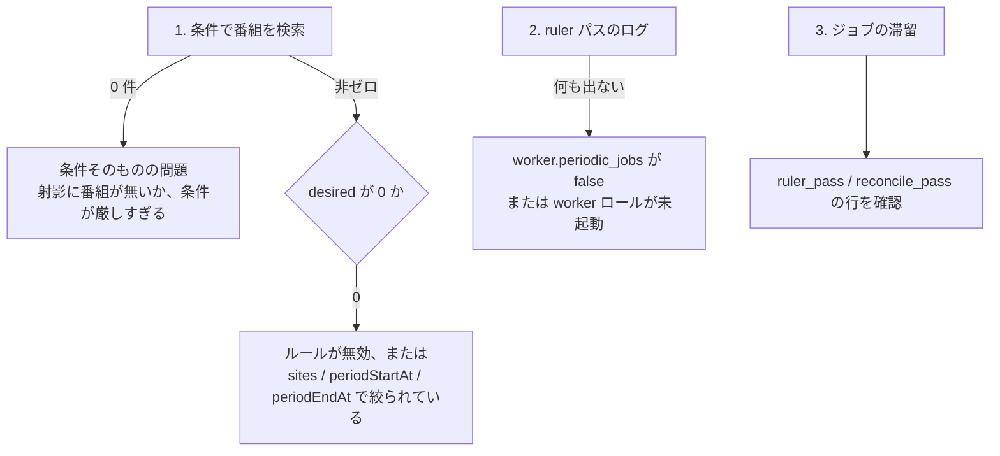

> [runbook.md](../runbook.md) の一部。索引から辿る。

## 詰まったとき

運用中に詰まったときの切り分けを、症状ごとの節に並べた。見出しの症状から引いて、書いてある順に確かめる。

### `media_dir` に書けない（`permission denied`）

録画が 1 件も無くても、起動直後にジョブがエラーになるのが、この症状の最初の形である。ヘルスチェックは通り続けるので、ジョブ側を見ないと気付けない。

ヘルスチェックの `/healthz` は、この症状でも通り続ける。

カタログの書き出しは起動時に 1 回走る定期ジョブなので、`media_dir` に書けない構成ではこれが最初に落ちる。ingest・サムネイル生成・エンコードも同じ理由で落ちるが、そちらは録画ができるまで走らない。

```sh
docker compose exec postgres psql -U rokuban -d rokuban -c \
  "SELECT id, kind, state, attempt, errors FROM river_job
     WHERE state IN ('retryable', 'discarded') ORDER BY id DESC LIMIT 5"
```

カタログ書き出しのジョブが retryable で次のエラーを持っていれば、この症状である。

```text
creating catalog dir: mkdir /mnt/media/catalog: permission denied
```

実測: 所有権を焼く前のイメージで `docker-compose.test.yml` を起動したときのジョブ行。このとき `/healthz` は `{"status":"ok"}` を返し続けた。

イメージは `/mnt/media` を実行ユーザー所有で焼いてある（uid/gid `65534` = `nobody:nogroup`）。**空の** named volume なら手当ては要らない。Docker の copy-up がマウント点の所有権を volume 側にコピーするためである。所有権を焼く前のイメージで起動しただけの volume も、書き込みが一度も無ければ空である。イメージを上げ直すだけで直る（実測: 空 volume を旧イメージでマウントすると `/mnt/media` は `root:root`。そのあと修正後イメージでマウントすると `nobody:nogroup` になり `touch` が通る）。

bind mount には copy-up が無いので、ホスト側を先に用意する（[setup.md](setup.md) の「録画の保存先」）。

<details>
<summary>根拠</summary>

- 起動時に 1 回走る定期ジョブ: `catalog_export`
- ジョブの状態を見る表: `river_job`

</details>

#### 既に中身がある volume の手当て

volume に既に中身がある場合は、イメージを上げ直しても所有権は変わらない。所有権を再帰的にかけ直す。

典型は、この不具合に当たって compose 側で `user: "0:0"` を当てて回避した volume である。root のまま録画やカタログを書いてしまっている。copy-up は空の volume にしか適用されない。

`chown` は `-R` でかける。`/mnt/media` だけを chown しても、配下の `catalog/` などが root 所有のまま残る。ディレクトリ作成は既存ディレクトリに対してエラーを返さないので、ファイル作成で同じ `permission denied` になる。

実測: root で `catalog/` を書いた volume では、非再帰 `chown` 後も `touch /mnt/media/catalog/probe` が `Permission denied` になった。`chown -R` 後は成功した。

```sh
docker compose down   # user: "0:0" を当てて回避していたら、この機に消す
docker run --rm --user 0 --entrypoint chown \
  -v <project>_media:/mnt/media <image> -R 65534:65534 /mnt/media
docker compose up -d
```

<details>
<summary>根拠</summary>

- 既存ディレクトリに対してエラーを返さないディレクトリ作成: `os.MkdirAll`（戻り値は `nil`）

</details>

### `ingest: transfer complete` が出ない

取り込み完了のログが出ないときは、ingest ジョブの状態とエラーを見て原因を切り分ける。転送が遅いだけなのか止まっているのかは、UI でも見分けられる。

```sh
docker compose exec postgres psql -U rokuban -d rokuban -c \
  "SELECT id, kind, state, attempt, errors FROM river_job WHERE kind='ingest' ORDER BY id DESC LIMIT 3"
```

- `errors` に **500** が出る。mirakc のイメージに `cat` / `dd` が無い（[setup.md](setup.md) の前提を参照）。HEAD だけ試すと成功するので騙されやすい
- `errors` に `context deadline exceeded` が出る。5 分の Work Timeout を超えた。通常は 4 分の slice で snooze するため、長い replay / 後処理や設定を調べる
- `state=retryable` のまま進まない。mirakc への到達性か、`media_dir` の書き込み権限（上記「`media_dir` に書けない」）を確認する

#### 取り込みの進捗の見分け方

転送が遅いだけなのか止まっているのかは、UI の取り込み状態で見分けられる。DB を直接見るなら、進捗表の更新時刻を見る。

録画一覧・録画詳細に取り込み状態が出る（「取り込み中 42%」/「取り込み中 1.2 GB（停滞）」/「取り込み待ち」。[frontend/recordings.md](../frontend/recordings.md)）。DB を直接見るなら次のクエリを使う。

```sh
docker compose exec postgres psql -U rokuban -d rokuban -c \
  "SELECT recording_id, written_bytes, expected_bytes, observed_at FROM recording_ingest_progress"
```

`observed_at` が現在時刻から離れていくなら、転送は止まっている。進捗の書き直しは最短 2 秒間隔である。バイトが流れたときにしか書かないので、極端に遅い回線ではこれより粗くなる。

`written_bytes` は temp replay で再開した試行なら末尾から続く。サイズ / ハッシュ不一致や record の cancel / fail で temp を捨てた次の試行だけは 0 に戻る（[recording/ingest.md](../recording/ingest.md) §5.3）。

#### rename 後の失敗

rename 後の親ディレクトリ fsync または DB commit の失敗では、temp が canonical へ移動済みになる。次の ingest は orphan 回収を待たず全量 pull を開始する。

残った canonical orphan は、再試行の rename で置き換わるか、報告されて人が調査・回復するまで残る。DB commit が成立して応答だけ失われた場合は、冪等性チェックで転送を省略する。replay 中は進捗行がまだ更新されないので、古い `observed_at` だけで worker 停止とは断定しない。

### エンコードが失敗している（理由を知りたい）

エンコードの失敗の理由と最後に試した時刻は API に出さないので、運用者は DB を直接見る。一覧・詳細のバッジは「エンコード失敗」までしか言わない。

バッジの文言は「`h264: エンコード失敗`」の形である。**失敗の理由と最後に試した時刻は API に出さない。** プロファイル名以上の内部情報を配らないためである。

```sh
docker compose exec postgres psql -U rokuban -d rokuban -c \
  "SELECT recording_id, profile, state, error, attempted_at FROM recording_encode_attempts ORDER BY attempted_at DESC LIMIT 20"
```

- `error` は ffmpeg の失敗メッセージを含む先頭 2000 バイトである。全文は worker のログにある
- `state='running'` のまま `attempted_at` が古い行は、worker が実行中に落ちた可能性がある。encode の回収処理は、enqueue 時に保存した締切の後で同じ job を再試行する。締切は `max(1 時間, 実尺 × profile rate)` で、実尺が不明な場合と締切のない旧 args は 12 時間になる。試行回数の列は、次の worker 起動時に死亡した試行を数える。締切を越えても状態が変わらない場合は、notifier の常駐 River client と worker のログを確認する
- `error` に `unknown encode profile` が出る。設定から消えたプロファイルである。`config.encode.profiles` に戻すか、その録画のエンコード方針から外す。表の判断は [schema/recordings/satellites.md](../schema/recordings/satellites.md) の `recording_encode_attempts` 節にある
  - 名前の規則に当たって改名した旧名は、設定に戻せない（[configuration/cut.md](../configuration/cut.md) §相対パスから読める名前）。方針から外すしかない

<details>
<summary>根拠</summary>

- error を切り詰める処理: `EncodeWorker`
- 締切後に再試行する回収処理: `JobRescuer`
- 締切を保存する場所: `args`
- 死亡した試行を数える列: `recording_encode_attempts.attempt_count`
- エンコード方針の保存先: `recording_encode_policy`

</details>

### encode が上限に達して止まった

encode の試行が上限に達して止まったときは、原因を直してから、同じ profile を指定して再要求する。原因を直す前に再要求しても、同じ失敗を繰り返すだけである。

試行回数が 25 の失敗行は、ドメイン上限に達した印である。この行がある間、ジョブはキャンセル扱いで終わり、reconcile や再投入では動かない。

1. `error` 列と worker のログで原因を特定して直す（profile 設定、ffmpeg、入力ファイルなど）。**原因を直す前に再要求しない。** 25 回分の失敗を繰り返すだけになる
2. 直したら `POST /api/recordings/{id}/encode-profiles` に同じ profile を指定して再要求する。API は指定 profile の `failed` 行を消して試行回数を 1 から数え直し、ヒントジョブを投入する。既に desired にある profile でも同じ
3. `running` の行は消えない。生きた試行の印なので、死んだ実行は締切後の回収処理が回収するのを待つ

<details>
<summary>根拠</summary>

- 上限の印になる行: `recording_encode_attempts` の `attempt_count` が 25 の `failed` 行
- ジョブをキャンセル扱いにする呼び出し: `river.JobCancel`
- 締切後に死んだ実行を回収する処理: `JobRescuer`

</details>

### EPG 同期が一度しか走らない

EPG 同期が最初の 1 回しか走らないときは、完了済みの同期ジョブの行を削除する。完了済みの行が一意キーを占有していることが原因である。

ジョブ表の `epg_sync` に完了済みの行が残っていて、一意キーを占有している。一意性の対象状態の設定を変更した場合に起きる（[データ層](../data.md) の「River のジョブ一意性の注意」）。

```sh
docker compose exec postgres psql -U rokuban -d rokuban -c \
  "DELETE FROM river_job WHERE kind='epg_sync' AND state='completed'"
```

`rokuban_epg_sync_last_success_timestamp_seconds` が更新され続けているかで監視できる。

<details>
<summary>根拠</summary>

- 完了済みの行が残るジョブ表: `river_job`
- 占有される一意キー: `unique_key`
- 変更すると起きる設定: `UniqueOpts.ByState`

</details>

### デプロイ直後、旧キューの残骸が `river_job` に残っている

デプロイ後に、旧キューの残骸を 1 回だけ掃除する。残しても新しいジョブの投入はブロックされないが、誰も引かない行が滞留メトリクスを汚し続けるため、残さない方がよい。

実測（このリリースノートを書くために実バイナリで確認済み。手順は下記）。site 単位のキュー名を修飾する変更（`ingest` → `ingest_<site>` 等。[運用](../operations.md) の「`worker.queues` に書く名前は論理名」参照）がある。`delete_reconcile` / `catalog_export` の `default` → `cleanup` への移設もある。どちらも、デプロイ前に投入済みだった旧キューの行を新キューへ自動移行しない。

#### 旧キューの残骸が投入を妨げない理由

現在の River 投影では、旧キューの残骸があっても新しいジョブの投入自体はブロックされない。一意キーがキュー名を含むため、旧キュー（キューを含まない鍵）と新キュー（キューを含む鍵）は別のハッシュになり衝突しない。

実際に確認した挙動は次の通り。

```console
$ rokuban enqueue reconcile-pass --site tokyo   # 旧バイナリで投入（旧キュー "reconciler"）
inserted job "reconcile-pass" (id=1) for site "tokyo"

$ rokuban enqueue reconcile-pass --site tokyo   # 新バイナリで同じ args を再投入
inserted job "reconcile-pass" (id=3) for site "tokyo"   # 別行として作られる。スキップされない
```

```sql
SELECT id, kind, queue, state FROM river_job ORDER BY id;
--  id |      kind      |      queue       |   state
-- ----+----------------+------------------+-----------
--   1 | reconcile_pass | reconciler       | available   ← 旧キューの残骸（誰も引かない）
--   3 | reconcile_pass | reconciler_tokyo | available   ← 新キュー。worker が正しく引く
```

<details>
<summary>根拠</summary>

- 一意キーにキュー名を含める設定: `UniqueOpts.ByQueue: true`

</details>

#### 旧キューの残骸の掃除

デプロイ後に 1 回だけ、次の DELETE で旧キューの残骸を消す。対象は未完了の 5 状態すべてで、旧キュー名の行と、default キューの旧 cleanup 系ジョブである。

**それでも掃除は推奨する。** 旧キューの残骸（上の `id=1`）は、どの worker も購読しないキューに永久に残り、`state='available'` のままで滞留メトリクスを汚し続ける。5 状態は、未完了を表す状態の定義と同じものである。`available` / `scheduled` / `retryable` だけでは不十分で、`pending` / `running` の残骸も取りこぼさない。

```sh
docker compose exec postgres psql -U rokuban -d rokuban -c \
  "DELETE FROM river_job
     WHERE state IN ('available', 'pending', 'retryable', 'running', 'scheduled')
       AND (
         queue IN ('ingest', 'epg', 'reconciler', 'watcher')
         OR (queue = 'default' AND kind IN ('delete_reconcile', 'catalog_export'))
       )"
```

上のコマンドを実際に実行して `id=1` の行が消え、`id=3` だけが残ることを確認済み（このリリースノートの検証手順）。

<details>
<summary>根拠</summary>

- 5 状態の定義: `internal/jobs/queue.go` の `pendingJobStates`

</details>

#### default を購読しない cleanup worker

キューの購読設定に default を含めない中央 cleanup worker を運用する構成では、default キューの残骸がどの worker にも購読されない。上の DELETE から、default キューの分岐を省略しないこと。

`worker.queues` に `default` を含めない中央 cleanup worker（例: `queues: [cleanup]`）を運用する構成を考える。**この構成では `default` キューの残骸はどの worker も購読しないままになる。** 残骸とは旧 `delete_reconcile` / `catalog_export` である。`queue = 'default'` の分岐を上の DELETE から省略しないこと。

「`default` は引き続き購読対象なので掃除不要」という判断は、`default` を含む `worker.queues` を書いている構成にしか当てはまらない。

### 番組リストが空

番組リストが空のときは、まず mirakc の番組一覧が空でないかを確かめる。0 件なら mirakc 側の問題で、mirakc の EPG が復帰すれば次の同期で戻る。

```sh
curl -s "$MIRAKC_URL/api/programs" | jq 'length'
```

0 なら mirakc 側の問題である。mirakc は再起動直後に EPG キャッシュを読み込み終えておらず、空を返すことがある。Rokuban は空レスポンスでプロジェクションを消さないようにしてあるので、mirakc の EPG が復帰すれば次の同期で戻る。

### ルールを作ったのに予約ができない

ルールを作ったのに予約ができないときは、条件のマッチ、ruler パスの実行、ジョブの滞留の順に、上から切り分ける。



```sh
# 1. 条件はマッチしているか（ruler と同じコンパイラ）
curl -s -X POST http://localhost:40773/api/programs/search \
  -H 'Content-Type: application/json' -d '<ルールと同じ条件>' | jq length

# 2. ruler パスは走ったか
docker compose logs rokuban | grep 'ruler: pass complete' | tail -3

# 3. ジョブが詰まっていないか
docker compose exec postgres psql -U rokuban -d rokuban -c \
  "SELECT id, kind, state, attempt, errors FROM river_job
     WHERE kind IN ('ruler_pass','reconcile_pass') ORDER BY id DESC LIMIT 5"
```

- 1 が 0 件のときは、条件そのものの問題である（射影に番組が無いか、条件が厳しすぎる）。検索は `enabled` を見ないので、ここが非ゼロでもルールが無効なら予約はできない
- 1 は非ゼロだが `desired` が 0 のときは、ルールが `enabled: false` か、`sites` / `periodStartAt` / `periodEndAt` で絞られている
- ログに何も出ないときは、`worker.periodic_jobs` が false（`rokuban enqueue ruler-pass`）か、worker ロールが起動していない
- **サーキットブレーカーは疑わなくてよい。** 止まるのは削除だけで、作成は続く

### 予約はあるのに mirakc に schedule が作られない

予約はあるのに mirakc に schedule が作られないときは、予約が除外か重複排除になっていないか、同期対象外になっていないかを見る。

```sh
curl -s http://localhost:40773/api/reservations | \
  jq '.[] | select(.title == "<番組名>") | {state, skip, dedupMatchRecordingId}'
```

- `skip: true` のときは、除外か重複排除である。`dedupMatchRecordingId` / `dedupSimilarity` が入っていれば重複排除で、相手の録画 ID と類似度まで説明できる。無ければユーザーの除外である
- `state: "orphaned"` のときは、同期対象外である。放送済み番組の予約は GC まで残る
- どちらでもないときは、`rokuban_reconcile_pending_diff{action="create"}` が減らないなら mirakc が作成を拒否している。`reconciler: creating schedule` の ERROR を見る

<details>
<summary>根拠</summary>

- ユーザーの除外を表す行: `program_intents.action = 'skip'`

</details>

### `overrides.contentPath` を明示指定したのに既存 schedule のパスが変わらない・毎パス再作成される

contentPath を明示指定したのに既存 schedule のパスが変わらない、または毎パス再作成されるときは、mirakc が contentPath を POST した値のまま返しているかを疑う。

`overrides.contentPath` の反映（[reconciler.md](../recording/reconciler.md) §3.2「予約オプションの差分反映」）は、mirakc の挙動に依存する。mirakc が `GET /api/recording/schedules` で `options.contentPath` を POST した値のまま返す（正規化しない）ことが前提である。

この依存は、適合テストが mirakc 4.0.0-dev.0 相当に対して判定している。本番の mirakc がこの pin と異なるバージョンなら、この前提はそのバージョンで改めて確認する（下記の症状はその手がかり）。

```sh
curl -s http://localhost:9090/api/v1/query --data-urlencode \
  'query=rokuban_reconcile_pending_diff{action="update"}' | jq
```

- `action="update"` がゼロに戻らず、`reconciler: recreated schedule` の Info ログで同じ `program_id` に対して `reason=content_path` が反復していないか見る。反復しているなら、mirakc が contentPath をそのまま返していない。これは比較が収束せず毎パス DELETE→POST になっていることを意味する。実 mirakc に対して `GET /api/recording/schedules` の応答を直接見て、POST した `contentPath` と一致するか確認する
- `action="update_deferred"` 側に出ているだけなら、`scheduled` 以外の状態（録画中等）で allowlist に見送られているだけで異常ではない

<details>
<summary>根拠</summary>

- 前提を mirakc 4.0.0-dev.0 相当に対して判定する適合テスト: `internal/mirakc/conformance` の `TestConformance/ContentPathRoundTrip`

</details>

### `/api/capacity/overages` が常に空

チューナー射影が空だと、容量超過の判定は何も主張しない設計である。そのため、空配列からは超過が無いのか判定が無効なのかを区別できない。

空配列を見たら、射影が動いているかを先に確認する。

```sh
curl -s http://localhost:40773/metrics |
  grep -E 'rokuban_tuners_projected|rokuban_tuner_sync_last_success|rokuban_capacity_overages'
# rokuban_tuners_projected{site="default"} 4
# rokuban_tuner_sync_last_success_timestamp_seconds{site="default"} 1.7695e+09
# rokuban_capacity_overages{site="default"} 0
```

```sh
docker compose exec postgres psql -U rokuban -d rokuban -c \
  "SELECT tuner_index, name, types, is_available, is_fault, observed_at FROM tuner_sync ORDER BY tuner_index"
```

- 行が無い、または `rokuban_tuners_projected` が 0 のときは、射影が空である。判定は無効
- `tuner sync: mirakc returned no projectable tuners, skipping sweep` が出るときは、mirakc が空を返したのでスイープを見送った。既存の射影は消さない
- `tuner sync: skipping tuner with unknown channel type` が出るときは、未知の種別を持つチューナーを丸ごと捨てた。容量 cap(A) が 1 本少なくなるので、警告が過剰に出る側にずれる。見逃す側にはずれない
- 行はあるが `is_available = false` / `is_fault = true` が全台のときは、判定する。射影された事実であって、我々の無知ではない

<details>
<summary>根拠</summary>

- 射影が空のとき何も主張しない対象: `tuner_sync`
- 1 本少なくなる容量: `cap(A)`

</details>

### ドロップ統計で音声 PID が `other` に見える

ドロップ統計で音声 PID が other に見えても、ドロップ統計そのものは正しい。これは「誤読しやすい正常」で、分類の限界であってドロップではない。

`pidType` が `other` の音声 PID（LATM AAC）は、分類ライブラリの音声判定の値域に従っているだけである。自前の種別表は作らない方針である。ISDB の GR/BS/CS は MPEG-2 AAC が主なので、実害は 4K/8K に限られると見込んでいる。観測したら「分類の限界」であってドロップではない。1 行で足せるので、観測したら報告する。

<details>
<summary>根拠</summary>

- 音声 PID の stream_type: `stream_type = 0x11`、MPEG-2 AAC は `0x0F`
- 分類ライブラリと音声判定: `gots` の `IsAudioContent()`
- 作らない自前の表: `stream_type`

</details>

### 録画が開始直後に失敗する

録画開始の数秒後に録画が失敗するときは、チューナーの競合を疑い、mirakc のチューナーの使用状況を確認する。

`recording.failed` の `need-rescheduling` が録画開始の数秒後に出る場合、チューナーの競合が濃厚である。

```sh
curl -s "$MIRAKC_URL/api/tuners" | jq '.[] | {name, isAvailable, users}'
```

EPGStation のライブ視聴・EPG 収集・別チャンネルの録画がチューナーを取っていないか確認する。
