# データベーススキーマ v1（索引）

PostgreSQL のテーブル構成と、スキーマ設計の判断をまとめる。本文は分割先のファイルにあり、節番号は分割前のままなので、この表から該当ファイルを引く。最終形で切る対象は永続資産に限り、導出テーブルの列は、それを書くコードと同じ PR で決める。

| 節 | 内容 | ファイル |
|---|---|---|
| §1 | 設計原則（desired/observed 分離・mirakc 固有概念の隔離・tombstone・サイトスコープ・導出値と事実の分離・行の寿命・型の規律） | [schema/principles.md](schema/principles.md) |
| §3 §3.5 §3.6 §3.7 | desired: `reservations` / `program_intents`・`program_overrides` / `circuit_breakers` / `program_snapshots` | [schema/reservations.md](schema/reservations.md) |
| §4 | observed: `schedule_sync` / `schedule_sync_snapshots` / `ruler_pass_snapshots` / `record_sweep_snapshots` | [schema/schedule-sync.md](schema/schedule-sync.md) |
| §5 | 永続資産: `recordings`（行の作られ方・status・ごみ箱・重複防止）/ `never_scheduled_events` / `recording_purge_requests` / `encoded_asset_removal_requests` | [schema/recordings/history.md](schema/recordings/history.md) |
| §5 | 永続資産（衛星表）: `recording_encode_policy` / `recording_ingest_progress` / `recording_encode_attempts` | [schema/recordings/satellites.md](schema/recordings/satellites.md) |
| §5 | 永続資産（衛星表）: `recording_cm_detections` / `recording_cm_attempts` / `cm_logos` / `cm_logo_areas` | [schema/recordings/satellites.md](schema/recordings/satellites.md) |
| §5 | 永続資産（衛星表）: `recording_chapter_ownership` / `recording_chapter_spans` / `recording_playback_positions` / `recording_watched` | [schema/recordings/satellites.md](schema/recordings/satellites.md) |
| §6 | 永続資産: `media_assets` / `media_asset_cuts` / `media_asset_thumbnail_seeks` | [schema/recordings/media-assets.md](schema/recordings/media-assets.md) |
| §7 | observed: `record_sync` / `drop_stats` / `drop_positions` | [schema/record-sync.md](schema/record-sync.md) |
| §8 | jsonb ドキュメント形式（base / overrides / quality_events の形） | [schema/jsonb.md](schema/jsonb.md) |
| §9 §9.5 | 使い捨てキャッシュ: `epg_services` / `epg_programs` / `tuner_sync` | [schema/projections.md](schema/projections.md) |
| — | 永続資産: `rules` と条件の子テーブル 6 つ | [schema/rules.md](schema/rules.md) |
| §10 | マイグレーションの権威の所在 | [schema/future.md](schema/future.md) |

コードコメントの「schema.md §3.5」などは、この表で該当ファイルを引ける。設計根拠は [データ層](data.md)・[メディアストレージ](storage.md)、および [invariants.md](invariants.md) にある。

**「最終形で切る」の対象は永続資産に限る。** 永続資産は `recordings` / `media_assets` / `drop_stats` / `rules` である。導出テーブル（`reservations` / `*_sync` / 射影）の列は、それを書くコードと同じ PR で決める。導出テーブルまで先に固めて churn を生んだ経緯は不変条件 11 にある（[invariants.md](invariants.md) §11）。

根拠

- 本文の分割先: `docs/schema/`。§5 / §6 はさらに `docs/schema/recordings/` に割ってある

## 永続資産の衛星表

永続資産の衛星表は、録画履歴かメディアアセットを指す小さな表である。主なものは録画履歴の節（§5）にあり、メディアアセットの節（§6）にもある。行の存在そのものが 1 つの事実を表すものが多い。

録画履歴の節の主なものは、原本保持ポリシーの凍結、転送の途中経過、即時完全削除の要求、外したエンコード結果の要求、encode ジョブの直近の試行状態、世帯共有の再開位置、世帯共有の視聴済み印などである。

根拠

- 原本保持ポリシーの凍結: `recording_encode_policy`
- 転送の途中経過: `recording_ingest_progress`
- 即時完全削除の要求: `recording_purge_requests`
- 外したエンコード結果の要求: `encoded_asset_removal_requests`
- encode ジョブの直近の試行状態: `recording_encode_attempts`
- 世帯共有の再開位置: `recording_playback_positions`
- 世帯共有の視聴済み印: `recording_watched`

メディアアセットの節には、実体無しの観測を持つ `missing_media_assets` などがある。放送地平を超えて残す schedule 欠測の `never_scheduled_events` は衛星表ではない。保持猶予に 30 日を足した期間で刈る（`retention_grace + 30日`）。

## 2. 全体図

意図・上書き・予約は互いに対応付けず、三者とも共通の番組キーで番組スナップショットに結びつく。意図がスキップで上書きの無い番組は予約行を持たないので、予約と意図は常に 1 対 1 になるとは限らない。

```mermaid
erDiagram
    rules ||--o{ rule_text_matches : "rule_id"
    rules ||--o{ rule_services : "rule_id"
    rules ||--o{ rule_channel_types : "rule_id"
    rules ||--o{ rule_genres : "rule_id"
    rules ||--o{ rule_times : "rule_id"
    rules ||--o{ rule_sites : "rule_id"
    rules ||--o{ reservations : "rule_id (勝者ルール)"
    program_snapshots ||--o| reservations : "(site, program_id) FK, ON DELETE CASCADE"
    program_snapshots ||--o| program_intents : "(site, program_id) FK, ON DELETE CASCADE"
    program_snapshots ||--o| program_overrides : "(site, program_id) FK, ON DELETE CASCADE"
    recordings ||--o{ record_sync : "recording_id (observed)"
    recordings ||--o{ media_assets : "recording_id"
    recordings ||--o| recording_encode_policy : "recording_id (凍結。衛星表、ON DELETE CASCADE)"
    recordings ||--o| recording_ingest_progress : "recording_id (転送中。衛星表)"
    recordings ||--o| recording_purge_requests : "recording_id (即時削除の要求。衛星表)"
    recordings ||--o{ encoded_asset_removal_requests : "recording_id (外した版の要求。衛星表)"
    recordings ||--o{ recording_encode_attempts : "recording_id (encode 試行の観測。衛星表)"
    recordings ||--o| recording_playback_positions : "recording_id (世帯共有の再開位置。衛星表)"
    recordings ||--o| recording_watched : "recording_id (世帯共有の視聴済み印。衛星表)"
    media_assets ||--o{ drop_stats : "media_asset_id"
    media_assets ||--o{ drop_positions : "media_asset_id"
    media_assets ||--o| missing_media_assets : "media_asset_id (実体無しの観測。衛星表)"
```

### 表の分類

表は、ユーザーが書く・ruler が導出する desired、mirakc の観測、永続資産の 3 つに分かれる。desired は、ルールと条件の子表（ユーザーが書く永続資産）、番組単位のユーザー意図と上書き（永続）、予約（ruler が導出）である。番組の事実のスナップショットは、EPG 射影から複製した放送の寿命を持つキャッシュで、別に分類する。

observed は mirakc の観測で、短命で使い捨てである。schedule 全量観測のコミット鮮度だけを持つサイト単位のマーカーも、この仲間に入る。永続資産は録画履歴・メディアアセット・ドロップ統計である。

根拠

- desired: `rules` + 子表 / `program_intents` + `program_overrides` / `reservations`
- 番組の事実のスナップショット: `program_snapshots`（Phase 1。§3.7）
- observed: `schedule_sync` / `record_sync`。全量観測マーカーは `schedule_sync_snapshots`
- 永続資産: `recordings` / `media_assets` / `drop_stats`

### 衛星表の読み方

衛星表の多くは、行の存在が 1 つの事実を表す。実体無しの観測は、削除の走査が毎回作り直せるので、メディアアセットの列にしない（不変条件 13）。行が表す事実は、凍結済み、原本を転送中、完全削除の要求、版を外した、encode ジョブが実行中か失敗、のいずれかである。世帯共有の再開位置と視聴済み印は、API が書くユーザーの状態で、値を持つ。

実体無しの観測は削除 reconcile が毎パス作り直す。この表を根拠に自動削除する経路は無い（[storage/missing-assets.md](storage/missing-assets.md)）。同じ削除 reconcile の帳簿でも、まだメディアアセットに無いファイルを追う表は、外部キーも衛星関係も持たないので、この図には現れない。

根拠

- 凍結済み（行の存在）: `recording_encode_policy`。`recordings` の削除で CASCADE
- 原本を転送中（コミットで消える）: `recording_ingest_progress`
- ごみ箱の猶予を待たない完全削除の要求（復元は DELETE）: `recording_purge_requests`
- ユーザーがそのエンコード結果を外した（削除の確定か足し直しで DELETE）: `encoded_asset_removal_requests`
- encode ジョブが running か failed（完了で消える）: `recording_encode_attempts`
- API が書く世帯共有の状態: `recording_playback_positions`（再開位置）/ `recording_watched`（視聴済み印）
- 直前の走査で実体ファイルを観測できなかった: `missing_media_assets`（`media_assets` を指す衛星表）
- まだ `media_assets` に無いファイルを追う表: `orphan_files`

### 番組キーによる結びつき

意図・上書きと予約は、互いには外部キーで対応しない。三者とも、共通の番組キーで番組スナップショットへの外部キーを持ち、削除は連動する（Phase 1）。

意図がスキップで、かつ上書きが無い番組は、予約に行を持たない。上書きがあればスキップでも行は残り、切り離された予約として保持する（§3.5）。そのため、予約と意図が常に 1 対 1 になるとは限らない。

根拠

- 共通の番組キー: `(site, program_id)`。`program_snapshots` への FK は `ON DELETE CASCADE`
- 対応しない表: `program_intents` / `program_overrides` と `reservations`
- 行を持たない条件: 意図が skip で上書きが無い番組（`reservations` に行なし）
- 残る条件: `program_overrides` があれば skip でも行は残る（detached）

### 勝者ルールだけを記録する

予約が持つルールの参照は、勝者ルールだけである。負けたルールは記録しない。勝者以外は base に何も供給しないので、削除も無効化も予約を変えない（[schema/rules.md](schema/rules.md)）。

マイグレーションの一覧は `internal/db/migrations/` が権威である。

根拠

- 勝者ルールを持つ列: `reservations.rule_id`
- 予約へ供給されるもの: `base`

