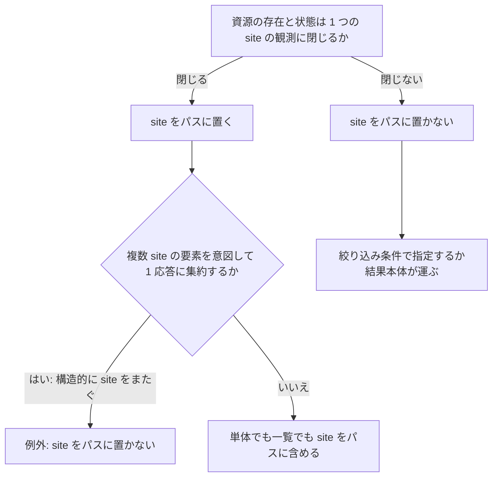

> [docs/schema.md](../schema.md)（索引）の分割本文。節番号は分割前のまま（§1）。

## 1. 設計原則

スキーマは、望ましい状態と観測した状態、導出できる値と不可逆な事実、書き手や寿命の違う行を、別の表や列に分ける。mirakc 固有の概念は短命な導出状態に閉じ込め、コミットは DB 行の存在で決める。以下に 10 の原則を置く。

### 原則 1: desired / observed の分離

k8s の spec/status と同じ形で、あるべき姿と観測結果を別の表に置く。reconciler と watcher は、この 2 つの差分だけを見る。

- あるべき姿は予約の表で、ruler と api が書く
- 観測結果は schedule と record の同期表で、mirakc の観測を写す。短命で使い捨てである
- 全量観測のコミット鮮度は、スナップショット表が持つマーカーだけで表す

根拠

- あるべき姿: `reservations`
- 観測結果: `schedule_sync` / `record_sync`
- 鮮度のマーカー: `schedule_sync_snapshots`

### 原則 2: mirakc 固有概念の隔離

不変条件 7 に従い、mirakc の形をしてよいのは短命な導出状態だけにする。永続テーブルには mirakc の ID や enum を構造として持ち込まない。

mirakc の record id は同期表にだけ存在し、同期表から永続側への片方向ポインタを張る。スナップショット表は mirakc の予約を写さず、全量観測の鮮度だけを持つ。

#### 例外: 品質イベント

録画失敗の理由などの品質イベントは、履歴として価値があるので保持する。構造化した列にはせず、jsonb の自由形式ログとして持つ。システムのロジックは、その中身に依存しない。

#### 未解決: 同一 mirakc を共有する複数の Rokuban

未解決: 同一の mirakc を複数の Rokuban が共有すると、自分の予約を見分ける tag が衝突し、互いの予約と録画を自分のものと誤認して消し合う。

設定で tag を焼き分けても解消しない。mirakc の schedule は programId が主キーなので、複数の Rokuban が同一番組を取り合う問題が tag の手前で残る。対処は「複数共有を支持するか」の判定基準を決めてからにする。

根拠

- mirakc の形をしてよい導出状態: `reservations` の base、`schedule_sync`、`record_sync`
- スナップショット表は予約を写さない: `schedule_sync_snapshots`
- 永続テーブル: `recordings` / `media_assets` / `drop_stats`
- 永続側へのポインタ: `record_sync.recording_id`
- 品質イベントの例: `recording.failed`
- tag の衝突: `IsOurs` が見る `program:{id}`

### 原則 3: コミット = DB 行

不変条件 3 に従い、ファイルの公開はメディア資産の行の INSERT で決める。rename のアトミック性には依存しない。

根拠

- 公開の単位: `media_assets` 行の INSERT

### 原則 4: tombstone

物理削除の後もメタデータの行は残す。ドロップ統計・録画履歴・重複排除は、削除後も機能する。

### 原則 5: 識別子と存在のスコープ

mirakc が指すものは 2 種類ある。record id はインスタンス単位で採番される識別子で、取り違えると別の録画を指す。programId は放送そのものから合成される値で、存在のスコープしか持たない。この区別が、site 列と API の資源同定を決める。

#### 識別子の 2 種類

record id を取り違えると、別の録画を指してしまう。programId は放送から合成される値で、サービスの id も同じく放送から合成される。どちらも存在のスコープしか持たず、取り違えても別の番組にはならず、その site の EPG に無ければ 404 になるだけである（[ruler](../recording/ruler.md)「サイトの扱い」）。

同一放送なら全 site で同一の programId になる、という前提がある。これは Mirakurun の ID 合成規則（NID・SID・eventId から合成する）からの演繹で、複数サイトの実機で測った結果ではない（未検証）。式は [reservations.md](reservations.md)「チャンネル識別はスナップショットする」にある。ruler の N 予約と重複排除は、この前提の上に成り立つ。

根拠

- programId と同型の値: `Service.id`
- 重複排除の実装: `internal/store/pgstore/rulerpass.go`

#### 放送イベントの同定

同一サービス内の event_id は、永続的な一意性を持たない。ARIB TR-B14 第四編 8.2.1 が保証する範囲は、イベント終了から 24 時間である。そのため、録画の永続的な放送イベント identity には開始時刻を加える。

根拠

- 同一サービス内で一意とは限らない列: `event_id`
- 永続的な放送イベント identity: `recordings` の `(site, network_id, service_id, event_id, program_start_at)`

#### site 列

設定は、多拠点が現実化したら mirakc の一覧で互換拡張すると定めている（[設定](../configuration.md)）。その際のスキーマ波及を避けるため、mirakc を指すすべてのテーブルに site 列を最初から持たせる。理由は、識別子が曖昧だからではない。行の存在と状態が site ごとの観測だからである（同じ放送でも、A では録画中、B では未予約になりうる）。

site は設定ファイルで定義するサイト名で、各要素に必須であり、既定値は無い。サイトのレジストリは設定であり、DB に sites テーブルは作らない。

site を持つのは、mirakc の観測と番組に由来する表である。予約・同期表・録画・EPG プロジェクションなどが当たる。メディア資産とドロップ統計は中央ストレージの記録なので持たない。

検索も同じ観測側に立つ。検索結果の programId は存在のスコープなので、同一放送が複数 site でマッチすれば、行ごとに site を持つ複数行を返し、畳まない。

根拠

- 設定の拡張先: `mirakcs:` リスト
- サイト名の定義: `config.mirakcs[].site`
- site を持つ表: `reservations` / `schedule_sync` / `record_sync` / `recordings` / EPG プロジェクションなど
- site を持たない表: `media_assets` / `drop_stats`
- 列: `site`

#### API の資源同定

資源の同定は、その資源の存在と状態が特定 1 つの site の観測に閉じているかで決める（[api/rest.md](../api/rest.md) §エンドポイント設計の規約）。判定の入力は、その資源があるべき形である。現行の実装が返すレスポンス形は入力にしない。現状の形を根拠に現状のパスを正当化すると、判定基準が何も条件しなくなる。件数（単体か一覧か）と資源の種類名も、判定に使わない。

集合を返す操作も同じ基準に従う。要素の存在が site に閉じるなら、一覧でも site をパスに置く。mirakc の record や、その site の EPG に存在するかで決まる programId がこれに当たる。番組・意図・上書きを指すパスは、site と programId を含む形を取る。TanStack Query のクエリキーと SSE の invalidate 単位も、サイトごとに階層化される。

同じ種類の資源でも、実体が site に閉じない場合は、種類名では判定せず、その資源だけを site 無しにする。site 非依存で動くワーカーが書く行がこれに当たる。

**唯一の例外は、複数 site の要素を意図して 1 応答に集約する場合である。** api が全 site を扱えること（不変条件 1）を使った明示的な設計で、要素自体は site に閉じていても、site をパスに置かない。例外に入れてよいのは、その資源が構造的に site をまたぐ場合に限る。運用上あると便利、は理由にならない。検索がこの例外に当たる理由と未解決は、[api/rest.md](../api/rest.md)「録画一覧」の「既定は全サイトを返す」と同じ節に書いてある。

site に束縛されない資源は、単体か一覧かによらず site をパスに固定しない。絞り込み条件として指定するか、結果本体が運ぶ。導出行は書き込みの宛先にしない。意図と上書きは、番組の site と programId を自身のキーとして書く。導出行の書き手は ruler だけである。例外は、ルール削除 API の同期削除 1 本だけである（[reservations.md](reservations.md) §3 冒頭）。

根拠

- 番組・意図・上書きを指すパス: `/api/sites/{site}/programs/{programId}`
- 例外に当たるエンドポイント: `GET /api/reservations` / `GET /api/capacity/overages`
- site に束縛されない資源: rokuban 採番の `recordings.id`
- 書き込みの宛先にしない導出行: `reservations`
- 意図と上書きのキー: `program_intents` / `program_overrides` の `(site, programId)`

### 原則 6: 導出値と不可逆な事実を分ける

不変条件 9 に従い、毎パス再計算される値と、二度と再取得できない事実を、1 つの列に同居させない。混同は列だけでなく、identity・式・適用の瞬間にも起きる。実例と失敗事例は [invariants.md](../invariants.md) §9 にある。

唯一の例外は、サーキットブレーカーの表である（§3.6）。「誰かが確認した」は再取得できないので、このスキーマで唯一の意図的な非導出状態になる。

根拠

- 例外: `circuit_breakers`

### 原則 7: 意味を持たない行を作らない

不変条件 10 に従い、行の存在そのものを主張として使う。空の上書きは「行が無い」で表し、停止していないブレーカーも「行が無い」で表す。詳細は [invariants.md](../invariants.md) §10 にある。

#### 述語の共有

同じ述語を 2 箇所目のクエリファイルに書く前に、view にする。述語の一致をコメント（「揃えること」）で守る方法は、CHECK で禁止するより弱い。view なら乖離が表現不可能になる。

ただし、述語の正体が再計算できない観測なら、view では導出せず、専用表の行の存在にする。一度きりの事実は、毎回作り直せる派生値ではないからである。表自体は GC で有限の寿命を持つが、行が持つ値は観測結果であり、式では導けない。

根拠

- 空の上書きは行が無い: `program_overrides`
- 停止していないブレーカーは行が無い: `circuit_breakers`
- view にした述語: `program_investments`
- 専用表の行の存在にした観測: `never_scheduled_events`

### 原則 8: 型の規律

状態は text 型と CHECK で、時刻は timestamptz で、ID は IDENTITY の bigint で持つ。クエリ軸の列は型付きカラムにし、可変・詳細のペイロードだけを jsonb にする。PostgreSQL 15 以上を前提とする。

状態を Postgres の enum 型にしない理由は、マイグレーションが面倒で利点が薄いからである。15 以上を前提にするのは、一意制約の NULL 同一視が 15 で導入されたからである。

#### jsonb を許す条件

jsonb を許すのは、そのテーブル自身のロジックが中身を一切使わない不透明なペイロードのときだけである（[録画エンジン](../recording.md) §4.2「jsonb を許す条件」）。内容でクエリするなら、型付き列にする。

不透明なペイロードには、内容を検査する CHECK も置かない。「クエリはしないが制約はする」という中途半端な状態を作らない。同じ理由で、マージは SQL で行わず、Go 側で型付きに行う。

まだやりがちな違反は、録画の品質イベント（jsonb）の中身への EXISTS を、core ロジックの WHERE 軸にすることである。欠測の判定軸は専用表の行の存在にし、録画の表は観測された試行だけを持つ（[recordings/history.md](recordings/history.md)「never_scheduled_events」）。

根拠

- 不透明なペイロード: `jsonb`
- 状態: `text` + `CHECK`
- 時刻: `timestamptz`
- ID: `bigint GENERATED ALWAYS AS IDENTITY`
- 15 以上が要る理由: `UNIQUE NULLS NOT DISTINCT`
- SQL のマージ演算: `||` / `- keys`
- 違反の例: `recordings.quality_events` への `EXISTS(jsonb_array_elements(...))`
- 欠測の判定軸: `never_scheduled_events`

### 原則 9: 表は行の寿命で割る

不変条件 12 に従い、1 表は 1 つの書き手と 1 つの寿命を持つ。原則 6 は列の粒度なので、行に寿命が混ざるケースを網に掛けられない。予約の表に 3 つの寿命が同居していた実例は [invariants.md](../invariants.md) §12 にある。

新しい列を足すときは、「この値はこの行と同時に生まれて同時に死ぬか」を問う。違えば、番組の site と program_id を主キーにした別表にする。

#### 永続表に対する盲点

この寿命チェックは永続表では何も検出しない（不変条件 13）。録画の表は、試行の帰結の観測だけを持つ脊椎とする。脊椎（watcher と reconciler）以外のループが書く状態は、録画の id を外部キーに持つ衛星表に置く。メディア資産がその形である。境界（削除と置換の時刻の列は衛星に出せない等）は [invariants.md](../invariants.md) §13 にある。

根拠

- 3 つの寿命が同居していた表: `reservations`
- 別表の主キー: `(site, program_id)`
- 脊椎の表: `recordings`
- 衛星表の外部キー: `recording_id`
- 衛星表の例: `media_assets`
- 衛星に出せない列: `deleted_at` / `superseded_at`

### 原則 10: 判定基準を先に書く

不変条件 11 に従い、形を固定する前に、その形を決める判定基準を書く。導出テーブルの列は、書き手のコードと同じ PR で決める。新しい列を足すときは「これを書くコードは今あるか」を問う。判定基準が後から来て、予約の列が 5 回変更された経緯は [invariants.md](../invariants.md) §11 にある。

将来への先払いは高い方から行う。site 列（安い方、DB）は v1 から先払いしていたが、API の資源同定（高い方）は後から判定基準を書いた（[api/rest.md](../api/rest.md) §エンドポイント設計の規約）。現行のパスが全エンドポイントでこの基準に適合しているとは限らない（同節の未解決を参照）。

根拠

- 5 回変更された表: `reservations`
- 先払いした列: `site`

